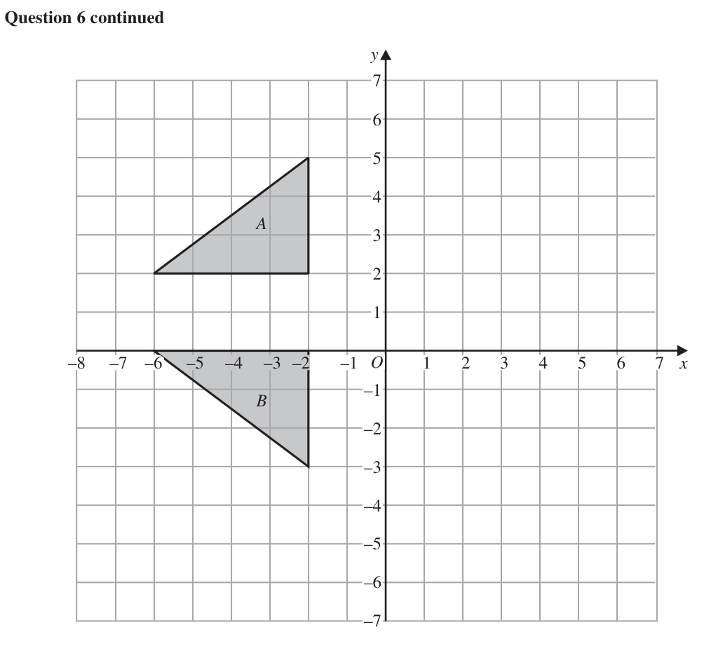
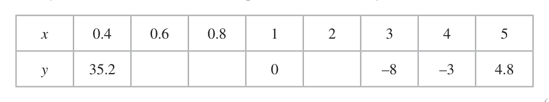
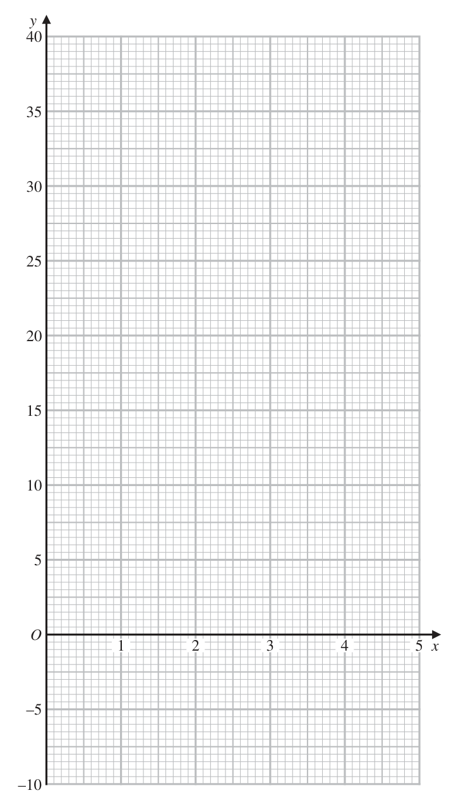

# 4MB1/02R — 2023-06 (official extraction)

> schema `syllabai.official-paper-questions/0.2` · paper_id `pearson-edexcel:international-gcse:mathematics-b:4mb1:2023-06:4MB1/02R` · qp sha256 `4af9561ce7c0feaa…` · extraction is the disclosed baseline (ADR-039)

## Question 1 (8 marks)

On Monday, Tisam buys 600 watermelons in India to sell in the UK. On Tuesday, Tisam splits 200 of the watermelons each into 8 slices. She sells each slice for £0.60 She sells all the slices by the end of the day.

### 1(a) [2]

Work out how much money Tisam receives from the sale of the watermelon slices on Tuesday. On Wednesday, Tisam sells 60% of the remaining watermelons. She sells them for £1.40 each.

**Mark scheme answer**

> 200 × 8 × 0.60 2 M1 correct method.
> [£] 960 A1 cao (cas)

- **(2)** 200 × 8 × 0.60 2 M1 correct method.

### 1(b) [2]

Work out how much money Tisam receives from the sale of the watermelons on Wednesday. Tisam gives away for free the watermelons she has left. Tisam bought the 600 watermelons at a cost of 90 rupees each. The cost to send the watermelons to the UK was £700 Using an exchange rate of 1 rupee = £0.0097

**Mark scheme answer**

> (600 – 200) × 0.6 [= 240] 2 M1 correct method to find 60% of remaining melons.
> [“240” × 1.40] [£] 336 A1 cao (cas)

- **(2)** (600 – 200) × 0.6 [= 240] 2 M1 correct method to find 60% of remaining melons.

### 1(c) [4]

calculate the percentage profit, to one decimal place, that Tisam makes from the sale of the watermelons.

**Mark scheme answer**

> eg 90 × 0.0097 eg “960” ÷ 0.0097[=98969(.0..)] 4 M1 Conversion of any value in Rupees to £ or any value
> [= 0.873 or 87.3p] in £ to Rupees.
> or “336” ÷ 0.0097[=34639(.1..)]
> or 600 × 90 × 0.0097 or “960 + 336” ÷ 0.0097[=133608(.2..)] ft their answer to part (a) and (b) if appropriate.
> [= 523.8(0)] or 700 ÷ 0.0097[=72164(.9..)]
> eg eg M1 dep on the previous method mark.
> “960” + “336” – “523.8(0)” – 700 “98969”+ “34639” – “72164” – 600 × 90 Method to find profit, that uses the cost of the melons, the
> [=1296 – 1223.8(0) [=133608(.2…) – 126164(.9…) sales calculated in parts (a) and (b) and the exchange rate.
> =72.2(0)] = 7443.29…] The transport cost can be omitted but must not be used
> with an inconsistent currency.
> May be seen within calculation for % profit.
> ft their answer to part (a) and their answer to part (b) but
> working must be shown.
> Note: use of inconsistent currencies is not permitted for
> the award of this mark.
> "72.2(0)" " 7443.29 " M1 dep on the previous method mark.
> eg ×100 eg ×100 Method to find percentage profit that uses the cost of the
> "523.80"+ 700 “72164” + 600 × 90
> "72.2(0)" " 7443.29 " melons, the sales calculated in parts (a) and (b), the
> or [= 0.059] or [= 0.059] transport cost and the exchange rate.
> "523.80"+ 700 “72164” + 600 × 90 ft their answer to part (a) and their answer to part (b) but
> "960"+ "336" ”98969” + “34639” working must be shown.
> or [= 1.059] or [= 1.059]
> "523.80"+ 700 “72164” + 600 × 90 Note: use of inconsistent currencies is not permitted for
> "960"+ "336" ”98969” + “34639” the award of this mark.
> or ×100[= 105.9] or ×100[= 105.9]
> "523.80"+ 700 “72164” + 600 × 90
> 5.9 (%) A1 AWRT 5.9 (cas)
> SC B2 for a profit of 147.4(%)
> Total 8 marks
> Qu Working Answer Mark Notes

- **(4)** eg 90 × 0.0097 eg “960” ÷ 0.0097[=98969(.0..)] 4 M1 Conversion of any value in Rupees to £ or any value

## Question 2 (4 marks)

E is the universal set and A, B and C are three sets. E = { p, q, r, s, t, u } A = { p, r, t } B = { q, r, s }

### 2(a) [1]

List the elements of the set A ∩ Bʹ Given that n(C ) = 3 n(A ∩ C ) = 2 n(B ∩ C ) = 1

**Mark scheme answer**

> p, t 1 B1 cao (cas) (elements can be stated in either order)
> Note: do not accept p, t seen in the correct region on
> a Venn diagram.

- **(1)** p, t 1 B1 cao (cas) (elements can be stated in either order)

### 2(b) [3]

list all the possible sets C

**Mark scheme answer**

> {p, q, t} 3 B3 (cas)for all 4 correct sets listed with no incorrect
> {p, s, t} sets listed.
> {p, r, u}
> {r, t, u} B2 for at least 3 correct sets listed with at most 2
> incorrect sets listed.
> or for 2 correct sets listed with no incorrect sets
> listed.
> B1 for at least 1 correct set listed with at most 4
> incorrect sets listed.
> Note:
> Elements can be stated in either order
> Sets need not be in brackets but must be clearly
> distinguishable.
> Treat a number in the set as an element of the set.
> Ignore any repeats of elements or sets.
> Total 4 marks
> Qu Working Answer Mark Notes

- **(3)** {p, q, t} 3 B3 (cas)for all 4 correct sets listed with no incorrect

## Question 3 (8 marks)
### 3(a) [2]

Solve 4x – 3 ≤ 11 y+8

**Mark scheme answer**

> 4x ≤ 11 + 3 2 M1 for adding 3 to both sides or dividing throughout by 4 (in an inequality or equation) as a first step
> or
> Showing 3.5 oe as the critical value
> (can be written as x = 3.5 oe)
> 7
> x≤ A1 (cas) accept equivalent fraction or decimal (eg. or 3.5) do not isw x = 3.5
> 2

- **(2)** 4x ≤ 11 + 3 2 M1 for adding 3 to both sides or dividing throughout by 4 (in an inequality or equation) as a first step

### 3(b) [2]

Solve ≥3

**Mark scheme answer**

> y 2 M1 for a correct start by either
> y + 8 ≥ 3 × 2 or ≥3–4
> 2 removing the fraction by multiplying throughout by 2
> or isolating the y term by splitting the fraction and subtracting 4
> (in an inequality or equation)
> y y ≥ –2 A1 (cas) do not isw y = –2

- **(2)** y 2 M1 for a correct start by either

### 3(c) [4]

On the grid opposite, by drawing suitable straight lines and using shading, show the region R that satisfies the inequalities 4x – 3 ≤ 11 y+8 ≥3 y ≤ 2x + 1 Label the region R y –5 –4 –3 –2 –1 O 1 2 3 4 5 x –1 –2 –3 –4 –5 for a spare grid if you need to redraw your inequalities. Only use this grid if you need to redraw your inequalities. y –5 –4 –3 –2 –1 O 1 2 3 4 5 x –1 –2 –3 –4 –5

> 🖼 crop required: grid (qp.pdf p.8)

**Mark scheme answer**

> 1 4 B1ft Vertical line through 3.5 on x axis ft answer to (a)
> B1ft Horizontal line through –2 on y axis ft answer to (b)
> 8 B1 y = 2 x + 1 drawn through point (0, 1) and (2,5)
> B1cao dep on all previous three marks awarded in this part.
> Correct region indicated with either this region shaded or labelled as R or the outside of the region
> shaded (lines must be sufficient in length to define the region).
> Note: Condone any mix of solid and/or dashed lines
> R Max score of B2 if more than 3 lines are drawn.
> –

- **(4)** 1 4 B1ft Vertical line through 3.5 on x axis ft answer to (a)

## Question 4 (7 marks)

x = 4.2 × 105 and y = 6 × 10–100

### 4(a) [1]

Write x as an ordinary number.

**Mark scheme answer**

> 420 000 1 B1cao
> 82 − 2.52 + 3.52 − 2.52 ⎢ = 231 + 6 = 7.60 + 2.45⎥

- **(1)** 420 000 1 B1cao

### 4(b) [2]

Calculate xy Give your answer in standard form. x

**Mark scheme answer**

> 252 ×10 –96 or 25.2 ×10 –95 or 2.52 ×10n or 2 M1 n is any integer or 1 ≤ k < 10
> k ×10 –94 126
> Allow for 25.2
> or for a correct answer in any form
> 2.52 ×10 –94 A1 cao (cas)

- **(2)** 252 ×10 –96 or 25.2 ×10 –95 or 2.52 ×10n or 2 M1 n is any integer or 1 ≤ k < 10

### 4(c) [2]

Calculate y Give your answer in standard form.

**Mark scheme answer**

> –2 O 2 4 x
> –
> –
> 4 Total 8 marks
> Qu Working Answer Mark Notes
> Allow for 0.7
> or for a correct answer in any form
> 7 ×10104 A1 cao (cas)

- **(2)** –2 O 2 4 x

### 4(d) [2]

Using the values of x and y above, write the following in order of size x y x y Start with the smallest value.

**Mark scheme answer**

> 2 B2 Fully correct (cas)
> y, y , x, x
> B1 order reversed ie x, x , y , y
> or both y values before both x values
> eg y, y , x, x
> or √y after y and √x before x
> eg x , y, y , x
> Can be written numerically
> eg y as 6 ×10−100 or 2.45 ×10−50
> x as 4.2 ×105 or 648(.074)
> Accept y as 0 and y as 0 but do not accept 0 for y
> in their ordered list
> Total 7 marks
> Qu Working Answer Mark Notes

- **(2)** 2 B2 Fully correct (cas)

## Question 5 (7 marks)

B Diagram NOT accurately drawn 8m 3.5 m 2.5 m A D C Figure 1 Figure 1 shows a framework of wooden beams, with ADC a straight line. AB = 8 m BC = 3.5 m BD = 2.5 m ∠ADB = 90°

### 5(a)(i) [3]

Calculate, giving your answer to the nearest metre, the length of AC

### 5(a)(ii) [2]

Calculate, giving your answer to one decimal place, the size, in degrees, of ∠BAD A fourth beam DE is added to the framework. The point E lies on AB and is such that DE is perpendicular to AB

**Mark scheme answer**

> 2.5 sin A sin 90 2.5sin 90
> sin ∠BAD = or = oe eg sin A =
> 8 2.5 8
> "7.60" ft their AD from part a(i) (either from a correct method or
> or cos ∠BAD = (=0.94 or 0.95)
> 8 be clearly labelled)
> 2.5
> or tan ∠BAD = (=0.32 or 0.33)
> "7.60"
> or 2.52 = 82 + "7.60"2 − 2 × 8 × "7.60"cos A oe
> Note: if find ∠ABD then must do 90 – “∠ABD ” for M1
> 18.2 A1 (cas) awrt 18.2

- **(2)** 2.5 sin A sin 90 2.5sin 90

### 5(b) [2]

Calculate the length, in metres to 3 significant figures, of DE

**Mark scheme answer**

> DE 2 M1 Forming an equation in DE.
> eg sin"18.2" = [(DE=) “7.6” sin “18.2”]
> "7.60" Using trigonometry
> DE
> or sin ( 90 − "18.2") = [(DE=) 2.5 sin (90 – “18.2”) ]
> 2.5
> DE
> or cos(90 − "18.2") = [(DE=) “7.6” cos(90 − "18.2")
> "7.60"
> DE
> or cos"18.2" = [(DE=) 2.5 cos “18.2” ]
> 2.5
> ⎡ 1 ⎤
> 1 1 ⎢ × “7.60” × 2.5 ⎥ or Areas of triangles
> or × 8 × DE = × “7.60” × 2.5 oe ⎢( DE = ) 2 ⎥ (Area of triangle ABD = 9.499177596)
> 2 2
> ⎢ ×8 ⎥
> ⎣ 2 ⎦
> 2.5 8 ⎡ 2.5 × "7.60" ⎤ or Similar Triangles
> or = oe ⎢( DE = ) ⎥⎦
> DE "7.60" ⎣ 8 ft their ∠BAD and AD (either from a correct method or be
> clearly labelled)
> Note: if find AE or EB first then proceed to find DE for M1
> 2.37 5 231
> A1 (cas) awrt 2.37 or 2.38 or for an exact value of
> Total 7 marks
> Qu Working Answer Mark Notes

- **(2)** DE 2 M1 Forming an equation in DE.

## Question 6 (11 marks)

Triangles A and B are shown on the grid opposite.

### 6(a) [2]

Describe fully the single transformation that maps triangle A onto triangle B Triangle A is transformed to triangle C under the translation

**Mark scheme answer**

> Reflection 2 B1 for reflection (Allow reflaction, refraction, reflation)
> B0 if multiple transformations listed. Multiple transformations are when more than one of
> (in line) reflection, rotation (turn), translation (move), enlargement(stretch/squash) is stated eg centre
> y=1 (0, 0), SF 1, 180, a vector or matrix do not imply multiple transformations
> B1 for y = 1

- **(2)** Reflection 2 B1 for reflection (Allow reflaction, refraction, reflation)

### 6(b) [2]

On the grid, draw and label triangle C Triangle A is transformed to triangle D under the transformation with the matrix M where 0 1 M= 1 0

**Mark scheme answer**

> Correct 2 B2 Fully correct triangle
> triangle C B1 For 2 of 3 points correct and joined to make a triangle or for 3 correct points stated (could be
> drawn written as a matrix) or plotted correctly but not joined to make a triangle
> Correct coordinate (–3, –6), (–7 , –6) and (–3 , –3)
> Award 2 marks for correct triangle drawn and labelled, irrespective of working in working space.

- **(2)** Correct 2 B2 Fully correct triangle

### 6(c) [3]

On the grid, draw and label triangle D Triangle B is transformed to triangle E by a rotation of 180° about the point (0, 1)

**Mark scheme answer**

> ⎛ 0 1 ⎞⎛ −2 −2 −6 ⎞ 3 M1 For intention to multiply the correct way, can be implied by writing in the correct order or
> ⎜ ⎟⎜ ⎟ oe one correct point stated or (1 point correctly plotted)
> ⎝ 1 0 ⎠⎝ 2 5 2⎠
> Points can be in any order
> ⎛ 2 5 2⎞ M1 Correct result for their matrix multiplication (or 2 points correctly plotted)
> ⎜ ⎟ oe Points can be in any order
> ⎝ −2 −2 −6 ⎠
> Correct A1 (cas) cao
> triangle D Correct coordinates (2 , –2), (5 , –2) and (2 , –6)
> drawn Award 3 marks for correct triangle drawn and labelled, irrespective of working in working space.

- **(3)** ⎛ 0 1 ⎞⎛ −2 −2 −6 ⎞ 3 M1 For intention to multiply the correct way, can be implied by writing in the correct order or

### 6(d) [2]

On the grid, draw and label triangle E

**Mark scheme answer**

> 2 M1 Triangle B rotated by 180° about any centre
> or for 2 of 3 points correct and joined to make a triangle or for 3 correct points stated (could be
> written as a matrix) or plotted correctly but not joined to make a triangle
> Correct A1(cas) cao
> triangle E Correct coordinates (2 , 2), (6 , 2) and (2 , 5)
> drawn Award 2 marks for correct triangle drawn and labelled, irrespective of working in working space.

- **(2)** 2 M1 Triangle B rotated by 180° about any centre

### 6(e) [2]

Find the matrix which represents the transformation that maps triangle A onto triangle E y A –8 –7 –6 –5 –4 –3 –2 –1 O 1 2 3 4 5 6 7 x –1 B –2 –3 –4 –5 –6 –7 for a spare grid if you need to redraw your triangles. Only use this grid if you need to redraw your triangles. y A –8 –7 –6 –5 –4 –3 –2 –1 O 1 2 3 4 5 6 7 x –1 B –2 –3 –4 –5 –6 –7

**Mark scheme answer**

> ⎛ −1 0 ⎞ 2 B2 (cas) Correct matrix given
> ⎜ ⎟ B1 for stating transformation as reflection in y axis/x = 0
> ⎝ 0 1⎠ or matrix with 3 correct elements (in the correct positions)
> Qu Working Answer Mark Notes
> Total 11 marks
> Qu Working Answer Mark Notes

- **(2)** ⎛ −1 0 ⎞ 2 B2 (cas) Correct matrix given

## Question 7 (7 marks)

y Diagram NOT accurately drawn B C E D A O x Figure 2 → 8.5 → 15 Figure 2 shows a quadrilateral ABCD with AB = and AC = 4.5 The diagonals AC and BD meet at the point E →

### 7(a) [1]

Find as a column vector BC The point E has coordinates (6, 4) Given that AE : AC = 3 : 5

**Mark scheme answer**

> ⎛ 6.5 ⎞ 1 B1 cao
> ⎜ ⎟ isw if find the magnitude
> ⎝ 0.5 ⎠

- **(1)** ⎛ 6.5 ⎞ 1 B1 cao

### 7(b) [3]

find the coordinates of the point A Given that ABCD is a kite,

**Mark scheme answer**

> 15 ⎡ 9 ⎤ 3 M1 correct use of ratio on AC to find either AE or EC
> ( AE = ) 53 × ⎛⎜⎝ 5 ⎞⎟⎠ ⎢= ⎛⎜⎝ 3 ⎞⎟⎠⎥ oe
> ⎣ ⎦
> 2 ⎛15 ⎞ ⎡ ⎛ 6 ⎞ ⎤
> ( )
> EC = × ⎜ ⎟ ⎢ = ⎜ ⎟ ⎥ oe
> 5 ⎝ 5 ⎠ ⎣ ⎝ 2 ⎠⎦
> 6 9 M1 correct method to find position vector of A
> (OA = OE + EA = ) ⎛⎜⎝ 4 ⎞⎟⎠ − "⎛⎜⎝ 3 ⎞⎟⎠ " oe
> or follow through their AE or EC
> 6 6 15 If following through their AE or EC then this must be from a
> (OA = OE + EC + CA = ) ⎛⎜⎝ 4 ⎠⎞⎟ + "⎝⎛⎜ 2 ⎠⎞⎟ "− ⎝⎜⎛ 5 ⎠⎞⎟ oe correct method or be clearly labelled as AE or EC
> (–3, 1) ⎛ −3 ⎞
> A1 cao (cas) Allow ⎜ ⎟
> ⎝1⎠
> SCB2 for one correct value
> ⎛ 0.375 ⎞
> SCB1 ⎜ ⎟ oe
> ⎝ 2.125 ⎠
> Qu Working Answer Mark Notes
> ⎢⎣ AC = 5 ⎥⎦ [ − x + 6 :15] [ 4 − y : 5]
> 6− x 3 4− y 3
> = or = − x + 6 = 9 or 4− y =3
> 15 5 5
> x = −3 or y =1 x = −3 or y =1 M1dep for solving either equation to find
> either the x coordinate or the y coordinate
> (–3, 1) A1 cao
> ALT 1 Eqn of line and distance

- **(3)** 15 ⎡ 9 ⎤ 3 M1 correct use of ratio on AC to find either AE or EC

### 7(c) [3]

find the coordinates of the point D

**Mark scheme answer**

> ⎛ −3 ⎞ ⎛ 8.5 ⎞ ⎡ ⎛ 5.5 ⎞ ⎤ ⎛ −8.5 ⎞ ⎛ 3 ⎞ ⎛ 6 ⎞ ⎡ ⎛ 0.5 ⎞ ⎤ 3 M1 for a correct start to find OB or BE
> ( )
> OB = “⎜ ⎟ ” + ⎜
> ⎝1⎠
> ⎟ ⎢= ⎜ ⎟⎥
> ⎝ 4.5 ⎠ ⎣ ⎝ 5.5 ⎠ ⎦
> ( )
> BE = ⎜ ⎟ + " ⎜ ⎟ "+ ⎜ ⎟ ⎢ = ⎜ ⎟⎥
> ⎝ −4.5 ⎠ ⎝ −1⎠ ⎝ 4 ⎠ ⎣ ⎝ −1.5 ⎠ ⎦ (may be embedded within working or on
> diagram) follow through their OA
> ⎣ (
> ⎡OD = OE + BO + OE = ⎤
> ⎦ ) ⎡OD = OE + BE = ⎤
> ⎣ ⎦
> M1 dep on the previous mark
> fully correct method to find position vector
> ⎛ 6 ⎞ ⎛ ⎛ −5.5 ⎞ ⎛ 6 ⎞ ⎞ ⎡ ⎛ 6.5 ⎞ ⎤ ⎛ 6 ⎞ ⎛ 0.5 ⎞ ⎡ ⎛ 6.5 ⎞ ⎤ of D
> ⎜ ⎟ + ⎜ “⎜ ⎟” + ⎜ ⎟ ⎟ ⎢ = ⎜ ⎟ ⎥ ⎜ ⎟ + "⎜ ⎟ " ⎢= ⎜ ⎟⎥ follow through their OA
> ⎝ 4 ⎠ ⎝ ⎝ −5.5 ⎠ ⎝ 4 ⎠ ⎠ ⎣ ⎝ 2.5 ⎠ ⎦ ⎝ 4 ⎠ ⎝ −1.5 ⎠ ⎣ ⎝ 2.5 ⎠ ⎦
> follow through their OB or BE
> or or
> ⎣ (
> ⎡OD = OB + 2 × BO + OE = ⎤
> ⎦ ) ( )
> ⎡OD = OE + EB + 2 × BE = ⎤
> ⎣ ⎦
> ⎛ ⎛ 6 ⎞ ⎛ −0.5 ⎞ ⎞ ⎛ 0.5 ⎞ ⎡ ⎛ 6.5 ⎞ ⎤ If following through their OB or BE then
> ⎛ 5.5 ⎞ ⎛ ⎛ −5.5 ⎞ ⎛ 6 ⎞ ⎞ ⎡ ⎛ 6.5 ⎞ ⎤ ⎜ ⎜ ⎟ + "⎜ "⎟ + 2 × "⎜ ⎟ " ⎢= ⎜ ⎟⎥
> "⎜ ⎟ "+ 2 × ⎜ " ⎜ ⎟ "+ ⎜ ⎟ ⎟ ⎢ = ⎜ ⎟ ⎥ ⎟ this must be from a correct method
> ⎝ ⎝ 4 ⎠ ⎝ 1.5 ⎠ ⎠ ⎝ −1.5 ⎠ ⎣ ⎝ 2.5 ⎠ ⎦
> ⎝ 5.5 ⎠ ⎝ ⎝ −5.5 ⎠ ⎝ 4 ⎠ ⎠ ⎣ ⎝ 2.5 ⎠ ⎦
> or may go via A or may go via A
> eg ⎡OD = OA + ( AO + OE ) + ( BO + OE ) = ⎤ eg ⎡OD = OA + ( AO + OE ) + BE = ⎤
> ⎣ ⎦ ⎣ ⎦
> ⎛ −3 ⎞ ⎛ ⎛ 3 ⎞ ⎛ 6 ⎞ ⎞ ⎛ ⎛ −5.5 ⎞ ⎛ 6 ⎞ ⎞ ⎡ ⎛ 6.5 ⎞ ⎤ ⎛ −3 ⎞ ⎛ ⎛ 3 ⎞ ⎛ 6 ⎞ ⎞ ⎛ 0.5 ⎞ ⎡ ⎛ 6.5 ⎞ ⎤
> " ⎜ ⎟ "+ ⎜ " ⎜ ⎟ "+ ⎜ ⎟ ⎟ + ⎜ " ⎜ ⎟ "+ ⎜ ⎟ ⎟ ⎢ = ⎜ ⎟ ⎥ " ⎜ ⎟ "+ ⎜ " ⎜ ⎟ "+ ⎜ ⎟ ⎟ + " ⎜ ⎟ " ⎢= ⎜ ⎟⎥
> ⎝ 1 ⎠ ⎝ ⎝ −1⎠ ⎝ 4 ⎠ ⎠ ⎝ ⎝ −5.5 ⎠ ⎝ 4 ⎠ ⎠ ⎣ ⎝ 2.5 ⎠ ⎦ 1 −1
> ⎝ ⎠ ⎝ ⎝ ⎠ ⎝ ⎠⎠ 4 ⎝ −1.5 ⎠ ⎣ ⎝ 2.5 ⎠ ⎦
> ⎣ (
> or ⎡OD = OA + AB + 2 × BO + OE = ⎤
> ⎦ ) or ⎡OD = OA + AB + 2 × BE = ⎤
> ⎣ ⎦
> ⎛ −3 ⎞ ⎛ 8.5 ⎞ ⎛ ⎛ −5.5 ⎞ ⎛ 6 ⎞ ⎞ ⎡ ⎛ 6.5 ⎞ ⎤ ⎛ −3 ⎞ ⎛ 8.5 ⎞ ⎛ 0.5 ⎞ ⎡ ⎛ 6.5 ⎞ ⎤
> " ⎜ ⎟ "+ ⎜ ⎟ + 2 × ⎜ " ⎜ ⎟ "+ ⎜ ⎟ ⎟ ⎢ = ⎜ ⎟ ⎥ " ⎜ ⎟ "+ ⎜ ⎟ + 2 × "⎜ ⎟ " ⎢= ⎜ ⎟⎥
> ⎝ 1 ⎠ ⎝ 4.5 ⎠ ⎝ ⎝ −5.5 ⎠ ⎝ 4 ⎠ ⎠ ⎣ ⎝ 2.5 ⎠ ⎦ ⎝ 1 ⎠ ⎝ 4.5 ⎠ ⎝ −1.5 ⎠ ⎣ ⎝ 2.5 ⎠ ⎦
> or use midpoint formula
> x + 5.5 y + 5.5
> or D = 6 and D =4
> 2
> ( 6.5, 2.5) ⎛ 6.5 ⎞
> A1 cao (cas) AO for ⎜ ⎟
> ⎝ 2.5 ⎠
> SCB2 for one correct value
> Total 7 marks
> These are some alternative methods that can be used for Question 7b and 7c
> Qu Working Answer Mark Notes
> ALT 1 Ratio
> 2
> ( x − 6) + ( y − 4) = 2.5 oe y = −3x + 22 distance of AD or DE
> Distance AD
> ( x + 3)2 + ( y − 1)2 = 92.5 oe
> 2
> eg ( x − 6) + (−3x + 22 − 4) = 2.5 M1dep for a correct equation for the x or y
> coordinate of D
> ( x + 3)2 + (−3x + 22 − 1)2 = 92.5
> (6.5, 2.5) A1 cao
> ALT 2 Pythagoras and Trig
> tan −1 BAG = [⇒ BAG = 27.8(9...)] (where AGB is a right angle)
> 8.5
> ⎡ 370 ⎤ M1dep for distance AB and for angle DAH
> [ AB =] 8.52 + 4.52 ⎢= ⎥ and (where angle AHD is a right angle)
> ⎣ 2 ⎦
> ⎛ 4.5 ⎞ ⎛ −1 ⎛ 4.5 ⎞ −1 ⎛ 3 ⎞ ⎞
> tan −1 ⎜ ⎟ − 2 × ⎜ tan ⎜ ⎟ − tan ⎜ ⎟ ⎟ [⇒ DAH = 8.97(2...)]
> ⎝ 8.5 ⎠ ⎝ ⎝ 8.5 ⎠ ⎝ 9 ⎠⎠
> (6.5, 2.5) A1 cao
> Qu Working Answer Mark Notes

- **(3)** ⎛ −3 ⎞ ⎛ 8.5 ⎞ ⎡ ⎛ 5.5 ⎞ ⎤ ⎛ −8.5 ⎞ ⎛ 3 ⎞ ⎛ 6 ⎞ ⎡ ⎛ 0.5 ⎞ ⎤ 3 M1 for a correct start to find OB or BE

## Question 8 (13 marks)

The function f is such that where x ≠ 0 f:x ↦ 1 – x

### 8(a) [1]

State a value that cannot be in the range of the function f

**Mark scheme answer**

> 1 1 B1 cao allow f ≠ 1, y ≠ 1 or suitable interval notation
> Condone f = 1, f:x=1, y = 1
> but do not allow x ≠ 1or x = 1.
> If they give the correct answer ignore any reference to x = 0 or x ≠ 0
> eg. (–∞,1)∪ (1,∞)

- **(1)** 1 1 B1 cao allow f ≠ 1, y ≠ 1 or suitable interval notation

### 8(b) [4]

Solve 16 f(x) = x + 8

**Mark scheme answer**

> ⎛ 1⎞ 4 M1 Set 16 f(x) = x + 8 to give a correct equation in one unknown.
> 16 ⎜1 – ⎟ = x + 8 Only condone missing brackets if they’re recovered
> ⎝ x⎠
> 16 x − 16 = x 2 + 8 x M1 multiply out brackets and multiply through by x (condone one sign error for this mark)
> M1 indep method to solve their three term quadratic.
> If factorising must expand to give at least two correct terms for their quadratic.
> x 2 − 8x + 16 = 0 ⇒ ( x − 4) 2 = 0 If using quadratic formula then must be correct substitution (condone missing brackets
> around the b in b2)
> If using completing the square, allow one error
> 4 A1 cao (cas) (ignore any given y value)
> Qu Working Answer Mark Notes

- **(4)** ⎛ 1⎞ 4 M1 Set 16 f(x) = x + 8 to give a correct equation in one unknown.

### 8(c) [6]

Show that ff(x) = f –1(x)

**Mark scheme answer**

> 1 or
> x –1
> –1 or1 6 M1 form a correct expression for ff (x)
> 1– x 1−
> 1 x −1
> 1– x –1
> x x x
> 1 1 x −1− x
> 1− −1 − M1 correct expression as a single fraction with 1 − as the denominator or
> x or x or x x
> 1 1 x −1 x −1
> 1− 1− correct expression as a single fraction with as denominator with a
> x x x x
> −x −1 x x –1 – x x –1 x x single fraction on numerator and denominator
> or 2 or × or or − or 1 –
> x –x x x –1 x –1 x –1 x –1 x –1 1
> or correct expression with no nested fractions but not – or
> x –1 1 –x
> implies previous method mark with no errors seen up to this point
> 1 1 A1 (wr) correct simplified result for ff(x) must gain both M marks with no
> – or errors seen when finding composite function
> x –1 1 –x
> 1 xy – y = –1 or y – xy = 1 M1 using y = f(x) and rearrange so that all x terms isolated on M2 for
> – = y – 1 or xy – x = –1 one side in a correct equation.
> x
> 1 x and y may be exchanged in these expressions (then all y – =x–1
> or = 1 – y or x – xy = 1 terms isolated on one side) y
> x or
> 1 y (x – 1) = –1 or y (1 – x) = 1 M1 for taking x out as a common factor within an equation
> – = x or x (y – 1) = –1 (dep on two terms in x) which must be seen and not implied =1–x
> y –1 or correct expression for x in terms of y. y
> 1 x and y may be exchanged in these expressions (for taking y
> or = x or x (1 – y) = 1 out as a common factor within an equation (dep on two terms
> 1− y in y) which must be seen and not implied.
> 1 1 A1 (wr) correct simplified result for f–1(x) must be in terms of x with no errors
> – or seen when finding inverse function. Dep on the third and fourth method marks
> x –1 1 –x
> being awarded. If previous A marked gained must either state this is equal to
> previous result or be an identical expression. isw for A1 but not for A2

- **(6)** 1 or

### 8(d) [1]

State a value that cannot be in the domain of the function f –1

**Mark scheme answer**

> 1 1 B1 ft follow through their answer to part (a) or their inverse in (c) provided
> this is a rational function with a linear denominator.

- **(1)** 1 1 B1 ft follow through their answer to part (a) or their inverse in (c) provided

### 8(e) [1]

Evaluate fff(2)

**Mark scheme answer**

> 2 1 B1 cao
> Total 13 marks
> Qu Working Answer Mark Notes

- **(1)** 2 1 B1 cao

## Question 9 (15 marks)

The curve C has equation for 0 < x ≤ 5 y = x2 + – 25 x

### 9(a) [5]

Find, to one decimal place, the coordinates of the stationary point of C

**Mark scheme answer**

> ⎡⎣ y = x 2 ⎤⎦ + 24 x −1 [ −25] 5
> M1 expressing as 24x −1 , may be implied by correct derivative of this term( –24x –2 )
> x
> ⎡ dy ⎤ –2
> M1 at least 1 (non-constant) term differentiated correctly
> ⎢⎣ dx = ⎥⎦ 2 x –24 x
> 2 x –24 x –2 = 0 ⇒ x = … M1 dep on previous M mark set derivative = 0 and attempt to solve for x
> 2 24 M1 dep on previous M mark use their x to find y (an answer of -9.3 can imply this mark)
> [ y =] 3 12 + 3 – 25
> (2.3, –9.3) A1 (awrt 2.3, awrt -9.3) (allow x= 3 12 )

- **(5)** ⎡⎣ y = x 2 ⎤⎦ + 24 x −1 [ −25] 5

### 9(b) [2]

Complete the table of values for y Give your values of y to one decimal place where necessary. x 0.4 0.6 0.8 1 2 3 4 5 y 35.2 0 –8 –3 4.8

**Mark scheme answer**

> x 0.4 0.6 0.8 1 2 3 4 5 2 B2 –1eeoo
> penalise not rounded to 1dp only once.
> y 35.2 15.4 5.6 0 –9 –8 –3 4.8

- **(2)** x 0.4 0.6 0.8 1 2 3 4 5 2 B2 –1eeoo

### 9(c) [4]

On the grid opposite, plot the stationary point and plot the points from your completed table. Join these to form a smooth curve.

**Mark scheme answer**

> Stationary point from part (a) plotted 4 B1 ft follow through answer to part (a) (ft is dep on at least 3 method marks awarded in
> part (a) and not being one of the points from the table)
> At least 5 points correctly plotted from their table M1 ft their answer to part (b)
> Smooth curve through at least 5 of their points M1 ft clearly plotted points
> Correct curve A1 a fully correct curve passing through the points on the overlay (tolerance is one small
> square), ignoring the stationary point. This implies the method marks

- **(4)** Stationary point from part (a) plotted 4 B1 ft follow through answer to part (a) (ft is dep on at least 3 method marks awarded in

### 9(d) [4]

By drawing a suitable straight line on the grid, find estimates, to one decimal place, of the solutions to the equation x3 + 8x2 – 49x + 24 = 0 within the range 0 < x ≤ 5 y O 1 2 3 4 5 x –5 –10 for a spare grid if you need to redraw your curve. Only use this grid if you need to redraw your curve. y O 1 2 3 4 5 x –5 –10

**Mark scheme answer**

> 24 4 M1 divide through by x
> x2 + 8x – 49 + = 0 or
> x or for writing curve equation equal to mx+c (where m and c can be any letters) and
> 24 multiplying throughout by x
> x2 + − 25 = mx + c and x3 + 24 − 25 x = mx 2 + cx
> x
> 24 M1 dep
> [x2 + – 25=] 24 – 8x
> x
> Line drawn through (0, 24) with a negative M1 for a line drawn through (0, 24) with a negative gradient
> gradient or correct line drawn (y = 24 – 8x) and intersects the curve twice, this implies M3
> Note: half square tolerance allowed for the line
> 0.55, 3.65 A1 allow value 0.45 - 0.65 and 3.5 - 3.8 follow through their graph.
> Must follow from a correct line drawn (and intersects curve twice) (half square tolerance
> allowed for the line)
> Note: A0 if give answers as coordinates or give y values as well as x values
> Total 15 marks
> y
> 40
> 30
> O x
> 1 2 3 4
> –10
> Qu Working Answer Mark Notes

- **(4)** 24 4 M1 divide through by x

## Question 10 (10 marks)

Hugo is learning a new game. Each time he plays the game the possible outcomes are that he may win, draw or lose. The first time Hugo plays the game the probability that he wins is he draws is

### 10(a) [1]

Show that the probability that Hugo loses the first game is The second time Hugo plays the game the probability that he wins is he draws is he loses is

**Mark scheme answer**

> 1 1 1 1 2 1 B1 Correct answer with correct method to find P(lose). Do not allow 1 + 1 + 2 = 1
> 1− − 1− − =
> 4 12 4 12 3 4 12 3
> or order or their term for lose then draw divided by any value.
> "3 + 8" b
> " 8 " or " 3 + 8 " must come from a correct method or be clearly labelled as
> draw and lose in either order or as lose then draw
> "8" M1 dep Divide their term for lose then draw by their sum of ratio parts for
> draw and lose in either order
> "3 + 8"
> " 8 " or " 3 + 8 " must come from a correct method or be clearly labelled as
> draw and lose in either order or as lose then draw
> Dependent on previous method mark
> 8 A1 cao (cas) equivalent fractions eg. 240 or awrt 0.727
> 11 330
> Qu Working Answer Mark Notes
> ( ) ( )

- **(1)** 1 1 1 1 2 1 B1 Correct answer with correct method to find P(lose). Do not allow 1 + 1 + 2 = 1

### 10(b) [2]

Use the information to complete the tree diagram opposite. Hugo plays the game twice.

> 🖼 crop required: diagram (qp.pdf p.30)

**Mark scheme answer**

> 2 B1 1 , 1 and 2 all placed correctly
> 4 12
> 3 1
> B1 All 9 of the values , and correctly placed on the second branches.
> 5 10

- **(2)** 2 B1 1 , 1 and 2 all placed correctly

### 10(c) [2]

Find the probability that he draws both of his games. Hugo scores points each time he plays. He scores 3 points if he wins, 2 points if he draws and 1 point if he loses. After 2 games Hugo has 3 points.

**Mark scheme answer**

> "
> 1
> "× " " 2 M1 ft their tree diagram. Fully correct method to find required probability (do not
> 12 10 isw)
> Note: 2 × ⎛ " 1 "× " 1 " ⎞ gains M0
> ⎜ ⎟
> ⎝ 12 10 ⎠
> 1 A1 (cas) Correct probability
> 120

- **(2)** "

### 10(d) [5]

Find the probability that Hugo lost the first game. First game Second game win win draw lose win draw draw lose win lose draw lose for a spare copy of the tree diagram. Only use this diagram if you need to redraw your tree diagram. First game Second game win win draw lose win draw draw lose win lose draw lose

> 🖼 crop required: diagram (qp.pdf p.30)

**Mark scheme answer**

> 1 3 ⎡ 1⎤ 2 1 ⎡ 1⎤ 5 M1 ft their tree diagram
> " "× " " ⎢ = ⎥ or " "× " " ⎢ = ⎥ Calculate probability of draw then lose or lose then draw (can be embedded within
> 12 10 ⎣ 40 ⎦ 3 10 ⎣ 15 ⎦
> another calculation where probabilities are added)
> 1 3 2 1 ⎡ 11 ⎤ M1 ft their tree diagram. Implies previous method mark.
> eg " "× " "+ " "× " " ⎢ =
> 12 10 3 10 ⎣ 120 ⎥⎦ Calculate the probability of draw and lose in either order
> ⎛ 1⎞ M1 Divide any probability by their probability for draw and lose in either order or
> “ ⎜ ⎟” their probability of lose then draw divided by any probability
> p ⎝ 15 ⎠
> or 11 1
> ⎛ 11 ⎞ p " " or " " must come from a correct method or their " " must be from the sum
> "⎜ ⎟" 120 15 120
> ⎝ 120 ⎠
> of two products that are clearly labelled as being draw and lose or their " " must
> come from the product of two probabilities that is clearly labelled as lose then draw
> Note: The value of p can be any probability.
> ⎛ 1 ⎞ M1 dep on previous method mark. For dividing their probability of lose then draw by
> “⎜ ⎟”
> ⎝ 15 ⎠ their probability of draw and lose in either order. " 11 " or " 1 " must come from a
> ⎛ 11 ⎞ 120
> “⎜ ⎟”
> ⎝ 120 ⎠ correct method or be correctly labelled
> 8 A1 cao (cas) equivalent fractions eg. 240 or awrt 0.727
> 11 330
> Total 10 marks
> Win
> Win Draw
> ……...
> Lose
> Win
> ……...
> Draw Draw
> Lose
> Win
> ……...
> Lose Draw
> Lose
> An alternative method for Q10d
> Qu Working Answer Mark Notes
> ALT 1 Ratio
> 1 3 ⎡ 1⎤ 2 1 ⎡ 1⎤ M1 ft their tree diagram
> × ⎢ = ⎥ or × ⎢ = ⎥ Calculate probability of draw then lose or lose then draw
> 12 10 ⎣ 40 ⎦ 3 10 ⎣ 15 ⎦
> 1 3 ⎡ 1⎤ 2 1 ⎡ 1⎤ M1 ft their tree diagram. Implies previous method mark.
> × = : × = Write down the ratio of draw then lose: lose then draw (or vice versa)
> 12 10 ⎢⎣ 40 ⎥⎦ 3 10 ⎢⎣ 15 ⎥⎦
> This ratio may then (but does not have to) be simplified
> [ 3 : 8]

- **(5)** 1 3 ⎡ 1⎤ 2 1 ⎡ 1⎤ 5 M1 ft their tree diagram

## Question 11 (10 marks)

C Diagram NOT accurately drawn x cm 3 5 cm 15° A B 4 3 cm Figure 3 Figure 3 shows triangle ABC AB = 4 3 cm BC = 3 5 cm AC = x cm ∠BAC = 15° 6+ 2 Given that the exact value of cos 15° =

### 11(a) [3]

show that x is a solution of the equation x2 – 6 2 2 6 x + 3 = 0

**Mark scheme answer**

> 3 5 2 = x 2 + 4 3 2 – 2 x × 4 3 × cos15 oe or 3 M1 correct substitution into cosine rule accept values correct to 3 sf.
> ( 6.712 = x 2 + 6.932 − 2 × 6.93 × 0.966 )
> x + (4 3) 2 − (3 5) 2 oe
> cos15 = (only condone missing brackets if recovered including on the 3 5 and 4 3 )
> 2 × 4 3x
> or
> sin C sin15 or C = 15.5.. or B = 180 – 15 – 15.5… =
> = finding the value of x as a decimal (13.1…..) by using the sine rule and
> 4 3 3 5
> 149.495… or b = sin149(.4...) × 3 5 = 13.1(56..)
> ( )
> substituting this x value into the equation to show that x 2 – 6 2 + 2 6 x + 3 = 0
> sin15 will only gain a maximum score of M1
> with (13.156)2 – ( 6 2 + 2 6 ) ×13.156 + 3 = 0
> 6+ 2 M1 correct expansion of surds which may be seen in earlier working
> 45 = x 2 + 48 − 8 3 x × oe
> 4 Must see cos15 replaced with 6 + 2 and either 45 or 48 and in a correct equation.
> 6 + 2 x 2 + 48 − 45 oe
> or =
> 4 8 3x This implies the previous method mark
> Allow 6 + 2 x 2 + 3 provided the 45 or 48 are seen in earlier working
> =
> 4 8 3x
> (
> x2 – 6 2 + 2 6 x + 3 = 0 ) A1 (wr) No incorrect working seen, must gain both method marks.

- **(3)** 3 5 2 = x 2 + 4 3 2 – 2 x × 4 3 × cos15 oe or 3 M1 correct substitution into cosine rule accept values correct to 3 sf.

### 11(b) [2]

Write the equation given in part (a) in the form (x – k)2 = 21 + 12 3 where k is a constant that should be stated as a simplified surd.

**Mark scheme answer**

> [( x − k )2 =] x 2 − 2kx... 2 M1 for expansion of ( x – k ) 2 to find the first two terms or comparing of coefficients of x
> or
> ( )
> −2k = – 6 2 + 2 6 or −2k = – 6 2 − 2 6 or
> ( )
> or correct start of completing the square on x 2 – 6 2 + 2 6 x + 3 = 0 to find k
> 2k = 6 2 + 2 6 oe
> or ⎡ x 2 − (6 2 + 2 6 ) x + 3 = ⎤ ⎛ x − 6 2 + 2 6 ⎞ .... or equivalent surd
> ⎣ ⎦ ⎜⎜
> ⎟⎟
> ⎝ ⎠
> eg ⎡ x 2 − (6 2 + 2 6 ) x + 3 = ⎤ ( x − (3 2 + 6) )2 ....
> ⎣ ⎦
> or ⎡ x 2 − (6 2 + 2 6 ) x + 3 = ⎤ ( x − 3 2 − 6 )2 ....
> ⎣ ⎦
> ( )
> 3 2+ 6 A1 (cas) implies M1 condone x − (3 2 + 6) ... and isw but A0 for 6 2 +2 6

- **(2)** [( x − k )2 =] x 2 − 2kx... 2 M1 for expansion of ( x – k ) 2 to find the first two terms or comparing of coefficients of x

### 11(c) [2]

Show that 3 2 3 = 21 + 12 3 Given that ∠ABC is obtuse

**Mark scheme answer**

> 9 + 6 3 + 6 3 +12 2 M1 expand binomial to give 12 (which can be written as 4 × 3 ) with two other terms
> correct if 4 terms given and one other term correct if 3 terms given
> 21 +12 3 A1(wr) fully correct expression with no incorrect working seen.

- **(2)** 9 + 6 3 + 6 3 +12 2 M1 expand binomial to give 12 (which can be written as 4 × 3 ) with two other terms

### 11(d) [3]

use parts (b) and (c) to find the exact value of x Give your answer in the form a + b 2 + c 3 + d where a, b, c and d are integers. Cosine rule: a 2 b 2 c 2 2bc cos A

**Mark scheme answer**

> ( x – "(3 2 + 6 )” ) = (3 + 2 3 ) oe
> ( ) (ft their result from part(b)) to find x
> 2 2
> M1 Use 3 + 2 3
> ( ) (
> or x – " 3 2 + 6 ” = ( ± ) 3 + 2 3 oe ) or use 3 + 2 3 (ft their result from part(b)) if sqrt (condone missing ±)
> (
> x =3 2 + 6 ± 3+ 2 3 ) M1 dep isolate x term (allow +, – or ± )
> x= 3 + 3 2 + 2 3 + 6 A1 cao (cas) do not allow both solutions given. Accept equivalent answers in the given
> form.
> Total 10 marks

- **(3)** ( x – "(3 2 + 6 )” ) = (3 + 2 3 ) oe

