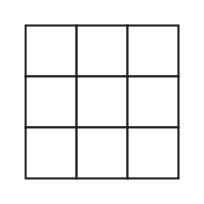
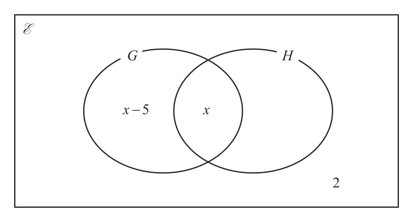
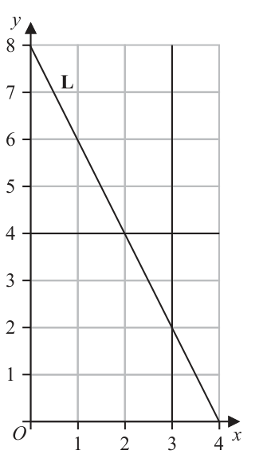
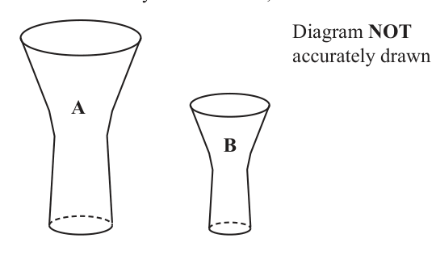

# 4MB1/01 — 2023-11 (official extraction)

> schema `syllabai.official-paper-questions/0.2` · paper_id `pearson-edexcel:international-gcse:mathematics-b:4mb1:2023-11:4MB1/01` · qp sha256 `cdb1c8ab6cb40c9c…` · extraction is the disclosed baseline (ADR-039)

## Question 1 (2 marks)

A pattern is made with grey and white squares.

### 1(a) [1]

Write down the order of rotational symmetry for this pattern.

**Mark scheme answer**

> 2 1 B1

- **(1)** 2 1 B1

### 1(b) [1]

Shade, on the grid below, exactly 5 squares to make a pattern with 4 lines of symmetry.

**Mark scheme answer**

> or 1 B1 A suitable pattern
> cas Total 2 marks
> Question Working Answer Mark Notes

- **(1)** or 1 B1 A suitable pattern

## Question 2 (2 marks)

−3 4 3 Write down a number from the above list that is

### 2(a) [1]

both a rational number and a natural number,

**Mark scheme answer**

> 4 1 B1 with no incorrect values

- **(1)** 4 1 B1 with no incorrect values

### 2(b) [1]

an irrational number.

**Mark scheme answer**

> 3 1 B1 with no incorrect values
> cas Total 2 marks
> Question Working Answer Mark Notes

- **(1)** 3 1 B1 with no incorrect values

## Question 3 (2 marks)

The nth term of a sequence is given by 3n 2 − 20 Find the difference between the 4th term and the 5th term of this sequence.

### 3 [2]

The nth term of a sequence is given by 3n 2 − 20 Find the difference between the 4th term and the 5th term of this sequence.

**Mark scheme answer**

> (3 × 5 − 20) [ = 55] and (3 × 4 − 20 ) [= 28] or
> 2 2 2 M1 A correct method to find the 4th term and the 5th term or
> correct method to find the difference (condone missing
> ( 3 × 5 − 20) − (3 × 4 − 20 ) [= 55 –28] or
> 2
> brackets around the terms), which could be the other way
> ( 3 × 5 ) − (3 × 4 ) [= 75 – 48] oe
> 2
> round eg 28 – 55
> 27 or – 27 A1
> cas Total 2 marks
> Question Working Answer Mark Notes

- **(2)** (3 × 5 − 20) [ = 55] and (3 × 4 − 20 ) [= 28] or

## Question 4 (2 marks)

Using ruler and compasses only and showing all your construction lines, construct the bisector of angle FGH H F G

### 4 [2]

Using ruler and compasses only and showing all your construction lines, construct the bisector of angle FGH H F G

**Mark scheme answer**

> 2 M1 for bisector of angle FGH within lines of overlay
> Accurate bisector A1 correct bisector which must be a straight line + construction
> lines ignore any additional lines eg line drawn from F to H
> wr Total 2 marks
> Question Working Answer Mark Notes

- **(2)** 2 M1 for bisector of angle FGH within lines of overlay

## Question 5 (2 marks)

Without using a calculator and showing all your working, work out 1 1 2 ÷1 3 5 Give your answer as a mixed number in its simplest form.

### 5 [2]

Without using a calculator and showing all your working, work out 1 1 2 ÷1 3 5 Give your answer as a mixed number in its simplest form.

**Mark scheme answer**

> 2+ 1 35 2 M1
> 7 5 3 30 + 5
> × or = or Note if we see the fractions as a division then the denominators
> 3 6 1+ 1 15 + 3 18 7 6 35 7 3 35
> 5 15 must be the same eg ÷ = or ÷ = gets M0
> 3 5 18 6 5 18
> 35 35 17 A1 dep on M1 We must see both the correct top heavy fraction and
> =1 the correct simplified mixed fraction
> 18 18
> wr Total 2 marks
> Question Working Answer Mark Notes

- **(2)** 2+ 1 35 2 M1

## Question 6 (2 marks)

Factorise fully 5mp 2 − 10 p

### 6 [2]

Factorise fully 5mp 2 − 10 p

**Mark scheme answer**

> 5 p ( mp − 2 ) 2 B2 correct answer
> B1 for 5 ( mp 2 − 2 p ) or p ( 5mp − 10 ) or 5 p ( mp + 2 ) or 5 p (... − ...)
> Condone missing closed bracket
> cas Total 2 marks
> Question Working Answer Mark Notes

- **(2)** 5 p ( mp − 2 ) 2 B2 correct answer

## Question 7 (2 marks)

Harpreet has been given 22 × 3 × 55 × 7 red bricks 22 × 54 × 7 2 green bricks 24 × 32 × 53 × 7 blue bricks Harpreet is asked to arrange the bricks in rows according to the following rules. Each row must contain just one colour of brick. Each row must contain the same number of bricks. Calculate the maximum number of bricks there can be in a row.

### 7 [2]

Harpreet has been given 22 × 3 × 55 × 7 red bricks 22 × 54 × 7 2 green bricks 24 × 32 × 53 × 7 blue bricks Harpreet is asked to arrange the bricks in rows according to the following rules. Each row must contain just one colour of brick. Each row must contain the same number of bricks. Calculate the maximum number of bricks there can be in a row.

**Mark scheme answer**

> 3500 2 B2 Allow 22 × 53 × 7 must be their only answer or identified as their
> answer
> B1 22 × 5n × 7 or 2m × 53 × 7 where m and n must be
> non zero integers
> or having the HCF with other values in the working space
> Note B0 for finding the LCM only
> cas Total 2 marks
> Question Working Answer Mark Notes
> 7 2 + 32
> 2 M1 Condone omission of , missing brackets around the −3 and
> subtraction of the squares rather than addition.
> eg allow 72 + −32 and 7 2 − −32 and 7 2 − ( −3)
> Implied by 58 or ± 58 or − 58 or 7.6….
> 58 A1 isw if they give the exact value and then 7.6….
> A0 for ± 58
> cas Total 2 marks
> Question Working Answer Mark Notes
> 9 1 1 3 M1 Correct method to find the distance in 2.5 hours (could be
> 80 × 2 [ = 200] or 80 × 2 + 25 [ = 225] oe part of calculation to find the total distance or in a correct
> 2
> calculation to find the average speed)
> Ignore any incorrect units
> 80 × 2.5 + 25 "200"+ 25 M1 Correct method to find speed using total distance/ total time
> or oe
> 2.5 + 0.5 2.5 + 0.5 or allow a distance other than 200 provided it is clearly labelled
> as the distance in the first part of the journey and is not equal to
> Ignore any incorrect units
> 75 A1 ignore any additional incorrect units
> isw further calculations for the method marks but not for the
> accuracy mark
> cas Total 3 marks
> Question Working Answer Mark Notes

- **(2)** 3500 2 B2 Allow 22 × 53 × 7 must be their only answer or identified as their

## Question 8 (2 marks)

Given that a = find the exact value of ½ a½

### 8 [2]

Given that a = find the exact value of ½ a½

## Question 9 (3 marks)

A car travels at an average speed of 80 km/h for 2.5 hours and then travels a further distance of 25 km in 0.5 hours. Calculate the average speed, in km/h, of the car for the whole journey. ....................................................................... . . . . . . . . . . . . . . . . . . . . . . km/h

### 9 [3]

A car travels at an average speed of 80 km/h for 2.5 hours and then travels a further distance of 25 km in 0.5 hours. Calculate the average speed, in km/h, of the car for the whole journey km/h

## Question 10 (3 marks)

In a survey, 32 students were asked whether they study either History (H) or Geography (G). Given that, of these students, 2 x − 5 study Geography and 5 x − 1 study History

### 10(a) [1]

complete the Venn diagram for this information, giving the missing value in terms of x E G H x

**Mark scheme answer**

> Correct 1 B1 for 4x – 1 oe (eg 5x – 1 – x) correctly placed
> 4x – 1 in or Allow 35 – 2x oe
> Venn
> diagram

- **(1)** Correct 1 B1 for 4x – 1 oe (eg 5x – 1 – x) correctly placed

### 10(b) [2]

Calculate the value of x x =

**Mark scheme answer**

> x − 5 + x + "4 x − 1"+ 2 = 32 oe 2 M1 correct equation ft their 4x – 1 only.
> eg x − 5 + x + "4 x − 1" = 30 Condone the missing 2 only eg x − 5 + x + "4 x − 1" = 32
> 6 A1
> cas Total 3 marks
> Question Working Answer Mark Notes

- **(2)** x − 5 + x + "4 x − 1"+ 2 = 32 oe 2 M1 correct equation ft their 4x – 1 only.

## Question 11 (3 marks)

Calculate the mean of the two numbers 4 × 10100 and 3.6 × 10101 Give your answer in standard form.

### 11 [3]

Calculate the mean of the two numbers 4 × 10100 and 3.6 × 10101 Give your answer in standard form.

**Mark scheme answer**

> 0.4 ×10101 or 36 ×10100 or 3 M1 for converting one of the numbers so that it is written as the
> 0.2 ×10101 or 18 ×10100 same power of ten as the other number (this may be done after
> dividing by 2)
> Implied by 4 ×10101 or 40 ×10100 oe
> 0.4 ×10101 + 3.6 × 10101 4 × 10100 + 3.6 × 10101
> oe M1 Allow correct numbers in any form eg
> 2
> 4 ×10100 + 36 ×10100
> or oe
> 2 ×10101 A1 oe eg 2.0 ×10101 but not 20 ×10100 (this implies M2)
> Allow international multiplication symbol of . for × eg 2.10101
> Do not isw
> cas Total 3 marks
> Question Working Answer Mark Notes

- **(3)** 0.4 ×10101 or 36 ×10100 or 3 M1 for converting one of the numbers so that it is written as the

## Question 12 (3 marks)

y 7 L O 1 2 3 4 x The diagram above shows the line L with equation y mx c, the line with equation y = 4 and the line with equation x = 3

### 12(a) [2]

Find the value of m and the value of c m = c =

**Mark scheme answer**

> m = −2 2 B1 cao
> SCB1 for the wrong way round.
> c=8 B1 cao

- **(2)** m = −2 2 B1 cao

### 12(b) [1]

On the grid, shade and label the region R defined by 0 ≤ y≤4 and 0 ≤ x≤3 and y ≤ mx + c

**Mark scheme answer**

> Correct 1 B1
> region Correct region indicated by one of the following
> shaded • correct region shaded
> • correct region labelled as R
> • all of outside region shaded.
> cas Total 3 marks
> Question Working Answer Mark Notes

- **(1)** Correct 1 B1

## Question 13 (3 marks)

Simplify x 2 + 3x + 2

### 13 [3]

Simplify x 2 + 3x + 2

**Mark scheme answer**

> x 2 ( x + 1) 3 M2 numerator fully factorised and denominator factorised correctly
> ( x + 1)( x + 2 ) does not have to be within a fraction
> M1 for one of the numerator fully factorised or denominator
> factorised correctly does not have to be within a fraction
> x2
> A1 (do not isw)
> x+2
> cas Total 3 marks
> Question Working Answer Mark Notes

- **(3)** x 2 ( x + 1) 3 M2 numerator fully factorised and denominator factorised correctly

## Question 14 (4 marks)

A bag contains red pens, blue pens, black pens, green pens and purple pens. A pen is selected at random from the bag. The table gives information about the probability of the colour of the pen that is selected. Colour red blue black green purple Probability 0.25 0.10 3 y + 0.15 x y Tisam draws a pie chart to show the information about the number of pens of each colour in the bag. The size of the angle of the sector representing green pens is 50.4°

### 14(a) [1]

Show that x = 0.14

**Mark scheme answer**

> 50.4
> [ = 0.14] 1 B1 oe eg 0.25 × 50.4 [ = 0.14]
> 360
> Allow verify eg 0.14 × 360=50.4 or
> 0.1 = 3.6 and 14 × 3.6 = 50.4
> provided we also see the 50.4
> Note: allow 0.25 + 0.1 + 3 y + 0.15 + y = 360 − 50.4 to find y
> 360
> and then using this value of y to show or verify x = 0.14
> BUT B0 for using x = 0.14 to find y and then using this
> value of y to show or verify that x = 0.14

- **(1)** 50.4

### 14(b) [3]

Calculate the value of y y =

**Mark scheme answer**

> Credit can be given for work seen in part (a) if not seen in part (b)
> 0.25 + 0.1 + 3 y + 0.15 + x + y = 1 oe 3 M1 equation for y, may also be in terms of x
> or 0.25 + 0.1 + 3 y + 0.15 + 0.14 + y = 1 oe Allow one missing probability provided we see the
> remaining individual probabilities added to 1
> If converting to degrees and using the sum of the angles
> equals 360
> 90 + 36 + 3y + 54 + 50.4 + y = 360
> 4 y = 1 − 0.25 − 0.1 − 0.15 − 0.14 oe eg 4 y = 0.36 M1 For collecting y terms on 1 side and numbers on the
> other in a correct equation. x must be replaced with
> 0.14
> If converting to degrees 4y = 129.6 => y = 32.4
> 0.09 A1 oe
> Total 4 marks
> Question Working Answer Mark Notes

- **(3)** Credit can be given for work seen in part (a) if not seen in part (b)

## Question 15 (4 marks)

A bag contains red counters, blue counters and yellow counters such that number of red counters : number of blue counters = 5 : 2 number of blue counters : number of yellow counters = 3 : 4 The number of yellow counters in the bag is 56 Calculate the total number of counters in the bag.

### 15 [4]

A bag contains red counters, blue counters and yellow counters such that number of red counters : number of blue counters = 5 : 2 number of blue counters : number of yellow counters = 3 : 4 The number of yellow counters in the bag is 56 Calculate the total number of counters in the bag.

**Mark scheme answer**

> 15 : 6 and 6 : 8 oe or 15 : 6 : 8 oe 4 M1 for writing the ratios with a common figure or for writing a
> or correct 3 part ratio
> Allow equivalent ratios
> 8
> eg 7.5 : 3 and 3 : 4 or 7.5 : 3 : 4 or eg 5 : 2 and 2 : or 5 : 2 :
> 3
> [ no. of yellow & blue counters = ] × 7 [ = 98] or for the number of yellow and blue counters
> 56 or for the number of blue counters which may be written in the ratio
> [ number of blue counters =] × 3[ = 42] oe ie 42 : 56
> eg × 7 − 56 [ = 42]
> 56 M1 Finding the value of 1 part eg 56/(the number for yellow in their
> [ = 7] or [ = 14] or 8 [ = 21]
> 56
> eg ratio)
> 8
> 3 or for finding the number of red counters or red and blue counters
> "42" ft their number of blue counters provided this is from a correct
> or [ number of red counters = ] × 5 [ = 105]
> 2 method or clearly labelled or identified as total number of blue
> "42" counters
> or [ no. of red & blue counters =] × 7 [ = 147]
> eg (15 + 6 + 8 ) × "7" or ( 7.5 + 3 + 4 ) × "14" M1 Implies the previous method marks.
> A complete method to find the total number of counters in the bag
> ⎛ 8⎞
> or ⎜ 5 + 2 + ⎟ × "21" (where values in inverted commas must come from a correct method)
> ⎝ 3⎠
> or 56 ÷
> [ their ratio value for yellow ]
> [sum of their ratio parts ]
> 8
> eg 56 ÷ or 56 ÷
> or 56 ÷
> 5+ 2+ 8
> or 56 + "42"+ "105"
> 203 A1
> cas Total 4 marks
> Question Working Answer Mark Notes

- **(4)** 15 : 6 and 6 : 8 oe or 15 : 6 : 8 oe 4 M1 for writing the ratios with a common figure or for writing a

## Question 16 (4 marks)

Here is hexagon ABCDEF ( 2 x + 1) cm ( 3x + 4 ) cm AB 2 x cm DE = 2 x cm FE = 5 x cm AF 3 x The perimeter of the hexagon is 40 cm. Find the area, in cm2, of the hexagon. .................................................................... . . . . . . . . . . . . . . . . . . . . . . . . . cm2

### 16 [4]

Here is hexagon ABCDEF ( 2 x + 1) cm ( 3x + 4 ) cm AB 2 x cm DE = 2 x cm FE = 5 x cm AF 3 x The perimeter of the hexagon is 40 cm. Find the area, in cm2, of the hexagon cm2

**Mark scheme answer**

> 10 x + 6 x + 8 = 40 oe 4 M1 condone CD to be 3x+1 (for this mark only) may be implied by
> 16x + 10 = 40 or x =
> 40 − 8
> x= [ = 2] M1 method to solve correct equation (this may imply the previous
> method mark)
> ( 2 x + 1)( 3x + 4 ) + 2 x ( 5 x − ( 2 x + 1) ) M1 for correct expression for the area, may be in terms of x or with
> their x value substituted, in which may be simplified, ft their value of
> ( 2 x + 1)( 3x + 4 ) + 2 x ( 3x − 1) oe x provided working is shown
> or ( 2 x + 1)( 3x + 4 − 2 x ) + 5 x × 2 x oe eg
> ( 2 x + 1)( x + 4 ) + 10 x 2 ( 2 × "2"+ 1) × ( 3 × "2"+ 4 ) + (5 × "2"− ( 2 × "2"+ 1) ) × ( 2 × "2") oe
> eg ( 2 × "2"+ 1) × ( 3 × "2"+ 4 ) + ( 3 × "2"− 1) × ( 2 × "2") or 5 ×10 + 5 × 4
> or 5 x ( 3x + 4 ) − ( 5 x − (2 x + 1) )( x + 4 ) oe
> or ( 2 × "2"+ 1) × ( 3 × "2"+ 4 − 2 × "2 ) + ( 5 × "2") × ( 2 × "2") oe
> 5 x ( 3x + 4 ) − ( 3x − 1)( x + 4 )
> eg ( 2 × "2"+ 1) × ("2"+ 4 ) + ( 5 × "2") × ( 2 × "2") or 5 × 6 + 10 × 4
> Or
> 12 x 2 + 9 x + 4 or ( 5 × "2") × ( 3 × "2"+ 4 ) − ( 5 × "2"− (2 × "2"+ 1) ) × ("2"+ 4 ) oe
> eg ( 5 × "2") × ( 3 × "2"+ 4 ) − ( 3 × "2"− 1) × ("2"+ 4 ) or 10 ×10 − 5 × 6
> or 12 × "2"2 + 9 × "2"+ 4
> 70 A1
> SC B2 for an answer of 51.3125, 63.0625, 70.5625 Accept values
> that are rounded to 1dp
> cas Total 4 marks
> Question Working Answer Mark Notes

- **(4)** 10 x + 6 x + 8 = 40 oe 4 M1 condone CD to be 3x+1 (for this mark only) may be implied by

## Question 17 (4 marks)

2 1 3 1 A B 4 3 2 7

### 17(a) [2]

Calculate 3A – 2B 1 p 3 10 8 B C BC 32 1 2 7 4 1

**Mark scheme answer**

> ⎛ 12 −1 ⎞ 2 B2 Fully correct matrix
> ⎜ ⎟
> ⎝ 8 −5 ⎠ (B1 for 2 or 3 correct entries in a matrix of correct order)

- **(2)** ⎛ 12 −1 ⎞ 2 B2 Fully correct matrix

### 17(b) [2]

Calculate the value of p p =

**Mark scheme answer**

> −3 p − 4 = −10 or 2 p + 28 = 32 2 M1 A correct equation or ⎛⎜ −3 p − 4 ⎞
> ⎟
> ⎝ 2 p + 28 ⎠
> 2 A1
> cas Total 4 marks
> Question Working Answer Mark Notes

- **(2)** −3 p − 4 = −10 or 2 p + 28 = 32 2 M1 A correct equation or ⎛⎜ −3 p − 4 ⎞

## Question 18 (4 marks)

A Diagram NOT accurately drawn B 75° O C OABC is a sector of a circle, centre O, with ∠AOC = 75° The arc length ABC = 54 cm. Calculate the area, in cm2 to 2 significant figures, of the sector. .................................................................... . . . . . . . . . . . . . . . . . . . . . . . . . cm2

### 18 [4]

A Diagram NOT accurately drawn B 75° O C OABC is a sector of a circle, centre O, with ∠AOC = 75° The arc length ABC = 54 cm. Calculate the area, in cm2 to 2 significant figures, of the sector cm2

> 🖼 crop required: diagram (qp.pdf p.None)

**Mark scheme answer**

> 75 4 M1 For a correct equation with one unknown
> × 2π r = 54
> 360
> 54 ⎡ 19440 648 ⎤
> πr = ⎢ = = = 129.6 ⎥ or
> × 2 ⎣ 150 ⎦
> 75
> 360 M1 Correct method to find r or π r in a correct
> 54 ⎡ 19440 648 ⎤ equation
> r= ⎢ = = = 41.2529...⎥
> × 2π ⎣ 150π 5π ⎦
> 360
> 75 M1 ft their value for r or π r if working is shown
> × π ("41.2529......")
> Area =
> 360
> 1100 A1 awrt 1100 (1113.83…)
> If an answer is given in the range in the working
> and then rounded incorrectly award full marks
> cas Total 4 marks
> Q Working Answer Mark Notes
> ( 0.57 ) or
> Volume scale factor A to B = 0.57 oe 4 M1 Correct SF oe fraction or decimal may be M3 for
> within a calculation eg 1003/573 or (1 – 0.43)
> Volume scale factor B to A = 100/57 (=1.75…) oe Not for 57%
> 0.572 or
> 0.57 [ = 0.829...] or 0.57 2 [ = 0.3249] oe M1 1st step to find the SF for area
> ( 57 ) × 700
> 3
> or
> Condone use of 0.43 instead of 0.57 eg
> ( 100 )
> 100 / 57 [ = 1.206...] or (100 / 57 ) [ = 3.077(8...)] oe
> 3 2
> 0.43 [ = 0.754(7...) ] or 0.432 [ = 0.1849] or
> or
> 100 / 43 [ = 1.324(8...) ] or (100 / 43) [ = 5.408...]
> 3
> ⎛ 100 ⎞
> ("0.829") [ = 0.687] or 3 "0.3249" [ = 0.687...] oe M1 Correct method to find an area SF from a ⎜⎜ 3 ⎟⎟ or
> volume SF when Volume SF is 0.57 or 0.43 ⎝ 57 ⎠
> or
> ⎛ 100 ⎞
> ("1.206") [ = 1.454(6...)] or "3.077..." [ = 1.454(6...)] oe
> If Volume SF = 0.43
> ⎜ ⎟ or
> Area SF = ⎝ 57 ⎠
> ("0.754(7)") or 3 "0.1849 " [ = 0.569(6)] ( 100 )
> 2
> 700 ÷
> ( 57 )
> or
> ("1.324(8)") or "5.408..." [ = 1.755...]
> 2
> 700 × "0.687" 481 A1 awrt 480 to 483
> or If an answer is given in the range in the working and then rounded
> 700 ÷ "1.454..." incorrectly award full marks
> ALT Volume scale factor A to B = 0.57 oe M1 for recognition that the volume scale factor is 0.57
> Volume scale factor B to A = 100/57 (=1.75…) oe May be seen in a calculation
> 700 ⎡⎣ = 10 7 = 26.4(5...) ⎤⎦ or ( 700 ) [ = 18520.(25918)] M1
> 700 × 3 0.57 [ = 21.9(3...) ] oe M1
> ⎛
> ( 700 ) × 0.57 ⎞⎟⎠ [ = 21.9(3...)]
> eg ⎜ 3 Allow use of 0.43 instead of 0.57
> ⎝ If Volume SF = 0.43 then 700 × 3 0.43 [ = 19.9(6...) ]
> ("21.9(3...)") 481 A1 awrt 480 to 483
> If an answer is given in the range in the working and then rounded
> incorrectly award full marks
> cas Total 4 marks
> Question Working Answer Mark Notes
> 20 AX × 4 = 7 × 5 oe or ( AB + 4 ) × 4 = 7 × 5 oe 5 M1 use chord theorem correctly to form a
> correct equation with one unknown
> Allow use of letters eg x where x has been
> clearly identified eg allow 4 x = 7 × 5 where x is
> clearly identified as AX
> 35 M1 Correct value for PB may be un-simplified
> "− 4
> "
> 1 35 − 16 May be on the diagram
> PB = × [ = 2.375] oe eg PB = 4 [ = 2.375]
> 2 4
> sin115 sin ∠BPC M1 Fully correct method to enable sin ∠BPC to
> =
> 4 + "2.375" 5 be found.
> ft their PB (or PX) provided PB (or PX) is from a
> correct method or clearly labelled or identified as
> PB (or PX) with working shown
> PB (or PX) must be a numerical value
> sin115 M1 A correct expression for sin ∠BPC
> sin ∠BPC = × 5 [ = 0.7108...]
> ( 4 + "2.375") ft their PB (or PX) provided PB (or PX) is from a
> correct method or clearly labelled or identified as
> PB (or PX) with working shown
> PB (or PX) must be a numerical value
> 45.3 A1 awrt 45.1 to 45.3
> If an answer is given in the range in the working
> and then rounded incorrectly award full marks
> cas Total 5 marks
> Question Working Answer Mark Notes

- **(4)** 75 4 M1 For a correct equation with one unknown

## Question 19 (4 marks)

The diagram shows two mathematically similar solids, A and B Diagram NOT accurately drawn A B The volume of solid B is 43% less than the volume of solid A The total surface area of solid A is 700 cm2 Work out the total surface area, in cm2 to 3 significant figures, of solid B .................................................................... . . . . . . . . . . . . . . . . . . . . . . . . . cm2

### 19 [4]

The diagram shows two mathematically similar solids, A and B Diagram NOT accurately drawn A B The volume of solid B is 43% less than the volume of solid A The total surface area of solid A is 700 cm2 Work out the total surface area, in cm2 to 3 significant figures, of solid B cm2

## Question 20 (5 marks)

X 4 cm Diagram NOT accurately drawn B 5 cm P C A 2 cm D A, B, C and D are four points on a circle. P is the midpoint of AB APBX is a straight line. DCX is a straight line. BX = 4 cm CX = 5 cm DC = 2 cm ∠PCX = 115° Calculate, in degrees to one decimal place, ∠BPC BPC ........................................................... . . . . . . . . . . . . . . . . . . . . . . . . . . . . . . . . . . °

### 20 [5]

X 4 cm Diagram NOT accurately drawn B 5 cm P C A 2 cm D A, B, C and D are four points on a circle. P is the midpoint of AB APBX is a straight line. DCX is a straight line. BX = 4 cm CX = 5 cm DC = 2 cm ∠PCX = 115° Calculate, in degrees to one decimal place, ∠BPC BPC °

> 🖼 crop required: diagram (qp.pdf p.None)

## Question 21 (5 marks)
### 21(a) [3]

Express 3 x 2 6 x 9 in the form p ( x + q ) 2 + r where p, q and r are integers to be found.

**Mark scheme answer**

> 3 ( x + 2 x )…… or 3 ( x + 2 x ……) oe
> 2 2 3 M1 (where …… is any number or no number)
> 3( x + 1) 2 …… or 3 ⎡( x + 1)2 ……⎤ oe M1 (where …… is any number or no number)
> ⎣ ⎦
> 3 ( x + 1) − 12 A1 condone 3 ( x + 1) + ( −12 )
> 2
> allow p = 3, q = 1, r = –12

- **(3)** 3 ( x + 2 x )…… or 3 ( x + 2 x ……) oe

### 21(b) [2]

Hence, or otherwise, solve the equation 3 x 2 6 x 0 without using a calculator. Show your working clearly.

**Mark scheme answer**

> 12 2 M1 if using answer to part a then allow follow
> ( x + 1) = or ( x + 1)2 = 4 or
> 3 through of their r and p values provided
> (3x + 9)(x – 1) or (x + 3)(3x – 3) or (x + 3)(x – 1) oe −r
> >0
> p
> allow use of formula – no errors and
> substitution no more simplified than
> −2 ± 16
> seen in the working
> 1, −3 A1 dep on M1 being awarded (allow if the
> method is seen in the working space for
> part (a))
> ALT (a) px2 + 2pqx + pq2 + r M1 for multiplying out p(x + q)2 + r to obtain
> px2 + 2pqx + pq2 + r oe
> 2 of: M1 for equating coefficients and making 2
> p= 3 2pq = 6 oe pq2 + r = – 9 oe correct statements
> 3 ( x + 1) − 12
> Total 5 marks
> Question Working Answer Mark Notes

- **(2)** 12 2 M1 if using answer to part a then allow follow

## Question 22 (5 marks)

A particle is moving along a straight line. At time t seconds, the displacement, x metres, of the particle from a fixed point O on the line is given by x 2t 3 8t 2 15t At time t seconds, the velocity of the particle is v m/s

### 22(a) [2]

Find an expression for v in terms of t v =

**Mark scheme answer**

> v = 6t − 16t + 15
> 2 M1 for 6t 2 or ± 16t
> 6t 2 − 16t + 15 A1 do not isw an answer of 12t – 16

- **(2)** v = 6t − 16t + 15

### 22(b) [3]

Find the least speed, in m/s, of the particle m/s

**Mark scheme answer**

> a = 12t − 16 3 M1 for 12t or ± 16 allow if seen in (a) only if
> used in (b)
> 12t − 16 = 0 ⇒ t = M1 sets their a = 0 leading to a value for t
> 4.33 A1 allow 13/3 awrt 4.3
> Note: we have not told the candidates that we
> must see working therefore a correct answer
> with no working scores full marks, an answer of
> 4 ⎛ 4 13 ⎞
> scores 2 marks and an answer of ⎜ , ⎟
> 3 ⎝3 3 ⎠
> without identifying the oe scores 2 marks
> ALT ⎛ 16 ⎞
> 2 M1 1st step to completing the square ft their (a)
> 6⎜t − ⎟ ± ... if a 3 term quadratic
> ⎝ 6× 2 ⎠
> ⎛ 4 ⎞ 13
> 2 M1 Completing the square ft their (a) if a 3 term
> 6⎜t − ⎟ + quadratic
> ⎝ 3⎠
> 4.33 A1 allow 13/3 awrt 4.3
> cas Total 5 marks
> Q Working Answer Mark Notes

- **(3)** a = 12t − 16 3 M1 for 12t or ± 16 allow if seen in (a) only if

## Question 23 (6 marks)

C Diagram NOT accurately drawn O E 102° 54° A B D In the diagram, A, B, and C are points on a circle, centre O DBE is the tangent to the circle at the point B EBC 54° AOB 102° Find, in degrees, the size of ∠OCA Give reasons for each stage of your working. OCA ............................................................. . . . . . . . . . . . . . . . . . . . . . . . . . . . . . . . . °

### 23 [6]

C Diagram NOT accurately drawn O E 102° 54° A B D In the diagram, A, B, and C are points on a circle, centre O DBE is the tangent to the circle at the point B EBC 54° AOB 102° Find, in degrees, the size of ∠OCA Give reasons for each stage of your working. OCA °

> 🖼 crop required: diagram (qp.pdf p.None)

**Mark scheme answer**

> Finding ∠OBC or ∠OCB eg ALT 1 ALT2 6 M1 We can not mix and match
> ∠OBC = 90 − 54 [ = 36] ∠CAB = 54 ∠OBC = 90 − 54 [ = 36] methods but we award to the
> scheme that is the most benefit
> to the candidate.
> 102 Finding ∠OAB or ∠OBA ∠BOC = 180 − 2 × "36" M1
> ∠ACB = [ = 51]
> 2 eg [ = 108] Angles must be clearly labelled
> (180 − 102 ) = 39
> ∠OAB = [ ] or otherwise identified with no
> 2 ambiguity or contradiction on
> Finding ∠OCA or ∠OAC eg Finding ∠OCA or ∠OAC Finding ∠OCA or ∠OAC M1 the diagram.
> eg eg Only accept one letter if:
> ∠OCA = "51"− "36" ∠OCA = A = 15 O = 258
> or ∠OCA = "54"− "39" 180 − ( 360 − 102 − "108") B = 36 C = 51
> ∠OCA = 360 − (360 − 102) − "36"− "51"
> 15 A1
> Note values of 36 and 15 can come from incorrect working. Some candidates incorrectly think that These marks are independent of
> triangles COB and COA are congruent and that COB = COA which method is used
> OBC = 36 M1
> 360 − 102 B2 At least 2 correct reasons related
> Then 180 − 36 − = 15 to their calculations, one of which
> 2 must be a circle theorem.
> 51 − "15" = 36 B1 for 1 correct reason related to
> To help if you are seeing 129 then check carefully their calculation.
> Angle between tangent and radius (diameter) is 90° Note: We can allow symbols for the
> Angle at the centre is 2 × (double) angle at circumference / angle at circumference is ½ angle at words ‘triangle’, ‘angle’ and ‘sum’
> centre
> Base angles in an isosceles triangle (are equal)
> Angles in a triangle add to 180°
> Angles around a point add up to 360°
> Angles on a line add to 180°
> Alternate segment theorem
> Angles in a quadrilateral add to 360°
> cas Total 6 marks
> Q Working Answer Mark Notes

- **(6)** Finding ∠OBC or ∠OCB eg ALT 1 ALT2 6 M1 We can not mix and match

## Question 24 (6 marks)

A box contains n buttons. The buttons are either red or blue such that number of red buttons : number of blue buttons = 3 : 5 A sample of 2 buttons is taken at random from the bag. Given that the probability of the 2 buttons being the same colour is find the value of n (6) n = ........................................................ . . . . . . . . . . . . . . . . . . . . . . . . . . . . . . . . . . . . .

### 24 [6]

A box contains n buttons. The buttons are either red or blue such that number of red buttons : number of blue buttons = 3 : 5 A sample of 2 buttons is taken at random from the bag. Given that the probability of the 2 buttons being the same colour is find the value of n n =

**Mark scheme answer**

> 3 5 6 M1 For correct use of ratio to find a correct probability
> P(1st Red) = or P(1st Blue) =
> 8 8 for the 1st button or the correct number of red or blue on
> the first selection.
> 3 3 M1 For finding an algebraic expression for the probability
> n −1 n −1 of two red or two blue buttons
> 3 8 3n 8
> P(both Red) = × oe eg × pn − 1 pn
> 8 n −1 8n n − 1 Allow p × or p × where 0 < p < 1
> 5 5 n −1 n
> n −1 n −1 qn − 1 qn
> 5 8 5n 8 Allow p × or p ×
> or P(both Blue) = × oe eg ×
> 8 n −1 8n n − 1 n −1 n
> 5 3 where 0 < p < 1 and p+q = 1
> n −1 n −1
> 3 8 5 8
> or P(one of each colour) = × or × oe
> 8 n −1 8 n −1
> 3 5 M1 implies previous M1 for algebraic expression for
> n −1 n −1 P(2 red) + Prob(2 Blue) or 2 × P( red) × Prob( Blue)
> 3 8 5 8
> × + × oe pn − 1 qn − 1 pn qn
> 8 n −1 8 n −1 Allow p × + q× or p × + q×
> 5 n −1 n −1 n n
> n −1 where 0 < p < 1 and p+q = 1
> 3 8
> or 2 × × oe
> 8 n −1
> 3 5 M1 implies the previous method marks a correct equation
> n −1 n −1 with their ratio for
> 3 8 5 8
> × + × = oe P(2red)+Prob(2Blue)=10/19 or 2×P(red)×Prob(Blue)=9/19
> 8 n − 1 8 n − 1 19
> pn − 1 qn − 1
> Allow p × + q×
> 3 8 n −1 9
> or 2 × × = oe n −1 n −1
> 8 n − 1 19 where 0 < p < 1 and p+q = 1
> 9 25
> n − 3 + n − 5 = × 8 ( n − 1) or 285n = 288 ( n –1) oe M1 multiplying throughout by n – 1 or n and n – 1 to
> 8 8 19 remove the denominator to form a correct linear or
> 3 ⎛3 ⎞ 5 ⎛5 ⎞ 10 3 2 quadratic equation without terms in n on the denominator.
> n ⎜ n − 1⎟ + n ⎜ n − 1⎟ = n(n − 1) or n = 9n oe
> 8 ⎝8 ⎠ 8 ⎝8 ⎠ 19 32 Note: if all terms are on one side, condone the missing‘=0’
> 96 A1 cao (ie must have discounted n = 0 if found)
> Note: An answer of 96 with no obvious incorrect working
> gets all 6 marks
> Total 6 marks
> Q Working USING n = 8x Answer Mark Notes
> P(1st Red) = or P(1st Blue) =
> 8 8 the 1st button or the correct number of red or blue on the
> first selection.
> 3 3x − 1 3x 3x − 1 M1 For finding an algebraic expression for the probability
> P(both Red) = × oe eg ×
> 8 8x −1 8x 8x −1 of two red or two blue buttons
> 5 5x − 1 5x 5x −1 r rx − 1 r rx
> or P(both Blue) = × oe eg × Allow × or ×
> 8 8x −1 8x 8x − 1 t tx − 1 t tx
> 3 5x −1 5 3x − 1 r sx − 1 r sx
> or P(one of each colour) = × or × oe Allow × or ×
> 8 8x −1 8 8x −1 t tx − 1 t tx
> where r < t and s < t and r+s = t
> 3 3x − 1 5 5 x − 1 M1 implies previous M1 for algebraic expression for
> × + × oe
> 8 8x −1 8 8x −1 P(2 red) + Prob(2 Blue) or 2 × P( red) × Prob( Blue)
> 3 5x −1 r rx − 1 r sx − 1 r rx r sx
> or 2 × × oe Allow × + × or × + ×
> 8 8x −1 t tx − 1 t tx − 1 t tx t tx
> where r < t and s < t and r+s = t
> 3 3x − 1 5 5 x − 1 10 M1 implies the previous method marks a correct equation
> × + × = oe
> 8 8 x − 1 8 8 x − 1 19 with their ratio for
> 3 5x −1 9 P(2red)+Prob(2Blue)=10/19 or 2×P(red)×Prob(Blue)=9/19
> or 2 × × = oe r rx − 1 r sx − 1
> 8 8 x − 1 19 Allow × + ×
> t tx − 1 t tx − 1
> where r < t and s < t and r+s = t
> 19(34 x2 − 8x) = 10(64 x2 − 8x) or M1 multiplying throughout by 8x – 1 or 8x 2 − x
> 646 x 2 − 152 x = 640 x 2 − 80 x or 6 x − 72 x[= 0] oe
> to remove the denominator to form a correct linear or
> or quadratic equation without terms in x on the denominator.
> 19(34 x − 8) = 10(64 x − 8) or 646 x − 152 = 640 x − 80 or Note: if all terms are on one side, condone the missing‘=0’
> Note: this leads to a value of x = 12
> 6 x − 72 = 0 oe
> 96 A1 cao (ie must have discounted n = 0 if found)
> Note: An answer of 96 with no obvious incorrect working
> gets all 6 marks
> Total 6 marks
> Q Working Answer Mark Notes

- **(6)** 3 5 6 M1 For correct use of ratio to find a correct probability

## Question 25 (3 marks)

Make h the subject of p = h

### 25 [3]

Make h the subject of p = h

**Mark scheme answer**

> ph − 2h = 5 or −5 = 2h − ph 3 M1 Multiply by h and collect terms in h on one side. Allow one sign error
> or or separate the fraction and isolate the term in h. Allow one sign error
> 5 −5
> = p − 2 or = 2− p
> h
> h ( p − 2 ) = 5 or −5 = h ( 2 − p ) M1 taking h out as a common factor (dep on two different terms in h)
> or multiplying throughout by h (if separated the fraction and isolated the
> term in h)
> 5 −5
> h= A1 allow h =
> p−2 2− p
> 5 −5
> Do not isw but condone or on the answer line, provided
> p−2 2− p
> 5 −5
> h= or h = has been seen in the working space
> p−2 2− p
> cas Total 3 marks
> Q Working Answer Mark Notes
> ( 4 x + 6 ) = ( 6 x + 4 ) + ( 3x ) − 2 × 3x × ( 6 x + 4 ) cos 60
> 2 2

- **(3)** ph − 2h = 5 or −5 = 2h − ph 3 M1 Multiply by h and collect terms in h on one side. Allow one sign error

## Question 26 (6 marks)

B Diagram NOT accurately drawn 60° A C The diagram shows triangle ABC AB 4 x cm BC 3 x cm AC 6 x cm ACB 60° Find the area, in cm2 to 3 significant figures, of triangle ABC (6) .................................................................... . . . . . . . . . . . . . . . . . . . . . . . . . cm2

### 26 [6]

B Diagram NOT accurately drawn 60° A C The diagram shows triangle ABC AB 4 x cm BC 3 x cm AC 6 x cm ACB 60° Find the area, in cm2 to 3 significant figures, of triangle ABC cm2

> 🖼 crop required: diagram (qp.pdf p.None)

**Mark scheme answer**

> 6 M1 for correct substitution into the cosine rule
> Only condone missing brackets around the 6x+4 and 4x+6 if
> oe
> recovered
> or cos 60 = (
> 6 x + 4 ) + ( 3x ) − ( 4 x + 6 )
> 2 2
> oe Note having sin instead of cos is not considered a misread
> 2 × 3x × ( 6 x + 4 )
> 16 x 2 + 48 x + 36 = 36 x 2 + 48 x + 16 + 9 x 2 − 18 x 2 − 12 x M1 Two out of three correct terms in 3TQ or
> or
> 16 x 2 + 36 = 36 x 2 + 16 + 9 x 2 − 18 x 2 − 12 x Expand brackets in a correct equation.
> or Condone two incorrect or missing terms (likely to be having one or
> 1 36 x 2 + 48 x + 16 + 9 x 2 − 16 x 2 − 48 x − 36 two signs incorrect on the last two terms eg
> = oe 16 x 2 + 48 x + 36 = 36 x 2 + 48 x + 16 + 9 x 2 + 18 x 2 + 12 x
> 2 36 x 2 + 24 x
> 1 29 x 2 − 20
> eg =
> 2 36 x 2 + 24 x
> 22 x 2 − 24 x − 40[= 0] or 11x 2 − 12 x − 20[ = 0] oe M1 implies previous method marks
> Simplifying to get correct 3TQ
> (11x + 10 )( x − 2 ) [=0] M1 Attempt to solve their three term quadratic, if the quadratic is
> incorrect the method must be shown.
> For factorisation must multiply out to give 2 of the terms. Allow
> one error if using quadratic equation.
> Implied by x = 2 if previous method mark awarded
> 3x ( 6 x + 4 ) sin 60 M1 indep Correct method to find the area of the triangle may be in
> oe terms of x or with their x value substituted, ft their value of x.
> 2 If x ≠ 2 the working must be shown
> or ( 6 × "2"+ 4 )( 3 × "2") sin 60
> (4 x + 6) + (3 x) + (6 x + 4) ⎡ 13 x + 10 ⎤
> s= ⎢⎣ =
> or
> 2 ⎥⎦
> with
> 2 (4 × "2"+ 6) + (3 × "2") + (6 × "2"+ 4)
> s= [ = 18] with
> " s "× (" s "− ( 4 x + 6 ) ) × (" s "− 3 x ) × (" s "− ( 6 x + 4 ) )
> "18"× ("18"− ( 4 × "2"+ 6 ) ) × ("18"− ( 3 × "2") ) × ("18"− ( 6 × "2"+ 4 ) )
> 41.6 A1 Condone 24 3 If an answer is given in the range in the
> working and then rounded incorrectly award full marks
> cas Total 6 marks
> Q Working Answer Mark Notes

- **(6)** 6 M1 for correct substitution into the cosine rule

## Question 27 (3 marks)
### 27(a) [1]

Write 8 in the form a b where a and b are prime numbers.

**Mark scheme answer**

> 2 2 1 B1 accept a = 2, b = 2

- **(1)** 2 2 1 B1 accept a = 2, b = 2

### 27(b) [2]

Without using your calculator and showing all your working 6 2 3 express in the form p + q where p and q are integers. 3 2

**Mark scheme answer**

> 6+2 3 2 2 M1 Correct method to rationalise the denominator
> ×
> 2 2 6+2 3 − 2 6 2 +2 6
> Allow × or or
> 2 − 2
> 6+2 3 3 2 + 8
> × or
> (
> 6+2 3 3 2 + 8 )( ) or
> 3 2− 8 3 2+ 8 ( ) ( )
> 2
> 3 2 − 8
> 6+2 3 3 2 +2 2
> × oe
> 3 2 − "2 2 " 3 2 + "2 2 "
> Allow the denominator to be simplified to 10
> 6+2 3
> Or ⇒3 2+ 6
> M0 for + 6 as no method seen to rationalise the denominator
> 18 + 6 A1 dep on M mark awarded and no incorrect working seen
> wr Total 3 marks
> Q Working Answer Mark Notes

- **(2)** 6+2 3 2 2 M1 Correct method to rationalise the denominator

## Question 28 (6 marks)

f ( x) = 12 x3 4x2 25 x 14

### 28(a) [2]

Use the factor theorem to show that (3x − 4) is not a factor of f(x) g(x) = f(x) − 2

**Mark scheme answer**

> ⎛4⎞
> ⎛4⎞ ⎛4⎞
> 2 2 M1 allow 1.3 or 1.33 for this mark only
> 12 ⎜ ⎟ − 4 ⎜ ⎟ − 25 ⎜ ⎟ + 14 256 64 100
> ⎝3⎠ ⎝3⎠ ⎝3⎠ Allow − − + 14 but do not allow 2
> 9 9
> without prior working
> ⎛4⎞ A1 dep on M1
> f⎜ ⎟=2≠0
> ⎝3⎠ Correct evaluation (to 2) and recognition that
> this is not equal to zero or indicating that they
> know that for it to be a factor then it should be
> equal to 0 ie not just for = 2 therefore not a factor
> Credit can be given for work seen in part (a) if not seen in part (b)

- **(2)** ⎛4⎞

### 28(b) [4]

Factorise fully g(x) Show clear algebraic working.

**Mark scheme answer**

> ( 3x − 4 ) ( 4 x 2 ...) 4 M1 for realising 3x – 4 is a factor and getting 4x2
> Allow ( 2 x − 1) and 6x2 or ( 2 x + 3) and 6x2
> Division by ( 3 x − 4 ) giving a first term of
> ⎛ 1⎞
> 4x 2 Allow ⎜ x − ⎟ and 12x2 etc
> eg ⎝ 2⎠
> 4/3 12 –4 –25 12 May be seen as part of long division of synthetic
> 16 16 –12 long division (in which case look for the first
> 12 –9 0 correct non zero term on the bottom row).
> Quotient ( 4 x 2 + 4 x − 3) M1 a correct quadratic ( 6 x 2 − 11x + 4 ) or
> ( 6 x + x − 12) or ( 4 x + 4 x − 3) or
> 2
> (12 x + 2 x − 24 ) etc
> ( 2 x + 3)( 2 x − 1) M1 Correct factorisation of their quotient which
> must be a 3TQ
> ( 3x − 4 )( 2 x + 3)( 2 x − 1) A1 dep on first 2 method marks
> Note: ⎛⎜ x − 4 ⎞⎟ ⎛⎜ x + 3 ⎞⎟ ⎛⎜ x − 1 ⎞⎟ scores A0
> ⎝ 3 ⎠⎝ 2 ⎠⎝ 2⎠
> A0 if they go on to solve but A1 if solve and
> identify correct answer on the answer line
> Total 6 marks
> Pearson Education Limited. Registered company number 872828
> with its registered office at 80 Strand, London, WC2R 0RL, United Kingdom

- **(4)** ( 3x − 4 ) ( 4 x 2 ...) 4 M1 for realising 3x – 4 is a factor and getting 4x2

