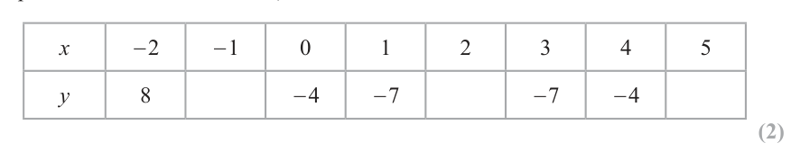

# 4MB1/02 — 2023-11 (official extraction)

> schema `syllabai.official-paper-questions/0.2` · paper_id `pearson-edexcel:international-gcse:mathematics-b:4mb1:2023-11:4MB1/02` · qp sha256 `974699fa3a3e6dfc…` · extraction is the disclosed baseline (ADR-039)

## Question 1 (11 marks)

The table shows information about 5 lakes in the Lake District. Name Surface area (m2) Volume (m3) Windermere 1.5 × 107 3.1 × 108 Ullswater 8.9 × 106 2.2 × 108 Thirlmere 3.3 × 106 5.0 × 107 Wastwater 2.9 × 106 1.1 × 108 Ennerdale Water 3.0 × 106 5.4 × 107

### 1(a) [1]

Write 3.3 × 106 as an ordinary number. Elter Water is another lake and has a volume of 500 000 m3

**Mark scheme answer**

> 3 300 000 1 B1

- **(1)** 3 300 000 1 B1

### 1(b) [1]

Write 500 000 in standard form.

**Mark scheme answer**

> 5 ×105 1 B1

- **(1)** 5 ×105 1 B1

### 1(c) [2]

Calculate the difference, in standard form, between Windermere’s surface area and Wastwater’s surface area. Volume of water in Windermere k volume of water in Thirlmere

**Mark scheme answer**

> 1.5 ×107 − 2.9 ×106 2 M1 Allow for 1.21×10n where n = 6 or 7
> 1.21×107 A1cas condone a correct answer not in standard form
> eg 12 100 000 or 12.1×106 ISW

- **(2)** 1.5 ×107 − 2.9 ×106 2 M1 Allow for 1.21×10n where n = 6 or 7

### 1(d) [2]

Work out the value of k The area of circle C is equal to the surface area of Ullswater.

**Mark scheme answer**

> 3.1×108 2 M1 Allow for 0.62 ×10n where n = 8 or 7 or 15
> k=
> 5.0 × 107
> 6.2
> A1cas allow

- **(2)** 3.1×108 2 M1 Allow for 0.62 ×10n where n = 8 or 7 or 15

### 1(e) [2]

Find, in metres to 2 significant figures, the radius of C x 4 106 n where n is an integer.

**Mark scheme answer**

> 8.9 ×106 8.9 ×106 2 M1 for a correct expression for r or r2
> or
> π π Allow 3.1, 3.14, etc or for π
> NB ⎡⎣ r 2 = ⎤⎦ awrt 2.83 × 106
> 1700 A1cas awrt 1700 oe eg 1.7 ×103 ISW

- **(2)** 8.9 ×106 8.9 ×106 2 M1 for a correct expression for r or r2

### 1(f) [3]

Find, in standard form, an expression for x 2 in terms of n

**Mark scheme answer**

> 4 −2 or 10 −12 n 3 1 1
> M1 for 2 or 12 n or May be embedded.
> 4 10
> M1 for a correct answer in any form with (106 n ) replaced with
> −2
> eg 4−2 ×10−12 n or 0.0625 ×10−12 n
> 10−12 n or (106 n ) replaced with 1012 n . This implies the first M1 ISW
> or or
> (16 ×1012n ) 16
> 6.25 ×10−12 n−2 A1 cas
> Total 11 marks
> Question Working Answer Mark Notes

- **(3)** 4 −2 or 10 −12 n 3 1 1

## Question 2 (6 marks)

y 10 cm BC 3 x y 1 cm AD 2 x 9 y 14 cm CD 5 x 5 y 9 cm Calculate the length, in cm, of the perimeter of the kite. (6)

### 2 [6]

y 10 cm BC 3 x y 1 cm AD 2 x 9 y 14 cm CD 5 x 5 y 9 cm Calculate the length, in cm, of the perimeter of the kite.

**Mark scheme answer**

> 6 x + 2 y − 10 = 3x + y + 1 or 6 M1 for equating one pair of sides
> 3x + y = 11 oe M1 equating both pairs of sides (at least one equation simplified and
> 3x − 4 y = −5 oe correct) condone one incorrect term in total. Implied by
> eg 2 x + 9 (11 − 3 x ) − 14 = 5 x + 5 (11 − 3 x ) − 9 oe

- **(6)** 6 x + 2 y − 10 = 3x + y + 1 or 6 M1 for equating one pair of sides

## Question 3 (4 marks)

E is the universal set and A and B are two other sets. E 6, 7, 8, 9, 10, 11, 12, 13, 14, 15, 16, 17, 18, 19, 20, 21 A 7, 8, 9, 10, 11, 12, 13, 14, 15 B 12, 13, 14, 15, 16, 17, 18, 19, 20 List the members of the set

### 3(a) [1]

A ∩ B

**Mark scheme answer**

> 12,13,14,15 1 B1

- **(1)** 12,13,14,15 1 B1

### 3(b) [1]

A B

**Mark scheme answer**

> 16, 17, 18, 19, 20 1 B1

- **(1)** 16, 17, 18, 19, 20 1 B1

### 3(c) [2]

A B

**Mark scheme answer**

> 7,8,9,10,11,12,13,14,15,16,17,18,19,20 2 M1 Finding A ∪ B ignore any incorrect set notation
> 6, 21 A1 cas
> Total 4 marks
> Question Working Answer Mark Notes

- **(2)** 7,8,9,10,11,12,13,14,15,16,17,18,19,20 2 M1 Finding A ∪ B ignore any incorrect set notation

## Question 4 (6 marks)

x 3 10 x 3 Given that y = x3

### 4(a) [2]

show that y 2 3 y

**Mark scheme answer**

> 2
> M1 replacing x by y in both terms to form a correct equation. Allow
> equivalent eg y = − 3 or y − 10 y −1 + 3 = 0
> y
> 2
> or
> y = 10 y −1 − 3 or x 3 = 10 − 3 x 3 −
> for removing the x 3 to gain a correct equation in terms of x eg
> 1
> x 3 ( x 3 + 3) = 10
> 2
> This may be implied by eg x + 3 y = 10 or x ( y + 3) = 10
> 3
> y= − 3 ⇒ y 2 + 3 y − 10 = 0 or
> A1 wr dep on M1. For both x replaced by y to form a correct equation
> y leading to the given equation with no errors.
> y 2 = 10 − 3 y ⇒ y 2 + 3 y − 10 = 0 or
> y ( y + 3) = 10 ⇒ y 2 + 3 y − 10 = 0
> ALT 2 1
> x + 3x − 10 [ = 0]
> 3
> M1 For substituting y = x into y 2 + 3 y − 10
> ⎛ −
> ⎞ 1 1
> x ⎜10 x 3 − 3 + 3 ⎟ − 10 ⇒ 10 − 10 = 0
> 3 A1 For taking out the x as a factor and substituting 10 x − 3 for x
> 3 3
> ⎝ ⎠ leading to zero with no errors.

- **(2)** 2

### 4(b)(i) [2]

Solve the equation y 2 3 y 1 1

**Mark scheme answer**

> quadratic.
> If using quadratic formula then must be correct substitution (condone
> missing brackets around the b in b2)
> If using completing the square, allow one numerical or sign error
> 2, −5 A1 cas Do not accept un-simplified values but award if seen in (ii)

- **(2)** quadratic.

### 4(b)(ii) [2]

Hence find the solutions to x3 10 x 3

**Mark scheme answer**

> x = 2 or x = ( −5 ) 2 M1 for cubing at least 1 of their y values. If y values incorrect, we need to
> 3
> see the cube
> 8, −125 A1 cas ignore any y values given
> Total 6 marks
> Question Working Answer Mark Notes

- **(2)** x = 2 or x = ( −5 ) 2 M1 for cubing at least 1 of their y values. If y values incorrect, we need to

## Question 5 (7 marks)

A solid square-based cuboid is made of steel. The mass of the cuboid is 1500 grams, to the nearest 50 grams. The length of the side of the square base of the cuboid is 12 cm, to 2 significant figures. The density of the steel is 7.98 g/cm3, to 3 significant figures. Given that Mass Density = Volume

### 5(a) [4]

show that the lower bound of the height of the cuboid is 1.2 cm to one decimal place. Show your working clearly. Another solid square-based cuboid is made of wood. The length of the side of the square base of this cuboid is 13 cm, to 2 significant figures. The height of the cuboid is 2.4 cm, to one decimal place.

**Mark scheme answer**

> 1525, 1475, 12.5, 11.5, 7.985, 7.975 4 B1 for one correct UB or LB stated or used
> 1475 M1 Correct method to find the volume using
> [V =] or
> m
> 7.985 V = where ( 1475 m 1525 and 7.975 d 7.985 ) or
> [V =]12.52 h d
> using V = s 2 h where 11.5 s 12.5
> m m V
> May be implied by use of d =
> or h = 2 or h = 2
> hs ds s
> where ( 11.5 s 12.5 , m and d any value) or
> where ( 1475 m 1525 and 7.975 d 7.985 , s any value) or
> where ( 11.5 s 12.5 and V is any value)
> ⎡ m ⎤ 1475 M1 Correct method/equation to enable h to be found where
> ⎢⎣ h = ds 2 = ⎥⎦ 7.985 ×12.52 or 7.98 < d 7.985 and 1475 m < 1500 and 12 < s 12.5
> 1475 This implies the first M mark.
> 7.985 =
> h ×12.52
> 1.2 A1wr awrt 1.2 working must be shown and the correct calculation with
> correct bounds seen.
> NB An answer of 1.2 with no working gains no marks

- **(4)** 1525, 1475, 12.5, 11.5, 7.985, 7.975 4 B1 for one correct UB or LB stated or used

### 5(b) [3]

Find, in cm2 to one decimal place, the lower bound of the surface area of the cuboid. Show your working clearly.

**Mark scheme answer**

> 2( s 2 + 2s × h) or 2 × s 2 + 4 × s × h oe 3 M1 for a correct expression in 2 variables. If the correct expression is
> not seen allow if consistent positive values are used for s and h
> 2(12.52 + 2 ×12.5 × 2.35) or M1 allow 12.5 s < 13 and 2.35 h < 2.4
> 2 ×12.52 + 4 ×12.5 × 2.35
> 430 A1wr working must be shown and the correct calculation with
> correct bounds seen. Allow 430.0
> NB An answer of 430 with no working gains no marks
> Total 7 marks
> Question Working Answer Mark Notes

- **(3)** 2( s 2 + 2s × h) or 2 × s 2 + 4 × s × h oe 3 M1 for a correct expression in 2 variables. If the correct expression is

## Question 6 (9 marks)

The table gives information about the time, in minutes, spent in a supermarket by 65 customers. Time (t minutes) Frequency 0 < t ≤ 15 15 15 < t ≤ 25 21 25 < t ≤ 30 20 30 < t ≤ 40 8 40 < t ≤ 60 1

### 6(a) [1]

Write down the class interval that contains the median time.

**Mark scheme answer**

> 15 < t 25 1 B1 condone < for and for <

- **(1)** 15 < t 25 1 B1 condone < for and for <

### 6(b) [4]

Calculate an estimate for the mean time spent by these 65 customers in the supermarket. Give your answer to one decimal place. One of the 65 customers is chosen at random.

**Mark scheme answer**

> 7.5 ×15 + 20 × 21 + 27.5 × 20 + 35 × 8 + 50 [×1][ = 1412.5] 4 M2 for at least 3 correct products using midpoints
> with intention to add. Allow 112.5 + 420 + 550 +
> 280 + 50 or seeing 1412.5
> (M1 for at least 3 products using frequency and a
> value within the interval with the intention to add.
> (condone use of lower class bound) or for at least 3
> correct products using midpoints without adding)
> "1412.5" M1 dep on at least M1 previously scored. For
> 65 dividing their sum by 65
> 21.7 A1cas must have 21.7 as their final answer.
> However if 21.7 seen condone further rounding to 22

- **(4)** 7.5 ×15 + 20 × 21 + 27.5 × 20 + 35 × 8 + 50 [×1][ = 1412.5] 4 M2 for at least 3 correct products using midpoints

### 6(c) [1]

Calculate the probability that the customer spent more than 30 minutes in the supermarket. The histogram below shows information about the time, in minutes, spent in the checkout queue for each of these 65 customers. Frequency density 0 1 2 3 4 5 6 7 8 9 10 11 12 13 14 15 Time in minutes There were 15 customers who spent between 5 and 10 minutes in the queue.

**Mark scheme answer**

> 9 1 B1 awrt 0.14

- **(1)** 9 1 B1 awrt 0.14

### 6(d) [3]

Calculate the number of these 65 customers who spent more than 3 minutes in the queue.

**Mark scheme answer**

> Fd for 5 – 10 class = 3 or 3 M1 finding fd oe eg 12 medium square = 15
> 1 small square = 0.05 or Implied by a frequency of 6, 14, 20 or 10 seen
> 1 medium square = 1.25 or Any fd / frequency may be seen in the correct place
> 1 large square = 5 or on the histogram
> [freq for 10 < t 15 = ] × 0.8
> 1.2
> [Number > 3=] M1 Correct method ft their fd eg
> 10 × 2 + 15 + 2 × 5 or 65 − 6 ×1 − 7 × 2 "3" "3"
> for fd × 8 × 2 + 15 + ×1.6 × 5
> (10 × 40 + 25 ×12 + 25 × 8) × "0.05" or 65 − ( 5 × 24 + 10 × 28) × "0.05" 2.4 2.4
> (8 × 2 + 5 × 2.4 + 5 ×1.6) × "1.25" or 65 − (1× 4.8 − 2 × 5.6) × "1.25"
> ( 4 ×1 + 1.2 × 2.5 + 0.8 × 2.5) × "5" or 65 − ( 0.5 × 2.4 + 1× 2.8) × "5"
> 45 A1cas
> Total 9 marks
> D
> A
> B
> C
> Question Working Answer Mark Notes

- **(3)** Fd for 5 – 10 class = 3 or 3 M1 finding fd oe eg 12 medium square = 15

## Question 7 (11 marks)

On the grid opposite, triangle B is the image of triangle A under a single transformation.

### 7(a) [2]

Describe fully the single transformation. Triangle B is transformed to triangle C by an enlargement with scale factor 2 centre (2, 7)

**Mark scheme answer**

> ⎛ −5 ⎞ 2 M1 If multiple transformations given award M0. Multiple
> Translation or ⎜ ⎟ transformation are when more than one of reflection, rotation
> ⎝ −1 ⎠ (turn), translation(move), enlargement(stretch/squash) is stated.
> Giving an equation of a line, SF, vector does not count as
> multiple transformations
> Translation A1
> ⎛ −5 ⎞
> ⎜ ⎟
> ⎝ −1 ⎠

- **(2)** ⎛ −5 ⎞ 2 M1 If multiple transformations given award M0. Multiple

### 7(b) [3]

Draw and label triangle C The area of triangle A is x cm2

**Mark scheme answer**

> Triangle C 3 B3 (0, 1) (−4, −1)(−4, −5) plotted and triangle drawn
> drawn (B2 2 points plotted correctly
> B1 correct enlargement from any centre)

- **(3)** Triangle C 3 B3 (0, 1) (−4, −1)(−4, −5) plotted and triangle drawn

### 7(c) [1]

Find, in terms of x, the area in cm2, of triangle C 3 2 y 1 M= N = 5 4 2 2 Triangle B is transformed to triangle D under the transformation with matrix N Given that the determinant of M is equal to the determinant of N

**Mark scheme answer**

> 4x 1 B1

- **(1)** 4x 1 B1

### 7(d) [5]

draw and label triangle D Show your working clearly. a b Determinant of matrix ad bc c d y A B −7 −6 −5 −4 −3 −2 −1 O 1 2 3 4 5 6 7 x −1 −2 −3 −4 −5 for a spare grid if you need to redraw your triangles. Only use this grid if you need to redraw your triangles. y A B −7 −6 −5 −4 −3 −2 −1 O 1 2 3 4 5 6 7 x −1 −2 −3 −4 −5

> 🖼 crop required: grid (qp.pdf p.None)

**Mark scheme answer**

> 3 × 4 − 5 × 2 = 2 y − ( −1× −2 ) 5 M1 ISW for using the determinant to set up an equation. eg
> 2 y − 2 = 2 We will condone 1 sign error eg 2 y + 2 = 2
> 3 × 4 − 5 × 2 + ( −1× −2 ) M1 rearranging to find a correct expression or value for y
> y= [ = 2]
> ⎛ "2" −1⎞⎛ −1 −1 1 ⎞ M1 Correct order of multiplication using their y. The points can be
> ⎜ ⎟⎜ ⎟ in any order
> ⎝ −2 2 ⎠⎝ 1 3 4 ⎠
> ⎛ −3 −5 −2 ⎞ M1 dep on previous M1 for multiplying out to give a 2×3 matrix
> ⎜ ⎟ with at least 2 correct entries. The points can be in any order.
> ⎝4 8 6⎠ Allow if two points plotted correctly
> Triangle D A1cas (−3, 4) (−5, 8) (−2, 6)
> plotted
> Total 11 marks
> Question Working Answer Mark Notes

- **(5)** 3 × 4 − 5 × 2 = 2 y − ( −1× −2 ) 5 M1 ISW for using the determinant to set up an equation. eg

## Question 8 (9 marks)
### 8(a) [2]

Complete the table of values for y x 2 4 x x −2 −1 0 1 2 3 4 5 y 8 −4 −7 −7 −4

> 🖼 crop required: table (qp.pdf p.None)

**Mark scheme answer**

> 1, −8, 1 2 B2 all 3 correct
> (B1 for 2 correct)

- **(2)** 1, −8, 1 2 B2 all 3 correct

### 8(b) [2]

On the grid opposite, plot the points from your completed table and join them to form a smooth curve.

> 🖼 crop required: grid (qp.pdf p.16)

**Mark scheme answer**

> 2 B2 Fully correct graph.
> ( B1 All points plotted correctly or at least 4 points plotted
> correctly with a smooth curve joining them. Do not ft any
> incorrect values)

- **(2)** 2 B2 Fully correct graph.

### 8(c) [3]

By drawing a suitable straight line on your grid, find estimates to one decimal place, for the solutions of the equation x 2 4 x 4 2 x 1 in the range −2 ≤ x ≤ 5

> 🖼 crop required: grid (qp.pdf p.16)

**Mark scheme answer**

> Draw the line y = −2 x + 1 3 M1 Line should touch the curve or go through the curve at both
> ends allow plus or minus one small square
> −1.4, 3.4 A2 dep on line drawn allow ± 0.2 (A2 for both, A1 for one) ignore
> any y values given. May be seen written on the graph.

- **(3)** Draw the line y = −2 x + 1 3 M1 Line should touch the curve or go through the curve at both

### 8(d) [2]

By drawing a suitable straight line on your grid, find an estimate to the nearest whole number, of the gradient of the curve y x 2 4 x 4 at the point where x y −2 −1 O 1 2 3 4 5 x −1 −2 −3 −4 −5 −6 −7 −8 −9 for a spare grid if you need to redraw your graph. Only use this grid if you need to redraw your graph. y −2 −1 O 1 2 3 4 5 x −1 −2 −3 −4 −5 −6 −7 −8 −9

> 🖼 crop required: graph (qp.pdf p.16)

> 🖼 crop required: grid (qp.pdf p.16)

**Mark scheme answer**

> A clear tangent drawn 2 M1 Accept a hand drawn line with the intention for it to be drawn
> so it touches the curve once at x = -1
> −6 A1 dep on tangent drawn. Allow ± 1
> Total 9 marks
> Question Working Answer Mark Notes

- **(2)** A clear tangent drawn 2 M1 Accept a hand drawn line with the intention for it to be drawn

## Question 9 (12 marks)

O Diagram NOT accurately drawn C E B D A Figure 2 → → Figure 2 shows triangle OAB with OA = 4a and OB = 3b → The point C lies on OB such that OC = 2b The point D is the midpoint of AB The point E lies on AC such that OED is a straight line.

**(a)** Find, in terms of a and b, simplifying your answer where possible, → → →

### 9(a)(i) [4]

CA (ii) AB (iii) OD Given that CE λCA

**Mark scheme answer**

> 4a − 2b 4 B1

- **(4)** 4a − 2b 4 B1

### 9(b) [4]

use a vector method to find the value of λ → → → → The point P is such that OP = μOD where μ 1 and AP is parallel to OB Given that the area of triangle OCE is 8 cm2

**Mark scheme answer**

> ⎡→ → → ⎤ ⎛ 3 ⎞ 4 → → → →
> ⎢CE = CO + OE = ⎥ − 2b + β ⎜ " 2a + 2 b " ⎟ M1 A correct method for CE (not using CE = λ CA ) ft their OD (see
> ⎣ ⎦ ⎝ ⎠ alternative 1, 2 and 3)
> → →
> Allow finding OE or CO (see alternative 4 and 5)
> → → → →
> CE = λ ("4a − 2b ") leading to "4" λ = "2" β or M1 equating coefficients using CE or OE or CO for a or b ft their
> 3 part(a)
> − "2" λ = −2 + " " β oe
> 3 M1 dep on the previous 2 M marks awarded . For a and b to gain 2
> "4" λ = "2" β and − "2" λ = −2 + " " β oe equations each with 2 parameters.
> 2 → → →
> ft their 2 vectors CE or OE or CO
> 2 → 2→
> A1cas Allow written as CE = CA
> 5

- **(4)** ⎡→ → → ⎤ ⎛ 3 ⎞ 4 → → → →

### 9(c) [4]

find the area, in cm2, of triangle APE

**Mark scheme answer**

> 3 2 4 AP OC
> SF = or SF = B2 stating or using the SF eg = 1.5 or = ft their lambda or
> 2 3 OC PA
> 2
> 3 ⎛3⎞ 2 ⎛2⎞
> × 8 or ⎜ ⎟ × 8 or k × = 8 or k × ⎜ ⎟ = 8 seen
> 2 ⎝2⎠ 3 ⎝3⎠
> (B1 CE : EA = 2 : 3 ft their lambda oe)
> May be implied by an area of 12 or 18
> M1 condone 8 × ( 5 ) or any combinations of letter(s) for k eg ADP
> 2
> ⎛ 3 ⎞
> ⎛ 2 ⎞
> 8 × ⎜ " " ⎟ or k × ⎜ " " ⎟ = 8
> ⎝ 2 ⎠ ⎝ 3 ⎠
> 18 A1cas do not ISW This must be their final answer or clearly labelled as APE
> Total 12 marks
> Alternative 1 Alternative 2 Alternative 3
> → → → → → → → → → → → → →
> CE = CB + BD + DE CE = CA+ AD + DE CE = CB + BA + AO + OE
> → 1 ⎛ 3 ⎞ → 1 ⎛ 3 ⎞ → ⎛ 3 ⎞
> M1 CE = b − ("− 4a + 3b") − β ⎜ "2a + b" ⎟ CE = "− 2b + 4a" + ("3b − 4a") + β ⎜ "− 2a − b" ⎟ CE = b − ("− 4a + 3b") − δ ⎜ "2a + b" ⎟
> 2 ⎝ 2 ⎠ 2 ⎝ 2 ⎠ ⎝ 2 ⎠
> CE = λ ("4a − 2b ") leading to CE = λ ("4a − 2b ") leading to CE = λ ("4a − 2b ") leading to
> M1
> "4" λ = "2"− "2" β or "4" λ = 4 + "− 2"− "2" β or "4" λ = "2"δ or
> 3 3 3 3
> − "2" λ = "1"− " "− " " β − "2" λ = −2 + " "− " " β − "2" λ = "1"− "3"+ " "δ
> 2 2 2 2
> "4" λ = "2"− "2" β and "4" λ = 4 + "− 2"− "2" β and "4" λ = "2" μ and
> M1 3 3 3 3
> − "2" λ = "1"− " "− " " β − "2" λ = −2 + " "− " " β − "2" λ = "1"− "3"+ " "γ
> 2 2 2 2
> 2 2
> A1
> 5 5
> → →
> Alternative 4 Using OE Alternative 5 Using CO
> → ⎛ 3 ⎞ → → ⎛ 3 ⎞
> M1 OE = κ ⎜ "2a + b" ⎟ CO = CE − η ⎜ "2a + b" ⎟
> ⎝ 2 ⎠ ⎝ 2 ⎠
> →
> OE = λ ("4a − 2b ") + 2b leading to CE = λ ("4a − 2b ") and CO = −2b leading to
> M1
> "4" λ = "2"κ or − "2" λ + 2 = " "κ
> "4" λ = "2"η or −2 = "− 2"η − " "η
> 2
> 3
> M1 "4" λ = "2"κ and − "2" λ + 2 = " "κ "4" λ = "2"η and −2 = "− 2"η − " "η
> 2
> 2
> A1
> 5
> Question Working Answer Mark Notes

- **(4)** 3 2 4 AP OC

## Question 10 (11 marks)

E Diagram NOT accurately drawn F A D H 4m G 1.5 m 2.4 m B 3m C Figure 3 Figure 3 shows a solid right prism ABCDEFGH The base of the prism, ABCD, is a rectangle and is horizontal. Trapezium BCHG is a cross section of the prism. AB = 4 m BC = 3 m CH = 2.4 m GB = 1.5 m GBC BCH ABG DCH

### 10(a) [2]

Calculate the volume, in m3, of the prism.

**Mark scheme answer**

> 3 2 M1 Correct method for area of trapezium eg 3 ×1.5 + 0.5 × 3 × ( 2.4 –1.5) May
> [Area BCHG] = (1.5 + 2.4 ) [ = 5.85] oe
> 2 be seen as part of a volume calculation.
> 23.4 A1 cas

- **(2)** 3 2 M1 Correct method for area of trapezium eg 3 ×1.5 + 0.5 × 3 × ( 2.4 –1.5) May

### 10(b) [3]

Calculate the angle of depression, in degrees to one decimal place, of G from E

**Mark scheme answer**

> [ DB =] 4 + 3 [=5]
> 2 2 3 M1 Finding the diagonal or [GE = ] 42 + 32 + 0.92 ⎡⎣ = 25.81 = 5.08...⎤⎦
> Condone incorrect labelling
> 2.4 − 1.5 ⎡ 0.9 ⎤ 5 0.9
> tan θ = M1 A correct eqn eg cos θ = or sin θ =
> ⎢= ⎥ or
> 42 + 32 ⎣ 5 ⎦
> oe
> ( 4 + 3 ) + 0.9
> 2 2
> ( 4 + 3 ) + 0.9
> 2 2
> 42 + 32 ⎡ 5 ⎤ 42 + 32 + 0.92 42 + 32 + 0.92
> tan θ = = or cos θ = or sin θ =
> 2.4 − 1.5 ⎢⎣ 0.9 ⎥⎦ 42 + 32 0.9
> or
> cos θ =
> ( 42 + 32 ) + ( 42 + 32 + 0.92 ) − 0.92 or cos θ =
> 0.92 + "25.81"− 52
> 2× 5× ( 4 + 3 + 0.9 )
> 2 2 2 2 × 0.9 × "25.81"
> 10.2 A1cas awrt 10.2 NB an answer that is awrt 79.8 gains 2 marks

- **(3)** [ DB =] 4 + 3 [=5]

### 10(c) [2]

Calculate the length, in metres to 3 significant figures, of AH The point P lies on the line GH such that GP = GH The point Q lies on the line BC such that BQ = BC

**Mark scheme answer**

> 4 + 3 + 2.4 or
> 2 2
> 5 + 2.4
> 2 2 2 M1 Correct method to find AH
> 5.55 A1cas awrt 5.55

- **(2)** 4 + 3 + 2.4 or

### 10(d) [4]

Calculate, in degrees to one decimal place, ∠APQ Area of trapezium ( a b) h

**Mark scheme answer**

> 2 4 M1 using similar triangles to find PQ eg Both PQ and AQ May be seen
> PQ = 1.5 + × ( 2.4 − 1.5 ) [ = 2.1] as part of
> 3 PQ = 2.4 − × ( 2.4 − 1.5 ) [ = 2.1]
> 3 AP = 42 + 22 + 2.12
> AQ = 42 + 22 ⎡⎣ = 20 = 2 5 = 4.47...⎤⎦ M1 Fully correct method to find AQ. or implied by
> AP = 24.41 [ = 4.94...]
> ⎡ AQ ⎤ 4.47... M1 dep on the previous M marks being awarded. We will not ft any values for
> Tan APQ ⎢ = ⎥ = 2.1 oe this mark, they must be correct to 1 dp. Correct method to find ∠APQ
> ⎣ PQ ⎦
> ⎡ AQ ⎤ 20 ⎡ PQ ⎤ 2.1
> eg sin θ ⎢ = ⎥ = or cosθ ⎢ = ⎥ =
> ⎣ AP ⎦ 20 + 2.12
> ⎣ AP ⎦ 20 + 2.12
> ⎡ AP 2 + PQ 2 − AQ 2 ⎤ 24.41 + 2.12 − 20
> cos APQ ⎢ = ⎥=
> ⎣ 2 × AP × PQ ⎦ 2 × 24.41 × 2.1
> 64.8 A1cas awrt 64.8 Only allow awrt 65 from correct working
> Total 11 marks
> Question Working Answer Mark Notes

- **(4)** 2 4 M1 using similar triangles to find PQ eg Both PQ and AQ May be seen

## Question 11 (14 marks)

The function f is defined as f : x ↦ 2 x 2 + 3 x

### 11(a) [1]

Find f(−2) df ( x)

**Mark scheme answer**

> 2 1 B1

- **(1)** 2 1 B1

### 11(b) [3]

Find the value of x such that =0 dx x The function g is defined as g : x ↦ 4 x

**Mark scheme answer**

> 4x + 3 3 M2 Correct differentiation (M1for one term correct)
> −0.75 A1cas

- **(3)** 4x + 3 3 M2 Correct differentiation (M1for one term correct)

### 11(c) [1]

State the value of x that must be excluded from any domain of the function g

**Mark scheme answer**

> −3 1 B1 for – 3 Allow x = −3 or x ≠ −3

- **(1)** −3 1 B1 for – 3 Allow x = −3 or x ≠ −3

### 11(d) [2]

Find fg(5) The function h is such that 3x gh(x) x > 1 x

**Mark scheme answer**

> ⎛ x+7⎞
> ⎛ x+7⎞ 2 M1 finding g(5) or fg(x)
> ⎡⎣g ( 5 ) = ⎤⎦ 2.5 or fg ( x ) = 2 ⎜ 4 − ⎟ + 3⎜ 4 − ⎟ oe
> ⎝ x+3⎠ ⎝ x+3⎠
> 20 A1 cas
> For (e) award method marks for which ever method will give the highest mark

- **(2)** ⎛ x+7⎞

### 11(e) [7]

Find h(x) in its simplest form. Show clear algebraic working.

**Mark scheme answer**

> ⎛ 3x − 4 ⎞ 7 ⎛ 3x − 4 ⎞
> h ( x ) = g −1 ⎜ ⎟ Implied by subst into their g ( x )
> −1
> ⎟ M1 for g −1 ⎜
> ⎝ x −1 ⎠ ⎝ x −1 ⎠
> y ( x + 3) = 4 ( x + 3) − ( x + 7 ) or M1 for 1st step to find g −1 ( x) eg x ( y + 3) = 3 y + 5 Condone
> x ( y + 3) = 4 ( y + 3) − ( y + 7 ) missing brackets around ( x + 7 ) or ( y + 7 ) eg x ( y + 3) = 3 y + 19
> x ( y − 4 + 1) = 12 − 7 − 3 y or x ( y − 3) = 5 − 3 y or M1 collecting x (y) terms on one side and factorising. Allow 1 error
> in correct equation eg x ( y − 3) = 19 − 3 y May be implied
> y ( x − 4 + 1) = 12 − 7 − 3x or y ( x − 3) = 5 − 3x
> 5 − 3y 5 − 3x a − by a − bx
> [ x =] or [ y =] M1 rearranging to get [ x = ] … or [ y =] … where 2
> y −3 x −3 y −c x−c
> of a,b and c are correct. oe This implies the 2nd and 3rd M1
> ⎛ 3x − 4 ⎞ 3x − 4
> 5 − 3⎜ ⎟ M1 Subst into their g −1 ( x) Allow any letter
> ⎝ x −1 ⎠ x −1
> ⎛ 3x − 4 ⎞
> ⎜ ⎟−3
> ⎝ x −1 ⎠
> 5 ( x − 1) − 3 ( 3 x − 4 ) M1 dep on 4th and 5th M mark being awarded. For removing the
> embedded fractions correctly
> ( 3x − 4 ) − 3 ( x − 1)
> ⎡⎣ h ( x ) = ⎤⎦ 4 x − 7 A1wr dependent on at least 5 method marks being awarded. For
> 4 x − 7 Must be in terms of x
> Alternative
> Allow the use of any letters
> h + 7 3x − 4 M1 for equating g(y) to gh(x)
> 4− =
> only
> 4 ( h + 3) − ( h + 7 ) 3 x − 4 M1 for making a single fraction of the LHS
> = Condone missing brackets around ( h + 7 ) Different
> h+3 x −1
> variables required on each side. Allow any 2 letters
> ( 3h + 5)( x − 1) = 3x − 4 M1 multiplying all terms by ( x − 1) or ( h + 3)
> oe or
> h+3 Different variables required on each side. Allow
> ( 3x − 4 )( h + 3) any 2 letters
> ( 3h + 5) = oe or
> ( 3h + 19 )( x − 1) = 3x − 4
> x −1 eg or
> 4 ( x − 1) −
> ( h + 7 )( x − 1) = 3x − 4 h+3
> h+3 ( 3x − 4 )( h + 3)
> ( 3h + 19 ) =
> 4 ( h + 3) − ( h + 7 ) =
> ( 3x − 4 )( h + 3) x −1
> or NB A correct expression here will imply the 2nd
> x −1
> method mark
> ( 3h + 5)( x − 1) = ( 3x − 4 )( h + 3) or M1 for multiplying all terms by ( x − 1) and ( h + 3)
> 4 ( x − 1)( h + 3) − ( h + 7 )( x − 1) = ( 3x − 4 )( h + 3)
> 3hx − 3h + 5 x − 5 = 3hx − 4h + 9 x − 12 M1 dep on 4th M mark being awarded. multiplying
> out the brackets. Allow one error only.
> 3hx − 3hx − 3h + 4h = 9 x − 12 − 5 x + 5 M1 dep on 5th M mark being awarded. Collecting
> the terms in h on one side.
> ⎡⎣ h ( x ) = ⎤⎦ 4 x − 7 A1 dep on at least 5 M marks being awarded. For
> 4 x − 7 . Must be in terms of x
> Total 14 marks
> Pearson Education Limited. Registered company number 872828
> with its registered office at 80 Strand, London, WC2R 0RL, United Kingdom

- **(7)** ⎛ 3x − 4 ⎞ 7 ⎛ 3x − 4 ⎞

