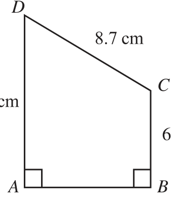
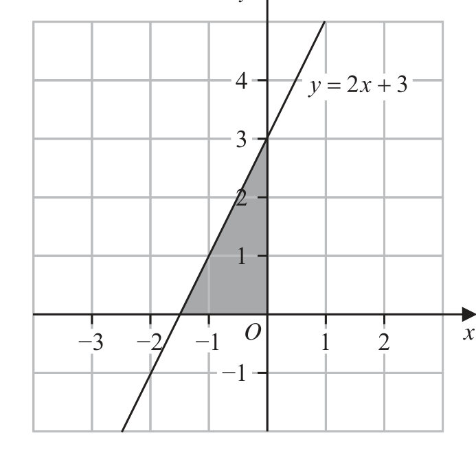
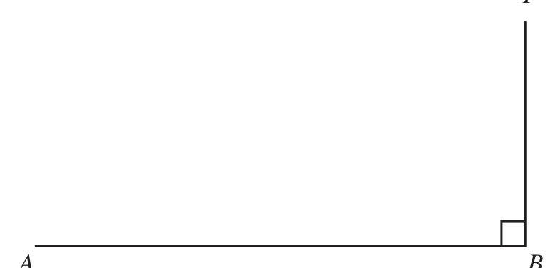
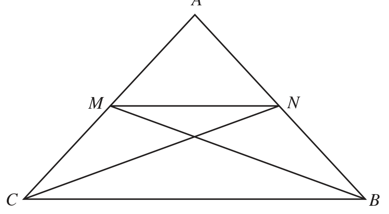
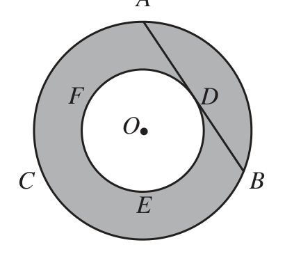
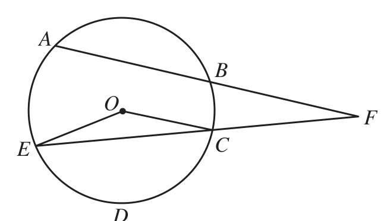

# 4MB1/01 — 2024-06 (official extraction)

> schema `syllabai.official-paper-questions/0.2` · paper_id `pearson-edexcel:international-gcse:mathematics-b:4mb1:2024-06:4MB1/01` · qp sha256 `f7e6199e731cd658…` · extraction is the disclosed baseline (ADR-039)

## Question 1 (2 marks)
### 1(a) [1]

Write 7432 to 2 significant figures.

**Mark scheme answer**

> 7400 2 B1 accept 7.4 ×10 and 7.400 ×103 and 74 ×102
> and 740 ×101

- **(1)** 7400 2 B1 accept 7.4 ×10 and 7.400 ×103 and 74 ×102

### 1(b) [1]

Write 0.0374 to 2 decimal places.

**Mark scheme answer**

> 0.04 B1 accept 4 ×10−2

- **(1)** 0.04 B1 accept 4 ×10−2

## Question 2 (2 marks)

Given that k = 7 find the value of 5k

### 2 [2]

Given that k = 7 find the value of 5k

**Mark scheme answer**

> 2 M1 for fully correct substitution of x = 7 into given
> expression

- **(2)** 2 M1 for fully correct substitution of x = 7 into given

## Question 3 (3 marks)

D Diagram NOT accurately drawn C 6 cm A B The diagram shows trapezium ABCD ABC BAD AD = 12cm CD = 8.7 cm BC = 6cm Calculate the area, in cm2, of trapezium ABCD ............................................................. cm2

### 3 [3]

The diagram shows trapezium ABCD ABC BAD AD = 12cm CD = 8.7 cm BC = 6cm Calculate the area, in cm², of trapezium ABCD cm²

> *Figure not shown in this reconstruction — the printed paper includes a diagram (not drawn accurately).*
> Labels in the original figure: D, C, A, B · Figure values: 6.

**Mark scheme answer**

> − 2 × 72
> + 5× 7 Allow (7)² or 49 and
> 2 5 × 7 or 35
> implied by (–95/2 or – 47.5) and 35
> –12.5 A1 oe we can ISW incorrect attempt to simplify
> cas
> −
> 3 M1 for a correct expression involving AB and no
> other unknowns or [AB=] 6.3
> Or $8.7^2$ = $AB^2$ + (12 − 6 )$^2$
> Allow using their h = (12 − 6 ) if marked on their
> ⎛ 6 ⎞ diagram providing h is less than 8.7
> Or cos ADC = [ = 46.39...] and
> ⎝ 8.7 ⎠ A correct Pythagoras calculation, eg or a complete
> $AB^2$ = $6^2$ + $8.7^2$ − 2 × 6 × 8.7 × cos"46.39..." method to find AB using trigonometry
> ⎛ 6 ⎞
> Or cos ADC = [ = 46.39...] and
> ⎝ 8.7 ⎠
> AD
> =
> sin"46.39..." sin ( 90 − "46.39...")
> ⎛ 6 ⎞
> Or cos ADC = [ = 46.39...] and
> ⎝ 8.7 ⎠
> AD 8.7
> =
> sin ("46.39...") sin 90
> 1 M1 for a correct method to find the area of a
> Area = (12 + 6 ) × "6.3" trapezium using their AB. “6.3” can be any number
> 1 other than 6, 12 or 8.7
> Or 6 × "6.3"+ × "6.3"× (12 − 6 )
> 2 eg 6 × "6.3"+ × "6.3"× (12 − 6 )
> 1
> Or 6 × "6.3"+ × 6 × 8.7 × sin"46.39..."
> Or 12 × "6.3"− × "6.3"× (12 − 6 )
> Or 12 × "6.3"− × 6 × 8.7 × sin"46.39..."
> cas 56.7 A1 awrt 56.7

- **(3)** − 2 × 72

## Question 4 (3 marks)

A B 5 1 4 2

### 4(a) [1]

Calculate A + B 13 2 Given that nA 2B = 7 1

**Mark scheme answer**

> ⎛ 1 −6 ⎞ 1 B1
>  −9 3 

- **(1)** ⎛ 1 −6 ⎞ 1 B1

### 4(b) [2]

find the value of n n =

**Mark scheme answer**

> ⎛ 3 −2 ⎞ ⎛ −2 −4 ⎞ ⎛ 13 2 ⎞ 2 M1 for setting up the matrices so a relevant
> n − 2× = oe equation can be formed or a correct relevant
> ⎝ −5 1 ⎠ ⎝ −4 2 ⎠ ⎝ −7 −1⎠
> equation eg 3n + 4 = 13 , −2n + 8 = 2 , −5n + 8 = −7 ,
> 3n − 2 × ( −2 ) = 13 n − 4 = −1 oe
> −2n − 2 × ( −4 ) = 2
> −5n − 2 × ( −4 ) = −7
> n − 2 × ( 2 ) = −1
> cas 3 A1

- **(2)** ⎛ 3 −2 ⎞ ⎛ −2 −4 ⎞ ⎛ 13 2 ⎞ 2 M1 for setting up the matrices so a relevant

## Question 5 (3 marks)

A straight line passes through the points with coordinates (2, –14) and (–3, 6) Find an equation of the line. Give your answer in the form y mx c

### 5 [3]

A straight line passes through the points with coordinates (2, –14) and (–3, 6) Find an equation of the line. Give your answer in the form y mx c

**Mark scheme answer**

> 6 − −14 3 M1 correct method to find the gradient.
> [ = −4] oe May be implied by an equation with the correct
> −3 − 2
> −14 − 6 gradient.
> [ = −4] oe
> 2 − −3
> M1 for a correct expression involving the intercept,
> (commonly c but can be any letter) for their

- **(3)** 6 − −14 3 M1 correct method to find the gradient.

## Question 6 (4 marks)
### 6(a) [2]

Solve the inequality 3w 4 ≤ 8w

**Mark scheme answer**

> 2 M1 allow for −3
> −5w 15 or −15 5w or 15 ≥ −5w or 5w ≥ −15 Allow use of any inequality symbol or = for the M
> mark
> cas w −3 A1 accept −3 ≤ w

- **(2)** 2 M1 allow for −3

### 6(b) [2]

On the number line, show the inequality 4 x ≤ 2 x −5 −4 −3 −2 −1 0 1 2 3 4 5

**Mark scheme answer**

> = "− 4"× −3 + c or −14 = "− 4"× 2 + c or gradient. Must be clearly identified if incorrect or
> y − 6 = "− 4" ( x − ( −3) ) or have come from correct working. Or a correct un-
> simplified equation or a correct equation not in the
> y − ( −14 ) = "− 4" ( x − 2 ) oe required form eg y + 4 x = −6
> May be implied by an equation with the correct
> intercept.
> cas y = −4 x − 6 A1 accept y = −4 x + (−6)
> A1 Both end points identified using the correct symbols
> and one correct line drawn between the two correct
> points.

- **(2)** = "− 4"× −3 + c or −14 = "− 4"× 2 + c or gradient. Must be clearly identified if incorrect or

## Question 7 (3 marks)
### 7(a) [2]

Simplify fully 3a 3b5

**Mark scheme answer**

> 9a b6 10
> 2 B2 fully correct
> (B1 for an expression in the form ma p b q with 2 of m,
> p and q correct, or a 6b10 )
> 1 − 12 1 1 1 −
> c B1 allow or or 0.5c
> or

- **(2)** 9a b6 10

### 7(b) [1]

Simplify fully 4c

**Mark scheme answer**

> 2 2 c
> 2c 2 4c

- **(1)** 2 2 c

## Question 8 (2 marks)

y −3 −2 −1 O 1 2 x −1 The diagram shows the line y 2 x Write down the three inequalities that define the region shaded in the diagram.

### 8 [2]

y −3 −2 −1 O 1 2 x −1 The diagram shows the line y 2 x Write down the three inequalities that define the region shaded in the diagram.

> *Figure not shown in this reconstruction — the printed paper includes a diagram (not drawn accurately). Use the text description to work through it.*

**Mark scheme answer**

> y 2x + 3 2 B2 All 3 correct
> x 0 (B1 for 2 correct)
> y 0 Allow equivalent inequalities and condone < for
> and > for for both marks but not =

- **(2)** y 2x + 3 2 B2 All 3 correct

## Question 9 (3 marks)

T Diagram NOT accurately drawn A B 20 m A and B are two points on horizontal ground. The distance from A to B is 20 m BT is a vertical pole. The angle of depression of A from T is 10° Find the height, in metres to 3 significant figures, of the pole. ............................................................. m

### 9 [3]

and B are two points on horizontal ground. The distance from A to B is 20 m BT is a vertical pole. The angle of depression of A from T is 10° Find the height, in metres to 3 significant figures, of the pole m

> *Figure not shown in this reconstruction — the printed paper includes a diagram (not drawn accurately).*
> Labels in the original figure: T, A, B, A · Figure values: 20.

**Mark scheme answer**

> 3 M2 for a fully correct equation or method. Other letters
> BT can be used for BT
> tan10 = or 20 × tan10 = BT oe
> 20 20 ⎛ M1 for TAB = 10 (may be seen on diagram) ⎞
> or tan 80 = or BT = oe 
> BT tan 80 ⎜ or cos10 = 20 ⎟
> BT 20 ⎜ AT ⎟
> or = oe ⎜ or a correct trig statement from an incorrect diagram eg ⎟
> sin10 sin 80
>  BTA=10° and 
> 20 
> ("20.30...") − 202 oe
> or cos10 = and BT = 20 BT
> AT tan10 = or = oe or BT = awrt 113... oe BT sin 80 sin10 
> 3.53 A1 awrt 3.5 allow answer of 3.4 or 3.6 from correct
> cas
> working

- **(3)** 3 M2 for a fully correct equation or method. Other letters

## Question 10 (3 marks)

A Diagram NOT accurately drawn M N C B The diagram shows the isosceles triangle ABC where AC = AB M is the midpoint of AC N is the midpoint of AB Prove that triangle MCB is congruent to triangle NBC

### 10 [3]

The diagram shows the isosceles triangle ABC where AC = AB M is the midpoint of AC N is the midpoint of AB Prove that triangle MCB is congruent to triangle NBC

> *Figure not shown in this reconstruction — the printed paper includes a diagram (not drawn accurately).*
> Labels in the original figure: A, M, N, C, B.

**Mark scheme answer**

> 3 M2 two correct with reasons, equivalent of bolded
> BC is common
> words needed for reasons.
> MC = NB midpoints [of AB and AC (M1 one correct with reason or all 3 stated with no
> and AB = AC] reasons)
> Allow ∠ACB for ∠MCB and ∠ABC for ∠NBC
> ∠MCB = ∠NBC isosceles triangle
> Allow shortened versions of key words
> wr SAS A1 SAS stated with all 3 correct, including reasons

- **(3)** 3 M2 two correct with reasons, equivalent of bolded

## Question 11 (2 marks)

A 5 1 Find A −1

### 11 [2]

A 5 1 Find A −1

**Mark scheme answer**

> ⎛1 2⎞ 2 M1 for correct method to find the determinant or
> det = 3 ×1 − ( −2 × −5 ) [ = −7 ] or the correct matrix without the determinant. May be
> ⎝5 3⎠ seen as part of the final answer.
> A1 oe
> ISW incorrectly multiplying through the matrix by
> 1
> 1 ⎛1 2⎞ − or if − is missing on the answer line but is
> cas − 7
> 7 ⎝5 3⎠
> seen in the working.
> Condone decimal equivalents correct to 2dp
> (awrt 0.14, 0.29, 0.71, 0.43)

- **(2)** ⎛1 2⎞ 2 M1 for correct method to find the determinant or

## Question 12 (3 marks)

Make x the subject of x 3 y

### 12 [3]

Make x the subject of x 3 y

**Mark scheme answer**

> 3 M1 for multiplying all terms by y and remove
> brackets correctly to a form a correct equation or
> 4x 4 for multiplying out the bracket correctly on the
> eg xy + 3 y = 4 x − 4 or x + 3 = − numerator and separating RHS into 2 fractions to a
> y y
> form an equation
> This mark can be implied by a correct equation with
> x terms on one side and terms without x on the other
> M1 for collecting terms in x on one side of the
> eg xy − 4 x = −4 − 3 y or 3 y + 4 = 4 x − xy equation and terms without x on the other side of
> 4x 4 the equation allow one sign error.
> or x − = − −3 Allow ft of their equation providing there are 4
> y y distinct terms with exactly 2 in terms of x
> −4 − 3 y
> x= − −3
> y−4 3y + 4 y
> A1 oe eg x = or x = do not ISW
> 4− y
> 1−
> cas y
> except allow correct fraction without x = on the
> answer line if given correctly with x = in the
> working

- **(3)** 3 M1 for multiplying all terms by y and remove

## Question 13 (3 marks)

A Diagram NOT F D accurately drawn O C B E The diagram shows the circle ABC with centre O and the circle DEF with centre O The line ADB is a tangent to the circle DEF at the point D AB = 16cm Showing your working, calculate in cm2, the shaded area of the diagram. Give your answer in terms of π ............................................................. cm2

### 13 [3]

The diagram shows the circle ABC with centre O and the circle DEF with centre O The line ADB is a tangent to the circle DEF at the point D AB = 16cm Showing your working, calculate in cm², the shaded area of the diagram. Give your answer in terms of π cm²

> *Figure not shown in this reconstruction — the printed paper includes a diagram (not drawn accurately).*
> Labels in the original figure: A, F, D, O, C, B, E.

**Mark scheme answer**

> 3 M1 for realising tangent is 90° to radius and use Pythagoras
> $8^2$ + $r^2$ = $R^2$ OR $OD^2$ = $OA^2$ − $8^2$ correctly to form an equation
> Allow any value for either (r or R) or (OD or OA)
> Area = π ( $8^2$ + $r^2$ ) − π$r^2$ or M1 dep on M1 for substituting in for $R^2$ or $r^2$ to eliminate one
> variable
> π ( $R^2$ ) − π ( $R^2$ − $8^2$ ) oe Or full working with their (r or R) or (OD or OA) to find the
> shaded area
> 64π A1 cao Allow $8^2$π dep on both previous M marks
> NB an answer of 64π will score full marks (an awrt 201 scores
> 2 marks only)

- **(3)** 3 M1 for realising tangent is 90° to radius and use Pythagoras

## Question 14 (4 marks)
### 14(a) [2]

Find the Highest Common Factor (HCF) of 90, 132 and 432 Show your working clearly. Lali thinks of two numbers. The Highest Common Factor (HCF) of the two numbers is 28 The Lowest Common Multiple (LCM) of the two numbers is a multiple of 35

**Mark scheme answer**

> 2 × 3 ×15 or 2 × 3 × 3 × 5 or 2 × 32 × 5 2 M1 for writing 2 or 3 numbers correctly in prime
> 2 × 3 × 22 or 2 × 2 × 3 ×11 or 22 × 3 ×11 factor form or as 2 × 3 × ... eg
> 2 × 3 × 72 or 2 × 2 × 2 × 2 × 3 × 3 × 3 or 24 × 33 90 132 432
> 2 45 66 216
> 3 15 22
> Or two correct trees
> wr 6 A1 cao

- **(2)** 2 × 3 ×15 or 2 × 3 × 3 × 5 or 2 × 32 × 5 2 M1 for writing 2 or 3 numbers correctly in prime

### 14(b) [2]

Find the two smallest numbers that Lali could be thinking of …………… , ……………

**Mark scheme answer**

> M1 for expressing both numbers as prime factors or
> 2 × 2 × 7 and 5 × 7 or 28, 56, 84, 112, 140 or 35, 70,
> 2 two correct trees, or lists at least 4 correct multiples
> 105, 140
> of 28 or 35
> 28 , 140 A1
> cas SCB1 for an answer of 140 given if no marks
> awarded

- **(2)** M1 for expressing both numbers as prime factors or

## Question 15 (4 marks)
### 15(a) [2]

Factorise fully 6a + 24ab

**Mark scheme answer**

> 6 ( a + 4ab ) or a ( 6 + 24b ) or 3a ( 2 + 8b ) or 2 M1 for a correct but partially factorised expression.
> 2a ( 3 + 12b ) or 3 ( 2a + 8ab ) or
> 2 ( 3a + 12ab ) or ... (1 + 4b )
> 6a (1 + 4b ) A1

- **(2)** 6 ( a + 4ab ) or a ( 6 + 24b ) or 3a ( 2 + 8b ) or 2 M1 for a correct but partially factorised expression.

### 15(b) [2]

Factorise fully x 2 7 x

**Mark scheme answer**

> ( x − 4 )( x − 3) 2 B2 correct factorisation allow ( − x + 4 )( − x + 3)
> (B1 for a factorisation which multiplies out to give 2
> correct terms )
> Do not ISW. Mark the answer line, if nothing on the
> answer line, mark final line of working.

- **(2)** ( x − 4 )( x − 3) 2 B2 correct factorisation allow ( − x + 4 )( − x + 3)

## Question 16 (4 marks)

Without using a calculator and showing all your working, evaluate 7 4 8 5 Give your answer as a mixed number in its simplest form.

### 16 [4]

Without using a calculator and showing all your working, evaluate 7 4 8 5 Give your answer as a mixed number in its simplest form.

**Mark scheme answer**

> 15 14
> [×] M1 for both improper fractions correct. Do not need
> 8
> the multiplication sign.
> ⎛ 7 ⎞⎛ 4⎞
> or ⎜ 1 + 2 + ⎟ Or for correctly writing product in brackets
> ⎝ 8 ⎠⎝ 5⎠
> ⎡15 14 ⎤ 15 ×14 210 3 7 M1 dependent on 1st M1 for correct method to
> ⎢⎣ 8 × 5 = ⎥⎦ 8 × 5 oe or 40 or 4 × 1 multiply
> Or correct method to expand the bracket
> 14 4 28 ⎡ 130 ⎤
> Or 2 + + + =2 oe Note is not sufficient to gain this mark
> 8 5 40 ⎢⎣ 40 ⎥⎦
> 2 63 2 3
> + or + oe
> 12 12 12 12 M1 (indep) for correct method to add to another
> 4 126 4 6
> + or + oe fraction. Same denominator used. (May be written as
> 24 24 24 24
> 8 252 8 12 single fraction with 2 terms on the numerator). Must
> + or + oe be two fractions, a denominator of 1 is not acceptable
> 48 48 48 48 for this mark.
> 20 630
> Or +
> 120 120
> 65 5 A1 dep on all 3 M's awarded.
> =5 65 130
> 12 12 Must see a correct improper fraction, eg , ,
> wr 12 24
> 260 650
> ,
> 48 120

- **(4)** 15 14

## Question 17 (4 marks)

Jay has 8 red apples and 10 green apples. The total weight of all 18 apples is 2394 g Jay eats one of the green apples weighing 148 g The mean weight of the 9 remaining green apples is 154 g Calculate the mean weight of the 8 red apples. ............................................................. g

### 17 [4]

Jay has 8 red apples and 10 green apples. The total weight of all 18 apples is 2394 g Jay eats one of the green apples weighing 148 g The mean weight of the 9 remaining green apples is 154 g Calculate the mean weight of the 8 red apples g

**Mark scheme answer**

> [Total weight of the 9 green apples] = 9 ×154 [ = 1386]
> M1 for correct method to find the total weight of
> Or [Total weight of the 10 green apples] = 154 × 9 + 148 remaining green or the weight of all 10 green apples
> [=1534] Or forms a suitable equation
> Or 8 x + 9 ×154 + 148 = 2394
> [Weight of the 8 red apples] = 2394 − "1386"− 148 M1 dep on M1 for correct method to find the total
> [ = 860] or 2394 − "1534" [ = 860] weight of red
> Or 8 x = 2394 − 9 ×154 − 148 Or method to isolate term in x
> "860"
> Mean = M1dep on both M’s awarded
> cas 107.5 A1 Allow 108

- **(4)** [Total weight of the 9 green apples] = 9 ×154 [ = 1386]

## Question 18 (4 marks)

A regular polygon has n sides. Each interior angle of the regular polygon is 2x° x 54 ° Each exterior angle of the regular polygon is Find the value of n n = .............................................................

### 18 [4]

A regular polygon has n sides. Each interior angle of the regular polygon is 2x° x 54 ° Each exterior angle of the regular polygon is Find the value of n n =

**Mark scheme answer**

> x − 54 4 M1 setting up a correct equation in x
> 2x + = 180 oe
> 1 M1 dep on M1 for a correct method to collect the x
> 4 x + x = 360 + 54 or 2 x + x = 180 + 27 [⇒ x = 82.8] terms together on one side of the equation and the
> 2 numerical terms together on the other side.
> Award of this mark implies the previous mark.
> 360 360
> or
> (180 − 2 × "82.8") ⎛ "82.8"− 54 2 ⎠ M1 for correct substitution to find n. x must be clearly
> 90 ( 2n − 4 ) "82.8"− 54 360 identified if incorrect or come from correct working.
> Or 2 × "82.8" = or =
> n 2 n
> 180 ( n − 2 )
> Or 2 × "82.8" =
> n
> cas 25 A1
> Alt 2x = and = and n
> n 2 n
> 180 ( n − 2 ) x − 54 360
> Or 2 x = and =
> n 2 n
> ⎛ 720 + 54n ⎞ M1 for a correct method to substitute to eliminate one
> 2n = 180n − 360 [⇒ 72n = 1800 ] variable.
> ⎝ n ⎠
> Award of this mark implies the previous mark.
> 360 720
> Or = [⇒ x = 82.8]
> 180 − 2 x x − 54
> 1800
> [ n =] M1 for a correct method to solve equation in n
> cas 25 A1

- **(4)** x − 54 4 M1 setting up a correct equation in x

## Question 19 (3 marks)

y varies inversely as the cube root of x y = 6 when x = 3.375 Find the value of y when x = 64 y = . . . . . . . . . . . . . . . . . . . . . . . . . . . .. . . . . . . . . . . . . . . . . . . . . . . . . . . . . . . . .

### 19 [3]

y varies inversely as the cube root of x y = 6 when x = 3.375 Find the value of y when x = 64 y =

**Mark scheme answer**

> 3 k
> k M1 for 3 oe allow other letter for the constant
> [ y =] 3 x
> x
> and use of ∝
> M1 dep on M1 for a correct method to find the
> k = 6 × 3 3.375 [ = 9] or k = 6 ×1.5 [ = 9]
> value of k, condone use of ∝
> Award of this mark implies the previous M mark if
> not already awarded
> cas 2.25 A1 oe
> k
> SC B1 for awrt 3.6 or 16 [from 6 = or
> 3.3753
> 6 = k 3 3.375 ]

- **(3)** 3 k

## Question 20 (4 marks)

Without using a calculator, show that 27 3 can be written in the form a b − a 45 3 where a and b are integers. Show your working clearly.

### 20 [4]

Without using a calculator, show that 27 3 can be written in the form a b − a 45 3 where a and b are integers. Show your working clearly.

**Mark scheme answer**

> 2
> 45 − 3 3 5 −3 5 −1
> "48" 45 − 3 "48" 3 5 − 3 M1 for multiplying by or or
> × or × or 45 − 3 3 5 −3 5 −1
> 45 + 3 45 − 3 3 5 +3 3 5 −3
> 3 − 45 3−3 5 1− 5
> "48"÷ 3 5 −1 or or or this may be seen
> × 3 − 45 3−3 5 1− 5
> 5 +1 5 −1
> earlier
> "48" ( 45 − 3) or "48"(3 5 − 3) or "16"( 5 −1) M1 for changing 45 to 3 5 this may be seen earlier
> 36 36 4 or for simplifying the denominator to an integer
> wr 4 5 −4 A1 dep on 3 M marks awarded

- **(4)** 2

## Question 21 (4 marks)

Car A travelled x km at an average speed of a km/h Car B travelled y km at an average speed of b km/h Given that x = 110 to 2 significant figures a = 90 to 1 significant figure y = 35 to 2 significant figures b = 60 to 1 significant figure calculate the upper bound, in hours to 3 decimal places, for (Time taken for car A to travel the x km) – (Time taken for car B to travel the y km) Show your working clearly. ............................................................. hours

### 21 [4]

Car A travelled x km at an average speed of a km/h Car B travelled y km at an average speed of b km/h Given that x = 110 to 2 significant figures a = 90 to 1 significant figure y = 35 to 2 significant figures b = 60 to 1 significant figure calculate the upper bound, in hours to 3 decimal places, for (Time taken for car A to travel the x km) – (Time taken for car B to travel the y km) Show your working clearly hours

**Mark scheme answer**

> 4 M1 for one correct LB or UB stated or used allow
> • • • •
> [ xLB =] 85 , [ xUB =] 95, [ aLB =]105, [ aUB =]115, 114.9 for 115, 84.9 for 85, 64.9 for 65 and 35.49
> for 35.5
> [ yLB =] 34.5 , [ yUB =] 35.5, [bLB =] 55, [bUB =] 65,
> x
> where 105 x 115 and 85 a 95 or M1 for a correct method to find the time travelled by
> M1 for a correct method to find the difference in time
> xUB yLB 115 34.5
> − = − ( = 1.352... − 0.530...) where 110 < xUB 115 and 85 aLB < 90 and
> aLB bUB 85
> 34.5 yLB < 35 and 60 < b UB 65
> 0.822 A1 dep on 3 M marks awarded and calculation with
> wr correct figures seen.
> awrt 0.82
> one car
> y
> where 34.5 y 35.5 and 55 b 65

- **(4)** 4 M1 for one correct LB or UB stated or used allow

## Question 22 (4 marks)

Express as a single fraction in its simplest form. 3 x 2 x 4 12 x 7 x 10 Show clear algebraic working.

### 22 [4]

Express as a single fraction in its simplest form. 3 x 2 x 4 12 x 7 x 10 Show clear algebraic working.

**Mark scheme answer**

> 4 M1 Factorise denominator of the divisor, must
> ⎡⎣12 x 2 + 7 x − 10 = ⎤⎦ ( 4 x + 5 )( 3 x − 2 ) factorise to 2 brackets and must multiply to give at
> least 2 correct terms
> These method marks can be awarded in any order.
> 2 ( x + 4 ) − 3 ( 3x − 2 )
> ( 3x − 2 )( x + 4 )
> M1 writing the difference as a correct fraction over a
> Or
> common denominator – need not be expanded and
> 2 ( 4 x + 5 )( 3 x − 2 )( x + 4 ) − 3 ( 4 x + 5 )( 3 x − 2 )( 3 x − 2 ) may be 2 separate fractions. Allow one sign error if
> 7 ( 3 x − 2 )( x − 2 )( x + 4 ) the numerator is expanded. The denominator may be
> oe expanded eg ( 3x 2 + 10 x − 8 )
> 2 ( x + 4 ) (12 x 2 + 7 x − 10 ) − 3 ( 3x − 2 ) (12 x 2 + 7 x − 10 ) This may be done after the multiplication
> ( 3x − 2 )( x + 4 ) (12 x 2 + 7 x − 10 )
> 14 − 7 x
> ×
> ( 4 x + 5)( 3x − 2 ) M1 indep Attempt to invert divisor and multiply.
> ( 3x − 2 )( x + 4 ) 7 x − 14
> −5 − 4 x 4x + 5 ⎛ 4x + 5 ⎞
> wr A1allow or − 
> x+4 −x − 4 ⎝ x+4 ⎠

- **(4)** 4 M1 Factorise denominator of the divisor, must

## Question 23 (7 marks)

The table below gives some information about the distance travelled to work, in km, each day by 60 people. Distance (d km) Frequency 0<d≤2 22 2 < d ≤5 13 5 < d ≤10 9 10 < d ≤ 20 12 20 < d ≤ 40 4

### 23(a) [1]

Write down the modal class.

**Mark scheme answer**

> 0<d 2 1 B1 accept unambiguous response

- **(1)** 0<d 2 1 B1 accept unambiguous response

### 23(b) [1]

Find the class that contains the median distance travelled to work.

**Mark scheme answer**

> 2<d 5 1 B1 accept unambiguous response
> 4 M2 for at least 3 correct products with clear intention
> to add (need not be evaluated)
> 1× 22 + 3.5 ×13 + 7.5 × 9 + 15 ×12 + 30 × 4 [= 435] (M1 for use of a value within interval (incl upper end

- **(1)** 2<d 5 1 B1 accept unambiguous response

### 23(c) [4]

Calculate an estimate, in km, for the mean distance travelled to work km One of the 60 people is selected at random.

**Mark scheme answer**

> points but not lower) for at least 3 products with clear
> Or 22 + 45.5 + 67.5 + 180 + 120 [ = 435]
> intention to add
> OR correct mid-points used for at least 3 products but
> not added)
> "435" M1 dep on at least M1 awarded for dividing their sum
> 60 by 60
> cas 7.25 A1 oe
> 4 1
> B1 oe eg (0.266666…) allow 0.26 or 0.27 or

- **(4)** points but not lower) for at least 3 products with clear

### 23(d) [1]

Find the probability that the distance this person travelled to work is more than 10 km.

**Mark scheme answer**

> 15
> better ISW incorrect cancelling

- **(1)** 15

## Question 24 (5 marks)

A and B are two mathematically similar containers. Container A has a volume of 30 000 mm3 and container B has a volume of 6480 mm3 Given that surface area of container A surface area of container B 8432 mm 2 calculate the surface area, in mm2, of container B ............................................................. mm2

### 24 [5]

A and B are two mathematically similar containers. Container A has a volume of 30 000 mm³ and container B has a volume of 6480 mm³ Given that surface area of container A surface area of container B 8432 mm² calculate the surface area, in mm², of container B

…………… mm²

**Mark scheme answer**

> 2 5 M2 for method to find the correct area scale factor
> ⎛ 30000 ⎞ ⎡ 25 3 = ⎥ or ⎛ 6480 ⎡ 3 18.64... ⎤ 30000 ⎡ 5 31.07... ⎤ ⎞
> ⎝ 6480 ⎠ ⎣ 9 M1 for 3 = or or 3 = or ⎟
> 2 ⎜ 30000 ⎣⎢ 5 31.07... ⎥⎦ 6480 ⎢⎣ 3 18.64... 6480 ⎞ ⎡ 9 2 2 3 = ⎥ ⎛ 6480 ⎞ ⎛ 30000 ⎞
> ⎝ 30000 ⎠ ⎣ 25 or [ = 0.0466...] or [ = 21.4...] 30000 ⎠ ⎝ 6480 ⎠ ⎠
> 965.48... 347.57...
> Or or
> 347.57... 965.48...
> SA B + SA B = 8432 or
> 9 M1 dep on at least one of the previous M marks awarded. For
> SA A + SA A = 8432 equation using their area SF
> May be implied by award of the 4th M1

- **(5)** 2 5 M2 for method to find the correct area scale factor

## Question 25 (6 marks)

Diagram NOT A accurately drawn B O F E C D The diagram shows circle ABCDE with centre O ABF and ECF are straight lines. OE = 10cm BF = 15cm AB ( x 1) cm CF = x cm The area of the sector OCDE 40 cm 2 Find the value, to one decimal place, of x x = ...........................................................

### 25 [6]

The diagram shows circle ABCDE with centre O ABF and ECF are straight lines. OE = 10cm BF = 15cm AB ( x 1) cm CF = x cm The area of the sector OCDE 40 cm² Find the value, to one decimal place, of x x =

> *Figure not shown in this reconstruction — the printed paper includes a diagram (not drawn accurately).*
> Labels in the original figure: A, B, O, F, E, C, D.

**Mark scheme answer**

> 8432 − SAB 9 SAB
> Or = or =
> 9 SAB 25 8432 − SAB
> 8432
> SA B =
> [ = 2232] or
> 1+
> 8432
> SA A =
> [ = 6200] M1 dep on previous M mark. For making SAB the subject or correct
> +1 method to calculate SAB
> or [ SAB ] × 8432 [ = 2232]
> cas 2232 A1 awrt 2230
> ∠EOC = [ = 144]
> 102 π
> ⎛ "144" ⎞ M1 for a expression to find the length of EC
> EC = 2 × 10sin [ = 19.02...] angle EOC must be clearly identified if not correct or
> ⎝ 2 ⎠
> come from correct working
>  180 − "144"
> Or EC = 2 ×10 cos ⎜ [ = 18] 2 ⎠
> Or EC = × sin"144"
> ⎛ ⎛ 180 − "144" sin ⎜ [ = 18] 2 ⎠⎠
> Or EC 2 = 102 + 102 − 2 ×10 ×10cos"144"
> M1 for correct use of the intersecting chord theorem,
> BF × AF = CF × EF Just stating is not enough, must be
> 15 × (15 + 1 + x ) = x × ( x + "19.02...") used.
> Allow use of their EC rounded to 2sf or better. EC must
> be clearly identified if not correct or come from correct
> working
> M1dep on 3rd M for reducing to a 3 term quadratic
> x 2 + ("19.02"− 15 ) x − 240 = 0 Where their value of " EC "− 15 is rounded correct to the
> x 2 + (" EC "− 15 ) x − 240 = 0 nearest integer or better. EC must be clearly identified if
> not correct or come from correct working
> M1 dep on previous M1 for a correct method to solve
> − "4.02..."± "4.02..."2 + 4 × 240 their 3 term quadratic. If they have incorrect 3 term
> x= quadratic then working must be seen.
> May be implied by an answer of 13.6 or −17.6
> cas 13.6 A1 awrt 13.6 do not award if negative answer also given

- **(6)** 8432 − SAB 9 SAB

## Question 26 (6 marks)

for Question 26 A Q P O Diagram NOT accurately drawn M B OAB is a triangle. The point P lies on AB such that OPQ is a straight line. The point M lies on OB such that OM : MB = 2 : 3 OA 3a OB 5b BQ 6a 3b

**(a)** Find, in terms of a and b, simplifying your answer where possible →

### 26(a)(i) [1]

AB AB →

**Mark scheme answer**

> −3a + 5b 2 B1

- **(1)** −3a + 5b 2 B1

### 26(a)(ii) [1]

OQ OQ →

**Mark scheme answer**

> 6a + 2b B1

- **(1)** 6a + 2b B1

### 26(b) [4]

Using a vector method and your answers from part (a) find MP Simplify your answer. MP

**Mark scheme answer**

> →
> MP = −2b + λ ( "6a + 2b ") and
> →
> → → M1 for 2 correct (but different) ways to find OP
> MP = −2b + 3a + μ ("− 3a + 5b ") or MP = 3b + φ ( "3a − 5b ")
> → →
> → using OP = λ OQ and finding a second vector for
> OP = λ ("6a + 2b") and →
> → → OP
> OP = 3a+μ ("− 3a + 5b") or OP = 5b+φ ( 3a − 5b ) → → → → →
> → → Allow for PO or AP or PA or BP or PB
> AP = λ ( "− 3a + 5b ") and AP = −3a + μ ("6a + 2b ") Must have used different scalar parameters to express
> → → the two different ways
> BP = λ ("3a − 5b ") and BP = −5b + μ ("6a + 2b ")
> 6λ = 3 − 3μ and 2λ = 5μ oe M1 dep on previous M1 for equating the coefficients
> or 6λ = 3φ and 2λ = 5 − 5φ oe to gain simultaneous equations or use of ratios eg
> or 3λ = 6φ and 5λ − 2 = −2 + 2φ oe 6 2 1
> = Implied by μ = or λ = or
> or 5λ = 2μ and −3λ = −3 + 6μ oe 3 − 3μ 5 μ 6
> or 3λ = 6μ and −5λ = 2μ − 5 oe
> φ = or 15μ = 3 − 3μ or 15 − 15φ = 3φ oe
> → 2
> MP = − × 5b + ( 6a + 2b )
> 5
> → 1 →
> or MP = −2b + 3a + ( −3a + 5b ) M1 For a correct expression for MP
> →
> or MP = 3b + ( 3a − 5b )
> → 5
> cas MP = a− b A1 oe
> 2

- **(4)** →

## Question 27 (5 marks)

The equation of a curve is y a bx 9 x 2 where a and b are constants. The maximum point on this curve is (3, 4.4) Find the value of a a = . . . . . . . . . . . . . . . . . . . . . . . . . . .. . . . . . . . . . . . . . . . . . . . . . . . . . . . . . . . .

### 27 [5]

The equation of a curve is y a bx 9 x 2 where a and b are constants. The maximum point on this curve is (3, 4.4) Find the value of a a =

**Mark scheme answer**

> dy 5 M1 for an attempt to differentiate x n → x n−1 for one
> = ( −1) bx −1−1 + ( −2 )( −9 ) x −2−1
> dx of the non-constant terms
> dy M1 differentiating a to 0 oe and at least one correct
> = −bx −2 + 18 x −3
> dx non zero term
> M1 dep on 1st M1 being awarded for substituting x =
> −b ( 3) + 18 × ( 3) = 0 [⇒ b = 6] oe
> −2 −3
> dy
> 3 into their and equating to 0
> dx
> 4.4 = a + 6 × 3−1 − 9 × 3−2 M1 for substituting x = 3, their value of b and y = 4.4
> a = 4.4 − 6 × 3−1 + 9 × 3−2 oe into y = a + bx −1 − 9 x −2
> cas a = 3.4 A1 oe
> Total 5 marks

- **(5)** dy 5 M1 for an attempt to differentiate x n → x n−1 for one

