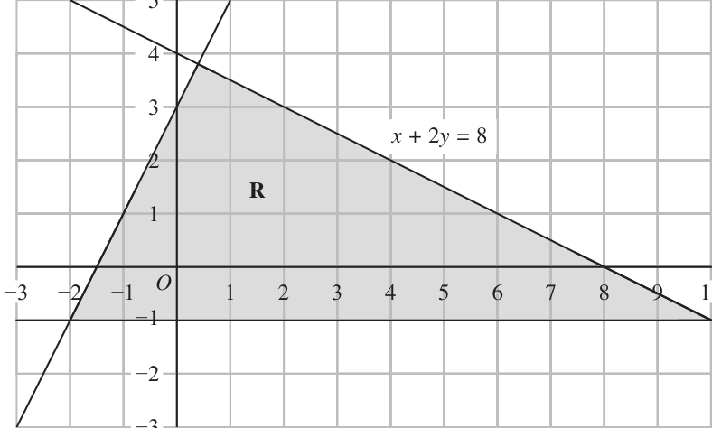
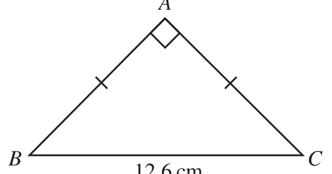
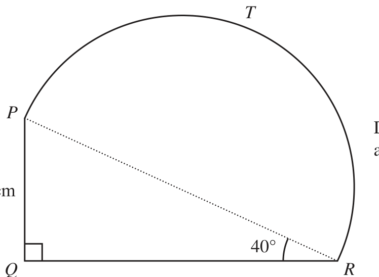
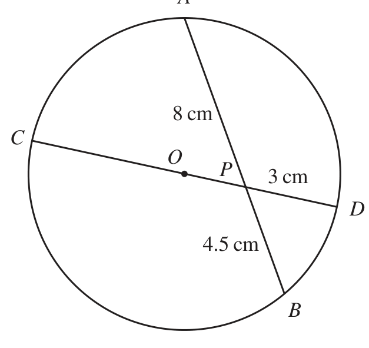
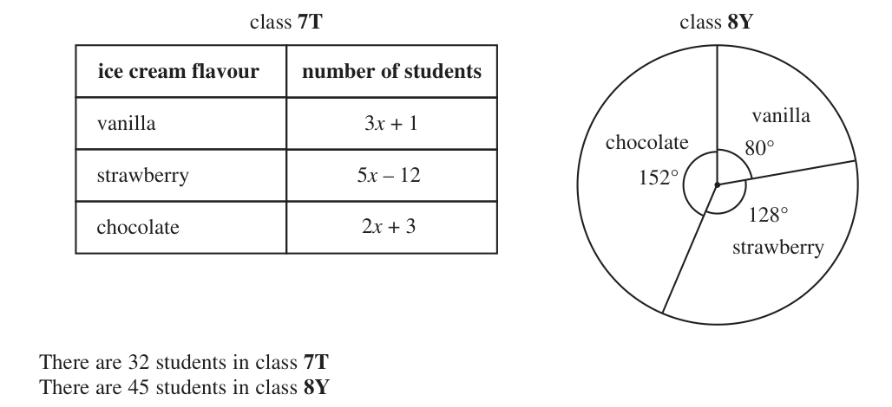
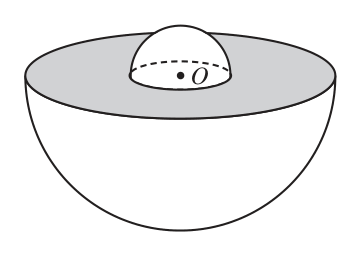
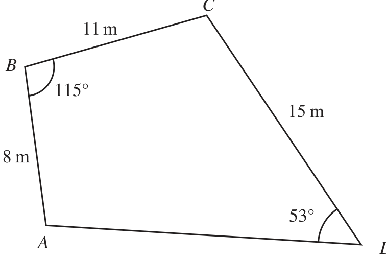

# 4MB1/01R — 2024-06 (official extraction)

> schema `syllabai.official-paper-questions/0.2` · paper_id `pearson-edexcel:international-gcse:mathematics-b:4mb1:2024-06:4MB1/01R` · qp sha256 `906bb2f5e8881b6a…` · extraction is the disclosed baseline (ADR-039)

## Question 1 (2 marks)

Write 75 millimetres as a fraction of 3 metres. Give your answer in its simplest form.

### 1 [2]

Write 75 millimetres as a fraction of 3 metres. Give your answer in its simplest form.

**Mark scheme answer**

> 75 0.075 7.5 0.75 2 M1 a ‘correct’ but un-simplified fraction (condone decimals in the
> or or or oe
> 3000 3 300 30 75 ×10−3
> fraction) eg
> or an answer of 0.025 or 2.5% or 2.5 ×10−2 oe eg 25 ×10−3
> 1 1mm
> A1cao Do not ISW ignore any units eg
> 40 40mm

- **(2)** 75 0.075 7.5 0.75 2 M1 a ‘correct’ but un-simplified fraction (condone decimals in the

## Question 2 (2 marks)
### 2(a) [1]

Write 5.142 557 to 3 decimal places.

**Mark scheme answer**

> 5.143 1 B1

- **(1)** 5.143 1 B1

### 2(b) [1]

Write 6281 to 3 significant figures.

**Mark scheme answer**

> 6280 1 B1 allow 628 × 10 or 628 ×101 or 6.28 ×103 or 6.280 ×103 or
> 62.8 ×102 62.80 ×102 Do not accept 6.2800 ×103

- **(1)** 6280 1 B1 allow 628 × 10 or 628 ×101 or 6.28 ×103 or 6.280 ×103 or

## Question 3 (2 marks)

Simplify 2t 2v

### 3 [2]

Simplify 2t 2v

**Mark scheme answer**

> 4t 5v 2 2 B2
> (B1 for an expression in which 2 of the terms have been simplified
> correctly. eg 4t5 or 4t5v)

- **(2)** 4t 5v 2 2 B2

## Question 4 (2 marks)

The nth term of a sequence is given by 7 n 2 + 100

### 4(a) [1]

Find the 5th term of the sequence. Barney says that 37 is a term in the sequence. Barney is wrong.

**Mark scheme answer**

> 275 1 B1

- **(1)** 275 1 B1

### 4(b) [1]

Explain why Barney is wrong.

**Mark scheme answer**

> eg ‘it would mean n² = ‒9 1 B1 a correct reason (which needs to refer to a value other than 37)
> which is not possible’ or ‘ eg
> all numbers are greater than • n² = ‒9 or n = −9 or 7n2 = −63 and idea this is not possible
> 100’ oe (eg n² cannot be negative or n or n2 0 or needs to be a
> whole number/positive
> • numbers cannot be less than 100
> • numbers are > 100 or 100
> • numbers are 107 or > 107
> • the smallest value is 107
> • the first term is 107 and terms increase /don’t decrease

- **(1)** eg ‘it would mean n² = ‒9 1 B1 a correct reason (which needs to refer to a value other than 37)

## Question 5 (2 marks)

Evaluate 3 10 2 Give your answer in standard form.

### 5 [2]

Evaluate 3 10 2 Give your answer in standard form.

**Mark scheme answer**

> 6 180 000 000 oe eg 6.18 ×109 or 2 M1 allow for a correct numerator in any form or
> 61.8 ×108 or for a correct answer in any form or for 2.06 ×10n where n is an
> 20 600 000 oe eg 20.6 × 106 or integer ≠ 7 or
> 2.06 ×10n where n ≠ 7 or
> 2 ×107 + 0.6 ×106 or 2 ×107 + 6 ×105 for a correct sum with the fraction removed
> oe
> 2.06 ×107 A1 Do not ISW mark their answer on the answer line or if no
> answer on the answer line their final answer.

- **(2)** 6 180 000 000 oe eg 6.18 ×109 or 2 M1 allow for a correct numerator in any form or

## Question 6 (2 marks)

Simplify (36a c ) 8 2 2

### 6 [2]

Simplify (36a c ) 8 2 2

**Mark scheme answer**

> 6a 4 c or 46656a 24c6 or 363 a 24c 6 or 2 M1 for correctly applying the power of 3 or the power of a 0.5 to all
> 66 a 24 c 6 3 terms or for an expression of 3 terms in the form ma p c q with 2 of
> m, p and q correct or a12 c3
> 216a12c3 A1 ISW Do not allow 63 a12c3

- **(2)** 6a 4 c or 46656a 24c6 or 363 a 24c 6 or 2 M1 for correctly applying the power of 3 or the power of a 0.5 to all

## Question 7 (3 marks)

Without using a calculator and showing all your working, calculate 1 1 2 ÷2 4 7 Give your answer as a mixed number in its simplest form.

### 7 [3]

Without using a calculator and showing all your working, calculate 1 1 2 ÷2 4 7 Give your answer as a mixed number in its simplest form.

**Mark scheme answer**

> 9 15 3 M1 for writing both mixed numbers as improper fractions. Do not
> [ ÷] oe need the division sign. Implied by the 2nd M1
> 4
> 9 7 135 28 M1 for inverting the 2nd fraction and showing multiplying or for
> eg × oe eg × oe
> 4 15 60 60 writing the improper fractions over a common denominator
> 63 1 A1 dependent on both Method marks being awarded.
> =1 For completion to the correct answer with full working shown.
> 60
> or We need to see the improper fraction followed by the mixed number
> 21
> =1
> 20
> wr Total 3 marks

- **(3)** 9 15 3 M1 for writing both mixed numbers as improper fractions. Do not

## Question 8 (3 marks)

Given that y 12 x 3 x2 dy find dx dy = . . . . . . . . . . . . . . . . . . . . . . . . . . . . .. . . . . . . . . . . . . . . . . . . . . . . . . . . . . . . . . dx

### 8 [3]

Given that y 12 x 3 x² dy find dx dy = ……………dx

Given that y 12 x 3 x² dy find dx dy = dx

**Mark scheme answer**

> 3 ×12 x ² or 36 x ² 3 M1 for differentiating the first term correctly
> ⎡ 16 ⎤ −2 M1 for rewriting the second term as 16x −2 This can be seen
> ⎢⎣ x 2 = ⎥⎦ 16x anywhere including in an expression for dy/dx
> May be implied by −2 ×16x −3 oe
> 36 x² − 32 x−3 2
> A1 oe eg 36x −
> x³
> Need not be simplified eg allow 3 ×12 x² − 2 ×16 × x −3

- **(3)** 3 ×12 x ² or 36 x ² 3 M1 for differentiating the first term correctly

## Question 9 (3 marks)

X c f a = 40 to the nearest whole number c = 2.2 to 1 decimal place f = 0.6 to 1 decimal place Calculate the upper bound for the value of X Show your working clearly.

### 9 [3]

X c f a = 40 to the nearest whole number c = 2.2 to 1 decimal place f = 0.6 to 1 decimal place Calculate the upper bound for the value of X Show your working clearly.

**Mark scheme answer**

> 39.5, 40.5, 2.15, 2.25, 0.55, 0.65 3 • •
> M1 one correct bound allow 40.49 for 40.5, 2.249 for 2.25,
> •
> 0.649 for 0.65
> UBa M1 where
> where 40 < UBa 40.5 and 2.15 LBc < 2.2 and 0.6 < UB f 0.65
> LBc − UB f
> ( 40 < UBa 40.5 )
> ( 2.15 LBc < 2.2 ) − ( 0.6 < UB f 0.65 )
> 40.5 A1 for 26.97 to 27 if all correct figures seen in the equation.
> = 27 • •
> 2.15 − 0.65 Allow 40.49 for 40.5 and 0.649 for 0.65
> wr Total 3 marks

- **(3)** 39.5, 40.5, 2.15, 2.25, 0.55, 0.65 3 • •

## Question 10 (4 marks)

y x + 2y = 8 R −3 −2 −1 O 1 2 3 4 5 6 7 8 9 10 x −1 −2 −3 The region R, shown shaded in the diagram, is bounded by three straight lines. Find three inequalities that define R

### 10 [4]

y x + 2y = 8 R −3 −2 −1 O 1 2 3 4 5 6 7 8 9 10 x −1 −2 −3 The region R, shown shaded in the diagram, is bounded by three straight lines. Find three inequalities that define R

> *Figure not shown in this reconstruction — the printed paper includes a diagram (not drawn accurately). Use the text description to work through it.*

**Mark scheme answer**

> y −1 4 B1 oe accept > for
> x + 2y 8 x
> B1 oe eg y 4 − accept < for
> eg y = 2x + 3 or y − 2 x = 3 or M1 for the correct equation for the line written in any form.
> y − (1) = 2 ( x − (−1) ) oe eg with any sign ( = > < )
> y 2x + 3 A1 oe allow equivalent inequality eg y − 2 x 3 or
> y − (1) 2 ( x − (−1) ) accept < for
> SC if y − 1 and x + 2 y 8 and y 2 x + 3 score B2. Allow correct sign without the =

- **(4)** y −1 4 B1 oe accept > for

## Question 11 (4 marks)

The diagram shows the point A and the point B A B

### 11(a) [1]

Construct the locus of all points that are 4 cm from A

**Mark scheme answer**

> a circle centre A with radius 1 B1 full circle. Radius 4cm (allow if closer to Y
> 4 cm than to B)

- **(1)** a circle centre A with radius 1 B1 full circle. Radius 4cm (allow if closer to Y

### 11(b) [2]

Using ruler and compasses, and showing all your construction lines, construct the perpendicular bisector of AB The region R consists of all the points that are nearer to B than to A and that are less than 4 cm from A

**Mark scheme answer**

> a correct bisector with arcs 2 B2 for a correct bisector with 2 pairs of arcs
> shown Allow if it is only one side of the line AB (use
> overlay) (NB may use the circle as one of the pair
> of arcs)
> (B1 for a bisector without the arcs or only one
> pair drawn or correct arcs without bisector drawn
> (must cross with in the lines on overlay or would
> if they were extended))

- **(2)** a correct bisector with arcs 2 B2 for a correct bisector with 2 pairs of arcs

### 11(c) [1]

Show, by shading, the region R Label the region R

**Mark scheme answer**

> correct region indicated 1 B1 dep on at least B1 being awarded in (b) for
> the bisector drawn. For the correct region between
> the bisector and the circle identified. Allow if a
> partial circle around A is drawn which intersects
> with their bisector twice and at least B1 awarded
> for the bisector drawn.
> NB if they do not shade and just label R they need
> to put R both sides of the line AB (if they have
> drawn the line AB)
> Q Working Answer Mark Notes

- **(1)** correct region indicated 1 B1 dep on at least B1 being awarded in (b) for

## Question 12 (4 marks)

A Diagram NOT accurately drawn B C 12.6 cm The diagram shows isosceles triangle ABC where AB = AC BAC 90° BC = 12.6 cm Calculate the perimeter, in cm to one decimal place, of the triangle. .............................................................. cm

### 12 [4]

The diagram shows isosceles triangle ABC where AB = AC ∠BAC = 90° BC = 12.6 cm Calculate the perimeter, in cm to one decimal place, of the triangle cm

> *Figure not shown in this reconstruction — the printed paper includes a diagram (not drawn accurately).*
> Labels in the original figure: A, B, C · Figure values: 12.6.

**Mark scheme answer**

> eg $x^2$ + $x^2$ = $12.6^2$ or 4 M1 for a correct statement using Pythagoras
> or trigonometry to find side AB/AC
> ⎡⎣ $AC^2$ = ⎤⎦ (0.5 ×12.6)² + (0.5 ×12.6)² ⎡⎣ = 39.69 + $39.69^2$ = 79.38⎤⎦ or
> NB do not award for $AB^2$ + $AC^2$ = $12.6^2$
> eg sin 45 =
> AC
> or cos 45 =
> AC
> or unless made clear AB = AC.
> 12.6 12.6 Allow AB instead of AC
> 6.3 6.3 May be Implied by the 2nd M1
> cos 45 = or sin 45 = oe
> AC AC
> $12.6^2$ ⎡ 3969 ⎤ M1 dependent on 1st M1 for a correct method
> [ x =] = ⎢ = 8.909 …⎥ or to find AB or AC
> 2 ⎣ 25 ⎦ Allow for 8.9 or better (actual 8.909545…) or
> [ AC =] (0.5 ×12.6)$^2$ + (0.5 ×12.6)$^2$ [= 8.9090…] or 63 2
> [ AB / AC =]12.6 × sin 45 or 12.6 × cos 45
> 6.3 6.3 Allow 9 if $x^2$ = 79.3... is seen
> [ AC / AB =] or
> cos 45 sin 45
> 2 × "8.909…"+ 12.6 M1 independent of the previous method
> 63 + 63 2
> marks. Allow
> For using 2 × n + 12.6 where 6.3 < n < 12.6
> If n is incorrect, working must be shown
> 30.4 A1 awrt 30.4 (actual 30.41909…)

- **(4)** eg $x^2$ + $x^2$ = $12.6^2$ or 4 M1 for a correct statement using Pythagoras

## Question 13 (4 marks)

T P Diagram NOT accurately drawn 40° Q R The diagram shows shape PTRQ where PRQ is a triangle and PTR is a semicircle with diameter PR PQR 90° PRQ 40° PQ = 8 cm Calculate the total area, in cm² to the nearest whole number, of shape PTRQ .............................................................. cm2

### 13 [4]

The diagram shows shape PTRQ where PRQ is a triangle and PTR is a semicircle with diameter PR ∠PQR = 90° ∠PRQ = 40° PQ = 8 cm Calculate the total area, in cm² to the nearest whole number, of shape PTRQ cm²

> *Figure not shown in this reconstruction — the printed paper includes a diagram (not drawn accurately).*
> Labels in the original figure: T, P, Q, R · Figure values: 40°.

**Mark scheme answer**

> 8 8 QR 8 4 M1 for a correct method or expression to find QR
> [QR =] or tan 40 = or tan 50 =
> QR
> or = oe or PR. Allow any letter(s) for QR/PR or
> tan 40 QR 8 sin 50 sin 40
> mislabelling or equivalents eg
> 8 8 8
> [ PR =] or (= 12.445…) or sin 40 = or cos50 = oe [QR=] 8 tan 50(= 9.534...)
> sin 40 cos50 PR PR
> If no working shown allow for awrt 12 or awrt 10
> 8 8 " QR " M1 dependent on first M1 being awarded for a
> eg [QR =] (= 9.534...) AND [ PR =] or (= 12.445…) oe or
> tan 40 sin 40 cos 40 correct method or expression to find QR AND PR
> 8 or 0.5PR. Allow equivalent expressions eg those
> [QR =] (= 9.534...) AND [ PR = ] 8 + "9.534..." (= 12.445…) oe or
> 2
> allowed for the 1st M1
> tan 40
> PR QR
> 8 = = oe gains M1M1
> [ PR =] (= 12.445…) AND [QR =] "12.445..."2 − 82 ( = 9.534...) oe or
> NB
> sin 90 sin 50 sin 40
> sin 40
> ⎛ "12.445..." ⎞
> 2 or for a correct method to find the area of the
> area of PTR = 0.5 × π × [ = 60.8...] or semicircle PTR or a correct method to find area of
> ⎝ 2 ⎠ PQR using their PR (from correct working) and
> 1 1 PQ = 8
> area of PQR = × 8 × "9.534..." or × 8 × "12.445..."× sin(90 − 40) or
> 2 2 Allow numbers written to 1 dp.
> 1 When finding the areas "12.445" or "9.534" must
> × "12.445..."× "9.534..."sin 40 [ = 38.1...]
> 2 come from correct working.
> ⎛ "12.445" ⎞
> 2 M1 correct method to find the whole area. If
> 0.5 × "9.534 …"× 8 + 0.5 × π × or working is shown ft their PR(diameter) and/or PQ
> ⎝ 2 ⎠
> if clearly labelled or marked on the diagram or
> ⎛ "12.445" ⎞ "12.445..."
> 0.5 × 8 × "12.445..."sin(50) + 0.5 × π × or comes from correct working. Allow or
> ⎝ 2 ⎠
> ⎛ "12.445" ⎞
> 2 "6.22…" for the radius.
> 0.5 × "12.445..."× "9.534..."sin(40) + 0.5 × π × 2 
> 99 A1 awrt 99 or awrt 98

- **(4)** 8 8 QR 8 4 M1 for a correct method or expression to find QR

## Question 14 (4 marks)

Solve the simultaneous equations 2 x 6 y 3 x 5 y Show clear algebraic working. x = .............................................................. y = ..............................................................

### 14 [4]

Solve the simultaneous equations 2 x 6 y 3 x 5 y Show clear algebraic working. x = y =

**Mark scheme answer**

> eg 6x + 18y = 42_ or 10x + 30y = 70_ 4 M1 For balancing the equations (only condone
> 6x + 10y = 20 18x + 30y = 60 one arithmetic error in multiplication).
> and correct operation to eliminate selected
> variable applied to all terms in their 2
> equations)
> or
> or writing x or y in terms of the other variable
> ⎛ 14 − 6 y ⎞ ⎛ 14 − 2 x ⎞ and correctly substituting to gain an equation
> eg 3 + 5 y = 10 or 3 x + 5 = 10 in one variable
> ⎝ 2 ⎠ ⎝ 6 ⎠
> x = ‒1.25 or A1 oe one correct value dep on M1
> y = 2.75 7
> Allow fractions eg − and
> 4
> eg 2 × "− 1.25"+ 6 y = 14 oe or M1 (dep) correct method to find second
> 3x + 5 × "2.75" = 10 oe variable – could start process again or use
> substitution.
> Dependent on previous M mark being
> awarded. If the value used is incorrect you may
> need to check their answer if full working not
> shown.
> x = ‒1.25 and A1 oe for both correct values dep on at least
> y = 2.75 one of the method marks being awarded. If
> switched on the answer line allow if seen
> correct in working
> wr Total 4 marks

- **(4)** eg 6x + 18y = 42_ or 10x + 30y = 70_ 4 M1 For balancing the equations (only condone

## Question 15 (4 marks)

Make y the subject of c y

### 15 [4]

Make y the subject of c y

**Mark scheme answer**

> 3y + 5
> oe or c 8 − y = 3 y + 5 4 M1 for either squaring both sides to remove the square root
> c2 =
> 8− y or removing the denominator of the expression.
> 8c2 − c 2 y = 3 y + 5 or M1 dependent on 1st M1 being awarded. For squaring both
> 3y 5 3y + 5 sides to remove the square root and removing the terms in
> 8− y = + or 8 − y = oe y from the denominator of the expression and expanding to
> c2 c2 c2
> gain a correct equation. Implies the previous M1
> 8c2 − 5 = 3 y + c 2 y oe or M1 for collecting the y terms on one side of the equation
> with the other terms on the other side. Allow one sign error
> −c2 y − 3 y = −8c 2 + 5 oe or
> c2 y + 3 y = 8c 2 − 5 oe or If the 2nd M1 has not been awarded then ft their equation
> y ( −c 2 − 3) = −8c 2 + 5 oe or providing the equation has 4 distinct terms with exactly 2
> in terms of y. Allow one sign error
> 3y
> −
> − y = 2 − 8 oe
> c c
> 8c 2 − 5
> y= 8− 2
> 3 + c2 5 − 8c 2 c oe
> A1 oe eg y = 2 or y =
> −c − 3
> +1
> c2
> (NB: if the final answer is missing y =…but is otherwise
> correct , award full marks if y = a correct expression has
> been seen in the working otherwise do not ISW)

- **(4)** 3y + 5

## Question 16 (4 marks)

A 8 cm C Diagram NOT O accurately drawn P 3 cm D 4.5 cm B A, D, B and C are points on a circle centre O COD is a diameter of the circle. AB is a chord of the circle. COD and AB intersect at the point P AP = 8 cm PB = 4.5 cm PD = 3 cm Calculate the circumference, in cm to 3 significant figures, of the circle. .............................................................. cm

### 16 [4]

A, D, B and C are points on a circle centre O COD is a diameter of the circle. AB is a chord of the circle. COD and AB intersect at the point P AP = 8 cm PB = 4.5 cm PD = 3 cm Calculate the circumference, in cm to 3 significant figures, of the circle cm

> *Figure not shown in this reconstruction — the printed paper includes a diagram (not drawn accurately).*
> Labels in the original figure: A, C, O, P, D, B · Figure values: 8, 3, 4.5.

**Mark scheme answer**

> 8 CP 8 x + ( x + 3) 4 M1 for forming a correct equation. Using the chord
> eg 8 × 4.5 = 3CP or = or =
> 3 4.5 3 4.5 theorem.
> 8 r + (r − 3)
> = oe
> 3 4.5
> 8 × 4.5 8 × 4.5 + 3 M1 for a correct expression for CP May be seen on
> [CP =] [ = 12] or r = [ = 7.5] or diagram
> 3 3× 2
> 8 × 4.5 − 3
> x= [ = 4.5]
> 3× 2
> [circumference = ] π × ("12"+ 3) oe M1 ft their CP if it comes from correct working or is
> 2 × π × "7.5" or 2π × ("4.5"+ 3) clearly labelled or on the diagram. Allow 3.14… or
> for π
> 47.1 A1 awrt 47.1 or 15π

- **(4)** 8 CP 8 x + ( x + 3) 4 M1 for forming a correct equation. Using the chord

## Question 17 (4 marks)
### 17(a) [2]

Find the position vector of the point B

**Mark scheme answer**

> ⎡ → ⎤ ⎛ 3⎞ ⎛ 5⎞ ⎛ 3 ⎞ ⎛ −5 ⎞ 2 →
>  OB = − or + or M1 for a correct method to find OB or may be implied by
> ⎣ ⎦ ⎝ −2 ⎠ ⎝ −9 ⎠ ⎝ −2 ⎠ ⎝ 9 ⎠ ⎛ −2 ⎞ ⎛ ... ⎞ ⎛ 7⎞
> one correct value ie or or for ... ⎠ ⎝ 7⎠ ⎝ −2 ⎠
> Must be seen on (a)
> ⎛ −2 ⎞ A1
>  7

- **(2)** ⎡ → ⎤ ⎛ 3⎞ ⎛ 5⎞ ⎛ 3 ⎞ ⎛ −5 ⎞ 2 →

### 17(b) [2]

Calculate ½ ½, giving your answer as a surd. ½ ½=

**Mark scheme answer**

> ("− 2") 2 + "7"2 [ = 7.28...] oe 2 M1 allow use of 2 rather than ‒2 and –7 rather than 7. May
> be implied by a correct answer or awrt 7.28 Condone
> missing brackets around negative values.
> →
> Only ft their values from (a) or OB found in (b) if
> working shown (allow ± their values)
> 53 →
> A1 ft their answer (as a simplified surd) to (a) or OB
> found in (b) Do not ISW. This mark implies the M1
> If no working is shown you may need to check.

- **(2)** ("− 2") 2 + "7"2 [ = 7.28...] oe 2 M1 allow use of 2 rather than ‒2 and –7 rather than 7. May

## Question 18 (5 marks)

The table gives information about the heights, in cm, of 80 plants in a garden. Height (h cm) Frequency 0 < h ≤ 10 2 10 < h ≤ 20 26 20 < h ≤ 30 10 30 < h ≤ 40 24 40 < h ≤ 50 18

### 18(a) [1]

Find the class interval that contains the median height of these plants.

**Mark scheme answer**

> 30 < h 40 1 B1 condone for < and vice versa

- **(1)** 30 < h 40 1 B1 condone for < and vice versa

### 18(b) [4]

Calculate an estimate for the mean height, in cm, of these plants cm

**Mark scheme answer**

> 5 × 2 + 15 × 26 + 25 × 10 + 35 × 24 + 45 × 18 4 M2 for at least 3 correct products using midpoints with
> (= 2300) intention to add.
> (M1 for at least 3 products using frequency and a value within
> 10 + 390 + 250 + 840 + 810 (= 2300) the interval with the intention to add. (allow use of
> upper/lower class bound) or for at least 3 correct products
> using midpoints without adding)
> "10 + 390 + 250 + 840 + 810 " ⎡ "2300" ⎤ M1 dep on at least M1 being awarded
> 80 ⎢⎣ = 80 ⎦⎥
> 28.75 115
> A1oe allow or 28.7 or 28.8 or (29 from correct working)

- **(4)** 5 × 2 + 15 × 26 + 25 × 10 + 35 × 24 + 45 × 18 4 M2 for at least 3 correct products using midpoints with

## Question 19 (5 marks)

The students in class 7T and the students in class 8Y were asked to name their favourite ice cream flavour. The table shows information about the favourite ice cream flavour for class 7T The pie chart shows information about the favourite ice cream flavour for class 8Y class 7T class 8Y ice cream flavour number of students vanilla 3x + 1 vanilla chocolate 80° strawberry 5x – 12 152° 128° chocolate 2x + 3 strawberry There are 32 students in class 7T There are 45 students in class 8Y More students in class 7T than in class 8Y said vanilla was their favourite ice cream flavour. Find how many more.

### 19 [5]

The students in class 7T and the students in class 8Y were asked to name their favourite ice cream flavour. The table shows information about the favourite ice cream flavour for class 7T The pie chart shows information about the favourite ice cream flavour for class 8Y class 7T class 8Y ice cream flavour number of students vanilla 3x + 1 vanilla chocolate 80° strawberry 5x – 12 152° 128° chocolate 2x + 3 strawberry There are 32 students in class 7T There are 45 students in class 8Y More students in class 7T than in class 8Y said vanilla was their favourite ice cream flavour. Find how many more.

**Mark scheme answer**

> 2 x + 3 + 5 x − 12 + 3x + 1 = 32 oe eg 10 x − 8 = 32 5 M1 for setting up an equation. Implied by x = 4
> 32 + 8 M1 rearranging to find a correct expression for x or for 7T
> x= [ = 4] oe or 7T vanilla = 13 oe vanilla
> 80 M1 Correct method to find the number for vanilla for 8Y eg
> × 45 (= 10) oe
> 360 280
> 45 − × 45
> 360
> 3 × "4" + 1 − "10" or M1 dependent on the 1st and 3rd M1 being awarded.
> Allow an answer of 3 or a correct method to find their
> difference. Ft their value of x and 10 if clearly labelled or
> come from correct working.
> 3 A1 dependent on 1st and 3rd method mark being awarded.
> NB the number 3 can be gained from incorrect working, so
> need to check it.
> If no working is shown then award 5/5

- **(5)** 2 x + 3 + 5 x − 12 + 3x + 1 = 32 oe eg 10 x − 8 = 32 5 M1 for setting up an equation. Implied by x = 4

## Question 20 (5 marks)
### 20(a) [3]

Solve 5 4y Show clear algebraic working. y = A 8 x 2w

**Mark scheme answer**

> 7 + 3 y = 2(4 y − 7 − 5) oe or 3 M1 for dealing with the fraction (of 0.5)
> 7 + 3 y + 2 × 5 = 2(4 y − 7) oe or correctly. Condone missing brackets if they have
> 7 3 recovered.
> + y + 5 = 4 y − 7 oe
> 2 2
> 3 y − 8 y = −14 − 10 − 7 oe eg 5y = 31 or M1ft previous stage as long as at least 4 terms to
> 7 3 deal with – for collecting terms in y on one side
> + 5 + 7 = 4 y − y oe and number terms the other side
> 2
> 6.2 A1 dep on both the previous 2 Marks being
> awarded oe eg
> wr

- **(3)** 7 + 3 y = 2(4 y − 7 − 5) oe or 3 M1 for dealing with the fraction (of 0.5)

### 20(b) [2]

Work out the value of x when A 35 and w 4.5 x =

**Mark scheme answer**

> A + 2w 2 M1 for a correct substitution into the given
> −35 = 8 x − 2 × −4.5 oe or x = formula or for a correct rearrangement of the
> formula to make x the subject
> ‒5.5 −44 −11
> A1 oe eg or
> cas 8
> Que Working Ans M Notes
> 5 M1 surface areas of both hemispheres seen (need not be
> { } ⎧

- **(2)** A + 2w 2 M1 for a correct substitution into the given

## Question 21 (5 marks)

O Diagram NOT accurately drawn The diagram shows a solid shape made by joining a large hemisphere and a small hemisphere. The centre of the base of the large hemisphere and the centre of the base of the small hemisphere meet at the point O radius of large hemisphere : radius of small hemisphere = 3 : 1 The total surface area of the solid shape is 567π cm 2 Calculate the total volume, in cm³ to 3 significant figures, of the solid shape. .............................................................. cm³

### 21 [5]

O Diagram NOT accurately drawn The diagram shows a solid shape made by joining a large hemisphere and a small hemisphere. The centre of the base of the large hemisphere and the centre of the base of the small hemisphere meet at the point O radius of large hemisphere : radius of small hemisphere = 3 : 1 The total surface area of the solid shape is 567π cm² Calculate the total volume, in cm³ to 3 significant figures, of the solid shape cm³

**Mark scheme answer**

> ✓
> or ⎪⎩2π 2⎪
> R
> eg 2π r and 2π (3r )
> 2
>  and 2π R ⎫ or added and may be part of an equation)
> ⎪
> ⎩ ⎝3⎠ ⎪
> ⎭ Or for a correct formula for the total surface area. Allow
> 2R2 + R2 + 2r 2 − r 2 or 2π R 2 + π R 2 + 2π r 2 − π r 2 or
> {2π (n r ) and 2π (m r ) } or 2 ( m) + m + 2 ( n ) − ( n )
> 2 2 2 2 2
> 2 ( 3) + ( 3) + 2 (1) − (1) or
> 2 2 2
> or 2π ( m ) + π m² + 2π ( n ) − π ( n ) where m = 3n
> 2 2
> 2π ( 3) + π ( 3) + 2π (1) − π (1) oe
> 2 2 2
> Allow use of other letters
> May be implied by the 2nd M1
> 2π r 2 + 2π (3r )² + π (3r )² − π r 2 = 567π oe or M1 a correct equation for the surface area of the solid
> 2 2 2
> 2 2 eg 2(nr ) + 2(3nr ) + (3nr ) − (nr ) = 567
> ⎛R⎞ ⎛R⎞
> 2π R 2 + 2π + π R 2 − π = 567π oe or or 28π r 2 = 567π or 28r 2 = 567
> ⎝3⎠ ⎝3⎠ 2
> ⎛R⎞
> 2 ( 3) + ( 3) + 2 (1) − (1) : 567 or 2 R 2 + 2 + R 2 − = 567
> 2 2 2 2 R
> ⎝3⎠ ⎝3⎠
> 2π ( 3) + π ( 3) + 2π (1) − π (1) : 567π
> 2 2 2
> 2 2 2
> Allow 2 x + 2( y) + ( y) − x = 567
> 2 ( y ) + ( y ) + 2 ( x ) − ( x ) : 567 where y = 3 x
> 2 2 2
> This implies the 1st M1
> [r =] 4.5 or [R =] 13.5 M1 for a correct value of the radius for either
> hemisphere. This implies the 2nd M1
> 1 4 1 4 ⎡ 243 6561 ⎤ M1 a fully correct method to find the volume of the solid
> × π × "4.5"3 + × π × "13.5"3 ⎢ = π+ π⎥ dep on at least one of the previous Method marks being
> 2 3 2 3 ⎣ 4 4 ⎦
> awarded and is equivalent to
> 1 4 1 4
> × π × " m "3 + × π × "3m "3 where m is a number
> 2 3 2 3
> (award 4 marks for 1701π )
> wr 5340 A1 awrt to 5340 dependent on at least the 3rd M1 mark
> being awarded from correct working
> (5343.8….)

- **(5)** ✓

## Question 22 (5 marks)
### 22(a) [2]

Express 50 + 242 in the form a a where a is an integer.

**Mark scheme answer**

> 5 2 + 11 2 [= 16 2 ] or 2 M1 writing 50 and 242 in the form c 2
> and adding or for 16 2 or for using
> 50 + 242 + 2 50 × 242 = ⎡⎣ 512 ⎤⎦
> ( 50 + 242 ) and multiplying out or 512
> cas 8 8 A1cao allow a = 8

- **(2)** 5 2 + 11 2 [= 16 2 ] or 2 M1 writing 50 and 242 in the form c 2

### 22(b) [3]

Express in the form y x + y where x and y are integers. 5 −1 Show each stage of your working.

**Mark scheme answer**

> 12 5 +1 12 − 5 −1 3 M1 multiply numerator and denominator by
> × or ×
> 5 −1 5 +1 5 −1 − 5 −1 5 + 1 or − 5 − 1
> 12 ( 5 + 1) or 12 ( 5 + 1) or 12 5 + 12 or 12 5 + 12 or M1 dep on previous M mark being awarded.
> denominator may be 4 terms which need to all
> 5 −1 4 5 −1 4 12 ( 5 + 1)
> (
> 12 − 5 − 1 ) or (
> 12 − 5 − 1 ) or −12 5 − 12 or −12 5 − 12 be correct eg.
> 5 + 5 − 5 −1
> −5 + 1 −4 −5 + 1 −4
> A1 dep on both the previous marks being
> wr 3 5 +3 awarded. Allow y = 3 and x = 5 or 3 + 3 5
> do not allow 3 ( 5 + 1) and do not ISW

- **(3)** 12 5 +1 12 − 5 −1 3 M1 multiply numerator and denominator by

## Question 23 (6 marks)

x 4 is a factor of 6 x 3 kx 2 26 x 24 , where k is a constant.

### 23(a) [2]

Use the factor theorem to show that k = 19

**Mark scheme answer**

> 6 × (−4)³ + k × (−4)² − 26 × −4 − 24 = 0 or 2 M1 correct substitution of x = − 4 into equation. Must
> be equal to zero (or implied by later working) or if
> 6 × (−4)³ + 19 × (−4)² − 26 × −4 − 24 substituting x = − 4 and k = 19 into the expression we
> do not need it = 0 for this mark. Condone missing
> brackets around the –4
> 304 A1 completion to show clearly that k = 19 either by
> 16k = 304 or k = and k =19 or
> 16 completing equation correctly (must see at least one line
> of working after the first line) and k = 19 or
> −384 + 304 + 104 − 24 = 0 and for −384 + 304 + 104 − 24 = 0 and comment (eg shown,
> shown or # )

- **(2)** 6 × (−4)3 + k × (−4)2 − 26 × −4 − 24 = 0 or 2 M1 correct substitution of x = − 4 into equation. Must

### 23(b) [4]

Hence solve 6 x 3 19 x 2 26 x Show clear algebraic working.

**Mark scheme answer**

> (6 x 2 ..............) 4 M1 for a start to find the quadratic factor.
> (6 x − 5 x − 6) M1 for a correct 3 term quadratic
> (3x + 2)(2 x − 3) or (3x + 2)(2 x − 3) ( x + 4 ) M1 dependent on the 2nd M1 being awarded for correct
> factorisation of the quadratic. Do not allow fractions or
> ⎛ 2⎞
> decimals eg ( x − 1.5) or ⎜ x + ⎟ (ie) or a correct use of
> ⎝ 3⎠
> the quadratic formula.
> 2
> Implied by − and as two of the solutions
> 3
> ( Allow ‒0.67 or better for − )
> 2 3
> ‒4, − , A1 oe (‒0.67 or better for − ) dep on all 3 method
> 3 2
> marks being awarded. Do not ISW. Mark the answer on
> the answer line. If no answer on the answer line mark
> the final line of their working.
> wr Total 6 marks

- **(4)** (6 x 2 ..............) 4 M1 for a start to find the quadratic factor.

## Question 24 (6 marks)

There are only pink and yellow sweets in a bag containing N sweets. There are 25 more pink sweets than yellow sweets. Stan takes at random 2 sweets from the bag. The probability that Stan takes 2 pink sweets from the bag is Find the probability that Stan takes 2 yellow sweets from the bag. Show clear algebraic working.

### 24 [6]

There are only pink and yellow sweets in a bag containing N sweets. There are 25 more pink sweets than yellow sweets. Stan takes at random 2 sweets from the bag. The probability that Stan takes 2 pink sweets from the bag is Find the probability that Stan takes 2 yellow sweets from the bag. Show clear algebraic working.

**Mark scheme answer**

> eg
> 0.5 N + 12.5 N + 25 p 25 + y
> oe 6 M1 for the probability that the first sweet is pink
> or or or
> N 2N 2 p − 25 2 y + 25 (N = number of sweets, p = number of pink sweets,
> y = number of yellow sweets) It must be seen as an
> expression in one letter and may be see in an equation
> 0.5 N + 12.5 0.5 N + 11.5 7 M1 for a correct equation for 2 pink sweets. Must be
> eg × = or
> N N −1 19 expressed using one variable.
> This mark implies the 1st M1
> N + 25 N + 23 7
> × = or
> 2N 2 N − 2 19
> p p −1
> × = or
> 2 p − 25 2 p − 26 19
> y + 25 y + 24
> × = oe
> 2 y + 25 2 y + 24 19
> eg 2.25N² ‒ 235N ‒ 2731.25 = 0 or M1 a correct 3 term quadratic for N or p or y ( allow
> 9N² ‒ 940N ‒ 10925 = 0 or any letter)
> 9p² ‒ 695p + 4550 = 0 or condone missing =0
> 9 y 2 − 245 y − 7200 = 0
> eg M1 dep on 2nd M1 for a correct method to solve their
> (9N + 95)(N ‒ 115) or (9 p − 65)( p − 70) or 3 term quadratic – if factorising allow brackets that
> (9y + 160)(y ‒ 45) oe multiply giving 2 correct terms, if formula used then
> allow one error. Working must be shown if the
> equation is incorrect. Seeing or using N = 115 or
> p = 70 or y = 45 implies the 3rd and 4th Method marks
> 45 44 M1 for a correct calculation for the probability of 2
> × yellow sweets May be implied by a correct answer
> 115 114
> wr 66 A1 oe eg 0.151(029…)
> 437 The correct answer will gain full marks if at least 2
> method marks have been awarded.
> PTO for SC
> SC for yellow is 25 more than pink
> M0M1M1M1M0A0
> 0.5 N − 12.5 0.5 N − 13.5 7 M1 for a correct equation for 2 pink sweets. Must be
> × = or
> N N −1 19 expressed using one variable.
> N − 25 N − 27 7
> × = or
> 2N 2 N − 2 19
> y − 25 y − 26
> × = or
> 2 y − 25 2 y − 26 19
> p p −1
> × =
> 2 p + 25 2 p + 24 19
> 2.25 N 2 + 240 N − 3206.25 = 0 or M1 a correct quadratic for N, p or y
> 9 N 2 + 960 N − 12825 = 0 condone missing =0
> 9 y 2 + 255 y − 7800 = 0
> 9 p 2 + 705 p + 4200 = 0
> 240 ± (240)² + 4 × 2.25 × 3206.25 M1 dep on 2nd M1 for a correct method to solve their
> [ ]
> N = or 3 term quadratic – if factorising allow brackets that
> 2 × 2.25 multiply giving 2 correct terms, if formula used then
> −960 ± 9602 + 4 × 900 ×12825 allow one error. Working must be shown
> [ N =] or
> 2×9
> 255 ± 2552 + 4 × 9 × 7800
> [ ]
> y =
> 2×9
> −705 ± 7052 − 4 × 9 × 4200
> [ ]
> p = or
> 2×9
> wr Total 6 marks
> Quest Working Ans Mark Notes

- **(6)** eg

## Question 25 (5 marks)

for Question 25 C B Diagram NOT 115° accurately drawn 53° A D The diagram represents a small horizontal field ABCD AB = 8 m BC = 11 m CD = 15 m ABC 115° ADC 53° Calculate, in m² to the nearest whole number, the area of the field. . . . . . . . . . . . . . . . . . . . . . . . . . . . . . . . . . . . . .. . . . . . . . . . . . . . . . . . . . . . . . . m²

### 25 [5]

for Question 25 C B Diagram NOT 115° accurately drawn 53° A D The diagram represents a small horizontal field ABCD AB = 8 m BC = 11 m CD = 15 m ∠ABC = 115° ∠ADC = 53° Calculate, in m² to the nearest whole number, the area of the field m²

> *Figure not shown in this reconstruction — the printed paper includes a diagram (not drawn accurately). Use the text description to work through it.*

**Mark scheme answer**

> 0.5 × 8 ×11× sin115(= 39.877...) 5 M1 for a correct method to find the area of
> triangle ABC
> $AC^2$ = $11^2$ + $8^2$ − 2 ×11× 8cos115 (= 259.38...) or M1 for a correct method to find the length of
> $AC^2$ or AC
> AC = $11^2$ + $8^2$ − 2 × 11× 8cos115(= 16.105...)
> ⎛ sin ( 53) ×15 ⎞ M1 for a correct method to find the angle
> ∠CAD = sin −1 [ = 48.059...] AND ACD
> ⎝ "16.105..." ⎠ or
> ∠ACD = 180 − "48.059"− 53 ( = 78.94...) or
> 16.105...$^2$ = $AD^2$ + $15^2$ − 2 × AD ×15cos53 or Finding $AD^2$ NB 2 ×15cos 53 = 18.054 …
> $AD^2$ = 16.105...$^2$ + $15^2$ − 2 ×16.105... ×15cos"78.9..." the length AD (19.79…)
> ⎧⎪ ⎡ −1 ⎛ sin ( 53) ×15 ⎞ ⎤ ✓⎪ For splitting triangle ACD into 2 triangles
>  [ = 10.76...]⎫
> 2
> ⎩ "16.105..." − 11.979… or "16.105..." cos sin with perpendicular CE where E is on AD and
> ⎪⎩ ⎢⎣ ⎝ "16.105..." ⎠ ⎥⎦ ⎭⎪
> finding the lengths AE (10.76…) and ED
> AND { 15 −11.979… or 15cos53[= 9.027...]}
> 2
> (9.027…)
> 1 M1 dependent on all 3 M marks being
> ×15 × "16.105..."sin("78.94...") + "39.877.." or awarded.
> 1 For a fully correct method to find the area
> × "19.79..."×15sin(53) + "39.877.." or
> 1 ⎛ sin ( 53) ×15 ⎞
> × "16.105..."× "19.79..." + "39.877.." or
> 2 ⎝ "16.105..." ⎠
> 1
> ×15sin 53 × "10.76..."+ ×15sin 53 × "9.027..."+ "39.877..." NB 15 sin 53 = 11.979…
> 2
> 158.42 A1 for awrt 158 (allow 159)

- **(5)** 0.5 × 8 ×11× sin115(= 39.877...) 5 M1 for a correct method to find the area of

## Question 26 (5 marks)

Show that can be written x 2 x 3 x2 1 p in the form where p and q are integers to be found. x+q

### 26 [5]

Show that can be written x 2 x 3 x² 1 p in the form where p and q are integers to be found. x+q

**Mark scheme answer**

> eg
> 6( x + 3) + 4( x − 2) 5 M1 writing the addition part as a correct fraction over a
> ( x − 2)( x + 3) common denominator – need not be expanded and may be
> 2 separate fractions. Allow one sign error in numerator if
> expanded
> 10 ( x + 1) 10 x + 10 A1 a correct single fraction with numerator and
> eg or 2 oe
> ( x − 2)( x + 3) x + x−6 denominator simplified – numerator and / or denominator
> may be factorised. This implies the 1st M1
> (5 x − 5)( x − 2)
> or
> (5 x − 10)( x − 1) M1 for numerator or denominator factorised correctly into
> ( x + 1)( x − 1) ( x + 1)( x − 1) 2 brackets
> 5( x − 1)( x − 2) 5( x − 2) M1 for numerator and denominator fully factorised
> or oe
> correctly including factor of 5 taken out (could be implied
> ( x + 1)( x − 1) ( x + 1)
> by further cancelling) This implies the 2nd M1
> 50 A1 dep on M3
> x+3
> ALT (5 x − 5)( x − 2) M1 for numerator or denominator factorised correctly
> ( x + 1)( x − 1)
> 5( x − 1)( x − 2) 5( x − 2) M1 for numerator and denominator fully factorised
> or
> ( x + 1)( x − 1) ( x + 1) correctly including factor of 5 taken out (could be implied
> by further cancelling)
> 30( x + 3) + 20( x − 2)
> oe M1 for multiplying each part and writing the addition as a
> ( x + 1)( x + 3) correct fraction over a common denominator – need not
> be expanded and may be 2 separate fractions. Allow one
> sign error in numerator if expanded
> 50 x + 50 50 ( x + 1) M1 for numerator and denominator fully factorised
> or
> ( x + 1)( x + 3) ( x + 1)( x + 3) correctly (could be implied by further cancelling)
> 50 A1 dep M3
> x+3
> wr Total 5 marks

- **(5)** eg

