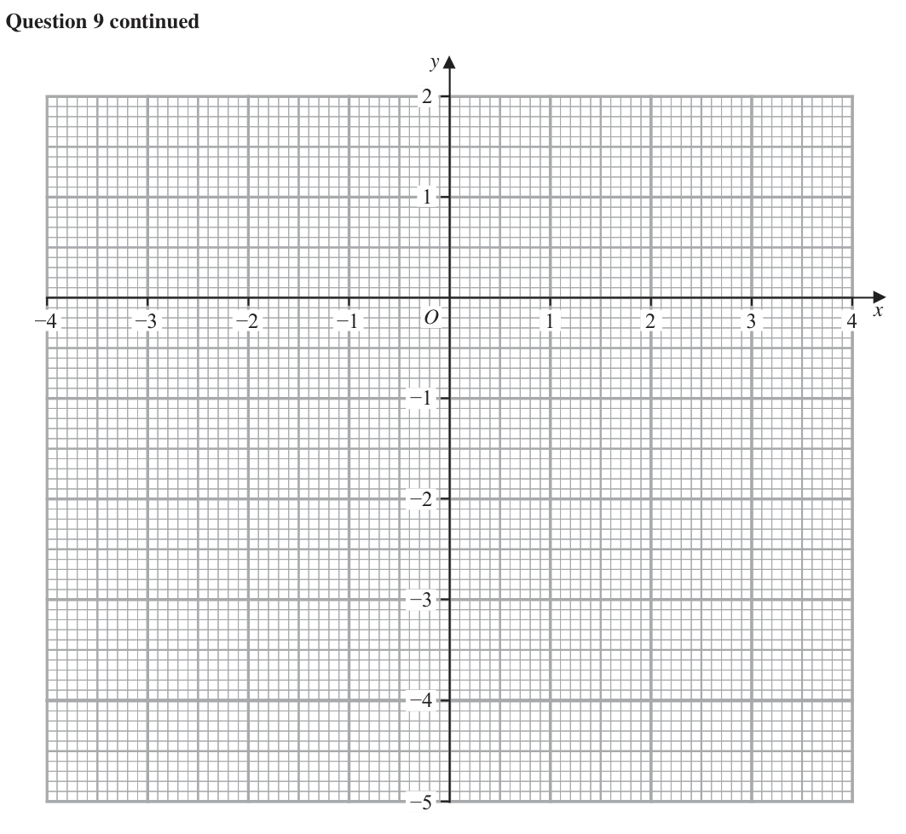
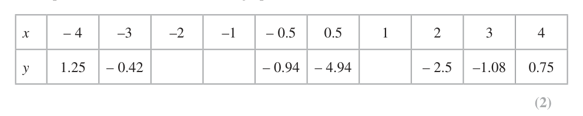

# 4MB1/02 — 2024-06 (official extraction)

> schema `syllabai.official-paper-questions/0.2` · paper_id `pearson-edexcel:international-gcse:mathematics-b:4mb1:2024-06:4MB1/02` · qp sha256 `6173f2c4ca24c0df…` · extraction is the disclosed baseline (ADR-039)

## Question 1 (5 marks)
### 1(a) [1]

Write 0.000 015 96 in standard form. The star, Sirius, is approximately 81 460 000 000 000 km from Earth. Light from Sirius takes approximately 3142.7 days to reach Earth.

**Mark scheme answer**

> 1.596 ×10−5 1 B1 ISW

- **(1)** 1.596 ×10−5 1 B1 ISW

### 1(b) [4]

Calculate the speed, in km/s to one significant figure, that light travels from Sirius to Earth. Give your answer in standard form. Show your working clearly.

**Mark scheme answer**

> 81460 000 000 000 4 M1 for use of Speed = distance / time. Condone
> ⎡⎣ = 2.5920... ×1010 ⎤⎦
> 3142.7 missing zeros or incorrect standard form for
> numerator/denominator. Allow if clear trying to use
> 81 460 000 000 000 ( eg 460 000 000 000) and
> 3142.7
> "2.5920... ×1010 " ⎡ "2.5920... ×1010 " ⎤ M1 for using a correct method to change their
> 60 × 60 × 24 ⎢= 86400 ⎥ Speed from km/day to km/second.
> ⎣ ⎦
> 300 004 A1 awrt 300000 Dependent on both M marks being
> awarded.
> 3 ×105 A1 from correct working. Dependent on both M
> marks being awarded. Allow awrt 3.0 ×105
> ALT 3142.7 × 60 × 60 × 24 ⎡ = 2.715... ×108 ⎤ M1 for using a correct method to change 3142.7
> ⎣ ⎦
> days to seconds or allow for 271529280 given to
> minimum of 3sf
> 81460000000000 M1 for use of Time = distance / speed. Condone
> "2.715... ×108 " missing zeros or incorrect standard form for
> numerator/denominator. Allow if clear trying to use
> 81 460 000 000 000( eg 460 000 000 000) and their
> changed 3142.7
> 300004 A1 awrt 300000 Dependent on both M marks being
> awarded.
> 3 ×105 A1 from correct working. Dependent on both M
> marks being awarded Allow awrt 3.0 ×105
> wr Total 5 marks
> Question Working Answer Mark Notes

- **(4)** 81460 000 000 000 4 M1 for use of Speed = distance / time. Condone

## Question 2 (6 marks)

A B C The diagram shows triangle ABC Using ruler and compasses only and showing all your construction lines, construct

### 2(a) [1]

the locus of the points that are 3 cm from B

**Mark scheme answer**

> a circle centre B with radius 3 cm 1 B1 full circle drawn. Use overlay

- **(1)** a circle centre B with radius 3 cm 1 B1 full circle drawn. Use overlay

### 2(b) [2]

the perpendicular bisector of AC

**Mark scheme answer**

> a correct perpendicular bisector of 2 B2 for a correct bisector with [2 pairs of arcs] or [2
> AC with arcs shown arcs centre C and the cross drawn ] (use overlay)
> must cross/touch AC NB bisector does not need to
> cross/touch BC
> (B1 for a bisector without arcs or only one pair
> drawn or correct arcs without bisector drawn. Arcs
> must cross within the lines on the overlay or would
> if they were extended

- **(2)** a correct perpendicular bisector of 2 B2 for a correct bisector with [2 pairs of arcs] or [2

### 2(c) [2]

the bisector of ∠ACB The region R consists of all the points inside the triangle that are closer to A than to C, closer to BC than to AC and more than 3 cm from B

**Mark scheme answer**

> a correct bisector with arcs shown 2 B2 for a correct bisector with arcs (use overlay)
> (B1 for a bisector without arcs or correct arcs
> without bisector drawn)
> NB bisector does not need to cross/touch AB

- **(2)** a correct bisector with arcs shown 2 B2 for a correct bisector with arcs (use overlay)

### 2(d) [1]

Show, by shading, the region R Label the region R

**Mark scheme answer**

> correct region shaded 1 B1ft only follow through if they have a circle
> centre B of any radius (allow partial circle of any
> radius that crosses BA and BC) and at least B1 for
> bisector drawn in part (b) and part (c) with the 3
> loci being a boundary of the area. The angle
> bisector must cross AB and the perpendicular
> bisector must cross BC. Only allow if the correct
> area is shaded.
> Total 6 marks
> Question Working Answer Mark Notes

- **(1)** correct region shaded 1 B1ft only follow through if they have a circle

## Question 3 (7 marks)

A college offers courses in Astronomy (A), Biology (B), Chemistry (C) and Physics (D) A group of 220 students are asked which of these courses they study. Here is some information about the numbers of students who study these subjects. n A 58 n B C D x n B D n B C D' 35 n B C D 20 The incomplete Venn diagram on the opposite page shows some other information about the numbers of students who study these subjects.

### 3(a) [3]

Using all the information given, complete the Venn diagram giving the number of elements in each appropriate subset, in terms of x where necessary. Given that n C' 105

> 🖼 crop required: diagram (qp.pdf p.4)

**Mark scheme answer**

> 3
> B3 All 5 shaded regions correct
> B2 3 or 4 shaded regions correct
> B1 2 shaded regions correct

- **(3)** 3

### 3(b) [2]

find the value of x One of the 220 students is chosen at random.

**Mark scheme answer**

> 16 + "48 − x "+ "20"+ "58"[ +0] = 105 oe or 2 M1 ft their values providing they are not blank or
> 0 and at least one region contains an expression in
> terms of x. Allow their ft equation if simplified eg
> "35"+ " x "+ 15 + 28 = 115 oe
> "142"− " x " = 105 or "78"+ " x " = 115
> For adding their values and equating to 105 or 115
> to form an equation in terms of x
> Do not award if the x terms would cancel each
> other out when simplified
> 37 A1 cao

- **(2)** 16 + "48 − x "+ "20"+ "58"[ +0] = 105 oe or 2 M1 ft their values providing they are not blank or

### 3(c) [1]

Write down the probability that this student studies Biology only.

**Mark scheme answer**

> 16 1
> B1 oe eg Allow 0.0727 or better. We will
> 220
> condone 7.27% or better (actual 0.0727272...)

- **(1)** 16 1

### 3(d) [1]

Write down the probability that this student studies Chemistry but not Biology. E B C 16 15 A D

**Mark scheme answer**

> 43 1 15 + 28
> B1 oe do not allow Allow 0.195 or
> 220 220
> better. We will condone 19.5[%] or better (actual
> 0.1954545…)
> cas Total 7 marks
> Question Working Answer Mark Notes
> In this question ignore any labelling on the triangles

- **(1)** 43 1 15 + 28

## Question 4 (13 marks)

Triangle A and triangle D are drawn on the grid opposite. Triangle A is reflected in the x-axis to give triangle B

### 4(a) [2]

On the grid, draw and label triangle B Triangle A is transformed to triangle C by a rotation of 90° clockwise about the point (0, 0)

> 🖼 crop required: grid (qp.pdf p.6)

**Mark scheme answer**

> correct 2 B2 correct triangle drawn (–2, –3) (–7, –5)(–5,–1) Award 2 marks for a correct
> triangle B triangle drawn irrespective of working in the working space.
> drawn (B1 for 2 correct vertices plotted correctly or a triangle of the correct size and
> orientation, or 3 correct vertices listed))
> SC B1 for a correct reflection applied to triangle A in the y-axis. [vertices (2, 3)
> (5, 1) (7, 5)] or for a correct reflection in the x – axis applied to triangle D
> [vertices (1, 0) (7, –4) (11, 4)]

- **(2)** correct 2 B2 correct triangle drawn (–2, –3) (–7, –5)(–5,–1) Award 2 marks for a correct

### 4(b) [2]

On the grid, draw and label triangle C Triangle D is the image of triangle A under a single transformation.

> 🖼 crop required: grid (qp.pdf p.6)

**Mark scheme answer**

> correct 2 B2 correct triangle drawn (3, 2) (5, 7)(1, 5)
> triangle C (B1 for 2 points correct or for 90° clockwise rotation but incorrect position or for
> drawn correct rotation of 90° around (0, 0) anticlockwise (–3, –2) (–1, –5)( –5, –7))

- **(2)** correct 2 B2 correct triangle drawn (3, 2) (5, 7)(1, 5)

### 4(c) [3]

Describe fully this transformation. Triangle A is transformed to triangle E under the transformation with matrix M where M

**Mark scheme answer**

> Enlargement 3 B1 allow enlarge. Do not allow bigger
> B0 if multiple transformations stated. Multiple transformations are when more
> than one of reflection (mirrored), rotation (turn), translation (move), is stated eg
> a vector or SF or equation of a line do not imply multiple transformations
> Centre (–1, 2) B1 for (–1, 2) Do not accept if written as a These two marks can still be
> column vector. awarded if multiple
> SF –2 B1 for –2 transformations are stated

- **(3)** Enlargement 3 B1 allow enlarge. Do not allow bigger

### 4(d) [3]

On the grid, draw and label triangle E Triangle E is transformed to triangle B under the transformation with matrix N

> 🖼 crop required: grid (qp.pdf p.6)

**Mark scheme answer**

> ⎛ −1 −1 ⎞⎛ −2 −5 −7 ⎞ 3 M1 for the intention to multiply the right way. Points can be in any order.
> ⎜ ⎟⎜ ⎟ May be implied by writing the matrices in the correct order or correctly stating
> ⎝ 0 −2 ⎠⎝ 3 1 5 ⎠ or plotting one point.
> ⎛ −1 4 2⎞ M1 for at least two correct columns or correctly stating or plotting two points.
> =⎜ ⎟
> ⎝ −6 −2 −10 ⎠
> correct A1 correct triangle drawn
> triangle E NB Award 3 marks for a correct triangle drawn irrespective of working in the
> drawn working space.

- **(3)** ⎛ −1 −1 ⎞⎛ −2 −5 −7 ⎞ 3 M1 for the intention to multiply the right way. Points can be in any order.

### 4(e) [3]

Using a combination of transformation matrices or otherwise, find the matrix N a b 1 d b The inverse of matrix is c d ad bc c a y A D −10 −8 −6 −4 −2 O 2 4 6 8 10 12 x −2 −4 −6 −8 −10 −12 for a spare grid if you need to redraw your triangles. Only use this grid if you need to redraw your triangles. y A D −10 −8 −6 −4 −2 O 2 4 6 8 10 12 x −2 −4 −6 −8 −10 −12

> 🖼 crop required: grid (qp.pdf p.6)

**Mark scheme answer**

> ⎛ −1 0.5 ⎞ 3 M1 for a correct inverse matrix for M or correct matrix for
> M −1 = ⎜ ⎟ or reflection in the x-axis or for setting up a correct matrix
> ⎝ 0 −0.5 ⎠ equation. Points in any order but the order must be the same in
> ⎛1 0 ⎞ both matrices
> matrix for reflection in x-axis is ⎜ ⎟ or
> ⎝ 0 −1 ⎠
> ⎛ a b ⎞⎛ −1 4 2 ⎞ ⎛ −2 −5 −7 ⎞
> ⎜ ⎟⎜ ⎟=⎜ ⎟
> ⎝ c d ⎠⎝ −6 −2 − 10 ⎠ ⎝ −3 −1 −5 ⎠
> ⎛ 1 0 ⎞⎛ −1 0.5 ⎞ M1 dep on M1 fully correct product or 2 correct equations from
> N=⎜ ⎟⎜ ⎟ or each set (any letters) May be implied by a correct answer
> ⎝ 0 −1⎠⎝ 0 −0.5 ⎠
> ⎡ −a − 6b = −2 ⎤ ⎡ −c − 6d = −3 ⎤
> 2 of ⎢ 4a − 2b = −5 ⎥ and 2 of ⎢⎢ 4c − 2d = −1 ⎥⎥
> ⎢ ⎥
> ⎢⎣ 2a − 10b = −7 ⎥⎦ ⎢⎣ 2c − 10d = −5⎥⎦
> ⎛ −1 0.5 ⎞ A1 cao
> ⎜ ⎟
> ⎝ 0 0.5 ⎠
> cas Total 13 marks
> Question Working Answer Mark Notes

- **(3)** ⎛ −1 0.5 ⎞ 3 M1 for a correct inverse matrix for M or correct matrix for

## Question 5 (5 marks)

5A particle P is moving along a straight line. At time t seconds, the displacement, x metres, of P from a fixed point O on the line is given by x kt 2 t 3 When t = 2 the velocity of particle P is 24 m/s Particle P comes to instantaneous rest at the point A Find the distance, in metres, between O and A (5)

### 5 [5]

5A particle P is moving along a straight line. At time t seconds, the displacement, x metres, of P from a fixed point O on the line is given by x kt 2 t 3 When t = 2 the velocity of particle P is 24 m/s Particle P comes to instantaneous rest at the point A Find the distance, in metres, between O and A

**Mark scheme answer**

> dx 5 M1 Attempt to differentiate ie t n → t n −1 for at
> = 2kt − 3t 2
> dt least one term
> 4k − 3 × 4 = 24 [⇒ k = 9] oe M1 dep on the first M1 being awarded.
> subst t = 2 into their differential and equating to
> 24 leading to a value for k ≠ 0
> 2 × "9 " t − 3t 2 = 0 [⇒ t = 0 or t = 6] M1 dep on the first M1 being awarded.
> subst their value of k into their differential and
> equating to 0 leading to a value for t > 0
> [ x =]"9"× "6"2 − 63 M1 dep on 2 of the previous 3 method marks
> being awarded.
> subst their positive value of t ≠ 2 and k ≠ 0 into
> the equation for x. If t or k is incorrect working
> must be shown.
> 108 A1 Do Not ISW
> cas Total 5 marks
> Question Working Answer Mark Notes

- **(5)** dx 5 M1 Attempt to differentiate ie t n → t n −1 for at

## Question 6 (10 marks)

The probability of a spinner landing on red is 0.6 This spinner is spun once.

### 6(a) [1]

Write down the probability that the spinner does not land on red. This spinner is spun twice.

**Mark scheme answer**

> 0.4 1
> B1 allow oe

- **(1)** 0.4 1

### 6(b) [2]

Calculate the probability that the spinner does not land on red either time. This spinner is spun 140 times.

**Mark scheme answer**

> "0.4"× "0.4" 2 M1 ft their answer to part (a) If no working shown you may need
> to check their answer follows form (a) for this mark eg if (a) is 0.6
> award M1A0 for 0.36
> 0.16
> A1 allow oe

- **(2)** "0.4"× "0.4" 2 M1 ft their answer to part (a) If no working shown you may need

### 6(c) [1]

Calculate the expected number of times the spinner will land on red. A bag contains n counters. The counters are red or blue or green such that number of red counters : number of blue counters : number of green counters = 2 : 1 : 1 A sample of 3 counters is taken at random from the bag without replacement. The probability of getting 2 red counters followed by a blue counter is

**Mark scheme answer**

> 84 1 B1

- **(1)** 84 1 B1

### 6(d) [6]

Calculate the probability of getting 3 green counters. Give your answer as a fraction. b b 2 4ac bx c 0 are x 2a

**Mark scheme answer**

> 1
> n 12 n − 1 14 n 6 M2 A fully correct expression.
> × × oe
> n n −1 n − 2 (M1 for setting up an expression with at least one of the numerators
> correct and all the denominators correct
> n 1 n − 1 14 n
> eg 2 × 2 × × m where m is an integer for M1)
> n n −1 n − 2
> 1 1 n 5 M1dep on M2 for forming a correct equation and realising that
> × × = oe
> 2 2 ( n − 1) 4 78 ( n – 2 ) can be cancelled eg n
> = or
> 16(n − 1) 78
> or
> for forming a correct quadratic equation by removing all terms in n
> 39 × ( 12 n − 1) × 14 n = 5 × ( n − 1)( n − 2 ) oe
> correctly from the denominator eg
> 39 2 39
> n − n = 10n 2 − 30n + 20 May be implied by n = 40
> 4
> 78n = 80n − 80 or M1 dep on M3 for removing the fractions to get a correct linear
> n2 − 42n + 80 = 0 equation, or a correct 3 term quadratic equation or n = 40
> 4 × "40"
> 1
> × "40"− 1 14 × "40"− 2 M1 A correct method to the required probability. Only ft their
> ×4 × value of n if a positive integer and working shown. May be implied
> "40" "40"− 1 "40"− 2
> by or 0.05th m1 which 12[145…]
> 247
> cas 3 A1 or equivalent fraction. Do Not allow written as a decimal
> 247
> PTO for ALT for (d)
> ALT (d) 2 x 2 x − 1 x M2 A fully correct expression. x is the number of blue/green
> × × oe or
> 4x 4x −1 4x − 2 counters, y is the number of red counters
> y y −1
> y (M1 for setting up an expression with at least one of the numerators
> × × 2 oe correct and all the denominators correct
> 2 y 2 y −1 2 y − 2
> 2x 2x −1 x
> eg × × × m where m is an integer for M1)
> 4x 4x −1 4x − 2
> 1 1 x 5
> or M1dep on M2 for forming an equation and realising that ( 2 x –1) or
> × × =
> 2 4 x − 1 2 78 ( 4 x – 2 ) or ( y − 1) can be cancelled or
> 1 1 y 5
> × × = or for forming a quadratic equation by removing all terms in x or y
> 2 2 y − 1 4 78 correctly from the denominator
> 39 × ( 2 x − 1) × x = 5 × ( 4 x − 1)( 4 x − 2 ) or May be implied by x = 10 or y =20
> 39 × y = 20 × ( 2 y − 2 )
> 78 x = 80 x − 20 or 78 y = 80 y − 40 or M1 dep on M3 for removing the fractions to get a correct linear
> 2 2 equation, or a correct 3 term quadratic equation or x = 10 or y =20
> 2 y − 42 y + 40 = 0 or 2 x − 21x + 10 = 0
> "10" "10"− 1 "10"− 2 M1 a correct method to the required probability. Only ft their value
> × × or
> 4 × "10" 4 × "10"− 1 4 × "10"− 2 of x or y if a positive integer and working shown. May be implied
> by or 0.012[145…]
> × "20" 12 × "20"− 1 12 × "20"− 2 247
> × ×
> 2 × "20" 2 × "20"− 1 2 × "20"− 2
> 3 A1 or equivalent fraction. Do Not allow written as a decimal
> 247
> cas Total 10 marks
> Question Working Answer Mark Notes

- **(6)** 1

## Question 7 (8 marks)

E 100 cm Diagram NOT F accurately drawn H 40 cm D C A 30° B Figure 1 Figure 1 shows a right triangular prism ABCDEF The base ABCD is on a horizontal plane. CF = DE = 40cm EF = DC = AB = 100cm FBC The point H lies on the line BF such that BH = 57.5 cm

### 7(a) [3]

Show that EH = 102.5 cm

**Mark scheme answer**

> 2 3 M1 for a fully correct method or expression to find BF
> 40 40 ⎛ 40 ⎞ + 402 = 80 or
> [ BF =] or or ⎜ ⎟ [ ] BC
> sin 30 cos 60 ⎝ tan 30 ⎠ eg = and BF 2 = 402 + "4800"
> sin 60 sin 30
> 40
> sin 30 = or cos 60 = (NB BC2 = 4800 and BC = 40 3 or 69.2[82...] )
> BF BF
> Allow any letters for BF
> eg ⎡⎣ EH 2 = ⎤⎦ 1002 + ("80"− 57.5 )
> or M1 dependent on M1being awarded. for a fully correct
> method to find EH2 or EH
> ⎧ tan ∠FEH = "80 "− 57.5 ⇒ ∠FEH = 12.68... and ✓
> ⎪⎪ [ ] ⎪ eg ⎡⎣ EH 2 = ⎤⎦ 1002 + ( 22.5 ) or [ EH =] 1002 + ( 22.5)
> 2
> 100 ⎪
> ⎩ 100
> ⎫ condone 1002 + ( 57.5 − "80")
> ⎪ EH = ⎪
> ⎪⎩ cos ( "12.68...") ⎪⎭
> wr [ EH =] 10506.25 ⇒ EH = 102.5 A1oe dep on both previous M marks being awarded. for a
> fully correct expression for EH2 or EH seen leading to
> 102.5 eg ⎡⎣ EH 2 = ⎤⎦ 1002 + ( 22.5 ) or 10506.25 or
> 100
> [ EH =] 100 + ( 22.5 ) or
> 2
> 10506.25 or
> cos (12.68... )

- **(3)** 2 3 M1 for a fully correct method or expression to find BF

### 7(b) [5]

Calculate, in degrees to 3 significant figures, ∠EHD [ Cosine rule: a2 = b2 + c2 – 2bc cos A ]

**Mark scheme answer**

> X is a point on the line FC such that HX is horizontal and Y is a point on the line BC such that HY is vertical
> 5 M1 for a fully correct method to find HX (the distance from
> [ HX or YC =] ("80"− 57.5) cos 30 802 − 402 − 57.5 cos 30 H to FC) eg ("80"− 57.5) sin 60 Allow 19.4 or 19.5 Allow
> or 19.4 [85...]
> awrt 19 from correct working
> 57.5 M1 for a fully correct method to find CX (the height of H
> [CX or YH =] 57.5sin 30 or × 40 or above BC) Allow 29 from correct working
> "80"
> 40 − ("80"− 57.5 ) sin 30 or 28.75 or 28.8
> ⎡⎣ DH 2 = ⎤⎦ 1002 + ("19.485...") + ("28.75") [ = 11206.25]
> 2 2 M1 dep on both previous M marks being awarded. For a
> fully correct method to find DH2 or DH ft their HX and CX
> or 11206 or 11200 or [DH =] 105.8… if clearly labelled or comes from correct working. Allow
> 11000 from correct working or awrt 105 or 106
> 102.5 + 11206.25 − 40
> 2 M1 dependent on all 3 method previous M marks being
> cos ∠EHD = [ = 0.92679...] oe awarded. For a fully correct method to find cos ∠EHD .
> 2 × 102.5 × 11206.25 For 11206.25 allow (awrt 105 or awrt 106)2
> cas 22.1 A1 awrt 22.1 Allow 22.2 or 22 or 22.0 from correct working
> Total 8 marks
> Question Working Ans Mark Notes

- **(5)** X is a point on the line FC such that HX is horizontal and Y is a point on the line BC such that HY is vertical

## Question 8 (12 marks)

A Swiss company makes three different types of watches, diver, calendar and automatic. The numbers of each type of watch made in January is such that diver : calendar : automatic = 4 : 6 : 5 The number of calendar watches the company makes in January is 54

### 8(a) [2]

Calculate the number of diver watches the company makes in January. Mel works for the company. She earns 32 Swiss francs for each hour worked plus 6% of the value of the watches she sells. In January Mel works 120 hours and sells watches to the value of 13 000 Swiss francs.

**Mark scheme answer**

> 54 2 M1 for a correct method to find number of watches
> × 4 oe
> 6 May be seen within a ratio ie 36 : 54 : 45 or 36 : 54 or
> 36 : 45 Condone × 4 May be implied 14.4 for M1
> 36 A1

- **(2)** 54 2 M1 for a correct method to find number of watches

### 8(b) [2]

Calculate the total amount Mel earns in January. In February Mel works 150 hours and earns a total amount of 8040 Swiss francs.

**Mark scheme answer**

> 120 × 32 + 0.06 ×13000 [ = 3840 + 780] 2 M1 for a complete method to find Mel’s earnings.
> 4620 A1
> SC M1A0 for 5580 (misread 150)

- **(2)** 120 × 32 + 0.06 ×13000 [ = 3840 + 780] 2 M1 for a complete method to find Mel’s earnings.

### 8(c) [3]

Calculate the value of the watches Mel sells in February. In March the company makes 250 automatic watches. The cost to make each automatic watch is 80 Swiss francs. 64% of these automatic watches are sold for 140 Swiss francs each. The remaining automatic watches are sold in America for $216 each. Using an exchange rate of 1 Swiss franc = $1.08

**Mark scheme answer**

> 8040 − 150 × 32 [ = 3240] or 0.6w + 150 × 32 = 8040 3 M1 a correct expression to find the amount earnt on watches
> or a correct equation
> "3240" M1 dep on M1 being awarded
> or 0.06w = "3240"
> 0.06 Allow 6% = "3240" or 0.06% = "3240"
> 54000 A1

- **(3)** 8040 − 150 × 32 [ = 3240] or 0.6w + 150 × 32 = 8040 3 M1 a correct expression to find the amount earnt on watches

### 8(d) [5]

calculate the total profit, in Swiss francs, the company makes on these 250 automatic watches.

**Mark scheme answer**

> 0.64 × 250 ×140 [ = 160 ×140 = 22400] 5 M1 for calculating the total selling price for watches sold in
> Swiss francs
> 216 M1 for a correct method to change $ to Swiss francs. May be
> [$216 =] [ = 200] seen in any calculation (need not be correct calculation) eg
> 1.08
> 216 216
> ( 250 − 0.64 × 250 ) × or ( 250 − 160 ) × Implied by
> 1.08 1.08
> 18000
> ( 250 − 0.64 × 250 ) × "200" [ = 90 × "200" = 18000] M1 for calculating the total selling price for watches sold in
> America in Swiss francs.
> "22400"+ "18000"− 250 × 80 M1 If working shown allow
> Or "their 0.64 × 250 ×140"+ n − 250 × 80 or
> 40400 − 250 × 80 216
> m + "their ( 250 − 0.64 × 250 ) × "− 250 × 80 where m and
> 1.08
> n are any number. This may be embedded in a calculation eg
> 40400 − 20000
> [×100 = 102] or implied by a profit of 102[%]
> 20000
> 20400 A1 do not ISW
> cas Total 12 marks
> Question Working Answer Mark Notes

- **(5)** 0.64 × 250 ×140 [ = 160 ×140 = 22400] 5 M1 for calculating the total selling price for watches sold in

## Question 9 (10 marks)

A graph has equation 1 2 1 y x x ≠ 0 4 x

### 9(a) [2]

Complete the table of values for the graph. x –4 –3 –2 –1 – 0.5 0.5 1 2 3 4 y 1.25 – 0.42 – 0.94 – 4.94 – 2.5 –1.08 0.75

**Mark scheme answer**

> –1.5, –1.75, 2 B2 All 3 values correct
> –3.75 (B1 2 values correct or if have –1.5, –1.8, –3.8)

- **(2)** –1.5, –1.75, 2 B2 All 3 values correct

### 9(b) [3]

On the grid opposite, plot the points from your completed table and draw the graph 1 2 1 y x 4 x

**Mark scheme answer**

> 3 B1 correct shape between x = –0.5 and x = 0 Points not joined and the
> curve must go above the x – axis between –0.5 and 0 and not cross the
> y-axis.
> B2 At least 8 points plotted correctly and joined with a reasonably
> smooth curve to form the 2 parts. Condone the points at x = –0.5 and
> x = 0.5 being joined to form 1 curve (ie condone crossing the y-axis) Do
> not allow straight lines for B2 (B1 for at least 6 points plotted correctly)
> NB for the 2 points at x = 0.5 and 3 check they are close to –1

- **(3)** 3 B1 correct shape between x = –0.5 and x = 0 Points not joined and the

### 9(c) [1]

Using your graph, find estimates, to one decimal place, of the solutions of the equation 1 2 1 x 3 4 x

**Mark scheme answer**

> 3.6, –3.3, –0.3 1 B1 Allow ±0.1 Do not allow extra values

- **(1)** 3.6, –3.3, –0.3 1 B1 Allow ±0.1 Do not allow extra values

### 9(d) [4]

By drawing a suitable line on the grid, find the range of values, to one decimal place, of x in −4 ≤ x ≤ 4 for which 1 2 1 x − 2 − ≤0 4 x y O x −4 −3 −2 −1 1 2 3 4 −1 −2 −3 −4 −5 for a spare grid if you need to redraw your graph. Only use this grid if you need to redraw your graph. y O x −4 −3 −2 −1 1 2 3 4 −1 −2 −3 −4 −5

**Mark scheme answer**

> Line y = −1 drawn 4 M1 for the line y = −1 drawn on the grid from –4 to 4
> –2.5, –0.5, 3.1 A1 dep on M1 For 3 correct values allow ±0.2 must agree with their
> horizontal line and graph. Condone incorrect extras. May be seen as
> part of inequalities or coordinates
> A0 if values are given to 3dp or more
> For reference x = –2.534070197, –0.517304045, 3.051374242
> −2.5 x − 0.5 or 0 < x < 3.1 M1 dependent on a horizontal line being drawn at y = –1 One correct
> range using the correct values ±0.2 which must agree with their
> horizontal line and graph. Allow < for and for <
> SC If drawn y = 1 allow for a correct inequality −3.9 x − 0.3 or
> 0 < x < 4.1 (all values ±0.2 )
> A1 dep on first M1
> −2.5 x − 0.5 Allow x − 2.5 [and] x − 0.5 for −2.5 x − 0.5
> and 0 < x < 3.1 Allow x > 0 [and] x < 3.1 for 0 < x < 3.1
> must have 0 < but the others we will allow < or or >
> Allow other notation eg [–2.5, –0.5] or (0,3.1] allow curved brackets for
> square brackets NB Allow −2.5, −0.5 and 3.1 all ± 0.2 but must have 0
> Total 10 marks
> Question Working Answer M Notes

- **(4)** Line y = −1 drawn 4 M1 for the line y = −1 drawn on the grid from –4 to 4

## Question 10 (11 marks)

f(x) 6 x3 (6 p 1) x 2 (5 p q ) x 2 where p and q are integers. Given that 2 x 1 is a factor of f(x)

### 10(a) [2]

show that 2 p q Given that x p is also a factor of f(x)

**Mark scheme answer**

> ⎛ 1⎞
> ⎛ 1⎞
> ⎛ 1⎞ 2 M1 for substitution of x = −0.5 into equation. Allow one slip of
> 6 × ⎜ − ⎟ − (6 p − 1) ⎜ − ⎟ − (5 p + q) ⎜ − ⎟ + 2 0.5 indicated rather than –0.5
> ⎝ 2⎠ ⎝ 2⎠ ⎝ 2⎠
> wr 3 3 1 5 1 A1 dep on M1 awarded. For equating to zero (may be implied). A
> eg − − p + + p + q + 2 = 0 ∴ 2 p + q = −3 fully correct solution with at least one line of working with all the
> 4 2 4 2
> or −3 − 6 p + 1 + 10 p + 2q + 8 = 0 ∴ 2 p + q = −3 brackets removed. .Do not allow 2p + q – 3 = 0

- **(2)** ⎛ 1⎞

### 10(b) [7]

find the value of p and the value of q Show clear algebraic working.

**Mark scheme answer**

> 6 p − (6 p − 1) p − (5 p + q) p + 2 or
> 3
> 7 M1 Substituting p in for x or −3 − 2 p for q or −32−q for p
> 6 x3 − (6 p − 1) x 2 − (5 p + (−3 − 2 p)) x + 2 or or for correct remainder −4 p 2 − pq + 2 from long division.
> ⎛ ⎛ −3 − q ⎞ ⎞ 2 ⎛ ⎛ −3 − q ⎞ ⎞ This needs to be a correct expression.
> 6 x3 − ⎜ 6 ⎜ ⎟ − 1) ⎟ x − ⎜ 5 ⎜ ⎟ + q ⎟ x + 2 or We will condone the use of an incorrect equation found in part(a)
> ⎝ ⎝ 2 ⎠ ⎠ ⎝ ⎝ 2 ⎠ ⎠
> 6 p 3 − (6 p − 1) p 2 − (5 p + (−3 − 2 p)) p + 2 [ = 0] or M1 Substituting p in for x and −3 − 2 p for q or −32−q for p
> 3
> ⎛ −3 − q ⎞ ⎛ ⎛ −3 − q ⎞ ⎞ ⎛ −3 − q ⎞ ⎛ ⎛ −3 − q ⎞ ⎞ ⎛ −3 − q ⎞ −3 − q
> 6⎜ ⎟ − ⎜6⎜ ⎟ − 1⎟ ⎜ ⎟ − ⎜ 5⎜ ⎟ + q ⎟⎜ ⎟ + 2 [ = 0] or or subst −3 − 2 p for q or for p into their remainder to
> ⎝ 2 ⎠ ⎝ ⎝ 2 ⎠ ⎠⎝ 2 ⎠ ⎝ ⎝ 2 ⎠ ⎠⎝ 2 ⎠
> ⎛ −3 − q ⎞ ⎛ −3 − q ⎞
> form an expression in terms of either p or q. Allow substitution into
> −4 p 2 − p ( −3 − 2 p ) + 2 or −4 ⎜ ⎟ −⎜ ⎟ q + 2 [ = 0] their expression (allow if subst into an incorrect expression)
> ⎝ 2 ⎠ ⎝ 2 ⎠ We will condone the use of an incorrect equation found in part(a)
> 2 p 2 − 3 p − 2 [ = 0] oe or q 2 + 9q + 14 [ = 0] oe A1 dependent on both previous M marks being awarded correct 3
> term quadratic in terms of p or q
> ( 2 p + 1)( p − 2)[= 0] or ( q + 7 )( q + 2)[= 0] M1 dep on at least 1 of the previous method marks being awarded
> for solving their 3 term quadratic equation by factorisation or
> correct use of formula/ completing the square. If the equation is
> incorrect working must be shown. (eg substitution into the formula
> with no simplification)
> p = 2 or q = −7 A1 dep on the previous A1 being awarded. For a correct value
> of p or q This implies 4th M1
> 2 × "2"+ q = −3 oe [ q =] − 3 − 2 × "2" or 2 p + ("− 7") = −3 M1 dependent on at least 1 method mark being awarded. For
> substituting their value of p into a correct equation to find q or their
> −3 − ("− 7") value of q into a correct equation to find p. Allow written as an
> oe [ p = ]
> 2 expression. Working must be shown if the value of p or q is
> incorrect. Allow for a correct equation in terms of the second
> variable. Implied by p = 2 and q = −7
> We will condone the use of an incorrect equation found in part(a)
> wr p = 2 and q = −7 A1 dep on the 1st M1, 2nd M1 and 1st A1 being awarded. Correct
> values with p = −0.5 , q = −2 both eliminated

- **(7)** 6 p − (6 p − 1) p − (5 p + q) p + 2 or

### 10(c) [2]

Factorise fully f(x) b b 2 4ac bx c 0 are x 2a

**Mark scheme answer**

> 2 ⎞ 2 M1 ft their value of p must be of the form
> ( 2 x + 1)( x − "2") ⎛⎜ 3x − ⎟ ⎛ 2 ⎞
> ⎝ "2" ⎠ ( 2 x + 1)( x − " p ") ⎜ 3x − ⎟
> ⎝ " p" ⎠
> cas ( 2 x + 1)( x − 2 )( 3x − 1) A1 cao do not ISW. Mark final answer.
> ⎛ 1⎞ ⎛ 1⎞
> NB ⎜ x + ⎟ ( x − 2 ) ⎜ x − ⎟ is M0A0
> ⎝ 2⎠ ⎝ 3⎠
> Total 11 marks
> Question Working Answer Mark Notes

- **(2)** 2 ⎞ 2 M1 ft their value of p must be of the form

## Question 11 (13 marks)

f is the function such that f : x ↦ 2 x − 5 x > 1

### 11(a) [2]

Find the value of m for which f(m) = 0 g is the function such that 7 8x g:xα 2x

**Mark scheme answer**

> 2m − 5 = 0 2 M1 Setting f(m) = 0 allow any letter for m
> cas 2.5 A1 oe eg 5/2 or f(2.5)[=0]

- **(2)** 2m − 5 = 0 2 M1 Setting f(m) = 0 allow any letter for m

### 11(b) [1]

Find g(–1)

**Mark scheme answer**

> cas –15 1 B1oe cao

- **(1)** cas –15 1 B1oe cao

### 11(c) [1]

State the value of x which must be excluded from any domain for g

**Mark scheme answer**

> cas 1 1 B1oe allow x = –0.5 or x ≠ –0.5 ISW
> −
> 2 DO NOT allow x < –0.5 or x > –0.5
> Must be a single value

- **(1)** cas 1 1 B1oe allow x = –0.5 or x ≠ –0.5 ISW

### 11(d) [4]

Find the value for x, to 3 significant figures, for which f(x) = g(x) Show your working clearly. h is the function such that h : x ↦ 2 x 2 4 x 5 x

**Mark scheme answer**

> ( 2 x − 5)( 2 x + 1) = 7 − 8 x oe 4 M1 for a correct equation with the fraction removed.
> Brackets may be expanded. Condone missing brackets
> if recovered. If only seen expanded allow 2 sign errors.
> 4 x 2 + 2 x − 10 x − 5 = 7 − 8 x M1 dependent on M1 awarded. multiplying out
> brackets. Allow one incorrect term.
> x2 = 3 M1 gaining a value for x2 ft their equation if the x
> terms cancel. May be implied by correct answer
> wr 1.73 A1 dependent on the 1st and 2nd M1 being awarded.
> awrt 1.73 or 3 (condone ±)

- **(4)** ( 2 x − 5)( 2 x + 1) = 7 − 8 x oe 4 M1 for a correct equation with the fraction removed.

### 11(e) [3]

Express h(x) in the form a x b c where a, b and c are integers.

**Mark scheme answer**

> ⎛ 2 5⎞ 3 M1 allow for a = 2 or b = 1 or c = 7 Allow these seen
> 2 ( x 2 + 2 x ) − 5 or 2 ⎜ x + 2 x − ⎟
> in an expression of the form a ( x + b ) − c
> ⎝ 2⎠
> This may be implied by the 2nd M1
> M1 allow for 2 of a = 2 or b = 1 or c = 7 Allow these
> ⎡ 2 ( x + 1)2 − 2 ⎤ − 5 or 2 ⎡( x + 1)2 − 1 − 5 ⎤
> ⎣ ⎦ ⎢⎣ 2 ⎥⎦ seen in an expression of the form a ( x + b ) − c
> cas 2 ( x + 1) − 7
> A1 if a correct expression is not seen we allow
> a = 2 and b = 1 and c = 7 clearly stated

- **(3)** ⎛ 2 5⎞ 3 M1 allow for a = 2 or b = 1 or c = 7 Allow these seen

### 11(f) [2]

Hence find the inverse function h–1 in the form h −1 : x ↦ ...

**Mark scheme answer**

> y + "7" x + "7" 2 M1 Allow any 2 different letters to be used ft their a
> = ( x + "1") or = ( y + "1") oe
> 2
> "2" "2" ≠ 1 , b and c (a, b and c ≠ 0 ) from part (e) for
> y ± "c "
> = ( x + " b ") oe We will allow ± "their c"
> "a"
> cas x + "7" A1ft their a, b and c from part (e) Must be in terms of
> − "1" x + "7"
> "2" x (if ± given award M1 only eg − "1"± )
> "2"
> Total 13 marks

- **(2)** y + "7" x + "7" 2 M1 Allow any 2 different letters to be used ft their a

