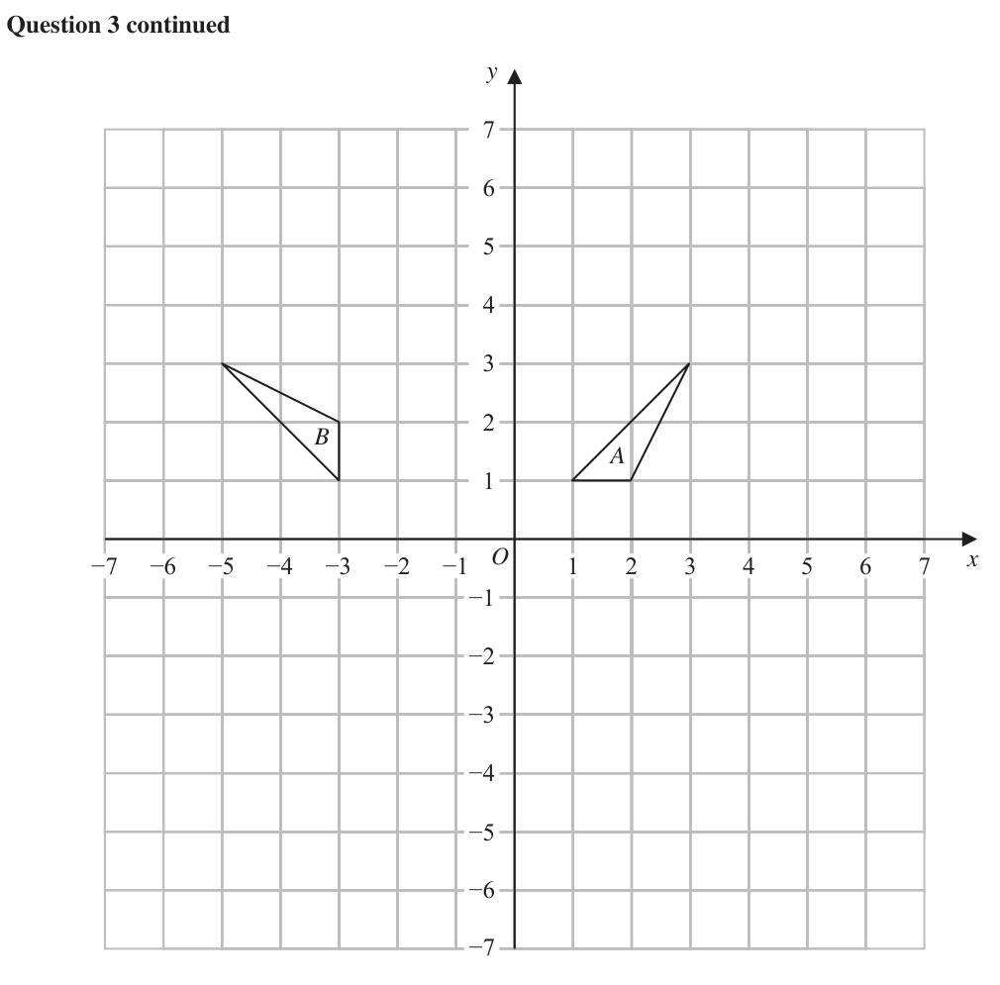
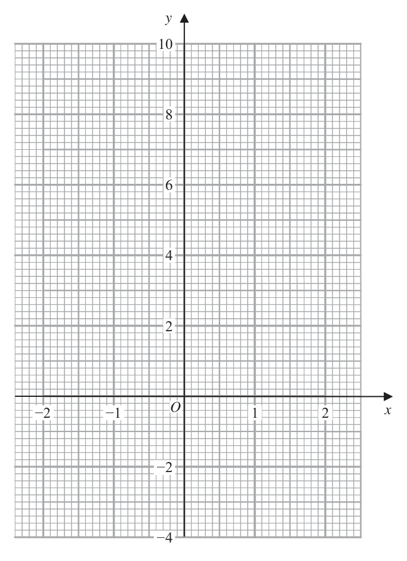
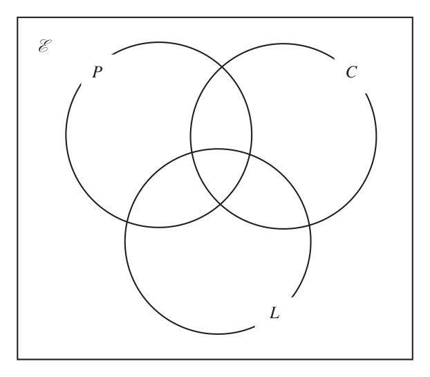
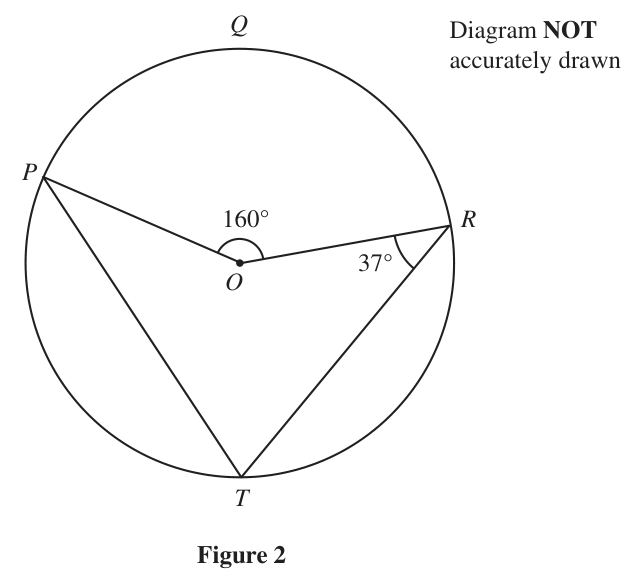

# 4MB1/02R — 2024-06 (official extraction)

> schema `syllabai.official-paper-questions/0.2` · paper_id `pearson-edexcel:international-gcse:mathematics-b:4mb1:2024-06:4MB1/02R` · qp sha256 `c3e33b746d5df74a…` · extraction is the disclosed baseline (ADR-039)

## Question 1 (9 marks)

Gary buys furniture and sells it in a shop. In the shop on Monday, Gary has tables and chairs such that number of tables : number of chairs = 2 : 7 Gary has 42 chairs in the shop on Monday.

### 1(a) [2]

Calculate the number of tables Gary has in the shop on Monday. Gary buys a table for $240 and sells it for $276

> 🖼 crop required: table (qp.pdf p.2)

**Mark scheme answer**

> 42 42 2 M1 for a correct method to find number of tables or
> × 2 oe or × 9 [ −12]
> 7 7 total number of tables and chairs

- **(2)** 42 42 2 M1 for a correct method to find number of tables or

### 1(b) [2]

Calculate the percentage profit from the sale of the table. Gary buys some chairs and sells them for $513 Gary’s percentage profit from the sale of the chairs is 35%

> 🖼 crop required: table (qp.pdf p.2)

### 1(c) [2]

Calculate the price at which Gary bought the chairs. The cost of a table that Gary buys is $732 An identical table costs 684 euros in France. Using the exchange rate $1 = 0.95 euros

> 🖼 crop required: table (qp.pdf p.2)

### 1(d) [3]

find the difference in the costs of the tables. State whether your answer is in euros or $.

## Question 2 (9 marks)

C B D 125° 125° 125° 125° E Diagram NOT A F accurately drawn L y° G K H J I Figure 1 Figure 1 shows a hexagon ABCDEL and a regular octagon EFGHIJKL BAL ABC CDE DEL 125 ° BCD ALE ALK y °

### 2(a) [5]

Calculate the value of y A different regular polygon has T sides and is such that an interior angle (10 x 25)° an exterior angle (7 x 83)°

**Mark scheme answer**

> t or setting up a correct equation to find the number of
> or eg = chairs
> 7 42
> May be seen within a ratio ie 12 : 42
> 12 A1 cao
> 4 ×180 − 4 ×125 hexagon
> [= 110] oe eg
> (2 × 6 − 4) × 90 − 4 ×125 or symmetry in the hexagon (eg line drawn from C to L)
> [= 110] or for correct method to find the exterior angle (at C or L) of the
> hexagon
> or 360 − 2 ×125 [ = 110] oe eg 2 × (180 − 125) [ = 110] can be implied by a correct calculation for y
> 360 − 4 × (180 − 125 )
> or [= 70] oe (If not M2 then M1 for:
> finding the angle sum of the hexagon
> eg 4 ×180 [= 720] or (2 × 6 – 4) × 90 [= 720] oe
> or finding one exterior angle of the hexagon
> eg 180 ‒ 125 [= 55]
> or use of symmetry in the hexagon (eg line drawn from C to L)
> and finding BCL or DCL or CLA or CLE
> 360 − 2 ×125
> eg [= 55] or 180 – 125 [= 55]
> (8 − 2) ×180 ( 2 × 8 − 4 ) × 90 = 135 M1 for finding one interior angle of the octagon
> eg [ = 135] oe eg [ ] or for finding one exterior angle of the octagon
> 8
> 360 can be implied by a correct calculation for y
> or [ = 45]
> eg 360 ‒ “110” ‒ “135” or “70” + (180 ‒ “135”) M1 (dep on all previous method marks awarded)
> or “70” + “45” or “45” + (180 ‒ “110”) oe
> 115 A1 cao

- **(5)** t or setting up a correct equation to find the number of

### 2(b) [4]

Calculate the value of T [Sum of interior angles of polygon (2n 4) right angles]

**Mark scheme answer**

> 276 − 240 276 − 240 2 M1 for a correct method to find the % profit
> [ = 0.15] or ×100 or
> May use multiple number of tables
> 240 240
> 276 276 12 × 276 − 12 × 240
> [= 1.15] or ×100[= 115] eg
> 240 240 12 × 240
> 15(%) A1 cao
> 180 + 58
> [ x =] [= 14] M1 (dep on first method mark) for a correct expression for x
> 360 360 M1 ft dep on M1
> or 180 + 58
> 7 × "14"− 83 180 − (10 × “14” + 25) ft their value of x provided x is from or clearly labelled as x
> 24 A1 cao
> ALT (b) eg T ( 7 x − 83) = 360 and T (10 x + 25 ) = 90 ( 2T − 4 ) oe
> M1 for setting up two equations in x and T
> eg T ( 7 x − 83) = 360 and T (10 x + 25 ) = 180 (T − 2 )
> Allow the use of any letters for T and x provided they are not the same
> 360 180 (T − 2 )
> or 7 x − 83 = and 10 x + 25 =
> T T
> eg 7Tx = 360 + 83T oe and 10Tx = 90 ( 2T − 4 ) − 25T oe M1 for making 7xT or x the subject of each equation
> or for coefficient of xT the same in both equations
> 360 + 83T 90 ( 2T − 4 ) − 25T or for correct rearrangement of one equation followed by
> eg x = oe and x = oe
> 7T 10T correct substitution into the other
> eg Allow the use of any letters for T and x provided they are not the same
> 70Tx = 3600 + 830T oe and 70Tx = 630 ( 2T − 4 ) − 175T
> oe
> M1 for collecting T terms on 1 side and numbers on the
> eg 1260T – 175T – 830T = 3600+2520 oe other in a correct equation
> Allow the use of any letters for T and x provided they are not the same
> 24 A1 cao
> cas for each part Total 9 marks
> Question Working Answer Mark Notes
> In this question ignore any (incorrect) labelling of triangles

- **(4)** 276 − 240 276 − 240 2 M1 for a correct method to find the % profit

## Question 3 (10 marks)

Triangle A and triangle B are drawn on the grid opposite.

### 3(a) [3]

Describe fully the single transformation that maps triangle A onto triangle B Triangle A is transformed to triangle C by a reflection in the line with equation y

**Mark scheme answer**

> 3 B1 allow rotate, rotated, rotation do not accept turn
> B0 if multiple transformations stated.
> Rotation
> Multiple transformations are when more than one of reflection (mirrored),
> rotation (turn), translation (move), enlargement (stretch / squash) is stated
> eg a vector or SF or equation of a line do not imply multiple transformations
> 90 [°] These two marks can
> B1 oe eg 270 clockwise or –270
> [anticlockwise] still be awarded if
> Do not allow 90 clockwise or –90 or –90 anticlockwise
> multiple
> (‒1, ‒1) B1 must be a coordinate and not a vector transformations are
> Do not allow if another coordinate is given as well stated

- **(3)** 3 B1 allow rotate, rotated, rotation do not accept turn

### 3(b) [2]

On the grid, draw and label triangle C Triangle A is transformed to triangle D by an enlargement with centre (0, 3) and scale factor 2

**Mark scheme answer**

> 2 B2 Fully correct triangle.
> Award 2 marks for a correct triangle drawn, irrespective of working in the
> Correct triangle C
> working space.
> at (1, ‒3), (2, ‒3),
> (B1 for correct line drawn or a triangle of the correct size and orientation, or
> (3, ‒5)
> for 2 correct vertices plotted correctly or 3 correct vertices listed)
> SCB1 for
> triangle B reflected in the line y = –1 (vertices (–3,–3) (–3,–4) (–5,–5))
> or for triangle A reflected in the line x = –1 (vertices (–4, 1) (–3, 1) (–5, 3))

- **(2)** 2 B2 Fully correct triangle.

### 3(c) [2]

On the grid, draw and label triangle D Triangle A is transformed to triangle E under the transformation with matrix M where 2 1 M

**Mark scheme answer**

> Correct triangle D 2 B2 Fully correct triangle.
> at (2, ‒1), (4, ‒1), Award 2 marks for a correct triangle drawn, irrespective of working in the
> (6, 3) working space.
> (B1 for a triangle of the correct size and orientation, or
> for 2 correct vertices plotted correctly or 3 correct vertices listed)

- **(2)** Correct triangle D 2 B2 Fully correct triangle.

### 3(d) [3]

On the grid, draw and label triangle E y B A −7 −6 −5 −4 −3 −2 −1 O 1 2 3 4 5 6 7 x −1 −2 −3 −4 −5 −6 −7 for a spare grid if you need to redraw your triangles. Only use this grid if you need to redraw your triangles. y B A −7 −6 −5 −4 −3 −2 −1 O 1 2 3 4 5 6 7 x −1 −2 −3 −4 −5 −6 −7

**Mark scheme answer**

> Points can be in any order 3 M1 for intention to multiply the correct way, can be implied by writing the
> ⎛ −2 1 ⎞⎛1 2 3 ⎞ matrices in the correct order or correctly stating or plotting one point.
> ⎜ ⎟⎜ ⎟
> ⎝ 0 −2 ⎠⎝1 1 3 ⎠
> Points can be in any order M1 for at least two correct columns or correctly stating or plotting two points.
> ⎛ −1 −3 −3 ⎞
> ⎜ ⎟
> ⎝ −2 −2 −6 ⎠
> Correct triangle E A1 Fully correct triangle
> at (–1, –2), (–3, –2), Award 3 marks for a correct triangle drawn, irrespective of working in the
> (–3, –6) working space.
> cas for each part Total 10 marks
> Question Working Answer Mark Notes

- **(3)** Points can be in any order 3 M1 for intention to multiply the correct way, can be implied by writing the

## Question 4 (6 marks)
### 4(a) [2]

Solve the inequality 4 x + 3 ≤ 31

**Mark scheme answer**

> 2 M1 for isolating the x term or reducing for x
> 3 31 May be the wrong inequality sign or an = sign
> 4x 31 − 3 oe or x +
> 4 4 Also allow for a critical value of 7 with incorrect sign
> A1oe eg (− ∞, 7] or [− ∞, 7] do not isw x = 7
> x

- **(2)** 2 M1 for isolating the x term or reducing for x

### 4(b) [2]

Solve the inequality 1 2 x 3 21

**Mark scheme answer**

> 2 B2 or other correct notation eg (‒1, 9) or −1 < x , x < 9 or
> −1 < x < 9
> −1 < x and x < 9 or −1 < x ∩ x < 9
> (B1 for one end correct or for “ −1 < x or x < 9 ”)

- **(2)** 2 B2 or other correct notation eg (‒1, 9) or −1 < x , x < 9 or

### 4(c) [2]

Hence represent on the number line opposite, the set of values of x for which 4 x + 3 ≤ 31 and 1 2 x 3 21 −2 −1 0 1 2 3 4 5 6 7 8 9 10 x

**Mark scheme answer**

> 2 M1 Do not allow lines with arrows at end points or
> A single line joining x = –1 and x = 7
> identification of any other values
> A1 Both end points identified using the correct symbols and
> one correct line drawn between the two correct points
> cas for each part Total 6 marks
> Question Working Answer Mark Notes

- **(2)** 2 M1 Do not allow lines with arrows at end points or

## Question 5 (6 marks)
### 5(a) [2]

Complete the table of values for y 2 x3 5x x −2 −1.5 −1 −0.5 0 0.5 1 1.5 2 y 3.75 6 5.25 3 0.75 2.25 

> 🖼 crop required: table (qp.pdf p.None)

**Mark scheme answer**

> 2 B2 all values correct (B1 for 2 values correct)
> ‒3, 0, 9
> Question Working Answer Mark Notes

- **(2)** 2 B2 all values correct (B1 for 2 values correct)

### 5(b) [2]

On the grid opposite, plot the points from your completed table and join them to form a smooth curve.

> 🖼 crop required: table (qp.pdf p.12)

**Mark scheme answer**

> 2 M1 for at least 5 points plotted correctly ±1 small square
> or for at least 4 points plotted correctly ±1 small square and a
> smooth curve drawn through all their plotted points
> If you are unable to see the points plotted then allow if curve
> goes through them within/on the circles.
> A1 for fully correct graph ±1 small square. Do not allow
> Correct
> straight line segments
> graph

- **(2)** 2 M1 for at least 5 points plotted correctly ±1 small square

### 5(c) [2]

By drawing a suitable straight line on your grid, find estimates to one decimal place, for the solutions of the equation 2 x 3 5 x 2 in the range −2 x 2 y −2 −1 O 1 2 x −2 −4

**Mark scheme answer**

> 2 M1 for the line y = 2 drawn on the grid that goes from at least
> x = –1.5 to x = 1.3 and intersects the curve at all points at
> which y = 2
> A1 dep on M1 and M1 being awarded in part (b)
> (condone straight line segments for this part of the question)
> For all 3 values and no extras
> Allow –1.9 to –1.5 and 0 to 0.4 and 1.3 to 1.7
> A0 if values are given to >2dp or if answers given as
> ‒1.7, 0.2, 1.5 coordinates or y values given as well as x values or if answer is
> given as an inequality
> Do not isw so if ‒1.7, 0.2, 1.5 then –1.7 < x < 1.5 A0
> For reference values from calc are
> x = –1.672981648, 1.469617434, 0.2033642138

- **(2)** 2 M1 for the line y = 2 drawn on the grid that goes from at least

## Question 6 (6 marks)

6 80 gardeners were asked if they grow potatoes (P), carrots (C) or lettuce (L) Of these gardeners 9 grow potatoes, carrots and lettuce 17 grow potatoes and carrots 23 grow carrots and lettuce 19 grow potatoes and lettuce 48 grow carrots 49 grow lettuce 2 grow none of these three crops

### 6(a) [3]

Using this information, complete the Venn diagram below to show the number of gardeners in each subset. E P C L

**Mark scheme answer**

> Correctly 3 B3 All 8 regions completed correctly
> completed (B2 for 5, 6 or 7 regions completed correctly
> Venn (B1 for 3 or 4 regions completed correctly))
> diagram

- **(3)** Correctly 3 B3 All 8 regions completed correctly

### 6(b) [1]

Find n(C ∩ Lʹ ) One of the gardeners is chosen at random. Given that this gardener grows carrots,

**Mark scheme answer**

> 25 1 B1 ft from a diagram where values other than 0 are present in the
> required regions

- **(1)** 25 1 B1 ft from a diagram where values other than 0 are present in the

### 6(c) [2]

find the probability that this gardener also grows lettuce.

**Mark scheme answer**

> 2 B2 oe eg 0.47(91…) rounded or truncated to 2sf
> (B1 ft from a diagram where values other than 0 are present in
> the required regions
> for where a > 23
> a
> "9 + 14" "9 + 14" a
> 23 or or ÷ (ft their 23) where a > “9 + 14”
> a 80
> 48 b b 48 b 3
> or or ÷ oe eg ÷ where b < 48
> 48 80 80 80 5
> or 23 : 48)
> 9 + 14
> B1 only for
> cas for each part Total 6 marks
> Question Working Answer Mark Notes

- **(2)** 2 B2 oe eg 0.47(91…) rounded or truncated to 2sf

## Question 7 (9 marks)

A B C 8 5

### 7(a) [2]

Find 4 A + 2B

**Mark scheme answer**

> 2 M1 for at least 2 correct values in the correct places
> A1 cao
> ⎛ 10 −4 ⎞
> ⎜ ⎟ Do not isw
> ⎝ −4 10 ⎠

- **(2)** 2 M1 for at least 2 correct values in the correct places

### 7(b) [3]

Find AC 1 0

**Mark scheme answer**

> 3 M2 for a matrix of the correct order and at least 4 correct
> values in the correct places
> (M1 for a matrix of the correct order and at least 2 correct
> values in the correct places)
> ⎛ −2 −6 22 ⎞ A1 cao
> ⎜ ⎟ Do not isw
> ⎝ 2 4 −18 ⎠

- **(3)** 3 M2 for a matrix of the correct order and at least 4 correct

### 7(c) [4]

Find the matrix D such that A 1 D 2I where I = 0 1 a b 1 d b The inverse of matrix is c d ad bc c a

**Mark scheme answer**

> 10 × 5 − (−6 × −8)[= 2] 4 M1 a correct method to find the determinant of A
> can be implied by multiplying matrix A by ½
> 1 ⎛5 6⎞ M2 for 4 values in the correct places in their A-1
> ⎜ ⎟ (M1 for at least 2 correct values in the correct places in
> 2 ⎝ 8 10 ⎠
> their A-1)
> ⎛ 2 0 ⎞ ⎛ 2.5 3 ⎞ ⎛ −0.5 −3 ⎞ A1 cao
> ⎜ ⎟−⎜ ⎟ ⎜ ⎟
> ⎝ 0 2⎠ ⎝ 4 5⎠ ⎝ −4 − 3 ⎠
> cas for each part Total 9 marks
> Question Working Answer Mark Notes

- **(4)** 10 × 5 − (−6 × −8)[= 2] 4 M1 a correct method to find the determinant of A

## Question 8 (11 marks)

Aalia delivers letters and parcels.

### 8(a) [3]

Last week Aalia worked for 5 days and wrote down 5 integers that represent the distance, in miles, she drove each day. For these integers the mode is 15 the median is 16 the largest − the smallest = 7 Find 5 integers that Aalia could have written down.

**Mark scheme answer**

> 3 M1 for a list of 5 numbers where the mode is 15 or the
> median is 16 or the range is 7
> M1 for a list of 5 numbers with two of:
> the mode is 15
> the median is 16
> the range is 7
> 15, 15, 16, A1 where x is 17, 18, 19, 20 or 21
> x, 22 (numbers can be in any order)

- **(3)** 3 M1 for a list of 5 numbers where the mode is 15 or the

### 8(b) [3]

Aalia has 8 letters to deliver to Tom. The mean weight of the 8 letters is 104 grams. 5 of the letters are each of weight 89 grams. The mean weight of the remaining letters is A grams. Work out the value of A The histogram shows information about the weights of all the parcels Aalia has in her delivery van on Friday. Frequency density 0 2 4 6 8 10 12 Weight (kg) 75 of the parcels in the van each have a weight between 2 kg and 6 kg. Aalia takes 2 parcels at random from the van.

**Mark scheme answer**

> 3 M1 for the total weight of the 8 letters or the total
> weight of the 5 letters
> 129 A1 cao

- **(3)** 3 M1 for the total weight of the 8 letters or the total

### 8(c) [5]

Find an estimate for the probability that both parcels weigh more than 4 kg.

**Mark scheme answer**

> cm square (5ss by 5ss) 5 M1 for showing frequency is related to area by a correct
> 1× 3 + 3 × 4 cm squares = 75 or 15 cm squares = 75 or calculation or a correct value for area and frequency or a
> 1 cm square = 5 parcels oe correct value on FD axis (1 cm vertically is FD 5) this
> small squares (ss) may come from 1×15 x + 3 × 20 x = 75 oe eg
> 75 lines of 5 ss = 75 or 5 ×15 + 15 × 20 ss = 75 or 1× 3x + 3 × 4 x = 75
> 375 ss = 75 or 5 ss = 1 parcel oe Implied by a frequency of 20 or 15 or 60 or 30 or 20 seen
> Any fd / frequency may be seen in the correct place on
> the histogram
> using FD eg 2 × 10 + 75 + 2 × 15 + 4 × 5 [= 145] M1 implies the previous method mark
> 2 × 20 + 2 × 15 + 4 × 5 [= 90] for a correct method to find the total number of parcels or
> cm square (5ss by 5ss) eg 14 × “5” + 75 [= 145] a correct method to find the number of parcels greater
> or 29 × “5” [= 145] oe or 18 × “5” [= 90] than 4 kg
> small squares (ss) Also allow correct method to find the number of
> 100 + 75 + 300 + 150 + 100 parcels less than 4 kg
> eg [= 145]
> 5 eg 2 × 10 + 1 × 15 + 1 × 20 [= 55] oe
> 200 + 150 + 100
> [= 90]
> M1 implies both previous method marks for a correct first
> probability
> Only ft numbers from correct working
> 90
> " " or " " or "0.62(06...)" oe Also allow the correct probability for a parcel
> 145 29 being less than 4 kg
> 55
> eg or or 0.37(93...)
> 145
> M1 A correct product
> ⎛ 90 ⎞ 324
> 90 90 − 1 Allow ⎜ ⎟ = ≈ 0.385
> × oe ⎝ 145 ⎠ 841
> 145 145 − 1
> 90 90 − 1 ⎛ 90 ⎞
> Condone 2 × × and 2 × ⎜ ⎟
> 145 145 − 1 ⎝ 145 ⎠
> 89 A1 oe eg 0.38(36…) [decimal or % 2sf or better]
> 232 Allow 0.38 – 0.3853
> cas for each part Total 11 marks
> Question Working Answer Mark Notes

- **(5)** cm square (5ss by 5ss) 5 M1 for showing frequency is related to area by a correct

## Question 9 (10 marks)

Q Diagram NOT accurately drawn P 160° R 37° O T Figure 2 Figure 2 shows the points P, Q, R and T on a circle centre O POR 160 ORT

### 9(a)(i) [1]

Work out the size, in degrees, of ∠PTR

**Mark scheme answer**

> 80 1 B1 cao

- **(1)** 80 1 B1 cao

### 9(a)(ii) [1]

Give a reason for your answer.

**Mark scheme answer**

> 1 B1 dep on B1 in (i)
> correct for Angle at the centre is 2 × (double) angle at
> reason circumference / angle at circumference is ½ angle at centre
> allow the symbol for the word ‘angle’

- **(1)** 1 B1 dep on B1 in (i)

### 9(b) [2]

Work out the size, in degrees, of ∠TPO The sector, OPQR, is cut out from the circle in Figure 2 A hollow right circular cone is formed by joining OP and OR together as shown in Figure 3 O Q Diagram NOT accurately drawn P 160° R P R Q O Figure 3 196 The curved surface area of the cone is π cm²

**Mark scheme answer**

> eg “80” ‒ 37 or 360 –“80” ‒ 37 – (360 – 160) or 2 M1 ft their answer to part (a)(i)
> 180 –“80” ‒ 37 – (180 – 160) oe A correct method to find angle TPO
> 43 A1 cao

- **(2)** eg “80” ‒ 37 or 360 –“80” ‒ 37 – (360 – 160) or 2 M1 ft their answer to part (a)(i)

### 9(c) [6]

Calculate the volume, in cm³ to 3 significant figures, of the cone. 1 2 Volume of cone 3 r h Curved surface area of cone rl

**Mark scheme answer**

> 22
> Throughout part (c) allow 3.1, 3.14, etc or for π and allow any letter or symbol for r
> 160 196 160 2 196
> ×π × r2 = π oe eg ×r = 160 196 160 196
> × π × (...r ) =
> 360 25 360 25 π or × π × ...r 2 = π
> 360 25 360
> 196π 160π 196 9 ⎡ 21 M1 implies previous M
> ⎤
> [ r =] ÷ oe eg [ r =] × ⎢= = 4.2 ⎥ a correct calculation for the radius of the sector (slant
> 25 360 25 4 ⎣ 5 ⎦ height of cone)
> 196 ⎡ 28 ⎤ 196
> [radius of cone = ] eg ÷ "4.2" ⎢ = = 1.866...⎥ oe M1 for ÷ " r " where “r” is the candidate’s value for the
> 25 ⎣ 15 ⎦
> 160 radius of the sector. If r is incorrect it must be clearly
> × 2π × "4.2"[ = 11.7...] labelled and working for this method mark must be shown
> 360 ⎡ 28 ⎤
> eg ⎢ = = 1.866...⎥ Condone radius of cone being labelled as l
> 2π ⎣ 15 ⎦
> M1 dep on first and third method marks,
> for a correct calculation for the height of the cone
> ⎡ 7 65 ⎤ Follow through candidate’s values for r or r and l. These
> (cone height=) "4.2"2 − "1.866..."2 ⎢ = = 3.762...⎥ must be clearly labelled and working shown if they are
> ⎣ 15 ⎦ incorrect
> Condone "1.866..."2 − "4.2"2
> M1 dependent on previous four method marks
> for a correct calculation for the volume where r and h are
> × π × "1.866..."2 × "3.762..."[ = 4.36(99..)π ] from correct methods
> 3
> NB: × π × "4.2"2 × "3.762..." does not get this mark
> 13.7 A1 13.4 to 13.9
> (cm³) SCB4 for 68.5 to 69.7
> cas Total 10 marks
> Question Working Answer Mark Notes

- **(6)** 22

## Question 10 (14 marks)

f and g are two functions such that f : x ↦ x2 + 2x where x > −1 g:x ↦ x+2

### 10(a) [1]

State the value of x that must be excluded from any domain of g

**Mark scheme answer**

> ‒2 1 B1 allow x = –2 or x ≠ –2
> DO NOT allow x < –2 or x > –2 or y = –2 or y ≠ –2

- **(1)** ‒2 1 B1 allow x = –2 or x ≠ –2

### 10(b) [1]

Find f(3)

**Mark scheme answer**

> 15 1 B1 cao

- **(1)** 15 1 B1 cao

### 10(c) [2]

Find the value of x for which g(x) = 5

**Mark scheme answer**

> 13 2 M1 Setting g(x) = 5
> = 5 oe
> x+2 Allow any letter for x
> 0.6 A1 oe eg

- **(2)** 13 2 M1 Setting g(x) = 5

### 10(d) [2]

Find fg(24)

**Mark scheme answer**

> 2 2 M1
> 13 ⎞ ⎛ 13 ⎞
> [ fg( x) =] ⎛⎜ ⎟ + 2⎜ ⎟ oe For evidence of a correct first step eg finding fg(x) or
> ⎝ x+2⎠ ⎝ x+2⎠ sight of 0.5 (which may be embedded in their attempt at fg(24))
> or [g(24) =] [= 0.5] oe
> 24 + 2
> or f(0.5) oe
> 1.25 A1 oe eg

- **(2)** 2 2 M1

### 10(e) [4]

Find the value of x for which gf(x) = 4 Show your working clearly. The function h is such that h : x ↦ 5 x 2 − 10 x − 4 where x ≥ 1

**Mark scheme answer**

> 13 4 M1 for a correct (un simplified) expression for gf(x)
> 2 [ = 4] or for finding the inverse of g
> x + 2x + 2
> 13 − 2 x ⎡ 13 − 2(4) 5 ⎤ or for correctly solving g(x) = 4 may use a different letter to x eg
> or ⇒ = ⎥ 13
> x ⎢⎣ 4 4⎦ =4⇒t =
> t+2
> 13
> or =4⇒ x =
> x+2
> 4 x + 8 x − 5 [ = 0] oe
> 2 M1 a correct 3TQ
> 5
> eg x 2 + 2 x − [= 0] or x 2 + 2 x =
> 4
> M1 dependent on the first method mark
> For solving their 3 term quadratic using any correct method.
> Method may be implied by answers of 0.5 and –2.5 or by an answer of 0.5
> Working must be shown if their quadratic is incorrect
> 1
> A1 dep on first method mark for just oe
> 2

- **(4)** 13 4 M1 for a correct (un simplified) expression for gf(x)

### 10(f) [4]

Find the inverse of h(x) in the form h −1 : x ↦ ... b b 2 4ac The solutions of ax 2 bx c 0 where a 0 are given by x 2a

**Mark scheme answer**

> [ y =] 5( x 2 − 2 x) − 4 4 M1 for a correct start to write the quadratic in completed square form
> Allow x and y to be interchanged
> ⎛ 4⎞
> or [ y = ] 5 ⎜ x 2 − 2 x − ⎟
> ⎝ 5⎠ Condone division of all terms by 5 ie x 2 − 2 x − oe
> [ y =] 5 ( ( x − 1) − 1) − 4 or M1 implies previous method mark
> Allow y = ( 5 x − 5)2 − 5 − 4 oe Allow x and y to be interchanged
> 4⎞
> [ y =] 5 ⎛⎜ ( x − 1) − 1 −
> Condone ( x − 1) − 1 − oe
> ⎟
> ⎝ 5⎠
> y +9 M1
> = ( x − 1)
> ( 5x − 5 ) oe Allow x and y to be interchanged
> 5 Allow y + 9 =
> Allow candidates to swap x and y [ h −1 : x ] x+9 + 5
> when finding inverse A1 oe eg Must only have + and must be in x
> x+9
> 1+
> 5 Do not ISW
> equation / expression
> M1 dep for applying the quadratic formula correctly
> [ x =] oe 10 + 100 − 4 × 5 × (− y − 4)
> 10 Allow with positive sign only eg [ x =]
> [ y =] oe for recognising that x/y has to be positive in a correct expression or for
> having a correct expression in terms of x
> or
> 10 ± 100 − 4 × 5 × (− x − 4)
> [ x =] oe
> 180 + 20 x
> A1 oe eg 1 +
> [ h −1 : x ]
> 10 + 100 − 4 × 5 × (− x − 4)
> Allow candidates to swap x and y 10 + 180 + 20 x
> x+9 Allow un-simplified eg or
> when finding inverse 1+ 10
> 5 Must only have + and must be in x
> Do not ISW
> cas for parts (a), (b), (c), (d), (f) wr for part (e) Total 14 marks
> Question Working Answer Mark Notes

- **(4)** [ y =] 5( x 2 − 2 x) − 4 4 M1 for a correct start to write the quadratic in completed square form

## Question 11 (6 marks)

Solve the simultaneous equations x y 2 x y 2 xy 2 2 Show clear algebraic working. (6) b b 2 4ac The solutions of ax 2 bx c 0 where a 0 are given by x 2a

### 11 [6]

Solve the simultaneous equations x y 2 x y 2 xy 2 2 Show clear algebraic working. b b 2 4ac The solutions of ax 2 bx c 0 where a 0 are given by x 2a

**Mark scheme answer**

> 2 ( 5 + y ) + y 2 + 2 y ( 5 + y ) = 85 or
> 6 M1 for substituting a linear equation into the quadratic
> equation
> 2 x2 + ( x − 5)2 + 2 x( x − 5) = 85 Allow one sign error in their (5 + y) or (x – 5)
> This mark can be implied by an un simplified correct
> expansion in a correct equation
> eg 50 + 20 y + 2 y 2 + y 2 + 10 y + 2 y 2 = 85
> or 2 x 2 + x 2 − 10 x + 25 + 2 x 2 − 10 x = 85
> 50 + 20 y + 2 y 2 + y 2 + 10 y + 2 y 2 = 85 M1 for correct expansion of all brackets in a correct equation.
> Implied by a correct (simplified) quadratic expression.
> or 2 x 2 + x 2 − 10 x + 25 + 2 x 2 − 10 x = 85
> No simplification needed at this stage.
> 5 y 2 + 30 y − 35[= 0] oe eg y 2 + 6 y − 7[= 0] A1 dep on first method mark being awarded
> A correct 3 term quadratic in either x or y (oe so look for signs
> or 5 x 2 − 20 x − 60[= 0] oe eg x 2 − 4 x − 12[= 0]
> reversed, does not need to equal zero eg allow x 2 − 4 x = 12 )
> eg (5 y − 5)( y + 7)[= 0] oe M1 dependent on one of the two previous M marks.
> Solving their 3 term quadratic equation using any correct
> ( 30 ) − 4 × 5 × −35
> −30 ± method.
> or oe
> 2×5 If the quadratic is correct then the method may be implied by
> 80 6 and ‒2 or by 1 and ‒7.
> or 5( y + 3) 2 − 80 and y = ± − 3 oe Working must be shown if their quadratic is incorrect to gain
> this method mark.
> eg ( x − 6 )( x + 2 ) [= 0] oe Condone incorrect labelling
> ‒2 and 6 A1 dep M3 and a correct quadratic
> or For both x values correct or both y values correct
> ‒7 and 1 Condone incorrect labelling
> A1 dep M3 and a correct quadratic
> Correct
> For both pairs correct, must show unambiguous pairings.
> pairings
> Allow as coordinates (6, 1) and (‒2, ‒7)
> x = 6, y = 1
> isw transcription errors eg exchanging x and y values.
> x = ‒2,y= ‒7
> Correct answer(s) with no working scores no marks
> wr Total 6 marks
> Question Working Answer Mark Notes

- **(6)** 2 ( 5 + y ) + y 2 + 2 y ( 5 + y ) = 85 or

## Question 12 (4 marks)

for Question 12 6 ( 2 a 3) 12 35 25 5w 7 252 a 1 Find an expression for w in terms of a Give your answer in the form na + m where n and m are integers. (4)

### 12 [4]

for Question 12 6 ( 2 a 3) 12 35 25 5w 7 252 a 1 Find an expression for w in terms of a Give your answer in the form na + m where n and m are integers.

**Mark scheme answer**

> 4 M1 for knowing that the cube root of a number is the same as raising
> 1 1 to the power
> ⎡ 3 25 = ⎤ ( 25 ) 3 oe or ( 52 ) 3 oe
> ⎣ ⎦
> ( 25 )
> 6(2 a −3)
> may be written as a correct statement embedded within
> 6(2 a −3) 6(2 a −3)
> ⎛ 1⎞ ⎛
> ⎞
> oe or ⎜ ( 52 ) 3 ⎟ ( )
> (2 a −3)
> eg ⎜ 253 ⎟ oe or 252 oe
> ⎝ ⎠ ⎝ ⎠
> M1 implies the previous method mark
> ( 25 )
> 6(2 a −3)
> for writing
> correctly as a power of 5
> ( )
> 2
> ⎡ 3 25 6(2 a −3) = ⎤ 58 a −12 ×6(2 a −3) (12 a −18)
> ⎢⎣ ⎥⎦ eg as 5 3 or 5 3 or 54(2 a −3) or 58 a −12
> or
> ( )
> 6(2 a −3)
> or for writing 35 × 3 25 correctly as a power of (7 and) 25
> (
> ⎡35 × 3 25
> ) = ⎤ [ 7 ×] 25 × 254 a −6
> 6(2 a −3) 1
> 2 ×6(2 a −3)
> ⎢⎣ ⎥⎦ eg [ 7 ×] 25 2 × 253
> We can allow brackets in the power but not a base raised to a
> ( )
> 4 a −6
> power to a power eg 52
> ×6(2 a −3)
> [ 7 ×] 5 × 5
> or
> [ 7 ×] 5 × 58a −12
> oe
> M1 implies the previous method marks
> [7 ×] 52(2 a +1) [7 ×] 54a+2 for use of only powers of 5 (and 7) on numerator and denominator
> (powers of 5 but not necessarily a single power).
> or [ 7 ×] 5 × 58 a −12 = [ 7 ×] 54 a + 2 × 5w oe Needs to be as a correct single statement so not as two parts etc
> or 8a ‒ 12 + 1 ‒ 4a ‒ 2 oe
> 4a ‒13 A1 condone 54 a −13 Do not allow 2w = 4a – 13
> cas Total 4 marks
> Pearson Education Limited. Registered company number 872828
> with its registered office at 80 Strand, London, WC2R 0RL, United Kingdom

- **(4)** 4 M1 for knowing that the cube root of a number is the same as raising

