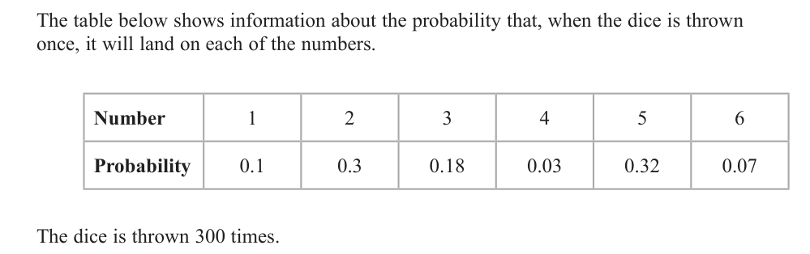
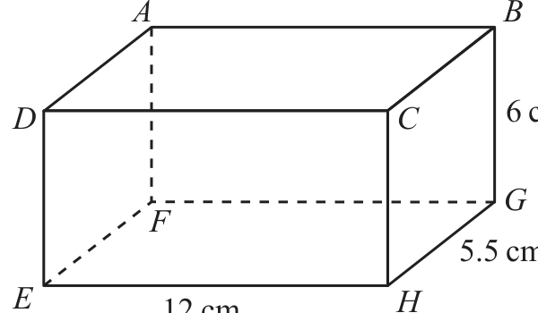
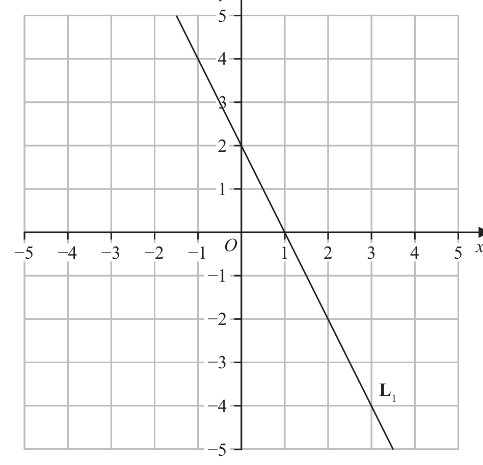
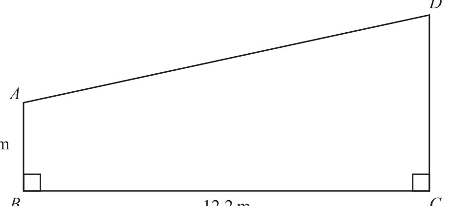
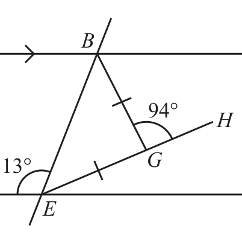
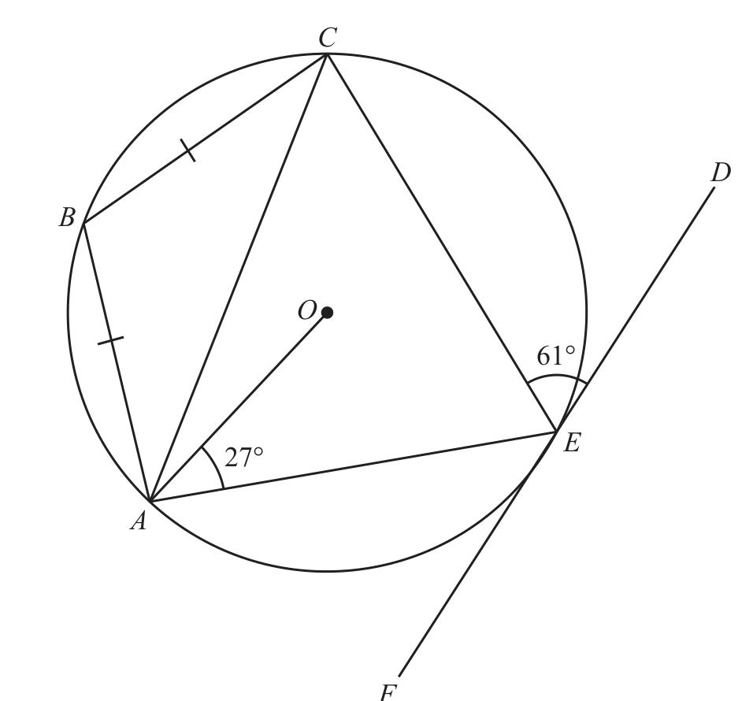
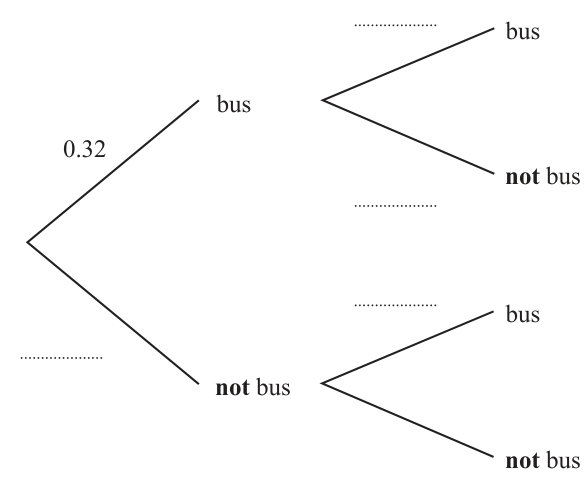
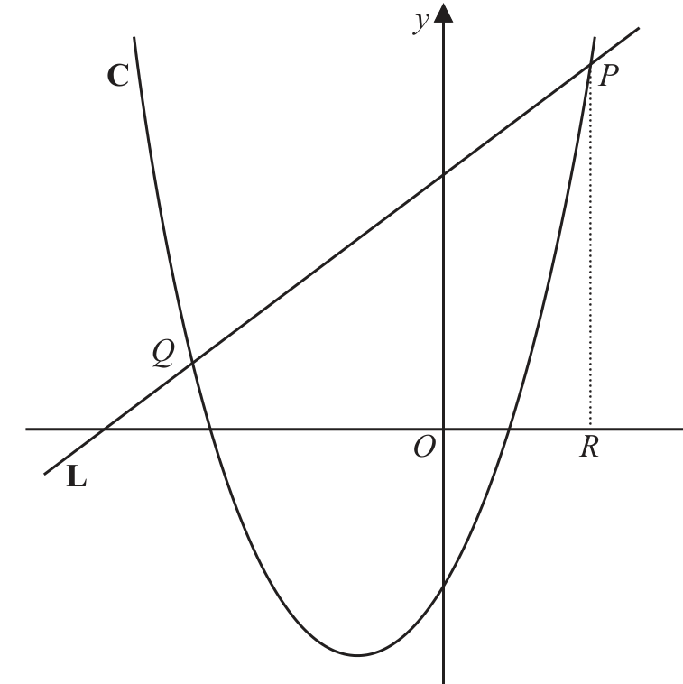
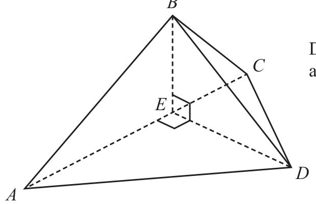

# 4MB1/01 — 2024-11 (official extraction)

> schema `syllabai.official-paper-questions/0.2` · paper_id `pearson-edexcel:international-gcse:mathematics-b:4mb1:2024-11:4MB1/01` · qp sha256 `185192fd7f5df315…` · extraction is the disclosed baseline (ADR-039)

## Question 1 (2 marks)

Factorise fully 28ab + 21b

### 1 [2]

Factorise fully 28ab + 21b

**Mark scheme answer**

> 7b(4a + 3) 2 B2 cao Do not ISW Condone a missing RH bracket
> (B1 for correct partial factorisation, eg 7(4ab + 3b) or b(28a + 21)
> or for correctly identifying the HCF, eg 7b( xa + y ) where x and y
> are integers) ISW for B1
> Total 2 marks

- **(2)** 7b(4a + 3) 2 B2 cao Do not ISW Condone a missing RH bracket

## Question 2 (2 marks)

A pattern is made with white squares and shaded squares.

### 2(a) [1]

Shade one more square to make a pattern with rotational symmetry of order 2 Here is a different pattern made from white squares and shaded squares.

**Mark scheme answer**

> 1 B1 for correct square and no incorrect squares shaded
> Allow any other clear indication that the correct square has been
> indicated

- **(1)** 1 B1 for correct square and no incorrect squares shaded

### 2(b) [1]

Shade one more square to make a pattern with exactly one line of symmetry.

**Mark scheme answer**

> 1 B1 for correct square and no incorrect squares shaded
> Allow any other clear indication that the correct square has been
> indicated
> Total 2 marks

- **(1)** 1 B1 for correct square and no incorrect squares shaded

## Question 3 (2 marks)

Using ruler and compasses only and showing all your construction lines, construct the perpendicular bisector of AB B A

### 3 [2]

Using ruler and compasses only and showing all your construction lines, construct the perpendicular bisector of AB B A

**Mark scheme answer**

> Overlay Correct 2 B2 for a correct bisector with 2 pairs of arcs (use overlay) must
> bisector cross/touch AB. This needs to be within the tram lines if required to
> be extended
> (B1 for a correct bisector without arcs or a correct bisector with only
> one pair of arcs or 2 pairs of correct arcs without bisector drawn)
> Total 2 marks

- **(2)** Overlay Correct 2 B2 for a correct bisector with 2 pairs of arcs (use overlay) must

## Question 4 (2 marks)

The bearing of Port A from Port B is 276° Find the bearing of Port B from Port A ............................. . . . . . . . . . . . . . . . . . . . . . . . . . . . . . . . . . °

### 4 [2]

The bearing of Port A from Port B is 276° Find the bearing of Port B from Port A

…………… °

**Mark scheme answer**

> 276 − 180 or 90 + (276 − 270) or 2 M1 for a complete correct method to find the bearing e.g. 90 + 6
> 180 − (360 − 276) Do not ISW e.g. 276 – 180 = 96 180 – 96 = 84 scores M0
> 096 A1 for 096 accept 96 Do not ISW

- **(2)** 276 − 180 or 90 + (276 − 270) or 2 M1 for a complete correct method to find the bearing e.g. 90 + 6

## Question 5 (2 marks)

Solve x x 7 7 x = ......................... . . . . . . . . . . . . . . . . . . . . . . . . . . . . . . . . . . . . .

### 5 [2]

Solve x x 7 7 x = ……………Solve x x 7 7 x =

**Mark scheme answer**

> 3 2 M1 for a correct equation in the form ax = b e.g. 3x = 126
> x = 18 oe
> 7 5−2
> Condone awrt 0.43x = 18 or 0.42x = 18 or x = 18
> 126
> May be implied by [x =] 42 or [ x =]
> 42 126
> A1 cao Accept [ x =] oe

- **(2)** 3 2 M1 for a correct equation in the form ax = b e.g. 3x = 126

## Question 6 (2 marks)

A 2 x 7 4 B 2 2 7 y Given that x > 2 and y > 4 find the highest common factor (HCF) of A and B

### 6 [2]

A 2 x 7 4 B 2 2 7 y Given that x > 2 and y > 4 find the highest common factor (HCF) of A and B

**Mark scheme answer**

> 22 × 32 × 7 4 or 22 × 32 × 50 × 74 2 M1 for 2 correct terms written in a product e.g. 22 × 32 ignore any
> other terms. Do not accept 2 x × 32 × 7 4 as this is A which is given in
> the question
> 86 436 A1 for 86 436 or 22 × 32 × 7 4 or 2 × 2 × 3 × 3 × 7 × 7 × 7 × 7

- **(2)** 22 × 32 × 7 4 or 22 × 32 × 50 × 74 2 M1 for 2 correct terms written in a product e.g. 22 × 32 ignore any

## Question 7 (2 marks)

A biased dice has six faces numbered 1, 2, 3, 4, 5 and 6 The table below shows information about the probability that, when the dice is thrown once, it will land on each of the numbers. Number 1 2 3 4 5 6 Probability 0.1 0.3 0.18 0.03 0.32 0.07 The dice is thrown 300 times. Calculate the expected number of times the dice will land on a number greater than 3

### 7 [2]

A biased dice has six faces numbered 1, 2, 3, 4, 5 and 6 The table below shows information about the probability that, when the dice is thrown once, it will land on each of the numbers. Number 1 2 3 4 5 6 Probability 0.1 0.3 0.18 0.03 0.32 0.07 The dice is thrown 300 times. Calculate the expected number of times the dice will land on a number greater than 3

**Mark scheme answer**

> 0.03 + 0.32 + 0.07[= 0.42] oe or p × 300 2 M1for a correct method to find P(>3) e.g. (1 − (0.1 + 0.3 + 0.18) )
> 21 126
> or p × 300 where 0 < p < 1 Allow to imply 0.42 Allow
> 50 300
> 126 126
> A1 cao Do not allow as a final answer
> 300

- **(2)** 0.03 + 0.32 + 0.07[= 0.42] oe or p × 300 2 M1for a correct method to find P(>3) e.g. (1 − (0.1 + 0.3 + 0.18) )

## Question 8 (3 marks)

8 3 kg of onions cost £1.71 2 kg of onions and 5 kg of potatoes cost £5.34 Calculate the total cost, in £, of 3 kg of onions and 4 kg of potatoes. £......................... . . . . . . . . . . . . . . . . . . . . . . . . . . . . . . . . . . . . .

### 8 [3]

8 3 kg of onions cost £1.71 2 kg of onions and 5 kg of potatoes cost £5.34 Calculate the total cost, in £, of 3 kg of onions and 4 kg of potatoes. £

**Mark scheme answer**

> 2 3 M1 for a correct first step to find the cost of 1 kg of onions, or to
> 171 ÷ 3[ = 0.57 ] or 1.71× [= 1.14] find the cost of 2 kg of onions. May be implied by 0.57 or 1.14
> or 5 kg of potatoes = 4.2[0] or 1kg of potatoes = 0.84 or 3 kg of
> potatoes = 3.36
> ( 5.34 − 2 × "0.57") ÷ 5[= 0.84] M1 for a correct method to find 1 kg of potatoes or to find 4 kg of
> potatoes
> or ( 5.34 − "1.14") × [= 3.36]
> 5.07 A1 cao

- **(3)** 2 3 M1 for a correct first step to find the cost of 1 kg of onions, or to

## Question 9 (3 marks)

A B Diagram NOT D C 6 cm accurately drawn G F 5.5 cm E 12 cm H The diagram shows a solid cuboid ABCDEFGH EH = 12 cm GH = 5.5 cm BG = 6 cm Calculate the total surface area, in cm2, of the cuboid. ..................................... . . . . . . . . . . . . . . . . . . . . . . . . . cm2

### 9 [3]

The diagram shows a solid cuboid ABCDEFGH EH = 12 cm GH = 5.5 cm BG = 6 cm Calculate the total surface area, in cm², of the cuboid cm²

> *Figure not shown in this reconstruction — the printed paper includes a diagram (not drawn accurately).*
> Labels in the original figure: A, B, D, C, G, F, E, H · Figure values: 6, 5.5, 12.

**Mark scheme answer**

> 12 × 5.5[= 66] 3 M1 for a correct method to find at least 2 different areas
> 12 × 6[ = 72] May be embedded in an attempt to find the total surface area
> 5.5 × 6[= 33]
> ("66"+ "72"+ "33") × 2 M1 dep on 1st M1 for a complete correct method to find the surface
> area
> 342 A1 cao

- **(3)** 12 × 5.5[= 66] 3 M1 for a correct method to find at least 2 different areas

## Question 10 (3 marks)

y −5 −4 −3 −2 −1 O 1 2 3 4 5 x −1 −2 −3 L1 −4 −5 The straight line L1 is drawn on the grid. The straight line L2 is parallel to L1 and passes through the point with coordinates 9, 12 Find an equation for L2 Give your answer in the form y mx c

### 10 [3]

y −5 −4 −3 −2 −1 O 1 2 3 4 5 x −1 −2 −3 L1 −4 −5 The straight line L1 is drawn on the grid. The straight line L2 is parallel to L1 and passes through the point with coordinates 9, 12 Find an equation for L2 Give your answer in the form y mx c

> *Figure not shown in this reconstruction — the printed paper includes a diagram (not drawn accurately). Use the text description to work through it.*

**Mark scheme answer**

> change in y −6 3 M1 for a correct method to find the gradient of L1, eg −6 oe
> Gradient = eg [= −2]
> change in x 3
> or “m” = −2
> Allow any expression that evaluates to −2 or −2x
> (May be implied by −2x ± c)
> 12 = m × −9 + c or M1 for substituting x = −9 and y = 12 into the equation of a line ft
> y – 12 = m(x − −9) their gradient (May be implied by −2x – 6)
> where m is their gradient
> y = −2x – 6 A1 for y = −2x – 6 do not ISW, allow y = –6 − 2x
> Must see y = on answer line or if not on the answer line, then award
> this mark if seen in the working

- **(3)** change in y −6 3 M1 for a correct method to find the gradient of L1, eg −6 oe

## Question 11 (2 marks)

Calculate 2.3 10114 4.6 10117 Give your answer in standard form.

### 11 [2]

Calculate 2.3 10114 4.6 10117 Give your answer in standard form.

**Mark scheme answer**

> for 0.0005 or 5 ×10n n < 0 or 2 M1 Allow any correct answer not in standard form e.g. 0.5 ×10−3 oe
> m ×10−4 1 ⩽ m < 10
> 5 ×10−4 A1 cao Do not ISW

- **(2)** for 0.0005 or 5 ×10n n < 0 or 2 M1 Allow any correct answer not in standard form e.g. 0.5 ×10−3 oe

## Question 12 (3 marks)

A, B, C and D are numbers such that A: B = 2:5 A: D = 3:8 B : C = 9 : 11 Find C : D Give your answer in its simplest form.

### 12 [3]

A, B, C and D are numbers such that A: B = 2:5 A: D = 3:8 B : C = 9 : 11 Find C : D Give your answer in its simplest form.

**Mark scheme answer**

> B : D = 15 : 16 oe or A : C = 18 : 55 oe 3 M1 for a correct ratio
> May be implied by C : D = 55 : 48 oe Allow D = 16 or C = 55
> B : C : D = 45 : 55 : 48 oe or M1 for a correct ratio
> A : C : D = 18 : 55 : 48 oe or May be implied by C : D = 55 : 48 oe e.g. 165 : 144
> A : B : C : D = 18 : 45 : 55 :48 oe
> 55 : 48 A1 allow 1 : 48 or 55 : 1
> 55
> ALT A 2 A 3 B 9 C D
> = = = M2 for a correct method to find or
> B 5 D 8 C 11 D C
> C 11 5 3 D 9 2 8 48
> = × × or = × × May be implied by oe or oe
> D 9 2 8 C 11 5 3 55
> 11 5
> (M1 for any 2 correct fractions multiplied together e.g. × May
> 9 2
> be seen in a calculation of 3 fractions multiplied together)
> Allow decimal equivalents if 2 decimal places or better
> 55:48 A1 allow 1 : 48 or 55 : 1
> 55

- **(3)** B : D = 15 : 16 oe or A : C = 18 : 55 oe 3 M1 for a correct ratio

## Question 13 (3 marks)

D Diagram NOT accurately drawn A 1.7 m B 12.2 m C The diagram shows quadrilateral ABCD where B and C are on horizontal ground and BA and CD are vertical. BC = 12.2 metres AB = 1.7 metres ABC BCD The angle of elevation of D from A is 32° Calculate the length, in metres to 3 significant figures, of CD ............................................ . . . . . . . . . . . . . . . . . . metres

### 13 [3]

The diagram shows quadrilateral ABCD where B and C are on horizontal ground and BA and CD are vertical. BC = 12.2 metres AB = 1.7 metres ABC BCD The angle of elevation of D from A is 32° Calculate the length, in metres to 3 significant figures, of CD metres

> *Figure not shown in this reconstruction — the printed paper includes a diagram (not drawn accurately).*
> Labels in the original figure: D, A, B, C · Figure values: 1.7, 12.2.

**Mark scheme answer**

> height 3 M1 for a correct trig statement or a fully correct method to find the
> tan ( 32 ) = [⇒ height = 7.62...] or height. May be implied by awrt 7.6 oe awrt 8.1 (calc set in rads) or
> 12.2
> 12.2 awrt 6.7 (calc set in grad)
> tan ( 58) = [⇒ height = 7.62...] or
> height
> height 12.2
> = [⇒ height = 7.62...] or
> sin 32 sin 58
> ⎛ 12.2 ⎞
> height = − 12.2 [ = 7.62...]
> ⎝ sin 58 ⎠
> 7.62... + 1.7 M1 for a complete correct method to find CD
> e.g. awrt 7.6 + 1.7 (Allow ft provided that “7.62…” has come from
> using a trig statement)
> 9.32 A1 for awrt 9.3

- **(3)** height 3 M1 for a correct trig statement or a fully correct method to find the

## Question 14 (3 marks)

Write as a single fraction in its simplest form x 1 2 x 5 7 4

### 14 [3]

Write as a single fraction in its simplest form x 1 2 x 5 7 4

**Mark scheme answer**

> 20 x − 20 − 28 x + 70 3 M2 for a fully correct expression
> or (M1 for 20 x − 20 − 28 x + 70 or 10 x − 10 − 14 x + 35 (Allow 1 sign
> 10 x − 10 − 14 x + 35 5 x − 5 4 x − 10
> or error) (May be implied by –8x + 50 or –4x + 25) or −
> 5 x 5 4 x 10 5 x 5 4 x 10
> − − + or or − − + (Allow one sign error) or an expression with a
> 7 7 4 4 7 7 4 4
> 5x 5 5 denominator of 28 or 14)
> − −x+
> 7 7
> 25 − 4 x −4 x + 25 2 x 25
> A1 accept or − + Do not ISW
> 14 14 7 14

- **(3)** 20 x − 20 − 28 x + 70 3 M2 for a fully correct expression

## Question 15 (4 marks)

A team takes part in a sports league. After 12 games its mean score per game is 96 After 14 games its mean score per game is 98 The ratio of its score in game 13 to its score in game 14 is 2 : 3 Calculate its score in game 14

### 15 [4]

A team takes part in a sports league. After 12 games its mean score per game is 96 After 14 games its mean score per game is 98 The ratio of its score in game 13 to its score in game 14 is 2 : 3 Calculate its score in game 14

**Mark scheme answer**

> 96 ×12[= 1152] or 98 ×14[= 1372] or 4 M1 for a correct method to find the total points after 12 games or
> 98 × 2[= 196] or 12 × 2[= 24] after 14 games or for finding the total points for the 2 extra games or
> the extra points for the 12 games. May be implied by 220
> 98 ×14 − 96 ×12[= 220] or M1 for a correct method to find the total points scored in games 13
> 98 × 2 + 12 × 2[= 220] and 14
> 3 M1 dep on 2nd M1 for correct use of the ratio to find the score in
> "220"× oe game 14
> 132 A1 cao

- **(4)** 96 ×12[= 1152] or 98 ×14[= 1372] or 4 M1 for a correct method to find the total points after 12 games or

## Question 16 (4 marks)

B A C Diagram NOT accurately drawn 94° H 113° G F D E In the diagram, BGE is an isosceles triangle with EG = BG ABC, DEF and EGH are straight lines. ABC is parallel to DEF DEB 113 BGH Find the size, in degrees, of ∠CBG Give a reason for each stage of your working. CBG ............................. . . . . . . . . . . . . . . . . . . . . . . . . . . . . . . . . . °

### 16 [4]

In the diagram, BGE is an isosceles triangle with EG = BG ABC, DEF and EGH are straight lines. ABC is parallel to DEF DEB 113 BGH Find the size, in degrees, of ∠CBG Give a reason for each stage of your working. CBG °

> *Figure not shown in this reconstruction — the printed paper includes a diagram (not drawn accurately).*
> Labels in the original figure: B, A, C, H, G, F, D, E · Figure values: 94°, 113°.

**Mark scheme answer**

> ∠BEF = ∠ABE [ = 180 − 113] = 67 4 M1 for finding ∠BEF / ∠ABE / ∠EBG / ∠GBE / ∠CBE
> 180 − (180 − 86)
> ⎡ 94 ⎤ e.g. ∠EGB = [= 47]
> or ∠EBG = ∠GBE ⎢ = ⎥ = 47 or
> ⎣ 2⎦ (May be seen on the diagram) May be implied by the 2nd M mark
> ∠CBE = 113
> [∠CBG =]180 − "47"− "67" or M1 for a correct method ft their ∠BEF / ∠ABE / ∠EBG / ∠GBE if
> clearly labelled or marked on the diagram
> [∠CBG =]113 − "47"
> cas 66 A1 for 66
> Alternate angles are equal B1 dep on M1M1A1 being awarded and at least one correct reason
> Corresponding angles are equal stated for their method. Must include the underlined words
> Co-interior angles / allied angles Condone for triangle and ∠ for angle
> add up to 180° Condone Alt for alternate, Co-int for co-interior, ext for exterior and
> Angles in a triangle add to 180° opp for opposite Iso(s) for Isosceles
> Angles on a straight line add to
> 180°
> Base angles in an isosceles triangle
> (are equal)
> The exterior angle of a triangle is
> equal to the sum of the interior
> opposite angles
> Total 4 marks

- **(4)** ∠BEF = ∠ABE [ = 180 − 113] = 67 4 M1 for finding ∠BEF / ∠ABE / ∠EBG / ∠GBE / ∠CBE

## Question 17 (4 marks)

At the start of 2012, Fatima bought a car for $15 500 From the start of 2012 to the start of 2014, the value of the car decreased by 8% From the start of 2014 to the start of 2016, the value of the car decreased by 2.2% From the start of 2016 to the start of 2018, the value of the car decreased by x% At the start of 2018, the value of the car was $13 137.40 Calculate, to 2 significant figures, the value of x x = ......................... . . . . . . . . . . . . . . . . . . . . . . . . . . . . . . . . . . . . .

### 17 [4]

At the start of 2012, Fatima bought a car for \$15 500 From the start of 2012 to the start of 2014, the value of the car decreased by 8% From the start of 2014 to the start of 2016, the value of the car decreased by 2.2% From the start of 2016 to the start of 2018, the value of the car decreased by x% At the start of 2018, the value of the car was \$13 137.40 Calculate, to 2 significant figures, the value of x x =

**Mark scheme answer**

> ⎛ 100 − 8 ⎞ 4 M1 for a correct method to find the value in 2014
> 15500 × [ = 14260] or May be implied by 14260 or 13946.28 (allow 13946.3 or 13946)
> ⎝ 100 ⎠
> ⎛ 8 ⎞
> 15500 − ⎜ ×15500 ⎟ [ = 14260]
> ⎝ 100 ⎠
> ⎛ 100 − 2.2 ⎞ M1 dep on 1st M1 for a correct method to find the value in 2016
> "14260"× [ = 13946.28] or May be implied by 13946.28 (Allow 13946.3 or 13946)
> ⎝ 100 ⎠
> ⎛ 2.2 ⎞
> "14260"− ⎜ × "14260" ⎟ [ = 13946.28]
> ⎝ 100 ⎠
> ⎛ ("13946.28"− 13137.40 ) ⎞ M1 dep on 2nd M1 for a correct method to find the multiplier for the
>  [×100] oe or final change e.g. "13946.28"− ("13946.28"× x ) = 13137.40
> ⎝ "13946.28" ⎠
> ⎛ 13137.40 ⎞ May be implied by awrt 5.8 or 0.058
> ⎜1 − ⎟ [×100]
> ⎝ "13946.28" ⎠
> 5.8 A1 awrt 5.8 Condone awrt 5.8%
> SC If they do an 8% increase followed by a 2.2% increase then
> award B1 for awrt 0.23 or awrt 23%

- **(4)** ⎛ 100 − 8 ⎞ 4 M1 for a correct method to find the value in 2014

## Question 18 (4 marks)

Make t the subject of r 3t

### 18 [4]

Make t the subject of r 3t

**Mark scheme answer**

> 5t − 7 4
> ⎛ 5t − 7 ⎞
> r2 = M1 for removing square root. Allow r = 
> 8 − 3t
> ⎝ 8 − 3t ⎠
> May be implied by 8r 2 − 3r 2t = 5t − 7
> 8r 2 − 3r 2t = 5t − 7 M1 dep on 1st M1 for multiplying by the denominator and
> expanding correctly to form a correct equation.
> 8r 2 + 7 = 5t + 3r 2t M1 ft their equation. For gathering the terms in t on one side and
> the other terms on the other side of an equation.
> This is dep on having 2 terms in t, exactly one of these must contain
> r or r 2 , and two other terms on the other side of the equation
> (this must be correct for their equation)
> 8r 2 + 7 −8r 2 − 7
> t= A1 oe e.g. t =
> 5 + 3r 2 −5 − 3r 2
> Must see t = on answer line or if not on the answer line, then award
> this mark if seen in the working
> Do not ISW

- **(4)** 5t − 7 4

## Question 19 (4 marks)

A B 4 3 0 2

### 19(a) [2]

Find AB 3 2 C 5 6

**Mark scheme answer**

> ⎛ ( 2 × 3 + 1× 0 ) ( 2 × ( −3) + 1× 2 ) ⎞ ⎛ 6 −4 ⎞ 2 B2 cao
>  (B1 for 2 terms correct)
> ⎜ ( 4 × 3 + 3 × 0 ) ( 4 × ( −3) + 3 × 2 ) 12 −6 ⎠
> ⎝ ⎠

- **(2)** ⎛ ( 2 × 3 + 1× 0 ) ( 2 × ( −3) + 1× 2 ) ⎞ ⎛ 6 −4 ⎞ 2 B2 cao

### 19(b) [2]

Find C −1

**Mark scheme answer**

> 1 ⎛ 6 −2 ⎞ 2 M1 for a correct determinant or matrix element of the inverse
>  6 −2 
> 3 × 6 − 2 × 5 ⎝ −5 3 ⎠ e.g. 3 × 6 − 2 × 5 or with all 4 terms correct
> ⎝ −5 3 ⎠
> ⎛ 3 1 − ⎟
> or 4 4 with 2 terms correct
>  −5 3 8 8
> ⎛ 3 1⎞ 1 ⎛ 6 −2 4 − ⎟ A1 oe Allow ISW
>  8 ⎝ −5 3 −5 3 8 8⎠

- **(2)** 1 ⎛ 6 −2 ⎞ 2 M1 for a correct determinant or matrix element of the inverse

## Question 20 (4 marks)

C Diagram NOT accurately drawn D B O 61° E 27° A F In the diagram A, B, C and E are points on a circle with centre O DEF is the tangent to the circle at the point E BA = BC OAE CED Find the size, in degrees, of ∠BCE BCE ............................. . . . . . . . . . . . . . . . . . . . . . . . . . . . . . . . . . °

### 20 [4]

In the diagram A, B, C and E are points on a circle with centre O DEF is the tangent to the circle at the point E BA = BC OAE CED Find the size, in degrees, of ∠BCE BCE °

> *Figure not shown in this reconstruction — the printed paper includes a diagram (not drawn accurately).*
> Labels in the original figure: C, D, B, O, E, A, F · Figure values: 61°, 27°.

**Mark scheme answer**

> ∠AEF = 63 or ∠ACE = 63 or 4 B1 May be seen on the diagram
> ∠OCE = ∠OEC = 29 or May be seen embedded in a correct calculation for another angle
> ∠OAC = ∠OCA = 34 or May be implied by 1st M1
> ∠AEC = 180 − 61 − 63 [ = 56] and M1 for a correct method to find ∠ABC
> ∠ABC = 180 − "56"[= 124] (Allow ∠B for ∠ABC )
> May be implied by ∠BCA / ∠BAC = 28
> or
> May be seen on the diagram
> ∠AOE = 180 − 2 × 27[= 126] and
> Do not ft their 63, 29 or 34
> ∠COE = 180 − 2 × 29[= 122] and
> "126"+ "122"
> ∠ABC = [= 124]
> or
> ∠AEC = 27 + 29 = [56] and
> ∠ABC = 180 − "56"[= 124]
> 1 M1 dep on 1st M1 for a correct method to find BCE
> ∠BCA = (180 − "124") [= 28] and Do not ft their 63/29/34
> ∠BCE = 63 + "28"
> or
> ∠BAC = ∠BCA = (180 − "124") [= 28]
> and ∠BCE = 34 + "28"+ 29 or
> ∠BCE = 180 − ("28"+ 34 + 27 )
> or
> ∠BAC = ∠BCA = (180 − "124") [= 28]
> and ∠BCE = 34 + "28"+ 29 or
> ∠BCE = 180 − ("28"+ 34 + 27 )
> 91 A1 Dep on 2nd M1
> Total 4 marks

- **(4)** ∠AEF = 63 or ∠ACE = 63 or 4 B1 May be seen on the diagram

## Question 21 (4 marks)

v 2 u 2 2as v = 25.4 to 1 decimal place u = 9.512 to 4 significant figures s = 15 to the nearest 5 Calculate the upper bound, to 3 significant figures, of a Show your working clearly.

### 21 [4]

v 2 u 2 2as v = 25.4 to 1 decimal place u = 9.512 to 4 significant figures s = 15 to the nearest 5 Calculate the upper bound, to 3 significant figures, of a Show your working clearly.

**Mark scheme answer**

> vUB = 25.45 vLB = 25.35 4 M1 for one correct bound
> uUB = 9.5125 u LB = 9.5115
> sUB = 17.5 sLB = 12.5
> v2 − u 2 M1 for substitution of at least 2 from
> [ a =] or v 2 − u 2 = 2as
> 25.4 < v ≤ 25.45
> 2s
> 9.5115 ≤ u < 9.512
> 12.5 ≤ s < 15
> into a formula or expression involving v, u and s
> e.g. v – u = 2as
> v
> − uLB 2 M1 for substitution of v, u and s into a correct formula or
> [ aUB =] UB or expression where
> 2 × sLB
> 25.4 < v ≤ 25.45
> vUB 2 − uLB 2 = 2asLB
> 9.5115 ≤ u < 9.512
> 12.5 ≤ s < 15
> 25.452 − 9.51152 A1 dep on correct working for awrt 22.3
> = 22.3
> 2 ×12.5
> or
> 25.452 − 9.51152 = 2a ×12.5
> ⇒ a = 22.3
> Total 4 marks

- **(4)** vUB = 25.45 vLB = 25.35 4 M1 for one correct bound

## Question 22 (5 marks)
### 22(a) [2]

On the number line, represent the inequality 5 y ≤ 3 y −6 −5 −4 −3 −2 −1 0 1 2 3 4 5 6

**Mark scheme answer**

> Shown 2 B2 for a fully correct diagram. Must be a single line
> (B1 for an open circle at −5 and a closed circle at 3 or a single line
> from −5 to 3 Allow ( for an open circle and ] as a closed circle

- **(2)** Shown 2 B2 for a fully correct diagram. Must be a single line

### 22(b) [3]

Solve the inequality 4 x + 2 ≥ 3 7 2 x

**Mark scheme answer**

> 4 x + 2 ≥ 21 − 6x 3 M1 for a correct expression after expanding the bracket
> (accept use of = or > or < or ⩽ for ≥)
> 4 x + 6 x ≥ 21 − 2 M1 for isolating the x terms e.g. 2 − 21 − 6x − 4x
> (accept use of = or > or < or ⩽ for ≥)
> Allow 19 10x (accept use of = or < or > or ⩾ for )
> x ≥ 1.9 A1 Allow x
> Total 5 marks

- **(3)** 4 x + 2 ≥ 21 − 6x 3 M1 for a correct expression after expanding the bracket

## Question 23 (6 marks)
### 23(a) [2]

Use the factor theorem to show that x 5 is a factor of 2 x 3 9 x 2 11x

**Mark scheme answer**

> 2 × ( −5) + 9 × ( −5) − 11× ( −5) − 30 2 M1 for correct substitution of x = –5 into the given expression
> 3
> (allow one error)
> =0 A1 dep on M1 must have no errors and = 0

- **(2)** 2 × ( −5) + 9 × ( −5) − 11× ( −5) − 30 2 M1 for correct substitution of x = –5 into the given expression

### 23(b) [4]

Hence, factorise completely 2 x 3 9 x 2 11x Show clear algebraic working.

**Mark scheme answer**

> 2 4 M1 for a start to find the quadratic factor. This may be seen in part
> 2 x ...
> (a)
> 2x2 − x − 6 M1 for a fully correct 3 term quadratic. This may be seen in part (a)
> ( 2 x + 3)( x − 2 ) M1 for an attempt at factorisation of their 3TQ – Must multiply out
> to give 2 of their 3 terms
> (x + 5) A1 Dep on the 2nd and 3rd M marks being awarded. Only accept
> (x – 2) what is seen (any order). Condone = 0 but do not ISW if they go on
> (2x + 3) to solve.
> NB A correct answer with no working scores 0/4
> Total 6 marks

- **(4)** 2 4 M1 for a start to find the quadratic factor. This may be seen in part

## Question 24 (5 marks)

The probability that Lethna takes the bus to work on Monday is 0.32 If Lethna takes the bus on Monday, the probability that she takes the bus on Tuesday is 0.47 If Lethna does not take the bus on Monday, the probability she will not take the bus on Tuesday is 0.71

### 24(a) [2]

Complete the tree diagram for this information. Monday Tuesday bus bus 0.32 not bus bus not bus not bus E is the event that Lethna takes the bus on exactly one of either Monday or Tuesday. F is the event that Lethna does not take the bus on Monday and does not take the bus on Tuesday.

**Mark scheme answer**

> 2 B2 for a completely correct tree diagram
> (B1 for at least two probabilities correctly placed)

- **(2)** 2 B2 for a completely correct tree diagram

### 24(b) [3]

Find which of the events, E or F, has the greater probability. Show your working clearly.

**Mark scheme answer**

> 0.32 × "0.47"[= 0.1504] or 3 M1 for one correct product, (ft their tree diagram, provided these are
> 0.32 × "0.53"[= 0.1696] or probabilities)May be implied by
> or
> 106
> or
> 493
> or
> 1207
> or
> "0.68"× "0.29"[= 0.1972] or 625 625 2500 2500
> "0.68"× "0.71"[= 0.4828] 0.3668 or
> 917
> 2500
> ("0.32 × 0.53") + ("0.68 × 0.29")[= 0.3668] or M1 for a complete correct method to find the probability that Lethna
> 1 − ( ("0.32 × 0.47") + ("0.68 × 0.71") )[ = 0.3668]
> takes the bus on exactly one day (ft their tree diagram, provided
> 917
> these are probabilities). May be implied by
> 2500
> F with A1 for F (Allow F > E) with 0.4828/0.483/0.48 and
> correct 0.3668/0.367/0.37/0.36
> figures 1207 917
> Allow F with and
> 2500 2500
> Total 5 marks

- **(3)** 0.32 × "0.47"[= 0.1504] or 3 M1 for one correct product, (ft their tree diagram, provided these are

## Question 25 (7 marks)

y Diagram NOT C P accurately drawn Q O R x L The diagram shows part of the curve C with equation y 3 x 2 16 x and part of the line L with equation 2 y 11x 110 P and Q are the points of intersection of C and L R is the point on the x-axis such that PR is parallel to the y-axis. Show that the area of triangle PQR is 442.75 cm2 You must show clear algebraic working.

### 25 [7]

y Diagram NOT C P accurately drawn Q O R x L The diagram shows part of the curve C with equation y 3 x 2 16 x and part of the line L with equation 2 y 11x 110 P and Q are the points of intersection of C and L R is the point on the x-axis such that PR is parallel to the y-axis. Show that the area of triangle PQR is 442.75 cm² You must show clear algebraic working.

> *Figure not shown in this reconstruction — the printed paper includes a diagram (not drawn accurately). Use the text description to work through it.*

**Mark scheme answer**

> 5.5 x + 55 = 3x 2 + 16 x − 35 or 7 M1 for correct substitution of the linear equation 2 y − 11x = 110 into the
> ⎛2 ⎞
> ⎛2 ⎞ quadratic equation y = 3x 2 + 16 x − 35 to form an (unsimplified) equation in
> y = 3 ⎜ y − 10 ⎟ + 16 ⎜ y − 10 ⎟ − 35
> ⎝ 11 ⎠ ⎝ 11 ⎠ either x or y. This mark can be implied by a fully correct 3 term quadratic
> 6 x + 21x − 180[= 0] oe or
> 2 M1 for a 3 term quadratic in either x or y with at least 2 out of 3 terms
> correct
> 12 y 2 − 1089 y + 12705[= 0] oe
> ( x − 4 )( 6 x + 45) oe or M1 for a correct method to solve their 3 term quadratic – either by formula,
> complete the square or factorising. By factorising: brackets must expand to
> ( y − 77 )(12 y − 165) oe give 2 out of the 3 correct terms. By formula: correct substitution into fully
> correct formula (allow 1 sign error). By completing the square: must see
> ⎛ b ⎞
> a ⎜ x + ⎟ ± ...[= 0] If the 3 term quadratic is incorrect then working must
> ⎝ 2a ⎠
> be shown. May be implied by x = 4 and –7.5 or y = 77 and 13.75
> May be seen as coordinates on the diagram
> y = 5.5 × "4"+ 55[= 77] or M1 for a correct method to find a y value using their x value or a correct
> y = 5.5 × "− 7.5"+ 55[= 13.75] method to find an x value using their y value. If the values of x or y are
> incorrect then working must be shown to find the corresponding values of y
> or
> or x.
> x = × "77"− 10[= 4] or May be implied by (4, 77) or (–7.5, 13.75)
> 11 May be seen as coordinates on the diagram
> x = × "13.75"− 10[= −7.5]
> [ P =] (4, 77) and [Q =] (−7.5, [13.75]) A1 for correct coordinates of P and x-coordinate of Q
> May be implied by x = 4, x = –7.5 and y = 77
> May be seen as coordinates on the diagram
> 1 M1 for a fully correct method to find the area (we do not ft their
> × ( 77 − 0 ) × ( 4 − −7.5) or
> 2
> coordinates) Allow use of alternative methods e.g. allow use of ab sin C
> 1 1 if the length of the sides are PQ = awrt 64, PR = 77, QR = awrt 18 and
> ( 77 + 13.75) ×11.5 − ×11.5 ×13.75 ∠PQR = awrt 130 or ∠QRP = awrt 39/awrt 40 or ∠QPR = awrt 10
> 2
> Shown A1 dep on all 5 M marks for 442.75 with no errors
> Total 7 marks

- **(7)** 5.5 x + 55 = 3x 2 + 16 x − 35 or 7 M1 for correct substitution of the linear equation 2 y − 11x = 110 into the

## Question 26 (9 marks)

B Diagram NOT C accurately drawn E D A The diagram shows a solid pyramid P with vertices A, B, C and D ACD is the horizontal triangular base of P E is the point on AC such that AE = AC AC = 15.5 cm CD = 8.2 cm AED

### 26(a) [2]

B Diagram NOT C accurately drawn E D A The diagram shows a solid pyramid P with vertices A, B, C and D ACD is the horizontal triangular base of P E is the point on AC such that AE = AC AC = 15.5 cm CD = 8.2 cm AED

Calculate, in cm to 3 significant figures, the length of ED cm The solid pyramid T is mathematically similar to P The area of the triangular base of T is 64.9 cm² Given that vertex B is vertically above point E and EBD

**Mark scheme answer**

> 2 2 M1 for a complete correct method to find ED
> EC = × 15.5[= 6.2]
> ED = 8.2 − "6.2"
> 2 2 "6.2" "6.2"
> cos ∠ECD = sin ∠EDC =
> 8.2 8.2
> [⇒ ∠ECD = 40.878...] [⇒ ∠EDC = 49.121...]
> ED = 8.2 × sin("40.8...") or ED = 8.2 × cos("49.1...")
> ED = "6.2"× tan("40.8...") "6.2"
> or tan("49.1...") =
> ED
> cas 5.37 A1 for awrt 5.4 Allow 125 5

- **(2)** 2 2 M1 for a complete correct method to find ED

### 26(b) [7]

calculate, in cm³ to 3 significant figures, the volume of T

…………… cm³

**Mark scheme answer**

> 1 1 1 7 M1 for a complete correct method to find the base area of P If
> × 15.5 × "5.37"[= 41.6175] or × 9.3 × "5.37 "+ × 6.2 × "5.37 "[ = 41.6175]
> 2 2 2 using 125 5 then the exact answer is 41.5908…
> "5.37" M1 for a complete correct method or expression to find EB
> [ EB =] [ = 1.849...] or "5.37"× tan(19)[= 1.849...] or Exact answer is 1.84785…
> tan(71)
> ⎛ "5.37" ⎞
> [ BE =]
> "5.37"
> × sin19[= 1.849...] or − "5.37" [ = 1.849...]
> 
> sin 71 ⎝ sin 71 ⎠
> 3/ 2 M2 for a complete correct method to find the volume SF or the
> ⎛ 64.9 ⎞ "41.6175"
> [= 0.80....] or
>  [ = 1.94....] or length SF. May be done in stages. Exact answers are
> ⎝ "41.6175" ⎠ 64.9 1.94926…, 0.51301… 0.80052…, 1.24917…
> 3/ 2
> ⎛ "41.6175" ⎞ 64.9
> [ = 1.24....]
> (M1 for a complete correct method to find the area SF e.g.
>  [= 0.51....] or 64.9 "41.6175"
> ⎝ 64.9 ⎠ "41.6175" [= 1.55...] or [= 0.64...]
> "41.6175" 64.9
> Exact answers are 1.56043…, 0.64084…)
> 1 M1 for a complete correct method to find the volume of P or
> × "41.6175"× "1.849..."[= 25.65...] or "1.849..."× "1.24..."[= 2.30...] or the vertical height of T
> Exact answers are 25.61797…2.30829…
> "1.849..."÷ "0.80..."[= 2.30...]
> This may be embedded in a calculation for the volume of T
> ⎛1 ⎞
> e.g. ⎜ × 15.5 × "5.37" ⎟ × "1.849..."× × "1.94..."
> ⎝2 ⎠
> 1 M1 dep on 5 previous M marks being awarded for a complete
> "25.6..."× "1.94..." or "25.6..."÷ "0.51..." or × 64.9 × "2.30..." correct method to find volume of T
> 50.0 A1 awrt 49.9 or 50 from no incorrect working

- **(7)** 1 1 1 7 M1 for a complete correct method to find the base area of P If

## Question 27 (6 marks)

A curve with equation y 9 x 2 16 x 5 is drawn on a grid where 1 unit = 1 cm on each axis. P and Q are two points on the curve. P is the point with coordinates 1, 2 The gradient of the tangent to the curve at Q is 6.5 Find the length, in cm to 3 significant figures, of PQ You must show clear algebraic working. .................................. . . . . . . . . . . . . . . . . . . . . . . . . . . . . cm

### 27 [6]

A curve with equation y 9 x 2 16 x 5 is drawn on a grid where 1 unit = 1 cm on each axis. P and Q are two points on the curve. P is the point with coordinates 1, 2 The gradient of the tangent to the curve at Q is 6.5 Find the length, in cm to 3 significant figures, of PQ You must show clear algebraic working cm

**Mark scheme answer**

> ⎡ dy ⎤ 6 M1 Attempt to differentiate ie x n → x n−1 for at least one non zero
> ⎢⎣ dx = ⎥⎦ 18 x − 16 term correct
> 18 x − 16 = 6.5 M1 dep on a linear expression in the form ax + b = c where c ≠ 0
> Can be implied by x = 1.25 oe
> 6.5 + 16 M1 dep on previous M1 for solving their linear expression correctly
> x= [= 1.25] leading to x = …
> y = 9 ×1.252 − 16 ×1.25 + 5[= −0.9375] M1 dep on 1st M1 for substitution of their x value into
> y = x 2 − 16 x + 5 (May be implied by awrt – 0.9 or − )
> If the x value is incorrect then working must be shown
> M1 dep on previous M1 for a correct method to find length PQ
> (1 − "1.25") + ( −2 + "0.9375")
> 2
> oe
> ("1.25"− 1) + ( − "0.9375"+ 2 ) or ("0.25") + ("1.0625")
> 2 2 2
> e.g.
> 1.09 A1 dep 1st M and 5th M marks being awarded awrt 1.09
> 305
> Allow 1.1 or ISW
> Total 6 marks

- **(6)** ⎡ dy ⎤ 6 M1 Attempt to differentiate ie x n → x n−1 for at least one non zero

