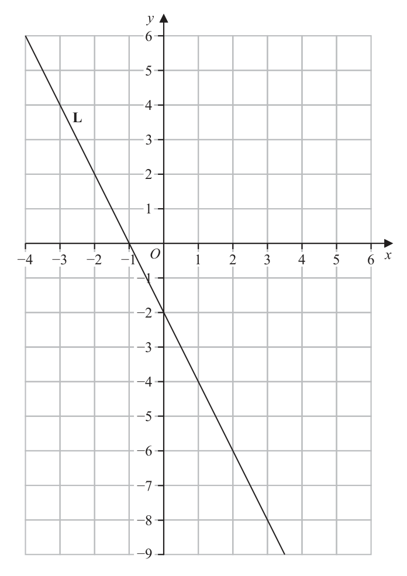
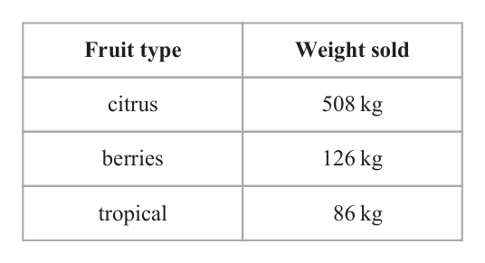
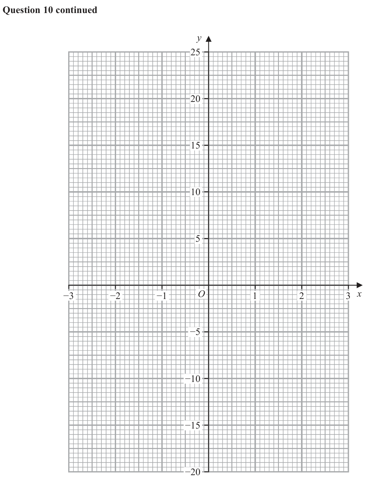

# 4MB1/02 — 2024-11 (official extraction)

> schema `syllabai.official-paper-questions/0.2` · paper_id `pearson-edexcel:international-gcse:mathematics-b:4mb1:2024-11:4MB1/02` · qp sha256 `307c9b6377530686…` · extraction is the disclosed baseline (ADR-039)

## Question 1 (4 marks)

Solve the simultaneous equations 3 x 5 y 7.5 7 x 6 y 3.9 Show clear algebraic working. (4)

### 1 [4]

Solve the simultaneous equations 3 x 5 y 7.5 7 x 6 y 3.9 Show clear algebraic working.

**Mark scheme answer**

> 21x + 35 y = 52.5 18 x + 30 y = 45 4 M1 multiplying both equations so the coefficients of x are the
> oe or oe or same or the coefficients of y are the same
> 21x + 18 y = 11.7 35 x + 30 y = 19.5
> OR rearranging to get x in terms of y or y in terms of x (this
> 7.5 − 5 y 7.5 − 3x could come from a linear combination of the equations given)
> x= oe or y = oe or
> 3 5 Allow one incorrect term for the award of this mark
> 3.9 − 6 y 3.9 − 7 x May be implied by a correct equation in terms of one variable
> x= oe or y = oe or a substitution of x or y with at most one incorrect term
> 7
> ⎛ 7.5 − 5 y ⎞ M1ft one incorrect term, for indicating a correct operation to
> 17 y = 40.8 oe or 17 x = −25.5 oe or 7 ⎜ ⎟ + 6 y = 3.9 eliminate one variable. If the correct operation is not indicated
> ⎝ 3 ⎠ then the correct operation must be applied throughout. Can be
> ⎛ 7.5 − 3 x ⎞ ⎛ 3.9 − 6 y ⎞ implied by a correct ft equation in terms of one variable
> oe or 7 x + 6 ⎜ ⎟ = 3.9 oe or 3 ⎜ ⎟ + 5 y = 7.5
> ⎝ 5 ⎠ ⎝ 7 ⎠ OR substitute to give an equation in terms of just x or an
> equation in terms of just y.
> ⎛ 3.9 − 7 x ⎞
> oe or 3 x + 5 ⎜ ⎟ = 7.5 oe
> ⎝ 6 ⎠
> x = −1.5 A1 oe award three marks if one method mark has been
> or awarded
> y = 2.4
> x = −1.5 A1 oe award full marks if one method mark has been awarded
> and
> y = 2.4
> wr Total 4 marks
> Question Working Answer Mark Notes

- **(4)** 21x + 35 y = 52.5 18 x + 30 y = 45 4 M1 multiplying both equations so the coefficients of x are the

## Question 2 (6 marks)

The line L with equation y 2 x 2 is drawn on the grid opposite.

### 2(a) [2]

On the grid opposite, draw the graph with equation x y for values of x from −4 to 6

**Mark scheme answer**

> Correct line 2 M1 for a straight line with a gradient of 1
> drawn or line with a positive gradient through one correct point as listed below
> or two points correct, which may be plotted or in a table or listed as listed
> below
> x –4 –3 –2 –1 0 1 2 3 4 5
> y –8 –7 –6 –5 –4 –3 –2 –1 0 1
> A1 correct line between −4 and 6
> (tolerance = must go through 2 points in the table)

- **(2)** Correct line 2 M1 for a straight line with a gradient of 1

### 2(b) [2]

On the grid opposite, draw the graph with equation 3 y x for values of x from −4 to 6

**Mark scheme answer**

> Correct line 2
> drawn M1 for a straight line with a gradient of −
> or line with a negative gradient through one correct point as listed below
> or two points correct, which may be plotted or in a table or listed as listed
> below
> x –3 0 3
> y 0 –1 –2 –3
> A1 correct line between −4 and 6
> (tolerance = must go through 2 points in the table)

- **(2)** Correct line 2

### 2(c) [1]

Show, by shading on the grid opposite, the region R defined by all of the inequalities x − y ≤ 4 y ≥ −2 x − 2 3 y x ≤ Label the region R The point P with coordinates (x, y) lies in the region R Given that y is an integer and P lies on the line with equation x = 1

**Mark scheme answer**

> Correct region 1 B1 dep on correct lines drawn, not necessarily from –4 to 6 but sufficient in
> shaded length to enclose the correct region
> Correct enclosed region identified
> Correct region indicated by one of the following
> • correct region shaded
> • correct region labelled as R
> • all of outside region shaded.

- **(1)** Correct region 1 B1 dep on correct lines drawn, not necessarily from –4 to 6 but sufficient in

### 2(d) [1]

write down all the possible y coordinates of the point P y L −4 −3 −2 −1 O 1 2 3 4 5 6 x −1 −2 −3 −4 −5 −6 −7 −8 −9

**Mark scheme answer**

> −2 and −3 1 B1 dep on B1 being awarded in part (c)
> for −2 and −3 only or for (1, −2) and (1, −3) only
> cas Total 6 marks
> Question Working Answer Mark Notes
> Ignore the use of or the omission of brackets throughout

- **(1)** −2 and −3 1 B1 dep on B1 being awarded in part (c)

## Question 3 (10 marks)

E = {2, 3, 4, 5, 6, 7, 8, 9, 10} P = {prime numbers} E = {even numbers} F = {factors of 36}

**(a)** Write down all the elements of

**(c)** Find

### 3(a)(i) [1]

E ′

**Mark scheme answer**

> { 3, 5, 7, 9 } 1 B1 cao

- **(1)** { 3, 5, 7, 9 } 1 B1 cao

### 3(a)(ii) [1]

P F

**Mark scheme answer**

> { 5, 7 } 1 B1 cao

- **(1)** { 5, 7 } 1 B1 cao

### 3(a)(iii) [1]

E ∪ F 70 children were asked which flavours of ice cream they like from chocolate (C), vanilla (V) and strawberry (S). 5 children like chocolate and vanilla and strawberry 15 like strawberry only 12 like chocolate only 8 like none of the flavours 6 like strawberry and vanilla 11 like chocolate and vanilla 21 like strawberry 35 like vanilla

**Mark scheme answer**

> { 2, 3, 4, 6, 8, 9, 10 } 1 B1 cao

- **(1)** { 2, 3, 4, 6, 8, 9, 10 } 1 B1 cao

### 3(b) [3]

Show all of this information on the Venn diagram opposite, giving the number of students in each appropriate subset.

> 🖼 crop required: diagram (qp.pdf p.6)

**Mark scheme answer**

> Diagram 3 B3 for all 8 regions correct
> (B2 for 5 or 6 or 7 regions correct
> (B1 for 2 or 3 or 4 regions correct))
> NB: Blank section not accepted as zero
> We must see the numerical value not only a calculation
> (eg 11 – 5 = 6 is acceptable but not just 11 – 5)

- **(3)** Diagram 3 B3 for all 8 regions correct

### 3(c)(i) [1]

n(C )

**Mark scheme answer**

> 23 1 B1 for 23 or ft their diagram where values are present (ie not
> blank) in the required regions “12 + 6 + 5 + 0”

- **(1)** 23 1 B1 for 23 or ft their diagram where values are present (ie not

### 3(c)(ii) [1]

n C V S One of the 70 children is chosen at random. Given that this child likes vanilla

**Mark scheme answer**

> 6 1 B1 for 6 or ft their diagram where a value is present (ie not
> blank) in the required region

- **(1)** 6 1 B1 for 6 or ft their diagram where a value is present (ie not

### 3(d) [2]

find the probability that this child also likes chocolate. E C V S

**Mark scheme answer**

> 11 2 B2 oe eg 0.31(42…) rounded or truncated to 2sf
> (B1ft their diagram where values are present in the required
> regions
> for where a > 11 and a = “6 + 5 + 23 + 1”
> a
> b
> or where b < 35 and b = “6 + 5”
> or 11 : 35
> 6+5 11 35
> B1 only for or ÷ oe)
> 6 + 5 + 1 + 23 70 70
> cas Total 10 marks
> Question Working Answer Mark Notes
> Throughout allow 3.1, 3.14, etc or for π

- **(2)** 11 2 B2 oe eg 0.31(42…) rounded or truncated to 2sf

## Question 4 (7 marks)

D Diagram NOT E accurately drawn F C B A O Figure 1 Figure 1 shows 3 sectors, OAF, OBE and OCD The three sectors have the same centre O OABC and OFED are straight lines. DOC and OD = 6.6 cm

### 4(a) [2]

Calculate the length, in cm to 3 significant figures, of the arc CD The area of the shaded region ABEF is of the area of sector OCD

**Mark scheme answer**

> 80 2 M1 for a correct method to find the arc length
> × π × 2 × 6.6 oe
> 360
> 9.22
> A1 awrt 9.1 or 9.2 or π

- **(2)** 80 2 M1 for a correct method to find the arc length

### 4(b) [2]

Calculate the area, in cm2 to 3 significant figures, of the shaded region ABEF Given that OA = 1.1 cm

**Mark scheme answer**

> 80 ⎡ 242 ⎤ 2 M1 for a correct method to find the area of OCD
> × π × 6.62 ⎢ = π = 30.4(1...) ⎥ or for a correct method to find the shaded area
> 360 ⎣ 25 ⎦

- **(2)** 80 ⎡ 242 ⎤ 2 M1 for a correct method to find the area of OCD

### 4(c) [3]

calculate the length, in cm, of AB

## Question 5 (8 marks)

A bag contains 8 red counters and 5 blue counters only. Imran takes at random 2 counters from the bag.

### 5(a) [3]

Calculate the probability that these 2 counters are the same colour. A box contains 11 black counters and w white counters only. Nathalie takes at random 2 counters from the box. The probability that these 2 counters are both white is

**Mark scheme answer**

> 8 7 ⎛ 56 ⎞ 3 M1 for one correct product
> P( RR ) = × ⎜= ⎟ oe 8 7 5 4 8
> 13 12 ⎝ 156 ⎠ Allow × n > 8 or × n > 5 or × n>8
> 5 4 ⎛ 20 ⎞ n n −1 n n −1 n n −1
> P( BB ) = × ⎜ = ⎟ oe 8 8 5 5 8 5
> 13 12 ⎝ 156 ⎠ OR Allow × n > 8 or × n > 5 or × n > 8
> n n n n n n
> 8 5 ⎛ 40 ⎞
> P ( RB ) = P ( BR ) = × ⎜ = ⎟ oe
> Do not accept one of these within another product
> 13 12 ⎝ 156 ⎠
> 8 7 5 4 ⎛ 56 20 ⎞ M1 for a complete method
> × + × ⎜= + ⎟ oe Implies previous method mark
> 13 12 13 12 ⎝ 156 156 ⎠
> 8 7 5 4 8
> 8 5⎛ 40 ⎞ Allow × + × or 1 − 2 × ×
> 1− 2× × ⎜ = 1− 2× ⎟ oe n n −1 n n −1 n n −1
> 13 12 ⎝ 156 ⎠
> 76
> A1 oe eg or 0.48(7…) rounded or truncated to 2sf
> 156
> Question Working Answer Mark Notes
> Throughout allow 3.1, 3.14, etc or for π

- **(3)** 8 7 ⎛ 56 ⎞ 3 M1 for one correct product

### 5(b) [5]

Calculate the value of w Show all your working.

**Mark scheme answer**

> 80
> or × × π × 6.62
> 12 360
> 12.7 121
> A1 awrt 12.5 or 12.6 or 12.7 or π
> or or or
> w + 11 w + 10 w + 11 w + 10
> w w − 1 10 M1 for forming a correct equation
> × = or Implies previous method mark
> w + 11 w + 10 21
> w w
> ×
> + 2×
> w
> ×
> = 1−
> 10 Condone × =
> w + 11 w + 10 w + 11 w + 10 21 w + 11 w + 11 21
> 11w − 231w − 1100 ( = 0 )
> 2 M1 (dep on previous method mark) for a correct 3 term quadratic (oe
> so look for signs reversed, does not need to equal zero eg allow
> w2 − 21w − 100 ( = 0 ) w2 − 21w = 100 )
> M1 for a correct method to solve their three term quadratic
> − − 21 ± ( −21) − 4 ×1× ( −100 )
> ( w =) Implied by 25 (and –4)
> 2 ×1 Working must be shown if their quadratic is incorrect to gain this
> ( w − 25)( w + 4 ) method mark.
> 25 A1 (dep on all of the previous marks being awarded) for 25 only

- **(5)** 80

## Question 6 (7 marks)

Diagram NOT accurately drawn h cm r cm Figure 2 Figure 2 shows a solid shape S, made by fixing a solid right circular cone to the flat circular face of a solid hemisphere. The centre of the base of the cone coincides with the centre of the hemisphere. The base radius of the cone and the radius of the hemisphere are each r cm The height of the cone is h cm The total volume of S is 1660 cm3 the volume of the hemisphere : the total volume of S = 8 : 25

### 6(a) [4]

Find, in cm to 3 significant figures, the value of r

**Mark scheme answer**

> 1660 4 M1 for working with ratio to find the volume of the hemisphere.
> × 8 ( = 531.2 )
> 25 Condone
> 1660
> (25 + 8)
> (
> × 8 = 402.42 )
> M1 for forming an equation in r
> Condone “531.2” being 1660 or
> 1660
> (25 + 8)
> ( )
> × 8 = 402.42 or a value that has used
> 2 3 1660 in a seen calculation
> π r = "531.2" oe 2 3
> 3 Condone π r being π r 3
> 3
> M1 for forming an equation in r
> Implies both of the previous method marks
> 531.2 must be correct or from a correct calculation and equation must be using the
> formula for the volume of a hemisphere
> 6.33 A1 awrt 6.3 or 6.4

- **(4)** 1660 4 M1 for working with ratio to find the volume of the hemisphere.

### 6(b) [3]

Find, in cm to 3 significant figures, the value of h 1 2 Volume of cone 3 r h Volume of sphere 4 r 3

**Mark scheme answer**

> 1 3 M1 ft candidates answer to part (a) for an expression for the volume of the cone
> π × "6.33"2 × h 1
> 3 (which may be within an equation) eg π × "6.33"2 × h + π × "6.33"3 = 1660
> 3
> or π × "6.33"2 × h = 1660 − "531.2"
> 1 M1 dep on the previous method mark being awarded
> π × "6.33"2 × h = 1660 − "531.2" oe For forming an equation in h
> Follow through their answer to part (a)
> eg π × "6.33" × h = 1128.8
> 2 If following through their answer from part (a) working for this method mark must
> 3 be shown
> 531.2 must be correct or from a correct calculation
> 26.9 A1 awrt 26 or 27
> cas Total 7 marks
> Question Working Answer Mark Notes

- **(3)** 1 3 M1 ft candidates answer to part (a) for an expression for the volume of the cone

## Question 7 (9 marks)

B Diagram NOT accurately drawn A a O 2b C Figure 3 Figure 3 shows quadrilateral OABC = a 3b a = 2b The point D lies on OB such that =

### 7(a) [3]

Find a simplified expression for in terms of a and b The point E lies on such that =k Given that ADE is a straight line

**Mark scheme answer**

> 1 ⎛ 3 ⎞ 3 M1 for a correct method to find OB or BO
> OB = a + 3b + a ⎜ = a + 3b ⎟ or BO = −3b − a − a ⎛⎜ = − a − 3b ⎞⎟
> 1
> 2 ⎝ 2 ⎠ 2 ⎝ 2 ⎠
> 3⎛ 3 ⎞ 1 2⎛ 3 ⎞ M1 for a correct method to find
> AD = −a + ⎜ a + 3b ⎟ or AD = 3b + a + ⎜ − a − 3b ⎟
> 5⎝ 2 ⎠ 2 5⎝ 2 ⎠
> 1 9 A1 for a correct answer oe
> − a+ b
> 10

- **(3)** 1 ⎛ 3 ⎞ 3 M1 for a correct method to find OB or BO

### 7(b)(i) [4]

find the value of k

**Mark scheme answer**

> 1 3 4 M1 for a correct expression for CB or BC
> CB = −2b + a + 3b + a = a + b
> 2
> ⎛ 1 9 ⎞ ⎛ 3 ⎞ M1 for one correct expression for
> AE = m ⎜ "− a + b " ⎟ oe or AE = −a + 2b + k ⎜ " a + b " ⎟ oe
> ⎝ 10 5 ⎠ ⎝ 2 ⎠ AE or DE or CE or BE or
> ⎛ 1 9 ⎞ ⎛ 1 9 ⎞ ⎛ 3 ⎞ EA or ED or EC or EB
> DE = λ ⎜ "− a + b " ⎟ oe or DE = − ⎜ "− a + b " ⎟ − a + 2b + k ⎜ " a + b " ⎟ oe
> ⎝ 10 5 ⎠ ⎝ 10 5 ⎠ ⎝ 2 ⎠
> ft part (a) and their CB or BC
> ⎛ 3 ⎞ ⎛ 1 9 ⎞
> CE = k ⎜ " a + b " ⎟ oe or CE = −2b + a + μ ⎜ "− a + b " ⎟ oe provided working for this method mark is shown
> ⎝ 2 ⎠ ⎝ 10 5 ⎠
> ⎛ 3 ⎞ 1 ⎛ 1 9 ⎞
> BE = −α ⎜ " a + b " ⎟ oe or BE = −3b − a + β ⎜ "− a + b " ⎟ oe
> ⎝ 2 ⎠ 2 ⎝ 10 5 ⎠
> ⎛ 1 9 ⎞ ⎛ 3 ⎞ M1 for two correct expressions for the same vector
> eg AE = m ⎜ "− a + b " ⎟ oe and AE = −a + 2b + k ⎜ " a + b " ⎟ oe
> ⎝ 10 5 ⎠ ⎝ 2 ⎠ OR for two correct expressions for parallel vectors eg 2
> 1 9 ⎛ 3 ⎞ −0.1 1.8 of AD , DE , AE AND using ratios to form an
> OR eg AD = − a + b and AE = −a + 2b + k ⎜ " a + b " ⎟ and = equation in one variable that can lead to a solution
> 10 5 ⎝ 2 ⎠ −1 + 1.5k 2 + k
> ft part (a) and their CB or BC provided working for
> this method mark is shown
> 4 A1 for 4
> 7

- **(4)** 1 3 4 M1 for a correct expression for CB or BC

### 7(b)(ii) [2]

find the ratio AD : DE in the form x : y where x and y are integers.

**Mark scheme answer**

> 7:3 2 B2 oe must be integers
> 1 18 3 27 10 3 (B1 for a correct simplified expression for AE or DE
> AE = − a + b or DE = − a + b or m = oe or λ = oe

- **(2)** 7:3 2 B2 oe must be integers

## Question 8 (14 marks)

Chetan owns a fruit shop. In January, Chetan sold 560 kg of citrus fruit. In February, Chetan sold 518 kg of citrus fruit.

### 8(a) [2]

Calculate the percentage decrease in the weight of citrus fruit sold. The table below shows the weight of citrus fruit, the weight of berries and the weight of tropical fruit Chetan sold in March. Fruit type Weight sold citrus 508 kg berries 126 kg tropical 86 kg Chetan is going to draw a pie chart for this information.

**Mark scheme answer**

> 560 − 518 560 − 518 2 M1 for a method to find the percentage change
> [= 0.075] or ×100 or Allow 518 – 560 for 560 – 518
> 560 560
> 518 518
> [= 0.925] or ×100[= 92.5]
> 560 560
> 7.5 (%) A1 allow –7.5(%)

- **(2)** 560 − 518 560 − 518 2 M1 for a method to find the percentage change

### 8(b) [2]

Calculate the size, in degrees, of the angle of the sector in the pie chart for the weight of berries sold in March. The table below gives information about the weight, in kg, of berries sold on each of the 30 days in April. Weight (w kg) Frequency 0 < w ≤ 5 10 5 < w ≤ 10 7 10 < w ≤ 15 6 15 < w ≤ 20 5 20 < w ≤ 25 2

**Mark scheme answer**

> 126 2 M1 for a method to find angle
> × 360
> 508 + 126 + 86
> 63 A1 cao

- **(2)** 126 2 M1 for a method to find angle

### 8(c) [1]

Find the class interval that contains the median weight.

**Mark scheme answer**

> 5 < w ≤ 10 1 B1 allow eg 5 – 10 or 5 < w < 10

- **(1)** 5 < w ≤ 10 1 B1 allow eg 5 – 10 or 5 < w < 10

### 8(d) [4]

Calculate an estimate for the mean weight, in kg, of berries sold on each day in April. Chetan wants to buy 60 kg of apples for his shop from one of the following online traders. US traders French traders 12 kg box of apples for $29.50 1.72 euros per kg of apples Free delivery Total delivery cost of 22.80 euros Buy 4 boxes and get a 5th box free Special offer of 15% off the cost of apples and the cost of delivery Using an exchange rate of $1 = 0.92 euros

> 🖼 crop required: boxes (qp.pdf p.20)

**Mark scheme answer**

> 2.5 ×10 ( = 25 ) 4 M2 for at least 3 correct products added (need not be evaluated
> but must be added)
> 7.5 × 7 ( = 52.5 ) or
> 12.5 × 6 ( = 75 ) If not M2 then award
> M1 for xf calculated and added for at least 3 class intervals
> 17.5 × 5 ( = 87.5 ) where x is a number in the range (including end points)
> 22.5 × 2 ( = 45 )
> OR
> correct mid-points used for at least 3 products but not added)
> 25 + 52.5 + 75 + 87.5 + 45 ( = 285 ) [lower bound products are: 0, 35, 60, 75, 40]
> [upper bound products are: 50, 70, 90, 100, 50]
> "285" M1 dep on at least M1 previously scored
> 30 for dividing their sum by 30
> Allow division by “30” provided addition or total under
> column seen
> The “285” can be a sum of products
> 9.5 A1 oe
> € (e) [US traders =] 29.50 × 4 [ = 118] 5 M1 for method to find the cost in M2 for
> US [US traders =]
> [US traders =] 29.50 × 0.92 [ = 27.14] M1 for method to use the exchange
> [
> 29.50 × 4 × 0.92 = 108.56 ]
> rate
> [French traders =] 1.72 × 60 + 22.80 M1 for a method to find the total M2 for
> cost in France ie [French traders =]
> [= 103.2 + 22.8 = 126]
> [French traders =] "126"× 0.85 [= 107.1]
> cost per kilo × 60 + delivery cost
> M1 dep on previous method mark ( )
> 1.72 × 60 × 0.85 = 87.72
> for a method to use the discount on + 22.80 × 0.85 = 19.38
> the full amount, “126” must come
> from a correct calculation.
> = 107.10
> French with A1 for France with correct comparable figures €108(.56) and €107(.10) Award
> working full marks for a correct answer with correct comparable figures provided it is not
> from obvious incorrect working
> $ (e) [US traders =] 29.50 × 4 [ = 118] 5 M1 for method to find the cost in
> US
> [French traders =] 1.72 × 60 + 22.80 M1 for a method to find the total M2 for M3 for
> cost in France ie [French traders =] [French
> [= 103.2 + 22.8 = 126]
> [French traders =] "126"× 0.85[= 107.1]
> cost per kilo × 60 + delivery cost
> M1 dep on previous method mark ( )
> 1.72 × 60 × 0.85 = 87.72 traders =]
> 116(.41…)
> for a method to use the discount on + 22.80 × 0.85 = 19.38
> the full amount, “126” must come
> from a correct calculation.
> = 107.10
> [Delivery cost =] 22.80 ÷ 0.92 [ = 24.78(2...)] M1 for method to use the exchange
> rate
> [1kg of apples =] 1.72 ÷ 0.92 [ = 1.86(9...) ] This mark can be awarded at any
> stage
> [60kg of apples =] 103.2 ÷ 0.92 [ = 112.17(3...) ]
> [Delivery after discount=] 19.38 ÷ 0.92 [ = 21.06(5...) ]
> [1kg after discount =] 1.462 ÷ 0.92 [ = 1.58(9...) ]
> [60kg after discount =] 87.72 ÷ 0.92 [ = 95.34(7...) ]
> French with A1 for France with correct comparable figures $118 and $116(.41…)
> working
> Award full marks for a correct answer with correct comparable figures provided it
> is not from obvious incorrect working
> cas Total 13 marks
> Question Working Answer Mark Notes

- **(4)** 2.5 ×10 ( = 25 ) 4 M2 for at least 3 correct products added (need not be evaluated

### 8(e) [5]

compare the cost, including delivery, of 60 kg of apples bought from US traders with the cost of 60 kg of apples bought from French traders. State which of the traders is the cheaper when buying 60 kg of apples. Show all your working.

## Question 9 (9 marks)

The function f is defined for all values of x by f : x ↦ 3 x 2 − 8 x≥0

### 9(a) [1]

Write down the range of f

**Mark scheme answer**

> f(x) ≥ −8 1 B1 Allow f or y Allow [−8, ∞) or [−8, ∞]
> DO NOT allow x ≥ −8
> ALTERNATIVE METHOD 2

- **(1)** f(x) ≥ −8 1 B1 Allow f or y Allow [−8, ∞) or [−8, ∞]

### 9(b) [1]

Find f 2 The function g is defined by g : x ↦ 2 x 2 4 x 3 where x ≥ − 1 The function h is defined by h : x ↦ 3 x 2 6 x 2 where x ≥ − 1 Given that hg 1 x 6.1

**Mark scheme answer**

> 3 × 22 − 8 4 1 B1 cao

- **(1)** 3 × 22 − 8 4 1 B1 cao

### 9(c) [7]

find the value of x Show all your working.

**Mark scheme answer**

> Allow any letter throughout for x or g(x) or h(x) or g-1(x) or h-1(x)
> ⎣ ( ) ⎦ ( ) ⎣ ( ) ⎦ ( )
> 2 2 7 M1 Attempting to complete the square for g(x) or
> h(x)
> ⎡⎣g ( x ) = ⎤⎦ ... ( x + 1) ± ... or ⎡⎣ h ( x ) = ⎤⎦ ... ( x + 1) ± ... where … can be any constant term(s) but not
> 2
> term(s) in x
> ⎡⎣g ( x ) = ⎤⎦ 2 ( x + 1) − 5 or ⎡⎣ h ( x ) = ⎤⎦ 3 ( x + 1) − 5 M1 completing the square for g(x) or h(x)
> 2
> g ( x) + 5 h ( x) + 5 M1 dep on at least one method mark being
> = ( x + 1) or = ( x + 1)
> 2
> awarded.
> 2 3 To award this mark the completed squared must
> be of the form a ( x + 1) ± b , a≠1, b≠0
> For rearranging to get ( x + 1) on its own.
> x+5 x+5 A1 correct inverse function.
> ⎡⎣g −1( x ) = ⎤⎦ − 1 or ⎡⎣ h −1( x ) = ⎤⎦ −1
> 2
> 2 M1 dep on the third method mark being awarded
> ⎛ x+5 ⎞ ⎛ x+5 ⎞
> ⎡⎣ hg ( x ) = ⎤⎦ 3 ⎜ "
> –1
> − 1" ⎟ + 6 ⎜ " − 1" ⎟⎟ − 2 for hg ( x ) or gh ( x )
> –1 –1
> ⎜ 2 ⎟ ⎜
> ⎝ ⎠ ⎝ ⎠
> ⎛ x+5 ⎞
> or ⎡⎣ hg ( x) = ⎤⎦ 3 ⎜ "
> −1
> ⎜ − 1"+ 1 ⎟⎟ − 5 or
> ⎝ 2 ⎠
> ⎛ x+5 ⎞ ⎛ x+5 ⎞
> ⎡⎣gh ( x ) = ⎤⎦ 2 ⎜ "
> –1
> − 1" ⎟ + 4 ⎜ " − 1" ⎟⎟ − 3
> ⎜ 3 ⎟ ⎜
> ⎝ ⎠ ⎝ ⎠
> ⎛ x+5 ⎞
> or ⎡⎣gh ( x) = ⎤⎦ 2 ⎜ "
> −1
> ⎜ − 1"+ 1 ⎟⎟ − 5
> ⎝ 3 ⎠
> 2 M1 dep on previous method mark being awarded
> ⎛ x+5 ⎞ ⎛ x+5 ⎞
> 3 ⎜⎜ − 1⎟⎟ + 6 ⎜⎜ − 1⎟⎟ − 2 = 6.1 or hg –1( x ) = 6.1 or gh –1( 6.1)
> ⎝ 2 ⎠ ⎝ 2 ⎠
> ⎛ x+5 ⎞
> 3 ⎜⎜ " − 1"+ 1⎟⎟ − 5 = 6.1 or
> ⎝ 2 ⎠
> ⎛ 6.1 + 5 ⎞ ⎛ 6.1 + 5 ⎞
> 2 ⎜⎜ − 1⎟⎟ + 4 ⎜⎜ − 1⎟⎟ − 3 or
> ⎝ 3 ⎠ ⎝ 3 ⎠
> ⎛ 6.1 + 5 ⎞
> 2 ⎜⎜ " − 1"+ 1⎟⎟ − 5
> ⎝ 3 ⎠
> 2.4 A1 oe dep on at least one M1 awarded
> same side of an equation / expression
> −4 ± 16 − 4 × 2 × (− y − 3) M1dep for applying the quadratic formula allow one
> [g –1( x ) =] or sign error and ± or + or –
> 4 M1dep on first M being awarded
> −6 ± 36 − 4 × 3 × ( − y − 2)
> [h –1( x ) =]
> for applying the quadratic formula correctly
> 6 allow ± or + or –
> −4 + 16 − 4 × 2 × (− x − 3) A1 correct inverse function (must only have +)
> [g –1( x ) =] or −4 + 40 + 8 x –1 −6 + 60 + 12 x
> 4 [g –1( x ) =] [ h ( x ) =]
> −6 + 36 − 4 × 3 × (− x − 2) 4
> [h –1( x ) =]
> 2 M1 dep on third method mark being awarded
> ⎛ −4 ± 16 − 4 × 2 × (− x − 3) ⎞ ⎛ −4 ± 16 − 4 × 2 × (− x − 3) ⎞
> ⎡⎣ hg ( x ) = ⎤⎦ 3 ⎜ " "⎟ + 6 ⎜ " "⎟ − 2 for hg ( x ) or gh ( x )
> –1 –1 –1
> ⎜ 4 ⎟ ⎜ 4 ⎟
> ⎝ ⎠ ⎝ ⎠
> ⎛ −4 ± 16 − 4 × 2 × (− x − 3) ⎞
> or ⎡⎣ hg ( x) = ⎤⎦ 3 ⎜ "
> −1
> "+ 1 ⎟ − 5 or
> ⎜ 4 ⎟
> ⎝ ⎠
> ⎛ −6 ± 36 − 4 × 3 × (− x − 2) ⎞ ⎛ −6 ± 36 − 4 × 3 × (− x − 2) ⎞
> ⎡⎣gh ( x ) = ⎤⎦ 2 ⎜ "
> –1
> "⎟ + 4 ⎜ " "⎟ − 3
> ⎜ 6 ⎟ ⎜ 6 ⎟
> ⎝ ⎠ ⎝ ⎠
> ⎛ −6 + 36 − 4 × 3 × (− x − 2) ⎞
> or ⎡⎣gh ( x) = ⎤⎦ 2 ⎜ "
> −1
> "+ 1⎟ − 5
> ⎜ 6 ⎟
> ⎝ ⎠
> 2 M1 dep on previous method mark being awarded
> ⎛ −4 ± 16 − 4 × 2 × (− x − 3) ⎞ ⎛ −4 ± 16 − 4 × 2 × (− x − 3) ⎞
> 3⎜"
> ⎜
> "⎟ + 6 ⎜ "
> ⎟ ⎜
> " ⎟ − 2 = 6.1
> ⎟ hg –1( x ) = 6.1 or gh –1( 6.1)
> ⎝ 4 ⎠ ⎝ 4 ⎠
> ⎛ −4 ± 16 − 4 × 2 × (− x − 3) ⎞
> or 3 ⎜ " "+ 1⎟ − 5 = 6.1 or
> ⎜ 4 ⎟
> ⎝ ⎠
> ⎛ −6 ± 36 − 4 × 3 × (−6.1 − 2) ⎞ ⎛ −6 ± 36 − 4 × 3 × (−6.1 − 2) ⎞
> 2⎜" "⎟ + 4 ⎜ " "⎟ − 3
> ⎜ 6 ⎟ ⎜ 6 ⎟
> ⎝ ⎠ ⎝ ⎠
> ⎛ −6 ± 36 − 4 × 3 × (−6.1 − 2) ⎞
> or 2 ⎜ " "+ 1⎟ − 5
> ⎜ 6 ⎟
> ⎝ ⎠
> 2.4 A1 oe
> ALTERNATIVE METHOD 3
> 3x 2 + 6 x − 2 − 6.1[ = 0] M1 for h(x) = 6.1 and arranging all terms on the same
> side of an equation / expression
> −6 ± 36 − 4 × 3 × −8.1 M1 dep for applying the quadratic formula allow one
> [ x =] sign error and ± or + or –
> −6 ± 36 − 4 × 3 × −8.1 M1dep on second M being awarded
> [ x =] for applying the quadratic formula correctly
> 6 allow ± or + or –
> −6 + 36 − 4 × 3 × −8.1 −10 + 370 A1 (must only have +)
> [ x =] =
> 6
> 2 M1 dep on previous method mark being awarded for
> ⎛ −10 ± 370 ⎞ ⎛ −10 ± 370 ⎞
> 2 ⎜⎜ " " ⎟⎟ + 4 ⎜⎜ " " ⎟⎟ − 3 oe ⎛ −10 + 370 ⎞
> ⎝ 10 ⎠ ⎝ 10 ⎠ g⎜⎜ ⎟⎟
> ⎝ 10 ⎠
> 2.4 A1 oe
> Total 9 marks
> Question Working Answer Mark Notes

- **(7)** Allow any letter throughout for x or g(x) or h(x) or g-1(x) or h-1(x)

## Question 10 (11 marks)
### 10(a) [3]

Complete the table of values for y 2 x 3 5 x x −2.5 −2 −1.5 −1 −0.5 0 0.5 1 1.5 2 2.5 y −15.75 3.75 5.25 3 0.75 2.25 21.75

> 🖼 crop required: table (qp.pdf p.None)

**Mark scheme answer**

> −3, 6, 0, 9 3 B3 for all 4 correct values
> (B2 for 3 correct
> (B1 for 2 correct))
> Question Working Answer Mark Notes
> In this question ignore any labelling of triangles even if incorrect

- **(3)** −3, 6, 0, 9 3 B3 for all 4 correct values

### 10(b) [3]

On the grid opposite, plot the points from your completed table and join them to form a smooth curve.

> 🖼 crop required: table (qp.pdf p.28)

**Mark scheme answer**

> A smooth curve 3 B3 for a fully correct curve. Do not allow straight line segments
> passing through (B2 for a smooth curve going through at least 5 correct points or at least
> all the points 7 correct points plotted but joined by line segments
> B1 at least 7 correct points plotted but not joined)
> NB: If you are unable to see the points then allow if curve or line
> segment passes through or on the circles.

- **(3)** A smooth curve 3 B3 for a fully correct curve. Do not allow straight line segments

### 10(c) [2]

By drawing a suitable straight line (at least 3 cm long) on the grid, find an estimate to the nearest whole number, of the gradient of the curve at the point where x

**Mark scheme answer**

> 2 M1 for a tangent drawn which must touch the curve at x = –2
> 19 A1 dep on M1 for 15 – 23

- **(2)** 2 M1 for a tangent drawn which must touch the curve at x = –2

### 10(d) [3]

By drawing a suitable straight line on the grid, find the range of values of x, to one decimal place, in the interval −2.5 ≤ x ≤ 2.5 for which 2 x 3 5 x y −3 −2 −1 O 1 2 3 x −5 −10 −15 −20 for a spare grid if you need to redraw your graph. Only use this grid if you need to redraw your graph. y −3 −2 −1 O 1 2 3 x −5 −10 −15 −20

**Mark scheme answer**

> 3 M1 for the line y = 1 drawn on the grid provided the curve has at least
> two solutions at y = 1
> −1.8 < x < 0.4 A1 dep on M1 for −1.8 < x < 0.4 allow ±0.1 and ≤ signs
> A0 if values are given to > 2dp
> 1.3 < x < 2.5 A1 dep on M1 for 1.3 < x < 2.5 accept x > 1.3 allow ±0.1 and ≤ or
> signs
> A0 if values are given to > 2dp

- **(3)** 3 M1 for the line y = 1 drawn on the grid provided the curve has at least

## Question 11 (15 marks)

Triangle A and triangle D are drawn on the grid opposite. Triangle A is transformed to triangle B under a rotation of 180° about the point with coordinates (3, 1)

### 11(a) [2]

On the grid, draw and label triangle B Triangle A is transformed to triangle C under a reflection in the line with equation y 0.5

> 🖼 crop required: grid (qp.pdf p.32)

**Mark scheme answer**

> Correct 2 B2 for triangle in correct position, eg vertices at (4, 1) (5, 1) (5, −2)
> triangle B
> (B1 for triangle of correct size in correct orientation but wrong position)

- **(2)** Correct 2 B2 for triangle in correct position, eg vertices at (4, 1) (5, 1) (5, −2)

### 11(b) [2]

On the grid, draw and label triangle C Triangle D is transformed to triangle E under the transformation with matrix M where 2 0 M

> 🖼 crop required: grid (qp.pdf p.32)

**Mark scheme answer**

> Correct 2 B2 for triangle in correct position, eg vertices at (1, −2) (2, −2) (1, −5)
> triangle C
> (B1 for a correct reflection in where )

- **(2)** Correct 2 B2 for triangle in correct position, eg vertices at (1, −2) (2, −2) (1, −5)

### 11(c) [3]

On the grid, draw and label triangle E

> 🖼 crop required: grid (qp.pdf p.32)

**Mark scheme answer**

> Points can be in any order 3 M1 for intention to multiply the correct way, can be implied by writing the matrices
> Could just be one correct point in the correct order or correctly stating or plotting one point.
> ⎛ −2 0 ⎞⎛ −1 −1 −2 ⎞
> ⎜ ⎟⎜ ⎟
> ⎝ 0 −2 ⎠⎝ 1 4 4 ⎠
> Points can be in any order M1 for at least two correct columns or correctly stating or plotting two points.
> ⎛ 2 2 4⎞
> ⎜ ⎟
> ⎝ −2 −8 −8 ⎠
> Correct A1 for triangle correctly drawn with vertices at (2, −2) (2, −8) (4, −8)
> triangle E Award 3 marks for a correct triangle drawn, irrespective of working in the working
> space.

- **(3)** Points can be in any order 3 M1 for intention to multiply the correct way, can be implied by writing the matrices

### 11(d) [3]

Describe fully the single transformation that maps triangle A onto triangle E Triangle A is transformed to triangle F under a rotation of 90° anticlockwise about the origin. 7 2k 2 Triangle F is transformed to triangle G under the matrix 2 4 Triangle G is the image of triangle A under the matrix N 1 3 Given that N 1 2 1

**Mark scheme answer**

> enlargement 3 B1 for enlargement B0 if multiple transformations stated. Multiple
> transformations are when more than one of
> reflection (mirrored), rotation (turn), translation
> (move), enlargement (stretch / squash) is stated
> eg a vector or SF or equation of a line do not
> imply multiple transformations
> scale factor 2 B1 for scale factor 2 These two marks can still be awarded if multiple
> centre (0, 10) B1 centre (0, 10) transformations are stated
> must be a coordinate and not a
> vector
> Do not allow if another
> coordinate is given as well

- **(3)** enlargement 3 B1 for enlargement B0 if multiple transformations stated. Multiple

### 11(e) [5]

find the value of k a b d b [Inverse of matrix is ] c d ad bc c a y D A −5 −4 −3 −2 −1 O 1 2 3 4 5 6 7 x −1 −2 −3 −4 −5 −6 −7 −8 −9 Turn to page 35 for a spare grid if you need to redraw your triangles. Only use this grid if you need to redraw your triangles. y D A −5 −4 −3 −2 −1 O 1 2 3 4 5 6 7 x −1 −2 −3 −4 −5 −6 −7 −8 −9

> 🖼 crop required: grid (qp.pdf p.None)

**Mark scheme answer**

> ⎛ 0 −1 ⎞ ⎛ 0 1⎞ 5 M1 for stating the correct matrix from A to F or from F to A
> A to F = ⎜ ⎟ F to A = ⎜ ⎟ or for stating a correct coordinate of triangle F which may be in a
> ⎝1 0⎠ ⎝ −1 0 ⎠ matrix
> [Coordinates of F = (–1, 1) (–1, 2), (–4, 1)]
> ⎛6 2⎞ ⎛ 0.2 −0.1 ⎞ M1
> F to G = ⎜ ⎟ oe G to F = ⎜ ⎟ oe correct transformation matrix F to G or G to F
> ⎝2 4⎠ ⎜ −0.1 0.3 ⎟⎠
> ⎝ or correct transformation matrix in terms of k for A to G or G to A
> or A to F or F to A
> ⎛2 2k − 7 ⎞ G to A = Where at least one of the elements in a must be correct
> A to G = ⎜ ⎟ oe ⎛ −2 ⎞
> −2 ⎠ 7 − 2k
> ⎝4 ⎜ 24 − 8k 24 − 8k ⎟ This mark and the following mark may be awarded in either order
> ⎜ ⎟ oe
> ⎜ −4 2 ⎟
> ⎝ 24 − 8k 24 − 8k ⎠
> ⎛0 5 ⎞
> ⎜ 2k − 6 ⎟ ⎛ 0.2k − 0.1 1⎞
> A to F = ⎜ ⎟ oe F to A = ⎜ ⎟ oe
> 1 − 2k ⎜ 0.4k − 1.2 0 ⎟⎠
> ⎜1 ⎟ ⎝
> ⎝ 4k − 12 ⎠
> −1 M1 for finding a fully correct inverse matrix
> ⎛ 2 −6 ⎞ ⎛ 7 − 2k 2⎞ 1 ⎛4 −2 ⎞
> eg N = ⎜ ⎟ oe or ⎜ ⎟ = ⎜ ⎟ oe
> ⎝ 4 −2 ⎠ ⎝ 2 4⎠ 24 − 8k ⎝ −2 7 − 2k ⎠
> ⎛ 0.2k − 0.1 1 ⎞ ⎛ 0 −1 ⎞ ⎛ 1 0.1 − 0.2k ⎞ or multiplying two matrices that are inverses of each other where
> eg ⎜ ⎟⎜ ⎟=⎜ ⎟ one is in terms of k and at least one element in terms of k is
> ⎝ 0.4k − 1.2 0 ⎠ ⎝ 1 0 ⎠ ⎝ 0 1.2 − 0.4k ⎠ correct
> ⎛ 7 − 2k 2 ⎞⎛ 0.2 −0.1 ⎞ ⎛1.2 − 0.4k 0.2k − 0.1⎞
> or ⎜ ⎟⎜ ⎟=⎜ ⎟ This mark and the previous mark may be awarded in either order
> ⎝ 2 4 ⎠⎝ −0.1 0.3 ⎠ ⎝ 0 1 ⎠
> M1 for a correct equation to find k implies M4
> 0.5 A1 oe Award full marks for a correct answer provided it is not
> from obvious incorrect working
> Total 15 marks
> Work down the columns ⎛1 2 1 ⎞
> Points can be any order, only need to use one point rather than all three For reference A = ⎜ ⎟
> Award maximum of M1 for finding the inverse ⎝1 1 4 ⎠
> ⎛ 0 −1 ⎞ ⎛ 0 1⎞ For finding the inverse of N-1 M1
> M1 for stating the correct matrix from A to F = ⎜ ⎟ or from F to A = ⎜ ⎟ ⎛ 2 −6 ⎞
> ⎝1 0⎠ ⎝ −1 0 ⎠ N=⎜ ⎟
> ⎛ −1 −1 −4 ⎞ ⎝ 4 −2 ⎠
> or for stating a correct coordinate of triangle F which may be in a matrix F = ⎜ ⎟ or
> ⎝ 1 2 1⎠ correct coordinate of G
> ⎛ −4 −2 −22 ⎞
> G =⎜ ⎟
> ⎝ 2 6 − 4⎠
> For correct coordinate of G in terms of k. For finding the inverse of N-1 −1 M1
> ⎛ 7 − 2k 2 ⎞ 1 ⎛4 −2 ⎞
> ⎛ 2 −6 ⎞ For ⎜ ⎟ = ⎜ ⎟
> ⎛ 2k − 5 2k − 3 8k − 26 ⎞ N=⎜ ⎟ ⎝ 2 4⎠ 24 − 8k ⎝ −2 7 − 2k ⎠
> G =⎜ ⎟ ⎝ 4 −2 ⎠ or
> ⎝ 2 6 −4 ⎠ or correct coordinate of G correct coordinate of F in terms of k.
> ⎛ −4 −2 −22 ⎞ 1 ⎛ 10 10 40 ⎞
> G =⎜ ⎟ F= ⎜ ⎟
> ⎝ 2 6 − 4⎠ 4k − 12 ⎝ 2k − 11 6k − 23 − 4k − 8 ⎠
> For correct coordinate of A in terms of k. For finding the inverse of −1 For correct coordinate of A in terms of k. M1
> ⎛ 7 − 2k 2 ⎞ 1 ⎛4 −2 ⎞
> ⎛ −0.2k + 1.1 −0.2k + 2.1 −0.8k + 1.4 ⎞ N-1 For ⎜ ⎟ = ⎜ ⎟
> A=⎜ ⎟ ⎛ 2 −6 ⎞ ⎝ 2 4⎠ 24 − 8k ⎝ −2 7 − 2k ⎠ ⎛ −0.2k + 1.1 −0.2k + 2.1 −0.8k + 1.4 ⎞
> ⎝ −0.4k + 1.2 −0.4k + 1.2 −1.6k + 4.8 ⎠ N=⎜ ⎟ or A=⎜ ⎟
> ⎝ 4 −2 ⎠ correct coordinate of F in terms of k. ⎝ −0.4k + 1.2 −0.4k + 1.2 −1.6k + 4.8 ⎠
> or 1 ⎛ 10 10 40 ⎞
> correct coordinate of G F= ⎜ ⎟
> 4k − 12 ⎝ 2k − 11 6k − 23 − 4k − 8 ⎠
> ⎛ −4 −2 −22 ⎞
> G =⎜ ⎟
> ⎝ 2 6 − 4⎠
> Correct equation for k from equating Correct equation for k Correct equation for k from equating coordinate Correct equation for k from equating M1
> coordinate of A from equating coordinate of F coordinate of A
> of G
> k = 0.5 (oe) A1
> Question 2
> Question 3
> C V

- **(5)** ⎛ 0 −1 ⎞ ⎛ 0 1⎞ 5 M1 for stating the correct matrix from A to F or from F to A

