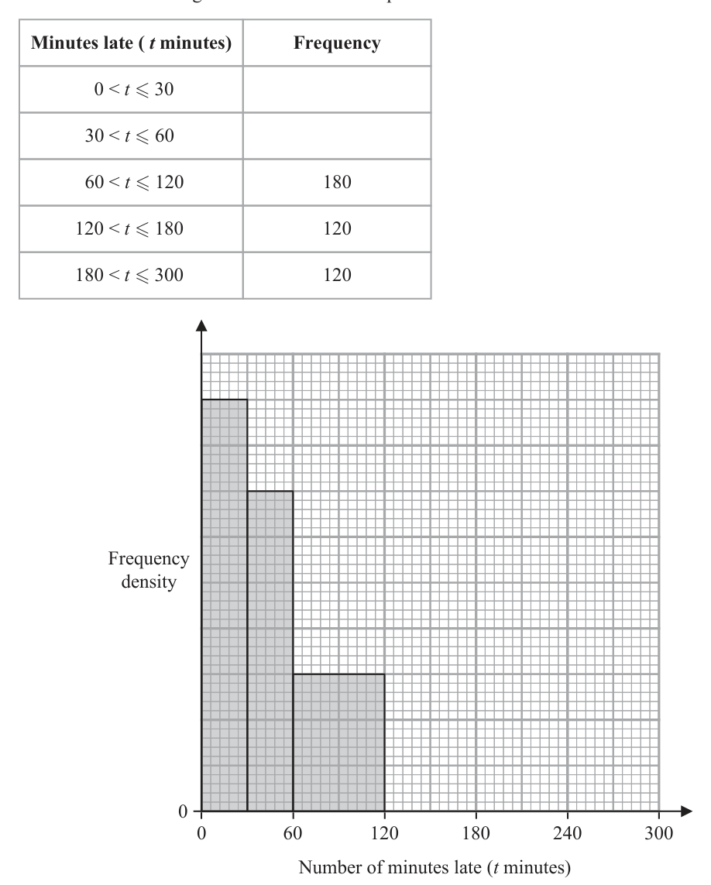

# 4MB1/01 — 2025-06 (official extraction)

> schema `syllabai.official-paper-questions/0.2` · paper_id `pearson-edexcel:international-gcse:mathematics-b:4mb1:2025-06:4MB1/01` · qp sha256 `ea50e91a9b3281e9…` · extraction is the disclosed baseline (ADR-039)

## Question 1 (2 marks)

Calculate the value of 7.1 Give your answer as a decimal to 5 significant figures.

### 1 [2]

Calculate the value of 7.1 Give your answer as a decimal to 5 significant figures.

**Mark scheme answer**

> 1.5707 2 B2 for 1.5707
> (B1 for 1.57070(0000…) or 1.57073 or 1.57(...)
> seen anywhere in working
> or
> B1ft for correctly rounding any number, given
> first with at least 6 sf, to 5 sf)
> 322
> SC1 for
> 205
> cas Total 2 marks

- **(2)** 1.5707 2 B2 for 1.5707

## Question 2 (2 marks)

The nth term of a sequence is given by 12 − 7 n Find the first 3 terms of this sequence. ............................... , .............................. . , . . . . . . . . . . . . . . . . . . . . . . . . . . . . . . .

### 2 [2]

The nth term of a sequence is given by 12 − 7 n Find the first 3 terms of this sequence , ,

**Mark scheme answer**

> 5, −2, −9 2 B2 −1 for every error or omission
> Any order
> If answers correct in working and transcribed
> incorrectly to answer line, mark the correct work
> and isw. Also B2 if answers correct in working
> and not transcribed.
> cas Total 2 marks

- **(2)** 5, −2, −9 2 B2 −1 for every error or omission

## Question 3 (2 marks)

Find the size of an interior angle of a regular polygon with 30 sides. ............................ . . . . . . . . . . . . . . . . . . . . . . . . . . . . . . . . . . °

### 3 [2]

Find the size of an interior angle of a regular polygon with 30 sides °

**Mark scheme answer**

> 180(30 – 2) [= 5040] 2 M1 for the method for calculating the sum of
> or 90(2 × 30 − 4) [=5040] interior angles. May be seen or used in any
> working eg [180(30 – 2)/30] or 5040/30
> or or
> 360/30 [= 12] for calculating the exterior angle. May be seen or
> used in further working eg [180 – 360/30]
> 168 A1
> cas Total 2 marks
> Question Working Answer Mark Notes

- **(2)** 180(30 – 2) [= 5040] 2 M1 for the method for calculating the sum of

## Question 4 (3 marks)

Without using a calculator and showing all your working, evaluate 2 4 5 −2 3 5 Give your answer as a mixed number in its simplest form.

### 4 [3]

Without using a calculator and showing all your working, evaluate 2 4 5 −2 3 5 Give your answer as a mixed number in its simplest form.

**Mark scheme answer**

> 17 14 3 M1 for correctly writing the fractions as improper,
> eg − oe 17
> 3 5 allow if and oe seen in other working
> 3
> or or
> ⎡ 2 4 ⎤ 10 12 for correctly writing the fraction part of the values
> ⎢⎣ 3 − 5 = ⎥⎦ 15 − 15 oe over a common denominator.
> It is not necessary to see the – sign for this mark.
> ⎡17 14 ⎤ 85 42 M1 dependent on previous method mark
> eg ⎢ − = ⎥ − oe for correctly writing improper fractions over a
> ⎣ 3 5 ⎦ 15 15
> common denominator.
> Accept sum with shared denominator or which
> shows working
> 5 ×17 − 3 ×14 5 ×17 3 ×14
> eg. or − oe
> 15 3× 5 5 × 3
> or 5
> Do not accept eg × 5 − × 3 unless recovered
> ⎡10 12 ⎤ 2 3
> ⎢⎣15 − 15 = ⎥⎦ = − 15 oe and [5 − 2 =] 3 or
> correctly subtracting whole number parts and the
> 25
> or 4 − 2 fraction parts over a common denominator.
> 15 15 It is not necessary to see the – sign for this mark.
> 43 13 A1 dependent on both previous method marks
> = 2 or for completion to the correct answer with the
> 15
> 2 13 minimum number of steps as shown, dependent
> 3− = 2 or on the candidate’s approach. No errors or
> 15 15 omissions.
> 25 12 13 A – sign must be present at least once through
> 4 −2 = 2
> 15 15 15 their working to indicate subtraction.
> wr Total 3 marks
> Question Working Answer Mark Notes

- **(3)** 17 14 3 M1 for correctly writing the fractions as improper,

## Question 5 (2 marks)

Diagram NOT B accurately drawn 42.5 cm 20 cm A C The diagram shows the right-angled triangle ABC AB = 20 cm BC = 42.5 cm BAC Calculate the length of AC ................................... . . . . . . . . . . . . . . . . . . . . . . . . . . . cm

### 5 [2]

Diagram NOT B accurately drawn 42.5 cm 20 cm A C The diagram shows the right-angled triangle ABC AB = 20 cm BC = 42.5 cm BAC Calculate the length of AC cm

> 🖼 crop required: diagram (qp.pdf p.None)

**Mark scheme answer**

> eg AC 2 + 202 = 42.52 or 2 M1 for applying Pythagoras theorem correctly.
> AC 2 + 400 = 1806.25 or 1406.25 implies this mark.
> Be aware 42.52 = AC 2 + 202 − 2 × 20 × cos 90 is equivalent and
> ⎡⎣ AC 2 = ⎤⎦ 1806.25 − 400 or [AC=] 42.5 − 20
> 2
> M1
> ⎡⎣ AC 2 = ⎤⎦ 42.52 − 202 ( = 1406.25)
> Allow any letters or labelling that implies a correct use of
> Pythagoras.
> 37.5 A1
> ALT 20 2 M1 for a full correct method using trigonometry.
> cos B = or
> 42.5
> Allow any letters or labelling that implies a correct use of
> [ B =] cos −1 ⎛⎜
> 20 ⎞
> ⎟ ( = 61.9275...) Trigonometry.
> ⎝ 42.5 ⎠
> and
> oe method using non right-angled trig
> AC
> tan ("61.9275...") = 20 42.5
> 20 = oe
> sin C sin 90
> or [ AC = ] tan ("61.9275...") × 20
> −1 ⎛ 20 ⎞
> or eg or [C = ] sin ⎜⎝ 42.5 × sin 90 ⎟⎠ ( = 28.0724.... ) oe
> sin C =
> 42.5
> or and [ AC = ]
> [C =] sin −1 ⎛⎜
> 20 ⎞ 202 + 42.52 − 2 × 20 × 42.5cos (180 − "28.0724"− 90 ) oe
> ⎟ ( = 28.0724...)
> ⎝ 42.5 ⎠
> and
> tan ("28.0724...") =
> AC
> tan ("28.0724......")
> or [ AC = ]
> 37.5 oe A1
> eg 75/2 This is an exact answer but allow awrt 75/2 or 37.5
> cas Total 2 marks
> Question Working Answer Mark Notes

- **(2)** eg AC 2 + 202 = 42.52 or 2 M1 for applying Pythagoras theorem correctly.

## Question 6 (2 marks)

Make d the subject of g 5d 4e 2

### 6 [2]

Make d the subject of g 5d 4e 2

**Mark scheme answer**

> $g + 4e^2 = 5d$ or $\frac{g}{5} = d - \frac{4e^2}{5}$ or $\frac{g+4e^2}{5}$ or
> $-g - 4e^2 = -5d$ or $-\frac{g}{5} = -d + \frac{4e^2}{5}$ or
> $\frac{-g-4e^2}{-5}$
> $d = \frac{g+4e^2}{5}$ 2 M1 for a correct first step eg by adding $4e^2$ or dividing
> or throughout by 5 or correct expression for $d$ without $d =$ …
> $d = \frac{-g-4e^2}{-5}$ A1 oe eg $d = \frac{g}{5} + \frac{4e^2}{5}$ Allow the other way round eg
> $\frac{g+4e^2}{5} = d$ Must see $d =$ … or … $= d$ at least once but
> allow if correct answer is in final answer in working but
> omitted on the answer line. Do not ISW
> cas Total 2 marks

- **(2)** $g + 4e^2 = 5d$ or $\frac{g}{5} = d - \frac{4e^2}{5}$ or $\frac{g+4e^2}{5}$ or

## Question 7 (2 marks)

On the number line below represent the inequality 4 ≤ x x −5 −4 −3 −2 −1 0 1 2 3 4 5

### 7 [2]

On the number line below represent the inequality 4 ≤ x x −5 −4 −3 −2 −1 0 1 2 3 4 5

**Mark scheme answer**

> closed circle at x = −4 or 2 M1
> open circle at x = 2 or
> a single line joining x = −4 and x = 2 (with single line closed, open, no circles or any other
> shape at x = −4 and x = 2). If clear and distinguishable,
> allow the line drawn to be on the printed number line.
> A1 Both end points identified using the correct symbols
> and one correct line drawn between the two correct points.
> cas Total 2 marks
> Question Working Answer Mark Notes

- **(2)** closed circle at x = −4 or 2 M1

## Question 8 (3 marks)
### 8(a) [1]

Write down the value of p 0 where p > 0

**Mark scheme answer**

> 1 1 B1 cao
> p = 1 scores B0, no isw this answer

- **(1)** 1 1 B1 cao

### 8(b) [2]

Simplify fully 32q r 20 5 5

**Mark scheme answer**

> $8q^{12}r^3$ 2 B2
> Allow in any order eg $q^{12}r^3 8$
> 8 must be not be $2^3$
> (B1 for a product with 2 parts correct and 3 parts in total)
> Condone inclusion of multiplication signs for B1.
> cas Total 3 marks

- **(2)** $8q^{12}r^3$ 2 B2

## Question 9 (3 marks)

Students travel to college by bus or by car or by train so that the number who travel by bus : the number who travel by train = 9 : 2 the number who travel by train : the number who travel by car = 3 : 5 Given that 600 students travel to college by car, calculate the number of students who travel to college by bus.

### 9 [3]

Students travel to college by bus or by car or by train so that the number who travel by bus : the number who travel by train = 9 : 2 the number who travel by train : the number who travel by car = 3 : 5 Given that 600 students travel to college by car, calculate the number of students who travel to college by bus.

**Mark scheme answer**

> 27 : 6 and 6 : 10 oe or 27 : 6 : 10 oe or 3 M1 for writing the ratios with a common figure or for
> 360 : 600 writing a correct 3 part ratio or for number of students
> 3 who travel by train or for total students for 2nd ratio.
> or [ train ] = 600 × [ = 360] Allow equivalent ratios eg 54:12 and 12: 20 or 54:12:20
> 600 × 8 Allow any of the ratios or number to be implied
> or [ = 960] [total students for 2nd eg [Bus =] 27, [train =] 6, [car =] 10 or 27, 6, 10
> 27 6 6
> ratio] or and or and
> 6 10 27
> Ignore incorrect labelling.
> Can be implied by the next M Mark.
> 27 9 M1 for a full and correct method to find the number of
> 600 × oe or "360"× oe students who catch the bus.

- **(3)** 27 : 6 and 6 : 10 oe or 27 : 6 : 10 oe or 3 M1 for writing the ratios with a common figure or for

## Question 10 (3 marks)

The numbers D, E and F are given as products of their prime factors D 29 3 x E 2 2 3 x F 2 4 32 x 7 x where x is a positive integer.

### 10(a) [1]

Find the Highest Common Factor (HCF) of D and E Give your answer in terms of x as a product of prime factors.

**Mark scheme answer**

> 2 2 × 3x 1 B1 do not isw Condone eg 223x
> Allow 2 × 2 but not 4

- **(1)** 2 2 × 3x 1 B1 do not isw Condone eg 223x

### 10(b) [1]

Find the Lowest Common Multiple (LCM) of E and F Give your answer in terms of x as a product of prime factors. Given that x is even,

**Mark scheme answer**

> 2
> or
> 27 + 6 + 10
> [ total students] = 600 × [ = 2580]
> and "2580"× or
> 27 + 6 + 10
> "2580"− 600 − "360" oe
> 360 ×11
> or 960 – 600 [=360] and [=1980]
> and 1980 – 360 = 1620
> 1620 A1
> cas Total 3 marks
> Question Working Answer Mark Notes
> do not isw
> Condone 2432 x +17 x +1
> Allow 2 × 2 × 2 × 2 but not16

- **(1)** 2

### 10(c) [1]

find the least number that F must be multiplied by to give a square number.

**Mark scheme answer**

> 21 1 B1 cao
> cas Total 3 marks
> Question Working Answer Mark Notes

- **(1)** 21 1 B1 cao

## Question 11 (3 marks)

Without using a calculator and showing all your working, find the value of the integer m such that 675 108 m m = ......................... . . . . . . . . . . . . . . . . . . . . . . . . . . . . . . . . . . . . .

### 11 [3]

Without using a calculator and showing all your working, find the value of the integer m such that 675 108 m m =

**Mark scheme answer**

> $\sqrt{225\times3} - \sqrt{36\times3}$ 3 M1 Must see 675 and 108 decomposed. The square
> or roots don’t need to be present if there is a correct
> $\sqrt{25\times27} - \sqrt{4\times27}$ decomposition
> or Allow further decomposition for this mark
> $15\sqrt{3} - 6\sqrt{3}$ (eg $225 = 5\times5^2\times3$ eg $108 = 4\times3^3$), so long as 675
> or and 108 are decomposed into at least the equivalent
> $5\sqrt{27} - 2\sqrt{27}$ of
> 225 x 3 and 36 x 3
> or
> 25 x 27 and 4 x 27
> do not allow $9\sqrt{3}$ alone for M1
> do not allow, for example $\sqrt{225\times3} - \sqrt{4\times27}$ only
> unless recovered later in the question.
> Not necessary to see subtraction sign for this mark.
> $9\sqrt{3}$ or $3\sqrt{27}$ M1 (dep on first M1)
> Not necessary to see subtraction sign for this mark,
> but must be a square root.
> Please send any alternative methods seen to 243 A1 (dep on both M marks) condone $\sqrt{243}$
> review.
> Subtraction sign seen at least once.
> No incorrect working for the A mark.
> wr Total 3 marks

- **(3)** $\sqrt{225\times3} - \sqrt{36\times3}$ 3 M1 Must see 675 and 108 decomposed. The square

## Question 12 (3 marks)

Solve 4 3 Show clear algebraic working. x = ......................... . . . . . . . . . . . . . . . . . . . . . . . . . . . . . . . . . . . . .

### 12 [3]

Solve 4 3 Show clear algebraic working. x = ……………Solve 4 3 Show clear algebraic working. x =

**Mark scheme answer**

> $12\times\frac{2x+3}{4} + 12\times\frac{x-1}{3} = 12\times7$ or 3 M1 for clear intention to multiply all terms by 12 (or
> $12\times\left(\frac{2x+3}{4} + \frac{x-1}{3}\right) = 12\times7$ oe $4\times3$) or a multiple of 12
> or Do not allow eg $12\times\frac{2x+3}{4} + \frac{x-1}{3} = 12\times7$ unless
> $3(2x+3) + 4(x-1) = 12\times7$ or recovered
> $\frac{3(2x+3)}{12} + \frac{4(x-1)}{12} [= 7]$ or
> $\frac{3(2x+3)+4(x-1)}{12} [= 7]$ oe express LHS as two fractions over 12 (or $4\times3$) or
> or a multiple of 12 or
> $\frac{2x}{4} + \frac{3}{4} + \frac{x}{3} - \frac{1}{3} = 7$ oe oe express as a single fraction with a denominator of
> 12 (or $4\times3$) or a multiple of 12
> If numerator expanded allow 1 sign or numerical
> error
> or separate out terms on the left
> $6x + 4x = 12\times7 - 9 + 4$ oe or M1 for a correct equation with no brackets and x terms
> $10x = 79$ oe or gathered on one side, constants on the other – examples
> $\frac{10x}{12} = \frac{79}{12}$ oe given, look for equivalences.
> $\frac{6x}{12} + \frac{4x}{12} = 7 - \frac{3}{4} + \frac{1}{3}$ oe This mark implies the previous M mark if not
> $\frac{6x+4x}{12} = \frac{79}{12}$ oe already awarded.
> 7.9 A1oe must have gained the previous M mark.
> wr Total 3 marks

- **(3)** $12\times\frac{2x+3}{4} + 12\times\frac{x-1}{3} = 12\times7$ or 3 M1 for clear intention to multiply all terms by 12 (or

## Question 13 (3 marks)

Diagram NOT accurately drawn B C 7 cm 5 cm E A 13 cm D In the diagram A, B, C and D are points on a circle. AEC is a diameter of the circle. BED is a chord of the circle. AE = 5 cm BE = 7 cm ED = 13 cm Calculate, in cm, the radius of the circle. ................................... . . . . . . . . . . . . . . . . . . . . . . . . . . . cm

### 13 [3]

Diagram NOT accurately drawn B C 7 cm 5 cm E A 13 cm D In the diagram A, B, C and D are points on a circle. AEC is a diameter of the circle. BED is a chord of the circle. AE = 5 cm BE = 7 cm ED = 13 cm Calculate, in cm, the radius of the circle cm

> 🖼 crop required: diagram (qp.pdf p.None)

**Mark scheme answer**

> 5 × EC = 13 × 7(= 91) or 3 M1 correct equation in EC or correct method to find
> [ EC =] (= 18.2)
> "18.2"+ 5 M1 correct method to find the radius – general
> [ r =] principle of marking unless precluded, allow follow
> through of their 18.2, where EC comes from correct
> working or is clearly labelled.
> EC must not be 15.
> 11.6 A1
> cas Total 3 marks
> Question Working Answer Mark Notes

- **(3)** 5 × EC = 13 × 7(= 91) or 3 M1 correct equation in EC or correct method to find

## Question 14 (3 marks)

120 100 Distance travelled (metres) 60 0 1 2 3 4 5 6 Time (t seconds) The graph shows the distance travelled by a car at time t seconds. By drawing a suitable straight line, estimate the speed of the car when t = 5 Give your answer in m/s to 2 significant figures. ..................................... . . . . . . . . . . . . . . . . . . . . . . . . . m/s

### 14 [3]

120 100 Distance travelled (metres) 60 0 1 2 3 4 5 6 Time (t seconds) The graph shows the distance travelled by a car at time t seconds. By drawing a suitable straight line, estimate the speed of the car when t = 5 Give your answer in m/s to 2 significant figures m/s

> 🖼 crop required: graph (qp.pdf p.None)

**Mark scheme answer**

> 3 M1 for drawing a tangent to the curve at t = 5
> Mark intention for a line which touches at t = 5 and
> isn’t seen to cross the curve
> M1 dep on previous method mark, for complete
> method to find gradient of their tangent at t = 5
> (change in y over change in x)
> May be implied by a number in the range 24-36
> inclusive, provided a tangent has been drawn and
> not from obvious incorrect working.
> Working may be seen on the diagram
> If the answer is not in range, we must see a
> calculation for the gradient of the form
> y2 − y1
> x2 − x1
> 30 A1 dep on first M1 answer range 24-36 inclusive.
> Must come from a gradient of a tangent and not
> gradient of a chord.
> Must see tangent drawn.
> wr Total 3 marks
> Question Working Answer Mark Notes

- **(3)** 3 M1 for drawing a tangent to the curve at t = 5

## Question 15 (4 marks)

Diagram NOT accurately drawn R O 28° x° U S T R and T are two points on a circle, centre O STU is the tangent to the circle at the point T ROS is a straight line. OTR OST x Calculate the value of x Give reasons for each stage of your working. x = ......................... . . . . . . . . . . . . . . . . . . . . . . . . . . . . . . . . . . . . .

### 15 [4]

Diagram NOT accurately drawn R O 28° x° U S T R and T are two points on a circle, centre O STU is the tangent to the circle at the point T ROS is a straight line. OTR OST x Calculate the value of x Give reasons for each stage of your working. x =

> 🖼 crop required: diagram (qp.pdf p.None)

**Mark scheme answer**

> [Angle ROT =] 180 – 2 × 28 [= 124] 4 M1 for method to find TOR
> or or
> [Angle TOS =] 28 × 2 [= 56] for method to find TOS
> or or
> [Angle OTS =] 90 OTS = 90
> or or TRO = 28
> [Angle TRO =] 28 Mark angles seen on the diagram.
> [Angle OST =] 180 – 90 – “56” M1 complete method to find OST using 90 degrees
> or Allow 180 – 90 – their TOS or
> [Angle OST =] 180 – (28 + 90) – 28 180 – (28 + 90) – their TRO
> If it is clear they are using their TOS or their TRO
> May imply previous method mark.
> cas 34 A1 cao no isw for this question
> B1 (dep on M2)
> Angle between radius and tangent = 90 or
> perpendicular
> and
> one other reason stated that is r.elevant for their
> method
> Base angles in an isosceles triangle are equal or
> angles equal as 2 sides equal.
> Exterior angle of a triangle equal to sum of interior
> opposite angles
> Angles in triangle or angles in a triangle add to 180
> Angles on a straight line or angles on a line add to
> 180
> Angle at centre = Double angle at circumference
> Allow an angle symbol for the word angle.
> Total 4 marks
> Question Working Answer Mark Notes

- **(4)** [Angle ROT =] 180 – 2 × 28 [= 124] 4 M1 for method to find TOR

## Question 16 (4 marks)
### 16(a) [2]

Factorise fully 10 p 2 q 4 − 15 p 3q

**Mark scheme answer**

> 5 p q(2q − 3 p)
> 2 3 2 B2 for 5 p q(2q − 3 p)
> 2
> (B1 for correct partial factorisation seen on answer line
> or working space 5 p (2q − 3 pq) or p q (10q − 15 p )
> 2 4 2
> or 5q (2 p q − 3 p ) or 5 p q(2q − 3 p) or
> 2 3 3 2
> 5 pq(2 pq3 − 3 p2 )
> or for correctly identifying the HCF in a factorisation
> of the form 5 p q(aq ± ...) or 5 p 2 q(... ± bp)
> 2
> where a and b are integers).

- **(2)** 5 p q(2q − 3 p)

### 16(b) [2]

Factorise 2 x 2 − 9 x − 5

**Mark scheme answer**

> (2 x + 1)( x − 5) 2 B2
> (B1 for any factorisation of the form
> (ax + b)( x + c), where a, b and c are integers
> which expands to give 2 out of 3 correct terms
> B1 if further work shows a misunderstanding, such as
> solving)
> cas Total 4 marks
> Question Working Answer Mark Notes

- **(2)** (2 x + 1)( x − 5) 2 B2

## Question 17 (4 marks)

Diagram NOT accurately drawn 8 cm 16 cm 24 cm The diagram shows six solid spheres placed inside a hollow cuboid. The cuboid measures 16 cm by 24 cm by 8 cm Each sphere has a diameter of 8 cm Calculate the volume, in cm 3 to 3 significant figures, of the space inside the cuboid that is not occupied by the spheres. .................................... . . . . . . . . . . . . . . . . . . . . . . . . . . cm3

### 17 [4]

Diagram NOT accurately drawn 8 cm 16 cm 24 cm The diagram shows six solid spheres placed inside a hollow cuboid. The cuboid measures 16 cm by 24 cm by 8 cm Each sphere has a diameter of 8 cm Calculate the volume, in cm 3 to 3 significant figures, of the space inside the cuboid that is not occupied by the spheres cm3

> 🖼 crop required: diagram (qp.pdf p.None)

**Mark scheme answer**

> (cube surrounding 1 cube around a sphere=) 4 M1 for volume of cuboid
> 8 × 8 × 8 [ = 512] NB: Students can find the volume of the
> cube around each ball and follow this
> (whole cuboid=) ( 8 × 3) × ( 8 × 2 ) × ( 8 ) [= 3072] or through to get a correct answer
> 4 ⎛ 8 ⎞ ⎡ 256π M1 for volume of 1 or n balls where n is an
> ⎤
> (1 ball=) π ⎜ ⎟ ⎢ = = 268.0825731⎥ or integer.
> 3 ⎝2⎠ ⎣ 3 ⎦
> 4 ⎛8⎞
> n× π ⎜ ⎟
> (n balls=) 3 ⎝2⎠
> [ = 512π = 1608.495439] for 6 balls
> eg "3072 − 512π " oe M1 for a complete method to find the
> ⎛ 256π ⎞ volume of the whole remaining space
> eg 6 × ⎜ "512 − " ⎟ oe (dependent on both previous method marks,
> ⎝ 3 ⎠
> but implies previous 2 marks).
> 1460 A1 awrt 1460 (1463.504561)
> cas Total 4 marks
> Question Working Answer Mark Notes

- **(4)** (cube surrounding 1 cube around a sphere=) 4 M1 for volume of cuboid

## Question 18 (4 marks)

The incomplete table and the incomplete histogram give information about the number of minutes that 900 flights arrived late at an airport. Minutes late ( t minutes) Frequency 0 < t ≤ 30 30 < t ≤ 60 60 < t ≤ 120 180 120 < t ≤ 180 120 180 < t ≤ 300 120 Frequency density 0 60 120 180 240 300 Number of minutes late (t minutes)

### 18(a) [3]

Complete the table and the histogram. Sam selects at random one of the 900 flights.

**Mark scheme answer**

> Fd = 3 or 2 or 1 oe seen by the table or in 3 M1 for use of area to work out frequency density, implied
> working or on the graph or a correct by a correct fd or a correct frequency per square(s) or a
> frequency indicated. correct scale on the y-axis or a correct frequency or the
> Watch out for equivalences such as 180/60 180-300 (height 1) or the 120-180 (height 2) bars
> [= 3] completed at the correct height (even if fd not marked or
> or incorrect).
> for a correct frequency density on the FD Allow multiples of squares eg 2 large squares = 240
> axis where the height of one large square is
> 2 eg height of 0-30 bar is 9,
> or height of 30-60 bar is 7
> or height of 60-120 bar is 3, (may be seen
> besides the table)
> or 1 small square = 1.2 oe
> or 1 medium square ( 5 × 5 ) = 30 oe
> or 1 large square (10 × 10 ) = 120 oe
> 270 and 210 A2 for all four correct
> and height 2 (if not A2 then A1 for two or three correct)
> (120-180)
> and height 1
> (180-300)

- **(3)** Fd = 3 or 2 or 1 oe seen by the table or in 3 M1 for use of area to work out frequency density, implied

### 18(b) [1]

Find the probability that this flight was late by greater than 120 minutes.

**Mark scheme answer**

> 4 1 240
> B1 oe eg or
> 15 900
> •
> If writing a decimal 0.26r , 0.2 6 , 0.26…(minimum one 6),
> 0.27. Do not accept 0.3.
> cas Total 4 marks
> Question Working Answer Mark Notes

- **(1)** 4 1 240

## Question 19 (4 marks)

f is directly proportional to g 2 f = 9 when g = 5 g is inversely proportional to h g = 5 when h = 4 Find a formula for f in terms of h

### 19 [4]

f is directly proportional to g 2 f = 9 when g = 5 g is inversely proportional to h g = 5 when h = 4 Find a formula for f in terms of h

**Mark scheme answer**

> eg f = kg
> K 4 M1 for setting up either equation with a constant term
> eg g = Equation can be implied by correct substitution.
> h
> The constant term can be any other letter apart from f or g or h
> g2
> eg f = T783478he first 3 M marks can be awarded if using the same
> 1 1
> k eg g = × letter for the constant of proportionality in both equations.
> K h allow use of ‘α’ instead of ‘=’, so long as there are constants of
> proportionality ≠ 1
> Note that f = or ∝ g 2 , g = or ∝ are M0
> h
> May be implied by 2nd or 3rd M1
> K M1 for substitution of values into either equation
> 9 = k 52 or 5= Implied by the correct values of one of the constants of
> proportionality. allow use of ‘α’ instead of ‘=’, so long as there
> [9 = 25k ] [ K = 4 × 5 = 20]
> are constants of proportionality ≠ 1
> ⎡ 9⎤ May be implied by the 3rd M1.
> ⎢⎣ k =
> 25 ⎥⎦
> K M1 for substitution of values into both equations 9 = k 52 oe
> 9 = k 52 and 5=
> 4 K
> and 5 = oe allow use of ‘α’ instead of ‘=’, so long as there
> [9 = 25k ] [ K = 4 × 5 = 20]
> ⎡ 9⎤ are constants of proportionality ≠ 1 Implied by the correct
> ⎢⎣ k =
> 25 ⎥⎦
> values for both constants.
> 9 2 20 9 ⎛ 20 ⎞
> 2 144
> f = g g= A1 oe eg f = Must see f = at least once
> 25 h f = ⎜ ⎟ h2
> 25 ⎝ h ⎠
> 9 ⎛ 20 ⎞
> f = ⎜ ⎟ The question doesn’t ask for simplification, Equivalents are
> 25 ⎝ h ⎠ fine. Once the correct unsimplified answer is seen, you may
> ⎡ 9 ⎛ 400 ⎞ ⎛ 3600 ⎞ ⎤ isw. Do not allow poor notation eg f =
> 9 20
> ×
> ⎢ f = 25 ⎜ h 2 ⎟ = ⎜ 25h 2 ⎟ ⎥ 25 h
> ⎣ ⎝ ⎠ ⎝ ⎠⎦
> Total 4 marks
> ALT k M1 for combining two equations
> f =
> h2
> allow use of ‘α’ instead of ‘=’, so long as there is a
> constant of proportionality ≠ 1
> Note that f = or ∝ 2 are M0
> h
> May be implied by 2nd or 3rd M mark
> k M1 for substitution of values
> 9= May be implied by 3rd M mark
> k = 144 M1 for finding k by a correct rearrangement
> Implied by correct 144
> 144 9 × 42
> f = A1 oe eg f = 2 Must see f = at least once
> h2 h
> The question doesn’t ask for simplification, Equivalents
> are fine.
> Do not allow poor notation.
> Allow any value of g, due to the g cancelling.
> cas Total 4 marks
> Question Working Answer Mark Notes

- **(4)** eg f = kg

## Question 20 (4 marks)

A solid right cylinder is made of wood. The mass of the cylinder is 2140 g, to the nearest 10 g The radius of the cylinder is 8.5 cm, to the nearest 0.5 cm The density of the wood is 0.7 g/cm 3, to the nearest 0.1 g/cm 3 mass Given that density = volume and taking the value of π as 3.142 calculate the lower bound, in cm to one decimal place, of the height of the cylinder. Show all your working. .................................. . . . . . . . . . . . . . . . . . . . . . . . . . . . cm

### 20 [4]

A solid right cylinder is made of wood. The mass of the cylinder is 2140 g, to the nearest 10 g The radius of the cylinder is 8.5 cm, to the nearest 0.5 cm The density of the wood is 0.7 g/cm 3, to the nearest 0.1 g/cm 3 mass Given that density = volume and taking the value of π as 3.142 calculate the lower bound, in cm to one decimal place, of the height of the cylinder. Show all your working cm

**Mark scheme answer**

> [mLB =] 2135, [mUB =] 2145 4 B1 For one correct LB or UB seen or used.
> [dLB =]0.65, [dUB =]0.75 May be implied by subsequent working.
> [rLB =]8.25, [rUB =]8.75
> [Volume =] 3.142 × ( r ) h oe where M1 Correct method to find Volume.
> 8.25 ≤ r ≤ 8.75 or Allow π or or 3.14 or 3.1 or 3 instead of 3.142
> m
> [Volume = ] oe You may see this as part of other (incorrect) work eg
> d 2135 2135
> the is implicit
> where 2135 ≤ m ≤ 2145 and 0.65 ≤ d ≤ 0.75 0.75 × 2 × 3.142 × 8.75 0.75
> "2135" M1 dep on previous M being awarded, but may
> [ h =] oe
> 3.142 × "8.75"2 × "0.75" imply previous M mark
> For a correct expression for the height of cylinder
> or used or a correct formula used, must see
> "2135" 2135 ≤ mLB < 2140,
> "0.75" = oe
> 3.142 × "8.75"2 × h rUB where 8.5 < rUB ≤ 8.75, and
> d UB where 0.7 < d UB ≤ 0.75
> or
> Allow if use π or or 3.14 or 3.1 or 3 instead of
> "2135"
> 3.142 × "8.75"2 × h = oe 3.142
> "0.75"
> 2135 A1 awrt 11.8 from correct working. Must be seen to
> = 11.8
> 3.142 × 8.752 × 0.75 use 2135, 8.75 (Allow 8.7499…), 0.75 (Allow
> 0.7499…) but may be seen in stages.
> wr Total 4 marks
> Question Working Answer Mark Notes

- **(4)** [mLB =] 2135, [mUB =] 2145 4 B1 For one correct LB or UB seen or used.

## Question 21 (6 marks)

A A B C 5 10 2 p 4 1 3 8

### 21(a) [2]

Find matrix B, giving the elements of B in terms of p where appropriate.

**Mark scheme answer**

> ⎛ 1 −3 − p ⎞ 2 B2 correct
> ⎜ ⎟ (B1 for 3 correct values or expressions in the correct
> ⎝ −5 + 2 p 6 ⎠
> position)

- **(2)** ⎛ 1 −3 − p ⎞ 2 B2 correct

### 21(b) [2]

Find A −1

**Mark scheme answer**

> 1 ⎛10 3⎞ 2 B2 correct
> ⎜ ⎟ oe (B1 for a correct method to find the determinant
> 5⎝ 5 2⎠
> and
> ⎛2 0.6 ⎞ 2 other values correct in the correct position.
> eg ⎜ ⎟
> ⎝1 0.4 ⎠ For determinant
> 2 ×10 − ( −3 × −5 ) allow 2 ×10 − 3 × 5 oe
> Allow the presence of 5 or 1/5 with no contradictory
> work to imply this mark.)
> or
> 4 correct values in matrix in correct position.
> and
> an attempt to find the determinant – one error only
> involving multiplication of diagonals
> eg 2 ×10 + ( −3 × −5 ) eg 2 ×10 − ( −3 × 5 ) )
> If the correct matrix is seen in the working space,
> with the det then incorrectly included inside, isw.

- **(2)** 1 ⎛10 3⎞ 2 B2 correct

### 21(c) [2]

Find AC

**Mark scheme answer**

> ⎛ 11 −19 −20 ⎞ 2 B2 correct
> ⎜ ⎟ (B1 for 3, 4 or 5 correct values in the correct
> ⎝ −30 55 70 ⎠ position)
> cas Total 6 marks
> Question Working Answer Mark Notes

- **(2)** ⎛ 11 −19 −20 ⎞ 2 B2 correct

## Question 22 (6 marks)

Solve the simultaneous equations 3x 2 x 2y 2x 3y Show clear algebraic working.

### 22 [6]

Solve the simultaneous equations 3x 2 x 2y 2x 3y Show clear algebraic working.

**Mark scheme answer**

> 4 − 2x ⎛ 4 − 2x ⎞ 10 6 M1 for substituting a rearranged linear equation into the correct
> y= ⎟ = 3x − x + 3
> and 2 ⎜ oe quadratic equation (or a rearranged quadratic equation into the
> 3 ⎝ 3 ⎠ 3 correct linear equation) to form an un-simplified equation in one
> or variable – allow one sign error only in the rearranged equation.
> ⎛ 4 − 3 y ⎞ 10 ⎛ 4 − 3 y ⎞
> 2 This mark may be implied by a correct equation (simplified or
> 4 − 3y
> x= and 2 y = 3 ⎜ ⎟ − ⎜ ⎟ + 3oe unsmplified) in terms of x or y Eg 8 − 4 x = 9 x 2 − 10 x + 9
> 2 ⎝ 2 ⎠ 3⎝ 2 ⎠
> 9 x 2 − 6 x + 1(= 0) or M1 dep on 1st M mark for simplifying to a 3 term quadratic with
> least 2 terms correct
> 81y 2 − 180 y + 100(= 0) or (oe so look for signs reversed or any multiples of coefficients,
> or eg 18 x 2 − 12 x = −2 doesn’t need to = 0 if terms collected on one ‘side’)
> M1 dep on 1st M mark for valid method to solve their quadratic.
> 6 ± (−6) 2 − 4 × 9 × 1
> If factorising must multiply out to give 2 correct terms.
> (3x − 1)2 (= 0) oe or 2×9 oe Allow use of formula with one sign error.
> or −27 ± 27 2 − 4 × 3 × ( −188 )
> 180 ± (−180) 2 − 4 × 81×100 [ x =]
> 2×3 .
> (9 y − 10) ( = 0) or
> 2 × 81 Allow completing the square with one sign error only.
> Implied by correct values. If not correct, method must be shown.
> 1 10 A1 dependent on a correct quadratic
> x= y= for a correct value of x or y
> 3 oe or 9 oe
> 4 − 2 ×" 3 "1 M1 Dep on 1st M.
> [ y =] 2 × " 13 "+ 3 y = 4 Substitute their value of x or y into a correct equation or
> Eg 3 or expression or starting again and giving a correct unsimplified
> 4 − 3 × " 109 "
> [ x =] 2 x + 3 × " 109 " = 4
> equation for the relevant variable.
> Implied by a correct pair of values.
> or 2 or
> If values of x or y are incorrect then working must be shown
> If 2 values are found from an incorrect equation – only 1 needs
> to be substituted for the mark.
> 1 A1 oe dep on any previous 2 method marks being awarded
> x= •
> 3 oe
> x = 0.3 or 0.3r or 0.33... not 0.3
> y= Allow •
> and x = 1.1 or 1.1r or 1.11... not 1.1
> wr Total 6 marks
> Question Working Answer Mark Notes

- **(6)** 4 − 2x ⎛ 4 − 2x ⎞ 10 6 M1 for substituting a rearranged linear equation into the correct

## Question 23 (7 marks)

The table shows information about the monthly wages of 100 employees at a company. Wage (£w) Frequency 0 < w ≤ 600 7 600 < w ≤ 1200 13 1200 < w ≤ 1800 28 1800 < w ≤ 2400 42 2400 < w ≤ 3000 10

### 23(a) [4]

The table shows information about the monthly wages of 100 employees at a company. 
| Wage (£w) | Frequency |
| --- | --- |
| $0 < w \le 600$ | 7 |
| $600 < w \le 1200$ | 13 |
| $1200 < w \le 1800$ | 28 |
| $1800 < w \le 2400$ | 42 |
| $2400 < w \le 3000$ | 10 |

Calculate an estimate for the mean wage of the 100 employees. £ The mean number of hours worked by the 100 employees last week is 33 hours. The total number of hours worked by 91 of these employees last week is 2976 hours.

**Mark scheme answer**

> 4 M2 for at least 3 correct products using the midpoints (need not be
> $[300 \times 7] + [900 \times 13] + [1500 \times 28] +$
> $[2100 \times 42] + [2700 \times 10]$ evaluated but must be added)
> or
> $2100 + 11700 + 42000 + 88200 +$
> $27000 [= 171000]$ or
> If not M2: M1 for at least 3 products using frequency and a value
> within the interval with intention to add (eg an (incorrect) total at
> the bottom of the table or on the page or an addition sign
> somewhere next to their products or totals).
> Condone use of the lower or upper bounds.
> The numbers used can be a mix of, for example, upper, lower and
> midpoint or any number in the interval.
> [upper bound products for example, are:
> 4200, 15600, 50400, 100800, 30000, total = 20100]
> [lower bound products for example, are:
> 0, 7800, 33600, 75600, 24000, total = 14100]
> or
> at least 3 correct products using midpoints without adding.
> If candidates are using upper or lower bounds or midpoints the
> evaluated products or the total will imply their working. If not,
> they must show what they are using to calculate their products.
> eg $\frac{"171000"}{100}$ or $\frac{"171000"}{7 + 13 + 28 + 42 + 10}$ M1 dep on at least M1 awarded
> Allow division by their Σf provided addition seen or total under
> column seen
> 1710 A1

- **(4)** 4 M2 for at least 3 correct products using the midpoints (need not be

### 23(b) [3]

Find the mean number of hours worked last week by the remaining 9 employees hours

**Mark scheme answer**

> 33 ×100 − 2976(= 324) 3 M1 find the total for the 9 trainees
> "324" M1 dep on 1st M mark for complete method to find the mean wage
> 9 for the 9 trainees
> 36 A1
> cas Total 7 marks
> Question Working Answer Mark Notes

- **(3)** 33 ×100 − 2976(= 324) 3 M1 find the total for the 9 trainees

## Question 24 (6 marks)

N A Diagram NOT accurately drawn 15 km L 22 km B The diagram shows the position of two boats, A and B, and the position of a lighthouse L, which are all in the same horizontal plane. The bearing of A from L is 050° The bearing of B from L is 125° The distance of A from L is 15 km The distance of B from L is 22 km Calculate the bearing, to the nearest degree, of A from B Show your working clearly. ........................... . . . . . . . . . . . . . . . . . . . . . . . . . . . . . . . . . . °

### 24 [6]

N A Diagram NOT accurately drawn 15 km L 22 km B The diagram shows the position of two boats, A and B, and the position of a lighthouse L, which are all in the same horizontal plane. The bearing of A from L is 050° The bearing of B from L is 125° The distance of A from L is 15 km The distance of B from L is 22 km Calculate the bearing, to the nearest degree, of A from B Show your working clearly °

> 🖼 crop required: diagram (qp.pdf p.None)

**Mark scheme answer**

> ( AB =)15 + 22 − 2 ×15 × 22 × cos(125 − 50)
> 2 2 2 6 M1 correct substitution into Cosine Rule to find AB
> or AB2
> ( AB2 =)538(.1794302) A1 for 538(.1794302) or ( AB =)23. (19869458)
> Correct answer can imply first M1 even though
> question states working required.
> sin ABL sin 75 M1 correct substitution into sine rule or cosine rule
> = to find ABL
> 15 "23.19..."
> or (follow through candidate’s AB provided AB is
> clearly labelled or on diagram or from correct
> 152 = 222 + ("23.19...") − 2 × 22 × ("23.19...") cos ABL
> working).
> or or
> sin LAB sin 75 correct substitution into sine rule to find LAB
> =
> 22 "23.19..." (follow through candidate’s AB provided AB is
> Or clearly labelled or on diagram or from correct
> 222 = 152 + ("23.19...") − 2 ×15 × ("23.19...") cos LAB working).
> This isn’t a dependent mark, but it must be clear
> from diagram or working that students are using their
> value for AB
> ( sin ABL = ) ⎛⎜ ⎞ M1 full correct method to find angle ABL
> × 15 ⎟ or ( sin ABL = ) ⎛⎜
> sin 75 14.489... ⎞
> ⎟ or angle LAB
> ⎝ "23.19..." ⎠ ⎝ "23.19..." ⎠
> or ( sin ABL = )("0.0416..."×15)
> Implies previous method mark.
> ⎛ 22 + ("23.19...") − 15 ⎞
> 2 2
> or ( cos ABL = ) ⎜ ⎟
> ⎜ 2 × 22 × ("23.19...") ⎟ Allow this mark to be implied by
> ⎝ ⎠
> ⎛ "797.17..." ⎞
> or ( cos ABL = ) ⎜ ⎟
> [ABL =] awrt 38 or awrt 39
> ⎝ "1020.74....." ⎠ [LAB =] awrt 66 or awrt 67
> or
> Again for info, you will see, for example, the
> ⎛ 21.250... ⎞ following, if students find angle LAB first
> ( sin LAB = ) ⎛⎜ ⎞
> sin 75
> × 22 ⎟ or ( sin LAB = ) ⎜ ⎟
> ⎝ "23.19..." ⎠ ⎝ "23.19..." ⎠
> eg (ABL) = 180 – “ 66.35038218 ” – 75
> or ( sin ABL = )("0.0416..."× 22 )
> or
> ⎛ 152 + ("23.19...")2 − 222 ⎞ (see diagram) eg “66.35….” – 50
> or ( cos LAB = ) ⎜ ⎟
> ⎜ 2 × 15 × ("23.19...") ⎟
> ⎝ ⎠
> ( cos LAB = ) ⎛⎜
> "279.17...." ⎞
> ⎟
> ⎝ "695.96..." ⎠
> eg 180 + 125 + "38.6496..."[ = 343.6496...] M1 (dep on the 2 previous M marks) correct method
> to find the bearing.
> or
> eg 270 + 35 + "38.6496..."[ = 343.6496...]
> or eg 360 – “16.35038218” = [ = 343.6496...]
> 344 A1 accept answers in the range [343.6, 344.1]
> Dep on awarding any 2 previous method marks
> wr Total 6 marks
> ALT
> Question Working Answer Mark Notes
> AB
> ⎡⎣ AB 2 = ⎤⎦ 538(.1794302) A1 (M1 on ePen) for 538(.1794302) or
> ( AB =)23.1(9869458)
> Correct answer can imply first M1 even though
> question states working required.
> [horizontal distance = ] 22sin (180 −125) −15sin (125 − 50) and M1 for method to find the vertical and
> the horizontal distance from A to B
> [ vertical distance=] 22cos (180 − 125) + 15cos (125 − 75)
> "22sin (180 − 125 ) − 15sin (125 − 50 )" M1 correct use of trig ratio
> for tan θ = oe
> "22cos (180 − 125 ) + 15cos (125 − 75 )"
> Implies previous method mark.
> "22cos (180 − 125 ) + 15cos (125 − 75 )" The correct angles imply this method mark
> or tan ϑ = oe
> "22sin (180 − 125 ) − 15sin (125 − 50 )" [θ = 16.35...] accept awrt 16 or 17
> [ϑ = 73.649…] accept awrt 73 or 74
> 360 – “16.35…”oe 270 + “73.649…”oe M1 (dep on previous 2 M marks) correct method
> to find the bearing
> 344 A1 accept answers in the range [343.6, 344.1]
> Dep on awarding any 2 previous method marks
> cas Total 6 marks
> Question Working Answer Mar Notes
> k Condone missing arrows throughout

- **(6)** ( AB =)15 + 22 − 2 ×15 × 22 × cos(125 − 50)

## Question 25 (8 marks)

A Diagram NOT accurately drawn M N X O B The diagram shows triangle OAB such that = a and = 3b M is the midpoint of OA N is the point on AB such that AN : NB = 4 : 1

### 25(a) [1]

Express in terms of a and b

**Mark scheme answer**

> 1 1 B1
> − a + 3b

- **(1)** 1 1 B1

### 25(b) [2]

Express in terms of a and b Give your answer in its simplest form. Given that the point X is such that OXN and MXB are straight lines,

**Mark scheme answer**

> ( AN =) ± 54 (−a + 3b) ( BN =) ± 15 (a − 3b) 2 M1 correct use of ratio on correct AB or BA
> Ignore any labelling.
> ⎡ 4 ⎤ ⎡ 1 ⎤
> ⎢⎣a + 5 (−a + 3b) ⎥⎦ ⎢⎣ 3b + (a − 3b) ⎥
> 5 ⎦
> 1 12 A1
> a+ b
> 5

- **(2)** ( AN =) ± 54 (−a + 3b) ( BN =) ± 15 (a − 3b) 2 M1 correct use of ratio on correct AB or BA

### 25(c) [5]

find a simplified expression for in terms of a and b

**Mark scheme answer**

> 1 12 5 M1 for using the correct or their ON in a correct vector
> eg ⎡⎣ AX = AO + OX ⎤⎦ = −a + λ (" a + b")
> 5 5 path for AX using any unknown parameter, in terms of
> 4 1 12 a and b. The examples given are not the only
> eg ⎡⎣ AX = AN + NX = ⎤⎦ ( −a + 3b ) + μ ("− a − b") possibilities.
> 5 5
> Candidates may use a negative parameter also.
> Longer routes may be used
> ( ) 1
> eg AX = AB + BO + OX = − a + 3b − 3b + λ (" a + b")
> 5
> 1 1 M1 for using the correct or their MB in a correct vector
> eg ⎡⎣ AX = AM + MX = ⎤⎦ − a + β ("− a + 3b")
> 2 2 path for AX using any unknown different parameter, in
> 1 terms of a and b. The 2 examples given are not the only
> eg ⎡⎣ AX = AB + BX = ⎤⎦ − a + 3b + α ("− a + 3b") possibilities.a negative parameter also.
> 1 1 1 12 M1 dep both previous M marks, for correctly setting
> Eg "− 1 + λ " = "− − β " and " λ = 3β " or expressions equal (to each other) and forming two
> 5 2 2
> 1 1 12 1 equations in their parameters.
> "− 1 + λ " = "− 1 − α " and " λ = 3 − α " or Each equation must involve 2 parameters.
> 5 2 5
> 1 1 1
> "− 1 − μ " = "− − β " and 3 − " μ = 3β " or
> 5 2 2
> 1 1
> "− 1 − μ " = "− 1 − α " and 3 − " μ = 3α "
> 5 2
> 5 1 2 1 A1 for either parameter correct, is implied by a correct
> Eg λ = or μ = or β = or α = − final vector or eg
> 6 6 3
> 1 1 1 1
> OX = a + 2b MX = − a + 2b BX = a − b NX = − a − b
> 6 3 6 30
> These will depend on the path chosen, for example if
> using BX rather than MX with μ positive in the vector
> path
> 5 12b − 5a
> − a + 2b A1oe eg.
> 6
> ALT1 1 1 12 5 M1 for using correct or their ON in a correct
> 2 5 5 vector path for MX using any unknown
> eg ⎡⎣ MX = MA + AN + NX = ⎤⎦ parameter, in terms of a and b.
> The examples given are not the only
> 1 4 1 12
> a + ( −a + 3b ) − α (" a + b") possibilities.
> 2 5 5 5 Candidates may also for example use a negative
> parameter or a longer path.
> ⎡ MX = μ MB = ⎤ μ ⎛⎜ "− a + 3b" ⎞⎟
> ⎣ ⎦ ⎝ 2
> 1 ( )
> M1 for using μ correct or theirMB and any
> ⎠ unknown different parameter, in terms of a and
> b.
> The example given is not the only possibility,
> they may also for example use a negative
> parameter.
> 1 1 1 12 M1 dep both previous M marks, for correctly
> Eg "− + λ = − μ " and " λ = 3μ "
> 2 5 2 5 setting expressions equal (to each other) and
> Eg forming two equations in their parameters.
> 3 1 1 12 12 Each equation must involve 2 parameters.
> "− − α = − μ " and " − α = 3μ "
> 10 5 2 5 5
> ⎡ MX = ⎤ − a + 2b A1 for correct MX
> ⎣ ⎦ 3 May be implied by correct vectors or correct
> ⎡ 5 5 1⎤ parameters
> ⎢⎣λ = 6 μ = 6 α = 6 ⎥⎦ eg
> 1 1 1
> OX = a + 2b BX = a − b NX = − a − b
> 6 6 30
> 5 12b − 5a
> − a + 2b A1oe eg.
> 6
> ALT2
> 1
> eg ⎡⎣OX = λ ON = ⎤⎦ λ (" a + b") (
> M1 for using λ correct or their ON )
> 5
> and any unknown parameter,in terms of a and b.
> The example given is not the only possibility,
> they may also for example use a negative
> parameter.
> 1 1 M1 for using the correct or their MB in a correct
> eg ⎡⎣OX = OM + MX ⎤⎦ = a + μ ("− a + 3b")
> 2 2 vector path for OX using any unknown different
> 1 parameter, in terms of a and b.
> eg ⎡⎣OX = OB + BX = ⎤⎦ 3b + α (" a − 3b") The examples given are not the only
> possibilities.
> Candidates may use a negative parameter also or
> a longer path.
> 1 1 1 12 M1 dep both previous M marks, for correctly
> eg " λ = − μ " and " λ = 3μ "
> 5 2 2 5 setting expressions equal (to each other) and
> 1 1 12 forming two equations in their parameters.
> eg " λ = α " and " λ = 3 − 3α " Each equation must involve 2 parameters.
> 5 2
> 1 May be implied by correct vectors eg
> eg ⎡⎣OX = ⎤⎦ a + 2b
> 6 1 1 1 2
> MX = − a + 2b BX = a − b NX = − a − b
> ⎡ 5 2 1⎤ 3 6 30 5
> ⎢⎣λ = 6 μ = 3 α = 3 ⎥⎦
> 5 12b − 5a
> − a + 2b A1oe eg.
> 6
> ALT3
> ⎡OM = OX + XM ⎤
> ⎣ ⎦
> 5 (
> M1 for either λ correct or their ON )
> 1 1 12
> a = λ (" a + b")+μ (" a − 3b") (
> or μ correct or theirMB )
> 2 5 5 2 M2 for
> ( ) (
> a = λ correct or their ON +μ correct or their MB )
> The example given is not the only possibility, they
> may also for example use a negative parameter or a
> longer path.
> 1 1 1 12 M1 dep both previous M marks, for correctly setting
> eg " λ + μ = " and " λ − 3μ = 0"
> 5 2 2 5 expressions equal (to each other) and forming two
> equations in their parameters.
> Each equation must involve 2 parameters.
> 5 2 A1 for either parameter correct, is implied by a
> Eg λ = or μ = correct final vector
> 6
> May be implied by correct
> 1 1
> OX = a + 2b MX = − a + 2b BX = a − b
> 6 3
> These will depend on the path chosen, for example
> if using a negative parameter or both signs reversed
> in a vector
> 5 12b − 5a
> − a + 2b A1oe eg.
> 6
> ALT4 1 12 5 M1 for using correct or their ON in a correct
> 5 5 vector path for BX using any unknown
> 1 1 12 parameter, in terms of a and b.
> eg ⎡⎣ BX = BN + NX = ⎤⎦ ( a − 3b ) − α (" a + b") The examples given are not the only
> 5 5
> possibilities.
> Candidates may also for example use a negative
> parameter or longer paths.
> ( BX = α BM = )α ⎛⎜⎝ " 12 a − 3b" ⎞⎟⎠ ( )
> M1 for using α correct or theirMB and any
> unknown different parameter, in terms of a and
> b.
> The example given is not the only possibility,
> they may also for example use a negative
> parameter.
> 1 1 12 M1 dep both previous M marks, for correctly
> Eg " λ = α " and "− 3 + λ = −3α "
> 5 2 5 setting expressions equal (to each other) and
> 3 12 1 1 1 forming two equations in their parameters.
> Eg "− + μ = −3α " and " + μ = α" Each equation must involve 2 parameters.
> 5 5 5 5
> 1 A1 for correct MX
> BX = a − b
> 6 May be implied by correct vectors or correct
> ⎡ 5 2 1⎤ parameters
> ⎢⎣λ = 6 μ = 3 α = 3 ⎥⎦ eg
> 1 1 1
> OX = a + 2b MX = − a + 2b NX = − a − b
> 6 3 30
> 5 12b − 5a
> − a + 2b A1oe eg.
> 6
> ALT5
> 1
> eg ⎡⎣ NX = λ NO = ⎤⎦ λ ("− a + − b") (
> M1 for using λ correct or their NO )
> 5
> and any unknown parameter,in terms of a and b.
> The example given is not the only possibility,
> they may also for example use a negative
> parameter.
> 1
> eg ⎡⎣ NX = NB + BX = ⎤⎦ ( −a + 3b ) + μ (" a − 3b") M1 for using the correct or their MB in a correct
> 5 2 vector path for NX using any unknown different
> eg ⎡⎣ NX = NA + AM + MX = ⎤⎦ parameter, in terms of a and b.
> The examples given are not the only
> 4 1
> ( a − 3b ) − a + α ("− a + 3b") possibilities.
> Candidates may use a negative parameter also or
> 5 2
> a longer path.
> 1 1 1 12 3 M1 dep both previous M marks, for correctly
> eg "− λ = − + μ " and "− λ = − 3μ "
> 5 5 2 5 5 setting expressions equal (to each other) and
> eg forming two equations in their parameters.
> 1 4 1 1 12 12 Each equation must involve 2 parameters.
> "− λ = − − α " and "− λ = − + 3α "
> 5 5 2 2 5
> 1 2 May be implied by correct vectors eg
> eg NX = − a− b
> 30 5 1 1
> MX = − a + 2b BX = a − b OX = a + 2b
> ⎡ 1 1 2⎤ 3 6
> ⎢⎣λ = 6 μ = 3 α = 3 ⎥⎦
> 5 12b − 5a
> − a + 2b A1oe eg.
> 6
> Question Working Answer Mark Notes

- **(5)** 1 12 5 M1 for using the correct or their ON in a correct vector

## Question 26 (7 marks)
### 26(a) [2]

Solve the inequality 3 x 5 15 2 x

**Mark scheme answer**

> 3x + 2 x < 15 + 5 oe 2 M1 isolating x terms and constant terms in a correct inequality
> or −5 − 15 < −2 x − 3 x oe or allow for just 4 on answer line or in working
> allow signs to be =, >, < , ≤ or ≥
> x<4 A1
> For this question allow x < 4 in working and just 4 on answer line.
> (−∞, 4) or [−∞, 4)

- **(2)** 3x + 2 x < 15 + 5 oe 2 M1 isolating x terms and constant terms in a correct inequality

### 26(b) [3]

Solve the inequality x x 1 Show clear algebraic working.

**Mark scheme answer**

> x2 − x − 6 [> 0] 3 M1 oe correctly rearranged does not need > 0
> oe eg ( x − 3)( x + 2 ) [ > 0]
> ( x = ) 3 and ( x = ) − 2 A1 dep on M1
> x < −2 A1 ft dep on M1
> x>3 Allow (−∞, −2) ∪ (3, ∞) or [−∞, −2) ∪ (3, ∞]
> Must have both of these
> must be written as two separate inequalities
> ie not as −2 > x > 3

- **(3)** x2 − x − 6 [> 0] 3 M1 oe correctly rearranged does not need > 0

### 26(c) [2]

Hence find the range of values of x for which both 3 x 5 15 2 x and x x 1

**Mark scheme answer**

> x < −2 2 B2 for both inequalities correct and clearly listed as final answer if
> 3< x < 4 not on answer line.
> Allow (−∞, −2) ∪ (3, 4) or [−∞, −2) ∪ (3, 4)
> B1 for 3 < x < 4
> Allow (3, 4)

- **(2)** x < −2 2 B2 for both inequalities correct and clearly listed as final answer if

