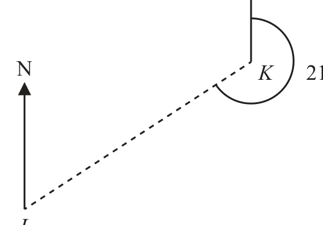
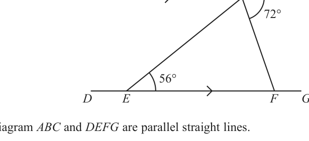
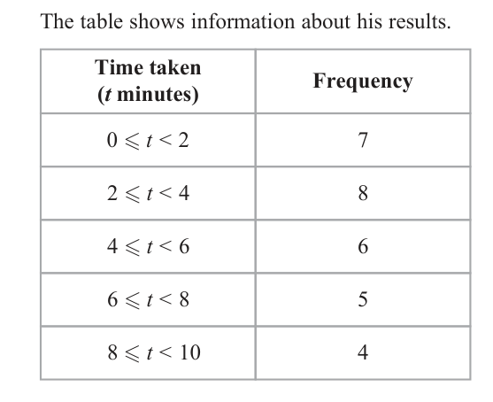
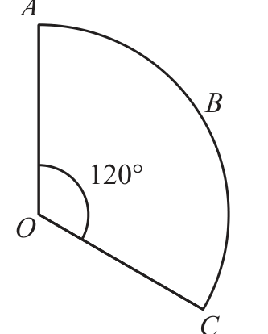
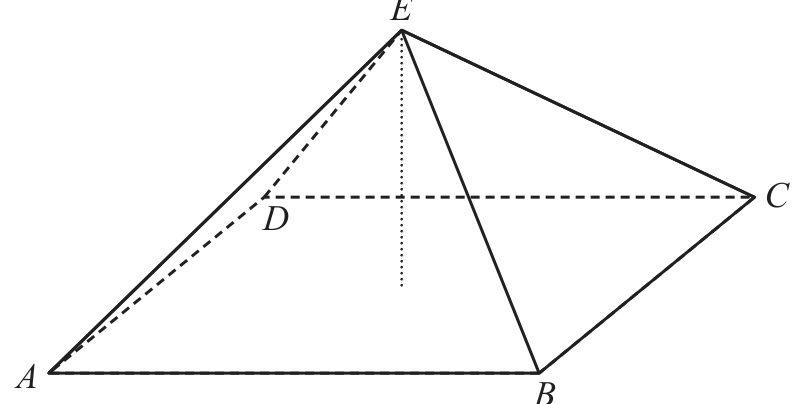
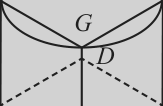

# 4MB1/01R — 2025-06 (official extraction)

> schema `syllabai.official-paper-questions/0.2` · paper_id `pearson-edexcel:international-gcse:mathematics-b:4mb1:2025-06:4MB1/01R` · qp sha256 `a7023e2de197557c…` · extraction is the disclosed baseline (ADR-039)

## Question 1 (2 marks)

Factorise fully 9 x + 12 x 2 y

### 1 [2]

Factorise fully 9 x + 12 x 2 y

**Mark scheme answer**

> 3x ( 3 + 4 xy ) 2 B2 fully correct answer as their final answer
> ( )
> (B1 for partial factorisation 3 3x + 4 x 2 y or x ( 9 + 12 xy )
> or for correctly identifying the HCF in the factorisation of the form
> 3 x ( 3 + ...) or 3x (... + axy ) where a is an integer
> or a correct answer (that is not their final answer) seen within the
> working)
> condone missing closed bracket

- **(2)** 3x ( 3 + 4 xy ) 2 B2 fully correct answer as their final answer

## Question 2 (2 marks)

N Diagram NOT accurately drawn N K 214° J The diagram shows the position of two towns, J and K The bearing of J from K is 214° Find the bearing, in degrees, of K from J ............................. . . . . . . . . . . . . . . . . . . . . . . . . . . . . . . . . . °

### 2 [2]

The diagram shows the position of two towns, J and K The bearing of J from K is 214° Find the bearing, in degrees, of K from J °

> *Figure not shown in this reconstruction — the printed paper includes a diagram (not drawn accurately).*
> Labels in the original figure: N, N, K, J · Figure values: 214°.

**Mark scheme answer**

> 360 – 214 [= 146] oe or 2 M1 for a correct method to find an appropriate angle at K
> or a correct method to find the bearing.
> 270 – 214 [= 56] oe may be seen on diagram
> eg 360 – 90 – 214 [= 56] oe
> 214 – 180 oe
> 034 A1 Allow 34
> Do not ISW ie if 34 is not on the answer line it must be their final
> answer
> may be seen on diagram provided it is the only angle at J

- **(2)** 360 – 214 [= 146] oe or 2 M1 for a correct method to find an appropriate angle at K

## Question 3 (2 marks)

Make x the subject of t = 6(x + 4)

### 3 [2]

Make x the subject of t = 6(x + 4)

**Mark scheme answer**

> eg t − 24 = 6 x 2 M1 for start by multiplying out brackets and isolating the term in x
> t correctly
> or = x+4 or dividing throughout by 6
> or correct expression for x without x = …
> t t − 24 24 − t
> x = −4 A1 oe eg x = or x =
> 6 6 −6
> must see x = ... but allow if correct answer is in working but omitted
> on the answer line.
> Do not ISW for incorrect subsequent cancelling
> t + 24 24 − t t −4
> SCB1 for a final answer of x = or x = or x = oe
> 6 6
> must see x = ... but allow if written in working but omitted on the
> answer line.

- **(2)** eg t − 24 = 6 x 2 M1 for start by multiplying out brackets and isolating the term in x

## Question 4 (2 marks)

The price of a television is reduced by 8% in a sale. The price of the television in the sale is $1012 Calculate the price of the television before the sale. $......................... . . . . . . . . . . . . . . . . . . . . . . . . . . . . . . . . . . . . .

### 4 [2]

The price of a television is reduced by 8% in a sale. The price of the television in the sale is \$1012 Calculate the price of the television before the sale. \$

**Mark scheme answer**

> 1012 92 2 M1 for realising that 1012 is 92%
> or × x = 1012 or 92% = 1012
> 0.92 100
> oe
> 1100 A1

- **(2)** 1012 92 2 M1 for realising that 1012 is 92%

## Question 5 (2 marks)

Simplify fully (4xy5)3 / 2xy

### 5 [2]

Simplify fully (4xy5)³ / 2xy

**Mark scheme answer**

> 32x2 y14 2 B2
> (B1 for a product with 2 parts correct and no more than 3 parts in
> total)
> Condone inclusion of multiplication signs for B1

- **(2)** 32x2 y14 2 B2

## Question 6 (2 marks)

Given that, for all values of x, x 2 + 6 x − 15 = ( x + a )2 − b where a and b are integers find the value of a and the value of b a = ......................... . . . . . . . . . . . . . . . . . . . . . . . . . . . . . . . . . . . . . b = ......................... . . . . . . . . . . . . . . . . . . . . . . . . . . . . . . . . . . . . .

### 6 [2]

Given that, for all values of x, x 2 + 6 x − 15 = ( x + a )² − b where a and b are integers find the value of a and the value of b a = b =

**Mark scheme answer**

> 2 M1 for ( x + 3) − .... (condone ( x + 3) − .... ) or ... − 24 is seen in working
> Implied by a = 3 and b = 24 or a = 3 and b = –24
> or x 2 + 2ax + a 2 − ... and 2a = 6 or a 2 − b = −15 oe
> a=3 A1 for a = 3 and b = 24
> and Allow if ( x + 3) − 24 is seen in working even if a = 3 and b = –24 is seen
> b = 24
> on the answer line
> NB When + 6x is misread as – 6x award M1 for a = –3 and b = 24

- **(2)** 2 M1 for ( x + 3) − .... (condone ( x + 3) − .... ) or ... − 24 is seen in working

## Question 7 (3 marks)

A B C Diagram NOT accurately drawn 72° 56° D E F G In the diagram ABC and DEFG are parallel straight lines. ∠BEF = 56° and ∠CBF = 72° Find the size, in degrees, of ∠EBF Give reasons for each stage of your working. ∠EBF ............................. . . . . . . . . . . . . . . . . . . . . . . . . . . . . . . . . . °

### 7 [3]

In the diagram ABC and DEFG are parallel straight lines. ∠BEF = 56° and ∠CBF = 72° Find the size, in degrees, of ∠EBF Give reasons for each stage of your working. ∠EBF °

> *Figure not shown in this reconstruction — the printed paper includes a diagram (not drawn accurately).*
> Labels in the original figure: A, B, C, D, E, F, G · Figure values: 72°, 56°.

**Mark scheme answer**

> ∠ABE = 56 or ∠BFE = 72 or 3 M1 may be seen on diagram
> ∠BED = 180 − 56 [ = 124] or Angles must be unambiguously identified
> eg Angle F = 72 is too ambiguous
> ∠EBC = 180 − 56 [ = 124] or
> ∠ABF = 180 − 72 [ = 108] or
> ∠BFG = 180 − 72 [ = 108] or
> For the equation 56 + 72 + x = 180
> 56 + 72 + x = 180 oe x can be any letter and does not need to be identified
> eg [x = ]180 – (56 + 72) oe
> 52 A1 cas may be on the diagram
> If 52 is on the answer line or their final answer in their working or
> identified as ∠EBF on the diagram then award M1A1 ignoring any
> contradiction
> Alternate angles B1 dep the method mark being awarded
> Angle(s) on a straight line For a correct reason relevant to their method with the words in bold.
> Angle(s) in a triangle add to 180° Allow Alt and for ‘triangle’ and ∠ for ‘angle’
> Co-interior angles or/ allied angles
> add up to 180°

- **(3)** ∠ABE = 56 or ∠BFE = 72 or 3 M1 may be seen on diagram

## Question 8 (3 marks)

Here are the marks that 10 students scored in a test. 25 11 24 6 4 28 19 11 15 10

### 8(a) [1]

Write down the mode of these 10 marks.

**Mark scheme answer**

> 11 1 B1

- **(1)** 11 1 B1

### 8(b) [2]

Find the median of these 10 marks.

**Mark scheme answer**

> 4 6 10 11 11 15 19 24 25 28 2 M1 for arranging all 10 numbers in order (this may be seen
> 11 + 15 anywhere in the question) or for identifying 11 and 15 or for a
> or correct calculation
> 13 A1

- **(2)** 4 6 10 11 11 15 19 24 25 28 2 M1 for arranging all 10 numbers in order (this may be seen

## Question 9 (3 marks)
### 9(a) [2]

Solve the inequality 5 y < 20 + 3y 3 y

**Mark scheme answer**

> 5 y − 3 y < 20 or 2 y < 20 oe 2 M1 for correctly isolating y terms and constant terms. May be the
> wrong inequality sign or an = sign
> Also allow for a critical value of 10 oe eg 20/2 with incorrect sign
> y < 10 A1 cas condone use of x
> Allow for y < 10 or y < 20/2 even if a final answer of 10 is given
> Allow [−∞,10) or (−∞,10)

- **(2)** 5 y − 3 y < 20 or 2 y < 20 oe 2 M1 for correctly isolating y terms and constant terms. May be the

### 9(b) [1]

Represent the inequality x ≥ 1 on the number line below. x −5 −4 −3 −2 −1 0 1 2 3 4 5

**Mark scheme answer**

> 1 B1 filled in circle with single horizontal line going to 5 or if it
> doesn’t reach 5 it must have an arrow on.

- **(1)** 1 B1 filled in circle with single horizontal line going to 5 or if it

## Question 10 (3 marks)

The cost, including delivery, of a mobile phone in the UK is £624 The cost of an identical mobile phone in the USA is $448 plus an additional cost of $d for delivery. The cost, including delivery, of the mobile phone in the UK is £224 more than the cost, including delivery, of the mobile phone in the USA. Using the exchange rate £1 = $1.28 calculate the value of d d = ........................ . . . . . . . . . . . . . . . . . . . . . . . . . . . . . . . . . . . . .

### 10 [3]

The cost, including delivery, of a mobile phone in the UK is £624 The cost of an identical mobile phone in the USA is \$448 plus an additional cost of \$d for delivery. The cost, including delivery, of the mobile phone in the UK is £224 more than the cost, including delivery, of the mobile phone in the USA. Using the exchange rate £1 = \$1.28 calculate the value of d d =

**Mark scheme answer**

> 624 ×1.28 [ = 798.72] or 3 M1 A correct method used to change currency
> 224 ×1.28 [ = 286.72] or Allow embedded if all amounts that are being multiplied or divided by
> 448 1.28 are in the same currency
> [ = 350] eg (624 − 224) ×1.28 [ = 512] or (624 + 224) ×1.28 [ = 1085.44]
> 1.28
> Implied by the values 798.72 or 800 or 799 or 286.72 or 290 or 287 or
> 512 or 350
> In American Dollars: M1 dep on previous M1 mark awarded.
> 448 + d = "798.72"− "286.72" oe An equation or method to find the delivery cost in \$ or £ (the equation
> eg must have all values in the same currency)
> 448 + d = 1.28 × 624 − 1.28 × 224
> or
> [ d =]"798.72"− "286.72"− 448 Allow use of their values rounded to minimum of 2 sf eg 800, 799,
> or 290, 287.
> In GBP Implied by (£)50 or (\$)64
> "350"+ d = 624 − 224 oe
> 64 A1 cao

- **(3)** 624 ×1.28 [ = 798.72] or 3 M1 A correct method used to change currency

## Question 11 (3 marks)

A and B are two points on horizontal ground. The distance from A to B is 1.5 kilometres BC is a vertical pole The angle CAB = 6° Calculate the height, in metres to 3 significant figures, of the pole. .......................................... . . . . . . . . . . . . . . . . . . metres

### 11 [3]

A and B are two points on horizontal ground. The distance from A to B is 1.5 kilometres BC is a vertical pole The angle CAB = 6° Calculate the height, in metres to 3 significant figures, of the pole metres

**Mark scheme answer**

> h 3 M1 for a correct equation to find the height in m or km
> tan ( 6 ) = or tan ( 6 ) = oe
> 1500 1.5
> Condone an incorrect conversion from 1.5 km to 1500 m
> 1500 1.5
> tan (84 ) = or tan (84 ) = oe
> h h
> sin ( 6 ) sin ( 84 ) sin ( 6 ) sin ( 84 )
> = or = oe
> h 1.5 h 1500
> [ h =]1500 tan ( 6 ) [ = 157.656...] or M1 for a correct expression for the height in metres or km
> or awrt 160 or awrt 0.16 provided it is not from an incorrect
> or [ h =]1.5 tan ( 6 ) [= 0.1576…] oe working
> 1.5
> or [ h =] [= 0.1576...] oe
> tan ( 84 ) Allow use of tan6 = 0.105 or 0.11 or more accurate
> Allow use of tan84 = 9.5(1…) or more accurate
> 1500
> or [ h =] [= 157.656..] oe Allow use of sin6 = 0.104(5…) or more accurate
> tan ( 84 ) Allow use of sin84 = 0.99(4…) or more accurate
> 1.5 × sin ( 6 )
> or [ h = ] oe
> sin ( 84 ) Condone an incorrect conversion from 1.5 km to 1500 m
> 1500 × sin ( 6 )
> or [ h = ] oe
> sin ( 84 )
> 158 A1 awrt 158 or awrt 157 provided it is not from incorrect
> working
> NB 1500sin6 = 156.(7…) is from incorrect working and
> worth 0 marks
> NB: When 6 is misread as 60 award M2 for awrt 2600 or awrt
> 2.6 provided they are not from incorrect working

- **(3)** h 3 M1 for a correct equation to find the height in m or km

## Question 12 (3 marks)

Solid A and solid B are similar. The surface area of solid A is 25 cm 2 The surface area of solid B is 900 cm 2 The volume of solid A is 50 cm 3 Calculate the volume, in cm 3, of solid B ..................................... . . . . . . . . . . . . . . . . . . . . . . . cm 3

### 12 [3]

Solid A and solid B are similar. The surface area of solid A is 25 cm² The surface area of solid B is 900 cm² The volume of solid A is 50 cm³ Calculate the volume, in cm³, of solid B

…………… cm³

**Mark scheme answer**

> 3 M1 for a correct expression to find a linear SF or a correct equation
> [ = 6] or 25 ⎡⎢= 1 ⎤⎥ or
> 900
> in x 2 or allow sf written as a correct ratio
> 25 900 ⎣ 6 ⎦
> or for a correct equation in terms of V
> 25 × x = 900 or 900 : 25 oe
> 3
> ⎛ 900 ⎞ ⎛ V ⎞
> or = 25 ⎠ ⎝ 50 ⎠
> 50 M1 dep on previous method mark awarded
> 50 × ("6") or
> 3 for a correct method to find the volume.
> ⎛ 1 " "⎟ ft their SF if it comes from correct working
> ⎝ 6 ⎠
>  900 × 50 oe
> or 25 
> 10 800 A1 cao do not isw

- **(3)** 3 M1 for a correct expression to find a linear SF or a correct equation

## Question 13 (4 marks)

On a trip, a powerboat travels at an average speed of 40 km/h for 1 hour 18 minutes and then travels at an average speed of 22 km/h for 30 minutes. Calculate the average speed of the powerboat, in km/h, for the whole trip. ...................................... . . . . . . . . . . . . . . . . . . . . . . km/h

### 13 [4]

On a trip, a powerboat travels at an average speed of 40 km/h for 1 hour 18 minutes and then travels at an average speed of 22 km/h for 30 minutes. Calculate the average speed of the powerboat, in km/h, for the whole trip km/h

**Mark scheme answer**

> 40 ×1.3[ = 52] or 22 × 0.5 [ = 11] oe 4 M1 correct method to find the distance travelled M3
> for one part of the trip for
> 40 22 40 × 78 + 22 × 30
> eg × 78 [ = 52] or × 30 [ = 11]
> 60 60 78 + 30
> 40 ×1.3 + 22 × 0.5 [ = 63] oe M1 dep on previous method mark awarded
> correct method to find total distance travelled
> 40
> eg × 78 + × 30 [ = 63]
> 60
> Allow
> 40 × m + 22 × 0.5 where 1 < m < 1.5
> "63" "63" M1 dep on the previous method mark awarded
> or × 60 oe correct method to find speed
> 1.3 + 0.5 78 + 30
> "63"
> Allow where 1 < m < 1.5
> m + 0.5
> and m is the same value for total distance and
> speed
> 35 A1 cao
> NB: Accept 60 + 18 for 78 throughout

- **(4)** 40 ×1.3[ = 52] or 22 × 0.5 [ = 11] oe 4 M1 correct method to find the distance travelled M3

## Question 14 (4 marks)

Xiou records the time, in minutes, it takes each of the 30 students in his class to complete the same puzzle. The table shows information about his results. Time taken Frequency (t minutes) 0≤t<2 7 2≤t<4 8 4≤t<6 6 6≤t<8 5 8 ≤ t < 10 4 Calculate an estimate for the mean number of minutes that these students take to complete the puzzle. .............................................. . . . . . . . . . . . . . . minutes

### 14 [4]

Xiou records the time, in minutes, it takes each of the 30 students in his class to complete the same puzzle. The table shows information about his results. Time taken Frequency (t minutes) 0≤t<2 7 2≤t<4 8 4≤t<6 6 6≤t<8 5 8 ≤ t < 10 4 Calculate an estimate for the mean number of minutes that these students take to complete the puzzle minutes

**Mark scheme answer**

> 1× 7 + 3 × 8 + 5 × 6 + 7 × 5 + 9 × 4 4 M2 for at least 3 correct products using midpoints (need not be
> [ = 132] evaluated but must be added)
> Allow 7 + 24 + 30 + 35 + 36 or seeing 132
> If not M2 then award:
> M1 for at least 3 products using frequency and a value within the
> interval with intention to add. Condone use of the lower class bound
> and upper class bound
> or at least 3 correct products using midpoints without adding.
> [lower bound products are 0, 16, 24, 30, 32
> upper bound products are 14, 32, 36, 40, 40]
> "132" M1 dep on M1 for dividing by 30
> 30 Allow 7 + 8 + 6 + 5 + 4 for 30
> 4.4 A1 oe
> Question Working Answer Mark Notes.
> Condone missing arrows throughout

- **(4)** 1× 7 + 3 × 8 + 5 × 6 + 7 × 5 + 9 × 4 4 M2 for at least 3 correct products using midpoints (need not be

## Question 15 (4 marks)

The points O, A and B are such that OA = (−1/5) and OB = (−4/2) The point C is such that |AC| = √125 and AC is parallel to OB Find BC Give your answer in the form (c/d) where c and d are integers such that c < 0 and d > 0 Show all your working. BC = ( )

### 15 [4]

The points O, A and B are such that OA = (−1/5) and OB = (−4/2) The point C is such that |AC| = √125 and AC is parallel to OB Find BC Give your answer in the form (c/d) where c and d are integers such that c < 0 and d > 0 Show all your working. BC = ( )

**Mark scheme answer**

> ⎡⎣ OB =⎤⎦ (−4)² + 22 ⎡⎣= 20 ⎤⎦ or 4 M1 correct method to find OB or AC or OB2 or AC2
> Condone missing brackets around the –4 or – 4k
> ⎡⎣ AC =⎤⎦ ( −4k ) + ( 2k ) ⎡⎣= 20k ⎤⎦
> 2
> → ⎛ −10 ⎞ → ⎛ −11⎞
> oe eg Implied by AC = or OC = AC =⎤⎦ 16k 2 + 4k 2 ⎡⎣ = 20k ⎤⎦ ⎝ 5⎠ ⎝ 10 ⎠
> 125 = k " 20 " oe → → → →
> M1 for using AC = k OB or | AC |= k | OB |
> eg
> 125 = λ "20" oe →
> ft | OB | if clearly labelled or comes from (−4)² + 22
> → ⎛ −4 ⎞ ⎛ −4 ⎞
> Allow for AC = k or 125 = k 2⎠ ⎝ 2⎠
> Implied by 2.5 oe or 0.4 oe or 6.25 oe or 0.16 oe
> → ⎛ −10 ⎞ → ⎛ −11⎞
> or AC = or OC = 5⎠ ⎝ 10 ⎠
> → ⎛ 4 ⎞ ⎛ −1 ⎞ 125 ⎛ −4 ⎞ M1 dep on both previous marks
> BC = + ± or →
> ⎝ −2 ⎠ ⎝ 5 ⎠ " 20 " ⎝ 2 ⎠ for a correct method to find BC
> → ⎛ 4 ⎞ ⎛ −1 ⎞ ⎛ −10 ⎞ If working shown allow
> BC = + ± " "
> ⎝ −2 ⎠ ⎝ 5 ⎠ ⎝ 5 ⎠ → ⎛ 4 ⎞ ⎛ −1 ⎞ ⎛ −4 ⎞ → ⎛ 3⎞ ⎛ −4 ⎞
> BC = + ± " k " or BC = ± " k " −2 ⎠ ⎝ 5 ⎠ ⎝ 2⎠ ⎝3⎠ ⎝ 2⎠
> → ⎛ 4 ⎞ ⎛ −1 ⎞ ⎛ −4 ⎞ → ⎛ 3⎞ ⎛ −4 ⎞
> BC = + ± " λ " or BC = ± " λ " −2 ⎠ ⎝ 5 ⎠ ⎝ 2⎠ ⎝3⎠ ⎝ 2⎠
> → →
> Do not allow misreads of signs BO and OA
> ⎛ 13 ⎞ ⎛ −7 ⎞
> Implied by or −2 ⎠ ⎝ 8 ⎠
> ⎛ −7 ⎞ A1 dep on at least 2 previous marks awarded.
>  13 
> ⎝ 8 ⎠ condone (from k = –2.5) not being eliminated.
> ⎝ −2 ⎠
> ALT
> ⎡ AC 2 = ⎤ (c − 3)² + (d − 3) 2 = 125 oe M1 correct method to find AC or AC2 in terms of c and d
> ⎣ ⎦
> ( x + 1) + ( y − 5)² = 125 oe
> or correct method to find the equation of a circle with centre A and
> → ⎛ x⎞
> radius 125 where OC = (allow any letter for x and y including c
> ⎝ y⎠
> and d and allow any letter for c and d)
> d −3 2 M1 for correct method to find the equation of the line CD
> eg = − oe This mark and the previous may be awarded in either order
> c −3
> y −5
> or = − oe
> x +1
> eg (6 − 2d ) + (d − 3)² = 125 oe
> 2 M1 dep on both previous marks
> 2 for correctly substituting their rearranged linear equation into the non
> ⎛ 1 9 ⎞
> (c − 3) + ⎜ − c + − 3 ⎟ = 125 oe
> 2 linear equation to form an equation in one variable
> ⎝ 2 2 ⎠
> or (10 − 2 y) + ( y − 5)² = 125 oe
> ⎛ 1 9 ⎞
> ( x + 1) + ⎜ − x + − 5 ⎟ = 125 oe
> ⎝ 2 2 ⎠
> ⎛ −7 ⎞ A1 dep on at least 2 previous marks awarded.
>  13 
> ⎝ 8 ⎠ condone not being eliminated.
> ⎝ −2 ⎠

- **(4)** ⎡⎣ OB =⎤⎦ (−4)² + 22 ⎡⎣= 20 ⎤⎦ or 4 M1 correct method to find OB or AC or OB2 or AC2

## Question 16 (4 marks)

A Diagram NOT accurately drawn B 120° O C OABC is a sector of a circle, centre O with ∠AOC = 120° The length of arc ABC is 17.2 cm Calculate the area, in cm 2 to 3 significant figures, of the sector. ................................... . . . . . . . . . . . . . . . . . . . . . . . . . cm2

### 16 [4]

OABC is a sector of a circle, centre O with ∠AOC = 120° The length of arc ABC is 17.2 cm Calculate the area, in cm² to 3 significant figures, of the sector cm²

> *Figure not shown in this reconstruction — the printed paper includes a diagram (not drawn accurately).*
> Labels in the original figure: A, B, O, C · Figure values: 120°.

**Mark scheme answer**

> 120 2π r 4 M1 setting up a correct equation to find r
> × 2π r = 17.2 oe eg = 17.2 Allow π to be 3 or better for this mark
> 360
> 17.2 M1 fully correct method to find r or 2r
> [ r =] 120 [ = 8.2123...] oe Implies the previous method mark
> × 2π
> 360
> 17.2 25.8
> eg [ r = ] [ = 8.2123...] Implied by r = 8(.2123…) rounded or truncated to 1sf or r =
> π
> 2π
> 3 or 2r = 16(.4247…) rounded or truncated to 2sf
> 17.2 unless from obvious incorrect working
> or [ 2r = ] [ = 16.4247...] oe
> 120
> ×π Allow π to be 3 or better for this mark
> 360
> 120 M1 (indep) Accept any value of r except 17.2 used correctly in the
> Area = × π × "8.2123..."2 oe
> 360 area formula for the sector (must show substitution into correct
> 2 formula if r is incorrect)
> 1 ⎛ 17.2 ⎞
> eg Area = π × 
> 3 ⎝ 2π 3 ⎠ Allow π to be 3 or better for this mark
> 70.6 A1 awrt 69 or awrt 70 or awrt 71

- **(4)** 120 2π r 4 M1 setting up a correct equation to find r

## Question 17 (4 marks)

Without using a calculator and showing all your working, express (4 + 2√7)/(3 − √7) in the form a + √b where a and b are integers.

### 17 [4]

Without using a calculator and showing all your working, express (4 + 2√7)/(3 − √7) in the form a + √b where a and b are integers.

**Mark scheme answer**

> 4 B1 for an answer of 13 + 175
> 4+ 2 7 3+ 7 M1 For multiplying the numerator and denominator by 3 + 7
> ×
> 3− 7 3+ 7
> 12 + 6 7 + 4 7 + 14 M1 dep on the previous mark being awarded.
> 9−7 For expanding numerator (2, 3 or 4 terms) and/or denominator (1 or 2 or 4 terms)
> where either or both are correct (the numerator terms and the denominator terms
> do not need to be seen in a fraction)
> 13 + 175 A1 dependent on both previous method marks and no errors seen when expanding
> numerator and denominator for 13 + 5 7 or 13 + 175
> wr Total 4 marks
> ⎡4+ 2 7 ⎤
> No marks for ⎢ = ⎥ 13 + 5 7
> ⎣ 3 − 7 ⎦
> ⎡4+ 2 7 ⎤
> B1 only for ⎢ = 13 + 5 7 = ⎥ 13 + 175
> ⎣ 3− 7 ⎦
> 4+ 2 7 3+ 7
> M1 only for × = 13 + 5 7
> 3− 7 3+ 7
> 4+ 2 7 3+ 7 
> B1M1 only for × = 13 + 5 7 = 13 + 175
> 3− 7 3+ 7 
> 4 + 2 7 3 + 7 26 + 10 7
> B0M2A1 for × = = 13 + 5 7
> 3− 7 3+ 7
> 4 + 2 7 3 + 7 26 + 10 7 
> B1M2A1 for × = = ⎣13 + 5 7 = ⎤⎦ 13 + 175
> 3− 7 3+ 7

- **(4)** 4 B1 for an answer of 13 + 175

## Question 18 (5 marks)

B Diagram NOT accurately drawn 52° x° O A C D In the diagram A, B, C and D are points on a circle, centre O ∠ABC = 52° and the reflex angle AOC = x°

### 18(a) [2]

B Diagram NOT accurately drawn 52° x° O A C D In the diagram A, B, C and D are points on a circle, centre O ∠ABC = 52° and the reflex angle AOC = x°

Find the size, in degrees, of ∠ADC Give a reason for your answer

…………… °

**Mark scheme answer**

> 128 2 B1 may be on the diagram
> If 128 is on the answer line or identified as ∠ADC in the
> working or on the diagram then award B1 ignoring any
> contradiction
> Opposite angles of a cyclic quadrilateral B1 dep on previous B mark being awarded for all reasons
> add to 180 ⁰ related to their method
> Require the words in bold
> or if ∠AOC has been found at any point Condone opposite sides / vertices of cyclic quadrilateral
> (including in part b)
> Angle at the centre is 2 × (double) angle at Allow ∠ for ‘angle’
> circumference / angle at circumference is
> ½ angle at centre
> AND
> Angles around a point add up to 360°

- **(2)** 128 2 B1 may be on the diagram

### 18(b) [3]

Find the value of x Give a reason for your answer. x =

**Mark scheme answer**

> [∠AOC =] 2 × 52 [ = 104] and 360 – 104 3 M1 follow through their answer to part (a)
> or
> "128"× 2
> 256 A1 follow through their answer to part (a)
> may be on the diagram
> If 256 is on the answer line or identified as the reflex ∠AOC
> or identified as x in the working or on the diagram then award
> M1A1 ignoring any contradiction
> Angle at the centre is 2 × (double) angle at B1 dep on M1 for one reason related to their method
> circumference / angle at circumference is Require the words in bold
> ½ angle at centre Allow ∠ for ‘angle’
> or
> Angles around a point add up to 360°

- **(3)** [∠AOC =] 2 × 52 [ = 104] and 360 – 104 3 M1 follow through their answer to part (a)

## Question 19 (5 marks)
### 19(a) [2]

Calculate 3.6 × 10103 × 7.5 × 10101 Give your answer in standard form. $c = 4 \times 10^{-8n}$ where n is an integer. −

**Mark scheme answer**

> eg 27 ×10204 2 M1 For a correct answer in the form a ×10n or 3.6 × 7.5 ×10103+101 or
> 27 ×10103+101 (isw)
> 2.7 ×10205 A1 cas

- **(2)** eg 27 ×10204 2 M1 For a correct answer in the form a ×10n or 3.6 × 7.5 ×10103+101 or

### 19(b) [3]

Find an expression for $c^{-\frac{1}{2}}$ in terms of n Give your answer in standard form.

**Mark scheme answer**

> 1 1 3 1 1
> or or M1 for or or
> ( 4 ×10 )−8 n 1/2
> 4 × 10 −8 n
> ( 4 ×10 ) −8 n 1/2
> 4 × 10 −8 n 2 ×10−4 n
> 1 or
> 2 ×10−4 n
> 4n 8 n /2
> 1 −8 n×−
> or 10 or 10 or 1 or 10 may be seen embedded
> 4n 8 n /2
> 1 (10 ) −8 n 2
> 10 or 10 or 1 or
> (10 )
> −8 n 2 −
> This mark is not awarded simply for 4 or 0.5 oe
> −8 n×−
> or 10
> 10 4 n A1 Allow for a correct answer written in any form provided we
> Eg 0.5 ×10 or
> 4n
> 8n
> 4n
> 2 have 10 or 10
> Allow 2−1 for 0.5 or but do not allow 4-0.5
> 5 ×104 n−1 8n
> −1
> A1 both correct Accept 5 × 10

- **(3)** 1 1 3 1 1

## Question 20 (5 marks)

The width of a rectangle is x metres. The length of the rectangle is 8 metres longer than the width of the rectangle.

### 20(a) [2]

Find an expression in terms of x for the perimeter, in metres, of the rectangle. Simplify your answer m.

**Mark scheme answer**

> x + x + ( x + 8) + ( x + 8) 2 M1 for 4x + 16 oe Allow for a correct answer (that is not their final
> answer) seen within the working
> 4 x + 16 A1 Allow factorised forms eg 4 ( x + 4 ) or 2 ( 2 x + 8 )
> Do not ISW

- **(2)** x + x + ( x + 8) + ( x + 8) 2 M1 for 4x + 16 oe Allow for a correct answer (that is not their final

### 20(b) [2]

Factorise x 2 + 8 x − 20

**Mark scheme answer**

> ( x + 10 )( x − 2 ) 2 M1 Must be in the form (x + a)(x + b) and multiply out to give at
> least 2 correct terms
> ( x + 10 )( x − 2 ) A1 ignore any subsequent solving

- **(2)** ( x + 10 )( x − 2 ) 2 M1 Must be in the form (x + a)(x + b) and multiply out to give at

### 20(c) [1]

Hence write down the range of values of x for which the area of the rectangle is greater than 20

…………… m²

**Mark scheme answer**

> x > "2" 1 B1 for x > 2 or follow through their part (b) but factorised form
> must have only one positive critical value and only one region must
> be given
> Condone x ≥ "2"

- **(1)** x > "2" 1 B1 for x > 2 or follow through their part (b) but factorised form

## Question 21 (5 marks)

E Diagram NOT accurately drawn C D A B The diagram shows a right solid pyramid ABCDE, made of silver, with horizontal rectangular base ABCD and vertex E AB = 9 cm to 1 significant figure. BC = 6.5 cm to the nearest 0.5 cm. The mass of the pyramid is 5080 grams to the nearest 10 grams. The density of the silver is 10.5 g/cm 3 to 3 significant figures. mass Given that density = volume calculate the upper bound, in cm to 3 significant figures, of the perpendicular height of the pyramid. Show all your working. ................................. . . . . . . . . . . . . . . . . . . . . . . . . . . . cm

### 21 [5]

The diagram shows a right solid pyramid ABCDE, made of silver, with horizontal rectangular base ABCD and vertex E AB = 9 cm to 1 significant figure. BC = 6.5 cm to the nearest 0.5 cm. The mass of the pyramid is 5080 grams to the nearest 10 grams. The density of the silver is 10.5 g/cm³ to 3 significant figures. mass Given that density = volume calculate the upper bound, in cm to 3 significant figures, of the perpendicular height of the pyramid. Show all your working cm

> *Figure not shown in this reconstruction — the printed paper includes a diagram (not drawn accurately).*
> Labels in the original figure: E, C, D, A, B.

**Mark scheme answer**

> 8.5, 9.5, 6.25, 6.75, 5075, 5085, 10.45,10.55 5 B1 for one correct LB or UB
> seen or used.
> 1 m M1 for correct method to find
> V = xyh where or V = where an expression for the volume
> 3 d
> 8.5 x 9.5 and 6.25 y 6.75 5075 m 5085 and 10.45 d 10.55 (will be in terms of h) using
> eg eg the formula V = xyh
> [V =] × 8.5 × 6.25 × h ⎡⎢= h ⎤⎥
> 5085
> 1 425
> [V =] [ = 486.6028708] or for a correct method to
> 3 ⎣ 24 ⎦ 10.45
> m
> find the volume using V =
> d
> 5085
> May be embedded eg 10.45 =
> × 8.5 × 6.25 × h
> m m M1 dep on the previous mark
> [ h =] 1 or d =
> 1 being awarded correct
> xyd xyh expression for h or a correct
> 3
> where formula used and knowing
> where to use an upper bound
> 5080 < m 5085 and 8.5 x < 9 and 6.25 y < 6.5 and 10.45 d < 10.5
> and where to use a lower
> bound
> 5085 5085
> eg [ h = ] or 10.45 =
> 1
> × 8.5 × 6.25 ×10.45 × 8.5 × 6.25 × h
> 3
> 5085 M1 dep on the previous mark
> eg [ h = ] being awarded.
> × 8.5 × 6.25 ×10.45 For a correct formula for h
> with at least two correct
> bounds used in the right place
> 5085 A1 dep on all previous marks
> = 27.478... being awarded for a correct
> × 8.5 × 6.25 ×10.45 calculation with the correct
> figures seen leading to awrt
> 27.5
> wr Total 5 marks

- **(5)** 8.5, 9.5, 6.25, 6.75, 5075, 5085, 10.45,10.55 5 B1 for one correct LB or UB

## Question 22 (6 marks)

The weights, in grams, of tomatoes harvested by a gardener last month were measured. The incomplete table and incomplete histogram below give information about the weight, in grams, of each tomato harvested last month. Weight (w grams) Number of tomatoes 0 < w ⩽ 10 x 10 < w ⩽ 15 24 15 < w ⩽ 25 40 25 < w ⩽ 35 60 35 < w ⩽ 55 y 55 < w ⩽ 65 20 Frequency density 0 5 10 15 20 25 30 35 40 45 50 55 60 65 Weight (w grams)

### 22(a) [2]

Show that y = 16 A tomato for which w ≤ 35 grams is classed as a small tomato. A small tomato is selected at random. The probability that this tomato weighs less than or equal to 15 grams is

**Mark scheme answer**

> fd = 4.8 or 4 or 6 or 2 oe seen by the table or 2 M1 for use of area to work out frequency density.
> in working or on the graph May be implied by a correct fd or a correct frequency per
> square(s) or a correct scale on the y-axis.
> or for a correct frequency density on the FD
> axis where the height of one large square is 2 Allow multiple of squares eg 2 large squares = 40
> eg height of 10-15 bar is 4.8
> or height of 15-25 bar is 4
> or height of 25-35 bar is 6
> or height of 35-55 bar is 0.8
> or height of 55-65 bar is 2,
> (may be seen besides the table)
> or 1 small square = 0.2 oe
> or 1 medium square = 5 oe
> or 1 large square = 20 oe
> 20 × 0.8 = 16 A1 shows that y = 16
> eg 80 × 0.2 = 16 or 4 × 0.8 × 5 = 16 or 2 × 0.4 × 20 = 16
> Allow verification eg 16 ÷ 20 = 0.8 and fd = 0.8 for the 35-
> 55 group
> OR
> y
> 0.8 = and y = 16 and fd = 0.8 for the 35-55 group

- **(2)** fd = 4.8 or 4 or 6 or 2 oe seen by the table or 2 M1 for use of area to work out frequency density.

### 22(b) [4]

Complete the histogram.

**Mark scheme answer**

> x + 24 3 x + 24 3 4 x + 24 3 40 + 60 5
> = oe eg = M1 Allow = or = where a is a positive
> x + 24 + 40 + 60 8 x + 124 8 x+a 8 x+a
> 40 + 60 5 100 5 x + 24 3 40 + 60 5
> or = oe eg = integer eg = or =
> x + 24 + 40 + 60 8 x + 124 8 x + 160 8 x + 160 8
> The denominator must be an expression with an unknown
> eg 8( x + 24) = 3( x + 124) M1 Allow any correct equation
> or 8 x + 192 = 3x + 372 x + 24
> eg = oe
> or 800 = 5( x + 124) x + 24 + 40 + 60 8
> or 800 = 5 x + 620
> Can be implied by 36 provided not from an incorrect
> equation or incorrect working
> x = 36 A1 can be implied by a bar of height 18 small squares
> provided not from incorrect working
> Bar 18 B1ft their x value provided x is an integer
> small
> squares NB A bar of height 18 small squares and width 10 small
> high squares is to be awarded all 4 marks if no working is seen or
> no incorrect working seen

- **(4)** x + 24 3 x + 24 3 4 x + 24 3 40 + 60 5

## Question 23 (5 marks)

A = (−1/2 −2 / 0 1) BA⁻¹ = ( x −8 / 1 x ) where x > 0 Given that the determinant of matrix B⁻¹ is −1/6 find matrix B –1 Give the elements of this matrix as numbers. Show all your working. B⁻¹ = ( )

### 23 [5]

A = (−1/2 −2 / 0 1) BA⁻¹ = ( x −8 / 1 x ) where x > 0 Given that the determinant of matrix B⁻¹ is −1/6 find matrix B –1 Give the elements of this matrix as numbers. Show all your working. B⁻¹ = ( )

**Mark scheme answer**

> ⎛ 1 ⎞ 5 M1 BA-1 and A matrices to be multiplied in correct order
> ⎛ x −8 − −2⎟
> [B =] 2 This may be implied by the second M1
> ⎝1 x 0 ⎟ Condone incorrect labelling
> ⎝ 1⎠
> ⎛− 1 x ⎞
> − 2x − 8 ⎛ ⎞ ⎛ −2 + x 2x + 8 ⎞
> M1 correct method to multiply out the matrices with at least
>  2 elements correct.
> [B =] ⎜ 2 ⎟ or ⎡⎣ B ⎤⎦ = ⎜
> −1
> ⎟ ×⎜ 1
>  Condone incorrect labelling
>  − 1 
> ( )
> ( ) − 
> − 2+ x − x −2 + x − 2 x + 8 2 x
>  Condone missing brackets – mark clear intention (even if
> ⎝ 2 ⎠ ⎝ 2 2 ⎠
> not recovered)
> 1 1 M1 for a correct equation in terms of x
> eg − x ( −2 + x ) − ( 2 x + 8) = −6 or
> 2
> Condone missing brackets – mark clear intention (even if
> 1
> − x ( −2 + x ) − − ( −2 x − 8) = −6 or −0.5 x 2 − 4 = −6 or not recovered)
> 2 2 NB Allow for x = 2 and /or x = −2
> 1
> =− oe
> 1
> − x ( −2 + x ) − ( 2 x + 8 )
> 2
> ⎛ −2 + "2" 2 × "2"+ 8 ⎞ M1ft dep on previous 3 M marks being awarded.
> 1 B = −
> −1
> 1 1 Correct method to find 3 or 4 elements
> 6⎜ − × "2" ⎟ x -value subst into B or B-1 ft their x value
> ⎝ 2 2 ⎠
> Implied by a correct matrix
> NB For x = –2
> ⎛ −2 + "− 2" 2 × "− 2"+ 8 ⎞ ⎡ ⎛ −4 4 ⎞ ⎤
> ⎡⎣B = ⎤⎦ −
> −1 1 =−
> 1 
> 1 1
> 6⎜ − × "− 2" 6⎜ 1 2 2 ⎠ ⎢⎣ ⎝ 2 ⎠ ⎥⎦
> ⎛0 12 ⎞ A1 oe dep on at least first 2 method marks awarded
> 1 
> − 1 ignore any second matrix given.
> 6⎜ − 1 2 ⎠

- **(5)** ⎛ 1 ⎞ 5 M1 BA-1 and A matrices to be multiplied in correct order

## Question 24 (6 marks)

Solve the simultaneous equations 9 − xy = x2 4y − x = 11 Show clear algebraic working.

### 24 [6]

Solve the simultaneous equations 9 − xy = x² 4y − x = 11 Show clear algebraic working.

**Mark scheme answer**

> ( 4 y − 11) = 9 – ( 4 y − 11) y or 6 M1 for substituting a rearranged linear equation into the correct non linear
> equation (or a rearranged non linear equation into the correct linear equation)
> ⎛ 11 + x ⎞ to form an un-simplified equation in one variable – allow one sign error only
> x² = 9 – x 4 in the rearranged equation.
> ⎛ 9 − x² ⎞ This mark can be implied by a correct equation (simplified or unsimplified) in
> 4 − x = 11 terms of x or y
> ⎝ x ⎠ eg 16 y 2 − 88 y + 121 = 9 − 4 y 2 + 11y
> 5 x 2 + 11x − 36 [ = 0] or M1 dep on first M awarded for simplifying to a 3 term quadratic with least 2
> terms correct
> 20 y 2 − 99 y + 112 [ = 0]
> (oe so look for signs reversed, does not need to equal zero eg allow
> 5 x 2 + 11x = 36 or 20 y 2 = 99 y − 112 )
> ( 5 x − 9 )( x + 4 ) [ = 0] or M1 dep on first M awarded for correct method to solve their three term
> quadratic.
> ( 5 y − 16 )( 4 y − 7 ) [ = 0] If the quadratic is correct then the method is implied by x = 1.8 and x = –4 or y
> = 3.2 and y = 1.75 (condone incorrect labelling)
> Working must be shown if their quadratic is incorrect to gain this method
> mark. If factorising must multiply out to give 2 correct terms. Allow use of
> −27 ± 27 2 − 4 × 3 × ( −188 )
> formula with one sign error [ x = ] . Allow
> 2×3
> completing the square with one sign error only
> 9 A1 oe dep on a correct quadratic
> x= or x = −4 or
> 5 Correct values for x or for y (condone incorrect labelling)
> y = or y = 7
> 5
> eg M1 dep on first M mark awarded
> 4 × 3.2 − x = 11 or 4 (1.75 ) − x = 11 Subst at least one of their values of x or y into a correct equation or their
> rearranged equation (condoning one sign error) or starting again and giving a
> or 4 y − 1.8 = 11 or 4 y + 4 = 11
> correct unsimplified equation for the relevant variable.
> If values of x or y are incorrect then working must be shown
> Implied by a correct pair of values
> Condone substitution of y values for x provided these have been labelled as x
> 9 A1 oe dependent on 2 M marks awarded.
> x=
> 5 For both pairs correct. Must be clearly paired up eg
> y= and 9 ⎛ 9 16 ⎞ ⎛ 7⎞
> 5 x= and x = −4 and ⎜ , −4, ⎟
> x = −4 5 ⎝5 5 ⎠ ⎝ 4⎠
> y=
> 7 y = and y = 7
> 4 5
> wr Total 6 marks

- **(6)** ( 4 y − 11) = 9 – ( 4 y − 11) y or 6 M1 for substituting a rearranged linear equation into the correct non linear

## Question 25 (5 marks)

Diagram NOT accurately drawn E h cm H F G D X A C Y B A cube ABCDEFGH of side 6 cm is placed inside a hollow cone of height h cm. The face ABCD of the cube rests on the circular base of the cone. The vertices E, F, G and H of the cube touch the curved surface of the cone. X and Y are points on the circumference of the base of the cone such that XACY is a straight line. Given that XF = 134 cm find the value of h Show all your working. h = ...................... . . . . . . . . . . . . . . . . . . . . . . . . . . . . . . . . . . . . .

### 25 [5]

h cm H F G D X A C Y B A cube ABCDEFGH of side 6 cm is placed inside a hollow cone of height h cm. The face ABCD of the cube rests on the circular base of the cone. The vertices E, F, G and H of the cube touch the curved surface of the cone. X and Y are points on the circumference of the base of the cone such that XACY is a straight line. Given that XF = 134 cm find the value of h Show all your working. h =

> *Figure not shown in this reconstruction — the printed paper includes a diagram (not drawn accurately).*
> Labels in the original figure: E.

**Mark scheme answer**

> [ AC =] $6^2$ + $6^2$ ⎡⎣= 72 = 6 2 = 8.4852...⎤⎦ oe
> M1 A correct method to find AC or
> AC
> ⎡1 ⎤1 2
> or ⎢ AC = ⎥ 6 + $6^2$ ⎡⎣ = 3 2 = 4.2426...⎤⎦ May be seen embedded when finding another length
> ⎣2 ⎦2
> eg [ XA = ] "7 2 "− 6 2 where "7 2 " is the candidate’s value for XC
> This mark and the following mark can be awarded in either
> order
> [ XC =] 134 − $6^2$ M1 A correct method to find XC or
> XC
> ⎡ = 98 = 7 2 = 9.8994....⎤ oe
> ⎣ ⎦ May do in two steps using trigonometry
> ⎡1 ⎤1 eg sin θ =
> → θ = 31.21... and 134 cos31.21 = 9.8994... oe
> or ⎢ XC = ⎥ 134 − 6 2
> ⎣2 ⎦2 134
> ⎡ 1 7 2 ⎤ or cos θ =
> → θ = 58.78... and 134 cos58.78 = 9.8994... oe
> ⎢= 98 = = 4.9497...⎥ oe 134
> ⎣ 2 2 ⎦
> May be seen embedded when finding another length
> eg [ XA = ] 7 2 − "6 2 " where "6 2 " is the candidate’s value for
> AC
> This mark and the previous mark can be awarded in either order
> [ XA =]"7 2 "− "6 2 " ⎡⎣ = 2 = 1.414...⎤⎦ oe M1 A correct method to find XA or XY or
> XY
> or [ XY = ] "6 2 "+ 2 × ("7 2 "− "6 2 ")
> ft their AC and XC provided they are clearly labelled or from correct
> ⎡ = 8 2 = 11.3137...⎤ oe working
> ⎣ ⎦
> ⎡1 ⎤1
> (
> or ⎢ XY = ⎥ "6 2 "+ "7 2 "− "6 2 "
> ⎣2 ⎦2
> ) If XA or XY or
> XY are correct then this implies the previous method
> ⎡ = 4 2 = 5.6568...⎤ oe marks
> ⎣ ⎦
> 6 h−6 6 h−6 M1 A fully correct equation set up to enable h (or h – 6) to be found
> eg = oe eg = oe Allow x in place of h – 6 and x + 6 in place of h which
> 2 3 2 1.4(1...) 4.2(4...)
> h−6 h−6 6 x x x+6
> or =
> oe eg =
> h
> oe will lead to x = 18 eg = or = oe
> 6 2 8 2 8.4(5...) 11.3(1...) 2 3 2 6 2 8 2
> h−6 h h−6 h May do in two steps using trigonometry
> or = oe eg = oe 6 h
> 3 2 4 2 4.2(4...) 5.6(5...) eg tan θ = → θ = 76.73... and tan 76.73 =
> 2 4 2
> or = oe eg = oe 2 4 2
> 4 2 2 5.6(5...) 1.4(1...) eg tan θ = → θ = 13.26... and tan13.26 =
> 6 h
> h−6 h
> Allow decimals to at least 1 dp condone truncation eg =
> 4.2 5.6
> 24 A1 dep on the first 3 method marks awrt 24
> ALT
> [ AC =] 62 + 62 M1 A correct method to find AC or
> AC
> ⎡1 ⎤1 2
> or ⎢ AC = ⎥ 6 + 62
> ⎣2 ⎦2
> [ XY =] " 62 + 62 "
> h−6
> ⎡1 ⎤ h
> or XY
> ⎢⎣ 2 XY = ⎥⎦ h − 6 " 3 + 3 " or
> 2
> h M1 a correct method to find XC
> [ XC =] "3$^2$ + 3$^2$ " + " 3$^2$ + 3$^2$ "
> h−6
> ⎛ h ⎞
> 2 M1 A fully correct equation set up to enable h to be found
> 134 = $6^2$ + ⎜ " 3$^2$ + 3$^2$ + 3$^2$ + 3$^2$ " ⎟ (which may be a correct 3 term quadratic)
> ⎝ h−6 ⎠
> 13$h^2$ − 372h + 1440 = 0
> 24 A1 dep on the first 3 method marks
> awrt 24 need to discard the 4.61(5…)

- **(5)** [ AC =] $6^2$ + $6^2$ ⎡⎣= 72 = 6 2 = 8.4852...⎤⎦ oe

## Question 26 (8 marks)

The function g is defined by g:x ↦ 3 − x < 0 x

### 26(a) [1]

Find g(−2)

**Mark scheme answer**

> 5.5 1 B1 oe

- **(1)** 5.5 1 B1 oe

### 26(b) [2]

Find the range of g

**Mark scheme answer**

> 3 or 2 M1 for realising 3 is the bound. Allow no letter or any
> y = 3 or y > 3 or y < 3 or y 3 or y 3 letter including x
> y >3 A1 cas For y allow g or g(x)
> Do not allow x > 3

- **(2)** 3 or 2 M1 for realising 3 is the bound. Allow no letter or any

### 26(c) [3]

Express the inverse function g −1 in the form g −1 : x ↦ ... g −1 : x ↦ The function h is defined by h : x ↦ x<0 2x − 3 ax + b

**Mark scheme answer**

> yx − 3x = −5 or xy − 3 y = −5 3 M1 multiply through by x (or y ) and
> or collect terms in x (or y) on one side
> 5 5 or subtract 3 from both sides to isolate
> y −3 = − or x − 3 = − the terms in x (or y)
> x y look for signs reversed
> (Allowing x and y interchanged or use Condone
> of other letters) one sign
> error
> x ( y − 3) = −5 or y ( x − 3) = −5 M1 dep on first M awarded take x out as throughout
> a common factor
> or multiply throughout by x (or y)
> look for signs reversed
> (Allow x and y interchanged or use of
> other letters)
> Implied by a correct answer (that is not
> their final answer) seen within the
> working)
> −5
> ⎡⎣ g −1 : x ⎤⎦ A1oe eg Must be in terms of x. Do not isw
> x −3 3− x

- **(3)** yx − 3x = −5 or xy − 3 y = −5 3 M1 multiply through by x (or y ) and

### 26(d) [2]

Express the composite function gh in the form gh : x ↦ where a, b and c c are integers. gh : x ↦

**Mark scheme answer**

> 5 2 5 ( 2 x − 3)
> [gh: x ] 3 − 2 M1 Allow 3 − oe
> 2x − 3
> Read 2/2x – 3 as
> 2x − 3
> −10 x + 21 A1 condone the fraction line not being under the – in
> 2 the –10x

- **(2)** 5 2 5 ( 2 x − 3)

