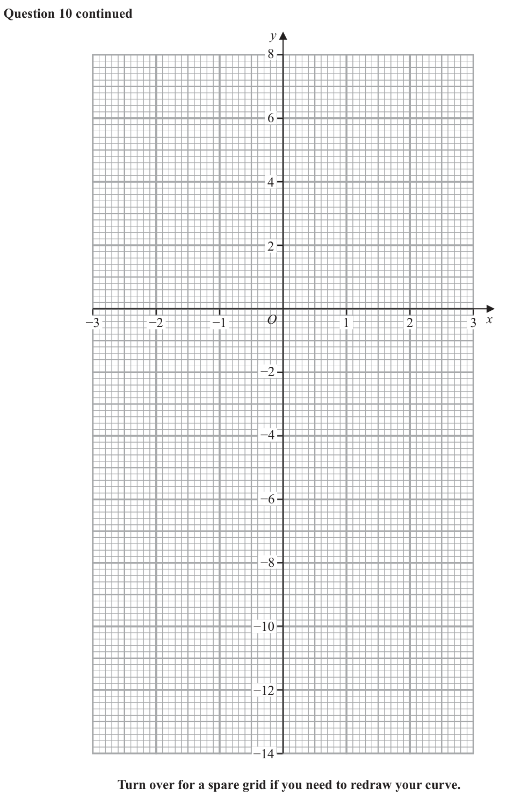
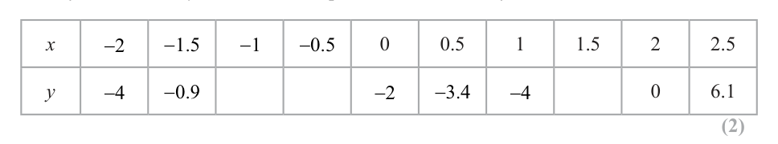
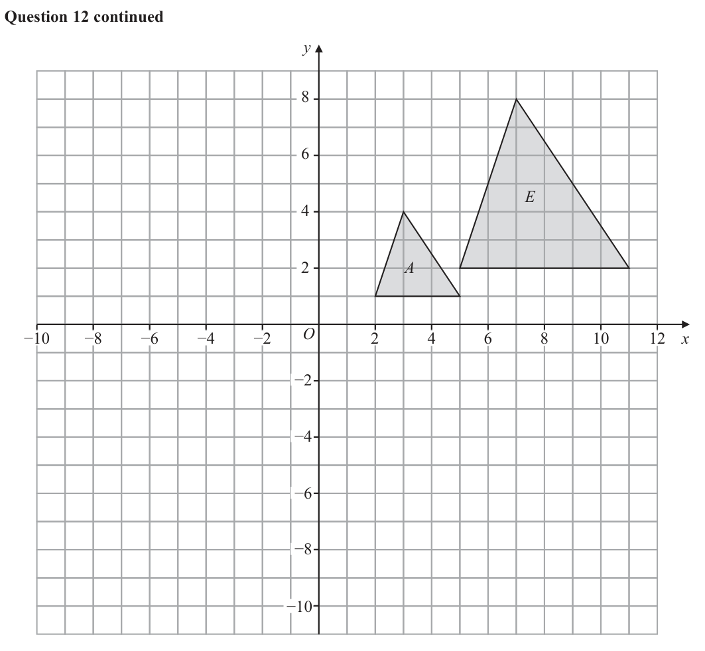

# 4MB1/02 — 2025-06 (official extraction)

> schema `syllabai.official-paper-questions/0.2` · paper_id `pearson-edexcel:international-gcse:mathematics-b:4mb1:2025-06:4MB1/02` · qp sha256 `a16203fbf2c38d66…` · extraction is the disclosed baseline (ADR-039)

## Question 1 (3 marks)

Charles asks each of the students in his class which flavour of ice cream they prefer. There are 30 students in his class. He uses the information he collects to draw this accurate pie chart. mint fudge vanilla strawberry chocolate Find how many of the 30 students prefer chocolate ice cream.

### 1 [3]

Charles asks each of the students in his class which flavour of ice cream they prefer. There are 30 students in his class. He uses the information he collects to draw this accurate pie chart. mint fudge vanilla strawberry chocolate Find how many of the 30 students prefer chocolate ice cream.

**Mark scheme answer**

> 84 (±2) seen or 276 (±2) 3 B1 may be seen in a calculation. May be implied
> by oe
> 84 360 − 276 M1 a correct calculation for the number of
> × 30 oe e.g. × 30 students who preferred chocolate ice cream -
> 360 360
> allow use of any angle (even if outside range) for
> chocolate (but must be a value and not x) May be
> 360
> seen in stages e.g. [ = 12] and 12
> 7 A1 cao
> Note: an answer with no working and in the range
> 6.8 – 7.17 implies B1M1
> Note: B0M1A1 is possible
> Total 3 marks
> Question Working Answer Mark Notes

- **(3)** 84 (±2) seen or 276 (±2) 3 B1 may be seen in a calculation. May be implied

## Question 2 (5 marks)

P Q Scale: 1 cm represents 2 metres S R The trapezium PQRS is a scale drawing of Abdul’s garden.

### 2(a) [1]

Construct the locus of all points inside the trapezium that are 6 metres from P

**Mark scheme answer**

> an arc centre P with radius 1 B1 for a correct arc
> 3 cm NB The arc does not have to touch/cross PQ and PS

- **(1)** an arc centre P with radius 1 B1 for a correct arc

### 2(b) [1]

Construct the locus of all points inside the trapezium that are 12 metres from QR

**Mark scheme answer**

> a line parallel to QR drawn 1 B1 for a correct line
> 6 cm from QR NB The line does not have to touch/cross PQ and SR

- **(1)** a line parallel to QR drawn 1 B1 for a correct line

### 2(c) [2]

Using ruler and compasses only and showing all your construction lines, construct the locus of all points inside the trapezium that are equidistant from PS and RS Abdul is going to put a fountain in his garden. The fountain must be greater than 6 metres from P greater than 12 metres from QR closer to PS than to RS

**Mark scheme answer**

> a correct bisector with arcs 2 B2 for a correct bisector with arcs that have been drawn
> shown from a point on SP (x) and a point on SR (y) such that Sx =
> Sy NB The bisector does not have to touch/cross PQ but
> must remain within the tolerance if extended to PQ
> (B1 for a bisector without arcs or correct arcs that cross or
> would cross if tolerance lines were extended)
> NB the intersection of the arcs and the point S must be two
> distinct points which allow for a straight line to be drawn
> for either B2 or B1

- **(2)** a correct bisector with arcs 2 B2 for a correct bisector with arcs that have been drawn

### 2(d) [1]

Show, by shading, the region in which Abdul can place the fountain. Label the region R

**Mark scheme answer**

> correct region indicated 1 B1ft only follow through if they have an arc centre P and a
> line parallel to QR and at least B1 for part (c) with the 3
> loci being a boundary of the area
> NB The arc must touch/cross PQ and PS, the line must
> touch/cross PQ and the bisector and the bisector must
> touch/cross the parallel line i.e. it must be a fully bounded
> area
> Total 5 marks
> Question Working Answer Mark Notes

- **(1)** correct region indicated 1 B1ft only follow through if they have an arc centre P and a

## Question 3 (6 marks)
### 3(a) [1]

Write 34 700 000 in standard form.

**Mark scheme answer**

> 3.47 ×107 1 B1 cao

- **(1)** 3.47 ×107 1 B1 cao

### 3(b) [1]

Write 9.8 10 3 as an ordinary number. x 5.4 10121 y 2 10120

**Mark scheme answer**

> 0.0098 1 B1 cao

- **(1)** 0.0098 1 B1 cao

### 3(c)(i) [2]

Calculate xy Give your answer in standard form.

**Mark scheme answer**

> 108 ×10240 or 10.8 ×10241 or 1.08 ×10n or k ×10242 2 M1 where n is any integer or 1 ≤ k < 10
> or for a correct answer in any form
> 1.08 ×10242 A1 cao

- **(2)** 108 ×10240 or 10.8 ×10241 or 1.08 ×10n or k ×10242 2 M1 where n is any integer or 1 ≤ k < 10

### 3(c)(ii) [2]

Calculate x + y Give your answer in standard form.

**Mark scheme answer**

> (54 ×10 ) + ( 2 ×10 ) or (5.4 ×10 ) + ( 0.2 ×10 ) or
> 120 120 121 121 2 M1 where n is any integer or 1 ≤ k < 10
> or for a correct answer in any form
> 56 ×10120 or 5.6 ×10n or k ×10121
> 5.6 ×10121 A1 cao
> Total 6 marks
> Question Working Answer Mark Notes

- **(2)** (54 ×10 ) + ( 2 ×10 ) or (5.4 ×10 ) + ( 0.2 ×10 ) or

## Question 4 (6 marks)

B C Diagram NOT 5m accurately drawn 50° A 5m D Figure 1 Figure 1 shows the section of a park, ABCD, where ADB is a sector of a circle centre D AD = BD = 5 m ADB BCD CDA

### 4(a) [2]

Calculate the area, in m 2 to 3 significant figures, of the sector ADB Grass is to be grown in this section ABCD of the park. 35 g of grass seed is needed for each 1 m 2

**Mark scheme answer**

> 50 125 2 M1 a correct method to find the area
> × π × 52 [= π = 10.908...] of the sector. May be implied by
> 360
> awrt 10.9
> 10.9m2 125
> A1 awrt 10.9 (Allow π or 11 if
> from correct working)

- **(2)** 50 125 2 M1 a correct method to find the area

### 4(b) [4]

Calculate, in g to the nearest g, the weight of grass seed needed to cover this section of the park. Show all your working.

**Mark scheme answer**

> BC = 5sin 40 or BC = 5cos 50 [=3.213938048] 4 M1 for a correct method to find BC
> CD = 5cos 40 or CD = 5sin 50 [=3.830222216] or CD May be implied by awrt 3.2 or
> awrt 3.8
> Allow equivalent equations e.g.
> sin 40 sin 90
> =
> x
> 1 1 M1 for a correct method to find the
> × 5 × sin 40 × 5 × cos 40 or × 5 × sin 40 × 5 × sin 50 area of the triangle ft their BC and/or
> 2
> 1 1 their CD
> or × 5 × cos 50 × 5 × cos 40 or × 5 × cos50 × 5 × sin 50 May be implied by awrt 6.2
> 2
> 1
> or × 5 × sin 40 × 52 − ( 5sin 40 ) or × 5 × cos50 × 52 − ( 5cos50 )
> 2
> 2
> 1
> or × 5 × cos 40 × 52 − ( 5cos 40 ) or × 5 × sin 50 × 52 − ( 5sin 50 )
> 2
> 2
> [=6.155048456]
> ("10.9"+ "6.15...") × 35 [17.06... × 35 = 597.217...] M1 for correct method
> ft their answer to part (a) and their
> triangle BCD. Either the area must
> be labelled triangle BCD or it must
> be clear that they are finding the area
> of triangle BCD. It must be 2 areas
> added together and multiplied by 35
> 597 A1 awrt 597
> Cas Total 6 marks
> Question Working Answer Mark Notes

- **(4)** BC = 5sin 40 or BC = 5cos 50 [=3.213938048] 4 M1 for a correct method to find BC

## Question 5 (9 marks)

A company buys blankets, cushions and towels in the ratios number of blankets : number of cushions : number of towels = 2 : 3 : 6 The company buys a total of 3850 of these items.

### 5(a) [2]

Calculate the number of blankets that the company buys. The company sells each cushion for £15.95 The company makes a profit of 16% on each cushion.

**Mark scheme answer**

> 3850 2 3850
> ×2 M1 for × n where n = 2 or 3 or 6
> 11
> 700 A1 cao

- **(2)** 3850 2 3850

### 5(b) [2]

Calculate, in £, how much the company pays for each cushion. The company buys 1500 small towels for £7 each and 600 large towels for £11 each. In January, it sells of the small towels for £15 each and 95% of the large towels for £18 each. The remaining towels were given away for free.

**Mark scheme answer**

> 15.95 2 15.95
> ×100 M1 for x ×1.16 = 15.95 or x ×116 = 15.95 or
> 116 116
> [£] 13.75 A1 cao

- **(2)** 15.95 2 15.95

### 5(c) [4]

Calculate the percentage profit that the company makes in January. Give your answer to one decimal place. The company buys some items from a new supplier. The company spends $9460 Using the exchange rate of £1 = $1.23

**Mark scheme answer**

> 1500 × 7 + 600 ×11(= 10500 + 6600 = 17100) 4 M1 for a correct method to find the total cost of the
> towels. May be seen as two separate calculations and
> added at any stage
> 3 95 M1 for a correct method to find the income from
> ×1500 ×15 + × 600 ×18[= 13500 + 10260 = 23760] or
> ⎛3 ⎞ ⎛ 95 ⎞ profit. May be seen as two separate calculations and
> ⎜ ×1500 × 15 − 10500 ⎟ + ⎜ × 600 × 18 − 6600 ⎟
> ⎝5 ⎠ ⎝ 100 ⎠ added at any stage (Condone 95% for )
> 100
> [= 3000 + 3600 = 6660]
> "23760"− "17100" "6660" M1 for a correct method to find the percentage profit
> ×100 or ×100
> "17100" "17100" ft their total cost and their income from selling
> items/total profit
> 23760
> Allow equivalent calculations e.g. ×100 − 100
> 17100
> 38.9[%] A1 awrt 39

- **(4)** 1500 × 7 + 600 ×11(= 10500 + 6600 = 17100) 4 M1 for a correct method to find the total cost of the

### 5(d) [1]

calculate the amount, in £ to the nearest £, that the company spends with this new supplier.

**Mark scheme answer**

> 7691 1 B1 awrt 7691
> Cas Total 9 marks
> Question Working Answer Mark Notes

- **(1)** 7691 1 B1 awrt 7691

## Question 6 (7 marks)

The Venn diagram shows information about the number of students in a school who are members of the Athletics Club (A), the Brass Band (B) and the Chess Club (C) 15 students are not members of any of these clubs. E C A B 25 10 21 x 37 There are twice as many members of the Chess Club than there are members of the Brass Band.

### 6(a) [2]

Find the value of x

**Mark scheme answer**

> 21 + x + 37 = 2(10 + 21) 2 M1 for a correct equation May be implied a correct answer
> on its own
> 4 A1 cao

- **(2)** 21 + x + 37 = 2(10 + 21) 2 M1 for a correct equation May be implied a correct answer

### 6(b) [1]

Find the number of these students who are not members of the Chess Club.

**Mark scheme answer**

> 50 1 B1 cao

- **(1)** 50 1 B1 cao

### 6(c) [1]

Find the number of these students who are members of all three clubs.

**Mark scheme answer**

> 21 1 B1 cao

- **(1)** 21 1 B1 cao

### 6(d) [1]

Find n B C ' At the start of 2022, the Drama Club had 80 members. From the start of 2022 until the start of 2023, the number of members of the Drama Club increased by 12.5% From the start of 2023 until the start of 2024, the number of members of the Drama Club increased by 30%

**Mark scheme answer**

> 71 1 B1 cao

- **(1)** 71 1 B1 cao

### 6(e) [2]

Calculate the number of students who were members of the Drama Club in 2024

**Mark scheme answer**

> 80 ×1.125 ×1.3 2 M1 correct method to find no of students
> Condone 80 ×112.5% ×130% May be seen as separate
> calculations
> 117 A1 cao
> Cas Total 7 marks
> Question Working Answer Mark Notes

- **(2)** 80 ×1.125 ×1.3 2 M1 correct method to find no of students

## Question 7 (7 marks)

Bag A contains 10 red counters and 5 yellow counters. Two counters are taken at random from bag A.

### 7(a) [2]

Complete the tree diagram below. First counter Second counter red red yellow red yellow yellow

> 🖼 crop required: diagram (qp.pdf p.None)

**Mark scheme answer**

> 2 5 9 5 10 4
> B2 for LH branch oe and RH branches oe
> 15 14 14 14 14
> (B1 for any two correct pairs of branches
> 5 9 5 5 10 4 9 5
> e.g. with or with or with
> 15 14 14 15 14 14 14 14
> )

- **(2)** 2 5 9 5 10 4

### 7(b) [2]

Calculate the probability that the two counters taken are the same colour. Bag B contains 4 red counters and 3 yellow counters. The two counters that have been taken from bag A are both placed into bag B so that there are a total of 9 counters in bag B. A counter is then taken at random from bag B. Given that each of the two counters taken from bag A and the one counter taken from bag B are all the same colour,

**Mark scheme answer**

> 10 9 5 4 2 M1 fully correct method ft their tree diagram
> × " "+ " "× " " or
> 15 14 15 14 Do not ft any probability greater than 1
> ⎛ 10 5 5 10 ⎞
> 1 − ⎜ × " "+ " "× " " ⎟
> ⎝ 15 14 15 14 ⎠
> 11 A1 oe Allow awrt 0.52

- **(2)** 10 9 5 4 2 M1 fully correct method ft their tree diagram

### 7(c) [3]

calculate the probability that the three counters are all red.

**Mark scheme answer**

> ⎛ 10 9 6 ⎞ ⎛ 5 4 5⎞ 3 M2 probability of all the same colour ft their tree diagram. Do
> ⎜ × " "× ⎟ + ⎜ " "× " "× ⎟ not ft any probability greater than 1
> ⎝ 15 14 9 ⎠ ⎝ 15 14 9 ⎠ (M1 probability of all being red e.g. 10 × " 9 "× 6 ⎡ = 2 ⎤ oe
> oe
> ⎡ 2 10 64 ⎤ 15 14 9 ⎢⎣ 7 ⎥⎦
> ⎢⎣ = 7 + 189 = 189 ⎥⎦ ft their tree diagram. Do not ft any probability greater than 1)
> 27 A1 oe Allow awrt 0.84
> a
> SC award M1M0A0 for oe where a and b are the
> a+b
> product of three probabilities and a ≠ b
> Cas Total 7 marks
> Question Working Answer Mark Notes

- **(3)** ⎛ 10 9 6 ⎞ ⎛ 5 4 5⎞ 3 M2 probability of all the same colour ft their tree diagram. Do

## Question 8 (9 marks)

y cm x cm 2x cm Figure 2 Figure 2 shows a solid cuboid with length 2x cm, width x cm and height y cm The volume of the cuboid is a cm 3 , where a is a constant. The total surface area of the cuboid is S cm 2 3a

### 8(a) [4]

Show that S 4 x 2 x Given that the minimum value of S is 400

**Mark scheme answer**

> 2x 2 y = a oe 4 M1 for a correct expression for the volume of the cuboid
> [ S =] 2 × 2 x 2 + 2 × xy + 2 × 2 xy[= 4 x 2 + 6 xy] M1 for a correct expression for the surface area of the cuboid.
> Need not be simplified.
> a a a 2x 2 y a M1 for a correct rearrangement of the volume expression
> y= oe or xy = oe or 2 xy = oe or = May be implied by an embedded expression in S
> 2 x2 2x x x x
> a a a A1 dep on M3 with no errors seen
> [ S =] 4 x 2 + 6 x × 2 or [ S =] 4 x2 + 6 × or [ S =] 4 x2 + 3 × or We condone S = omitted from the final answer
> 2x 2x x
> 2x y
> [ S =] 4 x 2 + 3 × Leading to the given answer
> x

- **(4)** 2x 2 y = a oe 4 M1 for a correct expression for the volume of the cuboid

### 8(b) [5]

Find, to 3 significant figures, the value of a

**Mark scheme answer**

> S = 4 x 2 + 3ax −1 5 3a dS
> −1 −2
> M1 for writing as 3ax May be implied by 3ax oe seen in dx
> x
> dS M1 for differentiating one term correctly and putting equal to 0
> = 8 x − 3ax −2 = 0 oe
> dx May be implied by 8 x3 − 3a = 0
> 3a M1 dependent on a fully correct expression for dS = 0
> 4x2 + = 400[⇒ 4 x3 + 3a = 400 x] dx
> x
> For putting S = 400 and solving simultaneously to get a correct
> Solving simultaneously leading to 12 x3 = 400 x oe or
> equation in one variable.
> ⎛ 3a ⎞ ⎛ 3a ⎞
> 4 ⎜⎜ 3 ⎟⎟ + 3a = 400 ⎜⎜ 3 ⎟⎟ oe May be implied by x = 100 [=5.77…] oe May be implied by a
> ⎝ 8 ⎠ ⎝ 8 ⎠
> correct equation of the form a n = ...
> 3
> ⎛ 100 ⎞ ⎛ 100 ⎞ ⎛ 100 ⎞ M1 dependent on previous M mark for substitution of x = 100 oe
> ⎝ 3 ⎠ ⎝ 3 ⎠ ⎝ 3 ⎠ into an equation to find a value of a
> 400 ⎛ 13 ⎞ or reducing to a correct equation with a n = ...
> or a 3 = ⎜ 3 ⎟ oe May be implied by awrt 513
> 9 ⎝ ⎠
> 513 A1 awrt 513 Allow 8000 3
> Cas Total 9 marks
> Question Working Ans Mark Notes

- **(5)** S = 4 x 2 + 3ax −1 5 3a dS

## Question 9 (9 marks)

X M Diagram NOT F E accurately drawn A D O B C Figure 3 Figure 3 shows a solid right pyramid ABCDEFX The base ABCDEF of the pyramid is horizontal and is a regular hexagon of side 3 cm O is the midpoint of the base. The vertex X of the pyramid is vertically above point O such that OX = 5 cm M is the midpoint of XD

### 9(a) [3]

Find the area, in cm 2 to one decimal place, of the hexagonal base.

**Mark scheme answer**

> 60° or 120° or 30° 3 M1 for seeing any of these angles. May be
> seen in the diagram or embedded in a
> calculation
> Area of equilateral triangle M1 for splitting hexagon into six triangles and
> 1 1 1 1 1 1.5 finding the area
> × 3 × 3 × sin 60 × 6 or × 3 × 3 × sin 120 × 6 or × 3 × 3 × cos 30 × 6 or × 3 × 1.5 × tan 60 × 6 or × 3× ×6 or
> 2 2 2 2 2 tan 30 for splitting hexagon into two trapezia and
> 1 1 1.5 sin 60 1 finding the area
> × 3× 3 − 1.5 × 6 × 3× ×6 × 3 × 1.5 + 3 − 2 × 1.5 × 3 cos 60 × 6
> 2 2 2
> or or or or or
> 2 2 sin 30
> for splitting hexagon into two triangles and a
> 4.5(4.5 − 3)(4.5 − 3)(4.5 − 3) × 6 rectangle/four triangles and two rectangles and
> Area of trapezium finding the area
> (( ) 6+3
> × 3 sin 60 × 2 ) or (( ) )
> 6+3
> (( ) )
> × 3 cos 30 × 2 or
> 6+3
> × 1.5 tan 60 × 2 or (( )
> 6+3
> ×
> 1.5
> tan 30
> ) ×2 or May be seen in stages
> (( ) 6+3
> × 3 − 1.5
> 2
> ) ×2 or (( ) ) (( )
> 6+3
> ×
> 1.5 sin 60
> sin 30
> ×2 or
> 6+3
> × 1.5 + 3 − 2 × 1.5 × 3 cos 60 × 2
> 2
> ) May be implied by awrt 23.4
> Area of 2 triangles + rectangle or Area of 4 triangles + 2 rectangles
> 1
> × 2 × 3 sin 60 × 1.5 × 2 + 3 × 2 × 3 sin 60 or × 2 × 3 cos 30 × 1.5 × 2 + 3 × 2 × 3 cos 30 or
> 2
> 1 1 1.5 1.5
> × 2 × 1.5 tan 60 × 1.5 × 2 + 3 × 2 × 1.5 tan 60 or × 2× × 1.5 × 2 + 3 × 2 × or
> 2 2 tan 30 tan 30
> 1 1 1.5 sin 60 1.5 sin 60
> × 2× 3 − 1.5 × 1.5 × 2 + 3 × 2 × 3 − 1.5 ×2× × 1.5 × 2 + 3 × 2 ×
> 2 2 2
> or or
> 2 2 sin 30 sin 30
> 1 3 sin 120 3 sin 120
> × × 1.5 × 2 + 3 × × 2 × 1.5 + 3 − 2 × 1.5 × 3 cos 60 × 1.5 × 2 + 3 × 2 × 1.5 + 3 − 2 × 1.5 × 3 cos 60
> 2 2 2
> or
> 2 sin 30 sin 30
> 3 + 3 − 2 × 3 × 3 cos120 × 1.5 × 2 + 3 × 3 + 3 − 2 × 3 × 3 cos120
> 2 2 2
> or or
> 6+3 3 ⎛6+3 3 ⎞⎛ 6 + 3 3 ⎞⎛ 6 + 3 3 ⎞
> ⎜ − 3 ⎟⎜ − 3 ⎟⎜ − 3 3 ⎟ × 2 + 3 × 3 3 or
> 2 ⎝ 2 ⎠⎝ 2 ⎠⎝ 2 ⎠
> 9+3 3 ⎛9+3 3 ⎞⎛ 9 + 3 3 ⎞⎛ 9 + 3 3 3 3⎞ 3 3
> ⎜ − 3 ⎟⎜ − 1.5 ⎟⎜ − ⎟ × 4 + 2× 3×
> 4 ⎝ 4 ⎠⎝ 4 ⎠⎝ 4 2 ⎠
> 23.4 27
> A1 awrt 23.4 or exact value of oe

- **(3)** 60° or 120° or 30° 3 M1 for seeing any of these angles. May be

### 9(b) [6]

Calculate the size, in degrees to 3 significant figures, of ∠AMX Show all your working. Area of triangle = absinC Cosine rule : a b c 2bc cos A 2 2 2

**Mark scheme answer**

> 6 M1 for correct use of Pythagoras to find XA or XD
> [ XA = XD = ] 5 + 3 ⎡⎣ = 2
> 34 = 5.830...⎤
> ⎦
> May be implied by 34 = awrt5.8 or
> 1 ⎡ 34 ⎤ M1 for correct use of midpoint to find XM
> [ XM = MD ] 5 + 3 ⎢= = 2.915...⎥
> 2
> 2 ⎣ 2 ⎦ May be implied by = awrt2.9
> M1 for a correct method to find AM
> ⎛ 3⎞ ⎛ 5 ⎞ ⎡ = 106 = 5.1478...⎤ or
> 2
> [ AM =] ⎜ 3 + ⎟ +⎜ ⎟ ⎢ ⎥
> ⎝ 2⎠ ⎝2⎠ ⎣ 2 ⎦ May be implied by
> 106
> or awrt 5.15 Allow 5.14
> ⎛ 34 ⎞ 34 ⎡ 106 ⎤ May be seen in stages
> [ AM =] 6 + ⎜ ⎟ − 2×6× cos ( 59.036..) ⎢ = = 5.1478...⎥
> ⎝ 2 ⎠ 2 ⎣ 2 ⎦ You may find these expressions useful
> 3 5
> cos −1 = sin −1 = tan −1 = 59.036...
> ⎛ 34 ⎞ ⎡ 106 ⎤
> 34
> cos ( 61.927...) ⎢ =
> or [ AM =] 34 + ⎜
> 34
> ⎟ − 2 × 34 × = 5.1478...⎥
> ⎝ 2 ⎠ 2 ⎣ 2 ⎦ ⎛ 34 2 + 34 2 − 6 2 ⎞
> cos ⎜ ⎟ = 61.927
> −1
> ⎜ ⎟
> ⎝ 2 34 34 ⎠
> Allow decimal equivalents
> ⎛ 34 ⎞ ⎛ 106 ⎞
> 2
> M1 dependent on 3rd M mark for correct substitution into Cosine
> 2 34 106
> 34 = ⎜ ⎟ +⎜ ⎟ − 2× × × cos AMX or Rule
> ⎝ 2 ⎠ ⎝ 2 ⎠ 2 2 or correct substitution into the Sine Rule
> Allow decimal equivalents
> ⎛ 34 ⎞ ⎛ 106 ⎞
> 2
> 34 106
> 6 =⎜ ⎟ +⎜ ⎟ − 2× × × cos AMD or sin ∠AMD sin 59.036...
> ⎝ 2 ⎠ ⎝ 2 ⎠ 2 2 Allow =
> 6 106
> ⎛ 34 ⎞ ⎛ 106 ⎞
> 2
> 106
> ⎜ ⎟ = 6 +⎜ ⎟ − 2×6× × cos MAD or
> ⎝ 2 ⎠ ⎝ 2 ⎠ 2 may be implied by 5th M mark
> sin ∠AMX sin ( 61.927...) sin ∠MAD sin 59.036...
> = or =
> 34 106 34 106
> 2 2
> M1 dependent on 4th M mark for a correct rearrangement of the
> ⎛ 34 ⎞ ⎛ 106 ⎞ ⎛ 34 ⎞ ⎛ 106 ⎞
> 2 2 2
> ⎜ ⎟ +⎜ ⎟ − 34 ⎜ ⎟ +⎜ ⎟ −6
> cosine rule or the sine rule
> cos ∠AMX =
> ⎝ 2 ⎠ ⎝ 2 ⎠ or cos ∠AMD = ⎝ 2 ⎠ ⎝ 2 ⎠ or Allow decimal equivalents
> 34 106 34 106 May be implied by answers in the range 87.9 – 88.3
> 2× × 2× ×
> 2 2 2 2 sin 59.036...
> Allow sin ∠AMD = ×6
> ⎛ 106 ⎞ ⎛ 34 ⎞
> 2
> ⎛ 106 ⎞
> 6 +⎜
> ⎟ −⎜ ⎟ sin ( 61.927 ) ⎜ ⎟
> cos ∠MAD =
> ⎝ 2 ⎠ ⎝ 2 ⎠ or sin ∠AXM = × 34 or ⎝ 2 ⎠
> 106 106
> 2×6×
> 2
> sin 59.036...
> sin ∠MAD = ×
> 106
> 88.1 A1 87.9 – 88.3
> Do not ISW e.g. 180 – 88.1 = 91.9 would score A0
> Do not accept answers in the range that have come from incorrect
> methods
> Wr Total 9 marks
> Question Working Answer Mark Notes

- **(6)** 6 M1 for correct use of Pythagoras to find XA or XD

## Question 10 (13 marks)

f(x) x 3 3 x

### 10(a) [2]

Use the factor theorem to show that that x 2 is a factor of f( x)

**Mark scheme answer**

> ( 2) − 3 ( 2) − 2 2 M1 Attempt to find f (±2) (M0 if long division used)
> ( 2) − 3( 2) − 2 = 0 A1 Find f(2) must see working including the “ = 0”
> Allow 8 – 6 – 2 = 0 as a minimum

- **(2)** ( 2) − 3 ( 2) − 2 2 M1 Attempt to find f (±2) (M0 if long division used)

### 10(b) [3]

Hence, factorise f( x) completely.

**Mark scheme answer**

> ⎡⎣( x − 2 ) ⎤⎦ ( x 2 + 2 x + 1) 2 1 0 –3 –2
> 3 M1 (For any two terms of the quadratic factor).
> May be seen as part of long division of synthetic long division (in which
> 2 4 2 case look for two correct non-zero terms on the bottom row).
> 1 2 1
> ⎡⎣( x − 2 ) ⎤⎦ ( x + 2 x + 1)
> 2 A1 fully correct quadratic factor
> ( x − 2)( x + 1) 2 A1 fully correct solution with no incorrect working seen gains full marks,
> may be awarded from part (a).
> Allow ( x − 2)( x + 1)( x + 1) ISW

- **(3)** ⎡⎣( x − 2 ) ⎤⎦ ( x 2 + 2 x + 1) 2 1 0 –3 –2

### 10(c) [2]

Complete the table of values for y x 3 3 x Give your values of y to one decimal place where necessary. x −2 −1.5 −1 −0.5 0 0.5 1 1.5 2 2.5 y −4 −0.9 −2 −3.4 −4 0 6.1

> 🖼 crop required: table (qp.pdf p.None)

**Mark scheme answer**

> 0, −0.6, −3.1 2 B2 All values correct to 1 dp or better
> (actual values are 0, −0.625, −3.125)
> (B1 for 2 values correct to at least 1dp)

- **(2)** 0, −0.6, −3.1 2 B2 All values correct to 1 dp or better

### 10(d) [3]

On the grid opposite, plot the points from your completed table and join them to form a smooth curve.

**Mark scheme answer**

> Curve drawn 3 B3 Fully correct smooth curve ±1 small square. Allow if curve goes
> through points, even if the points are not plotted.
> (B2 for at least 7 points plotted correctly ±1 small square or a curve/line
> segments that goes through at least 7 correct points ±1 small square .
> (B1 For at least 5 points plotted correctly ±1 small square or a curve/line
> segments that goes through at least 5 correct points ±1 small square.

- **(3)** Curve drawn 3 B3 Fully correct smooth curve ±1 small square. Allow if curve goes

### 10(e) [3]

By drawing a suitable straight line on the grid, find an estimate, to one decimal place, for the solution of the equation 2 x 3 7 x 6 0 in the interval −2 ≤ x ≤ 2.5 y −3 −2 −1 O 1 2 3 x −2 −4 −6 −8 −10 −12 −14 for a spare grid if you need to redraw your curve. Only use this grid if you need to redraw your curve. y −3 −2 −1 O 1 2 3 x −2 −4 −6 −8 −10 −12 −14

**Mark scheme answer**

> 3 M1 for identifying the required line` (allow 0.5 x + 1 or f ( x) = 0.5 x + 1 )
> x3 − 3x − 2 = 0.5 x + 1 or y = 0.5 x + 1
> May be seen on the diagram
> Allow a straight line drawn through (0, 1) with a positive gradient.
> M1 a correct line that intersects the curve
> (a correct line drawn implies M2)
> (x=) 2.2 A1 dependent on a correct line being drawn
> Allow answers in the range 2.1 to 2.3 inclusive (dep on M2)
> NB: if y values given as well then A0
> Total 13 marks
> Question Working Answer Mark Notes

- **(3)** 3 M1 for identifying the required line` (allow 0.5 x + 1 or f ( x) = 0.5 x + 1 )

## Question 11 (12 marks)

The functions f, g and h are defined as f : x ↦ 6 − x2 0< x<3 x 1 g : x ↦ + x x + 6x + 8 x + 2 x+5 h : x ↦ x>0 2x + 3

### 11(a) [3]

Write g(x) as a single fraction in its simplest form. Show clear algebraic working.

**Mark scheme answer**

> ⎡⎣ x 2 + 6 x + 8 = ⎤⎦ ( x + 4)( x + 2) 3 B1 factorising quadratic
> x+x+4 ⎡ 2x + 4 2( x + 2) ⎤ M1 for writing both fractions with a common denominator
> = =
> ⎢
> ( x + 4)( x + 2) ⎣ ( x + 4)( x + 2) ( x + 4)( x + 2) ⎥⎦ (can be written as two fractions with a common
> denominator or one single fraction)
> This step may be done before or without factorising
> x ( x + 2) + x2 + 6x + 8
> eg oe
> ( x + 6 x + 8) ( x + 2 )
> 2 A1 cao dep on M1
> x+4 Do not ISW

- **(3)** ⎡⎣ x 2 + 6 x + 8 = ⎤⎦ ( x + 4)( x + 2) 3 B1 factorising quadratic

### 11(b) [2]

Find hf(2)

**Mark scheme answer**

> 6 − 1 x2 + 5 2 M1 for f(2) = 4
> f (2) = 4 or
> 2 4+5
> (
> 2 6 − 1 x2 + 3
> 2 ) May be seen as a substitution into h(x) e,g.
> 2(4) + 3
> or
> substitution of f(x) into h(x)
> 9 A1 Allow awrt 0.82
> 11 = 0.8181...

- **(2)** 6 − 1 x2 + 5 2 M1 for f(2) = 4

### 11(c) [4]

Find the inverse function h–1 in the form h −1 : x ↦ ... Give your answer in its simplest form.

**Mark scheme answer**

> 2 xy + 3 y = x + 5 4 M1 For a correct expression.
> May use 2 other letters eg 2 xy + 3x = y + 5 (from
> interchanging x and y as a first step)
> 2 xy − x = 5 − 3 y 3 y − 5 = x − 2 xy M1 Collect all their x terms on one side (must be more than
> one) Allow 1 sign error.
> 2 xy − x 5 − 3 y
> Condone both sides being over x or y eg =
> x x
> May use other letters eg 2 xy − y = 5 − 3x
> x ( 2 y − 1) = 5 − 3 y 3 y − 5 = x(1 − 2 y) M1 Isolating term in x ie taking x out as common factor so
> it only appears once in the equation
> 5 − 3x 3x − 5
> A1 oe eg must be in terms of x
> 2x − 1 1 − 2x

- **(4)** 2 xy + 3 y = x + 5 4 M1 For a correct expression.

### 11(d) [3]

Solve the equation hh( x) = x Show your working clearly.

**Mark scheme answer**

> x+5 5 − 3x 3 M1 for recognising that question can be answered by
> =" " oe
> 2x + 3 2x −1 solving h( x) = h −1 ( x)
> May be implied by a correct quadratic ft answer to part (c)
> for this method mark only
> May be implied by ( x + 5)( 2 x − 1) = ( 5 − 3x )( 2 x + 3) or
> 2 x2 + 9 x − 5 = 15 + x − 6 x2
> 8x2 + 8x − 20[ = 0] oe M1 for a correct three term quadratic
> −1 + 11 A1 oe Allow awrt 1.16 (Condone 1.15) Must reject other
> 2 root if seen
> ALT x+5 M1 for a correct expression for h 2 ( x)
> +5
> [ hh( x) =] x + 5
> 2 x + 3 or May be implied by a correct quadratic/cubic
> ⎛ ⎞ 11x + 20
> 2⎜ ⎟+3 May be implied by = x or 11x + 20 = x ( 8 x + 19 )
> ⎝ 2x + 3 ⎠ 8 x + 19
> x + 5 + 5 ( 2 x + 3)
> ⎡⎣ h 2 ( x) = ⎤⎦ = or
> 2 ( x + 5 ) + 3 ( 2 x + 3)
> 11x + 20
> ⎡⎣ h 2 ( x) = ⎤⎦
> 8 x + 19
> 8x2 + 8x − 20[ = 0] oe or M1 for a correct three term quadratic or a correct cubic
> 16 x3 + 40 x 2 − 16 x − 60 [ = 0] oe Allow equivalent expressions e.g 40 x 2 − 16 x − 60 = −16 x3
> −1 + 11 A1 oe Allow awrt 1.16 (Condone 1.15) Must reject other
> 2 root/roots if seen
> Total 12 marks
> Question Working Answer Mark Notes

- **(3)** x+5 5 − 3x 3 M1 for recognising that question can be answered by

## Question 12 (14 marks)

Triangle A and triangle E are drawn on the grid opposite.

**(d)** Triangle A is transformed to triangle D under the transformation with matrix M where 2 1 M

### 12(a) [3]

Describe fully the single transformation that maps triangle A onto triangle E Triangle A is transformed to triangle B under a reflection in the y-axis.

**Mark scheme answer**

> Enlargement 3 B1 Allow enlarge. Do not allow bigger
> B0 if multiple transformations stated. Multiple transformations are when
> more than one of reflection (mirrored), rotation (turn), translation (move),
> is stated eg a vector or SF or equation of a line do not imply multiple
> transformations
> Centre (–1, 0) B1 for (–1, 0) Do not accept if written as a These 2 marks can still be
> column vector awarded if multiple
> SF 2 B1 for 2 transformations are stated

- **(3)** Enlargement 3 B1 Allow enlarge. Do not allow bigger

### 12(b) [2]

On the grid, draw and label triangle B Triangle A is transformed to triangle C under a translation with the vector

**Mark scheme answer**

> Correct 2 B2 correct triangle drawn (–2, 1) (–5, 1) (–3, 4)
> triangle B Award 2 marks for a correct triangle drawn irrespective of working in the
> drawn working space. (B1 for 2 correct vertices plotted correctly or a triangle of
> the correct size and orientation, or 3 correct vertices listed))
> SC B1 for a correct reflection applied to triangle A in the x-axis. [vertices
> (2, –1) (5, –1) (3, –4)] Ignore triangle B not labelled

- **(2)** Correct 2 B2 correct triangle drawn (–2, 1) (–5, 1) (–3, 4)

### 12(c) [2]

On the grid, draw and label triangle C

**Mark scheme answer**

> 2 M1 for a triangle translated either 4 units to the right or 3 units down.
> Correct A1 correct triangle drawn (6, –2) (9, –2) (7, 1) Ignore triangle C not
> triangle C labelled
> drawn

- **(2)** 2 M1 for a triangle translated either 4 units to the right or 3 units down.

### 12(d)(i) [3]

On the grid, draw and label triangle D Triangle F is transformed to triangle A under the transformation with matrix N where k N Triangle F is transformed to triangle D under the transformation with matrix P Given that the determinant of P is 5

**Mark scheme answer**

> ⎛ −2 1 ⎞ ⎛ 2 3 5 ⎞ 3 M1 for the intention to multiply the right way. Points can be in any order.
> ⎜ ⎟⎜ ⎟ May be implied by writing the matrices in the correct order or correctly
> ⎝ 1 −3 ⎠ ⎝ 1 4 1 ⎠ stating or plotting one point.
> ⎛ −3 −2 − 9⎞ M1 for at least two correct columns or correctly stating or plotting two
> =⎜ ⎟ correct points
> ⎝ −1 −9 2 ⎠
> correct A1 correct triangle drawn
> triangle D NB Award 3 marks for a correct triangle drawn irrespective of working in
> drawn the working space. Ignore triangle D not labelled

- **(3)** ⎛ −2 1 ⎞ ⎛ 2 3 5 ⎞ 3 M1 for the intention to multiply the right way. Points can be in any order.

### 12(d)(ii) [4]

calculate the value of k a b Determinant of matrix = ad bc c d y E 2 A −10 −8 −6 −4 −2 O 2 4 6 8 10 12 x −2 −4 −6 −8 −10 for a spare grid if you need to redraw your triangles. Only use this grid if you need to redraw your triangles. y E 2 A −10 −8 −6 −4 −2 O 2 4 6 8 10 12 x −2 −4 −6 −8 −10

**Mark scheme answer**

> ⎛ −2 1 ⎞ ⎛ k −5 ⎞ 4 M1 for intention to multiply the two matrices, implied by one correct value
> ⎜ ⎟⎜ ⎟ or once multiplied or finding the determinant of the two matrices
> ⎝ 1 −3 ⎠ ⎝ 1 −1 ⎠
> ⎛ k −5 ⎞ ⎛ −2 1 ⎞
> ⎜ ⎟⎜ ⎟ or
> ⎝ 1 −1 ⎠ ⎝ 1 −3 ⎠
> ⎛ −2 1 ⎞
> det ⎜ ⎟ = (−2 × −3 − 1×1) and
> ⎝ 1 −3 ⎠
> ⎛ k −5 ⎞
> det ⎜ ⎟ = (k × −1 − −5 ×1)
> ⎝ 1 −1 ⎠
> ⎛ −2k + 1 9 ⎞ ⎛ −2k − 5 k + 15 ⎞ M1 for matrix with 3 or 4 correct elements or for multiplying the two
> ⎜ ⎟ or ⎜ ⎟ or determinants and equating to 5
> ⎝ k − 3 −2 ⎠ ⎝ −3 4 ⎠
> (−2 × −3 − 1×1) (k × −1 − −5 ×1) =5
> −2(−2k + 1) − 9(k − 3) = 5 or M1 dependent on previous M mark for forming a correct equation for their
> 4(−2k − 5) + 3(k + 15) = 5 or 5(−k + 5) = 5 determinant
> 4 A1
> Total 14 marks
> E
> B A
> C
> D

- **(4)** ⎛ −2 1 ⎞ ⎛ k −5 ⎞ 4 M1 for intention to multiply the two matrices, implied by one correct value

