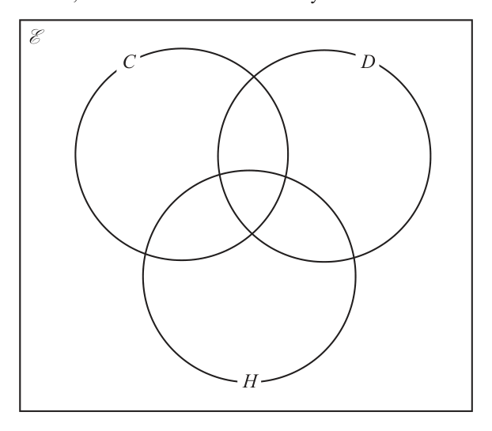
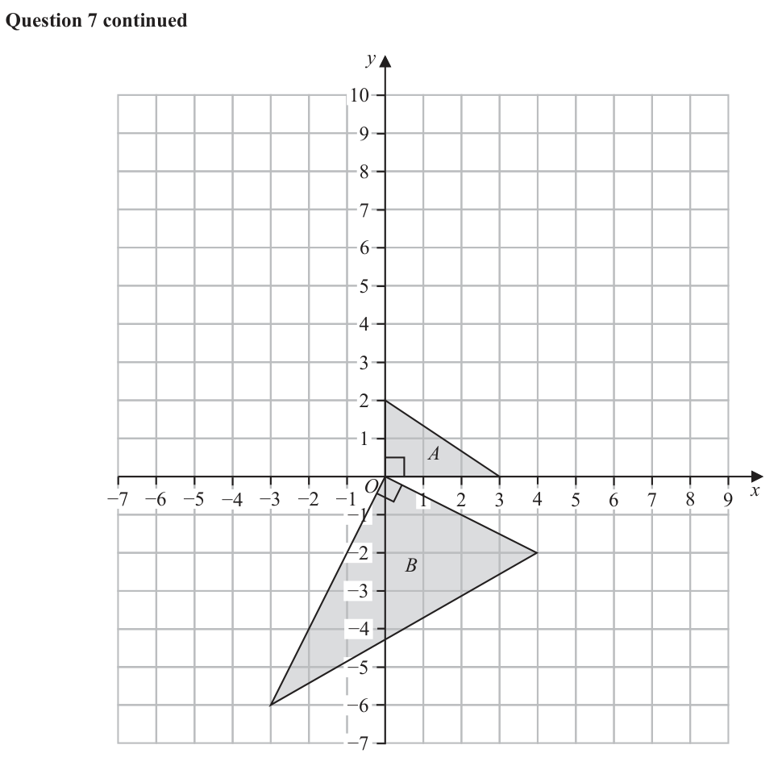
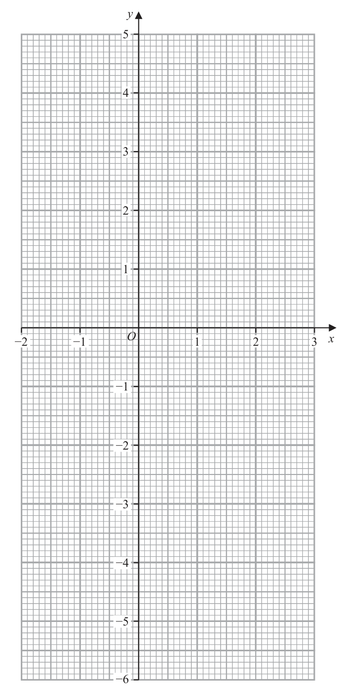
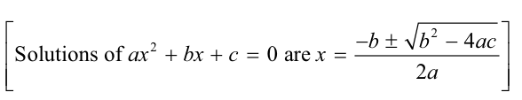

# 4MB1/02R — 2025-06 (official extraction)

> schema `syllabai.official-paper-questions/0.2` · paper_id `pearson-edexcel:international-gcse:mathematics-b:4mb1:2025-06:4MB1/02R` · qp sha256 `7c31d1c0294f643c…` · extraction is the disclosed baseline (ADR-039)

## Question 1 (4 marks)

Solve the simultaneous equations 3x 4 y 4x 7 y Show clear algebraic working. (4)

### 1 [4]

Solve the simultaneous equations 3x 4 y 4x 7 y Show clear algebraic working.

**Mark scheme answer**

> 12 x − 16 y = 12 21x − 28 y = 21 4 M1 for preparing to eliminate a variable either by multiplying so the
> or or coefficients of x (or y) are the same or rearranging to get x in terms of y or y
> 12 x − 21 y = 6 16 x − 28 y = 8 in terms of x
> 4x − 2 3x − 3
> y= or y = or Allow one arithmetic or sign slip in total for both M marks
> 7
> 2+ 7y 3+ 4y 5 + 11y 7x − 5 x +1
> x= or x = [Allow eg, x = or x = 3 y − 1 or y = or y = ]
> 4 3 7 11
> ⎛ 4x − 2 ⎞ M1 dependent on previous mark For a correct method to eliminate either
> 5 y = 6 or 5 x = 13 or 3 x − 4 ⎜ ⎟ = 3 or variable by adding/subtracting equations or substituting to obtain an
> ⎝ 7 ⎠ equation in one variable
> ⎛ 3x − 3 ⎞ ⎛ 2+ 7y ⎞ NB the alternative forms of x and y listed in the notes above can be
> 4x − 7 ⎜ ⎟ = 2 or 3 ⎜ ⎟ − 4 y = 3 or substituted into either of the correct original equations
> ⎝ 4 ⎠ ⎝ 4 ⎠ Allow one arithmetic or sign slip in total for both M marks
> ⎛ 3+ 4y ⎞ A correct equation in one variable implies the previous mark
> 4⎜ ⎟ −7y = 2
> ⎝ 3 ⎠
> x = 2.6 A2 wr dependent both method marks being awarded and having a correct
> and equation in terms of x or y only
> y = 1.2 13
> Accept exact fractions eg x = and y = or simplified mixed numbers
> 5
> 3
> eg x = 2 and y = 1 isw if correct form is seen
> 5
> 7.8
> NB we will not accept decimals within a fraction eg
> May be seen within a coordinate pair
> (A1 for just one value correct)
> Total 4 marks
> Question Working Answer Mark Notes
> Use the overlay when marking this question

- **(4)** 12 x − 16 y = 12 21x − 28 y = 21 4 M1 for preparing to eliminate a variable either by multiplying so the

## Question 2 (4 marks)

A B D C The diagram shows quadrilateral ABCD

### 2(a) [1]

Construct the locus of all points that are 4 cm from C

### 2(b) [2]

Using ruler and compasses only and showing all your construction lines, construct the perpendicular bisector of AD The region R consists of all the points inside the quadrilateral that are less than 4 cm from C and nearer to A than to D

### 2(c) [1]

Show, by shading, the region R Label the region R

## Question 3 (6 marks)

Diagram NOT accurately drawn F G E D C B A Figure 1 Figure 1 shows part of a regular 20-sided polygon in which AB, BC, CD, DE, EF and FG are six of the sides.

### 3(a) [2]

Find the size, in degrees, of angle ABC

**Mark scheme answer**

> 2 M1 Finding the sum of the interior angles or the exterior angle of the
> [ = 18] or ( 20 − 2 ) ×180 [ = 3240] or
> 360
> polygon. May be seen as part of calculation eg ⎛⎜ 180 −
> 20 360 ⎞
> ⎟ or
> ( 2 × 20 − 4 ) × 90 [ = 3240] ⎝ 20 ⎠
> ⎛ ( 20 − 2 ) ×180 ⎞ or ( 2 × 20 − 4 ) × 90
> ⎜ ⎟
> ⎝ 20 ⎠
> 162 A1 cas May be seen on diagram.

- **(2)** 2 M1 Finding the sum of the interior angles or the exterior angle of the

### 3(b) [4]

Find the size, in degrees, of angle EGA Sum of interior angles of a polygon 2n 4 right angles

**Mark scheme answer**

> ( 2 × 7 − 4) × 90 [ = 900] or ( 2 × 6 − 4) × 90 [ = 720] or 4 M1 for a start to the process,
> either a correct method to find the sum of the interior angles of a 7,
> ( 2 × 5 − 4) × 90 [ = 540] or ( 2 × 4 − 4) × 90 [ = 360] or 6, 5, 4 or 10 sided polygon.
> ( 2 ×10 − 4 ) × 90 [ = 1440] Allow for ( n − 2 ) ×180 where n = 7, 6, 5, 4,10
> 180 − "162" or ∠FGE . Allow 180 = "162"+ 2x oe
> [∠FGE =] [ = 9] NB, if found, the 9 could be seen on the diagram or labelled as
> ∠FEG, ∠FGE , ∠DEC , ∠DCE , ∠BCA, ∠BAC
> "900"− 5 × "162" M1 ft a correct method to find an angle within the polygon eg
> [∠FGA or ∠BAG =] [ = 45] ∠FGA or ∠BAG or ∠DEG or ∠ACD or ∠ACE Allow the
> [∠DEG or ∠ACD =]"162"− "9"[= 153] angles, represented by any variable, to be seen within an equation eg
> 900 = 5 × "162"+ 2x
> "1440" ft their part (a), their sum of angles and their ∠FGE if clearly
> [∠ACE or ∠CEG =] [ = 144] or labelled, seen on the diagram or from correct working
> [∠ACE or ∠CEG =]"162"− 2 × "9"[= 144]
> "540"− 3 × "162"
> [∠DEA or ∠BAE =] [ = 27]
> eg [∠EGA =]" ∠FGA "− " ∠FGE " or M1 ft a complete method to find ∠EGA
> [∠EGA =]"720"− " ∠BAG "− " ∠DEG "− 3 × "162" or ft their part (a), their sum of angles and their calculated angles if
> clearly labelled, seen on the diagram or from correct working
> "360"− 2 × " ∠CEG "
> [∠EGA =] or [∠EGA =]180 − "144" or
> There are alternative approaches, for example
> 2 [∠EGA =]180 − ∠AEG − ∠EAG = 180 − ("162"− "27"− "9") − ("45"− "27")
> "540"− "162"− 2 × " ∠DEG "
> [∠EGA =]
> 36 A1 cas
> Total 6 marks
> Commonly found angles that could be used to work towards finding ∠EGA
> (due to the symmetry of the shape, these may not always be found in these positions)
> Question Working Ans Mark Notes

- **(4)** ( 2 × 7 − 4) × 90 [ = 900] or ( 2 × 6 − 4) × 90 [ = 720] or 4 M1 for a start to the process,

## Question 4 (7 marks)

The nth term of a sequence is given by 2n 2 − 5

### 4(a) [2]

Find the difference between the 3rd term and the 7th term of the sequence. A different sequence is generated. After the first term the sequence is generated by using the rule “multiply the previous term by d and then add 2” The first term of the sequence is 2 x 1 The second term of the sequence is 4 x 9 The third term of the sequence is 20 x 11 Given that 2 x 1

**Mark scheme answer**

> 2 × 7 − 5 [ = 93] and 2 × 3 − 5 [ = 13] or
> 2 2 2 M1 for a correct method to find the 3rd and 7th term or the 3rd and
> 7th term minus 5
> 2 × 7 2 [ = 98] and 2 × 32 [ = 18] Allow for 93 and 13 or 98 and 18
> 80 A1 cas Allow – 80

- **(2)** 2 × 7 − 5 [ = 93] and 2 × 3 − 5 [ = 13] or

### 4(b) [5]

find the value of d Show all your working.

**Mark scheme answer**

> d ( 2 x − 1) + 2 = 4 x + 9 5 M1 for
> • forming two recurrence relationships (allow one sign error).
> (
> and d ( 4 x + 9 ) + 2 = 20 x − 11 or d d ( 2 x − 1) + 2 + 2 = 20 x − 11 oe ) Allow equivalences eg 2 xd 2 − d 2 + 2d + 2 = 20 x − 11
> AND AND
> 4x + 7 20 x − 13 4x + 9 20 x − 13 • rearranging at least one of their equations to isolate either d
> [ d =] or [ d = ] or [ d = ] or [ d = ] or
> 2x −1 4x + 9 2x −1 4x + 7 or x
> 56 x + 50 48 16 x − 20 12 x − 27
> [ d =] or [ d =] or [ d = ] or [ d = ] or Any two expressions for d (or for x) imply the correct recurrence
> 22 x 6 x − 14 2 x + 10 11 relationships
> 13 + 9d d +7 13 + 9d 20 − 4d 11d + 27
> [ x =] or [ x = ] or [ x = ] or [ x = ] or [ x = ] or
> d +7 2d − 4 20 − 4d 2d − 4 12 This mark can be implied by the correct 3-term quadratic
> 48 + 14d 11d + 20 d − 2d − 13
> [ x =]
> or [ x = ] or [ x = ] or [ x = ]
> 16 − 2d 22d − 56 2d − 20
> 6d
> ( ) ( )
> ± 24 x − 110 x − 50 [ = 0] or ± 12 x − 55 x − 25 [ = 0] or
> 2 2 M2 for a correct 3-term quadratic (allow multiples) no need for =
> ± ( 22d − 2d − 192 ) [ = 0] or ± (11d − d − 96 ) [ = 0]
> 2
> (M1 for a 3-term quadratic with 2 correct coefficients)
> M1 dependent on the 1st M1 being awarded. For an attempt at
> solving their 3-term quadratic. If factorising it must multiply out
> (12 x + 5)( x − 5) oe or to gain at least 2 correct terms. If using the quadratic formula it
> (11d + 32 )( d − 3) oe must be correct.
> 5
> Can be implied by x = − or 5 or d = 3 or d = −
> 12
> 3 A1 wr dependent on 3 method marks awarded
> d = 3 must be clearly selected
> Total 7 marks
> Question Working Answer Mark Notes

- **(5)** d ( 2 x − 1) + 2 = 4 x + 9 5 M1 for

## Question 5 (13 marks)

A large rental company has cars, vans and minibuses available to rent. The cost to rent a minibus from the company is found by adding $1000 rental fee $400 for each day the minibus is rented $0.8 per kilometre the minibus travels during the time it is rented This cost is reduced by n% if the minibus is a hybrid vehicle. The total cost of hiring 3 minibuses that are hybrid vehicles for 7 days is $10 584 Given that each minibus travels a total distance of 500 kilometres during these 7 days

### 5(a) [5]

find the value of n Show all your working. The number of cars the company owns is the Highest Common Factor (HCF) of 2 2 × 35 × 53 and 25 × 32 × 55 × 7

**Mark scheme answer**

> 1000 + 7 × 400 [ = 3800] or 5 M1 for calculating the combined cost of any two components
> These may be seen within a calculation for multiple minibuses eg for 3
> 1000 + 0.8 × 500 [ = 1400] or minibuses 3 × (1000 + 7 × 400 ) [ = 3000 + 8400 = 11400 ] or
> 7 × 400 + 0.8 × 500 [ = 3200] 3 × (1000 + 0.8 × 500 ) [ = 3000 + 1200 = 4200] or
> 3 × ( 7 × 400 + 0.8 × 500 ) [ = 8400 + 1200 = 9600 ]
> 1000 + 7 × 400 + 0.8 × 500 [ = 4200] M1 fully correct method for the total cost.
> This may be seen within a calculation for multiple minibuses, eg,
> 3 × (1000 + 7 × 400 + 0.8 × 500 ) [ = 12600]
> 4200 implies M1M1 unless contradictory working is seen
> 10584 M1 finding value(s) that can be compared
> [ = 3528] or either the cost of hiring 1 discounted minibus (hybrid) or 3 full-price
> minibuses or ( m full-price minibuses and m discounted minibuses)
> "4200"× 3[= 12600] or ft their values if they come from correct method
> ⎛ 10584 × m
> ⎜ "4200"× m and [ = 3528m] ⎞⎟ 12600 implies M1M1M1 unless contradictory working is seen
> ⎝ 3 ⎠
> "3528" M1 ft their values if they all use the same value of m and come from
> ± [ = 0.84] or correct working
> "4200"
> 10584
> "3528" Allow calculation for m minibuses eg for 3 minibuses ±
> ×100 [ = 84] or
> or
> ± "12600"
> "4200"
> "12600"− 10584
> "4200"− "3528" ±
> ± [ = 0.16] or "12600"
> "4200"
> 100 − n
> "4200"× [ = "3528"] or
> 100
> n
> "4200"− × 4200 [ = "3528"]
> 100
> 16 A1 cas

- **(5)** 1000 + 7 × 400 [ = 3800] or 5 M1 for calculating the combined cost of any two components

### 5(b) [1]

Find the number of cars the company owns. The number of cars that are hybrid vehicles is the least value of N such that when N is divided by 120 the remainder is 7 and when N is divided by 504 the remainder is 7

**Mark scheme answer**

> 4500 1 B1 oe eg 22 × 32 × 53 isw

- **(1)** 4500 1 B1 oe eg 22 × 32 × 53 isw

### 5(c) [3]

Find the number of cars that are hybrid vehicles. The company owns 200 vans and minibuses in total. Each van and each minibus is either an electric vehicle or a hybrid vehicle. The ratio of the number of vans to the number of minibuses is 5 : 3 40% of the vans are hybrid vehicles. of the minibuses are hybrid vehicles.

**Mark scheme answer**

> 23 × 3 × 5 and 23 × 32 × 7 3 M1 allow 120 = 8 × 3 × 5 and/or 504 = 8 × 3 × 21 may be reduced further
> or list of at least 4 multiples for one of the numbers
> 120, 240, 360, 480, 600, 720, 840, …2016, 2520 or
> 504, 1008, 1512, 2016, 2520 (allow multiples with 7 added)
> LCM = 23 × 32 × 5 × 7 or 2520 A1 correct LCM
> Correct value implies M1
> 2527 A1 cas
> SC award 3 marks for a final answer of 7
> ALT 120 x + 7 = 504 y + 7 3 M1 for setting up the correct relationship
> x 21 A1 may be seen embedded eg 120 × 21 + 7 or 504 × 5 + 7
> = Allow x = 21 and y = 5
> y 5
> 2527 A1 cas

- **(3)** 23 × 3 × 5 and 23 × 32 × 7 3 M1 allow 120 = 8 × 3 × 5 and/or 504 = 8 × 3 × 21 may be reduced further

### 5(d) [4]

Express the total number of vans and minibuses which are hybrid vehicles as a percentage of the total number of vans and minibuses. Show your working clearly.

**Mark scheme answer**

> 5 4 M1 For a correct method to find the number of hybrid vans
> [ hybrid vans ] 0.4 × × 200 [ = 50] oe 4
> 8 Allow 40% as 0.4 or or . Implied by 50
> 10 100
> 9 3 M1 for a correct method to find the number of hybrid minibuses
> [ hybrid minibuses ] × × 200 [ = 27 ] oe Implied by 27
> 25 8
> "50"+ "27" M1 ft their values if clearly labelled or if they come from correct method
> [×100]
> 200
> 38.5 A1 wr dependent on all method marks awarded
> ALT 5 ⎡ 1⎤ 4 M1 for a correct method to find the relative number or proportions of
> 0.4 × 5 [ = 2] or 0.4 × ⎢ = ⎥ hybrid vans
> 8 ⎣ 4⎦
> 9 ⎡ 27 ⎤ 9 3 ⎡ 27 ⎤ M1 for a correct method to find the relative number or proportions of
> × 3 ⎢= = 1.08⎥ or × =
> 25 ⎣ 25 ⎦ 25 8 ⎢⎣ 200 ⎥⎦ hybrid minibuses
> "2"+ "1.08" 1 27 M1 ft their values if they come from correct method
> [×100] or " "+ " "[×100]
> 8 4 200
> 38.5 A1 wr dependent on all method marks awarded
> Total 13 marks
> Question Working Answer Mark Notes

- **(4)** 5 4 M1 For a correct method to find the number of hybrid vans

## Question 6 (7 marks)

A group of 90 students were asked if they own any of a dog (D), a cat (C) or a horse (H) Of these 90 students 4 own all three 14 own a dog and a cat 7 own a cat and a horse 26 own a dog only 2 own a horse only 6 own none of these animals Let x be the number of these students who own a cat only.

### 6(a) [3]

Show all this information on the Venn diagram, giving the number of students in each appropriate subset, in terms of x where necessary. E C D H The number of these students who own a cat is 37 more than the number of these students who own a horse.

**Mark scheme answer**

> 3 B3 fully correct
> (B2 6 or 7 correct)
> (B1 3, 4 or 5 correct)
> Allow 34 for x
> Allow 5 or x – 29 for 39 – x

- **(3)** 3 B3 fully correct

### 6(b) [2]

Find the value of x

**Mark scheme answer**

> 2 M1 ft their Venn diagram if at least one region has x in
> and no areas are blank ( x must not cancel out)
> We must see the relation between the horses and cats so
> x + 10 + 3 + 4 − 37 = 4 + 3 + 2 + "39 − x " oe look for cats − 37 = horses or cats = horses + 37 or
> cats − horses = 37
> May be seen with sections combined eg
> x + 17 = 48 − x + 37
> 34 A1 cas

- **(2)** 2 M1 ft their Venn diagram if at least one region has x in

### 6(c) [1]

Find n D H

**Mark scheme answer**

> 36 1 B1 ft "10 " + "26"

- **(1)** 36 1 B1 ft "10 " + "26"

### 6(d) [1]

Find n C D

**Mark scheme answer**

> 8 1 B1 ft "6" + "2" or 90 – “82”
> Total 7 marks
> Question Working Answer Mark Notes

- **(1)** 8 1 B1 ft "6" + "2" or 90 – “82”

## Question 7 (7 marks)

Triangle A and triangle B are drawn on the grid opposite. Triangle A is transformed to triangle C under the translation

### 7(a) [2]

On the grid, draw and label triangle C Triangle A is transformed to triangle D under a reflection in the line with equation x = 4

**Mark scheme answer**

> for moving triangle A 4 left 2 M1 implied by an attempt at the correct translation
> or moving triangle A 7 up
> or for correctly translating two of the vertices
> Triangle C A1 cas for a fully correct triangle (–1, 7) (–4, 7) (–4, 9)

- **(2)** for moving triangle A 4 left 2 M1 implied by an attempt at the correct translation

### 7(b) [2]

On the grid, draw and label triangle D Triangle B is the image of triangle A under an enlargement with centre the origin and scale factor 5 followed by a clockwise rotation of θ° about the origin.

**Mark scheme answer**

> correct reflection in the vertical line x = k 2 M1 implied by an attempt at reflection
> or for correctly reflecting 2 vertices
> or a correct reflection in the horizontal line y = 4
> Triangle D A1 cas for a fully correct triangle (5,0) (8, 0) (8, 2)

- **(2)** correct reflection in the vertical line x = k 2 M1 implied by an attempt at reflection

### 7(c) [3]

Calculate the value, to 4 significant figures, of θ Show your working. y A O x −7 −6 −5 −4 −3 −2 −1 1 2 3 4 5 6 7 8 9 −1 −2 B −3 −4 −5 −6 −7 for a spare grid if you need to redraw your triangles. Only use this grid if you need to redraw your triangles. y A O x −7 −6 −5 −4 −3 −2 −1 1 2 3 4 5 6 7 8 9 −1 −2 B −3 −4 −5 −6 −7

**Mark scheme answer**

> 1 2 3 M1 uses a trigonometric method to calculate an angle.
> tan ( x ) = oe or sin ( x ) = oe or
> 2 2 5 ft their42 + 22 in place of 5 when using sin or cos
> ( ) − 2 oe
> 42 + 2 5 Allow sin ( x ) = oe or cos ( x ) =
> 4 oe
> cos ( x ) = oe or cos ( x ) = 2 5 2 5
> 2 5 2× 4× 2 5 Note that measuring the angle is not an acceptable method
> x = 26.565... or x = 63.434... A1 wr awrt 27 or 63 condone 26 (truncation) if an acceptable
> method was seen
> 117 A1ft wr awrt 117 ft their x value if from correct working.
> ⎛ −2 ⎞
> SC3 for using cos −1 ⎜ ⎟ = 116.56...
> ⎝2 5⎠
> Total 7 marks
> Question Working Answer Mark Notes

- **(3)** 1 2 3 M1 uses a trigonometric method to calculate an angle.

## Question 8 (12 marks)

Table 1 gives information about the probability that a biased red six-sided dice will land on each of the numbers 1, 2, 5, 7, 9, 11 Table 1 Number 1 2 5 7 9 11 Probability 0.1 0.15 0.2 2x 2 x + 0.1 x Calvin rolls the red dice once.

**(a)** Calculate the probability that the red dice lands on

### 8(a)(i) [1]

either the number 2 or the number 5

**Mark scheme answer**

> 0.35 1 B1 oe

- **(1)** 0.35 1 B1 oe

### 8(a)(ii) [1]

an odd number

**Mark scheme answer**

> 0.85 1 B1 oe

- **(1)** 0.85 1 B1 oe

### 8(a)(iii) [3]

a number less than 8 Pabel rolls the red dice twice.

**Mark scheme answer**

> 0.1 + 0.15 + 0.2 + 2 x + 2 x + 0.1 + x = 1 3 M1 using sum of probabilities = 1
> May be seen in any form for example as
> [ P(less than 8)= ] 0.1 + 0.15 + 0.2 + 2 x = 1 − ( 2 x + 0.1 + x )
> [ P(odd)= ] 0.1 + 0.2 + 2 x + 2 x + 0.1 + x = 0.85
> This may be seen earlier in (a) or by the table.
> 2 x + 2 x + x = 1 − 0.1 − 0.2 − 0.15 − 0.1 oe or M1 dependent on previous M1
> 5 x = 0.45 oe or x = 0.09 Correctly isolating terms in x (condone one arithmetic/sign error)
> This may be seen earlier in (a) or by the table.
> 0.63 A1 cas oe

- **(3)** 0.1 + 0.15 + 0.2 + 2 x + 2 x + 0.1 + x = 1 3 M1 using sum of probabilities = 1

### 8(b) [2]

Calculate the probability that the red dice lands on the numbers 2 and 5 Tai rolls the red dice 80 times.

**Mark scheme answer**

> [ 2 ×] 0.15 × 0.2 2 M1 for the probability of the red dice landing on 2 then 5 or the probability
> of the red dice landing on 5 then 2
> May be seen as 0.15 × 0.2 + 0.2 × 0.15
> 0.06 A1 cas oe

- **(2)** [ 2 ×] 0.15 × 0.2 2 M1 for the probability of the red dice landing on 2 then 5 or the probability

### 8(c) [2]

Calculate the expected number of times the red dice lands on a number less than 5 A biased blue six-sided dice has faces numbered 2, 4, 6, 8, 10, 12 The probability that the blue dice lands on the number 2 is 0.24 The probability that the blue dice lands on the number 4 is 0.12 In a game Tai rolls the red dice once and the blue dice once. The number that the red dice lands on is added to the number that the blue dice lands on to give his score in the game. Given that his score is less than 6

**Mark scheme answer**

> 80 × ( 0.15 + 0.1) 2 M1 for 80 × p where 0 < p < 1
> 20 A1 cas

- **(2)** 80 × ( 0.15 + 0.1) 2 M1 for 80 × p where 0 < p < 1

### 8(d) [3]

find the probability that the red dice lands on the number 2

**Mark scheme answer**

> 0.1× 0.24 + 0.15 × 0.24 + 0.1× 0.12 [ = 0.072] 3 M1 for finding the probability that the score is < 6
> This may be seen embedded within another calculation
> 0.15 × 0.24 0.15 × 0.24
> [ = 0.5] M1 for
> p
> where 0.036 < p < 1
> "0.072"
> 0.5 A1 cas oe
> Total 12 marks
> Question Working Answer Mark Notes

- **(3)** 0.1× 0.24 + 0.15 × 0.24 + 0.1× 0.12 [ = 0.072] 3 M1 for finding the probability that the score is < 6

## Question 9 (8 marks)

Diagram NOT accurately drawn E F D C G H A B Figure 2 Figure 2 shows a solid made by joining a half cylinder to a prism. The plane face of the half cylinder coincides with the top face of the prism. The rectangular base ABGH of the solid is horizontal. The cross section ABCD of the prism is a trapezium such that AB is parallel to DC AB = 26 cm DC = 10 cm BG = 20 cm AD = BC = 17 cm The perpendicular height of the trapezium ABCD is 15 cm

### 9(a) [5]

Calculate, in cm 2 to 2 significant figures, the total surface area of the solid. Show all your working. O is the midpoint of EF N is the point on the edge of the half cylinder vertically above O

**Mark scheme answer**

> 22
> Allow 3, 3.1, 3.14 etc or for π
> 17 × 20 [ = 340 ] or 26 × 20 [ = 520] 5 M1 correct method to find area of one of the
> rectangular sides Allow 2 ×17 × 20 [ = 680]
> 2π × 5 × 20 [ = 200π = 628.318...] or π × 5 × 20 [ = 100π = 314.159...] M1 for a method to find the surface area of the
> cylinder or half-cylinder.
> ⎡ 25 π = 39.269...⎤ Allow π × 5 × 20 + π × 5 [ = 125π = 392.699...]
> and π × 5 [ = 25π = 78.539...] or 0.5 × π × 5 ⎢ =
> 2 2
> ⎣ 2 ⎥⎦
> 1 M1 Correct method for area of the trapezium. Allow
> ( 26 + 10 ) ×15[ = 270] ⎡ 2 × 1 ⎤ ( 26 + 10 ) × 15 = 540
> ⎢⎣ 2 ⎥⎦ [ ]
> 2 × "270"+ "314.159"+ "78.539"+ 2 × "340"+ "520" [ = 2132.699...] oe M1 dep on previous 3 method marks awarded. For a
> fully correct method to find the surface area.
> "540"+ "(100 + 25)π "+ "680"+ "520"[ = 125π + 1740]
> 2100 A1 cas awrt 2100 ignore units

- **(5)** 22

### 9(b) [3]

Calculate the size, in degrees to 3 significant figures, of ∠AON Area of trapezium = 2 (a b)h

**Mark scheme answer**

> 3 X is the midpoint of HG
> AX = 13 + 20 ⎡⎣= 569 = 23.85...⎤⎦ or
> 2 2 M1 for a correct method to find AX, AO or AN
> ignoring labelling
> AO 2 = 132 + 202 + 152 [ = 794] or AN 2 = 132 + 202 + 202 [ = 969]
> " 569 " M1 dependent on 1st M1
> 15 " 569 "
> tan ∠AOX = or cos ∠AOX = or sin ∠AOX = ft using trigonometry to find ∠AOX or ∠AON allow
> 15 " 794 " " 794 " any notation for the angle
> "794"+ 52 − "969" ft their values provided that they come from a correct
> "969" = "794"+ 5 − 2 × 5 × " 794 "cos ∠AON or cos ∠AON =
> method
> 2 × 5 × " 794 "
> " 569 " sin ∠AON sin" ANX " Note that [∠AOX = 57.83... and ∠ANX = 50.022...]
> or tan ∠ANX = and =
> 20 "969" "794"
> 122 A1 cas awrt 122 or 123
> Total 8 marks
> Question Working Answer Mark Notes

- **(3)** 3 X is the midpoint of HG

## Question 10 (7 marks)

B Diagram NOT accurately drawn N C O M A Figure 3 Figure 3 shows triangle OAB where = 10a and = 5b M is the midpoint of OA The point N lies on the line AB such that AN = AB

### 10(a) [3]

Find an expression for in terms of a and b Give your answer in its simplest form. The point C lies on BM such that BC : BM = 3 : 4 The area of triangle OBM = 45 cm 2 Given that a= b= 2 cm

**Mark scheme answer**

> → → 3 → →
> AB = 5b − 10a or BA = 10a − 5b or M1 for finding AB or BA
> → 2 → 3 → →
> AN = ( 5b − 10a ) [ = 2b − 4a] or BN = (10a − 5b ) [ = 6a − 3b ] May be seen within AN or BN
> 5
> → 2 → 3 M1 condone invisible brackets
> ON = 10a + ("5b − 10a") or ON = 5b + ("10a − 5b")
> 5
> 6a + 2b A1 cas do not isw but accept 2 ( 3a + b )

- **(3)** → → 3 → →

### 10(b) [4]

find the length, in cm to 3 significant figures, of OC a b c Sine Rule sin A sin B sin c Cosine Rule a b c 2bc cos A 2 2 2 Area of triangle ab sin C

**Mark scheme answer**

> 1 4 M1 allow awrt 64.2
> ×10 ×10sin ∠BOM = 45 or ∠BOM = 64.158...
> ⎛ "64.158..." ⎞ M1 Allow for BM = 10.62… or BM = 112.8…
> BM = 2 × 10 sin ⎜ ⎟ or
> ⎝ 2 ⎠ ft their ∠BOM
> BM = 10 + 10 − 2 ×10 ×10 × cos"64.158..." or
> 2 2
> =
> ⎛ 180 − "64.158..." ⎞ sin("64.158...")
> sin ⎜ ⎟
> ⎝ 2 ⎠
> ⎛3 ⎞
> ⎛3 ⎞ M1 for finding length OC awrt 78.8
> OC 2 = 102 + ⎜ × " BM " ⎟ − 2 ×10 × ⎜ × " BM " ⎟ × cos (" ∠OBM ") ft their values for BM and angles provided correctly
> ⎝4 ⎠ ⎝4 ⎠
> labelled or from correct working
> or OC 2 = 102 + ("7.96...") − 2 ×10 × ("7.96...") × cos ("57.92...") or
> 2 180 − "64.15..."
> ⎛1 ⎞ ⎛1 ⎞ Note ∠OMB = ∠OBM = = 57.92... or
> OC = 10 + ⎜ × " BM " ⎟ − 2 ×10 × ⎜ × " BM " ⎟ × cos (" ∠OMB ")
> 2
> ⎝4 ⎠ ⎝4 ⎠
> ⎛ 10 × sin ("64.15...") ⎞ = 57.92... but
> ∠OMB = ∠OBM = sin ⎜
> −1
> or OC 2 = 102 + ("2.65...") − 2 ×10 × ("2.65...") × cos ("57.92...") or ⎟
> ⎝ BM ⎠
> ⎛1 ⎞ ⎛1
> ⎞
> the angle ∠OMB alone does not imply the mark
> OC 2 = 102 − ⎜ × "10.62..." ⎟ + ⎜ × "10.62..." ⎟
> ⎝ 2 ⎠ ⎝ 4 ⎠
> 8.88 A1 wr accept answer in the range 8.87 - 8.90
> Total 7 marks
> Question Working Answer Mark Notes

- **(4)** 1 4 M1 allow awrt 64.2

## Question 11 (19 marks)

The curve C has equation f x 2 x 3 x 2 5 x

### 11(a) [2]

Use the factor theorem to show that x 2 is a factor of f x

**Mark scheme answer**

> 2 ( 2) − ( 2) – 5 ( 2) − 2
> 3 2 2 M1 Substituting ±2 in consistently.
> =0 A1 wr substituted 2 and = 0

- **(2)** 2 ( 2) − ( 2) – 5 ( 2) − 2

### 11(b) [4]

Hence find the x coordinate of each point where curve C crosses the x-axis. Show clear algebraic working. The curve C has two turning points. The x coordinates of the turning points are such that 6 x 2 2 x 5

**Mark scheme answer**

> 2 x ± 3x ± ...
> 2 4 M1 makes progress to find the quadratic factor with a minimum of
> 2 x 2 ± 3x ± ...
> (note that this could be seen in (a))
> 2 x + 3x + 1
> 2 M1 correct 3-term quadratic. (note that this could be seen in (a))
> M1ft their 3-term quadratic if working shown.
> −3 ± 32 − 4 × 2
> ( 2 x + 1)( x + 1) or
> 2× 2 If factorising it must multiply out to gain at least 2 correct terms.
> If using the quadratic equation it must be a correct equation but
> allow one error with the substitution
> −1, 2, − 0.5 A1 dep on 2nd M1 being awarded
> − ( −2 ) ± ( −2 ) − 4 × 6 × (−5)

- **(4)** 2 x ± 3x ± ...

### 11(c) [3]

Find the coordinates, to 2 decimal places, of these two turning points. Show your working clearly.

**Mark scheme answer**

> 2 3 M1 A correct use of the formula.
> x= May be implied by correct values to 2 dp
> 2× 6
> y = 2 ("1.09") − ("1.09") – 5 ("1.09") − 2 M1 ft their x-coordinates if full working shown.
> 3
> or Implied by 2 correct y-coordinates
> y = 2 ("− 0.76") − ("− 0.76") – 5 ("− 0.76") − 2
> 3
> Allow (awrt 1.1, awrt –6) (awrt –0.8, awrt 0.3)
> (1.09, −6.05) A1 dependent on the 2nd M1 being awarded
> Allow (awrt 1.1, awrt –6) (awrt –0.8, awrt 0.3)
> and
> Condone missing brackets
> (−0.76, 0.34) Allow x = ... and y = ... if correctly paired, eg working for y
> value underneath the corresponding x value
> NB can award M0M1A1

- **(3)** 2 3 M1 A correct use of the formula.

### 11(d) [1]

Complete the table of values for y f x x −1.5 −0.75 0 0.75 1.5 2.25 y 0.3 −2 −5.5 4.5

> 🖼 crop required: table (qp.pdf p.None)

**Mark scheme answer**

> –3.5, –5 1 B1 Both correct

- **(1)** –3.5, –5 1 B1 Both correct

### 11(e)(i) [?]

On the grid opposite, plot the points where curve C crosses the x-axis, the two turning points and all the points from your completed table.

### 11(e)(ii) [4]

Join all the points to form a smooth curve.

### 11(f) [3]

By drawing a suitable line on the grid, find estimates to one decimal place, of the solutions to the equation 2 x 3 x 2 3x 0 in the interval −1.5 ≤ x ≤ 2.25

**Mark scheme answer**

> y = −2 x − 3 3 M1 correct line identified or a straight line drawn through (0, – 3)
> with a negative gradient. Line need not intersect the curve
> –1.2, 0.3, 1.3 A2 dependent on correct line drawn allow values ±0.1
> The correct line should go through ( −1.5, 0 ) and ( 0, −3) (if
> extended)
> (A1 dependent on M1, for one correct coordinate ±0.1 )

- **(3)** y = −2 x − 3 3 M1 correct line identified or a straight line drawn through (0, – 3)

### 11(g) [2]

By drawing a suitable line (at least 3 cm long) on the grid, find the gradient of curve C at the point where x = 1.5 2a y −2 −1 O 1 2 3 x −1 −2 −3 −4 −5 −6 to page 37 for a spare grid if you need to redraw your graph. Only use this grid if you need to redraw your graph. y −2 −1 O 1 2 3 x −1 −2 −3 −4 −5 −6

**Mark scheme answer**

> Tangent drawn 2 M1 for a clear tangent drawn
> 5.5 A1 dependent on M1 being awarded
> allow in range 4 – 8 (if not from incorrect working)
> Total 19 marks
> Question Working Answer Mark Notes

- **(2)** Tangent drawn 2 M1 for a clear tangent drawn

## Question 12 (6 marks)

A particle P is moving along a straight line. At time t seconds, the displacement, x metres, of P from a fixed point O on the line is x k (48t t 3 ) where k is a constant. When t = 2 , the particle P is at the point A on the line. P is instantaneously at rest at the point B on the line. Given that AB = 5 metres calculate the distance, in metres, of P from O when t = 2 Show all your working. (6)

### 12 [6]

A particle P is moving along a straight line. At time t seconds, the displacement, x metres, of P from a fixed point O on the line is x k (48t t 3 ) where k is a constant. When t = 2 , the particle P is at the point A on the line. P is instantaneously at rest at the point B on the line. Given that AB = 5 metres calculate the distance, in metres, of P from O when t = 2 Show all your working.

**Mark scheme answer**

> v = [ k ] ( 48 − 3t 2 ) 6 M1 Attempt to differentiate with at least one term correct.
> No need for k
> Ignore erroneous labelling.
> 48 − 3t 2 = 0 M1 dep on previous M1 for equating their 2-term expression
> to 0
> Note a 2-term expression should have only two terms when
> all brackets are expanded
> ⎡1 ⎤ M2 For a correct equation for the difference in x leading to
> k ⎡⎣( 48 × "4"− "4"3 ) − ( 48 × 2 − 23 ) ⎤⎦ = 5 ⇒ k = ⎢ ⎥ a value for k
> ⎣8 ⎦
> (M1 For equating the difference in x to 5 leading to a value
> for k follow through with their value of t for point B (allow if
> negative))
> 1 M1 for substituting their value of k and t = 2.
> x = " " ( 48 × 2 − 8)
> This mark can be implied if x and k are correct
> 11 A1 dep on two of the previous method marks being awarded
> Units not required.
> NB The award of 2 method marks and a correct answer of 11
> implies the full 6 marks
> Total 6 marks

- **(6)** v = [ k ] ( 48 − 3t 2 ) 6 M1 Attempt to differentiate with at least one term correct.

