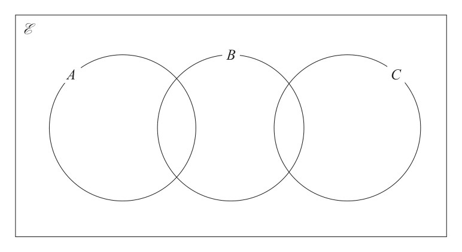

# 4MB1/01 — 2025-10 (official extraction)

> schema `syllabai.official-paper-questions/0.2` · paper_id `pearson-edexcel:international-gcse:mathematics-b:4mb1:2025-10:4MB1/01` · qp sha256 `6dca2d51a15ae2a5…` · extraction is the disclosed baseline (ADR-039)

## Question 1 (2 marks)

The nth term of a sequence is given by 5n2 – 2n Find the difference between the 3rd term and the 4th term of this sequence.

### 1 [2]

The nth term of a sequence is given by 5n2 – 2n Find the difference between the 3rd term and the 4th term of this sequence.

**Mark scheme answer**

> 5 × 42 − 2 × 4 [ = 72] or 5 × 32 − 2 × 3 [ = 39] 2 M1 A correct method to find the 3rd term or the 4th term
> This may be embedded within the difference (condone
> missing brackets around the terms), which could be the
> other way round eg 39 – 72
> May be implied by 72 or 39
> 33 or – 33 A1
> cas Total 2 marks
> Question Working Answer Mark Notes

- **(2)** 5 × 42 − 2 × 4 [ = 72] or 5 × 32 − 2 × 3 [ = 39] 2 M1 A correct method to find the 3rd term or the 4th term

## Question 2 (2 marks)

Make h the subject of k

### 2 [2]

Make h the subject of k

**Mark scheme answer**

> 8h 5 j 2k − 5 j 2 M1 for start by multiplying by 2 or separating the
> 2k = 8h + 5 j or k = + oe or
> 2 2 8 fraction or correct expression for h without h = …
> 2k − 5 j 5j
> h= k−
> 8 k 5j
> A1 oe eg h = − or h = 2 or h = 5 j − 2k
> 4 8 8 −8
> 2k − 5 j
> Allow the other way round eg =h
> Must see h = …
> Do not ISW except allow correct expression without
> h = ... on the answer line if given correctly with h = ...
> in the working
> cas Total 2 marks
> Question Working Answer Mark Notes

- **(2)** 8h 5 j 2k − 5 j 2 M1 for start by multiplying by 2 or separating the

## Question 3 (2 marks)

Without using a calculator and showing all your working, evaluate 5 2 1 ×2 6 5 Give your answer as a mixed number in its simplest form.

### 3 [2]

Without using a calculator and showing all your working, evaluate 5 2 1 ×2 6 5 Give your answer as a mixed number in its simplest form.

**Mark scheme answer**

> 11 12 2 M1 at least one correct improper fraction
> × oe or Or at least three correct terms from a method to expand
> 6 5
> ⎛ 5 ⎞⎛ 2⎞ 5 2 5 2
> 5 2 5 2 ⎜ 1 + ⎟ ⎜ 2 + ⎟ = 1× 2 + × 2 + 1× + ×
> 1× 2 + × 2 + 1× + × oe ⎝ 6 ⎠⎝ 5⎠ 6 5 6 5
> 6 5 6 5
> 132 ⎡ 12 ⎤ 2 A1 dep on M1
> = 4 = 4
> 30 ⎢⎣ 30 ⎥⎦ 5 We must see both working and the correct simplified mixed
> number.
> 66 ⎡ 6 ⎤ 2 Do not accept decimals but ISW a decimal number if a correct
> = 4 = 4
> 15 ⎢⎣ 15 ⎥⎦ 5 mixed number is seen.
> 22
> =4
> 5
> wr Total 2 marks
> Question Working Answer Mark Notes

- **(2)** 11 12 2 M1 at least one correct improper fraction

## Question 4 (2 marks)
### 4(a) [1]

Write down the order of rotational symmetry of a regular hexagon. A shape is made from a regular hexagon and a square. The vertices of the square lie on the sides of the hexagon.

**Mark scheme answer**

> 6 1 B1
> Allow written in words eg six
> cao

- **(1)** 6 1 B1

### 4(b) [1]

For this shape, write down the number of lines of symmetry.

**Mark scheme answer**

> 2 1 B1
> Allow written in words eg two
> cao
> cas Total 2 marks
> Question Working Answer Mark Notes

- **(1)** 2 1 B1

## Question 5 (2 marks)

Using ruler and compasses only and showing all your construction lines, construct the perpendicular bisector of AB A B

### 5 [2]

Using ruler and compasses only and showing all your construction lines, construct the perpendicular bisector of AB A B

**Mark scheme answer**

> Use the overlay when marking this question
> Accurate bisector 2 B2 for a line within the guidelines and 2 pairs of suitable
> intersecting arcs which intersect within the guidelines (if extended)
> (B1 for a line within the guidelines or 2 pairs of suitable
> intersecting arcs)
> NB The line can be any length - does not need to cross AB but must
> touch it and should remain within the guidelines if it were to be
> extended
> Total 2 marks
> Question Working Answer Mark Notes

- **(2)** Use the overlay when marking this question

## Question 6 (2 marks)

The bearing of point P from point Q is 304° Calculate the bearing of point Q from point P °

### 6 [2]

The bearing of point P from point Q is 304° Calculate the bearing of point Q from point P °

**Mark scheme answer**

> 304 – 180 or 2 M1 for a complete correct method to find the bearing e.g. 360 − (180 + ( 360 − 304 ) )
> 180 − ( 360 − 304 ) or
> 90 + ( 304 − 270 ) Do not ISW e.g. 304 − 180 = 124 and 180 − 124 = 56 scores M0
> 124 A1 cao
> May be seen in the diagram
> Total 2 marks
> Question Working Answer Mark Notes

- **(2)** 304 – 180 or 2 M1 for a complete correct method to find the bearing e.g. 360 − (180 + ( 360 − 304 ) )

## Question 7 (2 marks)

Find the value of when p = 2 and q = –5 2 p

### 7 [2]

Find the value of when p = 2 and q = –5 2 p

**Mark scheme answer**

> 2 × −5 − 3 × (−5) 2 2 M1 for correct substitution to evaluate the numerator
> 2× 2 +1 Allow −85 or −10 − 75 or 2(−5) − 3( −5) 2 or 2( −5) − 3(5) 2 or
> 2 × −5 − 3 × −52 or 2 × −5 − 3 × 25
> –17 A1 cao
> cas Total 2 marks
> Question Working Answer Mark Notes

- **(2)** 2 × −5 − 3 × (−5) 2 2 M1 for correct substitution to evaluate the numerator

## Question 8 (2 marks)

Given that y = x3 + 2x2 – 15x + 7 dy find dx dy = ....................................................... dx

### 8 [2]

Given that y = x3 + 2x2 – 15x + 7 dy find dx dy = dx

**Mark scheme answer**

> 2 M1 Attempt at differentiation such that x n → x n−1 for at least one
> non-zero term
> Accept unsimplified power and unsimplified coefficients eg
> 2 × 2x 2−1 or 15x1−1
> 3x 2 + 4 x − 15 A1 oe eg 3x 2 + 4 x1 − 15 x0
> Do not ISW
> cas Total 2 marks
> Question Working Answer Mark Notes

- **(2)** 2 M1 Attempt at differentiation such that x n → x n−1 for at least one

## Question 9 (3 marks)

Here are eight numbers. 15 30 18 12 23 19 16 23

### 9(a) [1]

Write down the mode.

**Mark scheme answer**

> 23 1 B1 cao

- **(1)** 23 1 B1 cao

### 9(b) [2]

Find the median.

**Mark scheme answer**

> 12, 15, 16, 18, 19, 23, 23, 30 2 M1 for ordered list. Allow the first 5 terms or last 5 terms correct or
> a list with only one error (either one value omitted, one value added
> or one value either incorrect or incorrectly placed). Ordered list
> may be seen within an (incorrect) attempt to sum the terms.
> Allow the ordered list to be seen anywhere in the question.
> 18.5 37
> A1 oe eg or 18
> 2
> Do not ISW
> cao
> cas Total 3 marks
> Question Working Answer Mark Notes

- **(2)** 12, 15, 16, 18, 19, 23, 23, 30 2 M1 for ordered list. Allow the first 5 terms or last 5 terms correct or

## Question 10 (3 marks)

The probability that Charlie arrives late to school is 0.35

### 10(a) [1]

Write down the probability that Charlie does not arrive late to school. Charlie attends school 20 times during January.

**Mark scheme answer**

> 0.65 1 13 65 0.65
> B1 oe eg or or or 65%
> 20 100

- **(1)** 0.65 1 13 65 0.65

### 10(b) [2]

Calculate the expected number of times that Charlie arrives late to school during January.

**Mark scheme answer**

> 0.35 × 20 2 M1 for p × 20 where 0 < p < 1
> Allow for
> 7 A1 cao
> Do not allow for A1
> cas Total 3 marks
> Question Working Answer Mark Notes

- **(2)** 0.35 × 20 2 M1 for p × 20 where 0 < p < 1

## Question 11 (3 marks)

A B 7m 4 Find 3A – B Give each element of the matrix in terms of m where appropriate.

### 11 [3]

A B 7m 4 Find 3A – B Give each element of the matrix in terms of m where appropriate.

**Mark scheme answer**

> ⎛ 0 6 − 2m ⎞ 3 B3 a fully correct matrix
> ⎜ ⎟
> ⎝ 21m − 5 18 ⎠
> (B2 for 3 correct entries in a matrix of correct order or a fully
> correct unsimplified matrix)
> (B1 for 1 or 2 correct entries in a matrix of correct order
> ⎛ −3 6 ⎞
> or for correct multiplication by a scalar eg 3A = ⎜ ⎟ )
> ⎝ 21m 12 ⎠
> NB: If correct matrix is seen but followed by incorrect subsequent
> algebra then award a maximum of B2
> ⎛ 0 6 − 2m ⎞ ⎛ 0 4m ⎞
> eg ⎜ ⎟ followed by ⎜ ⎟ scores B2
> ⎝ 21m − 5 18 ⎠ ⎝16m 18 ⎠
> maximum
> cas Total 3 marks
> Question Working Answer Mark Notes

- **(3)** ⎛ 0 6 − 2m ⎞ 3 B3 a fully correct matrix

## Question 12 (3 marks)

A straight line L passes through the points with coordinates (4, 3) and (6, –8) Find an equation of L in the form y = mx + c

### 12 [3]

A straight line L passes through the points with coordinates (4, 3) and (6, –8) Find an equation of L in the form y = mx + c

**Mark scheme answer**

> −8 − 3 3 difference in y
> [ = −5.5] oe M1 correct method to find the gradient using or
> 6−4 difference in x
> 3 − −8 setting up simultaneous equations and finding m
> [ = −5.5]
> 4−6
> May be implied by − oe
> or
> 3 = 4m + c and –8 = 6m + c May be implied by an equation with the correct gradient.
> −8 − 3
> leading to [ m =] [ = −5.5]
> 3 = "− 5.5"× 4 + c or M1 for a correct equation using one of the given points and their
> −8 = "− 5.5"× 6 + c or gradient to find the intercept, (commonly c but can be any letter)
> y − 3 = "− 5.5" ( x − 4 ) oe or Their gradient must be clearly identified if incorrect or has come
> from correct working.
> y − ( −8) = "− 5.5" ( x − 6 ) oe
> y = −5.5 x + 25
> A1 Allow any equivalent fraction for –5.5 eg y = − x + 25
> Must see y = … Do not ISW except allow correct expression
> without y = ... on the answer line if given correctly with y = ... in
> the working
> Equivalent form implies M2 eg y − 25 = −5.5 x or 2 y = −11x + 50
> cas Total 3 marks
> Question Working Answer Mark Notes

- **(3)** −8 − 3 3 difference in y

## Question 13 (3 marks)

Diagram NOT accurately drawn O 124 P R Q P, Q and R are three points on a circle, centre O ∠POR = 124° Calculate the size, in degrees, of ∠PQR Give reasons for each stage of your working. ∠PQR = . . . . . . . . . . . . . . . . . . . . . . . . . . . . . . . . . . . . . . . . . . . . . . . . . . . . . . . °

### 13 [3]

Diagram NOT accurately drawn O 124 P R Q P, Q and R are three points on a circle, centre O ∠POR = 124° Calculate the size, in degrees, of ∠PQR Give reasons for each stage of your working. ∠PQR = °

> 🖼 crop required: diagram (qp.pdf p.None)

**Mark scheme answer**

> Major angle at POR = 360 − 124 [ = 236] 3 M1 for method to find major angle at POR or
> angle PXR (where X is a point on the circle. May be
> or
> seen on the diagram or X must be specified)
> ∠PXR = 124 ÷ 2 [ = 62] (where X is a point
> on the circle) Do not accept ∠PQR = 124 ÷ 2 = 62
> Award for correct angles marked on the diagram
> Angle PQR = “236” ÷ 2 118 A1 cao
> or
> Angle PQR = 180 – 62 Do not award if angle comes from incorrect working
> eg ∠PQR = 124 ÷ 2 = 62
> Angle at the centre is 2 × (double) angle at B1 (dep on M1)
> circumference The reason must include at least the underlined
> words or an unambiguous abbreviation
> angle at circumference is ½ angle at centre
> Eg Accept ∠ for angle, twice for double.
> Total 3 marks
> Question Working Answer Mark Notes

- **(3)** Major angle at POR = 360 − 124 [ = 236] 3 M1 for method to find major angle at POR or

## Question 14 (3 marks)

A N B Diagram NOT accurately drawn M D C The diagram shows a square ABCD M is the midpoint of AD N is the midpoint of AB Prove that △DAN is congruent to △CDM

### 14 [3]

A N B Diagram NOT accurately drawn M D C The diagram shows a square ABCD M is the midpoint of AD N is the midpoint of AB Prove that △DAN is congruent to △CDM

> 🖼 crop required: diagram (qp.pdf p.None)

**Mark scheme answer**

> 1. AD=DC square 3 M2 two correct statements with reasons
> 2. AN = DM midpoints of AB (M1 one correct statement with reason or all 3 stated with no
> reasons)
> and AD
> Allow ∠DAB for ∠DAN or ∠CDA for ∠CDM or ∠A or ∠D
> 3. ∠DAN = ∠CDM = 90
> Allow right angle for 90°
> 5
> ND = AD = DC = MC If statements 1 & 2 are given then “ ND = MC due to Pythagoras ”
> 4. 2
> is a sufficient alternative to statement 4
> SAS A1 SAS or RHS or SSS stated with all 3 correct, including
> appropriate reasons
> For SAS must have reasons 1 2 3
> For RHS must have reasons 1 3 4 or reasons 2 3 4
> For SSS must have 1 2 4
> wr Total 3 marks
> Question Working Answer Mark Notes

- **(3)** 1. AD=DC square 3 M2 two correct statements with reasons

## Question 15 (3 marks)

Without using a calculator and showing all your working, express 11 2 3 2 in the form a + b 2 where a and b are integers.

### 15 [3]

Without using a calculator and showing all your working, express 11 2 3 2 in the form a + b 2 where a and b are integers.

**Mark scheme answer**

> 11 + 2 ⎛ 11 + 2 ⎞⎛ 3 2 + 1 ⎞ 3 M1 for multiplying numerator and denominator by 3 2 + 1 or
> =⎜ ⎟⎜ ⎟⎟
> 3 2 − 1 ⎜⎝ 3 2 − 1 ⎟⎜
> ⎠⎝ 3 2 + 1 ⎠
> −3 2 − 1 oe eg 18 + 1
> 33 2 + 11 + 6 + 2 33 2 + 11 + 6 + 2 M1 (dep) for expanding numerator (2, 3 or 4 terms) and
> or denominator (1, 2 or 4 terms) – condone one error only when
> (3 2) − 1
> 2
> 18 − 1
> multiplying out both numerator and denominator
> 34 2 + 17 33 2 + 11 + 3 2 2 + 2 33 2 + 11 + 3 4 + 2
> or eg or
> 17 3× 3 2 2 + 3 2 − 3 2 −1
> 9 4 −1
> 1+ 2 2 A1 final answer (dependent on both M marks)
> Accept 2 2 + 1
> wr Total 3 marks
> 11 + 2
> No marks for = 1+ 2 2
> 3 2 −1
> M1 only for
> ⎛ 11 + 2 ⎞ ⎛ 3 2 + 1 ⎞
> ⎜⎜ ⎟⎟ ⎜⎜ ⎟⎟ = 1 + 2 2
> ⎝ 3 2 −1 ⎠ ⎝ 3 2 +1 ⎠
> Question Working Answer Mark Notes

- **(3)** 11 + 2 ⎛ 11 + 2 ⎞⎛ 3 2 + 1 ⎞ 3 M1 for multiplying numerator and denominator by 3 2 + 1 or

## Question 16 (3 marks)

Write 3x2 + 24x + 1 in the form a(x + b)2 + c where a, b and c are integers.

### 16 [3]

Write 3x2 + 24x + 1 in the form a(x + b)2 + c where a, b and c are integers.

**Mark scheme answer**

> ⎛ 2 1⎞ 3 M1 Allow for a = 3 or b = 4 or c = −47 Allow
> 3 ( x 2 + 8 x ) + 1 or 3 ⎜ x + 8 x + ⎟ oe
> these seen in an expression of the form a ( x + b ) + c
> ⎝ 3⎠
> This may be implied by the second M1
> (3( x + 4) − 48) + 1 or
> 2 M1 Allow for any two of a = 3 or b = 4 or c = −47
> Allow these seen in an expression of the form
> ⎛ 1⎞ a ( x + b) + c
> 3 ⎜ ( x + 4 ) − 16 + ⎟ oe
> ⎝ 3⎠
> 3 ( x + 4 ) − 47
> A1 accept a = 3 , b = 4 , c = −47
> Alternative mark scheme
> ax2 + 2abx + ab2 + c M1 for multiplying out a(x + b)2 + c to obtain
> ax2 + 2abx + ab2 + c oe
> 2 of: M1 for equating coefficients and making 2 correct
> statements
> a=3 2ab = 24 oe ab2 + c = 1 oe
> 3 ( x + 4 ) − 47
> A1 accept a = 3 , b = 4 , c = −47
> cas Total 3 marks
> Question Working Answer Mark Notes

- **(3)** ⎛ 2 1⎞ 3 M1 Allow for a = 3 or b = 4 or c = −47 Allow

## Question 17 (4 marks)
### 17(a) [2]

Expand and simplify 3c(2 – 5c) – 2c(5c + 1)

**Mark scheme answer**

> 6c − 15c 2 − 10c 2 − 2c 2 M1 for 3 terms correct
> −25c 2 + 4c A1 do not ISW
> Allow c ( 4 − 25c ) or 4c − 25c 2 or −c ( 25c − 4 ) or c ( −25c + 4 )

- **(2)** 6c − 15c 2 − 10c 2 − 2c 2 M1 for 3 terms correct

### 17(b) [2]

Factorise fully 2de5 – 9de2

**Mark scheme answer**

> de 2 (2e3 − 9) 2 B2 for de 2 (2e3 − 9)
> Do not ISW
> Condone a missing RH bracket
> (B1 for correct partial factorisation d (2e5 − 9e2 ) or e 2 (2de3 − 9d )
> or de(2e4 − 9e)
> Allow m × de2 (... ± ...) where m is a constant
> ISW for B1)
> cas Total 4 marks
> Question Working Answer Mark Notes

- **(2)** de 2 (2e3 − 9) 2 B2 for de 2 (2e3 − 9)

## Question 18 (4 marks)

C x cm D Diagram NOT accurately drawn A 6 cm B E 6 cm F 14 cm 10 cm 10 cm H 5x cm G The diagram shows a shape ABCDEFGH HG = 5x cm CD = x cm AH = FG = 10 cm AB = EF = 6 cm ∠BAH = ∠AHG = ∠HGF = ∠GFE = 90° CD is parallel to HG The perpendicular height of the shape is 14 cm The area of the shape ABCDEFGH is 534 cm2 Find the value of x x = . . . . . . . . . . . . . . . . . . . . . .. . . . . . . . . . . . . . . . . . . . . . . . . . . . . . . . .

### 18 [4]

C x cm D Diagram NOT accurately drawn A 6 cm B E 6 cm F 14 cm 10 cm 10 cm H 5x cm G The diagram shows a shape ABCDEFGH HG = 5x cm CD = x cm AH = FG = 10 cm AB = EF = 6 cm ∠BAH = ∠AHG = ∠HGF = ∠GFE = 90° CD is parallel to HG The perpendicular height of the shape is 14 cm The area of the shape ABCDEFGH is 534 cm2 Find the value of x x =

> 🖼 crop required: diagram (qp.pdf p.None)

**Mark scheme answer**

> 10 × 5 x [ = 50 x ] oe 4 M1 for correct method to find the area of the rectangle AFHG (may
> or be seen as part of a calculation), may not be simplified eg
> 14 × 5 x [ = 70 x ] oe 60 + 10 ( 5 x − 12 ) + 60
> or or the area of the extended rectangle
> or the area of the central rectangle
> 10 × ( 5 x − 12 ) [ = 50 x − 120] oe
> x + ( 5 x − 12 ) M1 a correct method for the area of the trapezium BCDE or ABCX
> × 4 [ = 12 x − 24] oe or BCYZ (see diagram) with numbers and expressions substituted
> or
> 6 + 2x
> × 4 [ = 12 + 4 x ] oe
> or
> 10 + 14
> × ( 2 x − 6 ) [ = 24 x − 72] oe
> 12 x − 24 + 50 x = 534 M1 for a correct equation
> or does not need to be simplified eg
> 70 x − ( 24 + 8 x ) = 534
> 60 + 10 ( 5 x − 12 ) + 60 + ( x + 5 x − 12 ) × 4 = 534
> or
> 60 + 2(24 x − 72) + 14 x + 60 = 534 6 + 2x
> or 70 x − 2 ⎛⎜ ⎞
> × 4 ⎟ = 534
> ⎝ 2 ⎠
> 9 A1
> cas Total 4 marks
> Question Working Answer Mark Notes

- **(4)** 10 × 5 x [ = 50 x ] oe 4 M1 for correct method to find the area of the rectangle AFHG (may

## Question 19 (4 marks)

Find the two values of x such that 2 81x 2 x 4x 6 8x Show clear algebraic working. x = . . . . . . . . . . . . . . . . . . . . . .. . . . . . . . . . . . . . . . . . . . . . . . . . . . . . . . .

### 19 [4]

Find the two values of x such that 2 81x 2 x 4x 6 8x Show clear algebraic working. x =

**Mark scheme answer**

> For 2 of: For 2 of: 4 M1 for writing at least 2 of the terms
> with the bases of 2 and/or 3. This can be
> 81x = (3)4x oe (81x)2 = (3)8x oe done in two ways. The first working
> column shows the terms as they are
> 64x = (2 × 3)4x oe (64x)2 = (2 × 3)8x oe given. The second column squares the
> equation to remove the square root
> 1 1 before manipulating the terms.
> = 2–1.5x oe x
> = 2– 3x oe
> 8x
> 21 × 34 x × 2 x 22 × 38 x × 2 2 x
> M1 dep on previous M mark
> = 2−1.5 x = 2−3 x for correct equation in which all bases
> 2 ×3
> 4x 4x
> 2 ×3
> 8x 8x
> are 2 or 3
> allow the denominator to be seen as
> ( 2 × 3)
> 4x
> this can be implied by
> 21 × 34 x × 2x × 2−4 x × 3−4 x = 2−1.5 x or
> 21+ x −4 x × 34 x −4 x = 2−1.5 x or
> x ² − 4 x + 1 = −1.5 x or 2 x 2 − 8 x + 2 = −3x
> x ² − 4 x + 1 = −1.5 x 2 x 2 − 8 x + 2 = −3x M1 dep on previous M mark
> A correct quadratic equation oe
> Implied by x ² − 2.5 x + 1 = 0
> 1 A1 oe
> and 2 both values must be seen
> wr Total 4 marks
> Question Working Answer Mark Notes

- **(4)** For 2 of: For 2 of: 4 M1 for writing at least 2 of the terms

## Question 20 (5 marks)

Emma asks 420 students to choose one type of movie from Horror, Adventure and Comedy. 5% of the students choose Horror. of the students choose Adventure. The remaining students choose Comedy. The students who choose Comedy are put into either group A or group B For the students who choose Comedy number in group A : number in group B = 1 : 6 Calculate the number of students who choose Comedy and are in group B Show all your working.

### 20 [5]

Emma asks 420 students to choose one type of movie from Horror, Adventure and Comedy. 5% of the students choose Horror. of the students choose Adventure. The remaining students choose Comedy. The students who choose Comedy are put into either group A or group B For the students who choose Comedy number in group A : number in group B = 1 : 6 Calculate the number of students who choose Comedy and are in group B Show all your working.

**Mark scheme answer**

> 5 3 5
> × 420 [ = 21] or × 420 [ = 252] M1 for finding 5% of 420 or of 420
> 100 5
> or or
> 1 3 ⎡ 13 ⎤
> eg + = or 0.05 + 0.6 [=0.65] or 5% for combining 5% and
> + 60% [=65%]
> 420 – “21” – “252” [=147] or M1 for finding the number of students who prefer comedy
> ⎛ 13 ⎞ ft their 21 and their 252
> ⎜1 − " " ⎟ × 420 [=147]
> ⎝ 20 ⎠
> "147" M2 for a complete method to use the ratio to find the number
> × 6 [ = 126] in group B
> 1+ 6
> ft their total number for comedy which comes from a correct
> method
> (M1 for dividing into the ratio eg "147" [ = 21] )
> 1+ 6
> 126 A1 cao
> Accept if seen in a ratio as 21:126
> Do not accept 126 : 21 unless 126 is clearly labelled as B
> cas Total 5 marks
> Question Working Answer Mark Notes

- **(5)** 5 3 5

## Question 21 (5 marks)

The table shows information about the number of points scored by people in a game. Number of points Frequency 12 27 14 59 16 x 18 40 20 15 Given that the mean number of points scored is 15.6 seconds

### 21(a) [4]

calculate the value of x Show all your working. x = One of the people is chosen at random.

**Mark scheme answer**

> (12 × 27) + (14 × 59) + (16 × x) + (18 × 40) + (20 × 15) 4 M1 for at least 3 correct products (need not be
> or 324 + 826 + 16 x + 720 + 300 [ = 2170 + 16 x ] evaluated but must be added)
> " 2170 + 16 x " M1 dep on previous M1 awarded
> = 15.6
> "141 + x "
> ft with their sum of products
> Allow division by their total frequency (“141+x”)
> provided addition or total under column seen
> " 2170 + 16 x " = 15.6 ("141 + x ") M1 for method to remove the fraction
> ft with their sum of products and total frequency as
> long as both include an x
> May be implied by 2170 + 16 x = 2199.6 + 15.6 x or
> 0.4 x = 29.6
> 74 A1

- **(4)** (12 × 27) + (14 × 59) + (16 × x) + (18 × 40) + (20 × 15) 4 M1 for at least 3 correct products (need not be

### 21(b) [1]

Calculate the probability that this person scored more than 16 points.

**Mark scheme answer**

> 40 + 15 55 1
> B1oe eg , 0.2558…
> 141 + "74" 215
> ft their x
> Allow 2 decimal places or better
> cas Total 5 marks
> Question Working Answer Mark Notes

- **(1)** 40 + 15 55 1

## Question 22 (7 marks)

E = {3, 4, 5, 6, 7, 8, 9, 10, 11, 12} A = {multiples of 4} B = {factors of 12} C = {prime numbers}

### 22(a) [3]

Complete the Venn diagram for this information showing the position of each of the numbers in the universal set. E B A C

**Mark scheme answer**

> 3 B3 All 6 regions correct
> A B C (B2 for 4 or 5 correct regions
> 4 5 B1 for 3 correct regions)
> 8
> 12 6
> 9 10

- **(3)** 3 B3 All 6 regions correct

### 22(b) [1]

Find n(A′∩ B′ ∩ C′)

**Mark scheme answer**

> 2 1 B1 ft as long as the highlighted region is not empty

- **(1)** 2 1 B1 ft as long as the highlighted region is not empty

### 22(c) [1]

Find n(A ∪ B′) A number is chosen at random from the universal set, E

**Mark scheme answer**

> 8 1 B1 ft their Venn diagram

- **(1)** 8 1 B1 ft their Venn diagram

### 22(d) [2]

Find the probability that this number is in the set A ∪ C

**Mark scheme answer**

> 2 7 m
> M1 for either where n > 7 or where 0 °°m 10
> n
> or follow through 7 or 10 from their Venn diagram
> 7 A1 oe eg 0.7 or 70%
> cas Total 7 marks
> Question Working Answer Mark Notes

- **(2)** 2 7 m

## Question 23 (5 marks)

Diagram NOT accurately drawn B A C 24 cm The diagram shows a semicircle with diameter 24 cm The diagram also shows three congruent circles A, B and C inside the semicircle. All three circles touch the circumference of the semicircle and circle B touches both circle A and circle C The diameter of the semicircle is a tangent to circle A and circle C The radius of each of the circles is r cm

### 23(a) [1]

Show that r = 4

**Mark scheme answer**

> r 12 = 3r 1 B1 for a correct relationship for r
> sin 30 = or 12 − r = 2r or 12 = 3r or 24 = 6r
> 12 − r [⇒ r = 4] Allow correct trig statement or
> 12 − r = 2r or 12 = 3r or 24 = 6r
> Question Working Answer Mark Notes

- **(1)** r 12 = 3r 1 B1 for a correct relationship for r

### 23(b) [4]

Calculate the total area, in cm2 to 3 significant figures, of the shaded region cm2

**Mark scheme answer**

> Triangle and rectangle 82 − 4 2 × 4 + 2 8 2 − 4 2 × 4 4 M2 for area of the irregular pentagon or a
> or combination of rectangles
> ⎡ = 12 48 = 48 3 = 83.13...⎤
> ⎣ ⎦
> 1 This may be implied by
> 4 × 82 + 82 − 2 × 8 × 8cos (120 ) + × 4 × 82 + 82 − 2 × 8 × 8cos (120 )
> 2 12 48 = 48 3 = 83.138...
> ⎡ = 12 48 = 48 3 = 83.13...⎤
> ⎣ ⎦
> 6 right-angled ⎛1 ⎞ Allow use of r instead of 4
> 6 × ⎜ × 4 × 8sin ( 60 ) ⎟ ⎡⎣ = 12 48 = 48 3 = 83.13...⎤⎦
> triangles ⎝2 ⎠
> or (Award M1 for
> ⎛1 ⎞ the area of a right-angled triangle
> 6 × ⎜ × 4 × 82 − 42 ⎟ ⎡⎣ = 12 48 = 48 3 = 83.13...⎤⎦
> ⎝ 2 ⎠ × 4 × 8sin ( 60 ) ⎡⎣ = 8 3 = 13.85...⎤⎦
> oe
> 3 equilateral triangles ⎛1 ⎞ or
> 3 × ⎜ × 8 × 8sin ( 60 ) ⎟ ⎡⎣ = 12 48 = 48 3 = 83.13...⎤⎦
> ⎝2 ⎠ area of equilateral triangle
> 1 2
> or × 8 × sin ( 60 ) ⎡⎣ = 16 3 = 27.71...⎤⎦
> ⎛1 ⎞
> 3 × ⎜ × 8 × 82 − 42 ⎟ ⎡⎣ = 12 48 = 48 3 = 83.13...⎤⎦
> ⎝2 ⎠ or
> oe correct use of Pythagoras to find the length
> 2 equilateral triangles ⎛1 ⎞ ⎛1 ⎞ of half the base of the pentagon
> 2 × ⎜ × 8 × 8sin ( 60 ) ⎟ + 2 × ⎜ × 4 × 8sin ( 60 ) ⎟
> and 2 right-angled
> ⎝2 ⎠ ⎝2 ⎠ (2 × 4) 2 − 42 ⎡⎣ = 48 = 4 3 = 6.92...⎤⎦ .
> triangles
> ⎡ = 12 48 = 48 3 = 83.13...⎤ or
> ⎣ ⎦ cosine rule to find the length of the base
> or
> 82 + 82 − 2 × 8 × 8cos (120 ) ⎡⎣= 8 3 = 13.85...⎤⎦ )
> ⎛1 ⎞ ⎛1 ⎞
> 2 × ⎜ × 8 × 82 − 4 2 ⎟ + 2 × ⎜ × 4 × 8 2 − 4 2 ⎟
> ⎝2 ⎠ ⎝2 ⎠
> ⎡ = 12 48 = 48 3 = 83.13...⎤
> ⎣ ⎦
> 2 trapeziums ⎛1 ⎞
> 2 × ⎜ ( 4 + 8 ) 82 − 4 2 ⎟
> ⎝2 ⎠
> ⎡ = 12 48 = 48 3 = 83.13...⎤
> ⎣ ⎦
> Combination of 4 × 2 × 82 − 4 2 + 4 × 8 2 − 4 2
> rectangles
> ⎡ = 12 48 = 48 3 = 83.13...⎤
> ⎣ ⎦
> 120 2 ⎡ 16 ⎤ M1 for sector areas that need to be
> 3× × 4 × π ⎢ = 3 × π = 3 ×16.75...⎥ or subtracted from the pentagon or
> 360 ⎣ 3 ⎦
> combination of rectangles
> 60 ⎡ 8 ⎤
> 6× × 42 × π ⎢ = 6 × π = 6 × 8.37...⎥ or
> 360 ⎣ 3 ⎦ Allow a sector of angle θ where θ is 30, 45,
> 60 120 2 ⎡ 8 16 ⎤ 60, 90, 120, 180 or 360.
> 2× × 42 × π + 2 × × 4 × π ⎢ = 2 × π + 2 × π = 16.75... + 33.51...⎥
> 360 360 ⎣ 3 3 ⎦ ⎡ θ ⎤ 2 ⎡ θ ⎤ ⎡ θ ⎤
> eg ⎢ ×⎥ 4 π = ⎢ ×⎥ 16π = ⎢ × × 50.26...
> 90 30 120 2 ⎣ 360 ⎦ ⎣ 360 ⎦ ⎣ 360 ⎥⎦
> 2× × 42 × π + 2 × × 42 × π + × 4 ×π
> 360 360 360
> ⎡ 4 16 ⎤
> ⎢⎣ = 2 × 4π + 2 × 3 π + 3 π = 2 × 12.56... + 2 × 4.18... + 16.75...⎥⎦
> 90
> 2× × 42 × π + 2 × × 42 × π
> 360 360
> [ = 2 × 4π + 2 × 4π = 2 ×12.56... + 2 ×12.56...]
> 32.9 A1 awrt 32.9
> Note that Area of the semi-circle − n × area of the small circle [ = 72π − n × 16π ] where n = 1, 2 or 3 is not a correct method and is
> awarded M0M0M0A0
> If 16π is seen it must be referring to the area that is being subtracted from the pentagon (or combination of rectangles)

- **(4)** Triangle and rectangle 82 − 4 2 × 4 + 2 8 2 − 4 2 × 4 4 M2 for area of the irregular pentagon or a

## Question 24 (5 marks)

Express 2 2 as a single fraction in its simplest form. x 3x 2 x 1 2 x x 1 Show clear algebraic working.

### 24 [5]

Express 2 2 as a single fraction in its simplest form. x 3x 2 x 1 2 x x 1 Show clear algebraic working.

**Mark scheme answer**

> ⎡⎣ 2 x 2 − x − 1 = ⎤⎦ ( 2 x + 1)( x − 1) 5 M2 Attempt to factorise all three quadratics. Must
> multiply to give 2 correct terms
> ⎡⎣ 4 − x 2 = ⎤⎦ ( 2 + x )( 2 − x )
> (2 + x)(2 − x) ⎛ 1 x+2 ⎞
> eg ÷⎜ − ⎟
> ⎡⎣ x 2 − 3x + 2 = ⎤⎦ ( x − 2 )( x − 1) ( x − 2)( x − 1) ⎝ x − 1 (2 x + 1)( x − 1) ⎠
> For the attempted expansion of ( 4 − x 2 ) allow
> ( x + 2 )( x − 2 )
> (If not M2 then M1 for attempt to factorise 1 or 2
> quadratics. Must multiply to give 2 correct terms
> 4 − x2 ⎛ 1 x+2 ⎞
> eg ÷⎜ − 2 ⎟ or
> ( x − 2)( x − 1) ⎝ x − 1 2 x − x − 1 ⎠
> 4 − x2 ⎛ 1 x+2 ⎞
> ÷⎜ − ⎟ or
> x − 3x + 2 ⎝ x − 1 (2 x + 1)( x − 1) ⎠
> (2 + x)(2 − x) ⎛ 1 x+2 ⎞
> ÷⎜ − 2 ⎟ )
> x − 3x + 2 ⎝ x − 1 2 x − x − 1 ⎠
> 2x + 1 − ( x + 2) M1 Correct method used to subtract fractions by
> ( x − 1)( 2 x + 1) finding a common denominator.
> Must be done before the division.
> x −1
> or
> ( x − 1)( 2 x + 1) May be done before factorising the quadratics (and
> 1 candidate may have expanded the brackets).
> or
> 2x +1 Eg
> 2 x2 − x −1
> −
> ( x + 2 )( x − 1) or
> ( 2 x + 1)( x – 1) – ( x + 2 )( x – 1) ( x − 1) ( 2 x 2 − x − 1) ( 2 x 2 − x − 1) ( x − 1)
> or
> ( x – 1)( 2 x + 1)( x – 1) 2 x2 − x −1 x2 + x − 2
> − or
> 2 x3 − 3x 2 + 1 2 x3 − 3x 2 + 1
> 2 x2 − x −1 x2 + x − 2
> −
> ( x − 1) ( 2 x 2 − x − 1) ( x − 1) ( 2 x 2 − x − 1)
> ( 2 + x )( 2 − x ) × ( x − 1)( 2 x + 1) M1 for division by multiplying the first fraction by the
> ( x − 2 )( x − 1) ( x − 1) reciprocal of the second.
> May be done before factorising the quadratics (and
> candidate may have expanded the brackets).
> Must be done after the subtraction.
> 4 − x2 x2 − 2x − 3
> Accept 2 × 3
> x − 3x + 2 2 x − 3x 2 + 1
> ( x + 2 )( 2 x + 1) A1oe eg −
> 2 x2 + 5x + 2
> dep on all 4 method marks
> 1− x x −1
> wr Total 5 marks
> Question Working Answer Mark Notes

- **(5)** ⎡⎣ 2 x 2 − x − 1 = ⎤⎦ ( 2 x + 1)( x − 1) 5 M2 Attempt to factorise all three quadratics. Must

## Question 25 (6 marks)

Diagram NOT accurately drawn 5 cm The diagram shows a solid shape made by fixing the flat circular face of a solid hemisphere, with radius 5 cm, to a solid right circular cone with base radius 5 cm The centre of the circular face of the hemisphere coincides with the centre of the base of the cone. 550 The total volume of the solid is π cm3 Find the total surface area, in cm2 to 3 significant figures, of the solid. Show all your working. ....................................................... cm2

### 25 [6]

Diagram NOT accurately drawn 5 cm The diagram shows a solid shape made by fixing the flat circular face of a solid hemisphere, with radius 5 cm, to a solid right circular cone with base radius 5 cm The centre of the circular face of the hemisphere coincides with the centre of the base of the cone. 550 The total volume of the solid is π cm3 Find the total surface area, in cm2 to 3 significant figures, of the solid. Show all your working cm2

> 🖼 crop required: diagram (qp.pdf p.None)

**Mark scheme answer**

> [Volume of hemisphere is] 6 B1 may be seen in an equation
> 2 3 ⎡ 250 ⎤
> π ( 5) ⎢= π = 261.79...⎥
> 3 ⎣ 3 ⎦
> [Volume of cone is] B1 may be seen in an equation
> 1 ⎡ 25 ⎤
> π ( 5 ) h = ⎢ π h = 26.179...h ⎥
> 3 ⎣ 3 ⎦
> 250 25 550 M1 for setting up an equation for the total volume of the shape
> π + π ×h = π oe (dep on the sum of 2 volumes and at least B1 previously
> 3 3
> awarded)
> ft their volumes with at least one correct
> May be implied by h = 12
> M1 for finding the slant height of the cone
> l = 52 + ("12") [ = 13]
> ft their value of h if from correct working or clearly labelled
> May be implied by l = 13
> [surface area of the hemisphere & cone is] M1 for the surface area of the hemisphere and cone
> 2π 52 + π × 5 × "13" ft their value of l if from correct working or clearly labelled
> 361 A1 awrt 361 allow 115π
> cas Total 6 marks
> Question Working Answer Mark Notes

- **(6)** [Volume of hemisphere is] 6 B1 may be seen in an equation

## Question 26 (8 marks)

D Diagram NOT accurately drawn B A P O C The diagram shows a quadrilateral OABC → → → OA = 2a OC = 3b AB = a + 2b The point P is on the line CB such that CP : PB = 4 : 1 The point D is such that ABD and OPD are straight lines. →

### 26(a) [1]

Find AC in terms of a and b → AC = →

**Mark scheme answer**

> 3b − 2a 1 B1 oe

- **(1)** 3b − 2a 1 B1 oe

### 26(b) [2]

Find OP in terms of a and b Give your answer in its simplest form. → OP =

**Mark scheme answer**

> 4 2 M1 use of correct ratio on their BC
> 3b +
> ( − "( −2a + 3b ) "+ a + 2b ) oe or ft their AC
> 1 4
> 2a + a + 2b + ( −a − 2b + "− 2a + 3b ") oe May be seen as 3b + (−b + 3a) or 3a + 2b + (−3a + b)
> 5 5
> 12 11 A1 oe
> a+ b
> 5 5 cas
> °°°° °°°° °°°°

- **(2)** 4 2 M1 use of correct ratio on their BC

### 26(c) [5]

Using a vector method find the ratio OP : PD Show all your working.

**Mark scheme answer**

> ⎡ → ⎤ ⎛ 12 11 ⎞ 5 M1 finds OD or PD in terms of their OP must include
> ⎢ OD = ⎥ λ ⎜ " a + b " ⎟ or an unknown parameter.
> ⎣ ⎦ ⎝ 5 5 ⎠
> ⎡ → ⎤ ⎛ 12 11 ⎞ This may be seen as
> ⎢ PD = ⎥ ↦ ⎜ " a + b " ⎟ °°°°°°°°
> ⎣ ⎦ ⎝ 5 5 ⎠ OD = λ OP
> °°°°°°°°
> → 12 11 ⎛ 12 11 ⎞ PD = ↦ OP
> OD = " a + b "+ ↦ ⎜ " a + b " ⎟ °°°°°°°°°°°°°°°°°°°°
> 5 5 ⎝ 5 5 ⎠ OD = OP + PD = OP + ↦ OP
> °°°°°°°°
> → → ⎛ 12 11 ⎞ PD = λ OD
> or PD = ⎜ " a + b "⎟ To award marks, the vectors must be in terms of a and b
> 1− → ⎝ 5 5 ⎠
> Alternative routes may be seen
> °°°° °°°° °°°°
> → M1 finds OD or PD in terms of a multiple of AB or a
> OD = 2a + μ (a + 2b) or °°°°
> multiple of BD must include an unknown parameter.
> →
> OD = 2a + ( a + 2b ) +β ( a + 2b ) or
> This may be seen as
> °°°°°°°°°°°°
> → 1 OD = OA + μ AB
> PD = ( 3a − b ) +β ( a + 2b ) or °°°°°°°°°°°°°°°°°°°°°°°°°°°°
> 5 OD = OA + AB + BD = OA + AB + β AB
> → 1 °°°°°°°°°°°°°°°°°°°°
> δ PD = PB + BD = PB + β AB
> PD = ( 3a − b ) + ( a + 2b )
> 5 1− δ To award marks, the vectors must be in terms of a and b
> Alternative routes may be seen
> 12 11 M1 dep both previous M marks, for correctly setting
> ‘ λ = 2 + μ and λ = 2μ ’ or expressions equal (to each other) and forming two
> 5
> 12 11 equations in their parameters.
> ‘ λ = 3 + β and λ = 2 + 2β ’ or Each equation must involve 2 parameters
> 5
> 12 12 11
> ‘ ↦ + = 2 + μ and ↦ + = 2μ ’ or
> 5 5 5
> 12 12 11
> ‘ ↦ + = 3 + β and ↦ + = 2 + 2β ’ or ‘
> 5 5 5
> 12 3 11
> ↦ = + β and ↦ = 2β − ’ or
> 5 5 5
> 12 → 3 11 →
> ‘ = + β and = − + 2β ’ or
> 5 (1 − → ) 5 5 (1 − → )
> 12 3 δ 11 1 2δ
> ‘ ↦= + and ↦ = − + ’ or
> 5 5 1− δ 5 5 1− δ
> 12→ 3 δ 11→ 1 2δ
> ‘ = + and =− + ’
> 5 (1 − → ) 5 1 − δ 5 (1 − → ) 5 1− δ
> 20 22 7 9 A1 for either parameter correct, is implied by a correct
> λ= or μ = or ↦ = or β = or
> 13 13 13 13 final ratio.
> 7 9 These will depend on the path chosen.
> →= or δ =
> 20
> 13 : 7 A1 oe
> cas Total 8 marks
> Question Working Answer Mark Notes

- **(5)** ⎡ → ⎤ ⎛ 12 11 ⎞ 5 M1 finds OD or PD in terms of their OP must include

## Question 27 (7 marks)

(2x – 1) is a factor of 6x3 + 17x2 + ax – 8 where a is a constant.

### 27(a) [2]

Use the factor theorem to show that a = 6

**Mark scheme answer**

> ⎛ 1⎞
> ⎛ 1⎞
> ⎛ 1⎞ 2
> 6 × ⎜ ± ⎟ + 17 × ⎜ ± ⎟ + 6 × ⎜ ± ⎟ − 8 = ... M1 substitution of x = ± and a = 6 into expression and attempt
> ⎝ 2⎠ ⎝ 2⎠ ⎝ 2⎠
> or to evaluate
> 3 2 or
> ⎛ 1⎞ ⎛ 1⎞ ⎛ 1⎞
> 6 × ⎜ ± ⎟ + 17 × ⎜ ± ⎟ + a × ⎜ ± ⎟ − 8 = 0
> ⎝ 2⎠ ⎝ 2⎠ ⎝ 2⎠ substitution of x = ± into expression and equating to 0 to form
> an equation in a
> For both methods allow with terms evaluated eg:
> 3 17 3 17 1
> ± + ± 3 − 8 = ... or ± + ± a − 8 = 0
> 4 4 4 4 2
> 3 17 20 A1 Showing expression with x = 1 and a = 6 leads to 0 and a
> + +3−8 = − 5 = 0 and shown
> 4 4
> conclusion (eg shown or #)
> a a or Solving correct equation to gain a = 6 with no errors seen
> or − 3 = 0 or = 3 and a = 6
> 2 2 (must see at least one line of working after the first line)

- **(2)** ⎛ 1⎞

### 27(b) [3]

Hence, factorise fully 6x3 + 17x2 + 6x – 8 Show all your working.

**Mark scheme answer**

> 3x 2 + 10 x + 8 3 M1 for two out of three terms correct in the quadratic factor.
> This may be seen in part (a)
> ⎣ (
> ⎡( 2 x − 1) ⎤ 3 x 2 + 10 x + 8
> ⎦ ) M1 fully correct quadratic factor
> This may be seen in part (a)
> ( x + 2 )( 2 x − 1)( 3x + 4 ) A1 fully correct factorisation dep on previous M1
> Condone =0 but do not ISW if gone on to solve
> NB: ( x + 2 ) ⎛⎜ x − 1 ⎞⎟ ⎛⎜ x + 4 ⎞⎟ scores A0
> ⎝ 2 ⎠⎝ 3⎠

- **(3)** 3x 2 + 10 x + 8 3 M1 for two out of three terms correct in the quadratic factor.

### 27(c) [2]

Hence, solve 6(3y + 1)3 + 17(3y + 1)2 + 6(3y + 1) – 8 = 0 Show all your working. y =

**Mark scheme answer**

> 1 4 2 M1 for recognising that x = 3y + 1 (can be implied by one
> 3y + 1 = –2 or 3 y + 1 = or 3 y + 1 = − correct value for y) ft values from their factorisation
> 2
> 1 7
> −1, − , − A1 all three values, with no extras dep on M1
> 6 9
> Total 7 marks

- **(2)** 1 4 2 M1 for recognising that x = 3y + 1 (can be implied by one

