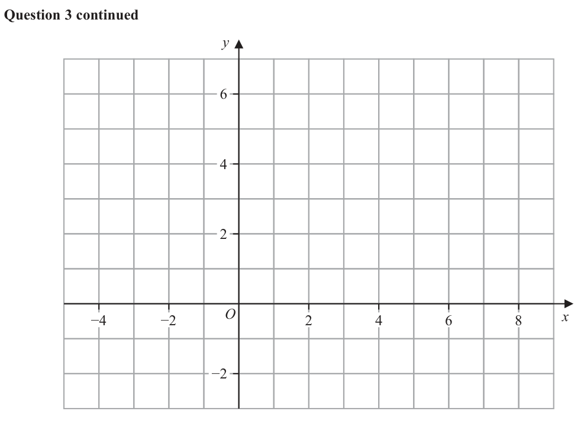
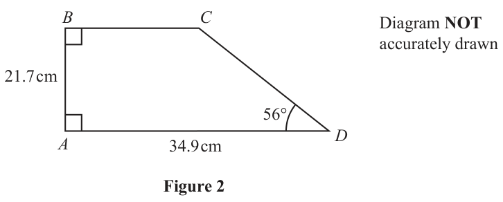
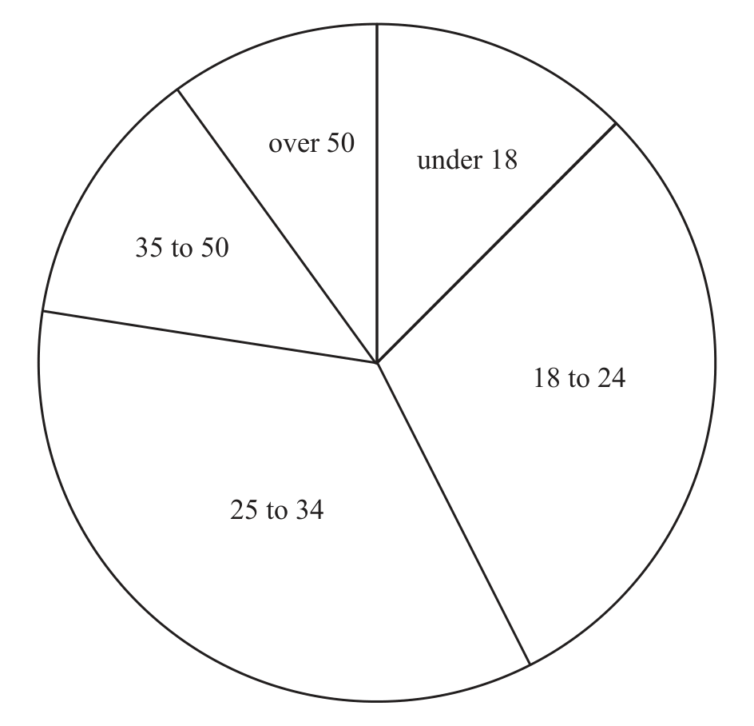
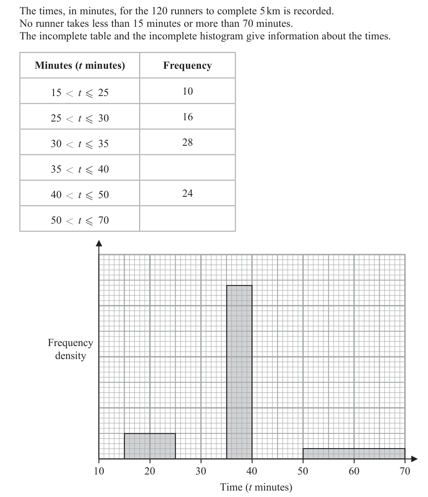
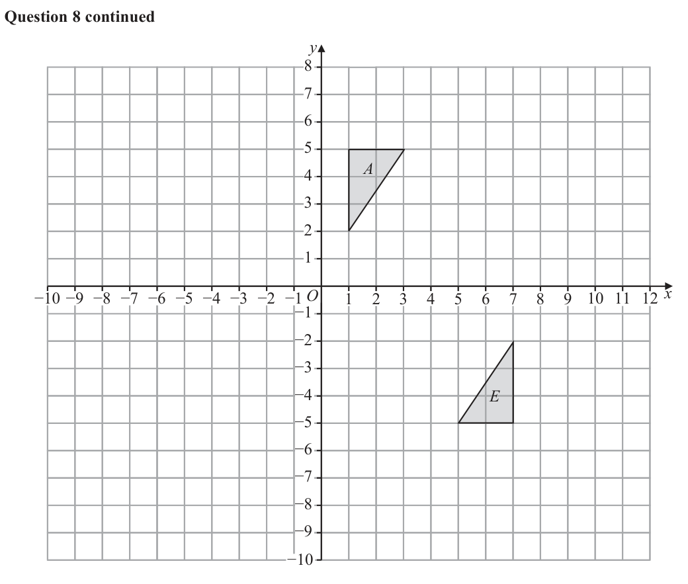
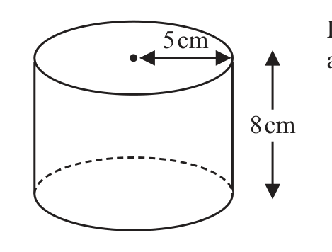
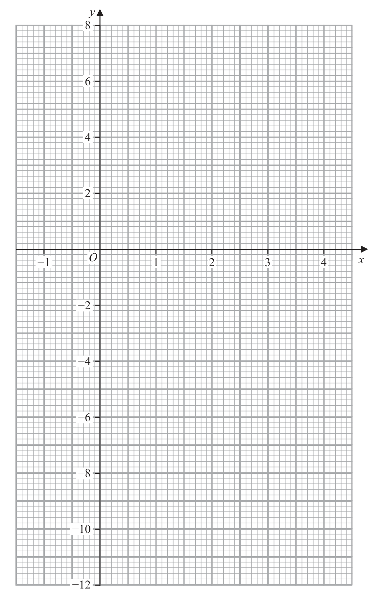

# 4MB1/02 — 2025-11 (official extraction)

> schema `syllabai.official-paper-questions/0.2` · paper_id `pearson-edexcel:international-gcse:mathematics-b:4mb1:2025-11:4MB1/02` · qp sha256 `080b6d571549bc71…` · extraction is the disclosed baseline (ADR-039)

## Question 1 (6 marks)
### 1(a) [1]

Write 2.51×10⁴ as an ordinary number.

**Mark scheme answer**

> 25 100 1 B1 cao

- **(1)** 25 100 1 B1 cao

### 1(b) [1]

Write 0.000 006 37 in standard form.

**Mark scheme answer**

> 6.37 ×10−6 1 B1 cao

- **(1)** 6.37 ×10−6 1 B1 cao

### 1(c) [2]

Calculate 5 10100 7 1099 Give your answer in standard form.

**Mark scheme answer**

> 35 ×10199 or 3.5 ×10n or k ×10200 2 M1 n is any integer or 1 ≤ k < 10
> or for a correct answer in any form
> 3.5 ×10200 A1 cao

- **(2)** 35 ×10199 or 3.5 ×10n or k ×10200 2 M1 n is any integer or 1 ≤ k < 10

### 1(d) [2]

Calculate 5 10100 7 1099 Give your answer in standard form.

**Mark scheme answer**

> (5 ×10 ) − ( 0.7 ×10 ) or (50 ×10 ) − ( 7 ×10 ) or
> 100 100 99 99 2 M1 n is any integer or 1 ≤ k < 10
> or for a correct answer in any form
> 43 ×1099 or 4.3 ×10n or k ×10100
> 4.3 ×10100 A1 cao

- **(2)** (5 ×10 ) − ( 0.7 ×10 ) or (50 ×10 ) − ( 7 ×10 ) or

## Question 2 (7 marks)

5 cm Diagram NOT accurately drawn 8 cm Figure 1 Figure 1 shows a right circular solid cylinder with radius 5 cm and height 8 cm

### 2(a) [3]

5 cm Diagram NOT accurately drawn 8 cm Figure 1 Figure 1 shows a right circular solid cylinder with radius 5 cm and height 8 cm

Calculate, in cm² to 3 significant figures, the total surface area of the cylinder. A and B are two mathematically similar solids. The surface area of A is 3051 cm² The surface area of B is 5424 cm² Given that volume of A + volume of B = 2548

…………… cm³

**Mark scheme answer**

> in an attempt at the total surface area Do not allow if seen in a
> calculation of the volume
> 2π × 5 × 8 [ = 80π = 251.3274123] M1 For curved surface area May be embedded in an attempt at the
> total surface
> A1 for awrt 408 Accept 130π Ignore an answer of 409 (incorrect
> 408
> rounding) after a correct answer is seen

- **(3)** in an attempt at the total surface area Do not allow if seen in a

### 2(b) [4]

calculate the volume, in cm³, of B

**Mark scheme answer**

> 3 4 M2 For a correct SF or ratio
> ⎛ 5424 ⎞ ⎡ 64 ̇̇ ⎤ or 64 : 27 or
>  = = 2.370 (If not M2 then
> ⎝ 3051 ⎠ ⎣ 27 ⎦⎥
> 5424 ⎡ 16 4 ⎤
> M1 for ⎢= = = 1.333...⎥ or
> ⎛ 3051 ⎞ ⎡ 27 ⎤ 3051 ⎣ 9 3 = = 0.421875⎥ or 27 : 64
> ⎝ 5424 ⎠ ⎣ 64 ⎦
> ⎛ 5424 ⎞ ⎡ 4096 ⎤ 3051 ⎡ 9 3 = = 5.6186...⎥ or ⎢= = = 0.75⎥ or
> ⎝ 3051 ⎠ ⎣ 729 ⎦ 5424 ⎣ 16 4 ⎦
> ⎛ 3051 ⎞ ⎡ 729 = = 1.7797...⎥ or 5424 : 3051 or
> ⎝ 5424 ⎠ ⎣ 4096 ⎦
> 16 : 9 or 9 : 16 or 5424 : 30513)
> 3 M1 dep on M2 for a correct equation or ratio
> ⎛ 5424 ⎞
> Vol of A + × Vol of A = 2548 or Equivalent equations are acceptable e.g.
> ⎝ 3051 ⎠
> 64 ⎛ 5424 ⎞ 2548 − Vol of A
> a + a = 2548 oe or =
> 27 ⎝ 3051 ⎠ Vol of A
> 3 Allow
> ⎛ 3051 ⎞
> Vol of B + × Vol of B = 2548 or
> × 2548 or
> × 2548 or Vol of A =756
> ⎝ 5424 ⎠
> 27 + 64 27 + 64
> b+ b = 2548 oe
> cas 1792 A1

- **(4)** 3 4 M2 For a correct SF or ratio

## Question 3 (8 marks)
### 3(a) [2]

Solve the inequality 3p − 2 > 4

**Mark scheme answer**

> 3p > 4 + 2 2 M1 for adding 2 to both sides or dividing throughout by 3 (in an
> equality or equation) as a first step or for showing 2 as the critical
> value May be implied by p = 2 or p < 2
> p>2 A1 isw e.g. p = 2

- **(2)** 3p > 4 + 2 2 M1 for adding 2 to both sides or dividing throughout by 3 (in an

### 3(b) [2]

Solve the inequality 5(2 q )

**Mark scheme answer**

> 10 − 5q < 30 or 2 − q < 6 2 M1 for a correct start by either expanding the brackets or dividing
> throughout by 5 May be implied by q = –4 or q < –4
> q > −4 A1 do not isw e.g. q = –4

- **(2)** 10 − 5q < 30 or 2 − q < 6 2 M1 for a correct start by either expanding the brackets or dividing

### 3(c) [4]

On the grid opposite, by drawing suitable straight lines and using shading, show the region R that satisfies the inequalities

y > 1   x + y < 5   y < 2x + 3

Label the region R

**Mark scheme answer**

> 4 B1 for horizontal line drawn through 1 on y axis Allow solid or
> dotted
> B1 for x + y = 5 drawn Allow solid or dotted
> Tolerance ± ¼ square on the intercepts
> B1 for y = 2 x + 3 drawn Allow solid or dotted
> Tolerance ± ¼ square on the intercepts
> B1 cao Correct region indicated with either this region shaded or
> labelled as R or the outside of the region shaded.
> We can ignore shading inside and outside of the required region if
> the required region is clearly labelled R

- **(4)** 4 B1 for horizontal line drawn through 1 on y axis Allow solid or

## Question 4 (9 marks)

B C Diagram NOT accurately drawn 21.7 cm 56° A D 34.9 cm Figure 2 Figure 2 shows trapezium ABCD AB = 21.7 cm AD = 34.9 cm ADC 56° ABC BAD 90°

### 4(a) [4]

B C Diagram NOT accurately drawn 21.7 cm 56° A D 34.9 cm Figure 2 Figure 2 shows trapezium ABCD AB = 21.7 cm AD = 34.9 cm ∠ADC = 56° ∠ABC = ∠BAD = 90°

Calculate the perimeter, in cm to 3 significant figures, of trapezium ABCD P Diagram NOT accurately drawn r cm Q 72° r cm O Figure 3 Figure 3 shows sector POQ of a circle with centre O and radius r cm ∠POQ = 72° Given that the perimeter of trapezium ABCD is equal to the perimeter of sector POQ

**Mark scheme answer**

> 21.7 4 M1 for a correct method to find length CD or ED
> [ ED =] (=14.63683...) or [ ED =]21.7 tan 34
> tan 56 (E is the point on line AD from where a vertical line is drawn
> or downwards from point C)May be seen on the diagram
> 21.7 21.7 NB. Sine rule may be used
> [CD =] (= 26.17492...) or [CD =]
> sin 56 cos 34
> 21.7 M1 for a correct method to find both CD and ED May be seen on the
> [ ED =] (=14.63683...)
> tan 56 diagram
> Allow
> and 21.7 sin 34
> [ ED =] ' 26.17....' − 21.7 or [ ED =]
> 2
> 21.7 or
> [CD =] (= 26.17492...) sin 56
> sin 56
> [ ED =] ( 21.7 + ' 26.17492...' − 2 × 21.7 × ' 26.17492...'× cos 34 )
> 2
> or [ ED =]' 26.17492...'× cos 56 or [ ED =]' 26.17492...'× sin 34
> and
> '14.63683...' '14.63683...'
> [CD =] 21.7 + '14.63.... ' or [CD =]
> 2
> or [CD =]
> sin 34 cos 56
> 34.9 + 21.7 + 34.9 – ’14.6’ + ‘26.1’ (= 103.038…) M1 (dep on M2) complete method with no extra sides
> 103 A1 awrt 103

- **(4)** 21.7 4 M1 for a correct method to find length CD or ED

### 4(b) [5]

calculate the area, in cm² to 3 significant figures, of sector POQ

**Mark scheme answer**

> 72 5 M1 for a correct expression for the arc length. May be seen embedded
> × 2×π × r in an expression for the perimeter of the sector
> 360
> ⎛ 72 ⎞ M1 for a correct expression for the perimeter of the sector
> ⎜ × 2 × π × r ⎟ + 2r
> ⎝ 360 ⎠
> "103.038..." M1 for a correct method to find r using their (a)
> [ r =] A value of r = 31.6 implies this mark
> ⎛ 72 × 2 × π ⎞ + 2
>  360 
> 72 M1 for correct method to find the area of the sector using their r value
> × π × "31.6"2
> 360
> 629 A1 627 – 629

- **(5)** 72 5 M1 for a correct expression for the arc length. May be seen embedded

## Question 5 (6 marks)

Solve the simultaneous equations 4 x 2 y 2 x 2y Show clear algebraic working. (6)

### 5 [6]

Solve the simultaneous equations

$4x^2 - y^2 = 27$

x + 2y = 3

Show clear algebraic working.

**Mark scheme answer**

> $x = 3 - 2 y \Rightarrow 4 ( 3 - 2 y )^2 - y^2 = 27$ 6 M1 for correct substitution of the linear equation x + 2 y = 3 into the quadratic equation
> $4x^2 - y^2 = 9$ to form an (unsimplified) quadratic equation in either x or y. This mark can be
> or $y = \frac{3-x}{2} \Rightarrow 4x^2 - \left(\frac{3-x}{2}\right)^2$ = 27 implied by the second method mark.
> $4 ( 9 - 12 y + 4 y^2 ) - y^2 = 27$ M1 for correct expansion of either their ( 3 − 2 y ) or
> $\left(\frac{3-x}{2}\right)^2$
> This mark can be implied by the third method mark
> or $4x^2 - \left(\frac{9}{4} - \frac{3x}{2} + \frac{x^2}{4}\right)$ = 27
> $15 y^2 - 48 y + 9$ [ = 0] M1 dep on first M1 for multiplying out and collecting terms, forming a 3 term quadratic in
> any form of $ax^2 + bx + c$ (= 0) with at least 2 coefficients (a or b or c) correct
> $\frac{15x^2}{4} + \frac{3x}{2} - \frac{117}{4}$ [ = 0] (oe e.g. $5 y^2 - 16 y + 3$[ = 0] , $15 x^2 + 6 x - 117$ [ = 0] , $5 x^2 + 2 x - 39$ [ = 0] etc look out for all signs
> reversed)
> (5 y − 1)( y − 3) [ = 0] oe or M1 correct method for solving their 3-term quadratic – either by formula, completing the
> square or factorising. If the quadratic is incorrect then working must be shown. Allow
> (5 x − 13)( x + 3) [ = 0] oe
> equivalent factorisations e.g. (15 y − 3)( y − 3) [ = 0]
> By factorising: brackets must expand to give 2 out of 3 correct terms
> By formula: correct substitution into fully correct formula (allow 1 sign error).
> By completing the square: must see e.g., 5 $\left(y - \frac{8}{5}\right)^2$ ± ...[ = 0]
> May be implied by x = 2.6 and x = –3 or y = 0.2 and y = 3
> [ x =] 3 − 2 × "0.2" and [ x =] 3 − 2 × "3" M1substituting their two x values into either equation leading to values for y or vice versa (not
> or dependent on any previous M marks) e.g. $4x^2 - "0.2"^2 = 27$ leading to x =… and
> [ y =] $\frac{3-"2.6"}{2}$ and [ y =] $\frac{3-"-3"}{2}$ $4x^2 - "3"^2 = 27$ leading to x = … or $4 ("2.6")^2 - y^2 = -27$ leading to y = … and
> $4 ("- 3")^2 - y^2 = -27$ leading to y = …
> This mark can be implied by correct values (if no working seen). This mark can be implied by
> both correct pairs of values. If values are incorrect then working must be seen
> (2.6, 0.2) A1 dep on 3 M marks for both correct pairs of x and y values (oe e.g.,
> (–3, 3) x = $\frac{13}{5}$ , y = $\frac{1}{5}$ and x = −3, y = 3 ) NB These do not need to be written as coordinates
> wr Total 6 marks

- **(6)** $x = 3 - 2 y \Rightarrow 4 ( 3 - 2 y )^2 - y^2 = 27$ 6 M1 for correct substitution of the linear equation x + 2 y = 3 into the quadratic equation

## Question 6 (10 marks)

The accurate pie chart below shows information about the ages, in years, of 120 runners. over 50 under 18 35 to 50 18 to 24 25 to 34

### 6(a) [3]

Calculate how many of these 120 runners are aged 25 to 34 Xavier is one of the runners. He runs 3000 metres to the nearest 100 metres in 18 minutes to the nearest minute

**Mark scheme answer**

> 126 (±2) seen 3 B1 may be seen in a calculation or on the diagram
> "126" M1 a correct calculation for the number of participants
> ×120
> 360 aged 25-34 allow use of their angle (even if outside
> range) for 25-34 (but must be a value and not x) Allow
> equivalent expressions e.g. "126"× 13 Condone an any
> angle between 0 and 360 if angle is not explicitly stated
> 42 A1 cao Note: an answer in the range
> 41.3(3…) – 42.6(6…) implies B1M1

- **(3)** 126 (±2) seen 3 B1 may be seen in a calculation or on the diagram

### 6(b) [4]

Calculate the lower bound, in metres/minute to 3 significant figures, for Xavier’s average speed. Show all your working. The times, in minutes, for the 120 runners to complete 5 km is recorded. No runner takes less than 15 minutes or more than 70 minutes. The incomplete table and the incomplete histogram give information about the times. Minutes (t minutes) Frequency 15 < t ≤ 25 10 25 < t ≤ 30 16 30 < t ≤ 35 28 35 < t ≤ 40 40 < t ≤ 50 24 50 < t ≤ 70 Frequency density 10 20 30 40 50 60 70 Time (t minutes)

> *Figure not shown in this reconstruction — the printed paper includes a diagram (not drawn accurately). Use the text description to work through it.*

**Mark scheme answer**

> d 4 M1 for a correct method to find the speed
> where 2950 ̇̇d 3050 and 17.5 ̇̇t 18.5
> t d and t must be within the limits given
> [ d LB =] 2950, [ dUB =] 3050, [tLB =]17.5 , [tUB =]18.5 B1 for one correct LB or UB stated or used
> 2950 ̇ d < 3000 ⎡ 2950 ⎤ M1 for recognising to be LB/UB ie
> speed = speed =
> 18 < t ̇ 18.5 ⎣ 18.5 ⎥⎦ speed =
> 2950 ̇ d < 3000
> 18 < t ̇ 18.5
> 159 2950
> A1 dep on Allow awrt 159
> 18.5

- **(4)** d 4 M1 for a correct method to find the speed

### 6(c) [3]

Complete the table and the histogram.

**Mark scheme answer**

> For a correct frequency density on the FD axis or by table or 3 M1 for use of area to work out frequency density. May
> One 1cm square height = FD of 1 be implied by one correct value in the table or at least
> or 1 person = 5 small squares or 5 people = 1 large square etc two correct bars drawn
> 34 and 8 A1 for both values correct
> Height 3.2 A1 for all three bars correct
> (25-30) Allow bars plotted at correct height even if there is no
> Height 5.6 scale given on the FD axis
> (30-35)
> Height 2.4
> (40-50)

- **(3)** For a correct frequency density on the FD axis or by table or 3 M1 for use of area to work out frequency density. May

## Question 7 (10 marks)

Alex produces and sells cans of drink. The table shows the production costs for 80 000 cans of drink. Production cost (euros) Manufacturing 31 000 Other 4 350 Total production cost 35 350

### 7(a) [2]

Alex produces and sells cans of drink. The table shows the production costs for 80 000 cans of drink. Production cost (euros) Manufacturing 31 000 Other 4 350 Total production cost 35 350

Calculate the manufacturing cost as a percentage of the total production cost. Give your answer to one decimal place. Alex sells each of the 80 000 cans of drink for £0.60 Using the exchange rate of £1 = 1.15 euros …………… , ……………

**Mark scheme answer**

> 31000 2 M1 for method to find the percentage (can be one step away ie without the ×
> [×100] 100).
> 35350
> May be implied by 0.8769…
> 87.7[%] A1 awrt 87.7
> Way 1 Total cost in £’s (1st 3 Marks)

- **(2)** 31000 2 M1 for method to find the percentage (can be one step away ie without the ×

### 7(b) [4]

calculate the percentage profit that Alex makes. Give your answer to 3 significant figures. Alex borrows £20 000 on 1st January 2026 from a bank. On 31st December each year, starting on 31st December 2026, the bank charges interest of 8.4% on the amount of money that Alex owes the bank. This interest is added to the amount of money that he owes the bank. Given that Alex does not repay any of the money that he owes the bank …………… , ……………

**Mark scheme answer**

> 0.6 × 80000(= 48000) 4 M1 for selling price of all 80 000 cans
> 35350 ÷ 1.15 (=30739.13043) M1 for converting costs from euros to pounds
> "48000"− "30739.13043" M1 method to find percentage profit (can be one step away ie without the ×100 )
> [×100]
> "30739.13043"
> Way 2 Total cost in €’s (1st 3 Marks)
> 0.6 × 80000(= 48000) or M1 for selling price of all 80 000 cans or converting selling price from pounds to
> 0.6 ×1.15(= 0.69) euros
> "48000"×1.15 = 55200 or M1 for converting selling price from euros to pounds or for selling price of all
> "0.69"× 80000(= 55200) 80 000 cans
> "55200"− 35350 M1 method to find percentage profit (can be one step away ie without the ×100 )
> [×100]
> 35350
> Way 3 Cost per can in £’s (1st 3 Marks)
> 35350 M2 for a fully correct method to find price per can in pounds
> (= 0.384239...)
> 1.15 × 80000 35350 35350
> (if not M2 then M1 for (= 30739.130...) or (= 0.441875)
> 1.15 80000
> 0.6 − " 0.3842391" M1 method to find percentage profit (can be one step away ie without the ×100 )
> [×100]
> " 0.3842391"
> Way 4 Cost per can in €’s (1st 3 Marks)
> 35350 ÷ 80000 (= 0.441875) M1 for cost per can
> 0.6 ×1.15(= 0.69) M1 converting selling price from pounds to euros
> "0.69"− " 0.441875" M1 method to find percentage profit (can be one step away ie without the ×100 )
> [×100]
> " 0.441875"
> This answer is for all 4 ways 56.2[%] A1 awrt 56.1 or 56.2

- **(4)** 0.6 × 80000(= 48000) 4 M1 for selling price of all 80 000 cans

### 7(c) [2]

calculate how much money Alex owes the bank on 1st January 2028 Give your answer to 2 decimal places. Alex also sells snacks. The selling price for each snack, after tax is added, is £0.90 Given that the rate of tax is 20%

**Mark scheme answer**

> 20000 ×1.0842 2 M1 for 20000 ×1.084n where n = 1 or 2 Allow 108.4% or 1 + 8.4% for 1.084 May
> be implied by 21680 or 20000 + 1680 or 20000 +1680 + 1821.12 or 1821.12 or
> 23500 or 23501 or 23501.1
> [£]23501.12 A1 cao

- **(2)** 20000 ×1.0842 2 M1 for 20000 ×1.084n where n = 1 or 2 Allow 108.4% or 1 + 8.4% for 1.084 May

### 7(d) [2]

calculate the selling price for each snack, in £, before tax is added.

**Mark scheme answer**

> 0.9 2 M1 for a correct method to find the selling price. Allow 120% or 1 + 20% for 1.2
> 0.90 ÷ 1.2 oe or ×100 oe
> 120
> 0.75 A1

- **(2)** 0.9 2 M1 for a correct method to find the selling price. Allow 120% or 1 + 20% for 1.2

## Question 8 (10 marks)

Triangle A and triangle E are drawn on the grid opposite.

### 8(a) [3]

Describe fully the single transformation that maps triangle A onto triangle E Triangle A is transformed to triangle B under the translation

**Mark scheme answer**

> Rotation 3 B1 allow rotate, rotated, rotation do not accept turn
> B0 if multiple transformations stated.
> Multiple transformations are when more than one of reflection (mirrored), rotation (turn),
> translation (move), enlargement (stretch / squash) is stated
> eg a vector or SF or equation of a line do not imply multiple transformations
> 180o B1 for 180o These two marks can still be
> (4, 0) B1 must be a coordinate and not a vector. Do not awarded if multiple transformations
> allow if another coordinate is given as well are stated
> ALT
> Enlargement B1 allow enlarge
> B0 if multiple transformations stated.
> Multiple transformations are when more than one of reflection (mirrored), rotation (turn),
> translation (move), enlargement (stretch / squash) is stated
> eg a vector or an angle or equation of a line do not imply multiple transformations
> SF = – 1 B1 for SF = – 1 These two marks can still be
> (4, 0) B1 must be a coordinate and not a vector. Do not awarded if multiple transformations
> allow if another coordinate is given as well are stated

- **(3)** Rotation 3 B1 allow rotate, rotated, rotation do not accept turn

### 8(b) [2]

On the grid, draw and label triangle B Triangle A is transformed to triangle C under an enlargement with scale factor 3 and centre of enlargement (5, 7)

**Mark scheme answer**

> Correct triangle 2 B2 for a fully correct triangle
> B at (7, 0), (7, 3) (If not B2 then B1 for a triangle translated either 6 units to the right or 2 units down)
> (9, 3)

- **(2)** Correct triangle 2 B2 for a fully correct triangle

### 8(c) [2]

On the grid, draw and label triangle C Triangle A is transformed to triangle D under the transformation with matrix M where 1 0 M

**Mark scheme answer**

> Correct triangle 2 B2 for a fully correct triangle
> C at (–1, 1), (If not B2 then B1 for a triangle enlarged by SF3 but in the incorrect position or for 2 of
> (–7, 1) (–7, –8) the 3 points correct and joined to make a triangle or for 3 correct points stated or plotted
> correctly but not joined to make a triangle)

- **(2)** Correct triangle 2 B2 for a fully correct triangle

### 8(d) [3]

On the grid, draw and label triangle D

**Mark scheme answer**

> ⎛ 1 0 ⎞⎛ 1 1 3 ⎞ 3 M1 for intention to multiply the correct way, can be implied by writing in the correct
>  oe order or one correct point stated or plotted
> ⎝ 0 −1⎠⎝ 2 5 5 ⎠ Points can be in any order
> Points can be in any order M1 for at least two correct columns or correctly stating or plotting two points.
> 1 1 3 oe
> ⎝ −2 −5 −5 ⎠
> Correct triangle A1 Fully correct triangle
> D at (1, –2), Award 3 marks for a correct triangle drawn, irrespective of working in the working space.
> (1, –5) (3, –5)
> B
> C
> D

- **(3)** ⎛ 1 0 ⎞⎛ 1 1 3 ⎞ 3 M1 for intention to multiply the correct way, can be implied by writing in the correct

## Question 9 (12 marks)
### 9(a) [2]

Complete the table of values for $y = 2x^3 - 9x^2 + 3x + 7$

| x | −1 | 0 | 0.25 | 1 | 2 | 3 | 4 |
|---|----|---|------|---|---|---|---|
| y |    | 7 | 7.22 |   |   | −11 |   |

**Mark scheme answer**

> –7, 3, –7, 3 2 B2 All values correct
> (If not B2, then B1 for 2 or 3 correct values)

- **(2)** –7, 3, –7, 3 2 B2 All values correct

### 9(b) [3]

On the grid opposite, plot the points from your completed table and join them to form a smooth curve.

**Mark scheme answer**

> Curve drawn 3 B3 Fully correct smooth curve ±1 small square. Allow if
> curve goes through points, even if the points are not
> plotted.
> (B2 for all points plotted correctly ± 1 small square, may
> be joined by line segments)
> B1 for at least 5 points plotted ±1 small square with curve
> (or line segments) going through 5 of their points.)

- **(3)** Curve drawn 3 B3 Fully correct smooth curve ±1 small square. Allow if

### 9(c) [2]

By drawing a suitable straight line (at least 3 cm long) on the grid, find an estimate for the gradient of the curve at the point where x = 0.5

**Mark scheme answer**

> 2 M1 for drawing a tangent to the curve at x = 0.5 Must be a
> tangent and not a chord
> -4.5 A1 (dep M1) answer in the range, –5 to –4
> Must come from a gradient of a tangent and not gradient of
> a chord

- **(2)** 2 M1 for drawing a tangent to the curve at x = 0.5 Must be a

### 9(d) [1]

Use your graph, to estimate, to one decimal place, the solutions of the equation

$2x^3 - 9x^2 + 3x + 7 = 0$

**Mark scheme answer**

> –0.7, 1.3, 3.9 1 B1 ft for all 3 values Allow ± 0.1

- **(1)** –0.7, 1.3, 3.9 1 B1 ft for all 3 values Allow ± 0.1

### 9(e) [4]

By drawing a suitable straight line on the grid, find an estimate for the range of values of x, to one decimal place, in the interval 0 < x ≤ 4 for which

$4x - 18 + \frac{38}{x^2} < 0$

Show clear algebraic working.

**Mark scheme answer**

> $4x^3 - 18x^2 + 38 < 0$ or
> $2x^3 - 9x^2 + 19 < 0$ 4 M1 for recognising to multiply by x²
> (may also recognise to divide by 2)
> $2x^3 - 9x^2 + 3x + 7 < 3x - 12$ M1 For a correct equation identified (allow 3x − 12 )
> or y = 3x − 12 seen
> M1 A correct line drawn that intersects the curve
> (the correct line drawn implies all 3 M marks)
> Answer dependent on a correct line 1.9 < x < 3.9 A1 (dep on 3rd M mark) values which round to 1.9, 3.9
> being drawn Do not allow use of ≤ instead of <
> NB: if y values given as well then A0

- **(4)** $4x^3 - 18x^2 + 38 < 0$ or

## Question 10 (7 marks)

cm 20 cm 12 cm 45° D C Figure 4 Figure 4 shows solid ABCDE The horizontal base CDE is a triangle. The vertical face ABED is a trapezium. The point F lies on BC such that BF : FC = 2 : 1 AC = 20 cm AD = 10 cm BE = 15 cm DE = 12 cm ∠BCE = 45° ADC ADE BED BEC 90° Calculate the length, in cm to one decimal place, of AF Show all your working. (7) [ Cosine rule: a 2 b 2 c 2 2bc cos A ]

### 10 [7]

Figure 4 shows solid ABCDE

The horizontal base CDE is a triangle.

The vertical face ABED is a trapezium.

The point F lies on BC such that BF : FC = 2 : 1

AC = 20 cm  AD = 10 cm  BE = 15 cm  DE = 12 cm

∠BCE = 45°  ∠ADC = ∠ADE = ∠BED = ∠BEC = 90°

Calculate the length, in cm to one decimal place, of AF

Show all your working.

[ Cosine rule: $a^2 = b^2 + c^2 - 2bc\cos A$ ]

> *Figure not shown in this reconstruction — the printed paper includes a 3-D diagram (not drawn accurately).*
> Labels in the original figure: B, A, E, D, C, F · Figure values: 15 cm, 10 cm, 12 cm, 20 cm, 45°.

**Mark scheme answer**

> [ BC =] $\frac{15}{\sin 45}$ = 15√2 = 21.2(1320344) or 7 M1 for correct method to find BC May be
> implied by 10√2 = 14.1(4213563) or
> [ BC =] $\frac{15}{\cos 45}$ = 15√2 = 21.2(1320344) or 5√2 = 7.07(1067812) (May be seen on the
> diagram)
> [ BC =] √(15² + 15²) [ = 15√2 = 21.2(1320344) ]
> M1 for correct method to find AB (May be
> [ AB =] √(12² + (15 − 10)²) [ = 13]
> seen on the diagram)
> M1 for a correct method to find BF or FC
> [ BF =] $\frac{2}{3}$ × " BC " [ = 10√2 = 14.1(4213563) ] (May be seen on the diagram)
> or
> [ FC =] $\frac{1}{3}$ × " BC " [ = 5√2 = 7.07(1067812) ]
> ( ) M1 for substitution into Cosine Rule to find
> "13"² = 20² + "15√2"² − 2 × 20 × "15√2" cos ACB
> angle ACB=ACF or angle ABC=ABF Allow
> ( ) any letter to represent angle ACB or angle
> or 20² = "13"² + "15√2"² − 2 × "13"× "15√2" cos ABC
> ABC
> ( ) M1 for correct method to find angle
> cos ACB = $\frac{20^2 + \left("15\sqrt{2}"\right)^2 - "13"^2}{2 \times 20 \times "15\sqrt{2}"}$ [⇒ ACB = 36.6(2414042)] ACB=ACF or angle ABC=ABF Allow any
> letter to represent angle ACB or angle ABC
> or (This implies 4th M mark) (May be seen in
> the diagram) May be implied by a correct
> ( )
> cos ABC = $\frac{"13"^2 + \left("15\sqrt{2}"\right)^2 - 20^2}{2 \times "13" \times "15\sqrt{2}"}$ [ ⇒ ABC = 66.6 ( 0500911) ] angle for ACB/ABC If any value is incorrect
> then working must be shown
> ( ) M1 for correct method to find AF
> [ ( AF )² ] = 20² + "5√2"² − 2 × 20 × "5√2" cos"36.6..."
> or
> [ ( AF )² ] = "13"² + "10√2"² − 2 × "13"× "10√2" cos"66.6..."
> 14.9 A1 awrt 14.9
> Alternative using the diagram below
> [ DC =] √(20² − 10²) [= 10√3 = 17.32050808]
> M1 for correct method to find DC May be
> implied by 10√3 = 17.3(2050808)
> (May be seen on the diagram)
> [ AN =] 10 − $\frac{1}{3}$ × 15 [ = 5] M1 for correct method to find AN
> (May be seen on the diagram)
> "(10√3)"² = 12² + 15² − 2 ×12 ×15 cos DEC M1 for substitution into Cosine Rule to find
> angle DEC or angle ECD Allow any letter
> ( )
> or 12² = 15² + "10√3"² − 2 × "15"× "10√3" cos ECD to represent angle DEC or angle ECD Allow
> other correct expressions e.g. If DEM then
> use of 10 rather than 15 is correct or if MCD
> then use of 5 rather than 15 is correct
> cos DEC = $\frac{12^2 + 15^2 - \left("(10\sqrt{3})"\right)^2}{2 \times 12 \times 15}$ [⇒ DEC = 78.9(4993504)] M1 for correct method to find angle DEC or
> angle ECD Allow any letter to represent
> angle DEC or angle ECD Allow other
> or correct expressions e.g. If DEM then use of
> ( )
> cos ECD = $\frac{15^2 + \left("10\sqrt{3}"\right)^2 - 12^2}{2 \times 15 \times "10\sqrt{3}"}$ [ ⇒ ECD = 42.8 ( 4172776 ) ] 10 rather than 15 is correct or if MCD then
> use of 5 rather than 15 is correct (This implies 4th M mark) (May be seen in
> the diagram) May be implied by a correct
> angle for DEC/ECD If any value is incorrect
> then working must be shown
> [ ( DM )² ] = 12² + 10² − 2 ×12 ×10 cos"78.9..." M1 for correct method to find DM
> or
> [ ( DM )² ] = 5² + "10√3"² − 2 × 5 × "10√3" cos"42.8..."
> AF = √(5² + "14.07..."²) M1 for a correct method to find AF
> 14.9 A1 awrt 14.9

- **(7)** [ BC =] $\frac{15}{\sin 45}$ = 15√2 = 21.2(1320344) or 7 M1 for correct method to find BC May be

## Question 11 (9 marks)

y −8 −4 O 4 8 x Figure 5 The function f has domain −8 ≤ x ≤ 8 Figure 5 shows the graph of y = f(x), which consists of a line segment from (–8, 3) to (–4, 0) and a line segment from (–4, 0) to (8, 9)

### 11(a) [2]

The function f has domain −8 ≤ x ≤ 8

Figure 5 shows the graph of y = f(x), which consists of a line segment from (–8, 3) to (–4, 0) and a line segment from (–4, 0) to (8, 9)

(a) Write down the range of the function f

The function g is defined as

$g:x \mapsto \frac{3x-1}{x+1}$

> *Figure not shown in this reconstruction — the printed paper includes a graph (Figure 5); the segment description above is complete for this part.*

**Mark scheme answer**

> { y : 0 ≤ y ≤ 9} 2 B2 for { y : 0 ≤ y ≤ 9} or [ 0, 9]
> condone 0 ≤ y ≤ 9 but not 0 ≤ x ≤ 9
> (If not B2 then B1 for 0 < y < 9 or 0 ≤ y ... or ... y ≤ 9 )
> Allow f or f(x) for y

- **(2)** { y : 0 ≤ y ≤ 9} 2 B2 for { y : 0 ≤ y ≤ 9} or [ 0, 9]

### 11(b) [1]

State the value of x which must be excluded from any domain of the function g

**Mark scheme answer**

> –1 1 B1 Allow x ≠ −1 but not y ≠ −1

- **(1)** –1 1 B1 Allow x ≠ −1 but not y ≠ −1

### 11(c) [2]

Find gf(0)

**Mark scheme answer**

> f(0) = 3 2 M1 for f(0) = 3
> 2 A1 cao

- **(2)** f(0) = 3 2 M1 for f(0) = 3

### 11(d) [4]

Find the inverse function g–1 in the form g-1(x) = … Give your answer in its simplest form.

**Mark scheme answer**

> xy + y = 3x − 1 or xy + x = 3 y − 1 4 M1 For a correct expression.
> y + 1 = 3x − xy x + 1 = 3 y − xy M1 Collect all their x (or y) terms on one side (must be more
> or or than one) Allow 1 sign error.
> − y − 1 = −3x + xy − x − 1 = −3 y + xy y + 1 3x − xy
> Condone both sides being over x or y eg =
> x x
> y + 1 = x (3 − y ) x + 1 = y (3 − x ) M1 Isolating term in x (or y) ie taking x (or y) out as common
> or or
> factor so it only appears once in the equation
> − y − 1 = x( y − 3) − x − 1 = y( x − 3)
> x +1 −x −1
> [ g −1 ( x) =] A1 oe e.g. Must be in terms of x. No label required
> 3− x x−3

- **(4)** xy + y = 3x − 1 or xy + x = 3 y − 1 4 M1 For a correct expression.

## Question 12 (6 marks)

A bag contains n sweets. There are 9 orange sweets in the bag. The rest of the sweets are purple. Mina takes at random a sweet from the bag and eats it. Stuart then takes at random a sweet from the bag and eats it. The probability that Mina and Stuart both eat a sweet of the same colour is Find the probability that all 9 orange sweets remain in the bag. Show clear algebraic working. (6)

### 12 [6]

A bag contains n sweets. There are 9 orange sweets in the bag. The rest of the sweets are purple. Mina takes at random a sweet from the bag and eats it. Stuart then takes at random a sweet from the bag and eats it. The probability that Mina and Stuart both eat a sweet of the same colour is $\frac{46}{91}$

Find the probability that all 9 orange sweets remain in the bag.

Show clear algebraic working.

**Mark scheme answer**

> $\frac{9}{n}$ × $\frac{8}{n-1}$ or $\frac{n-9}{n}$ × $\frac{n-10}{n-1}$ oe 6 M1 for orange and orange or purple and purple
> This may be seen as part of an equation
> allow eg n − 9 − 1 in place of n − 10
> or $\frac{9}{n}$ × $\frac{n-9}{n-1}$ or for orange and purple
> Allow any letter for n
> $\frac{9}{n}$ × $\frac{8}{n-1}$ + $\frac{n-9}{n}$ × $\frac{n-10}{n-1}$ = $\frac{46}{91}$ oe M1 Correct equation
> or correct equation using the complementary event.
> This implies the 1st M1
> or $2 \times \frac{9}{n} \times \frac{n-9}{n-1}$ = $1 - \frac{46}{91}$ oe
> $5n^2 - 187n + 1638$ (= 0) oe A1 For a correct 3 term quadratic.
> eg $45n^2 - 1683n + 14742$ (= 0)
> Allow $45n^4 - 1728n^3 + 16425n^2 - 14742n$ (= 0) oe
> A correct equation will imply both M marks
> (5n – 117)(n – 14) (= 0) M1 For solving their 3 term quadratic equation using
> any correct method.
> $\frac{--187 \pm \sqrt{(-187)^2 - 4 \times 5 \times 1638}}{2 \times 5}$ oe If factorising, allow brackets which expanded give 2
> or
> out of 3 terms correct
> If using formula must be correct substitution
> If completing the square allow one error
> This mark may be implied by n = 14 or n = 23.4
> If an incorrect 3 term quadratic is given then working
> must be shown
> $\frac{"14"-9}{"14"}$ × $\frac{"14"-1-9}{"14"-1}$ or M1 For using their value of n to find purple and
> purple. Only ft their value of n if n is an integer
> $1-\left(\frac{9}{"14"} \times \frac{8}{"14"-1} + \frac{9}{"14"} \times \frac{"14"-9}{"14"-1} + \frac{"14"-9}{"14"} \times \frac{9}{"14"-1}\right)$ Allow $1 - \frac{"14"-9}{"14"} \times \frac{"14"-1-9}{"14"-1}$ to imply this mark
> $\frac{10}{91}$ A1 oe Do not ISW
> ALT Let x be the number of purple
> $\frac{9}{9+x}$ × $\frac{8}{9+x-1}$ or $\frac{x}{9+x}$ × $\frac{x-1}{9+x-1}$ oe M1 for orange and orange or purple and purple
> or $\frac{9}{9+x}$ × $\frac{x}{9+x-1}$ or for orange and purple
> Allow any letter for x (except n)
> $\frac{9}{9+x}$ × $\frac{8}{9+x-1}$ + $\frac{x}{9+x}$ × $\frac{x-1}{9+x-1}$ = $\frac{46}{91}$ oe M1 Correct equation
> or correct equation using the complementary event.
> This implies the 1st M1
> or $2 \times \frac{9}{9+x} \times \frac{x}{9+x-1}$ = $1-\frac{46}{91}$ oe
> $5x^2 - 97x + 360$ (= 0) oe A1 For a correct 3 term quadratic.
> e.g. $45x^2 - 873x + 3240$ (= 0) oe
> Allow $45x^4 - 108x^3 - 8361x^2 - 7776x + 233280$ ( = 0) oe
> A correct equation will imply both M marks
> (5x – 72)(x – 5) (= 0) M1 For solving their 3 term quadratic equation using
> any correct method.
> $\frac{--97 \pm \sqrt{(-97)^2 - 4 \times 5 \times 360}}{2 \times 5}$ oe If factorising, allow brackets which expanded give 2
> or
> out of 3 terms correct
> If using formula must be correct substitution
> If completing the square allow one error
> This mark may be implied by x = 5 or x = 14.4
> If an incorrect 3 term quadratic is given then working
> must be shown
> $\frac{"5"}{9+"5"}$ × $\frac{"5"-1}{9+"5"-1}$ or M1 For using their value of x to find purple and
> purple. Only ft their value of x if x is an integer
> $1-\left(\frac{9}{9+"5"} \times \frac{8}{9+"5"-1} + \frac{9}{9+"5"} \times \frac{"5"}{9+"5"-1} + \frac{"5"}{9+"5"} \times \frac{9}{9+"5"-1}\right)$ Allow $1 - \frac{"5"}{9+"5"} \times \frac{"5"-1}{9+"5"-1}$ to imply this mark
> $\frac{10}{91}$ A1 oe Do not ISW
> wr Total 6 marks

- **(6)** $\frac{9}{n}$ × $\frac{8}{n-1}$ or $\frac{n-9}{n}$ × $\frac{n-10}{n-1}$ oe 6 M1 for orange and orange or purple and purple

