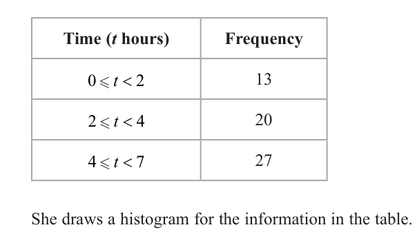
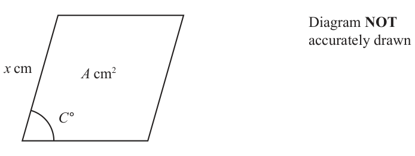

# 4MB1/01 — 2026-06 (official extraction)

> schema `syllabai.official-paper-questions/0.2` · paper_id `pearson-edexcel:international-gcse:mathematics-b:4mb1:2026-06:4MB1/01` · qp sha256 `b50e0ed4449543c4…` · extraction is the disclosed baseline (ADR-039)

## Question 1 (2 marks)

Solve the inequality 6x < 20 − 2x

### 1 [2]

Solve the inequality 6x < 20 − 2x

**Mark scheme answer**

> 8x < 20
> M1 for isolating the terms in x correctly
> or for x = 2.5 or x > 2.5 or 2.5
> Accept 6x + 2x < 20 Allow any inequality/equals symbol
> x < 2.5
> A1 oe eg 2.5 > x or x < 20/8
> Only isw incorrect simplification of a correct inequality
> Do not allow x ≤ 2.5 or x = 2.5 or x > 2.5 or 2.5 on answer line

- **(2)** 8x < 20

## Question 2 (2 marks)

Factorise fully 8ab − 28a

### 2 [2]

Factorise fully 8ab − 28a

**Mark scheme answer**

> 4 ( 2ab − 7a ) or a ( 8b − 28) or 2 M1 a correct partial factorisation or a common factor of 4a and one
> correct term in the brackets or 2b − 7 in the brackets
> 4a ( 2b ± ...) or 4a (... − 7 ) or
> ... ( 2b − 7 )
> 4a ( 2b − 7 ) A1
> Condone a missing final bracket
> Do not isw – see general marking guidance.
> cas Total 2 marks
> Question Working Answer Mark Notes

- **(2)** 4 ( 2ab − 7a ) or a ( 8b − 28) or 2 M1 a correct partial factorisation or a common factor of 4a and one

## Question 3 (2 marks)

Find the Lowest Common Multiple (LCM) of 60 and 84 Show all your working.

### 3 [2]

Find the Lowest Common Multiple (LCM) of 60 and 84 Show all your working.

**Mark scheme answer**

> 2 × 2 × 3 × 5 and 2 × 2 × 3 × 7 oe 2 M1 Both numbers expressed as a product of primes
> For 2 × 2 × 3 × 5 allow 4 × 3 × 5 or 6 × 2 × 5 or 12 × 5
> or or 2 × 2 × 3 × 5 ×1
> For 2 × 2 × 3 × 7 allow 4 × 3 × 7 or 6 × 2 × 7 or 12 × 7
> or 2 × 2 × 3 × 7 ×1
> Multiples (60) 120, 180, 240, 300, 360, 420, 480, 540 and A list of multiples including 420 for both numbers
> Multiples (84) 168, 252, 336, 420 or
> 2 60 84 or 2 60 and 2 84 Or a correct table or 2 correct trees
> 2 30 42 2 30 2 42 Allow equivalent tables and tree eg (2, 3, 2) rather
> 5 7 5 7 Or allow as Venn diagram.

- **(2)** 2 × 2 × 3 × 5 and 2 × 2 × 3 × 7 oe 2 M1 Both numbers expressed as a product of primes

## Question 4 (2 marks)
### 4(a) [1]

Write down the number from the list that is a natural number. −3 4 4.5 π

**Mark scheme answer**

> 4 1 B1

- **(1)** 4 1 B1

### 4(b) [1]

Write down an irrational number between 1 and 2

**Mark scheme answer**

> eg 2 or 1 B1 for any irrational number within the given range including
> multiples of π or e
> 3 or 0.5π
> 11 3π
> eg or or e0.5
> 3
> Total 2 marks
> Question Working Answer Mark Notes

- **(1)** eg 2 or 1 B1 for any irrational number within the given range including

## Question 5 (2 marks)

Show on the number line the inequality 2 x ≤ 3 −4 −3 −2 −1 0 1 2 3 4 x

### 5 [2]

Show on the number line the inequality 2 x ≤ 3 −4 −3 −2 −1 0 1 2 3 4 x

**Mark scheme answer**

> Shown 2 B2 for a fully correct diagram. Must be a single line
> (B1 for an open circle at −2 and a closed circle at 3
> or a single line from −2 to 3)
> Allow ( for an open circle and ] as a closed circle
> cas Total 2 marks
> Question Working Answer Mark Notes

- **(2)** Shown 2 B2 for a fully correct diagram. Must be a single line

## Question 6 (2 marks)

Each time Ishan plays a game, the probability that he wins is 0.64 Ishan plays the game 50 times. Calculate the expected number of games Ishan does not win.

### 6 [2]

Each time Ishan plays a game, the probability that he wins is 0.64 Ishan plays the game 50 times. Calculate the expected number of games Ishan does not win.

**Mark scheme answer**

> 50 × 0.36 [ = 18] or 2 M1 correct method to find the expected number of games not won
> or games won
> 50 × (1 − 0.64 ) [ = 18] oe
> 50 × 0.64 [ = 32] or 32
> 18 A1 cao
> cas Total 2 marks
> Question Working Answer Mark Notes

- **(2)** 50 × 0.36 [ = 18] or 2 M1 correct method to find the expected number of games not won

## Question 7 (2 marks)

B Diagram NOT C accurately drawn 105° D A In the diagram A, B, C and D are points on a circle. BCD 105 Find the size, in degrees, of ∠BAD Give a reason for your answer. ............................................................. °

### 7 [2]

B Diagram NOT C accurately drawn 105° D A In the diagram A, B, C and D are points on a circle. BCD 105 Find the size, in degrees, of ∠BAD Give a reason for your answer °

> 🖼 crop required: diagram (qp.pdf p.None)

**Mark scheme answer**

> 180 − 105 [ = 75] or 75 2 M1 a correct method to find the angle. Could be seen on the
> diagram
> 75 and Opposite A1 75 and correct reason – need underlined words
> angles of a cyclic
> quadrilateral sum Allow ∠ for angle
> to 180o
> Total 2 marks
> Question Working Answer Mark Notes

- **(2)** 180 − 105 [ = 75] or 75 2 M1 a correct method to find the angle. Could be seen on the

## Question 8 (3 marks)

The price of a yacht is reduced by 16% in a sale. Leda pays $15 700 of the sale price when she orders the yacht. She pays the remainder of the sale price in 10 equal payments of $2000 Calculate the price of the yacht before the sale. $. . . . . . . . . . . . . . . . . . . . . . . . . . . .. . . . . . . . . . . . . . . . . . . . . . . . . . . . . . . . .

### 8 [3]

The price of a yacht is reduced by 16% in a sale. Leda pays $15 700 of the sale price when she orders the yacht. She pays the remainder of the sale price in 10 equal payments of $2000 Calculate the price of the yacht before the sale. $

**Mark scheme answer**

> 15700 + 10 × 2000 [ = 35700] 3 M1 Correct method to find total sale price. May be implied by
> 35700 or 15700 + 20000
> "35700" M1 for dividing by 0.84
> 0.84 n n
> Allow or ×100 where n is positive
> 16 0.84
> or "35700"+ "35700"×
> 84 or a fully correct method to find the original price.
> 16 n
> or x − x = "35700" oe Condone
> 100 84%
> 42 500 A1
> NB multiply by 1.16 gives an answer of 41412 and is M1M0A0
> unless the method marks can be awarded in the working.
> cas Total 3 marks
> Question Working Answer Mark Notes

- **(3)** 15700 + 10 × 2000 [ = 35700] 3 M1 Correct method to find total sale price. May be implied by

## Question 9 (3 marks)

Write as a single fraction in its simplest form 4x 3 2x 3 2 Show clear algebraic working.

### 9 [3]

Write as a single fraction in its simplest form 4x 3 2x 3 2 Show clear algebraic working.

**Mark scheme answer**

> 2 ( 4 x − 3) − 3 ( 2 x + 5 ) 3 M1 for a correct method to reduce to a single fraction. Allow any common
> oe or denominator
> 2(4 x − 3) 3(2 x + 5) Condone invisible brackets if multiplied out correctly with one error only.
> − oe or May be implied by the second M mark and a correct final expression
> 6 6 2 x − 21
> 8 x − 6 6 x + 15 equivalent to
> − oe
> 6
> 8 x − 6 − 6 x − 15 M1 for multiplying out the brackets. Allow one sign error if 4 terms given.
> oe
> 6 If the 1st M1 has been awarded then this may be implied by a correct answer.
> ft their expression of the form m ( 4 x − 3) − n ( 2 x + 5) where m and n are
> integers
> 8 x − 6 − 6 x ± 15
> NB implies M1M1
> 2 x − 21 21 − 2 x
> A1 allow Dep on both M marks being awarded. Do NOT isw
> 6 −6
> wr Total 3 marks
> Question Working Answer Mark Notes

- **(3)** 2 ( 4 x − 3) − 3 ( 2 x + 5 ) 3 M1 for a correct method to reduce to a single fraction. Allow any common

## Question 10 (3 marks)

Zahra records the time, t hours, some people spend watching television each day. Her results are shown in the table below. Time (t hours) Frequency 0≤t < 2 13 2≤t < 4 20 4≤t < 7 27 She draws a histogram for the information in the table. In the histogram the bar for the class interval 4 ≤ t < 7 is a square with sides of length 4.5 cm the bar for the class interval 2 ≤ t < 4 is a rectangle of width w cm and height h cm Find the value of w and the value of h w = ............................................................. h = .............................................................

### 10 [3]

Zahra records the time, t hours, some people spend watching television each day. Her results are shown in the table below. Time (t hours) Frequency 0≤t < 2 13 2≤t < 4 20 4≤t < 7 27 She draws a histogram for the information in the table. In the histogram the bar for the class interval 4 ≤ t < 7 is a square with sides of length 4.5 cm the bar for the class interval 2 ≤ t < 4 is a rectangle of width w cm and height h cm Find the value of w and the value of h w = h =

**Mark scheme answer**

> [ w =] 3 3 B1
> 2 M1 A correct method to calculate the area of the bar 2 „ t < 4 or correct
> [ w × h =] 4.5 × 20 [ = 15] oe or method to find both fd
> May be implied by 15
> [ w × h =] × 20[ = 15] oe
> 27 20 Accept 9 and 10
> or [Fd =] and oe
> 3
> [ h =] 5 A1
> cas Total 3 marks
> Question Working Answer Mark Notes

- **(3)** [ w =] 3 3 B1

## Question 11 (3 marks)

Rima sells green pens, red pens and blue pens only. On Saturday, a total of 200 pens are sold by Rima. The ratio of the number of green pens sold to the number of red pens sold is 3 : 5 The ratio of the number of green pens sold to the number of blue pens sold is 2 : 3 Calculate the number of red pens sold by Rima on Saturday.

### 11 [3]

Rima sells green pens, red pens and blue pens only. On Saturday, a total of 200 pens are sold by Rima. The ratio of the number of green pens sold to the number of red pens sold is 3 : 5 The ratio of the number of green pens sold to the number of blue pens sold is 2 : 3 Calculate the number of red pens sold by Rima on Saturday.

**Mark scheme answer**

> 6 :10 and 6 : 9 oe 3 M1 for writing the ratios with a common figure for green or for
> or [G : R : B =] 6 :10 : 9 oe writing a correct 3 part ratio which can be in any order.
> Allow equivalent ratios
> 10 5
> eg 3 : 5 and 3 : 4.5 or 2 : and 2 : 3 or 1: and 1: or
> 3 3
> 3 : 5 : 4.5 or [ R : G : B =]10 : 6 : 9
> Do not need to be labelled as G, R and B
> "10" M1 correct method to find the number of red pens sold or green
> × 200 [ = 80] or pens sold or blue pens sold.
> "6"+ "10"+ "9"
> "6" ft their ratios incorporating red, green and blue
> × 200 [ = 48] or
> "6"+ "10"+ "9"
> May be implied by 48, 72 or 80
> "9"
> × 200 [ = 72] or
> "6"+ "10"+ "9"
> 48:80:72
> 80 A1
> cas Total 3 marks
> Question Working Answer Mark Notes

- **(3)** 6 :10 and 6 : 9 oe 3 M1 for writing the ratios with a common figure for green or for

## Question 12 (4 marks)

x 4 10 and y 3.2

### 12(a) [2]

Calculate xy Give your answer in standard form. y

**Mark scheme answer**

> 12.8 ×10 −41
> 2 M1 allow a correct answer in any form
> or 1.28 ×10n or 12.8 ×10−105+64
> or m ×10−40 or 1.28 ×10n
> or m ×10−40 where 1 „ m < 10
> 1.28 ×10− 40 A1 cao

- **(2)** 12.8 ×10 −41

### 12(b) [2]

Calculate x Give your answer in standard form.

**Mark scheme answer**

> 0.8 ×10169 2 M1 allow a correct answer in any form
> or 8 ×10 p or 0.8 ×1064−( −105)
> or q ×10168 or 8 ×10 p
> or q ×10168 where 1 „ q < 10
> 8 ×10168 A1 cao
> cas Total 4 marks
> Question Working Answer Mark Notes

- **(2)** 0.8 ×10169 2 M1 allow a correct answer in any form

## Question 13 (4 marks)

x is directly proportional to $\sqrt{w}$ y is inversely proportional to w x = 2 when y = 16 Find a formula for y in terms of x

### 13 [4]

x is directly proportional to $\sqrt{w}$ y is inversely proportional to w x = 2 when y = 16 Find a formula for y in terms of x

**Mark scheme answer**

> $x = k\sqrt{w}$ oe 4 M1 For a correct relationship for x in terms of w.
> Allow any letter for k but not x. w or y
> $y = \frac{c}{w}$ or $w = \frac{c}{y}$ M1 For a correct relationship for y in terms of w.
> Allow any letter for c (may be the same letter used for M1 but not x. w
> or y)
> $[x^2 = k^2 w \Rightarrow]$ $y = \frac{m}{x^2}$ and $16 = \frac{m}{2^2}$ M1 dep on both the previous M marks being awarded. For eliminating w
> to gain a relationship between x and y and substituting x = 2 and y = 16
> $y = \frac{64}{x^2}$ A1 oe
> NB y must be the subject of the equation
> cas
> Total 4 marks

- **(4)** $x = k\sqrt{w}$ oe 4 M1 For a correct relationship for x in terms of w.

## Question 14 (4 marks)

Quadrilateral A is transformed to quadrilateral B under a reflection in the y-axis. Quadrilateral B is transformed to quadrilateral C under an enlargement with centre (0, 0) and scale factor 4 Quadrilateral C is the image of quadrilateral A under the matrix N Find the matrix N Show all your working.

### 14 [4]

Quadrilateral A is transformed to quadrilateral B under a reflection in the y-axis. Quadrilateral B is transformed to quadrilateral C under an enlargement with centre (0, 0) and scale factor 4 Quadrilateral C is the image of quadrilateral A under the matrix N Find the matrix N Show all your working.

**Mark scheme answer**

> ⎛ −1 0 ⎞ 4 M1 for a correct matrix for reflection in y-axis (may be seen written as an
> ⎜ ⎟ inverse matrix)
> ⎝ 0 1⎠ or reflection in the y-axis of the point (1, 0) and (0, 1) May be seen on a
> ⎛ x ⎞ ⎛ −x ⎞
> diagram. Allow ⎜ ⎟ → ⎜ ⎟ for all their points
> ⎝ y⎠ ⎝ y ⎠
> ⎛1 ⎞ M1 for a correct matrix for enlargement/inverse matrix SF4 or correct
> ⎜4 0⎟ enlargement of points in a diagram
> ⎛ 4 0⎞
> ⎜ ⎟ or ⎜ ⎟ ⎛a b ⎞ 1 ⎛a b⎞
> ⎝ 0 4⎠ ⎜0 1⎟ May be implied by 4 × ⎜ ⎟ or × ⎜ ⎟ where a, b, c and d are
> ⎜ ⎟ ⎝c d ⎠ 4 ⎝c d⎠
> ⎝ 4⎠
> ⎛ x ⎞ ⎛ 4x ⎞
> either numbers of letters. Allow ⎜ ⎟ → ⎜ ⎟ for all their points
> ⎝ y⎠ ⎝4y⎠
> ⎛4 0 ⎞⎛ −1 0 ⎞ ⎛ −1 0 ⎞ M1 Dependent on the first method mark being awarded Allow the
> ⎜ ⎟⎜ ⎟ or 4 × ⎜ ⎟ multiplication of the two matrices in either order.
> ⎝0 4 ⎠⎝ 0 1 ⎠ ⎝ 0 1⎠
> ⎛a b ⎞⎛ −1 0 ⎞ ⎛ 4 0 ⎞ If using the points of a quadrilateral (May be seen on a diagram) then this
> ⎜ ⎟⎜ ⎟=⎜ ⎟ or mark is awarded for 2 pairs of correct simultaneous equations found that
> ⎝c d ⎠⎝ 0 1 ⎠ ⎝ 0 4 ⎠
> could be used to find N (see note below)
> ⎛1 ⎞
> 0⎟
> ⎛ a b ⎞⎜ 4 ⎛ −1 0 ⎞
> ⎜ ⎟⎜ ⎟=⎜ ⎟
> ⎝ c d ⎠⎜ 0 1 ⎟ ⎝ 0 1⎠
> ⎜ ⎟
> ⎝ 4⎠
> ⎛ −4 0 ⎞ A1 dependent on correct working- could be from a diagram
> ⎜ ⎟
> ⎝ 0 4⎠
> wr Total 4 marks
> Note for 3rd M1 using coordinates
> ⎛a b⎞
> Matrix N ⎜ ⎟ can be found by substitution of the coordinates of A, B, C, D into (ax + by, cx + dy) and set equal to the
> ⎝c d ⎠
> coordinates of A, B, C , D to form simultaneous equations which can then be solved to find a, b, c and d
> e.g. Quadrilateral A, B, C, D with coordinates ( x1 , y1 ) , ( x2 , y2 ) , ( x3 , y3 ) . ( x4 , y4 ) will go to Quadrilateral A, B, C , D ( x1 , y1 ) ,
> ( x2 , y2 ) , ( x3 , y3 ) . ( x4 , y4 )
> ⎛a b⎞ ⎛ a b ⎞ ⎛ x1 x2 x3 x4 ⎞ ⎛ x1 x2 x3 x4 ⎞
> Matrix N ⎜ ⎟ can be found using ⎜ ⎟⎜ ⎟=⎜ ⎟ (order of multiplication must be correct)
> ⎝c d ⎠ ⎝ c d ⎠⎝ y1 y2 y3 y4 ⎠ ⎜ y y2 y3 y4 ⎟⎠
> ⎝ 1
> Leading to
> 2 from ax1 + by1 = x1 ax2 + by2 = x2 ax3 + by3 = x3 ax4 + by4 = x4
> and
> 2 from cx1 + dy1 = y1 cx2 + dy2 = y2 cx3 + dy3 = y3 cx4 + dy4 = y4
> Question Working Answer Mark Notes

- **(4)** ⎛ −1 0 ⎞ 4 M1 for a correct matrix for reflection in y-axis (may be seen written as an

## Question 15 (4 marks)

Make x the subject of 2 2 8 where x and y are positive integers. x x 4 y Give your answer in the form a + y+b where a and b are integers. Show clear algebraic working.

### 15 [4]

Make x the subject of 2 2 8 where x and y are positive integers. x x 4 y Give your answer in the form a + y+b where a and b are integers. Show clear algebraic working.

**Mark scheme answer**

> 8x ( x + 4) 4 M1 for starting to eliminate the fraction
> 2 ( x + 4) − 2x = by multiplying through by x ( x + 4 )
> y
> 2 ( x + 4) − 2x 8 or by making the LHS a single fraction
> or =
> x ( x + 4) y
> 8 y = 8 x ( x + 4 ) or y = x ( x + 4 ) or M1 dep on 1st M1 being awarded. For eliminating the fraction and
> obtaining a correct 3-term equation (may be unsimplified). Allow
> x2 + 4 x − y = 0 oe one sign error
> y = ( x + 2 ) − 4 or M1 dep on 2nd M1 being awarded. For attempting to complete the
> square eg y = ( x + 2 )2 ± n where n is any value
> −4 ± 16 + 4 y
> x= or use the quadratic formula with 1 numerical error
> x = −2 + y + 4 A1 (dep on all 3 M marks awarded) Allow x = y + 4 − 2
> Do not condone x = −2 − y + 4 or x = −2 ± y + 4
> wr Total 4 marks
> Question Working Answer Mark Notes

- **(4)** 8x ( x + 4) 4 M1 for starting to eliminate the fraction

## Question 16 (4 marks)

Diagram NOT accurately drawn x cm A cm2 C° The diagram shows a rhombus of area A cm2 in which x = 8.4 to 1 decimal place A = 50 to 1 significant figure Given that the angle marked C° is an acute angle, find the upper bound, to 3 significant figures, of C Show all your working.

### 16 [4]

Diagram NOT accurately drawn x cm A cm2 C° The diagram shows a rhombus of area A cm2 in which x = 8.4 to 1 decimal place A = 50 to 1 significant figure Given that the angle marked C° is an acute angle, find the upper bound, to 3 significant figures, of C Show all your working.

**Mark scheme answer**

> Bounds for 4 B1 one correct bound
> x are 8.35 or 8.45
> A are 45 or 55
> A = x 2 sin C or M1 using 8.35 „ x „ 8.45 and 45 „ A „ 55 to find sin C in a
> A correct equation or a correct expression
> [sin C =] 2 or
> x
> h where h is any letter representing the perpendicular height of the
> A = x × h and sin C = rhombus
> x
> 55 = 8.352 × sin C or M1 Dependent on M1 being awarded. Allow
> 55 8.35 „ x < 8.4
> 8.352 50 < A „ 55
> 55 A1 dependent on all previous marks being awarded. The correct
> and 52.077…
> 8.352 expression for sin C with the correct values substituted must be seen
> followed by awrt 52.1
> wr Total 4 marks
> Question Working Answer Mark Notes

- **(4)** Bounds for 4 B1 one correct bound

## Question 17 (4 marks)

E Diagram NOT accurately drawn F D 10 cm C 13 cm A 4 cm B The diagram shows a right triangular prism ABCDEF AB = 4 cm BC = 13 cm FB = 10 cm FAB 90° Calculate the volume, in cm3 to the nearest integer, of the triangular prism. .............................................................. cm3

### 17 [4]

E Diagram NOT accurately drawn F D 10 cm C 13 cm A 4 cm B The diagram shows a right triangular prism ABCDEF AB = 4 cm BC = 13 cm FB = 10 cm FAB 90° Calculate the volume, in cm3 to the nearest integer, of the triangular prism cm3

> 🖼 crop required: diagram (qp.pdf p.None)

**Mark scheme answer**

> 102 − 42 [ = 84] oe 4 M1 correct use of Pythagoras theorem to find AF2
> eg 102 = AF 2 + 42
> cos ∠ABF = [∠ABF = 66.421...] or correct use of trig to find an angle
> sin ∠AFB = [∠AFB = 23.578...]
> M1 Fully correct method to find AF
> [ AF =] 102 − 42 ⎡⎣= 84 = 9.165....⎤⎦ ft their ∠ABF or ∠AFB if it comes from correct
> [ AF =] 4 × tan ("66.421...") or [ AF =]10 × sin ("66.421...") working or is clearly labelled
> May be seen as part of an expression for the area eg
> [ AF =] or [ AF =]10 × cos ("23.578...")
> × 4 ×10 × sin ("66.421...")
> tan ("23.578...")
> 4 × sin ("66.421...")
> [ AF =] or
> sin ("23.578...")
> [ AF =] 102 + 42 − 2 × 4 ×10cos ("66.421...")
> 1 1 M1 a correct method to find the volume.
> × 4 × " 84 "×13 or × 4 × "9.165..."×13 ft their AF, ∠ABF or ∠AFB if they come from
> 2
> 1 correct working or are clearly labelled
> or × 4 ×10 × sin ("66.421...") ×13
> or × " 84 "×10 × sin ("23.578...") ×13
> 238 A1 allow any value between 238 and 239 inclusive
> cas Total 4 marks
> Question Working Answer Mark Notes

- **(4)** 102 − 42 [ = 84] oe 4 M1 correct use of Pythagoras theorem to find AF2

## Question 18 (5 marks)

The nth term of a sequence is given by 10 + 6n

### 18(a) [2]

Find the sum of the 3rd term and the 7th term of this sequence. For a different sequence the first five terms are 7 11 15 19 23

**Mark scheme answer**

> (10 + 6 × 3) or (10 + 6 × 7 ) 2 M1 A correct expression for either term.
> Allow for 28 or 52 (need not be added)
> 80 A1 cao

- **(2)** (10 + 6 × 3) or (10 + 6 × 7 ) 2 M1 A correct expression for either term.

### 18(b) [2]

Write down a formula for the nth term of this sequence. Ian says there are no numbers that are in both the sequence in part (a) and the sequence in part (b).

**Mark scheme answer**

> 4n + 3 2 B2 for fully correct formula
> oe eg 7+ 4(n – 1)
> (B1 for 4n + c where c ≠ 3 or xn + 3 where x ≠ 4)

- **(2)** 4n + 3 2 B2 for fully correct formula

### 18(c) [1]

Explain why Ian is correct.

**Mark scheme answer**

> Sequence (a) is even 1 B1 for realising that (a) is always an even number and (b) always an
> and odd number
> Sequence (b) is odd
> cas Total 5 marks
> Question Working Answer Mark Notes

- **(1)** Sequence (a) is even 1 B1 for realising that (a) is always an even number and (b) always an

## Question 19 (5 marks)

B A C The diagram shows triangle ABC

### 19(a) [1]

Construct the locus of all points inside the triangle that are 7 cm from C

**Mark scheme answer**

> Arc, centre C 1 B1 for a correct arc (within guidelines)
> radius 7cm NB The arc does not have to touch/cross AC and BC but must stay
> within the guidelines if extended.

- **(1)** Arc, centre C 1 B1 for a correct arc (within guidelines)

### 19(b) [1]

Construct the locus of all points inside the triangle that are 3 cm from AC

**Mark scheme answer**

> a line parallel 1 B1 for a correct line (within guidelines)
> to AC drawn NB the line does not have to touch/cross AB and BC but it must
> 3 cm from AC stay within the guidelines if it was extended.

- **(1)** a line parallel 1 B1 for a correct line (within guidelines)

### 19(c) [2]

Using ruler and compasses only and showing all your construction lines, construct the locus of all points inside the triangle that are equidistant from AB and AC The region R consists of all the points inside the triangle that are less than 7 cm from C, nearer to AB than to AC and more than 3 cm from AC

**Mark scheme answer**

> Correct 2 B2 bisector drawn within guidelines with relevant construction
> bisector with lines where arcs/lines intersect within the guidelines (if extended)
> construction
> arc/lines Method 1
> shown Intersecting arcs drawn from a point x on AB
> and a point y on AC such that Ax=Ay
> Method 2
> Concentric arcs drawn centre A, at point x on
> AB and at point y on AC such that Ax=Ay and
> at point p on AB and a point q on AC such
> that Ap=Aq, then intersecting lines drawn
> between xq and yp
> (B1 bisector drawn within guidelines or relevant construction lines
> where arcs/lines intersect within the guidelines (if extended))
> NB the bisector does not need to touch/cross BC but must remain
> in tolerance if it was extended to BC

- **(2)** Correct 2 B2 bisector drawn within guidelines with relevant construction

### 19(d) [1]

Show, by shading, the region R

**Mark scheme answer**

> Correct 1 B1 Allow any clear indication of the correct region eg labelled R
> region shaded NB The region must be fully bounded so
> the arc must cross/touch BC,
> the line must cross/touch the arc and the bisector,
> the bisector must cross/touch BC
> Total 5 marks
> Question Working Answer Mark Notes

- **(1)** Correct 1 B1 Allow any clear indication of the correct region eg labelled R

## Question 20 (5 marks)
### 20(a) [2]

Without using a calculator and showing your working clearly, express 700 − 343 in the form a where a is an integer.

**Mark scheme answer**

> 10 7 − 7 7 2 M1 we must see 10 7 − 7 7 . Do not allow 3 7 on its own.
> 63 A1 dep on M1. Allow a = 63

- **(2)** 10 7 − 7 7 2 M1 we must see 10 7 − 7 7 . Do not allow 3 7 on its own.

### 20(b) [3]

Without using a calculator and showing your working clearly, express 3 5 in the form c + d where c and d are integers.

**Mark scheme answer**

> 3− 5 3− 5 3 M1 for multiplying the numerator and denominator by 3− 5
> ×
> 3+ 5 3− 5
> 8 − 2 15 M1 dep on previous method mark being awarded. For an attempt to
> expand top and bottom, condone a maximum of one numerical or
> −2
> sign error. Allow an un-simplified version if it would result in at
> 3 − 15 − 15 + 5
> least 2 of these 3 elements being correct. eg which
> 3+5
> gives 2 correct terms when simplified
> −4 + 15 A1 cao dependent on both the previous M marks being awarded
> wr Total 5 marks
> Question Working Answer Mark Notes

- **(3)** 3− 5 3− 5 3 M1 for multiplying the numerator and denominator by 3− 5

## Question 21 (5 marks)

A and B are two mathematically similar solids. The volume of A is 324 000 cm³ The volume of B is 12 000 cm³ The total surface area of A is $3^{x+6}$ cm² The total surface area of B is $9^x$ cm² Given that the height of B is $5^x$ cm find, in cm, the height of A Show all your working cm

### 21 [5]

A and B are two mathematically similar solids. The volume of A is 324 000 cm³ The volume of B is 12 000 cm³ The total surface area of A is $3^{x+6}$ cm² The total surface area of B is $9^x$ cm² Given that the height of B is $5^x$ cm find, in cm, the height of A Show all your working cm

**Mark scheme answer**

> $\sqrt[3]{\frac{324000}{12000}}$ or $\sqrt[3]{27}$ or 3, or
> $\sqrt[3]{\frac{12000}{324000}}$ or $\sqrt[3]{\frac{1}{27}}$ or $\frac{1}{3}$, or
> $9^x \times k^2 = 3^{x+6}$ and $12000 \times k^3 = 3240000$
> M1 for a correct SF for height/length or a correct equation.
> The scale factor may be implicit within an area scale factor or an
> equation for example $\left(\sqrt[3]{\frac{324000}{12000}}\right)^{2}$ or $\left(\frac{324000}{12000}\right)^{2} = \left(\frac{3^{x+6}}{9^{x}}\right)^{3}$
> $9^x \times ("3")^{2} = 3^{x+6}$ oe or
> $9^x = 3^{x+6} \times \left("\frac{1}{3}"\right)$ oe or
> $\left(\frac{324000}{12000}\right)^{2} = \left(\frac{3^{x+6}}{9^{x}}\right)^{3}$ oe
> M1 apply the area scale factor to form an equation linking the areas
> allow $9^x \times (m)^{2} = 3^{x+6}$ where $m > 1$ or $9^x = 3^{x+6} \times (n)^{2}$ where
> $0 < n < 1$
> May be implied by award of the 3rd M1
> $3^{2x} \times (3)^{2} = 3^{x+6}$ or $(3)^{6} = \frac{3^{3x+18}}{3^{6x}}$ or
> $9^x \times 9 = 9^{\frac{1}{2}(x+6)}$ or $9^x = 9^{\frac{x}{2}+3} \times \frac{1}{9}$
> or $x = 4$ or $2x + 2 = x + 6$ oe eg
> $6 = -3x + 18$ or $x + 1 = \frac{x}{2} + 3$
> M1 dep on at least one of the previous M marks being awarded.
> Changing all terms to base of 3 or 9 to gain a correct equation or
> value for x
> $5^{"4"} \times 3$ or $5^{"4"} \div \frac{1}{3}$
> M1 dep on the previous M mark being awarded. If working shown
> ft their value of x if labelled or comes from correct working.
> 1875
> A1
> cas
> Total 5 marks

- **(5)** $\sqrt[3]{\frac{324000}{12000}}$ or $\sqrt[3]{27}$ or 3, or

## Question 22 (5 marks)

Diagram NOT accurately drawn O B 8 cm 30° D C In the diagram B and C are points on a circle centre O The point D is such that DBO is a straight line. DC is the tangent to the circle at C CO = 8 cm and ODC 30° The region inside OCD but outside of the sector OBC is shaded. Calculate the area, in cm 2 to 3 significant figures, of this shaded region. Show all your working. ............................................................ cm 2

### 22 [5]

Diagram NOT accurately drawn O B 8 cm 30° D C In the diagram B and C are points on a circle centre O The point D is such that DBO is a straight line. DC is the tangent to the circle at C CO = 8 cm and ODC 30° The region inside OCD but outside of the sector OBC is shaded. Calculate the area, in cm 2 to 3 significant figures, of this shaded region. Show all your working cm 2

> 🖼 crop required: diagram (qp.pdf p.None)

**Mark scheme answer**

> ∠DOC = 60° 5 M1 for correct angle. May be seen on diagram or used
> when finding area of the sector.
> 8 ⎡ M1 a correct method to find either OD or CD
> [ DC =] = 8 3 = 13.856...⎤⎦ or
> tan 30 ⎣
> [ DC =]8tan 60 ⎡⎣= 8 3 = 13.856...⎤⎦ or
> [OD =] [ = 16] or
> sin 30
> 8 × sin 60 ⎡
> [ DC =] = 8 3 = 13.856...⎤⎦
> sin 30 ⎣
> "60" ⎡ 32 ⎤ M1 for a correct method for finding the area of the
> [Area OBC =] × π × 82 ⎢= π = 33.510...⎥ sector
> 360 ⎣ 3 ⎦
> ft their 60 if clearly labelled or marked on diagram
> [Area OCD =] 0.5 × "8 3"× 8 ⎡⎣ = 32 3 = 55.425...⎤⎦ M1 for a correct method for finding the area of the
> triangle
> or 0.5 × "8 3"× "16"× sin ( 30 ) or allow 0.5 × "16"2 − 82 × 8 ⎡⎣ = 32 3 = 55.425...⎤⎦ ft their
> 0.5 × "16"× 8 × sin ( 60 ) 16 if from correct working or clearly labelled
> 21.9 A1 awrt 22
> cas Total 5 marks
> Question Working Answer Mark Notes

- **(5)** ∠DOC = 60° 5 M1 for correct angle. May be seen on diagram or used

## Question 23 (7 marks)
### 23(a) [1]

Simplify $w^3 \times w^{-5}$

**Mark scheme answer**

> w⁻²
> 1
> B1 accept
> 1/w²

- **(1)** w⁻²

### 23(b) [1]

Simplify 5x⁰

**Mark scheme answer**

> 5 1 B1

- **(1)** 5 1 B1

### 23(c) [2]

Simplify fully $(8a^3b^9)^{\frac{1}{3}}$

**Mark scheme answer**

> $mab^3$ or $2a^p b^3$ or $2ab^q$
> 2 M1 For an expression in the correct form $ma^p b^q$ with 2 of m, p and q correct
> $2ab^3$ A1 fully correct

- **(2)** $mab^3$ or $2a^p b^3$ or $2ab^q$

### 23(d) [3]

Simplify fully $\frac{(36c^4d^2)^{\frac{1}{2}}}{3c^{-5}d^3}$

**Mark scheme answer**

> $6c^2d$ or $2c^y d^z$ or $xc^y d^{-2}$ or $xc^7 d^z$
> $2c^y d^z$ or $2c^y d^{-2}$ or $xc^7 d^{-2}$
> 3 M1 for correctly simplifying the numerator or for a final expression
> in the form $xc^y d^z$ with 1 of x, y and z correct
> M1 For a final expression in the form $xc^y d^z$ with 2 of x, y and z correct
> $2c^7 d^{-2}$ A1 oe eg $\frac{2c^7}{d^2}$

- **(3)** $6c^2d$ or $2c^y d^z$ or $xc^y d^{-2}$ or $xc^7 d^z$

## Question 24 (6 marks)

Zaid has two bags of marbles, A and B There are 10 marbles in bag A and 15 marbles in bag B In bag A, there are 5 red marbles, 3 blue marbles and 2 yellow marbles. In bag B, there are 6 red marbles, 2 blue marbles and 7 purple marbles. Zaid takes at random one marble from bag A and one marble from bag B

### 24(a) [3]

Complete the probability tree diagram on the opposite page.

> 🖼 crop required: diagram (qp.pdf p.20)

**Mark scheme answer**

> Diagram on next page 3 2 3 B3 fully correct
> , B2 the first set of branches and at least
> 10 10
> 6 ⎡ 2⎤ 2 7 one of the 2nd set of branches correct
> or , , B1 at least one set of 3 branches
> 15 ⎢⎣ 5 ⎥⎦ 15 15 correct

- **(3)** Diagram on next page 3 2 3 B3 fully correct

### 24(b) [3]

Calculate the probability that the two marbles are not the same colour. bag A bag B red red blue 5 purple red blue blue purple red yellow blue purple

**Mark scheme answer**

> ⎛ 5 2 ⎞ ⎛ 5 7 ⎞ ⎛ 5 9 ⎞ 3 M1 ft their tree diagram if working
> Not both red ⎜ " "× " " ⎟ + ⎜ " "× " " ⎟ or ⎜ " "× " " ⎟ shown. For a start to finding the
> ⎝ 10 15 ⎠ ⎝ 10 15 ⎠ ⎝ 10 15 ⎠
> probability
> ⎛ 3 6 ⎞ ⎛ 3 7 ⎞ one of these 4 rows
> or Not both blue ⎜ " "× " " ⎟ + ⎜ " "× " " ⎟ or
> ⎝ 10 15 ⎠ ⎝ 10 15 ⎠ Do not award if just see the equivalent
> ⎛ 3 13 ⎞ 3 13 2
> ⎜ " "× " " ⎟ or Not both yellow single values of , , or
> ⎝ 10 15 ⎠ 10 50 10
> ⎛ 2 6 ⎞ ⎛ 2 2 ⎞ ⎛ 2 7 ⎞ ⎛ 2 ⎞ May be implied by the 2nd M1
> ⎜ " "× " " ⎟ + ⎜ " "× " " ⎟ + ⎜ " "× " " ⎟ or ⎜ " 10 "×1⎟
> ⎝ 10 15 ⎠ ⎝ 10 15 ⎠ ⎝ 10 15 ⎠ ⎝ ⎠
> ⎛ 5 6 ⎞ ⎛ 3 2 ⎞
> Or Both the same colour ⎜ " "× " " ⎟ + ⎜ " "× " " ⎟
> ⎝ 10 15 ⎠ ⎝ 10 15 ⎠
> ⎛ 5 9 ⎞ ⎛ 3 13 ⎞ ⎛ 2 ⎞ ⎛ 45 ⎞ ⎛ 39 ⎞ ⎛ 2 ⎞ M1 for a correct method for probability
> ⎜ × ⎟ + ⎜ × ⎟ + ⎜ ⎟ or ⎜ ⎟+⎜ ⎟ + ⎜ ⎟ oe they are not the same colour. Ft tree
> ⎝ 10 15 ⎠ ⎝ 10 15 ⎠ ⎝ 10 ⎠ ⎝ 150 ⎠ ⎝ 150 ⎠ ⎝ 10 ⎠
> diagram if working shown.
> ⎛ 5 6 ⎞ ⎛ 3 2 ⎞
> 1 − ⎜ " "× " " ⎟ − ⎜ " "× " " ⎟ 3 39 2 1 1
> ⎝ 10 15 ⎠ ⎝ 10 15 ⎠ + + or 1 − −
> 10 150 10 5 25
> 19 A1 0.76
> cas Total 6 marks
> Question Working Answer Mark Notes

- **(3)** ⎛ 5 2 ⎞ ⎛ 5 7 ⎞ ⎛ 5 9 ⎞ 3 M1 ft their tree diagram if working

## Question 25 (6 marks)

A, X and Y are three points on horizontal ground. AB is a vertical mast with height 45 m X is 2000 m due west of A The bearing of Y from A is 320° The angle of elevation of B from Y is 10° Calculate, to the nearest degree, the bearing of X from Y Show all your working. ...................................................... °

### 25 [6]

A, X and Y are three points on horizontal ground. AB is a vertical mast with height 45 m X is 2000 m due west of A The bearing of Y from A is 320° The angle of elevation of B from Y is 10° Calculate, to the nearest degree, the bearing of X from Y Show all your working °

**Mark scheme answer**

> ∠YAX = 320 − 270 [ = 50] 6 M1 Correct method to find ∠YAX .
> May be seen on diagram or used
> 45 M1 Correct method to find AY
> AY = [ = 255.207...] Allow awrt 255
> tan10
> May be seen on diagram or used
> XY 2 = "255.207..."2 + 20002 − 2 × "255.207..."× 2000cos"50" oe M1 For a fully correct method to find XY2 or XY
> or XY 2 = 3408953.61... [ = 1846.33...]
> or XY = 1846.33... ft their AY and ∠YAX if clearly labelled or from
> or XY 2 = ("255.207..."sin(50) ) + ( 2000 − "255.207..."cos(50) )
> 2
> correct working.
> Allow awrt 3410000 or awrt 1850
> sin ∠YXA
> =
> sin"50"
> oe or sin ∠YXA = 0.106 or M1 for a correct method to find either ∠YXA or
> "255.207..." "3409381.6..." ∠XYA
> ("255.207...") = ("1846.33...") + 2000 − 2 × 2000 × "1846.33..."cos ( ∠YXA)
> 2 2
> ft their AY, XY and ∠YAX if clearly labelled or
> from correct working.
> −1 ( "1846.33...") + ( "255.207...) − 2000
> ⎛ 2 2 2 ⎞
> or ∠XYA = cos ⎜ ⎟
> ⎜ 2 × "1846.33..."× "255.207..." ⎟ Correct method implied by
> ⎝ ⎠
> sin ∠XYA sin"50" ∠XYA = 123.927... or ∠YXA = 6.0777...
> = oe or sin ∠XYA = 0.82974...
> 2000 "3409381.6..."
> 20002 = ("1846.33...") + ("255.207...") − 2 × "255.207..."× "1846.33..."cos ( ∠XYA)
> 2
> ⎛ ("1846.33...")2 + 20002 − ("255.207...)2 ⎞
> or ∠YXA = cos −1 ⎜ ⎟
> ⎜ 2 × "1846.33..."× 2000 ⎟
> ⎝ ⎠
> 140 + "123.927" or 180 + (90 − "6.0777") or M1 fully correct method to find the bearing.
> (90 + "50") + (180 − "56.0728...") ft their angle(s) if clearly labelled or comes from
> correct working
> 264 A1 dep on at least 2 method marks awarded.
> awrt 264
> wr Total 6 marks
> Question Working Answer Mark Notes

- **(6)** ∠YAX = 320 − 270 [ = 50] 6 M1 Correct method to find ∠YAX .

## Question 26 (6 marks)

Solve the simultaneous equations
$x^2 = 2 - y^2$
$3y - x = 4$
Show clear algebraic working.

### 26 [6]

Solve the simultaneous equations
$x^2 = 2 - y^2$
$3y - x = 4$
Show clear algebraic working.

**Mark scheme answer**

> $x^2 = 2 - \left(\frac{4+x}{3}\right)^2$  $(3y-4)^2 = 2 - y^2$  6 M1 for substituting a correct expression for x or y into the
> quadratic equation
> $[x^2 = 2 - \frac{16+8x+x^2}{9}]$  $9y^2 - 24y + 16\ [ = 2 - y^2 ]$ M1 for a correct method to multiply out the squared brackets
> $10x^2 + 8x - 2 = 0$  $10y^2 - 24y + 14 = 0$ M1 for a correct 3-term quadratic equation equal to zero.
> Allow unsimplified equations involving x²/y² and x/y and
> constant. May be implied by the 4th M1
> $(5x-1)(x+1)$  $(5y-7)(y-1)$ M1 for using a correct method to solve the/their simplified
> 3-term quadratic.
> If the quadratic is correct then the method is implied by
> $x = 0.2$ and $x = -1$ or $y = 1.4$ and $y = 1$ (condone incorrect
> labelling)
> Working must be shown if their quadratic is incorrect to
> gain this method mark. If factorising must multiply out to
> give 2 correct terms. Allow use of formula with one sign
> error . Allow completing the square with one sign error only
> $x = 0.2$ and $x = -1$ oe $y = 1.4$ and $y = 1$ oe A1 for both x values correct or both y values correct or
> allow for 1 correct pair
> $x = 0.2$, $y = 1.4$ A1oe dependent on 3rd M1 being awarded
> and $x = -1$, $y = 1$ Must be correctly paired
> isw if correct values are paired correctly in the working
> wr Total 6 marks

- **(6)** $x^2 = 2 - \left(\frac{4+x}{3}\right)^2$  $(3y-4)^2 = 2 - y^2$  6 M1 for substituting a correct expression for x or y into the

