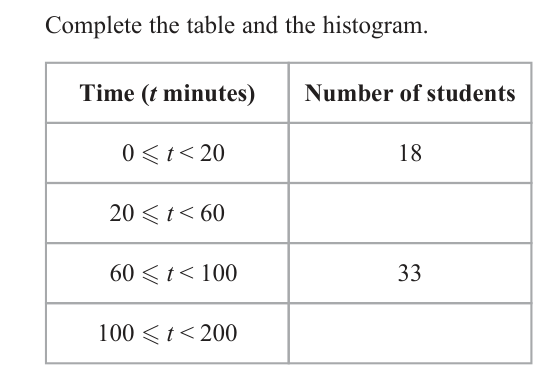
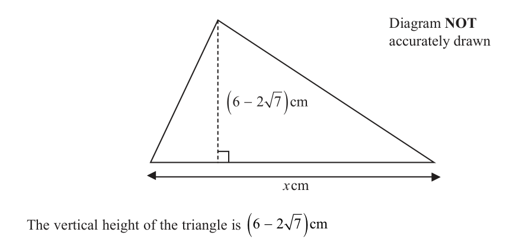
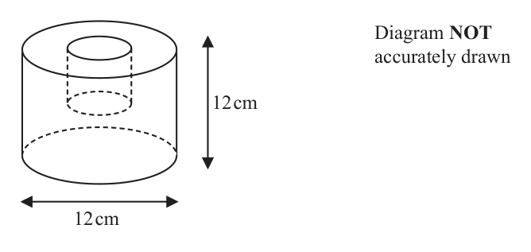

# 4MB1/01R — 2026-06 (official extraction)

> schema `syllabai.official-paper-questions/0.2` · paper_id `pearson-edexcel:international-gcse:mathematics-b:4mb1:2026-06:4MB1/01R` · qp sha256 `b7fb2c14cc9d7555…` · extraction is the disclosed baseline (ADR-039)

## Question 1 (2 marks)

Noah travels 18 km on his bicycle. The journey time is 45 minutes. Work out Noah’s average speed, in km/h, for the journey. ........................................ . . . . . . . . . . . . . . . . . . . . . . km/h

### 1 [2]

Noah travels 18 km on his bicycle. The journey time is 45 minutes. Work out Noah’s average speed, in km/h, for the journey km/h

**Mark scheme answer**

> 18 45 2 M1 Speed in km/min or time in hours found.
> [ = 0.4] oe or [ = 0.75] oe
> 45 60 Allow a calculation to be in km/sec ie
> 2700
> Allow for correct fraction or decimal seen. Ignore units written.
> Look for as part of a calculation eg
> cas 24 A1 cao
> Total 2 marks

- **(2)** 18 45 2 M1 Speed in km/min or time in hours found.

## Question 2 (2 marks)

Without using a calculator and showing all your working, work out 2 1 1 +2 3 4 Give your answer as a mixed number in its simplest form.

### 2 [2]

Without using a calculator and showing all your working, work out 2 1 1 +2 3 4 Give your answer as a mixed number in its simplest form.

**Mark scheme answer**

> 8 3 2 M1 Adding whole parts and expressing fractional parts with
> 1 + 2 [= 3] and + oe or common denominator or
> 12 12
> 20 27 expressing as improper fractions with a common denominator.
> + oe Accept sum with shared denominator or which shows working
> 12 12
> 2 × 4 + 1× 3 5× 4 9× 3
> eg eg +
> 12 3× 4 4 × 3
> 2
> Do not accept eg × 4 × 3 unless clearly recovered.
> 3
> wr 11 A1 cao
> 3 isw eg decimals after a correct answer.
> Total 2 marks

- **(2)** 8 3 2 M1 Adding whole parts and expressing fractional parts with

## Question 3 (2 marks)

E = {1, 2, 3, 4, 5, 6, 7, 8, 9, 10} A = {1, 3, 5, 7, 9} B = {3, 6, 9} Show all this information on the Venn diagram. E A B

### 3 [2]

E = {1, 2, 3, 4, 5, 6, 7, 8, 9, 10} A = {1, 3, 5, 7, 9} B = {3, 6, 9} Show all this information on the Venn diagram. E A B

> 🖼 crop required: diagram (qp.pdf p.None)

**Mark scheme answer**

> 2 B2 Fully correct
> (B1 2 or 3 out of 4 correct regions)
> A B
> 2 4 1 5 3
> 8 10 7
> Total 2 marks
> Question Working Answer Mark Notes

- **(2)** 2 B2 Fully correct

## Question 4 (2 marks)

A straight line L passes through the points with coordinates 6, 0 and 0, 8 Find an equation of L Give your answer in the form y mx c

### 4 [2]

A straight line L passes through the points with coordinates 6, 0 and 0, 8 Find an equation of L Give your answer in the form y mx c

**Mark scheme answer**

> 8 [ −0] ⎡ 8 4⎤ 2 M1 Correct method to find gradient or correct gradient
> Gradient = ⎢ − = − ⎥ oe y = mx + 8 seen
> [ 0] − 6 ⎣ 6 3 ⎦
> or y = mx + 8
> or − x oe seen
> or − x oe
> cas 4 A1 oe in the form y = mx + c (allow y = −1.3(33…)x + 8)
> y = − x+8 •
> 3 For a decimal allow 1.3 or better eg 1.3 or 1.33
> Allow 8 to be oe
> Allow
> − x + 8 on the answer line, only if y = seen at least once in the
> working.
> Total 2 marks

- **(2)** 8 [ −0] ⎡ 8 4⎤ 2 M1 Correct method to find gradient or correct gradient

## Question 5 (2 marks)

Find the value of when a = 3 and b a2 b2

### 5 [2]

Find the value of when a = 3 and b a2 b2

**Mark scheme answer**

> 3 − ( −4 ) 2 M1 Substitute into formula, must have correct signs, accept
> 32 + ( −4 )
> 2 3+ 4 3+ 4 7 m
> 2 or or or m, n are integers
> 3 +4
> 9 + 16 n
> Missing brackets may be recovered.
> cas 7 A1 oe eg 0.28
> oe isw after correct answer seen
> Total 2 marks
> Question Working Answer Mark Notes

- **(2)** 3 − ( −4 ) 2 M1 Substitute into formula, must have correct signs, accept

## Question 6 (3 marks)

Diagram NOT x cm accurately drawn D C 5 cm A B 10 cm The diagram shows trapezium ABCD where AB is parallel to DC AB = 10cm and DC = x cm The vertical height of the trapezium is 5 cm Given that the area of the trapezium is 45 cm2 find the value of x x = ......................... . . . . . . . . . . . . . . . . . . . . . . . . . . . . . . . . . . . . .

### 6 [3]

Diagram NOT x cm accurately drawn D C 5 cm A B 10 cm The diagram shows trapezium ABCD where AB is parallel to DC AB = 10cm and DC = x cm The vertical height of the trapezium is 5 cm Given that the area of the trapezium is 45 cm2 find the value of x x =

> 🖼 crop required: diagram (qp.pdf p.None)

**Mark scheme answer**

> 1 3 M1 forming correct equation in x
> × ( x + 10 ) × 5 = 45 oe Allow any correct equation where there is already a partial
> rearrangement.
> 1 45 × 2
> Eg × ( x + 10 ) = 9 Eg ( x + 10 ) =
> 2
> Condone splitting into a rectangle and 2 triangles or 2 rectangles
> as follows:
> ⎡ 1 ⎤ ⎛ 10 − x ⎞
> 45 = ⎢ 2 × ⎥ × 5 ⎜ ⎟ + 5x
> ⎣ 2⎦ ⎝ 2 ⎠
> Condone use of eg a or b for x
> 2 × 45 M1 dep on previous M1 correct order of operations to isolate x
> [ x =] − 10 oe May imply the previous method mark
> This may be done in stages.
> cas 8 A1 cao
> Total 3 marks

- **(3)** 1 3 M1 forming correct equation in x

## Question 7 (3 marks)

3 3 x 2 4 1 A B C D 1 5 2 x

### 7(a) [2]

Find A + B Given that A C D

**Mark scheme answer**

> ⎛ 4 2⎞ 2 B2 Fully correct
> ⎜ ⎟ (B1 2 or 3 values correct)
> ⎝2 1⎠

- **(2)** ⎛ 4 2⎞ 2 B2 Fully correct

### 7(b) [1]

find the value of x x =

**Mark scheme answer**

> 3 1 B1 cao
> 3 only
> Total 3 marks

- **(1)** 3 1 B1 cao

## Question 8 (3 marks)
### 8(a) [2]

Find the Highest Common Factor (HCF) of 24 and 54 Show all your working.

**Mark scheme answer**

> 24 = 23 × 3 or 54 = 2 × 33 2 M1 correct attempt to split either 24 or 54 into prime factors
> or 24 = 22 × 6 or 54 = 6 × 32 or prime factor tree (which may stop at last two factors)
> or 24 or 24 eg
> 3 8 2 12 2
> 2 4 2 6 3
> 2 2 2
> or 54 or
> 2 27 3
> 3 9 2
> 3 3 3
> or or diagram as shown, with prime factorisation as far as 4 and 9
> 2 24 54 or 3 24 54
> 3 12 27 2 8 18
> 4 9 4 9
> or complete list of factors of 24 and 54
> or complete list of factors of 24 and 54 (condone 1, 24 and 54 not present)
> or or correct Venn diagram as shown (can be missing the
> rectangle).
> 2 2
> 2 3
> Award for working seen in part (b) if not awarded in (a)
> wr 6 A1 cao do not accept 2 × 3

- **(2)** 24 = 23 × 3 or 54 = 2 × 33 2 M1 correct attempt to split either 24 or 54 into prime factors

### 8(b) [1]

Find the Lowest Common Multiple (LCM) of 24 and 54

**Mark scheme answer**

> 216 1 B1 cao do not accept 23 × 33
> Total 3 marks
> Question Working Answer Mark Notes

- **(1)** 216 1 B1 cao do not accept 23 × 33

## Question 9 (3 marks)
### 9(a) [2]

Solve the inequality 3 4 x

**Mark scheme answer**

> 4x < 13 – 3 or 4x < 10 oe 2 M1 correctly isolates term in x
> eg 2x < 5 eg 3 – 13 < – 4x
> or or for correctly dividing through by 4
> 3 [ 4] x 13
> + < oe eg 0.75 + x < 3.25
> 4 [ 4] 4 or for oe with no inequality or an incorrect inequality or
> or oe equals symbol
> cas 5 5
> x< A1 oe eg >x x<
> 2 2
> Allow a correctly inequality, then incorrectly processed
> eg x < followed by eg x < 0.5 eg x < 10 will get A1
> Allow this to be awarded in the body of working.
> do not isw when there is misunderstanding
> 5
> x < oe followed by oe is A0
> 2
> 5
> x = oe is A0 x > oe is A0
> 2

- **(2)** 4x < 13 – 3 or 4x < 10 oe 2 M1 correctly isolates term in x

### 9(b) [1]

On the number line below, represent the inequality y < 2 y −5 −4 −3 −2 −1 0 1 2 3 4 5

**Mark scheme answer**

> 1 B1 cao
> Accept anything that has an open circle at 2, with an arrow
> –5 –4 –3 –2 –1 0 1 2 3 4 5 pointing in the correct direction. Allow “(“ to represent an open
> circle.
> Eg
> as arrow indicates this continues beyond where the line stops.
> Total 3 marks
> Question Working Answer Mark Notes

- **(1)** 1 B1 cao

## Question 10 (3 marks)

y y=x+3 R x=4 x+y=4 O x Write down three inequalities that define the shaded region R in the diagram above.

### 10 [3]

y y=x+3 R x=4 x+y=4 O x Write down three inequalities that define the shaded region R in the diagram above.

> 🖼 crop required: diagram (qp.pdf p.None)

**Mark scheme answer**

> x„ 4 3 B3 All 3 correct
> oe eg B2 Any 2 correct
> x − 4„ 0 B1 Any 1 correct
> y „ x+3 Accept equivalents, condone strict inequalities
> oe eg
> y − x„ 3
> cas x + y …4
> oe eg
> y …4 − x SC1 – all three inequalities incorrect way round, strict or not
> Total 3 marks
> Question Working Answer Mark Notes

- **(3)** x„ 4 3 B3 All 3 correct

## Question 11 (3 marks)

Diagram NOT A B accurately drawn 80° 5 cm O OAB is a sector of a circle, centre O and radius 5 cm AOB 80° Calculate the perimeter, in cm to 2 significant figures, of the sector OAB ................................... . . . . . . . . . . . . . . . . . . . . . . . . . . . cm

### 11 [3]

Diagram NOT A B accurately drawn 80° 5 cm O OAB is a sector of a circle, centre O and radius 5 cm AOB 80° Calculate the perimeter, in cm to 2 significant figures, of the sector OAB cm

> 🖼 crop required: diagram (qp.pdf p.None)

**Mark scheme answer**

> 80 ⎡ 20 ⎤ 3 M1 Correct method to find arc length
> × 2 × π × 5 ⎢= π = 6.981...⎥ oe Watch for this done in parts.
> 360 ⎣ 9 ⎦
> If miscalculation during, award marks for method
> eg
> 2 × π × 5 [ = 8.281... correct method, incorrect processing ]
> × "8.281" gets this mark
> "6.981..."+ 2 × 5 [=16.981] oe M1 Add on straight edges to their arc length.
> It should be clear they’re adding the 2 straight edges onto
> something they think is the arc length (ie nothing to contradict
> this is the arc length).
> cas 17 A1 awrt 17
> Watch out for incorrect method of finding the area which also
> leads to a value of 17 (to 2sf)
> 17.4532……
> Total 3 marks
> Question Working Answer Mark Notes

- **(3)** 80 ⎡ 20 ⎤ 3 M1 Correct method to find arc length

## Question 12 (3 marks)

The incomplete table and the incomplete histogram give information about the length of time, in minutes, that each of 100 students worked in a library. Complete the table and the histogram. Time (t minutes) Number of students 0 ≤ t < 20 18 20 ≤ t < 60 60 ≤ t < 100 33 100 ≤ t < 200 Frequency density 0 40 80 120 160 200 Time (t minutes)

### 12 [3]

The incomplete table and the incomplete histogram give information about the length of time, in minutes, that each of 100 students worked in a library. Complete the table and the histogram. Time (t minutes) Number of students 0 ≤ t < 20 18 20 ≤ t < 60 60 ≤ t < 100 33 100 ≤ t < 200 Frequency density 0 40 80 120 160 200 Time (t minutes)

**Mark scheme answer**

> Frequency density of 3 M1 Method to find either a frequency for the table or height of a
> 18 33 bar or correct frequency density.
> oe eg 0.9 or oe eg 0.825 seen
> 20
> by the table Any correct missing frequency or frequency density implies this
> or mark
> in working
> or
> on the graph
> or
> any correct missing frequency or
> frequency density indicated in table, on
> graph or in working (39 or 10)
> or
> any correct FD on the vertical axis
> where the height of 1 small square is
> 0.025 = oe
> eg 8 cm to 1 FD
> or
> eg 1 cm2 to 2.5 frequency
> 39 or 10 A1 indicated on table, on graph or in working.
> cas A1
> Bar from 60-100 height 0.825 (33 small squares), and
> Bar from 100-200 height 0.1 (4 small squares)
> Total 3 marks
> Question Working Answer Mark Notes

- **(3)** Frequency density of 3 M1 Method to find either a frequency for the table or height of a

## Question 13 (3 marks)

The diagram shows a triangle. Diagram NOT accurately drawn x cm The vertical height of the triangle is 6 2 7 cm The length of the base of the triangle is x cm The area of the triangle is 1 7 cm Without using a calculator find the value of x Give your answer in the form a + b c where a, b and c are prime numbers. Show all your working. x = ......................... . . . . . . . . . . . . . . . . . . . . . . . . . . . . . . . . . . . . .

### 13 [3]

The diagram shows a triangle. Diagram NOT accurately drawn x cm The vertical height of the triangle is 6 2 7 cm The length of the base of the triangle is x cm The area of the triangle is 1 7 cm Without using a calculator find the value of x Give your answer in the form a + b c where a, b and c are prime numbers. Show all your working. x =

**Mark scheme answer**

> 1+ 7 ⎡ 1+ 7 2 + 2 7 ⎤ ⎡1 ⎤ 1+ 7 3 M1
> [ x =] 1 ⎢= = ⎥ or ⎢ x = ⎥ oe Any correct expression shown oe
> (
> 6−2 7 ⎣ )3 − 7 6 − 2 7 ⎦ ⎣ 2 ⎦ 6 − 2(7 ) For this question, completely ignore
> 2
> labelling of x or x
> 1+ 7 3 + 7 3+3 7 + 7 +7 10 + 4 7 M1 For rationalising any of
> Finding x × = or 1+ 7 1+ 7 2+2 7
> 3 − 7 3 + 7 9 ⎡ +3 7 − 3 7 ⎤ − 7 2 oe
> ⎣ ⎦
> 1 + 7 −3 − 7 −3 − 3 7 − 7 − 7
> (
> 6−2 7 3 −
> )7 6 − 2
> × =
> 3 − 7 −3 − 7 −9 ⎡ +3 7 − 3 7 ⎤ + 7 1+ 7
> oe eg ⎣ ⎦ or oe
> −10 − 4 7 10 + 4 7 (
> 6−2 7 )
> or or
> −2 2 a correct product stated to rationalise the
> denominator
> 2 + 2 7 6 + 2 7 12 + 12 7 + 4 7 + 4 × 7 40 + 16 7
> oe eg × = or and processing with at least
> 6 − 2 7 6 + 2 7 36 ⎡ +12 7 − 12 7 ⎤ − 28 8 2 out of 4 numerator terms correct
> ⎣ ⎦
> 1 and correct processing of denom
> or Finding x allow any mix of processing – full
> 2 evaluation doesn’t need to be seen eg
> 1+ 7 6 + 2 7 6 + 6 7 + 2 7 + 14 20 + 8 7
> ( 7 ) for 7
> × = or accept 4 × 7 for 28
> 6 − 2 7 6 + 2 7 36 ⎡ +12 7 − 12 7 ⎤ − 28
> ⎣ ⎦
> 10 + 3 7 + 7
> oe eg eg
> 9−7
> 1 + 7 −6 − 2 7 −6 − 6 7 − 2 7 − 14
> × = 10 − 7 7 + 7
> 6 + 2 7 −6 − 2 7 −36 ⎡ +12 7 − 12 7 ⎤ − 28 eg
> ⎣ ⎦
> ( 7)
> 9−
> −20 − 8 7 20 + 8 7
> or or would imply 2 out of 4 terms correct.
> −8
> wr 5+ 2 7 A1
> accept
> a = 5, b = 2, c = 7
> Total 3 marks
> Question Working Answer Mark Notes

- **(3)** 1+ 7 ⎡ 1+ 7 2 + 2 7 ⎤ ⎡1 ⎤ 1+ 7 3 M1

## Question 14 (4 marks)

The value of an investment increases by 20% to $1926

### 14(a) [2]

Find the value of the investment before the increase. $ Using an exchange rate of 1 euro = $1.07

**Mark scheme answer**

> 1926 1926 1926 2 M1 Complete method to reverse percentage increase
> or ×100 oe eg ×5 or a correct equation in x
> 1.2 120
> 1.2x = 1926 1926 1926
> Condone eg eg
> 120% (1 + 20%)
> Do not condone this, without the % sign
> cas 1605 A1 cao

- **(2)** 1926 1926 1926 2 M1 Complete method to reverse percentage increase

### 14(b) [2]

change $1926 into euros euros

**Mark scheme answer**

> 1926 2 M1 Correct method to change $1926 into euros
> oe
> 1.07
> cas 1800 A1 cao
> Total 4 marks

- **(2)** 1926 2 M1 Correct method to change $1926 into euros

## Question 15 (4 marks)
### 15(a) [2]

Calculate 9 10100 1.2 10101 Give your answer in standard form.

**Mark scheme answer**

> 10.8 ×10201 or 1.08 ×10n or k ×10202 2 M1 n must be an integer and 1„ k < 10
> cas 1.08 ×10 202
> A1 cao

- **(2)** 10.8 ×10201 or 1.08 ×10n or k ×10202 2 M1 n must be an integer and 1„ k < 10

### 15(b) [2]

Calculate 9 10100 1.2 10101 Give your answer in standard form.

**Mark scheme answer**

> 0.9 ×10 or 12 ×10
> 101 100
> or 21×10
> 100
> or M1 Express both numbers with same exponent where m is an
> 2.1×10m or q ×10101 integer and 1„ q < 10 .
> cas 2.1×10101 2 A1 cao
> Total 4 marks
> Question Working Answer Mark Notes

- **(2)** 0.9 ×10 or 12 ×10

## Question 16 (4 marks)

A large solid cylinder has a diameter of 12 cm and a height of 12 cm

### 16(a) [1]

Show that the volume of the cylinder is 432π cm3 Diagram NOT accurately drawn 12 cm 12 cm The diagram shows a large solid cylinder from which a small cylinder is removed. The volume of the solid formed is 416π cm3 Given that the small cylinder is similar to the large cylinder,

**Mark scheme answer**

> π × 62 ×12 [ = 432π ] or 1 B1 one of the correct expressions only
> ⎛ 12 ⎞
> π × ⎜ ⎟ ×12 [ = 432π ]
> ⎝ 2⎠
> or π × 36 ×12 [ = 432π ]

- **(1)** π × 62 ×12 [ = 432π ] or 1 B1 one of the correct expressions only

### 16(b) [3]

calculate the diameter of the small cylinder cm

**Mark scheme answer**

> π r 2 × 2r = ( 432 − 416 ) π [ = 16 π ] oe 3 M1 correct equation involving r or d only
> (r is radius d is diameter of small cylinder)
> or
> Allow any letters for r or d
> ⎛d ⎞
> π ⎜ ⎟ × d = ( 432 − 416 ) π [ = 16 π ] oe
> ⎝2⎠
> or
> ⎡ 16 ⎤
> ⎢⎣( 432 − 416 ) π = π r h ⇒ h = r 2 ⎥⎦
> 16 16π
> ⎡ h r⎤ r = r oe eg π r 2 = r
> = ⇒
> ⎢⎣12 6 ⎥⎦ 12 6 12
> where r and h are radius and height of
> small cylinder
> [r =] 2 M1 Dep on 1st M
> solves for r or d (allow 1 processing error)
> cas 4 A1
> ALT1 (b) ( 432 − 416 ) π ⎡ = 16π = 1 ⎤ oe find ratio of volumes of smaller cylinder to original
> 432π ⎢⎣ 432π 27 ⎥⎦ and find a linear ratio
> For 16π allow awrt 50.3
> and 3
> ( 432 − 416 ) π ⎡ = 1 ⎤ oe For 416π allow awrt 1310
> 432π ⎢⎣ 3 ⎥⎦ For 432π allow awrt 1360
> or
> 432π ⎡ 432π ⎤
> ⎢ = = 27 ⎥ oe
> ( 432 − 416 ) π ⎣ 16π ⎦
> 432π
> and 3 [ = 3] oe
> ( 432 − 416 ) π
> 1 1 M1 Dep on 1st M
> 12 × " " or 6 × " " oe use linear ratio to find diameter or radius
> 3
> cas 4 A1 awrt 4
> ALT2 (b) ( 432 − 416 ) π = ⎛ d ⎞3 oe M1 correct equation involving d only
> ⎜ ⎟ (d is diameter of small cylinder)
> 432π ⎝ 12 ⎠
> For 16π , 416π , 432π allow values as per ALT1
> Allow any letter for d (including r)
> [d =] 4 M1 Dep on 1st M
> solves for d (allow 1 processing error)
> cas 4 A1 awrt 4
> Total 4 marks
> Question Working Answer Mark Notes

- **(3)** π r 2 × 2r = ( 432 − 416 ) π [ = 16 π ] oe 3 M1 correct equation involving r or d only

## Question 17 (4 marks)
### 17(a) [2]

Simplify fully 2 x 2 y 3 125 p q

**Mark scheme answer**

> Examples for B1: 6 9
> 8x y 2
> B2 For the correct term. Allow in any order eg x 8 y
> 8 must not be 23
> 23 x 6 y 9 (B1 any 2 terms correct as part of a product of the form
> x 5 × 23 × y 9 bxn y m b, m, n ≠ 0 . Allow 8 to be 23
> Condone terms with or without of multiplication signs for B1
> x 6 × y 9 × 23
> only eg x × y 2
> 6 9 3
> 6 9
> 4.5 x y Only allow transcription errors of the powers or the constant
> onto the answer line)
> Do not isw (B1 only)

- **(2)** Examples for B1: 6 9

### 17(b) [2]

Write 15 3 in the form ap m q n where a, m and n are integers. 375 p q

**Mark scheme answer**

> Examples for B1: 9 p8q 4 2 8 4
> B2 Allow in any order eg p q 9
> Condone a = 9, m = 8, n = 4
> 32 p8 q 4 9 must not be 32
> p8 × 32 × q −2 B1 any 2 terms correct as part of a product of the form
> apn qm a, n, m ≠ 0 . Allow 9 to be 32
> p ×q ×3
> 6 4
> Condone terms with or without of multiplication signs for B1
> p q ×6
> 8 4
> only eg p × q 3
> 6 4 2
> Only allow transcription errors of the powers or the constant
> onto the answer line
> Do not isw (B1 only)
> Total 4 marks
> Question Working Answer Mark Notes

- **(2)** Examples for B1: 9 p8q 4 2 8 4

## Question 18 (4 marks)

Diagram NOT C accurately drawn (x + 1) cm x cm 20° A B The diagram shows triangle ABC AC x cm BC = x cm ABC BAC 20° Calculate the length, in cm to 2 significant figures, of BC ................................... . . . . . . . . . . . . . . . . . . . . . . . . . . . cm

### 18 [4]

Diagram NOT C accurately drawn (x + 1) cm x cm 20° A B The diagram shows triangle ABC AC x cm BC = x cm ABC BAC 20° Calculate the length, in cm to 2 significant figures, of BC cm

> 🖼 crop required: diagram (qp.pdf p.None)

**Mark scheme answer**

> x 4 M1 Form correct equation in x using sin 20
> = sin 20 [ = 0.342] Allow also BC or a mix of BC and x
> x +1
> oe eg x = ( x + 1) sin 20 Allow sin 20 to be awrt 0.34 throughout.
> x x +1 Allow a processing error for sin 20 if clearly seen written first
> eg =
> sin 20 sin 90 (general marking principle, if not precluded by the MS)
> A common error seen will be where a candidate’s calculator is in
> radians and they evaluate sin20 as 0.912945…..
> Must be using a number with minimum 2dp.
> Allow a misevaluation of sin20, if sin20 is seen, throughout, with
> continued correct working.
> x = x sin 20 + sin 20 Dep on 1st M1
> oe eg x − sin 20 = x sin 20 Correctly removes fraction from equation and expands bracket
> eg 0.34(2…)x + 0.34(2…) = x Can imply the previous method mark.
> x(1 − sin 20) = sin 20 Dep on 2nd M1
> oe eg x(1 − sin 20) − sin 20 = 0 Correctly separates terms in x (or collects if using awrt 0.34)
> sin 20 0.34(2...) Can imply previous 2 method marks.
> eg [ x =] =
> 1 − sin 20 1 − 0.34(2...)
> cas 0.52 A1 awrt 0.52
> ALT1 ⎡( AB ) = 4 M1 For a correct equation in x and
> ( x + 1) − x 2 = 2 x + 1⎤⎥
> ⎢⎣ ⎦ sin20 or cos20 or tan20
> 2x +1 ⎛ 2x +1 ⎞ sin20 = 0.34202…..
> oe eg ( cos 20 ) = ⎜⎜
> cos 20 = ⎟⎟ oe
> x +1 ⎝ x + 1 ⎠ cos20 = 0.93969….
> tan20 = 0.36397….
> or
> 2x +1 x 2x +1 x2 2x +1 x +1 (sin20)2 = 0.11697…..
> = oe eg = eg =
> sin 70 sin 20 ( sin 70 ) ( sin 20 )
> 2
> sin 70 [sin 90] (cos20)2 = 0.88302….
> (tan20)2 = 0.13247….
> or
> x ⎛ x ⎞
> Allow awrt 2dp
> oe eg ( tan 20 ) = ⎜
> tan 20 = ⎟ oe
> 2x +1 ⎝ 2x +1 ⎠
> ( cos 20 ) x 2 + ( 2 ( cos 20 ) − 2 ) x + ( cos 20 ) − 1[ = 0] oe M1 dep on 1st M1
> 2 2
> For correct 3 term quadratic in cos20 or tan 20
> or
> Award if 2 out of 3 terms are correct
> ( sin 70 ) x 2 − 2 ( sin 20 ) x − ( sin 20 ) [ = 0] oe
> 2 2
> or Don’t need to see = 0
> ( 0.88302...) x 2 − ( 0.23395...) x − 0.11697...[ = 0] oe May imply previous M mark with 2
> or coefficients correct
> x 2 − 2 ( tan 20 ) − ( tan 20 ) [ = 0] oe
> 2
> Allow evaluated coefficients awrt
> or 0.88, 0.23. 0.12, 0.26, 0.13
> x 2 − ( 0.26494...) x − 0.13247...[ = 0] oe
> M1 dep on 2nd M1 (ie using a 3TQ with 2 out
> ( ) (( )) ( )
> − 2 ( cos 20 ) − 2 ± 2 ( cos 20 ) − 2 − 4 ( cos 20 ) ( cos 20 ) − 1
> 2 2 2
> eg [ x =] of 3 terms correct)
> 2 ( cos 20 )
> Correct substitution into the quadratic formula
> cas 0.52 A1 awrt 0.52
> ALT2 ⎡( AB ) = 4 M1 correct equation in x using cosine rule
> ( x + 1) − x 2 = 2 x + 1⎤⎥
> ⎢⎣ ⎦
> cos70 = 0.34202…..
> ( 2x + 1) − 2 ( x + 1) ( 2x + 1) cos 20 oe
> x 2 = ( x + 1) +
> cos20 = 0.93969….
> ( x + 1) + 2 x + 1 − x 2
> oe eg cos 20 = Allow awrt 2dp
> 2 ( x + 1) 2 x + 1
> or
> ( 2 x + 1) = ( x + 1) + x − 2 x ( x + 1) cos 70
> 2 2
> ( ) ( )
> 2 ( cos 20 ) x3 + 5 ( cos 20 ) − 4 x 2 + 4 ( cos 20 ) − 4 x + ( cos 20 ) − 1[ = 0 ]
> 2 2 2 M1 dep on 1st M1
> For correct 4 term cubic in cos20 or quadratic in
> or cos70
> (1.76604...) x3 + ( 0.41511...) x 2 − ( 0.46791...) x − 0.11697...[ = 0] oe
> Award if 2 out of 4 terms are correct for the cubic
> or or 2 out of 3 terms correct for the quadratic.
> ( 2 − 2cos70 ) x2 − ( 2cos70 ) x [ = 0] Don’t need to see = 0
> or May imply previous M mark with 2 coefficients
> (1.31595....) x2 − ( 0.68404....) x [ = 0] correct
> Allow evaluated coefficients awrt
> 1.77, 0.42, - 0.47, - 0.12, 1.32, 0.68 in the relevant
> cubic or quadratic
> eg x ( ( 2 − 2cos 70 ) x − 2cos 70 ) [ = 0] oe M1 for correct factorisation or use of correct
> 2cos 70
> substitution into the quadratic formula to solve the
> oe eg [ x = ] oe 2TQ (with at least one term correct)
> 2 − 2cos 70
> May be implied by awrt 0.52
> cas 0.52 A1 awrt 0.52
> Mark
> Question Working Answer Notes

- **(4)** x 4 M1 Form correct equation in x using sin 20

## Question 19 (4 marks)

Express as a single fraction in its simplest terms x 2 3x 2 9 x

### 19 [4]

Express as a single fraction in its simplest terms x 2 3x 2 9 x

**Mark scheme answer**

> 3 x 2 + 9 x = 3 x ( x + 3) 4 M1 Correctly factorises 3x 2 + 9 x
> or or
> 2 x2 + 9 x + 9 = (2 x + 3)( x + 3) factorises 2 x 2 + 9 x + 9 correctly
> May be awarded for factorising after the fractions are added,
> in which case expect to see 3x( x + 3)( x − 2) in the denom
> 2 x2 + 9 x + 9 2 x + 3 M1
> =
> 3x 2 + 9 x 3x
> or Correct simplification of the second fraction.
> ( 2 x2 + 9 x + 9) ( x − 2) =
> 2x + 3
> May be awarded for simplification after the fractions are
> added
> ( 3x + 9 x ) ( x − 2 )
> 3x
> 3 x( x − 5) + ( x − 2)(2 x + 3) 3x 2 − 15 x 2 x 2 − x − 6 M1 For the correct addition of the 2 correct fractions.
> oe eg +
> 3 x( x − 2) 3x 2 − 6 x 3x 2 − 6 x
> or Must reach a common denominator.
> This may be as separate fractions.
> eg
> ( ) (
> 3x 2 + 9 x ( x − 5) ( x − 2) 2 x 2 + 9 x + 9
> +
> )
> ( )
> 3x 2 + 9 x ( x − 2) ( )
> 3x 2 + 9 x ( x − 2) Missing brackets must be recovered.
> or May be implied by A1
> 3x( x + 3)( x − 5) + ( x − 2)(2 x + 3)( x + 3)
> eg
> 3x( x + 3)( x − 2)
> 5 x − x − 54 x − 18
> 3
> or eg
> 3x3 + 3x 2 − 18 x
> 3x3 − 15 x 2 + 9 x 2 − 45 x 2 x3 + 9 x 2 + 9 x − 4 x 2 − 18x − 18
> or eg +
> 3x3 + 9 x 2 − 6 x 2 − 18x 3x3 + 9 x 2 − 6 x 2 − 18x
> cas 5 x 2 − 16 x − 6 A1 oe must be simplified
> 3 x( x − 2) 5 x 2 − 16 x − 6
> eg
> 3x 2 − 6 x
> Total 4 marks
> Question Working Answer Mark Notes

- **(4)** 3 x 2 + 9 x = 3 x ( x + 3) 4 M1 Correctly factorises 3x 2 + 9 x

## Question 20 (4 marks)

f x x 3 7 x 2 17 x

### 20(a) [2]

Use the factor theorem to show that x 2 is a factor of f x Given that f x x Q x where Q x is a quadratic expression in x

**Mark scheme answer**

> [ f (−2) =] eg 2 M1
> If a full substitution is not seen, the minimum we will accept
> ( −2 ) + 7 × ([ −] 2 ) + 17 × −2 + 14
> 3
> is
> −8 + 28 − 34 + 14
> Condone
> −23 + 7 × −22 + 17 × −2 + 14 = 0
> or
> −23 + 7 × ( −2 ) + 17 × −2 + 14 = 0
> Must see = 0 for either of these
> Ignore any reference to long division for part (a)
> wr =0 A1

- **(2)** [ f (−2) =] eg 2 M1

### 20(b) [2]

find Q x Q x

**Mark scheme answer**

> x + Ax + 7 or x + 5x + B
> 2
> A, B > 0 2 M1 Any 2 terms of the quadratic factor obtained –
> this may be seen awarded for the correct quadratic factor
> seen in part (a)
> cas x2 + 5x + 7 A1
> Do not isw eg if they go on to solve, after seeing the correct
> quadratic, award A0
> This must be seen in part (b) to be awarded
> Total 4 marks
> Question Working Answer Mark Notes

- **(2)** x + Ax + 7 or x + 5x + B

## Question 21 (4 marks)

Shape A is transformed to shape B under the transformation with matrix M where 1 1 M Shape B is transformed to shape C under the transformation with matrix N where N Shape C is transformed to shape A under the transformation with matrix P Find the matrix P P

### 21 [4]

Shape A is transformed to shape B under the transformation with matrix M where 1 1 M Shape B is transformed to shape C under the transformation with matrix N where N Shape C is transformed to shape A under the transformation with matrix P Find the matrix P P

**Mark scheme answer**

> ⎛15 19 ⎞ 4 M1 Attempt to find NM (at least 2 values in the matrix
> [ NM =] ⎜ ⎟ correct)
> ⎝19 24 ⎠
> ⎡ ⎛ 15 19 ⎞ ⎤ M1 Correct method to find determinant of their NM
> ⎢⎜ ⎟ = ⎥ 15 × 24 − 19 ×19 [ = −1] (allow their MN)
> ⎢⎣ ⎝19 24 ⎠ ⎥⎦ Eg for MN
> For reference ⎡⎛ 7 −9 ⎞ ⎤
> ⎡ ⎛ 7 −9 ⎞ ⎤ ⎢⎜ ⎟ = ⎥ 7 × 32 − ( −9 ) × ( −25 ) [ = −1]
> ⎣⎝ −25 32 ⎠ ⎦
> ⎢MN = ⎜ ⎟⎥
> ⎣ ⎝ −25 32 ⎠ ⎦ For an incorrect NM or MN, correct working must be shown
> for their matrix product
> 7 × 32 − (−9 × −25) [ = −1]
> ⎡ 1 ⎤ ⎛ 24 −19 ⎞ M1 ft their NM (allow their MN)
> ( )
> −1
> ⎢⎣ NM = ⎜ ⎟
> −1⎥⎦ ⎝ −19 15 ⎠
> This mark is for (ignore the determinant)
> ⎛ a b ⎞ ⎛ d −b ⎞
> ⎜ ⎟→⎜ ⎟ with their NM or their MN
> ⎝ c d ⎠ ⎝ −c a ⎠
> cas ⎛ −24 19 ⎞ A1
> ⎜ ⎟
> ⎝ 19 −15 ⎠
> or Allow
> −19 ⎞ 1 ⎛ 24 −19 ⎞
> ⎛ 24 −19 ⎞
> −⎜
> eg − 1 ⎛⎜ 24 ⎟ or eg ⎜ ⎟
> ⎟ 1 ⎝ −19 15 ⎠ −1 ⎝ −19 15 ⎠
> ⎝ −19 15 ⎠
> Total 4 marks
> Alt1 ⎢⎜ ⎟ = ⎥ 1× ( −4 ) − 1× ( −3) [ = −1]
> ⎢⎣ ⎝ −3 −4 ⎠ ⎥⎦
> or
> ⎡ ⎛ 3 −4 ⎞ ⎤
> ⎢⎜ ⎟ = ⎥ 3 × ( −5 ) − 4 × ( −4 ) [ = 1]
> ⎢⎣ ⎝ 4 −5 ⎠ ⎥⎦
> ⎛ 1 1 ⎞ ⎛ −4 −1⎞ M1 correct method to find inverse (ignore determinant) of M
> ⎜ ⎟→⎜ ⎟ or or N
> ⎝ −3 −4 ⎠ ⎝ 3 1 ⎠
> ⎛ 3 −4 ⎞ ⎛ −5 4 ⎞
> ⎜ ⎟→⎜ ⎟
> ⎝ 4 −5 ⎠ ⎝ −4 3 ⎠
> ⎛ −24 19 ⎞ M1 Find M −1N −1
> ⎜ ⎟ Awarded if at least 2 out of 4 numbers in the final matrix are
> ⎝ 19 −15 ⎠
> correct.
> cas ⎛ −24 19 ⎞ A1
> ⎜ ⎟
> ⎝ 19 −15 ⎠
> or Allow
> −19 ⎞ 1 ⎛ 24 −19 ⎞
> ⎛ 24 −19 ⎞
> −⎜
> eg − 1 ⎛⎜ 24 ⎟ or eg ⎜ ⎟
> ⎟ 1 ⎝ −19 15 ⎠ −1 ⎝ −19 15 ⎠
> ⎝ −19 15 ⎠
> Alt2 [ NM =] ⎜ ⎟ (at least 2 numbers in the matrix correct)
> ⎝19 24 ⎠
> ⎛ 15 19 ⎞ ⎛ x1 x2 x3 ..... ⎞ M1 Correct attempt to multiply any 2 by 2 matrix representing
> "⎜ ⎟ "⎜ y y ⎟ their NM by a 2 by n matrix with entries that form coordinates
> ⎝ 19 24 ⎠ ⎝ 1 2 y3 ..... ⎠
> that could make any shape with n sides.
> ⎛ x ' x2 ' x3 '... ⎞ Entries in the resulting matrix will need to be checked.
> =⎜ 1 ⎟ Allow for 2 correct columns using their NM and their set
> ⎝ y1 ' y2 ' y3 '... ⎠ of coordinates.
> Note it is also possible to just work with a 2 by 2 rather than
> 2 by n matrix and transform 2 points.
> ⎛ a b ⎞ ⎛ x1 ' x2 ' x3 '.... ⎞ ⎛ a b ⎞ ⎛ x1 ' x2 ' x3 '.... ⎞ ⎛ x1 x2 x3 ..... ⎞
> ⎜ ⎟⎜ ⎟ M1 for ⎜ ⎟⎜ ⎟=⎜ ⎟
> ⎝ c d ⎠⎝ y1 ' y2 ' y3 '.... ⎠ ⎝ c d ⎠⎝ y1 ' y2 ' y3 '.... ⎠ ⎝ y1 y2 y3 ..... ⎠
> ⎛ x x x3 ..... ⎞
> =⎜ 1 2 ⎟⇒ and correctly forming 2 pairs of simultaneous equations.
> y
> ⎝ 1 2y y3 ..... ⎠
> ax1 '+ by1 ' = x1 These equations must be correct for their NM and their image
> ax2 '+ by2 ' = x2 and original coordinates.
> ax3 '+ by3 ' = x3 Note it is also possible to just work with a 2 by 2 rather than
> and 2 by n matrix and transform 2 points.
> cx1 '+ dy1 ' = y1
> cx2 '+ dy2 ' = y2
> cx3 '+ dy3 ' = y3
> ⎛ −24 19 ⎞ A1
> ⎜ ⎟
> ⎝ 19 −15 ⎠
> or Allow
> −19 ⎞ 1 ⎛ 24 −19 ⎞
> ⎛ 24 −19 ⎞
> −⎜
> eg − 1 ⎛⎜ 24 ⎟ or eg ⎜ ⎟
> ⎟ 1 ⎝ −19 15 ⎠ −1 ⎝ −19 15 ⎠
> ⎝ −19 15 ⎠
> Question Working Answer Mark Notes

- **(4)** ⎛15 19 ⎞ 4 M1 Attempt to find NM (at least 2 values in the matrix

## Question 22 (7 marks)

A bag contains only red buttons, green buttons, blue buttons and yellow buttons. The table shows information about the probability that when a button is taken at random from the bag it is red or green or blue or yellow. Colour red green blue yellow Probability 0.3 0.1 2x x

### 22(a) [2]

Find the value of x x = There are 340 buttons in the bag.

**Mark scheme answer**

> 1 − 0.3 − 0.1 2 M1 Correct equivalent equation
> 0.3 + 0.1 + 2 x + x = 1 or or
> Correct equivalent full method (look for this to be in parts
> and carry through any processing errors,
> e.g 0.3 + 0.1 [= 0.31 incorrect processing, correct method]
> 1 – 0.31 [= 0.79 correct method again, with now 2
> processing errors]
> 0.79
> will be awarded this mark if all of the method is
> explicitly shown.
> cas 0.2 A1

- **(2)** 1 − 0.3 − 0.1 2 M1 Correct equivalent equation

### 22(b) [2]

Find the number of red buttons in the bag. Roya takes at random two buttons from the bag without replacement. Given that the first button Roya takes is not green,

**Mark scheme answer**

> 0.3 × 340 oe 2 M1 award for 0.1× 340 or 0.2 × 340 or 0.3 × 340
> or 0.4 × 340
> or for any full equivalent calculation to these
> cas 102 A1

- **(2)** 0.3 × 340 oe 2 M1 award for 0.1× 340 or 0.2 × 340 or 0.3 × 340

### 22(c) [3]

calculate the probability that both buttons Roya takes are red. Show all your working.

**Mark scheme answer**

> 0.3 ⎡ 1 ⎤ 3 M1 Correct probability of red for first counter, given not
> = oe
> 1 − 0.1 ⎢⎣ 3 ⎥⎦ green. Ft their 102 from part b, if used.
> "102" ⎡ "102" ⎤
> or = oe
> 340 − 0.1× 340 ⎢⎣ 306 ⎥⎦
> 0.3 102 ⎡ 1 ⎤ "102"− 1 M1 dep on 1st M
> or = × or
> 1 − 0.1 306 ⎢⎣ 3 ⎥⎦ 340 − 1 Correct method to find probability of red for second
> "102" "102"− 1 ⎡ 101 ⎤ counter and multiplication by probability of red for first
> × ⎢ 0.3 × counter. Ft their 102 from part b, if used.
> 340 339 = 339 ⎥ oe
> "102"/ 3 ⎢ ⎥
> 1− ⎢ 0.9 ⎥
> 340 ⎣ ⎦
> cas 101 A1 accept awrt 0.099
> 1017 Allow 0.1 from any correct working
> Total 7 marks
> Question Working Answer Mark Notes

- **(3)** 0.3 ⎡ 1 ⎤ 3 M1 Correct probability of red for first counter, given not

## Question 23 (5 marks)

The curve with equation y x 3 15 x 5 has two stationary points. Find the exact coordinates of each of these stationary points.

### 23 [5]

The curve with equation y x 3 15 x 5 has two stationary points. Find the exact coordinates of each of these stationary points.

**Mark scheme answer**

> 3x 2 or –15 5 M1 one correct algebraic term correctly differentiated
> "3x 2 − 15" = 0 or M1 dep on previous method mark, their derivative = 0
> dependent also on a derivative in the form
> [ x =] 5 or [ x =] − 5
> 3x2 + b or ax 2 − 15 a, b ≠ 0
> May be implied by [ x =] 5 or [ x =] − 5
> ("± 5 ") −15 × ("± 5 ") + 5 M1 dep on previous method mark
> for substituting any value of x (from previous working)
> into x3 − 15 x + 5
> Condone use of a decimal here.
> This mark can be implied by a correct coordinate,
> decimal or exact.
> ( 5, 5 −10 5 ) oe exact A2 for both coordinates correct
> eg ( − 5, 5 − 500 ) A1 only
> for one correct coordinate
> ( − 5, 5 + 10 5 ) oe exact or
> eg ( − 5, 5 + 500 ) all values correct given as decimals awrt 1dp or a mix of
> surds and decimals
> 5 = 2.2(36067....) 5 + 10 5 = 27.4 (27.36067977)
> 5 + 10 5 = −17.4 (−17.36067977)
> Allow answers to be given as x = and y =, so long as
> correctly paired. If seen we can isw
> cas - discuss Total 5 marks
> Question Working Answer Mark Notes

- **(5)** 3x 2 or –15 5 M1 one correct algebraic term correctly differentiated

## Question 24 (5 marks)

Diagram NOT accurately drawn B O A P 12 cm C Q In the diagram, A, B and C are points on a circle, centre O PCQ is the tangent to the circle at C QB is the tangent to the circle at B PAOB is a straight line. PB = 18cm PC = 12 cm

### 24(a) [3]

Calculate the radius, in cm, of the circle cm

**Mark scheme answer**

> (18 − 2r ) ×18 = 122 oe or 3 M1 correctly form equation using intersecting chord
> theorem
> (18 − r ) = 122 + r 2
> or
> 2
> ⎛ d⎞ ⎛d ⎞ correct equation using Pythagoras’ theorem
> oe eg ⎜18 − ⎟ = 122 + ⎜ ⎟
> ⎝ 2⎠ ⎝2⎠
> 36r = 18 − 12 [ = 180] oe
> 2
> M1 dep on previous M Correctly isolate terms in r
> and eliminate r2 if using Pythagoras
> cas 5 A1 cao
> ALT (a) 18 × PA = 122 oe M1 Correct equation to find PA or d
> (18 − d ) ×18 = 122 oe
> [PA = 8 or d = 10]
> 18 − "8" "10" M1 dep on previous M
> or
> 2 2 Correct method to find the radius, using their PA
> cas 5 A1 cao

- **(3)** (18 − 2r ) ×18 = 122 oe or 3 M1 correctly form equation using intersecting chord

### 24(b) [2]

Calculate the length, in cm, of QB cm

**Mark scheme answer**

> 18 2 M1 Correct use of similar triangles, ft their 5 from (a)
> "5"× oe or (12 + x )2 = 182 + x 2 oe or correctly forms equation using Pythagoras
> Allow seen in part (a) if used in part (b)
> BQ = CQ (equal tangents) so a correct equation also is
> (12 + CQ ) = 18 + CQ
> 2 2 2
> cas 7.5 A1 oe
> ALT "5" 2 Full correct method to find angle OPT (= angle BPQ)
> [∠OPC =] tan −1 [ = 22.61986....] awrt 23
> BQ and correct equation with BQ and this angle.
> tan"22.61986..". = oe
> or
> ⎡ sin 90 sin( POC ) ⎤
> ⎢⎣ 12 = 13 ⎥⎦
> [ POC =] sin −1 ⎛⎜ ⎞⎟ = 67.3801......
> ⎝ 12 ⎠
> OPC = 90 − "67.3801......"[ = 22.61986....]
> sin "22.61986...." sin"67.3801......."
> =
> BQ
> cas 7.5 A1 oe
> Total 5 marks
> Question Working Answer Mark Notes
> → → →

- **(2)** 18 2 M1 Correct use of similar triangles, ft their 5 from (a)

## Question 25 (5 marks)

The points O, A, B and C are such that OB = 13 AB is parallel to OC Given that the x coordinate of B is negative, find the exact coordinates of the point B (............................. . . ,. . . . . . . . . . . . . . . . . . . . . . . . . . . . . . . )

### 25 [5]

The points O, A, B and C are such that OB = 13 AB is parallel to OC Given that the x coordinate of B is negative, find the exact coordinates of the point B ( , )

**Mark scheme answer**

> → ⎛ −8 − 5λ ⎞ ⎛ −8 ⎞ ⎛ −5λ ⎞ ⎛ −8 ⎞ ⎛ 5λ ⎞ 5 M1 Find OB by adding OA and a multiple of AB
> ⎡OB = ⎤ ⎜
> ⎣ ⎦ 7+3λ ⎟ oe eg ⎜ 7 ⎟ + ⎜ 3λ ⎟ eg ⎜ 7 ⎟ + ⎜ − 3λ ⎟ or
> ⎝ ⎠ ⎝ ⎠ ⎝ ⎠ ⎝ ⎠ ⎝ ⎠ →
> ⎛ x + 8 ⎞ ⎛ −5λ ⎞ ⎛ x + 8 ⎞ ⎛ 5λ ⎞ place OB written with 2 variables equal to a multiple
> →
> oe eg ⎜ ⎟=⎜ ⎟ eg ⎜ ⎟=⎜ ⎟ of AB
> ⎝ y − 7 ⎠ ⎝ 3λ ⎠ ⎝ y − 7 ⎠ ⎝ − 3λ ⎠ Condone missing brackets from column vectors.
> ⎛ 8 ⎞ ⎛ 169 − y 2 ⎞ ⎛ −5λ ⎞ ⎛ 5λ ⎞
> eg ⎜ ⎟ + ⎜ ⎟=⎜ or
> ⎝ −7 ⎠ ⎜⎝ y ⎟ ⎝ 3λ ⎟⎠ ⎜⎝ − 3λ ⎟⎠
> ⎠
> ⎛ 8⎞ ⎛ x ⎞ ⎛ −5λ ⎞ ⎛ 5λ ⎞
> eg ⎜ ⎟ + ⎜ ⎟=⎜ ⎟ or ⎜ ⎟
> ⎝ −7 ⎠ ⎜⎝ 169 − x ⎟⎠ ⎝ 3λ ⎠ ⎝ − 3λ ⎠
> →
> " ( −8 − 5λ ) "2 + " ( 7 + 3λ ) "2 = 13 oe eg M1 Use their OB = 13 to correctly form an equation
> →
> " ( −8 − 5λ ) "2 + " ( 7 + 3λ ) "2 = 132 in their parameter using x 2 + y 2 = 169 and their OB
> eg if using 5𝜆 and −3𝜆 " ( −8 + 5λ ) "2 + " ( 7 − 3λ ) "2 = 169
> eg −7 + 169 − "( −5λ − 8)"2 = 3λ oe including for 5𝜆/−3𝜆
> eg 169 − "( 3λ + 7 )"2 + 8 = −5λ oe including for 5𝜆/−3𝜆
> ⎡ 7⎤ A1 oe Correct three term quadratic gained.
> 34λ 2 + 122λ − 56 [ = 0] ⎢⇒ λ = ⎥ oe Do not need to see = 0
> ⎣ 17 ⎦
> Implied by correct λ
> or if using 5𝜆 and −3𝜆
> ⎡ 7⎤
> 34λ 2 − 122λ − 56 [ = 0] ⎢⇒ λ = − ⎥
> ⎣ 17 ⎦
> 7 7 8 M1 dep on previous 2 M marks or dep on correct 𝜆
> −8 − 5 × " " and 7 + 3 × " " must use λ > − →
> 17 17 5 seen for substituting their λ into a correct OB to find
> or if using 5𝜆 and −3𝜆 both coordinates (working must be seen for an
> 7 7 8 incorrect λ , allow λ to be any other letter
> −8 + 5 × "− " and 7 − 3 × "− " must use λ < throughout)
> 17 17
> Both correct coordinates can imply this mark.
> cas ⎛ 171 140 ⎞ A1
> ⎜− , ⎟ oe fractions
> ⎝ 17 17 ⎠
> →→ → → →
> ALT1 ⎡OB = OA + AB ⎤ 5 M1 Find OB by adding OA and a multiple of AB
> ⎢ →→ ⎥ or
> ⎢⎣OB = OA + kOC ⎥⎦ →
> place OB written with 2 variables equal to a
> ⎡⎛ x ⎞ ⎤ ⎛ −8 − 5k ⎞ ⎛ x + 8 ⎞ ⎛ −5k ⎞ →
> ⎢⎜ ⎟ = ⎥ ⎜ ⎟ oe eg ⎜ ⎟=⎜ ⎟
> multiple of AB
> ⎣⎝ y ⎠ ⎦ ⎝ 7 + 3k ⎠ ⎝ y − 7 ⎠ ⎝ 3k ⎠ Condone missing brackets from column vectors.
> →
> "x + 8" "y - 7" M1 using their OB allow any letters for x and y
> =k= ⇒ x = or y = and x 2 + y 2 = 132
> −5 3 Correctly rearrange each component for k and write
> or x in terms of y or y in terms of x
> → 3 " y − 7" or
> ⎡"slope" of OC = ⎤ − = ⎡"slope" of AB = ⎤ oe →
> ⎣ ⎦ 5 "8 + x" ⎣ ⎦ correctly use "slope" of OC = = "slope" of AB
> 3 11 and write x in terms of y or y in terms of x (this
> eg − 3( x + 8) = 5( y − 7) eg y = − x + ⇒ x = or y = approach can imply first M mark)
> 5
> and
> ⎡ −5 y + 11 3x − 11⎤
> ⎢⎣ x =
> y=
> −5 ⎥⎦
> state x 2 + y 2 = 132
> The rearrangement for k or use→of gradient must be
> correct and checked for their OB
> the expression for x in terms of y or y in terms of x
> needs to be present, but doesn’t need to be checked.
> 34 y 2 − 110 y − 1400[ = 0 ] or 34 x2 − 66 x − 4104 [= 0] oe A1 oe Correct three term quadratic gained.
> ⎡ 140 ⎤
> Do not need to see = 0
> ⎢⇒ y = 17 = 8.2(35294.......) ⎥ Look for equivalent coefficients eg
> ⎢ ⎥ 17 x 2 − 33x − 2052 [ = 0] oe
> ⎢ x = −171 = −10.0(58823....) ⎥
> ⎢⎣ 17 ⎥⎦ Implied by correct x or y allow awrt 1dp
> ⎛ 140 ⎞ ⎛ 171 ⎞ M1 dep on both previous method marks or dep on
> −5 ⎜ ⎟ + 11 3⎜ − ⎟ − 11
> 17 ⎠ 17 ⎠ correct x or y
> x= ⎝ or y = ⎝ oe for substituting their x into a correct expression for
> 3 −5
> or y or their y into a correct expression for x
> 2 2 (working must be seen for an incorrect x or y, allow
> ⎛ 140 ⎞ ⎛ 171 ⎞ to be any other letters throughout)
> x = 169 − ⎜ ⎟ or y = 169 − ⎜ − ⎟
> ⎝ 17 ⎠ ⎝ 17 ⎠ Both correct coordinates can imply this mark.
> cas ⎛ 171 140 ⎞ A1
> ⎜− , ⎟ oe fractions
> ⎝ 17 17 ⎠
> Total 5 marks
> →→ → → →
> ALT2 ⎡OB = OA + AB ⎤ 5 M1 Find OB by adding OA and a multiple of AB
> ⎢ →→ ⎥ or
> ⎢⎣OB = OA + kOC ⎥⎦ →
> place OB written with 2 variables equal to a
> →
> ⎡⎛ x ⎞ ⎤ ⎛ −8 − 5k ⎞ ⎛ x + 8 ⎞ ⎛ −5k ⎞ multiple of AB
> ⎢⎜ ⎟ = ⎥ ⎜ ⎟ oe eg ⎜ ⎟=⎜ ⎟ Condone missing brackets from column vectors.
> ⎣ ⎝ y ⎠ ⎦ ⎝ 7 + 3k ⎠ ⎝ y − 7 ⎠ ⎝ 3k ⎠
> →
> [8 + x = −5k y − 7 = 3k ] M1 using their OB allow any letters for x and y
> Correctly rearranges one component for k and
> ⎛ −7 + y ⎞ correctly substitutes into the other component using
> 8 + 169 − y = −5 ⎜
> ⎟ oe
> ⎝ 3 ⎠ x 2 + y 2 = 132 – this may be implied by a correct
> ⎛8+ x ⎞ quadratic in x or y, usually with a square root sign.
> ⎟ = −7 + 169 − x oe
> or 3 ⎜
> ⎝ −5 ⎠
> Allow any letters for x and y
> 34 y − 110 y − 1400 [ = 0 ] or 34 x − 66 x − 4104 [ = 0] oe
> 2
> A1 oe Correct three term quadratic gained.
> Do not need to see = 0
> ⎡ 140 ⎤ Look for equivalent coefficients eg
> ⎢⇒ y = 17 = 8.2(35294.......) ⎥
> ⎢ ⎥ 17 x 2 − 33x − 2052 [ = 0] oe
> ⎢ x = −171 = −10.0(58823....) ⎥ Implied by correct x or y allow awrt 1dp
> ⎢⎣ 17 ⎥⎦
> ⎛ 140 ⎞ ⎛ 171 ⎞ M1 dep on both previous method marks or dep on
> −5 ⎜ ⎟ + 11 3⎜ − ⎟ − 11 correct x or y
> ⎝ 17 ⎠ ⎝ 17 ⎠
> x= or y = for substituting their x into a correct expression for
> 3 −5
> Or
> y or their y into a correct expression for x
> 2
> (working must be seen for an incorrect x or y, allow
> ⎛ 140 ⎞ ⎛ 171 ⎞ to be any other letters throughout)
> x = 169 − ⎜ ⎟ or y = 169 − ⎜ − ⎟
> ⎝ 17 ⎠ ⎝ 17 ⎠ Both correct coordinates can imply this mark.
> cas ⎛ 171 140 ⎞ A1
> ⎜− , ⎟ oe fractions
> ⎝ 17 17 ⎠
> Total 5 marks
> Question Working Answer Mark Notes

- **(5)** → ⎛ −8 − 5λ ⎞ ⎛ −8 ⎞ ⎛ −5λ ⎞ ⎛ −8 ⎞ ⎛ 5λ ⎞ 5 M1 Find OB by adding OA and a multiple of AB

## Question 26 (6 marks)

Diagram NOT E accurately drawn D C 9 cm M 48 cm O A 64 cm B The diagram shows a right pyramid ABCDE with horizontal rectangular base ABCD O is the centre of the base. Vertex E is vertically above O such that AE = BE = CE = DE AB = 64cm BC = 48cm EO = 9cm M is the midpoint of AD Calculate the size, to the nearest degree, of angle CEM °

### 26 [6]

Diagram NOT E accurately drawn D C 9 cm M 48 cm O A 64 cm B The diagram shows a right pyramid ABCDE with horizontal rectangular base ABCD O is the centre of the base. Vertex E is vertically above O such that AE = BE = CE = DE AB = 64cm BC = 48cm EO = 9cm M is the midpoint of AD Calculate the size, to the nearest degree, of angle CEM °

> 🖼 crop required: diagram (qp.pdf p.None)

**Mark scheme answer**

> ⎡⎣ MC ⎤⎦ = 24 + 64 [ = 4672]
> 2 2 2 6 M1 correct full method to find MC 2 or MC
> For MC accept awrt 68 – will imply correct method
> [ MC =] 242 + 642 ⎡⎣ = 8 73 = 68.3520....⎤⎦ unless from obviously incorrect method.
> ⎡⎣ ME 2 ⎤⎦ = 322 + 92 [ = 1105] M1 correct full method to find ME2 or ME
> For ME accept awrt 33 – will imply correct method
> [ ME ] = 322 + 92 ⎡⎣ 1105 = 33.24154....⎤⎦ unless from obviously incorrect method.
> ⎡⎣CE 2 ⎤⎦ = 242 + "33.2"2 oe eg ⎡⎣CE 2 ⎤⎦ = 242 + "1105"[ = 1681] M1 correct full method to find CE2 or CE or any of
> the slant edges eg AE.
> [CE ] = 242 + "33.2"2 [CE ] = 242 + "1105" [ = 41] ft their ME – allow anything they believe is their ME,
> not contradicted by other working.
> ⎡⎣ AC 2 = ⎤⎦ 482 + 642 [ = 6400] or AC = 482 + 642 [ = 80] Allow awrt 41 – will imply correct method unless
> from obviously incorrect method.
> or ⎡⎣OC 2 = ⎤⎦ 242 + 322 [ = 1600] or AC = 242 + 322 [ = 40] ⇒ For the first 3 marks, if students don’t follow the
> quickest route, it must be a full method and they
> ⎡⎣ AE 2 = ⎤⎦ "40"2 + 92 [ = 1609] or AE = "40"2 + 92 [ = 41 = CE ]
> may find any equivalent length.
> "4672" = ("41") + ("33.2") − 2 × "41"× "33.2"cos CEM
> 2
> M1 for full, correct use of cosine rule to find an
> equation involving CEM ft their lengths
> Implied by the next method mark.
> Follow through their MC, ME and CE if clearly they
> are using these sides and not contradicted.
> ("41") + ("33.2") − "68.42 " = −0.6919... M1 Correctly rearranges cosine rule to find an
> 2
> [cos CEM =] [ ] expression for CEM
> 2 × "41"× "33.2"
> "1681"+ "1105"− "4672" ft their lengths, order of operations must be dealt
> oe eg [ cos CEM = ] [ = −0.6919...] with correctly.
> 2 × "41"× "33.2"
> Implies the previous method mark
> − "1681"− "1105"+ "4672"
> oe eg [ cos CEM = ] [ = −0.6919...] Follow through their MC, ME and CE if clearly they
> −2 × "41"× "33.2" are using these sides and not contradicted.
> Remember to look on the diagram for lengths or 134 A1 awrt 134
> methods. If there is a contradiction between these, the A correct final answer may imply previous method
> working space takes precedence. marks (unless from obviously incorrect working).
> cas
> Total 6 marks
> Question Working Answer Mark Notes

- **(6)** ⎡⎣ MC ⎤⎦ = 24 + 64 [ = 4672]

## Question 27 (6 marks)

A regular polygon P has x 2 sides.

### 27(a) [1]

Write down, in terms of x, an expression for the size, in degrees, of each exterior angle of P ° A regular polygon Q has x sides. The size of each exterior angle of polygon Q is 9° greater than the size of each exterior angle of polygon P

**Mark scheme answer**

> 360 1 180 x
> oe B1 oe eg 180 −
> x+2 x+2

- **(1)** 360 1 180 x

### 27(b) [3]

Show that x 2 2 x

**Mark scheme answer**

> 360 360 3 M1 Form correct equation but ft their answer for part (a)
> −9 =" "
> x x+2
> 180 x 180( x − 2) Note from a correct expression in part (a) an equivalent
> oe eg "180 − "+ 9 = 180 − equation is
> x+2 x
> 180 x 180( x − 2)
> oe eg "189 −
> 180 x
> " = 180 −
> 180( x − 2) [ −] + 9 = [ −]
> x+2 x
> x+2 x
> Eg 360(x + 2) – 9x(x + 2) = 360x oe M1 for correct method to remove the denominators from
> eg 360x + 720 = 9x2 + 18x + 360x the correct equation but
> [9x2 + 18x – 720 = 0] Condone correct method to remove denominators from
> 360 360
> +9 =" "
> x x+2
> 360 360
> =" "− 9
> x x+2
> 360 360
> =" "
> x x+2
> oe
> 180 x 180( x − 2)
> 180 − " "− 9 = 180 −
> x+2 x
> 180 x 180( x − 2)
> [ −] = [ −] +9
> x+2 x
> 180 x 180( x − 2)
> 171 − " " = 180 −
> x+2 x
> wr Correctly A1 for fully correct working
> shown Allow = 0 to be missing on the final answer only

- **(3)** 360 360 3 M1 Form correct equation but ft their answer for part (a)

### 27(c) [2]

Calculate the value of x Show clear algebraic working.

**Mark scheme answer**

> (x + 10)(x – 8) 2 M1 correct method to solve quadratic.
> If factorising, allow brackets which when expanded give
> 2 out of 3 terms correct
> If using formula must use a fully correct formula,
> but allow one sign error when substituting
> ( 2 ) − 4 [×1] × ( −80 )
> −2 ±
> oe
> 2 [×1]
> If completing the square need to see
> ( x + 1) + c [ = 0] c ≠ 0, −80 oe
> This mark is for the method shown
> x = – 10 or 8 without working scores M0
> (as students are told to show clear algebraic working).
> wr 8 A1 do not accept –10 unless rejected
> Dep on M1
> Total 6 marks

- **(2)** (x + 10)(x – 8) 2 M1 correct method to solve quadratic.

