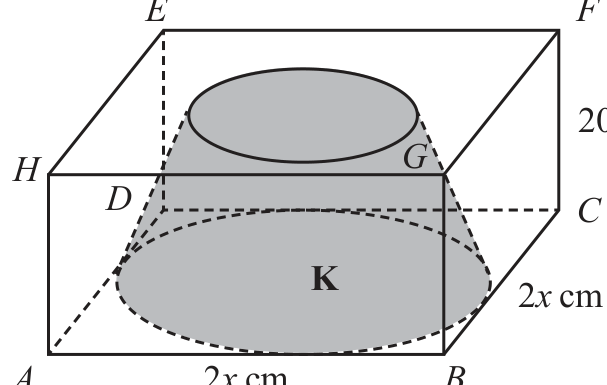
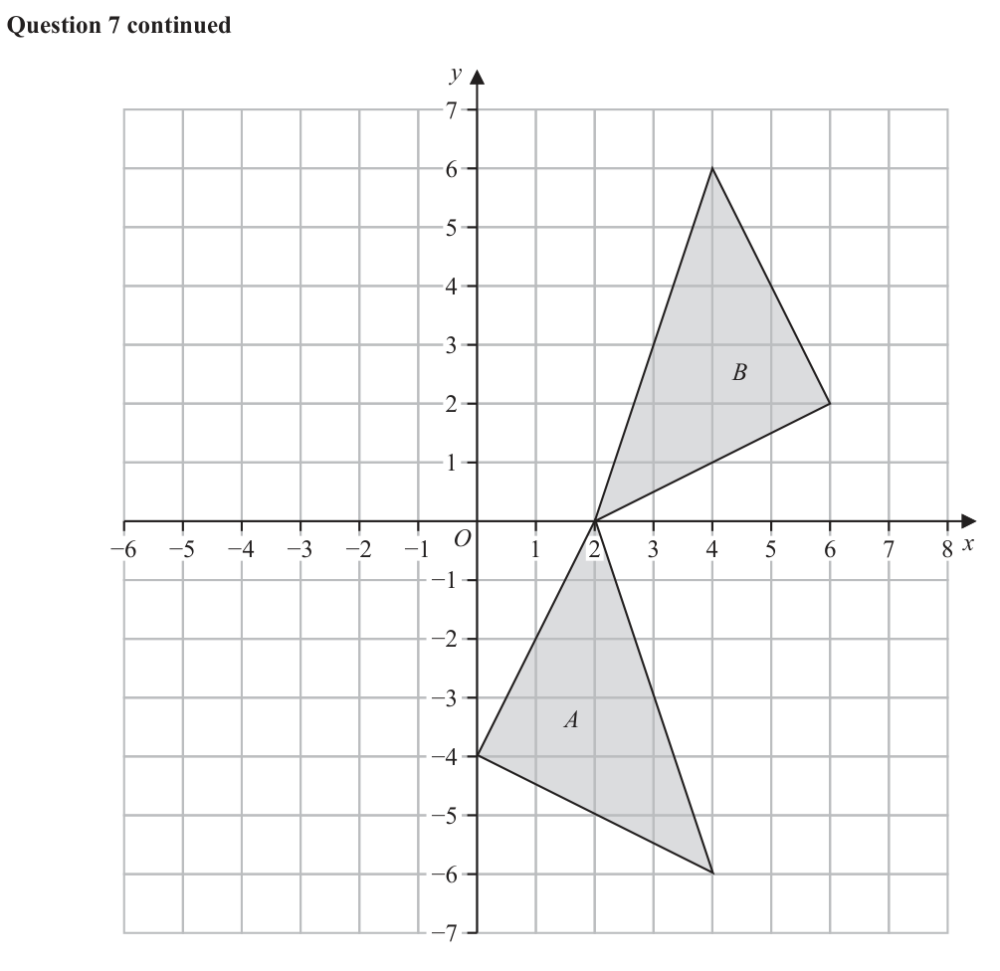
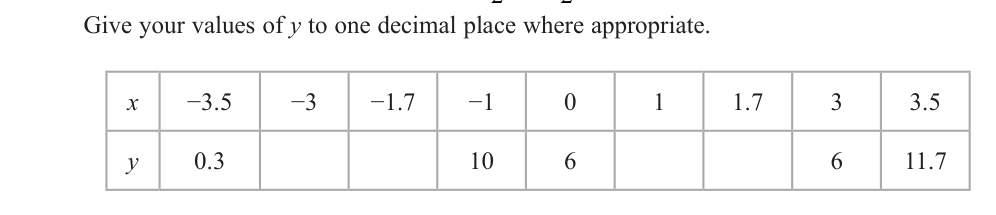
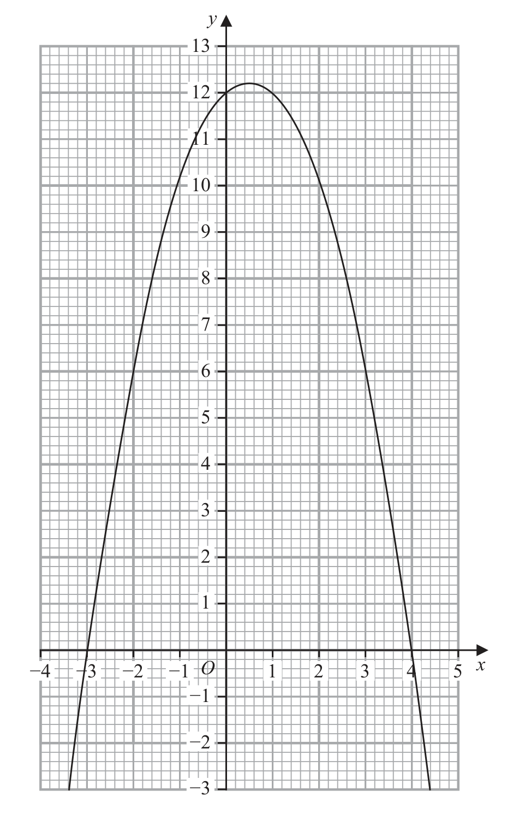

# 4MB1/02 — 2026-06 (official extraction)

> schema `syllabai.official-paper-questions/0.2` · paper_id `pearson-edexcel:international-gcse:mathematics-b:4mb1:2026-06:4MB1/02` · qp sha256 `2e25b25b027253aa…` · extraction is the disclosed baseline (ADR-039)

## Question 1 (6 marks)

A shop sells 1 kg of apples for $a and 1 kg of potatoes for $p Meg buys 8 kg of apples and 5 kg of potatoes from the shop. The total cost is $T

### 1(a) [2]

A shop sells 1 kg of apples for \$a and 1 kg of potatoes for \$p Meg buys 8 kg of apples and 5 kg of potatoes from the shop. The total cost is \$T

Write down a formula for T in terms of a and p Given that 4a 5 p 2a 15 p

**Mark scheme answer**

> T = 8a + 5 p 2 B2 fully correct
> (B1 for 8a + 5 p or T = 8a ± ... p or T = ...a + 5 p )

- **(2)** T = 8a + 5 p 2 B2 fully correct

### 1(b) [4]

find the total cost of 8 kg of apples and 5 kg of potatoes by first solving these simultaneous equations. Show clear algebraic working.

**Mark scheme answer**

> 4a + 5 p = 35 12a + 15 p = 105 4 M1 for coefficient of a or p the same in both
> 4a + 30 p = 140 or 2a + 15 p = 70 or equations and correct operation to eliminate selected
> variable (condone one arithmetic error) or for one
> 25 p = 105 10a = 35 correct rearrangement of one equation followed by
> ⎛ 35 − 5 p ⎞ ⎛ 35 − 4a ⎞ correct substitution into the other must gain an
> 2 + 15 p = 70 2a + 15 = 70 or
> ⎝ 4 ⎠ ⎝ 5 ⎠ equation in one variable
> or ⎛ 70 − 2a ⎞
> 4a + 5 = 35
> ⎛ 70 − 15 p ⎞ ⎝ 15 ⎠
> 4 + 5 p = 35
> ⎝ 2 ⎠
> p = 4.2 a = 3.5 A1 either value correct
> 4a + 5 × "4.2" = 35 ⇒ a = ... or M1 for substituting their value of p or a into a correct
> equation or starting again to gain an equation in the
> 2a + 15 × "4.2" = 70 ⇒ a = ... or
> 2nd variable (condone one arithmetic or sign error)
> 4 × 3.5 + 5 × p = 35 ⇒ p = ... or
> Implied by a = 3.5 or 7 and p = 4.2 or 21 oe

- **(4)** 4a + 5 p = 35 12a + 15 p = 105 4 M1 for coefficient of a or p the same in both

## Question 2 (5 marks)

E is the universal set and A, B and C are three sets such that E 1, 2, 3, 4, 5, 6, 7, 8, 9, 10, 11, 12, 13, 14, 15 A 6, 7, 8, 9, 10, 11, 12 B odd numbers C factors of 30

### 2(a) [1]

List the members of the set A ∩ B

**Mark scheme answer**

> 7, 9, 11 1 B1 cao allow brackets. Do not isw

- **(1)** 7, 9, 11 1 B1 cao allow brackets. Do not isw

### 2(b) [2]

Find n A B The set D is such that D ⊂ B and D ⊂ C

**Mark scheme answer**

> × 3.5 + 15 × p = 70 ⇒ p = ... 2
> Working must be shown if a or p is incorrect
> (\$) 49 A1 dep on M2
> wr Total 6 marks
> 2, 4, 14
> cas 3 A1 cao

- **(2)** × 3.5 + 15 × p = 70 ⇒ p = ... 2

### 2(c) [2]

Find the maximum value of n D

**Mark scheme answer**

> B ∩ C or 1, 2, 3, 5, 6, 10, 15 or 2 M1 for realising they need to find B ∩ C if writing the list allow one
> 1, 3, 5, 15 omission
> cas 4 A1

- **(2)** B ∩ C or 1, 2, 3, 5, 6, 10, 15 or 2 M1 for realising they need to find B ∩ C if writing the list allow one

## Question 3 (6 marks)

A B C 1 4 2 6 2 x

### 3(a) [2]

Find 5A − 3B The determinant of BC is 588 Given that x > 0

**Mark scheme answer**

> ⎛ 5 24 ⎞ 2 B2 fully correct matrix
>  (B1 for a 2 × 2 matrix with 2 or 3 terms correct.
> ⎝ −1 2 ⎠

- **(2)** ⎛ 5 24 ⎞ 2 B2 fully correct matrix

### 3(b) [4]

find the value of x a b Determinant of matrix ad bc c d

**Mark scheme answer**

> BC = −20 − 6 x −5 x + 9 4 M1 For a 2 × 2 matrix with 2 or 3 terms correct.
>  8 + 12 x 2 x − 18 
> ( −20 − 6 x )( 2 x − 18) − (8 + 12 x )( −5x + 9 ) = 588 M1 dep on previous method mark being awarded.
> For finding the determinant and equating to 588
> ft their matrix if un-simplified working shown
> ( −12x + 360 + 68x ) − ( −60x + 72 + 68x ) = 588 oe
> 2
> M1 dep on previous method mark being awarded.
> For multiplying out the brackets to gain the correct
> equation eg 48 x + 288 = 588
> or +/− 2.5 oe
> wr 2.5 A1 oe if other root shown it must be rejected
> Alt M1 for a correct method for the determinants of B
> M1 dep on previous mark being awarded. For
> multiplying detB and detC and equating to 588
> M1 dep on previous method mark being awarded.
> For multiplying out the bracket to gain the correct
> equation
> wr 2.5 A1 oe if other root shown it must be rejected

- **(4)** BC = −20 − 6 x −5 x + 9 4 M1 For a 2 × 2 matrix with 2 or 3 terms correct.

## Question 4 (5 marks)

Diagram NOT accurately drawn Cone L 30 cm 50 cm Cone J K x cm Figure 1 A right circular cone J has height 50 cm and base radius x cm The shaded solid K is formed by removing cone L with height 30 cm from cone J as shown in Figure 1 Diagram NOT accurately drawn E F 20 cm H G D C K 2x cm A 2x cm B Figure 2 Figure 2 shows solid K inside a hollow cuboid ABCDEFGH AB = BC = 2 x cm and FC = 20 cm The base of the cuboid rests on horizontal ground. The base of K rests on the base of the cuboid. Given that exactly 2000 cm 3 of water is needed to fill the space in the cuboid not occupied by K calculate, to one decimal place, the value of x Show all your working. (5) 1 22 Volume of a cone = 3 Àr πr h

### 4 [5]

Cone L 30 cm 50 cm Cone J K x cm Figure 1 A right circular cone J has height 50 cm and base radius x cm The shaded solid K is formed by removing cone L with height 30 cm from cone J as shown in Figure 1 Diagram NOT accurately drawn E F 20 cm H G D C K 2x cm A 2x cm B Figure 2 Figure 2 shows solid K inside a hollow cuboid ABCDEFGH AB = BC = 2 x cm and FC = 20 cm The base of the cuboid rests on horizontal ground. The base of K rests on the base of the cuboid. Given that exactly 2000 cm³ of water is needed to fill the space in the cuboid not occupied by K calculate, to one decimal place, the value of x Show all your working. 1 22 Volume of a cone = 3 Àr πr h

> *Figure not shown in this reconstruction — the printed paper includes a diagram (not drawn accurately). Use the text description to work through it.*

**Mark scheme answer**

> r 30
> or r = 3 x 5 M1 for a correct method to find the base radius of the small cone
> =
> x 50
> 1 ⎛ 3 ⎞
> 2 M1 dep on M1 for a correct method to find the volume of the
> π × ⎜ " x " ⎟ × 30 = ⎡18 π x 2 = 11.3097 … x 2 ⎤ small cone. May be seen as part of full equation eg
> 3 ⎝ 5 ⎠ ⎢⎣ 5 ⎥⎦
> 1 2⎛ ⎞
> ⎛3⎞
> πx ⎜ 50 − " × 30 ⎟
> 3 5 
> 1 ⎛3⎞
> Allow π x 2 × 50 × or awrt 11.3x2
> 3 ⎝5⎠
> 1 2 18 196
> πx × 50 − " π x 2 " =
> 
> π x 2 or 41.050...x 2 
> M1 for finding the volume of the frustrum. ft their volume of
> 3 5 ⎣ 15 ⎦ small cone if comes from correct working or is clearly labelled.
> (This may imply the 1st and 2nd M1)
> 196 M1 For setting up a correct equation to find x ft their volume of
> π " x 2 or 2000 = 38.94...x
> 2000 = 80 x 2 − "
> 15 the frustrum. Condone 2 rather than 2000 and ft, if working
> shown, their volume of cone providing of the form …x²
> wr 7.2 A1 answers in the range awrt 7.0 to 7.2

- **(5)** r 30

## Question 5 (7 marks)

E Diagram NOT D F accurately drawn C 5 cm G H Figure 3 Figure 3 shows part of a regular 15-sided polygon. CD, DE, EF, FG and GH are five sides of the polygon.

### 5(a) [2]

Show that EFG 156° Given that DG = 5cm

**Mark scheme answer**

> 360 2 M1 Finding the sum of the interior angles or the exterior angle of
> [ = 24] or (15 − 2) ×180[= 2340]
> the polygon. May be seen as part of calculation eg 180 −
> 15 360 or
> or ( 2×15 − 4) ×90[ = 2340] ⎝ 15 ⎠
> ⎛ (15 − 2 ) ×180 ⎞ ( 2×15 − 4 ) × 90
>  or
> ⎝ 15 ⎠
> wr 180 − 24 = 156 A1 dependent on M1
> or
> 2340
> = 156

- **(2)** 360 2 M1 Finding the sum of the interior angles or the exterior angle of

### 5(b) [5]

find the perimeter, in cm to one decimal place, of the 15-sided polygon. Show all your working. Sum of interior angles of polygon 2n 4 right angles Sine rule a b c sin A sin B sin C

**Mark scheme answer**

> ∠EGD or ∠FEG =
> 180 − 156
> [ = 12] 5 M1 for a correct method to find ∠EGD or ∠FEG
> 2 May be seen on diagram
> ∠DEG = 156 − "12"[ = 144] M1 for a correct method to find ∠DEG
> May be seen on diagram
> DE sin"12"
> or M1 for a correct method to find DE
> =
> 5sin"12"
> DE = [ = 1.7686…]
> sin"144"
> 15 × "1.7686..." M1 for a correct method to find the perimeter
> cas 26.5[cm] A1 awrt 26.5
> PTO for Alt1 and Alt2 Total 7 marks
> Alt 1 [Let M be the point on DG such that 5 M1 for a correct method to find ∠DEM or ∠EDG ft their answer to
> [∠DEM =] "156"− 90[= 66] or on diagram) ft their ∠EDG if it comes from correct working or is
> 360 − 2 × "156"
> [∠EDG =] [ = 24] clearly labelled or is their final answer (may be on diagram)
> [Let x be the length of DE] M1 for finding the length DM. ft their angle if it is clearly labelled
> or or comes from correct working
> 2 x cos"24"+ x = 5 or M1 setting up an equation to find the length of one side of the
> polygon. ft their DM if from correct working. If correct this implies
> 2 x sin"66"+ x = 5 the previous 2 method marks
> [Perimeter = ] M1 for a correct Method to find the perimeter ft their ∠EDG if it
> 15 × or
> 2cos"24"+ 1 diagram) If correct this implies the previous 3 method marks
> 15 ×
> 2sin"66"+ 1
> cas 26.5 A1 awrt 26.5
> [cm]
> Alt 2 Let EF = [= FG = DE] 5 M1 for a correct method to find EG or $EG^2$ in terms of
> ∠DEG = 156 − "12"[ = 144] M1 for a correct method to find ∠DEG
> May be seen on diagram
> M1 for finding the length DG. ft their angle if it is clearly labelled
> or comes from correct working
> 15 × "1.7686..." M1 for a correct method to find the perimeter
> cas 26.5 A1 awrt 26.5
> [cm]

- **(5)** ∠EGD or ∠FEG =

## Question 6 (7 marks)

A particle P is moving along a straight line. At time t seconds, the displacement, x metres, of P from a fixed point O on the line is given by x t 3 10t 2 0 ≤ t ≤ 10 At time t seconds the velocity of P is v m/s Find the range of values for the acceleration of P, in m/s 2 , when v > 9.25 Show all your working. (7) The solutions of ax 2 bx c 0 where a 0 are given by: b b 2 4ac x 2a

### 6 [7]

A particle P is moving along a straight line. At time t seconds, the displacement, x metres, of P from a fixed point O on the line is given by x t 3 10t 2 0 ≤ t ≤ 10 At time t seconds the velocity of P is v m/s Find the range of values for the acceleration of P, in m/s 2 , when v > 9.25 Show all your working. The solutions of ax 2 bx c 0 where a 0 are given by: b b 2 4ac x 2a

**Mark scheme answer**

> 7 M1 Attempt to differentiate t → t
> n n −1
> for at least one term
> M1 (dependent on previous mark) Attempt to differentiate
> t n → t n −1 for at least one term correct
> −3t 2 + 20t − 9.25 [ > 0] oe M1 for a correct 3 term quadratic expression (all three terms on
> same side)
> −20 ± 202 − 4 × ( −3) × ( −9.25 ) M1 a correct method to solve their 3 term quadratic. If factorising,
> allow brackets which when expanded give 2 out of 3 terms correct
> 2 × ( −3)
> If using formula must use a fully correct formula allow one sign
> error when substituting in
> If completing the square need to see or where c is a
> numerical expression that does not equal –9.25 or to see
> leading to oe where k does not
> equal
> May be implied by 0.5 or 37 (allow 6.2 or 6.17 or better) or Full
> working must be shown if it is incorrect.
> 37 M1 for selecting the correct range – may be implied by the correct
> "0.5" < t < " "
> 6 range using a
> −6 × "0.5"+ 20 [ = 17 ] or M1 for substitution of their “0.5” or their “37/6” into their
> 37 expression for a
> −6 × " "+ 20 [ = −17 ]
> cas −17 < a < 17 A1 cao

- **(7)** 7 M1 Attempt to differentiate t → t

## Question 7 (9 marks)

Triangle A and triangle B are drawn on the grid opposite. Triangle A is transformed to triangle C under a reflection in the y-axis.

### 7(a) [2]

On the grid, draw and label triangle C Triangle B is transformed to triangle D under an enlargement with scale factor −0.5 and centre (0, 4)

**Mark scheme answer**

> correct triangle drawn 2 B2 correct triangle drawn
> (–2, 0) (–4, –6) (0, –4) (B1 for 2 correct points or for a reflection in the x-axis)

- **(2)** correct triangle drawn 2 B2 correct triangle drawn

### 7(b) [3]

On the grid, draw and label triangle D

**Mark scheme answer**

> correct triangle drawn 3 B3 correct triangle drawn
> (–2, 3) (–1, 6) (–3, 5) B2 for 2 correct points
> B1 for an enlargement SF –0.5

- **(3)** correct triangle drawn 3 B3 correct triangle drawn

### 7(c) [4]

Describe fully the single transformation that maps triangle A onto triangle B Show all your working.

**Mark scheme answer**

> Rotation 4 B1 for rotation and no other transformations given
> 1 2 M1 allow awrt 3sf or 2 sf if working shown
> tan θ = oe or tan θ = oe or
> 2
> θ = 26.56505... θ = 18.4349...
> 90 + 2 × "26.565..." 180 − 2 × "18.4349..." M1 ft their angle
> wr 143° anticlockwise or A1 dep on at least 1 M1 awrt 143 with anticlockwise
> or awrt 217 with clockwise or – 217
> 217° clockwise about (Fully correct answer of 143 anticlockwise or 217
> (2, 0) clockwise about (2,0) with no working shown award
> SC B1)Allow counter clockwise to imply anticlockwise
> Alt(c) Rotation 4 B1 for rotation and no other transformations given
> M1 correct use of cosine rule
> (may see 98.1 and 45 calculated to get 143.1)
> or
> cos 𝜃 = − 0.8 M1 awrt 143 calculated
> 𝜃 = 143.1
> wr 143° anticlockwise or A1 dep on at least 1 M1 awrt 143 with anticlockwise
> or awrt 217 with clockwise or – 217
> 217° clockwise about
> (2, 0)

- **(4)** Rotation 4 B1 for rotation and no other transformations given

## Question 8 (9 marks)

The table below shows information about the time, in minutes, it takes each of 50 teachers to travel to work. Time (t minutes) Frequency 20 < t ≤ 22 4 22 < t ≤ 25 6 25 < t ≤ 30 23 30 < t ≤ 35 12 35 < t ≤ 60 5

### 8(a) [4]

Calculate an estimate, in minutes, for the mean time it takes for these 50 teachers to travel to work. Below is some information about how these 50 teachers travel to work. n teachers walk and travel by bus 21 teachers walk 34 teachers travel by bus 6 teachers do not walk and do not travel by bus Rosa selects at random 2 teachers from those who walk.

**Mark scheme answer**

> 21× 4 + 23.5 × 6 + 27.5 × 23 + 32.5 ×12 + 47.5 × 5 [ = 1485] 4 M2 for at least 3 correct products using midpoints with
> intention to add. Allow
> or 1485 (M1 for at least 3 products using frequency and a
> value within the interval with the intention to add.
> (condone use of lower class bound) or for at least 3
> correct products using midpoints without adding)
> "1485" M1 dep on at least M1 previously scored. For dividing
> 50 their sum by 50
> 29.7 A1 must have 29.7 as their final answer. However, if
> 29.7 seen condone further rounding to 30

- **(4)** 21× 4 + 23.5 × 6 + 27.5 × 23 + 32.5 ×12 + 47.5 × 5 [ = 1485] 4 M2 for at least 3 correct products using midpoints with

### 8(b) [5]

Find the probability that exactly one of these 2 teachers also travels by bus.

**Mark scheme answer**

> 5 M1 Venn diagram (no need for labels) or for setting up
> (W) (B) equation in terms of n
> c c May be implied by n =11
> 21 – n n 34 – n
> or 21 − n + n + 34 − n + 6 = 50 oe
> n = 11 A1 allow ‘number of people’ to imply n
> "11" 21 − "11" M1 May be embedded. Allow numerators and
> × or
> 21 20 denominators in any order " n " × 21 − " n " with any
> 21
> consistent value for n used
> "11" 21 − "11" M1 Allow numerators and denominators in any order
> 2× × or
> 21 20 " n " 21 − " n " with any consistent value for n used
> 2× ×
> 21
> 11 A1oe (0.52(3809…))

- **(5)** 5 M1 Venn diagram (no need for labels) or for setting up

## Question 9 (12 marks)

Each year Umera goes on a skiing holiday in France. In 2023, the cost of her flights was $250 In 2024, the cost of her flights is $315

### 9(a) [2]

Each year Umera goes on a skiing holiday in France. In 2023, the cost of her flights was \$250 In 2024, the cost of her flights is \$315

Calculate the percentage increase in the cost of her flights from 2023 to 2024 The plane takes 2 hours 54 minutes to fly to France at an average speed of 640 km/h

**Mark scheme answer**

> 315 315 − 250 2 M1 for a correct method
> - 100 oe or oe
> 250 250
> 26 [%] A1

- **(2)** 315 315 − 250 2 M1 for a correct method

### 9(b) [3]

Calculate the total distance, in kilometres, the plane travels to France. The cost to hire skis is 680 euros. The cost to buy a lift pass is 200 euros. The exchange rate is \$1 = x euros Umera pays \$612 to hire the skis.

**Mark scheme answer**

> 54 3 M1 changing time to a single unit
> 2+ [ = 2.9] or 120 + 54 [ = 174]
> 640 × "2.9" or 640 × "174"÷ 60 M1 correct method to find distance. Condone 640 × 2.54 or an answer of
> 1625.6
> 1856 A1 Accept 1850 or 1860 if from correct working

- **(3)** 54 3 M1 changing time to a single unit

### 9(c) [3]

Using the same exchange rate, calculate in \$, the cost to buy a lift pass. Umera stays in a hotel while on holiday. She makes 3 separate payments to cover the total cost of staying in the hotel. The 1st payment is 560 euros. The 2nd payment is of the total cost. The 3rd payment is 28% of the total cost.

**Mark scheme answer**

> 612 3 M1 correct method to find the exchange rate
> [ = 0.9] or 680 ⎡⎢ = 10 = 1.111...⎤⎥
> 680 612 ⎣ 9 ⎦
> 200 × "0.9" or 200 M1 correct method to find how much she pays. If working shown allow
> for 200 × " n " where 0 < n < 1 seen or where 1 < m < 2 seen
> "1.111..." 200
> m
> 180 A1 awrt 180

- **(3)** 612 3 M1 correct method to find the exchange rate

### 9(d) [4]

Calculate, in euros, 28% of the total cost.

**Mark scheme answer**

> 2 28 4 M1 to work out what fraction of the total the 2nd and 3rd payment are or
> 560 + c+ c = c oe or making a correct equation for the total cost
> 5 100
> [= 0.68] or 68% or Allow 0.28 or 28% or equivalent fractions
> 560 M1 for finding the total cost or for finding y% (accept 560=32% followed
> c= [ = 1750] or by a correct method to find either 100% or 28%)
> 1 − 17
> 560 y 560 y
> or oe
> 1− 17
> "1750"× 0.28 or 560
> × 0.28 Allow 28% or equivalent fractions of ‘their’ total
> M1
> 1 − 17
> 560 0.28 or 560 28 or
> × ×
> 1− 17 y 32 y cost
> 490 A1 cao

- **(4)** 2 28 4 M1 to work out what fraction of the total the 2nd and 3rd payment are or

## Question 10 (13 marks)

Part of the curve C with equation y x 2 x 12 is drawn on the grid opposite.

### 10(a) [3]

By drawing a suitable straight line on the grid, find estimates, to one decimal place, of the solutions to the equation x 2 x 3 0.5 x 1 3 9 The equation of curve D is y x x 2 2 1 3 9

**Mark scheme answer**

> y = 3 − 0.5x or Straight line passing 3 M1 equation of correct line seen. Implied by correct line drawn
> through at least 2 of (–2, 4) (0, 3)
> (2,2)
> M1 correct line drawn that crosses the curve twice
> wr –2.3 and 3.8 A1 dep on both previous M marks awarded allow – 2.2 to –2.4 and
> 3.7 to 3.9 Do not accept co-ordinates

- **(3)** y = 3 − 0.5x or Straight line passing 3 M1 equation of correct line seen. Implied by correct line drawn

### 10(b) [3]

Complete the table of values for x x 6 y 2 2 Give your values of y to one decimal place where appropriate. x −3.5 −3 −1.7 −1 0 1 1.7 3 3.5 y 0.3 10 6 6 11.7

**Mark scheme answer**

> 6, 11.2, 2, 3 B3 4 correct allow 11.2 or better (11.1935) and allow 0.8 or
> 0.8 better(0.8065)
> B2 3 correct
> B1 1 or 2 correct

- **(3)** 6, 11.2, 2, 3 B3 4 correct allow 11.2 or better (11.1935) and allow 0.8 or

### 10(c) [3]

On the grid, plot the points from your completed table and join them to form a smooth curve. Curve C and curve D intersect twice in the range −3.5 ≤ x ≤ 3.5

> *Figure not shown in this reconstruction — the printed paper includes a diagram (not drawn accurately). Use the text description to work through it.*

**Mark scheme answer**

> Correct 3 B3 fully correct graph
> curve drawn B2 At least 5 points plotted correctly and joined by a smooth curve,
> or all points plotted correctly and joined by straight lines.
> B1 At least 4 points plotted correctly or any curve through 4 correct
> points
> Do not ft any incorrect values

- **(3)** Correct 3 B3 fully correct graph

### 10(d)(i) [1]

Write down the coordinates of these 2 points of intersection.

**Mark scheme answer**

> (–1, 10) and 1 B1 both correct (condone missing brackets) Allow values between
> (3, 6) -1 and -1.1 for x co-ordinate and 10 and 10.1 for y co-ordinate
> MUST be seen in d(i)

- **(1)** (–1, 10) and 1 B1 both correct (condone missing brackets) Allow values between

### 10(d)(ii) [3]

Work out the equation of the line that passes through these 2 points of intersection. Give your answer in the form y mx c Show all your working.

**Mark scheme answer**

> 3 M1 ft their coordinates in (i) For a correct method to find the
> gradient. If co-ordinates incorrect, working must be shown.
> y = mx + 9 or y = "− 1" x + c or M1 allow − x instead of −1x ft their gradient
> L = "− 1" x + 9 or "− 1" x + 9 or
> or oe
> cas y = −x + 9 A1 oe must be y = ..

- **(3)** 3 M1 ft their coordinates in (i) For a correct method to find the

## Question 11 (11 marks)

The three functions f, g and h are defined as 5x + 2 f : x ↦ 2x + 3 g : x ↦ x 2 − 2 x > 0 h : x ↦ 10 x 3 29 x 2 5 x

### 11(a) [1]

State the value of x that must be excluded from any domain of f

**Mark scheme answer**

> 1 B1 allow –1.5 or x = −1.5 or x ≠ −1.5
> −

- **(1)** 1 B1 allow –1.5 or x = −1.5 or x ≠ −1.5

### 11(b) [1]

Write down the range of g

**Mark scheme answer**

> 1 B1 allow use of y and g for g(x) but do not allow x

- **(1)** 1 B1 allow use of y and g for g(x) but do not allow x

### 11(c) [1]

Find g(−3)

**Mark scheme answer**

> 7 1 B1 cao (accept ‘undefined’ as x > 0 in question)

- **(1)** 7 1 B1 cao (accept ‘undefined’ as x > 0 in question)

### 11(d) [2]

Find hf(4)

**Mark scheme answer**

> f(4) = 2 or 2 M1 for finding f(4)=2 or substituting f(x) into h(x)
> 3
> ⎛ 5x + 2 ⎞ ⎛ 5x + 2 ⎞ ⎛ 5x + 2 ⎞
> hf(x) = 10 + 29 − 5 −6
> ⎝ 2x + 3 ⎠ ⎝ 2x + 3 ⎠ ⎝ 2x + 3 ⎠
> cas 180 A1

- **(2)** f(4) = 2 or 2 M1 for finding f(4)=2 or substituting f(x) into h(x)

### 11(e)(i) [2]

Use the factor theorem to show that 5 x 2 is a factor of h(x)

**Mark scheme answer**

> ⎛ 2⎞
> ⎛ 2⎞ ⎛ 2⎞
> 2 M1 substituting − 2 or 2 into h(x) consistently.
> 10 ⎜ − ⎟ + 29 ⎜ − ⎟ − 5 ⎜ − ⎟ − 6 oe ⎝ 5⎠ ⎝5⎠
> ⎝ 5⎠ ⎝ 5⎠ ⎝ 5⎠
> M0 if long division used
> ⎛ 2⎞
> ⎛ 2⎞
> ⎛ 2⎞ A1 oe dep on M1 must have = 0
> 10 ⎜ − ⎟ + 29 ⎜ − ⎟ − 5 ⎜ − ⎟ − 6 = 0
> ⎝ 5⎠ ⎝ 5⎠ ⎝ 5⎠

- **(2)** ⎛ 2⎞

### 11(e)(ii) [4]

Hence solve the equation h(x) = 0 Show clear algebraic working. The solutions of ax 2 bx c 0 where a 0 are given by: b b 2 4ac x 2a

**Mark scheme answer**

> ( 2 x ........)
> 4 M1 for a start to find the quadratic factor - may be seen in
> part (e)(i)
> ( 2 x + 5 x − 3)
> A1 for a fully correct quadratic factor may be seen in part
> (e)(i)
> ( 2 x − 1)( x + 3) M1(dep on previous M1) A correct method to solve their
> 3 term quadratic. If factorising, allow brackets which
> when expanded give 2 out of 3 terms correct
> If using formula must use a fully correct formula allow
> one sign error when substituting in
> If completing the square need to see or where
> c is a numerical expression that does not equal –-3 or
> oe where k does not equal
> wr 0.5, –3, –0.4 A1 (dep on all 3 previous marks) all 3 values correct oe

- **(4)** ( 2 x ........)

## Question 12 (10 marks)

A Diagram NOT accurately drawn M O N P B Figure 4 Figure 4 shows triangle OAB Given that OA 3a and OB 3b

### 12(a) [1]

find an expression for in terms of a and b The point M lies on OA such that OM : MA = 2 : 1 The point N lies on OB such that ON OB The point P is such that ONPB is a straight line and AP is parallel to MN The point Q is such that OQ 12a 9b

**Mark scheme answer**

> −3a + 3b 1 B1 oe

- **(1)** −3a + 3b 1 B1 oe

### 12(b) [4]

Show that A, P and Q are collinear. The point R is such that NMR and BAR are straight lines.

**Mark scheme answer**

> → 6 → 4 → → → →
> MN = −2a + b or OP = 9 b oe M1 for finding MN or NM or OP or PO May be seen as part of
> 5 5 working. MUST be seen in (b)
> → 3⎛ 6 ⎞⎡ 9 ⎤ M2 for a correct method to find 2 of these vectors
> AP = ⎜ "− 2a + b" = −3a + b ⎥
> 2⎝ 5 ⎠⎣ 5 ⎦ (M1 for a correct method to find 1 of these vectors)
> → →
> → ft their MN or/and OP oe if from correct working or clearly labelled
> AQ = −3a − 12a + 9b [ = −15a + 9b ]
> → 9 ⎡ 36 ⎤ Note: Accept for M2
> PQ = − " b" − 12a + 9b ⎢ = −12a + b ⎥
> 5 ⎣ 5 ⎦
> → → → → → 4 →
> A1 oe dependent on M3. A correct statement but the relevant vectors
> AQ = 5 AP or PQ = 4 AP or PQ = AQ 1 → →
> 5 for their conclusion must be seen. allow equivalent eg AQ = AP

- **(4)** → 6 → 4 → → → →

### 12(c) [5]

Find an expression for in terms of a and b Give your answer in its simplest form. Show all your working.

**Mark scheme answer**

> → 5 →
> OR = 3b + ψ ("3a − 3b") M1 For a correct method to find a vector using AB from a point to R
> → eg ± →
> ft allow (their MN ) from
> or OR = 3a + φ ( "3a − 3b") part(b)
> or Note: They may calculate that and
> or
> → 6 ⎛ 6 ⎞ →
> OR = b + γ ⎜ "2a − b" ⎟ M1 For a correct method using MN to find a different vector from the
> 5 ⎝ 5 ⎠ → → → →
> → ⎛ 6 ⎞
> ±
> same point to R eg AR = AM ± χ NM ft allow (their AB ) from
> or OR = 2a + φ ⎜ "2a − b" ⎟ part(a),
> ⎝ 5 ⎠
> or Note: They may calculate that
> or
> 2γ = 3ψ and 6 − γ 6 = 3 − 3ψ M1 Equating the coefficients of a and the coefficients of b from two
> 5 5 different paths
> Note: If using
> or and
> they get
> or and
> (May be implied by correct parameter)
> or and
> 9 3 A1 solving to find the value of one of the parameters (may be
> γ = ,ψ =
> 4 2 implied by any correct parameter)
> Note: if using NR and BR they get
> ,
> , ,
> cas 9 3 A1 oe
> a− b
> 2
> Total 10 marks

- **(5)** → 5 →

