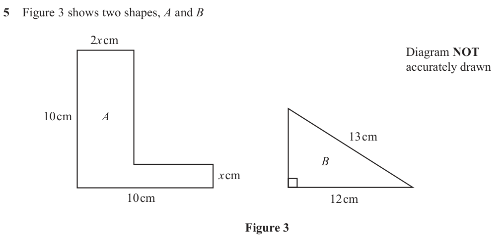
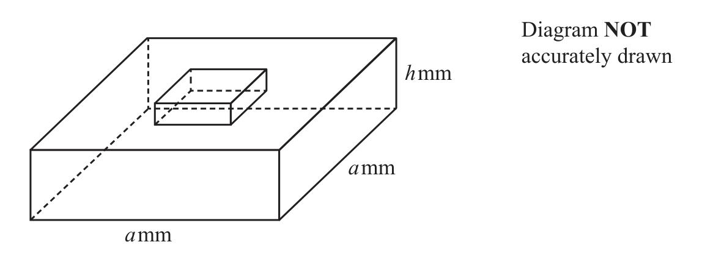
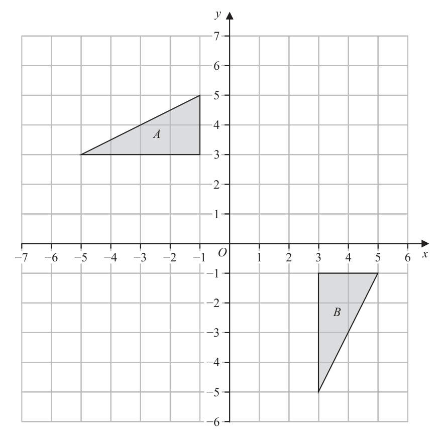
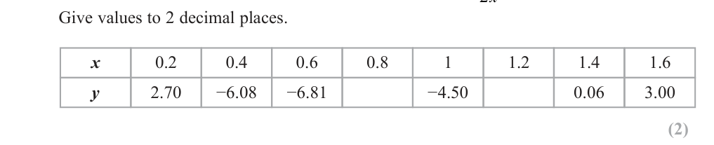
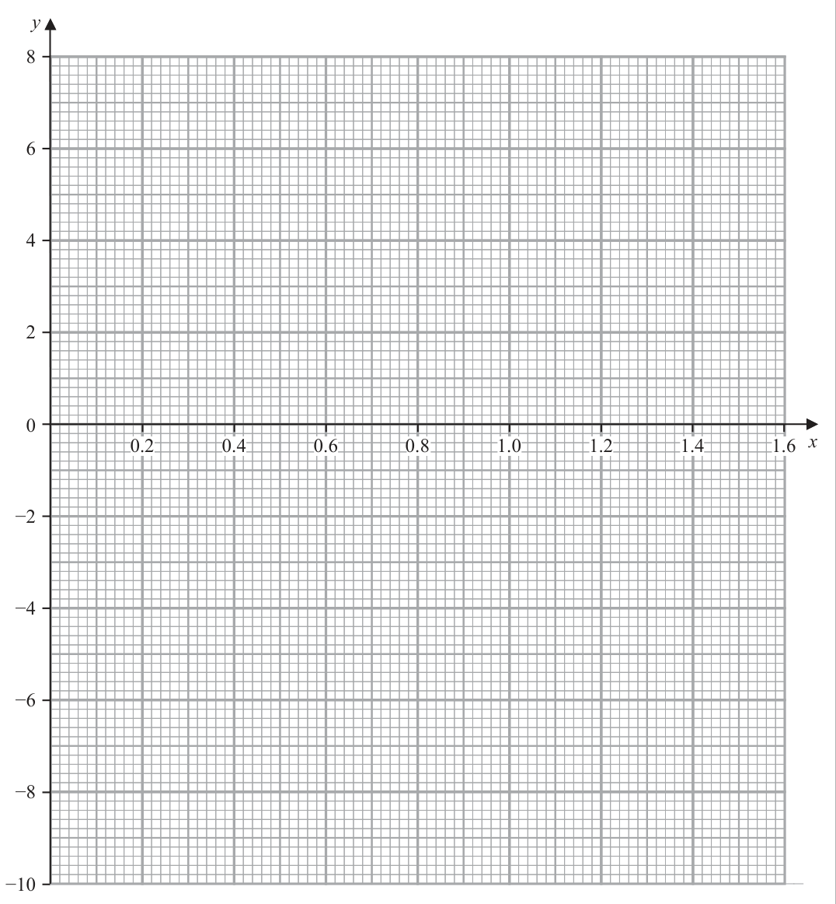

# 4MB1/02R — 2026-06 (official extraction)

> schema `syllabai.official-paper-questions/0.2` · paper_id `pearson-edexcel:international-gcse:mathematics-b:4mb1:2026-06:4MB1/02R` · qp sha256 `c3fec1bcb7a06c93…` · extraction is the disclosed baseline (ADR-039)

## Question 1 (15 marks)

Anne owns 2400 grams of an alloy made of gold, silver and copper such that weight of gold : weight of silver : weight of copper = 15 : 3 : 2

### 1(a) [2]

Calculate the weight of gold in 2400 grams of the alloy. Anne sells 2400 grams of the alloy to Geoff at a rate of £29.51 per gram. Of the money Anne receives, she is charged 10% commission.

**Mark scheme answer**

> 2400 2 M1 For a correct method to divide into the given ratio
> ×15
> 15 + 3 + 2
> Cas 1800(g) A1 cao (ignore units) Allow 1.8 [kg]

- **(2)** 2400 2 M1 For a correct method to divide into the given ratio

### 1(b) [3]

Show that Anne receives £63 700 to 3 significant figures, after she pays commission. Anne originally paid £56 000 for the alloy.

**Mark scheme answer**

> 2400 × 29.51[ = 70824] 3 M1 For a correct method to find the total received for 2400g May
> be implied by 70824 (Award for 2400 × "26.559"[ = 63741.6] )
> "70824"× 0.9 [ = 63740] M1 For a correct method to reduce by 10% e.g.
> "70824"− 0.1× "70824"
> Allow "70824"× (1 − 10%)
> (Award for 29.51× 0.9 [ = 26.559] allow awrt 26.56)
> Wr 63 700 A1 All M marks must be awarded and final answer of 63 700 (but
> allow both method marks if 63 741. 6 seen) As the answer is given
> no incorrect working can be seen

- **(3)** 2400 × 29.51[ = 70824] 3 M1 For a correct method to find the total received for 2400g May

### 1(c) [2]

Calculate the percentage profit, to 3 significant figures, that Anne makes. Geoff uses 3600 grams of a different alloy to make n pieces of jewellery. of the pieces he makes are rings each weighing 6 grams. of the pieces he makes are bracelets each weighing 24 grams. The remainder of the 3600 grams of alloy is used to make necklaces each weighing 78 grams.

**Mark scheme answer**

> 63700 − 56 000 2 M1 For a correct method for finding percentage profit (allow more
> [×100] or accurate value for 63 700)
> 56 000
> ⎛ 63700 − 1⎟ [×100] oe
> ⎝ 56 000 ⎠
> Cas 13.8% A1 awrt 13.8% or allow 13.7%

- **(2)** 63700 − 56 000 2 M1 For a correct method for finding percentage profit (allow more

### 1(d) [4]

Find the value of n Diagram NOT accurately drawn h mm a mm a mm Figure 1 Figure 1 shows a solid made from an alloy by fixing a small cuboid on the flat top face of a large cuboid. The total volume of the solid is V mm³ The base of the large cuboid is a square with sides of length a mm The height of the large cuboid is h mm The volume of the small cuboid is U mm³ Given that a = 73.2 to 1 decimal place U = 900 to the nearest 10 V = 51860 to 4 significant figures

> *Figure not shown in this reconstruction — the printed paper includes a diagram (not drawn accurately). Use the text description to work through it.*

**Mark scheme answer**

> 3 1⎡ 1 ⎤ 4 M1 For a correct method to find the proportion of pieces which are
> 4 6 ⎣ 12 ⎦
> necklaces. May be implied by
> 3 1
> n × 6 + n × 24 + " " n × 78 [ = 15n]
> M1 For a correct expression for the total weight of n pieces of
> 4 6 12 jewellery
> 15n = 3600 M1 For forming a correct equation in n, may be unsimplified
> Cas 240 A1 cao

- **(4)** 3 1⎡ 1 ⎤ 4 M1 For a correct method to find the proportion of pieces which are

### 1(e) [4]

calculate the upper bound, to 3 significant figures, of h Show all your working.

**Mark scheme answer**

> 51 855 or 51 865 or 4 M1 For any correct bound seen.
> 895 or 905
> 73.15 or 73.25
> ( 51 855 „ V „ 51 865) − (895 „ U„ 905) M1 For a calculation using h =
> V −U
> The values of V,
> ( 73.15 „ a „ 73.25)
> 2 a2
> U and a must be within the limits stated
> ( 51 860 < V „ 51 865) − (895„ U < 900 ) M1 For a calculation using
> UB − LB
> The values of
> ( 73.15„ a < 73.2)
> 2 LB 2
> V, U and a must be within the limits stated
> 51865 − 895 A1 awrt 9.53 must see the correct calculation to award
> =9.53
> 73.152 this. Condone 9.52 if correct calculation shown
> Wr Total 15 marks

- **(4)** 51 855 or 51 865 or 4 M1 For any correct bound seen.

## Question 2 (6 marks)

Akine notices that the rate at which water leaves the hot tap of his bath is different to the rate at which water leaves the cold tap of his bath. The rate at which water leaves each tap is constant. When full, the bath holds 240 litres of water. It takes 12 minutes to fill the bath using just the cold tap. It takes 15 minutes to fill the bath using just the hot tap.

### 2(a) [4]

Calculate the time taken to fill Akine’s bath with water using both the hot tap and the cold tap at the same time. Give your answer in minutes and seconds. Water leaves the bath at a constant rate of 100 litres per minute.

**Mark scheme answer**

> k k 4 M1 For finding the number of litres per minute for either tap.
> 20 or 16 or or Allow for k being algebraic or numerical including 1
> 12
> If working in hours allow 1200 or 960
> 1
> If working in seconds allow oe or oe
> 3
> "20"+ "16"[ = 36] M1 Dep on 1st M1 For combining their rates.
> k k ⎡ 9k ⎤ May be implied by
> or " "+ " " = ⎢ oe ⎥
> 12 15 ⎣ 60 ⎦
> If working in hours allow "1200"+ "960"[2160]
> 1 4 ⎡ 3⎤
> If working in seconds allow " "+ " " ⎢ = ⎥
> 3 15 ⎣ 5 ⎦
> 240 k M1 For a full method to find the correct time.
> or May be implied by awrt 6.6 or 6.7 minutes
> 36 k k
> + 240
> 12 15 If working in hours you may see × 60 oe
> 2160
> ⎛ 240 ⎞
> If working in seconds you may see ÷ 60 oe
> ⎜ 3 5⎠
> Cas 6 minutes 40 A1 cao
> seconds

- **(4)** k k 4 M1 For finding the number of litres per minute for either tap.

### 2(b) [2]

Calculate the time taken for the 240 litres of water to leave the bath. Give your answer in minutes and seconds.

**Mark scheme answer**

> 240 2 M1 a correct expression to find time in mins or seconds
> [ = 2.4] or 240 ÷ 100 [= 144] oe May be seen in parts
> 100
> e.g. 200 litres = 2mins and 40 litres = 0.4 × 60 [=24]
> Cas 2 mins 24 A1 cao
> seconds

- **(2)** 240 2 M1 a correct expression to find time in mins or seconds

## Question 3 (5 marks)

Diagram NOT E F accurately drawn D C G H 5 cm A 6 cm B Figure 2 Figure 2 shows a cuboid ABCDEFGH with horizontal base ABGH AB = 6cm BG = 5cm Given that the surface area of the cuboid is 236 cm2

### 3(a) [2]

Diagram NOT E F accurately drawn D C G H 5 cm A 6 cm B Figure 2 Figure 2 shows a cuboid ABCDEFGH with horizontal base ABGH AB = 6cm BG = 5cm Given that the surface area of the cuboid is 236 cm²

show that the length of BC is 8 cm

**Mark scheme answer**

> ( 6 + 5 + 6 + 5) BC + 2 × 6 × 5[ = 236] oe 2 M1 For a correct expression for the total surface area in terms of BC
> Allow 2 × 8 × 5 + 2 × 8 × 6 + 2 × 6 × 5
> Wr 22 BC = 176 oe 8 A1 cao Must gain M mark and have working equivalent to that
> shown
> Allow for 2 × 8 × 5 + 2 × 8 × 6 + 2 × 6 × 5 = 236 and a conclusion
> eg BC = 8[cm]

- **(2)** ( 6 + 5 + 6 + 5) BC + 2 × 6 × 5[ = 236] oe 2 M1 For a correct expression for the total surface area in terms of BC

### 3(b) [3]

Calculate, in cm to one decimal place, the length of AF

**Mark scheme answer**

> [ AG =] 52 + 62 ⎡⎣= 61 = 7.81⎤⎦ or 3 M1 For a correct method to find the length of AG or AC or AE
> [ AC =] 62 + 82 [ = 10] or
> [ AE =] 52 + 82 ⎡⎣= 89 = 9.43⎤⎦
> AF = "7.81"2 + 82 ⎡⎣ = 5 5 ⎤⎦ or M1 For a correct method to find the length of AF ft their AG / AC /
> AE
> AF = "10"2 + 52 ⎡⎣ = 5 5 ⎤⎦ or NB [ AF = ] 52 + 62 + 82 ⎡⎣ = 5 5 ⎤⎦ scores M2
> AF = "9.43"2 + 62 ⎡⎣ = 5 5 ⎤⎦
> Cas 11.2 A1 awrt 11.2 Do not allow 5 5

- **(3)** [ AG =] 52 + 62 ⎡⎣= 61 = 7.81⎤⎦ or 3 M1 For a correct method to find the length of AG or AC or AE

## Question 4 (5 marks)

A particle P is moving along a straight line. At time t seconds the displacement, s metres, of P from a fixed point O on the line is given by s 5t 3 t 4 t ≥ 0 At time t seconds the acceleration of P is a m/s2 Find the value of a at the instant when P changes direction and starts moving towards the point O Show all your working. (5)

### 4 [5]

A particle P is moving along a straight line. At time t seconds the displacement, s metres, of P from a fixed point O on the line is given by s 5t 3 t 4 t ≥ 0 At time t seconds the acceleration of P is a m/s2 Find the value of a at the instant when P changes direction and starts moving towards the point O Show all your working.

**Mark scheme answer**

> [v =]15t 2 − t 3 5 M1 for an attempt to differentiate i.e. x n → x n −1 for at least one
> term
> [ a =] 30t − 3t 2 M1 dep on previous mark. For an attempt to differentiate again (at
> least 1 term correct for their v)
> "15t 2 − t 3 " = 0 ⇒ t = ...[15] M1 dep on first M mark and having a 2 term expression.
> For setting their v to 0 and attempting to solve
> "30"× "15"− "3"× ("15") M1 dep on all previous M marks substituting their value of t into
> their expression for a
> –225 A1 allow 225
> Wr Total 5 marks

- **(5)** [v =]15t 2 − t 3 5 M1 for an attempt to differentiate i.e. x n → x n −1 for at least one

## Question 5 (6 marks)

Figure 3 shows two shapes, A and B 2x cm Diagram NOT accurately drawn 10 cm A 13 cm B x cm 10 cm 12 cm Figure 3 The corners of shape A are all right angles. Shape B is a right-angled triangle. The area of shape A is equal to the area of shape B Find, to 3 significant figures, the value of x (6)

### 5 [6]

Figure 3 shows two shapes, A and B 2x cm Diagram NOT accurately drawn 10 cm A 13 cm B x cm 10 cm 12 cm Figure 3 The corners of shape A are all right angles. Shape B is a right-angled triangle. The area of shape A is equal to the area of shape B Find, to 3 significant figures, the value of x

**Mark scheme answer**

> 6 M1 A correct method to find GI or ∠GHI or ∠GIH
> [GI =] 132 − 122 [ = 5]
> ⎛ 12 ⎞
> cos ∠GHI = [⇒ ∠GHI = 22.6] or
> ⎝ 13 ⎠
> ⎛ 12 ⎞
> sin ∠GIH = [⇒ ∠GIH = 67.4]
> ⎝ 13 ⎠
> May be implied by GI = 5
> 1 M1 A correct expression for the area of HGI ft their GI
> [ Area HGI =] ×12 × "5"[ = 30]
> 2 Allow [ Area HGI =] ×12 ×13sin"22.6"[ = 30] or
> × "5"×13sin("67.4") [ = 30]
> 10 × 2x or 10 × x or x (10 − 2 x ) or M1 A correct method to find an area of a rectangle required for the
> full area of the first shape ABCDEF
> 2 x (10 − x ) or (10 − 2 x )(10 − x )
> 10 × 2 x + x(10 − 2 x) = "30" M1 A correct method to find the area of the first shape ABCDEF in
> ⎡⎣ x − 15x + 15 = 0⎤⎦
> 2 terms of x and equate to 30 ft their area of their triangle
> M1 for a correct method to solve the quadratic equation
> [ − −]15 ± ([ −]15) − 4 [×1] ×15
> x= If using formula must use a fully correct formula allow one sign
> 2 [×1] error when substituting in
> ⎛ 15 ⎞
> If completing the square need to see ⎜ x − ⎟ + c [ = 0] or where c
> ⎝ 2⎠
> is a numerical expression that does not equal 15
> As the question asks for answer to 3 sf do not allow attempt at
> factorisation
> May be implied by 1.08 or 13.9
> 1.08 A1 awrt 1.07 or awrt 1.08 do not condone inclusion of 13.9

- **(6)** 6 M1 A correct method to find GI or ∠GHI or ∠GIH

## Question 6 (7 marks)

Diagram NOT accurately drawn D E 45° C 85° A B F Figure 4 In Figure 4 ABCD is a quadrilateral such that the points A, B, C and D lie on a circle. EAF is the tangent to the circle at the point A BDC 45° ABC 85° BD = 22 cm BC = 17 cm

### 6(a) [3]

Diagram NOT accurately drawn D E 45° C 85° A B F Figure 4 In Figure 4 ABCD is a quadrilateral such that the points A, B, C and D lie on a circle. EAF is the tangent to the circle at the point A ∠BDC = 45° ∠ABC = 85° BD = 22 cm BC = 17 cm

Find the size, to the nearest degree, of the obtuse angle BCD

**Mark scheme answer**

> sin ( BCD ) sin(45) 3 M1 Use of the sine rule to find an equation involving BCD
> = May be implied by 2nd M mark
> 22
> 22 × sin 45 M1 for a correct expression for sin(BCD)
> ⎡⎣sin ( BCD ) = ⎤⎦ [= 0.915]
> 17 May be implied by awrt 0.915 or angle BCD = 66
> Cas 114 A1 awrt 114

- **(3)** sin ( BCD ) sin(45) 3 M1 Use of the sine rule to find an equation involving BCD

### 6(b) [1]

Find the size, to the nearest degree, of ∠BAD

**Mark scheme answer**

> 66 1 B1 awrt 66 ft their BCD e.g. 180 − "114"

- **(1)** 66 1 B1 awrt 66 ft their BCD e.g. 180 − "114"

### 6(c) [3]

Find the size, to the nearest degree, of ∠BAF Give a reason for each stage of your working. a b c Sine rule : sin A sin B sin C

**Mark scheme answer**

> ∠BDA = 50 or ∠ABD = 64 3 M1 may be seen on diagram. May be implied by ∠BAF = 50
> If they have ∠BCD = 66 allow ∠ABD = 16
> Cas 50 A1 cao
> Alternate B1 dependent on using either ∠DAE = ∠ABD or ∠BAF = ∠ADB
> segment with correct reason(s)
> theorem

- **(3)** ∠BDA = 50 or ∠ABD = 64 3 M1 may be seen on diagram. May be implied by ∠BAF = 50

## Question 7 (9 marks)

Given that 33a =

### 7(a) [2]

show that 3a 4b Given that 4 a 2 b

**Mark scheme answer**

> 9 ⇒ 3 and 27 ⇒ 3 or
> 2b 4b 3 2 M1 For expressing everything as powers of 3 or a power of 9 or a
> 3 3 power of 27
> a
> ⇒ ( 32 )
> 2b
> 3 ⇒9
> 3a
> and 27 ⇒ 9 or
> Allow e.g. 9
> 2b
> b
> 33a ⇒ 27a and 92b ⇒ 27 3
> Wr
> 4b 2b 3
> b 3a = 4b − 3 A1 Must gain M1. Must see evidence of the subtraction of the
> 3 9 2 b− 27 b−13
> 34b
> = 34b−3 or 3 = 9
> or = 27 3 indices. Allow e.g. = 32(2b )³−3
> 3 27 3 3
> Answer is given so no incorrect working can be seen

- **(2)** 9 ⇒ 3 and 27 ⇒ 3 or

### 7(b) [2]

show that 2a 3b

**Mark scheme answer**

> 3( 2 −b ) 2 M1 for expressing everything as powers of 2
> 4 ⇒2
> a 2a
> and 8 2 −b
> ⇒2 or
> ( )
> 2 −b
> a Allow e.g. 82−b ⇒ 23
> ⎛ ⎞ 3 2 −b
> ⎛ ⎞
> or 4 ⇒ ⎜ 8 ⎟
> a
> 82 − b ⇒ ⎜ 4 ⎟
> 2 −b a
> or expressing 8 as a power of 4 or expressing 4 as a power of
> ⎝ ⎠ ⎝ ⎠
> Wr 1 1
> −3+ b 2a = 3b − 6 A1 Must gain M1 and see evidence of turning reciprocal into
> ⇒ 2−3(2−b ) or ⇒4
> (2 )
> 2 or
> 3( 2 −b ) 2 −b 3 ( −2 + b )
> 2 negative power. Allow e.g. Answer is given so no
> ⎛ 32 4 ⎟ incorrect working can be seen
> ⎝ ⎠
> 2 −b
> = 8b − 2

- **(2)** 3( 2 −b ) 2 M1 for expressing everything as powers of 2

### 7(c) [4]

Solve the simultaneous equations 3x 4 y 2x 3y Show clear algebraic working.

**Mark scheme answer**

> 6x = 9y – 18 or 9x = 12y – 9 4 M1 For a correct method to eliminate x or y: coefficients of x or y
> 6x = 8y – 6 (-) 8x = 12y – 24 (-) the same and correct operation to eliminate selected variable
> 0 = y – 12 x= 15 (condone any one arithmetic error) or writing x or y in terms of the
> or other variable and correctly substituting must gain an equation in
> ⎛ 3y − 6 ⎞ ⎛ 2x + 6 ⎞ one variable
> 3 = 4 y − 3 or 3x = 4 ⎜ 3 ⎟ − 3
> ⎝ 2 ⎠ ⎝ ⎠
> or
> ⎛ 4y −3 ⎞ ⎛ 3x + 3 ⎞
> 2 = 3 y − 6 or 2 x = 3 ⎜ 4 ⎟ − 6
> ⎝ 3 ⎠ ⎝ ⎠
> x = 15 or y = 12 A1oe one correct value dep on M1
> 3 x = 4 × "12"− 3 or 3 × "15" = 4 y − 3 or M1 dep on M1. For a correct method to find second variable –
> could start process again or use substitution
> 2 x = 3 × "12"− 6 or 2 × "15" = 3 y − 6
> Wr x = 15 and y = 12 A1oe for both correct values dep on both M marks

- **(4)** 6x = 9y – 18 or 9x = 12y – 9 4 M1 For a correct method to eliminate x or y: coefficients of x or y

### 7(d) [1]

Hence write down the value of a and the value of b that satisfy 3a 9 2b 1 3 = and 4 a 2 b 27 8

**Mark scheme answer**

> a = 15 and b = 12 1 B1 ft their part c

- **(1)** a = 15 and b = 12 1 B1 ft their part c

## Question 8 (8 marks)

A bag contains only red counters, blue counters and green counters. The bag contains 15 counters. There are 5 red counters and 3 blue counters. A counter is taken at random from the bag.

### 8(a) [2]

Show that the probability of this counter being green is 15 A second counter is taken at random from the same bag without replacing the first counter.

**Mark scheme answer**

> 15 − 5 − 3[ = 7] or 2 M1 For a correct method to find number of
> green counters or the probability the counter
> 5 3⎡ 8⎤ is red or blue
> + =
> 15 15 ⎢⎣ 15 ⎥⎦
> Wr 7 A1 dep on a fully correct method seen, must
> 15 see either the total probability is 1 or the
> total number of counters is 15 used and a
> correct conversion between probability and
> number of counters

- **(2)** 15 − 5 − 3[ = 7] or 2 M1 For a correct method to find number of

### 8(b) [3]

Complete the tree diagram on the opposite page.

**Mark scheme answer**

> 3 B1 7 placed correctly allow 0.467 or better.
> R
> 4 3 7 5 2 7
> R B B1 any group of , or
> 14 14 14 14 14 14
> 5 3 6
> G 14 14 14
> Allow equivalent fractions or decimal to at
> R least 3dp
> (0.286, 0.214, 0.5, 0.357, 0.143, 0.5, 0.357,
> B B 0.214, 0.429)
> 4 3 7 5 2 7
> G B1 all groups of , and
> 14 14 14 14 14 14
> 5 3 6
> R 14 14 14
> Allow equivalent fractions or decimal to at
> G B least 3dp
> G

- **(3)** 3 B1 7 placed correctly allow 0.467 or better.

### 8(c) [3]

Calculate the probability that at least one of the two counters taken is green. first counter second counter Red Blue Red 5 Green Red Blue Blue Green Red Green Blue Green

**Mark scheme answer**

> 5 4 5 3 5 7 3 5 3 M1 ft their tree diagram, any product of
> × " " or × " " or × " " or × " " or probabilities do not ft probabilities above 1
> 15 14 15 14 15 14 15 14
> 3 2 3 7 7 5 7 3 or below 0
> × " " or × " " or × " " or × " " or
> 15 14 15 14 15 14 15 14
> 7
> ×" "
> 15 14
> 5 7 3 7 7 M1 ft their tree diagram, correct expression
> ×" "+ ×" " + oe or for the probability at least one is green do
> 15 14 15 14
> not ft probabilities above 1 or below 0
> ⎛5 4 ⎞ ⎛5 3 ⎞ ⎛3 5 ⎞ ⎛3 2 ⎞
> 1 − ⎜ × " " ⎟ − ⎜ × " " ⎟ − ⎜ × " " ⎟ − ⎜ × " " ⎟ oe May be implied by a correct probability
> ⎝ 15 14 ⎠ ⎝ 15 14 ⎠ ⎝ 15 14 ⎠ ⎝ 15 14 ⎠
> cas 11 154
> A1 oe e.g. Allow 0.733 or better
> 15 210

- **(3)** 5 4 5 3 5 7 3 5 3 M1 ft their tree diagram, any product of

## Question 9 (9 marks)

Diagram NOT C accurately drawn M B N A E D Figure 5 Figure 5 shows a quadrilateral ABCD such that = 7a 4a 2b = 5b M is the midpoint of BC and N is the midpoint of CD

**(a)** Find, as a simplified expression in terms of a and b

### 9(a)(i) [1]

MC

**Mark scheme answer**

> 2a + b 1 B1
> →→ →

- **(1)** 2a + b 1 B1

### 9(a)(ii) [2]

CD

**Mark scheme answer**

> CD = CB + BA + AD ⎡⎣ = − ( 4a + 2b ) − 5b + 7a ⎤⎦ 2 M1 For a correct vector expression for CD in
> → → →
> terms of CB , BA and AD oe
> Cas 3a – 7b A1 oe
> →

- **(2)** CD = CB + BA + AD ⎡⎣ = − ( 4a + 2b ) − 5b + 7a ⎤⎦ 2 M1 For a correct vector expression for CD in

### 9(a)(iii) [2]

MN The point E is such that MNE and ADE are straight lines.

**Mark scheme answer**

> →→
> 1 ⎡ 1 ⎤ 2 M1 For a correct vector expression for MN in
> MN = MC + CD
> 2 ⎢⎣ = ("2a + b ") + 2 ("3a − 7b ")⎥⎦ → →
> terms of their MC and their CD
> Cas 7 5 A1 oe
> a− b
> 2
> → →

- **(2)** →→

### 9(b) [4]

Using a vector method, find BE as a simplified expression in terms of a and b

**Mark scheme answer**

> →
> ⎡ BE = ⎤ 2a + b + λ " a − b " or
> 7 5 M1 For a correct expression for BE or ME or
> →
> ⎣ ⎦ ⎝2 2 ⎠ NE in terms of a, b and a scalar multiple of
> → →
> →
> ⎡ BE = ⎤ 5.5a − 1.5b + α " a − b " or
> 7 5 MN ft their MN
> ⎣ ⎦ ⎝2 2 ⎠
> → →
> ⎡ ME = ⎤ λ " a − b " or ⎡ NE = ⎤ α " a − b "
> 7 5 7
> ⎣ ⎦ ⎝2 2 ⎠ ⎣ ⎦ ⎝2 2 ⎠
> →→ → →
> ⎡ BE = BA + AE = ⎤ − 5b + ka or M1 For a correct expression for BE or ME or
> ⎣ ⎦ →
> →→ NE in terms of a, b and a scalar multiple of a.
> ⎡ BE = BD + DE = ⎤ 7a − 5b + ma or
> ⎣ ⎦ Allow 7ma for a multiple of a
> → →
> ⎡ ME = ⎤ − 2a − 6b + ma or ⎡ ME = ⎤ 5a − 6b + ma or
> ⎣ ⎦ ⎣ ⎦
> →→ 3
> ⎡ NE = ND + DE = ⎤ a − b + ma
> ⎣ ⎦2
> ⎛ 5 ⎞ ⎛ 5 ⎞ M1 Dep on both previous M marks
> e.g. ⎜1 − λ ⎟ [b] = −5 [b] or ⎜ −1.5 − α ⎟ [b] = −5 [b] or For comparing the coefficients of b
> ⎝ 2 ⎠ ⎝ 2 ⎠
> 12 7
> 5 5 7 Can be implied by λ = , α = , k = or
> − λ[b] = −6[b] or − α [b] = − [b] 5 5
> 2 2 2
> m= or correct answer
> Cas 52 A1 oe
> a − 5b

- **(4)** →

## Question 10 (9 marks)

Triangles A and B are drawn on the grid opposite. Triangle C has vertices at coordinates 1, 1 , 2, 1 and 2, 3

### 10(a) [1]

On the grid, draw and label triangle C Triangle A is transformed to triangle D under the translation

**Mark scheme answer**

> Correctly plotted triangle 1 B1 cao (1, –1), (2, –1) and (2, –3)

- **(1)** Correctly plotted triangle 1 B1 cao (1, –1), (2, –1) and (2, –3)

### 10(b) [2]

On the grid, draw and label triangle D Triangle B is transformed to triangle E by a rotation of 90° anticlockwise about the point 1, 0

**Mark scheme answer**

> Correctly plotted triangle 2 B2 fully correct triangle plotted
> (–3, 1), (1, 1) and (1, 3) ⎛ 2⎞ ⎛ n ⎞
> (B1 for triangle translated by or )
> ⎝ n ⎠ ⎝ −2 ⎠

- **(2)** Correctly plotted triangle 2 B2 fully correct triangle plotted

### 10(c) [2]

On the grid, draw and label triangle E

**Mark scheme answer**

> Correctly plotted triangle 2 B2 fully correct triangle plotted
> (2, 2), (2, 4) and (6, 2) (B1 2 points plotted correctly or triangle rotated by 90°
> anticlockwise about any centre)

- **(2)** Correctly plotted triangle 2 B2 fully correct triangle plotted

### 10(d) [2]

Describe fully the single transformation that maps triangle A onto triangle B Triangle C is transformed to triangle F by an enlargement with scale factor −2 and centre of enlargement 0, 2

**Mark scheme answer**

> Reflection in line y = x 2 B1 For reflection/reflect. Do not allow mirrored. (B0 if multiple
> transformations stated. Multiple transformations are when more
> than one of reflection (mirrored), rotation (turn), translation
> (move) is stated e.g. a vector or SF or equation of a line do not
> imply multiple transformations)
> B1 y = x

- **(2)** Reflection in line y = x 2 B1 For reflection/reflect. Do not allow mirrored. (B0 if multiple

### 10(e) [2]

On the grid, draw and label triangle F

**Mark scheme answer**

> Correctly plotted triangle 2 B2 fully correct triangle plotted
> (–4, 0), (B1 2 points plotted correctly or triangle enlarged by scale
> (–4, –4) and factor –2 about any centre)
> (–2, –4)
> y
> A
> E
> D
> x
> –7 –6 –5 –4 –3 –2 –1 O 1 2 3 4 5
> –1
> C
> –2
> B
> –3
> F
> –4
> –5
> –6

- **(2)** Correctly plotted triangle 2 B2 fully correct triangle plotted

## Question 11 (12 marks)

The functions f and h are defined as f : x ↦ 4 x 2 4 x 15 x x 2 h:xα x x 1

### 11(a) [1]

Find f 2

**Mark scheme answer**

> 9 1 B1 cao

- **(1)** 9 1 B1 cao

### 11(b) [2]

Solve the equation f x ax + b

**Mark scheme answer**

> (2 x + 5)(2 x − 3) 2 M1 for a correct method to solve the quadratic equation. If factorising,
> ⎡ 5 3⎤ allow brackets which when expanded give 2 out of 3 terms correct
>  = 0 ⇒ x = − , x =
> 2 2 If using formula must use a fully correct formula allow one sign error when
> −4 ± 42 − 4 × 4 × ( −15 )
> substituting in oe
> 2× 4
> ⎛ 1⎞
> If completing the square need to see 4 ⎜ x + ⎟ + c [ = 0] or
> ⎝ 2⎠
> ( 2 x + 1) + c [ = 0] oe where c is a numerical expression that does not equal
> ⎛ 1⎞
> –15 or to see x + x − 3.75 = 0 leading to ⎜ x + ⎟ + k [ = 0] oe where k
> ⎝ 2⎠
> does not equal –3.75
> 5
> May be implied by x = − or x =
> 2
> Cas 3 A1oe do not condone inclusion of second solution

- **(2)** (2 x + 5)(2 x − 3) 2 M1 for a correct method to solve the quadratic equation. If factorising,

### 11(c) [3]

Express hh x in the form where a, b, c and d are integers. cx + d

**Mark scheme answer**

> x+2 3 M1 for substituting h into h
> +2
> x +1
> x+2
> +1
> x +1
> x + 2 + 2( x +1)
> x +1 x + 2 + 2( x + 1) M1 dep on M1 for getting the numerator and denominator over x + 1 or
> oe or oe multiplying each term by x + 1
> x + 2 + x +1
> x +1 x + 2 + x +1
> Cas 3x + 4 A1 oe
> 2x + 3

- **(3)** x+2 3 M1 for substituting h into h

### 11(d) [4]

Find the inverse of the function f Give your answer in the form f −1 : x ↦ …

**Mark scheme answer**

> 4( x + ...)² or (2 x + ...)² or 4 M1 start to complete the square, correctly dealing with 4x 2
> 15 y NB may be in terms of y rather than x
> x² + x − =
> 4 4
> ⎛ 1⎞
> 2 M1 dep on previous M mark. Completing square, correctly dealing
> 4 ⎜ x + ⎟ +… or (2 x + 1) 2 +… with 4 x 2 + 4 x
> ⎝ 2⎠
> NB may be in terms of y rather than x
> ⎛ 1⎞ ...
> or ⎜ x + ⎟ + ... =
> ⎝ 2⎠
> 1 y + 16 M1 dep on previous M mark. A correct rearrangement to a form
> x+ = or
> 2 4 involving a square root e.g. x + 1 = y + "..." or 2 x + 1 = y + "..."
> 2
> 2 x + 1 = y + 16 oe Allow for x and y interchanged
> Cas x + 16 1 x + 16 − 1
> − A1 oe accept equivalent forms eg must be in terms of x
> 4 2
> x + 16 1
> Do not allow ± −
> 4
> ALT Allow for x and y interchanged
> −4 + 42 − 4 × 4 ( −15 − y ) M1 dep on previous M mark. Substitution into a correct quadratic
> x= oe formula, allow one sign error in the substitution could be ± at this
> 2× 4 stage. Allow for x and y interchanged
> −4 + 256 + 16 y M1 dep on previous M mark. Expand and combine terms in the
> x= square root could be ± at this stage. Allow for x and y interchanged
> Cas −4 + 256 + 16 x 1 256 + 16 x
> A1 oe eg − + but must have only + before the square
> 8 2
> root and must be in terms of x. Do not ISW
> 1 256 + 16 x
> Do not allow − ±
> 2

- **(4)** 4( x + ...)2 or (2 x + ...)2 or 4 M1 start to complete the square, correctly dealing with 4x 2

### 11(e) [2]

Find the domain of f −1

**Mark scheme answer**

> x > 1 ⇒ f( x) > 4 ×12 + 4 ×1 − 15 2 M1 calculating range of f(x) may be as an equation for this mark.
> Cas x > −7 A1 cao

- **(2)** x > 1 ⇒ f( x) > 4 ×12 + 4 ×1 − 15 2 M1 calculating range of f(x) may be as an equation for this mark.

## Question 12 (9 marks)
### 12(a) [2]

Complete the following table of values for y 5 x 2 2x2 Give values to 2 decimal places. x 0.2 0.4 0.6 0.8 1 1.2 1.4 1.6 y 2.70 −6.08 −6.81 −4.50 0.06 3.00

**Mark scheme answer**

> –6.02, –2.45 2 B2 Both values correct
> (B1 One value which rounds to –6.0 or –2.5)

- **(2)** –6.02, –2.45 2 B2 Both values correct

### 12(b) [3]

On the grid opposite, plot the points from your completed table and join them to form a smooth curve.

**Mark scheme answer**

> Fully correct 3 B3 Fully correct graph
> graph (B2 for 6 or 7 points correct and joined with a smooth curve)
> (B1 for 4 or 5 points plotted correctly)

- **(3)** Fully correct 3 B3 Fully correct graph

### 12(c) [4]

By drawing a straight line on the grid, find estimates, to one decimal place, of the solutions to the equation 5 x 2 9 x 13 2 0 in the interval 0.2 ≤ x ≤ 1.6

**Mark scheme answer**

> 1 4
> 5 x 2 − 10 + = 3 − 9x M1 Rearrange to isolate 5 x 2 − 10 + 2 allow if y = 3 − 9 x seen or
> 2 x² 2x
> implied
> M1 Line drawn with a gradient of –9 or which would intersect y
> axis at 3
> A1 Correct line drawn which crosses the curve in 2 places
> Wr 0.21, 0.91 A1 Dep on both M marks. Allow ft their curve and line (Allow
> answers correct to 1dp)

- **(4)** 1 4

