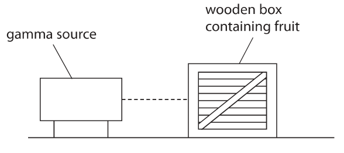
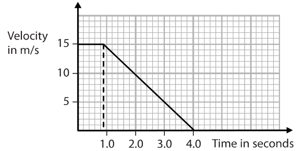
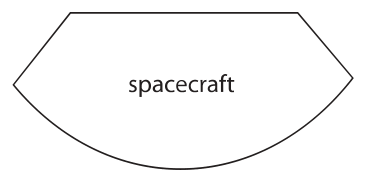
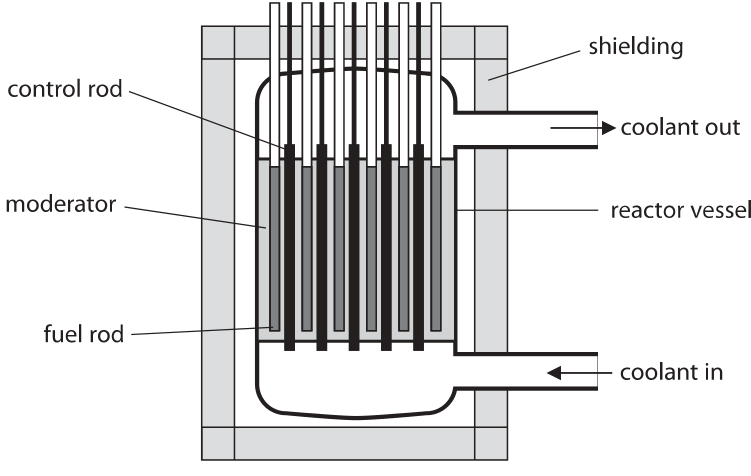
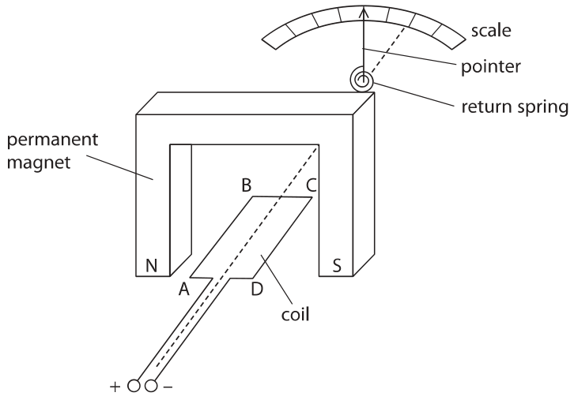
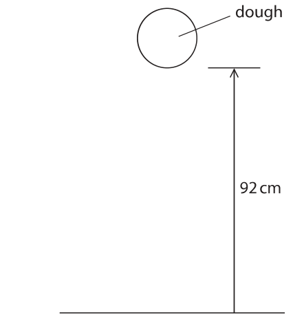

# 4PH1/1P — 2019-06 (official extraction)

> schema `syllabai.official-paper-questions/0.2` · paper_id `pearson-edexcel:international-gcse:physics:4ph1:2019-06:4PH1/1P` · qp sha256 `08f3ebee56b9957c…` · extraction is the disclosed baseline (ADR-039)

## Question 1 (5 marks)

This question is about waves.

### 1(a)(i) [1]

Which of these waves is longitudinal?

- **(A)** infrared
- **(B)** radio
- **(C)** sound  ✔
- **(D)** ultraviolet

**Mark scheme answer**

> C (sound waves);
> A is incorrect because it is a transverse wave
> B is incorrect because it is a transverse wave
> D is incorrect because it is a transverse wave

- **(1)** Answer C: sound

### 1(a)(ii) [2]

Draw a straight line linking each electromagnetic wave to its correct hazard. Electromagnetic wave Hazard microwave infrared skin burns blindness internal heating of body tissue cell mutation

**Mark scheme answer**

> one mark for each correct line;;
> two lines from any left
> hand box is a
> contradiction and
> scores zero for that
> box

- **(2)** one mark for each correct line;;

### 1(b)(i) [1]

Which of these is a use for x-rays?

- **(A)** checking for broken bones  ✔
- **(B)** cooking food
- **(C)** detecting forged banknotes
- **(D)** smoke detectors

**Mark scheme answer**

> A (checking for broken bones);
> B is incorrect because microwaves and infrared have this use
> C is incorrect because ultraviolet has this use
> D is incorrect because alpha radiation has this use

- **(1)** Answer A: checking for broken bones

### 1(b)(ii) [1]

Which of these is a use for infrared waves?

- **(A)** checking for broken bones
- **(B)** cooking food  ✔
- **(C)** detecting forged banknotes
- **(D)** sterilising medical instruments

**Mark scheme answer**

> B (cooking food);
> A is incorrect because x-rays has this use
> C is incorrect because ultraviolet has this use
> D is incorrect because gamma has this use
> Answer Notes Marks

- **(1)** Answer B: cooking food

## Question 2 (6 marks)

This question is about magnetic fields.

### 2(a) [3]

Describe an experiment to investigate the magnetic field pattern around a permanent bar magnet. You may draw a diagram to help your answer.

**Mark scheme answer**

> all marks may be given
> from diagram
> MP1. method to show shape;
> e.g.
> use compass(es)
> use of iron filings / powder
> MP2. use of plotting compass to show direction; allow if compass seen
> in diagram pointing in
> a suitable direction
> MP3. a further method detail;
> e.g.
> move compass / multiple compasses in
> different positions
> idea of another line or lines added
> sprinkle iron filings (on to card)
> tap card (to distribute iron filings) allow equivalent
> materials to card e.g.
> paper, plastic etc.

- **(3)** all marks may be given

### 2(b) [3]

The diagram shows two bar magnets. Complete the diagram to show the magnetic field pattern. N S S N

**Mark scheme answer**

> correctly drawn field line patterns for both bar
> magnets;
> correctly drawn field line pattern for region should show no lines
> between the magnets; linking south poles
> at least three field line directions given from north not every line needs to
> to south; have an arrow
> reject mark if
> directions contradict
> 2 marks max. if any
> lines overlap
> condone lines touching
> Answer Notes Marks

- **(3)** correctly drawn field line patterns for both bar

## Question 3 (4 marks)

This question is about food preservation.

### 3(a) [2]

The diagram shows how gamma radiation is used to irradiate fruit stored in a wooden box. The radiation kills bacteria on the fruit. gamma source wooden box containing fruit Explain why gamma radiation is used instead of alpha radiation to kill bacteria.

**Mark scheme answer**

> ignore refences to
> ionising ability
> gamma is more penetrating (than alpha); allow RA
> allow alpha has shorter
> range (in air)
> (therefore) idea that gamma can pass through the allow RA
> box / fruit; allow alpha won’t reach
> the box

- **(2)** ignore refences to

### 3(b) [2]

The wooden box has this label. these fruits have been irradiated Explain why fruit irradiated with gamma radiation is safe to eat.

**Mark scheme answer**

> any two from:
> MP1. fruit has no bacteria / (all) bacteria on fruit
> have been killed;
> MP2. fruit has not been contaminated; allow fruit does not
> contain any radioactive
> isotopes
> MP3. fruit has not been made radioactive; allow fruit does not
> emit radiation
> MP4. radioactive source has not been in contact
> with the fruit;
> Answer Notes Marks

- **(2)** any two from:

## Question 4 (12 marks)

A car driver sees a hazard on the road ahead. The graph shows the velocity of the car from when the driver sees the hazard. Velocity in m/s 1.0 2.0 3.0 4.0 Time in seconds

### 4(a)(i) [1]

Use the graph to determine the reaction time of the driver. reaction time = s

**Mark scheme answer**

> 0.9 (s);

- **(1)** 0.9 (s);

### 4(a)(ii) [4]

Calculate the stopping distance of the car. stopping distance = m

**Mark scheme answer**

> allow ECF from incorrect time
> found in (a)(i)
> distance = area (under line); can be implied from calculation,
> explicit statement or working on
> graph itself
> thinking distance (rectangle) = 13.5 (m) OR
> braking distance (triangle) = 23.25 (m)
> correctly determined;
> attempt at calculating area of a trapezium /
> adding values for areas of rectangle and
> triangle;
> (stopping distance =) 37 (m); allow 36.75, 36.7, 36.8

- **(4)** allow ECF from incorrect time

### 4(a)(iii) [3]

Calculate the acceleration of the car when the car is braking. acceleration = m/s²

**Mark scheme answer**

> acceleration formula seen in working; can be implied from substitution
> of data
> correct substitution into acceleration allow ECF from incorrect time
> formula; found in (a)(i)
> evaluation of acceleration; reject if given as a positive value
> e.g.
> (acceleration =) change in velocity ÷ time allow (a =) v-u ÷ t
> allow acceleration is gradient
> condone change in speed ÷ time
> (acceleration =) (−)15 / 3.1
> (acceleration =) −4.8 (m/s²) allow any answer that rounds to
> −4.8
> allow deceleration = 4.8 (m/s²)

- **(3)** acceleration formula seen in working; can be implied from substitution

### 4(b) [4]

The speed of the car affects the thinking distance and the braking distance. Discuss other factors that affect the thinking distance and the braking distance of the car.

**Mark scheme answer**

> max. two factors linked to thinking distance: allow ‘reaction time’ if no other
> thinking distance mark achieved
> ignore factors affecting visibility
> MP1. tiredness (of driver);
> MP2. age (of driver);
> MP3. alcohol or drug consumption; e.g. caffeine, medicine etc.
> MP4. distraction (of driver); e.g. using a mobile phone etc.
> max. two factors linked to braking distance: ignore bald “the weather”
> MP5. mass / weight of car; allow however expressed e.g.
> more people, less luggage etc.
> MP6. condition of brakes;
> MP7. condition of road; e.g. icy road, wet road
> MP8. condition of tyres; e.g. how much grip left / eq
> MP9. slope of road; e.g. whether the car is going up
> or downhill
> Answer Notes Marks

- **(4)** max. two factors linked to thinking distance: allow ‘reaction time’ if no other

## Question 5 (5 marks)

This question is about stretching a spring.

**(a)** The graph shows how the extension of a spring varies when a force is applied to the spring. The line on the graph shows that the spring has been extended past its elastic limit. The line has a straight section and a curved section. Extension Force

### 5(a)(i) [1]

Draw a cross on the line to show the elastic limit of the spring.

**Mark scheme answer**

> cross drawn on line in region shown; cross cannot be drawn
> at the extreme upper
> end of the curved line

- **(1)** cross drawn on line in region shown; cross cannot be drawn

### 5(a)(ii) [2]

Sketch another line to show how the extension will change when the force is decreased from its maximum value back to 0.

**Mark scheme answer**

> any line drawn above and starting at the end of the
> original that shows a reduction in extension as the force is
> decreased;
> line drawn is straight and returns to the extension axis DOP
> above the origin; judge straightness by
> eye

- **(2)** any line drawn above and starting at the end of the

### 5(b)(i) [1]

State which energy store of the spring increases when it is stretched. Assume the spring does not reach its elastic limit.

**Mark scheme answer**

> elastic (potential);

- **(1)** elastic (potential);

### 5(b)(ii) [1]

How is this energy transferred to the spring?

- **(A)** electrically
- **(B)** by heating
- **(C)** mechanically  ✔
- **(D)** by radiation

**Mark scheme answer**

> C (mechanically);
> A is incorrect because there is no electrical circuit
> B is incorrect because there is no temperature difference
> D is incorrect because transfers by radiation do not involve forces
> Answer Notes Marks

- **(1)** Answer C: mechanically

## Question 6 (12 marks)
**(b)** The student extends the investigation by recording additional data for the lamp. This is her method. For each voltage ● switch the current on for 45 seconds ● record the current and colour of the lamp ● calculate the power and the energy transferred by the lamp The table shows the student’s results. Voltage in V Current Power in W Energy in J Colour of lamp 0.0 0.00 0.0 0.0 off 2.0 0.40 0.8 36 red 4.0 0.90 3.6 orange 6.0 1.60 9.6 430 yellow 8.0 2.80 22.4 1000 white

### 6(a)(i) [4]

A student investigates how current varies with voltage for a metal filament lamp. Draw a diagram of the circuit that a student could use for this investigation.

**Mark scheme answer**

> circuit with symbols for ammeter, voltmeter, lamp, variable power
> any power supply all correct; supplies or variable
> number of cells can be
> shown using labelled
> standard symbols
> voltmeter in parallel with lamp;
> ammeter in series with lamp; if no lamp in circuit,
> allow ammeter drawn
> in series with power
> supply
> correct means of varying voltage of lamp i.e. allow variable resistor
> variable power supply/rheostat/potentiometer; in series with lamp
> e.g.

- **(4)** circuit with symbols for ammeter, voltmeter, lamp, variable power

### 6(a)(ii) [4]

Describe a method the student could use for their investigation.

**Mark scheme answer**

> any four from:
> MP1. record ammeter and voltmeter reading; allow ‘measure voltage
> and current’
> MP2. repeat readings (for each voltage) and find allow repeating
> average; experiment to find
> average
> MP3. idea of changing the voltage / current; allow described
> method that would
> change voltage or
> current e.g. adding
> more cells, changing
> circuit resistance etc.
> MP4. plot a graph of voltage and current;
> MP5. switch off current/circuit between readings; ignore “let lamp cool
> between readings”

- **(4)** any four from:

### 6(b)(i) [1]

State the unit for current.

**Mark scheme answer**

> ampere / amp / A / mA; reject I

- **(1)** ampere / amp / A / mA; reject I

### 6(b)(ii) [2]

Calculate the missing value of energy for the voltage of 4.0 V. Give your answer to 2 significant figures. energy = J

**Mark scheme answer**

> correctly evaluated energy;
> given to 2 significant figures; DOP
> e.g.
> 162 (J) gets 1 mark
> 160 (J) gets 2 marks

- **(2)** correctly evaluated energy;

### 6(b)(iii) [1]

The colour of a star is related to its surface temperature. The Sun is yellow. Use the student’s results to identify a colour for a star that is cooler than the Sun.

**Mark scheme answer**

> red or orange;
> Answer Notes Marks

- **(1)** red or orange;

## Question 7 (14 marks)

This question is about refraction.

**(b)** The diagram shows a ray of light from a torch incident on the surface of a pool of water. normal 45° air water The angle of refraction of the ray of light is 33°

**(c)** The torch is moved below the surface of the water. Light from the torch is incident on the water surface at an angle greater than the critical angle.

### 7(a) [1]

State what is meant by the term refraction.

**Mark scheme answer**

> waves change {speed / wavelength / allow waves bending
> direction} when they change medium; allow any reasonable alternative
> to ‘change medium’ i.e. changing
> (optical) density, pass from one
> material to another etc.

- **(1)** waves change {speed / wavelength / allow waves bending

### 7(b)(i) [2]

Draw the path of the ray of light in the water.

**Mark scheme answer**

> straight ray bent towards normal at the judge straightness of ray by eye
> air-water boundary;
> correct angle of refraction by eye;

- **(2)** straight ray bent towards normal at the judge straightness of ray by eye

### 7(b)(ii) [1]

State the formula linking refractive index, angle of incidence and angle of refraction.

**Mark scheme answer**

> refractive index = sini / sinr; allow rearrangements and
> standard symbols
> e.g. n = sini / sinr

- **(1)** refractive index = sini / sinr; allow rearrangements and

### 7(b)(iii) [2]

Show that the refractive index of water is about 1.3

**Mark scheme answer**

> substitution; reject 45/33
> evaluation to at least 3s.f.; reject 1.36
> reverse argument scores 1 mark
> e.g. only e.g. calculating i or r using n
> (n =) sin45 / sin33
> (n =) 1.30 allow 1.298…
> condone 1.29
> Answer Notes Marks

- **(2)** substitution; reject 45/33

### 7(c)(i) [2]

Explain the meaning of the term critical angle. You may draw a diagram to help your answer.

**Mark scheme answer**

> allow ideas if clear from diagram
> the angle of incidence (in the slower
> medium);
> above which gives total internal reflection allow TIR for total internal
> OR gives an angle of refraction of 90°; reflection

- **(2)** allow ideas if clear from diagram

### 7(c)(ii) [1]

State the formula linking critical angle and refractive index.

**Mark scheme answer**

> sin c = 1 / n; allow rearrangements and
> mixture of symbols and words

- **(1)** sin c = 1 / n; allow rearrangements and

### 7(c)(iii) [3]

Calculate the critical angle of water. Assume the refractive index of water is 1.3 critical angle = °

**Mark scheme answer**

> substitution;
> rearrangement;
> evaluation;
> e.g.
> sin c = 1/1.3
> c = sin⁻¹(1/1.3)
> (c =) 50 (°) allow 50.3, 50.28…

- **(3)** substitution;

### 7(c)(iv) [2]

A ray of light leaves the torch as shown in the diagram. Complete the path of the ray of light. air water 55° torch

**Mark scheme answer**

> single straight ray reflected downwards any ray above water surface
> from water surface; scores zero
> angle correct by eye;
> Answer Notes Marks

- **(2)** single straight ray reflected downwards any ray above water surface

## Question 8 (12 marks)

Schiaparelli is a spacecraft that was sent to Mars in 2016.

**(a)** Schiaparelli slowed down as it fell vertically through the atmosphere of Mars.

### 8(a)(i) [3]

Draw labelled arrows on the diagram to show the forces acting on Schiaparelli as it fell. spacecraft

**Mark scheme answer**

> ignore starting position of
> arrows and any horizontal
> arrows
> downward force arrow labelled “weight”; allow “gravitational force”,
> “gravitational pull”, “force
> of gravity”
> reject “gravity”
> upward force arrow labelled “drag” / allow “friction”
> “air resistance”; ignore “upthrust”
> upward force larger than downward force by eye;

- **(3)** ignore starting position of

### 8(a)(ii) [4]

Schiaparelli then opened a parachute to slow down. Explain how the spacecraft reached a low terminal velocity after opening its parachute. Use ideas about forces in your answer.

**Mark scheme answer**

> any four from: allow “drag” for air
> resistance throughout
> condone “gravity” for
> weight throughout
> MP1. air resistance increases (greatly) when allow “upwards force” for
> parachute is opened; air resistance
> MP2. idea that air resistance is greater than allow upward force is
> weight; bigger than downward
> force
> MP3. (therefore) resultant force is upwards; allow deceleration /
> upwards acceleration
> ignore “it slows down”
> MP4. idea that as speed decreases, air resistance
> decreases;
> MP5. resultant force (eventually) becomes zero; allow forces are
> balanced/equal
> air resistance = weight
> MP6. constant speed achieved; allow idea that there is no
> acceleration

- **(4)** any four from: allow “drag” for air

### 8(b) [4]

The parachute was disconnected when Schiaparelli was at a height of 2.0 m from the surface of Mars and travelling at a speed of 0.45 m/s. Calculate the speed of the spacecraft just before it hits the surface of Mars. [acceleration of free-fall on Mars = 3.4 m/s²] speed = m/s

**Mark scheme answer**

> accept answers in terms of
> GPE lost = KE gained,
> whatever candidate
> chooses for mass
> attempted use of v² = u² + (2 × a × s); can be implied from
> calculation
> reject if contradicted by
> another irrelevant formula
> and no further working
> seen
> correct substitution;
> rearrangement of formula / evaluation of v2; allow if 13.8 seen
> evaluation of v;
> e.g.
> $v^{2} = u^{2} + (2 \times a \times s)$;
> $v^{2} = 0.45^{2} + (2 \times 3.4 \times 2.0)$;
> v = √(0.45² + (2 × 3.4 × 2.0)) OR v² = 13.8
> (v =) 3.7 (m/s) allow 3.72, 3.715…

- **(4)** accept answers in terms of

### 8(c) [1]

Suggest why Mars has a lower gravitational field strength than Earth.

**Mark scheme answer**

> any one from: allow RA
> MP1. Mars has a smaller mass; allow Mars is less massive
> MP2. Mars has a lower density;
> MP3. Mars has a smaller (iron rich) core;
> Answer Notes Marks

- **(1)** any one from: allow RA

## Question 9 (12 marks)
**(b)** Heavy water is a compound of oxygen and an isotope of hydrogen called deuterium. Deuterium is formed by the fusion of protons.

### 9(a) [5]

The diagram shows a nuclear reactor. control rod moderator fuel rod shielding reactor vessel coolant out coolant in Each part of the nuclear reactor has a function and is made of a suitable material for its function. Complete the table by giving the missing information. Part Function Suitable material control rod boron moderator graphite shielding prevents irradiation of workers fuel rod

**Mark scheme answer**

> 1 mark for each correct answer in the table;;;;;
> Part Function Suitable material
> absorbs neutrons / regulates number
> control rod boron
> of neutrons / controls rate of reaction
> moderator slows neutrons / absorbs KE of neutrons graphite
> concrete / lead / steel /
> shielding prevents irradiation of workers
> water
> uranium(-235/238) /
> fuel Rod idea that it provides material for fission
> plutonium / U / Pu

- **(5)** 1 mark for each correct answer in the table;;;;;

### 9(b)(i) [2]

State the meaning of the term isotope.

**Mark scheme answer**

> same number of protons; allow same atomic
> number, same element
> different number of neutrons; allow different nucleon
> number, different
> mass number,
> different atomic mass

- **(2)** same number of protons; allow same atomic

### 9(b)(ii) [2]

Explain the difference between nuclear fission and nuclear fusion.

**Mark scheme answer**

> fission is the splitting of a nucleus; allow “breaking down”
> for splitting
> fusion is the joining of two nuclei; allow “fusing”,
> “combining” for joining

- **(2)** fission is the splitting of a nucleus; allow “breaking down”

### 9(b)(iii) [1]

State a location where nuclear fusion takes place.

**Mark scheme answer**

> star / fusion reactor / hydrogen bomb / red giant / allow any named star
> supernova; or fusion reactor, i.e.
> Sun, JET, ITER
> reject protostar, white
> dwarf

- **(1)** star / fusion reactor / hydrogen bomb / red giant / allow any named star

### 9(b)(iv) [2]

Explain why fusion cannot take place at low temperature or low pressure.

**Mark scheme answer**

> any two from: allow RA in terms of
> high temperature and
> high pressure
> MP1. nuclei move (too) slowly at low temperature; allow nuclei not having
> enough KE
> allow atoms/particles
> for nuclei
> MP2. nuclei interact/collide less often at low allow atoms/particles
> pressure; for nuclei
> MP3. nuclei repel each other;
> MP4. nuclei cannot get close enough / don’t have
> chance to undergo fusion;
> Answer Notes Marks

- **(2)** any two from: allow RA in terms of

## Question 10 (11 marks)

This question is about voltage and current.

**(b)** The diagram shows the parts of an ammeter. The pointer is connected to the coil so they can move together. scale pointer return spring permanent magnet B C N S A D coil + −

### 10(a) [4]

The diagram shows two resistors connected to a battery. 9.2V 12 mA 240Ω R Calculate the voltage across resistor R. voltage = V

**Mark scheme answer**

> use of voltage = current × resistance; allow rearrangements
> and standard symbols
> calculation of voltage across 240 ohm resistor calculate total
> (2.88 V); resistance of circuit
> (767 Ω)
> idea that voltages of two resistors in series adds evaluation of
> up to supply voltage; resistance of R (527 Ω)
> evaluation of voltage across R; evaluation of voltage
> across R (using V = IR)
> e.g.
> $V = I\times R$
> V₂₄₀ = (0.012 × 240 =) 2.88 (V) allow 2.9 (V)
> VR + V₂₄₀ = 9.2 allow 9.2 – 2.88 or
> $V + 2.88 = 9.2$
> (VR =) 6.3 (V) allow 6.32 (V)
> if mA not converted to
> A and 2880 seen then
> award 2 marks max.

- **(4)** use of voltage = current × resistance; allow rearrangements

### 10(b)(i) [3]

Explain what happens when there is a current in the coil.

**Mark scheme answer**

> any three from:
> MP1. coil produces a magnetic field; allow coil becomes an
> electromagnet
> MP2. (which) interacts with the magnetic field of
> the (permanent) magnet;
> MP3. producing a force acting on the coil;
> MP4. opposite forces on either side of coil; allow one side is
> pushed up and the
> other is pushed down
> MP5. coil rotates / turns; allow coil spins, pointer
> moves (to the left)

- **(3)** any three from:

### 10(b)(ii) [1]

Draw an arrow on the diagram to show the force acting on side CD of the coil when there is a current in the coil.

**Mark scheme answer**

> vertical arrow UP (on wire CD);

- **(1)** vertical arrow UP (on wire CD);

### 10(b)(iii) [3]

Explain how the ammeter could be changed so that it could measure smaller currents.

**Mark scheme answer**

> any three from:
> MP1. more turns on the coil; allow “more coils”
> MP2. stronger (permanent) magnet; allow method to
> increase field strength
> e.g. moving magnets
> closer together
> MP3. add an iron core;
> MP4. producing a larger force (for the same allow producing the
> current); same force for a
> smaller current
> MP5. use of a longer pointer;
> MP6. use of a weaker return spring;
> MP7. producing a greater movement at the end allow same movement
> of the pointer (for the same current); for a smaller current
> Answer Notes Marks

- **(3)** any three from:

## Question 11 (10 marks)

The diagram shows a manometer, a device used for measuring differences in pressure. trapped gas liquid difference in the levels of the liquid

**(b)** The temperature and pressure of the trapped gas increase when it is warmed.

### 11(a) [3]

One side of the manometer has some trapped gas. The other side is left open to the atmosphere. The difference in pressure can be calculated using this formula. [difference in pressure = height × density × 10] The density of the liquid is 1.3 × 10⁴ kg/m³. The difference in the levels of the liquid is 3.8 cm. Calculate the difference in pressure between the atmosphere and the trapped gas. difference in pressure = Pa

**Mark scheme answer**

> conversion of cm to m; seen anywhere in
> working
> substitution into given formula;
> evaluation; -1 for POT error
> 494 000 gains 2 marks
> e.g.
> 3.8cm = 0.038
> pressure difference = 0.038 × 1.3 × 10⁴ × 10
> (pressure difference =) 4900 (Pa) allow 4940 (Pa)
> allow
> 4800, 4840, 4846,
> 4841 (Pa) for use of
> $g = 9.8/9.81$

- **(3)** conversion of cm to m; seen anywhere in

### 11(b)(i) [3]

Explain, in terms of particles, why the pressure of the trapped gas increases.

**Mark scheme answer**

> any three from:
> MP1. particles have more energy in their kinetic allow particles have
> store / particles speed up; more KE
> MP2. {more frequent collisions / more collisions allow particles collide
> per second} with the walls of the tube; more often with walls
> ignore collisions with
> each other
> MP3. each collision with the wall is harder; allow ‘greater
> momentum change’
> MP4. increasing the force (on the walls of the
> container);

- **(3)** any three from:

### 11(b)(ii) [4]

The pressure of the trapped gas in the manometer is 9.95 × 10⁴ Pa and the temperature is 16 °C. Calculate the new pressure of the trapped gas if the temperature increases to 32 °C. [assume volume of the trapped gas remains constant] new pressure = Pa

**Mark scheme answer**

> conversion of temperatures to kelvin; not converting to kelvin
> giving 199 000 (Pa)
> gains 2 marks max.
> substitution;
> rearrangement;
> evaluation;
> e.g.
> T₁ = 289K, T₂ = 305K
> 9.95 × 10⁴ / 289 = p₂ = 305
> p₂ = 9.95 × 10⁴ × 305 / 289
> (p₂ =) 1.1 × 10⁵ (Pa) allow 1.05 × 10⁵ (Pa),
> 105008.65… (Pa)

- **(4)** conversion of temperatures to kelvin; not converting to kelvin

## Question 12 (7 marks)
### 12(a) [3]

The diagram shows a ball of dough, of mass 580 g, held at a height of 92 cm above the floor. dough 92 cm Calculate the increase in gravitational potential energy (GPE) stored in the ball of dough when it is above the floor. GPE = J

**Mark scheme answer**

> substitution into GPE = mass × g × height; allow substitution with no unit
> conversions
> allow g = 9.8, 9.81
> at least one quantity correctly converted to
> SI units;
> correct evaluation;
> e.g.
> GPE = 0.580 × 10 × 0.92
> mass = 0.580 (kg) OR height = 0.92 (m)
> (GPE =) 5.3 (J) allow 5.2, 5.34, 5.336, 5.23…

- **(3)** substitution into GPE = mass × g × height; allow substitution with no unit

### 12(b) [4]

The ball of dough hits the floor and does not rebound. Describe the energy transfers taking place from when the dough is dropped to after it has hit the floor. You should refer to energy stores as well as transfers between energy stores at these stages. ● before the dough is dropped ● just before the dough hits the floor ● after the dough has hit the floor

**Mark scheme answer**

> any four from:
> MP1. mention of energy being transferred
> mechanically at any stage in the
> response;
> MP2. (before it is dropped) dough initially condone the ball initially having
> has energy in its gravitational store GPE
> (and no energy in its kinetic store);
> MP3. (just before it hits the floor) energy condone energy transferred to
> is in the dough’s kinetic store (and KE
> less energy in its gravitational store);
> MP4. (as the dough falls / after the dough condone energy transferred to
> has hit the floor) the thermal store heat energy of the surroundings
> of the air / floor / surroundings ignore references to sound
> has increased; energy
> MP5. (after the dough has hit the floor) condone energy transferred to
> the thermal/elastic store of the elastic/heat energy of the dough
> dough has increased (and the
> kinetic store of the dough is zero);
> MP6. energy has been transferred to the
> surroundings (mechanically and) by
> radiation;
> Pearson Education Limited. Registered company number 872828
> with its registered office at 80 Strand, London, WC2R 0RL, United Kingdom

- **(4)** any four from:

