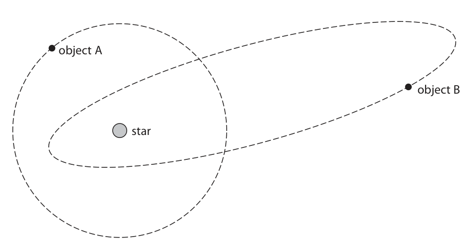
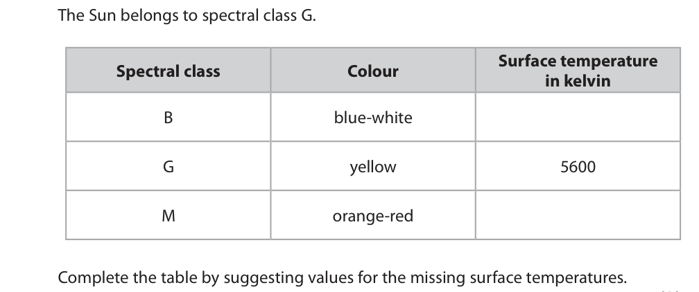
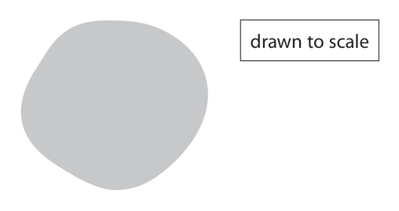
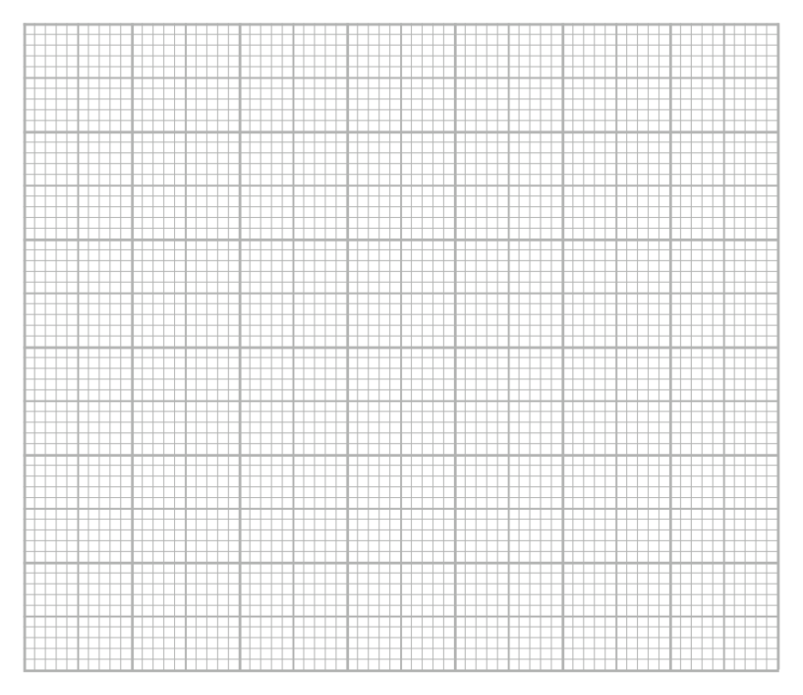
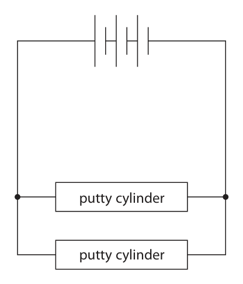
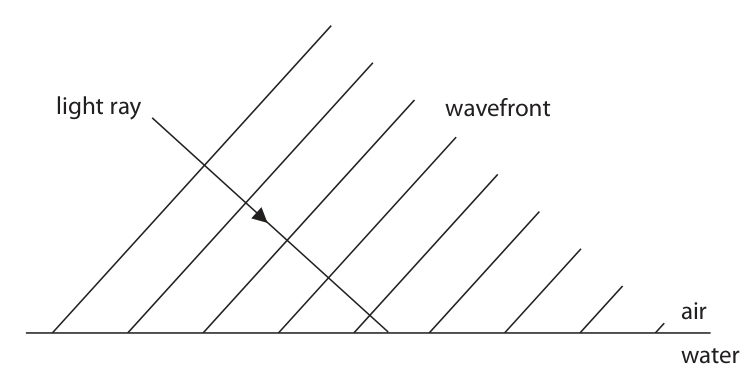
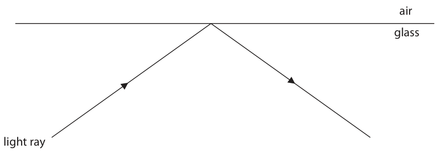
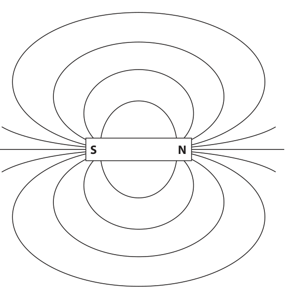
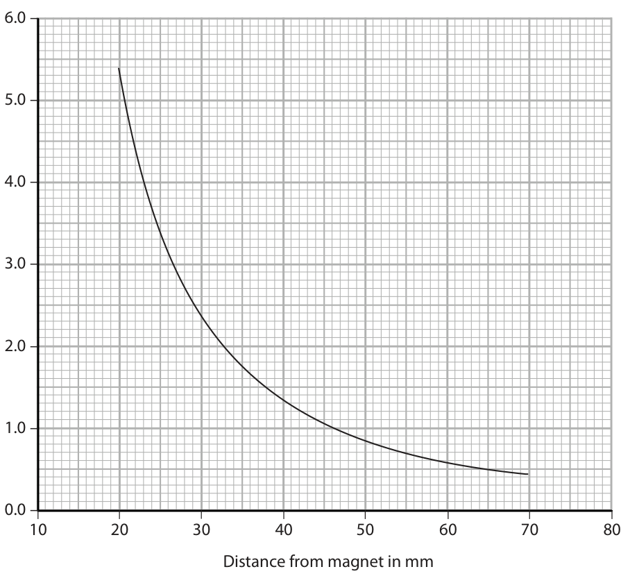

# 4PH1/1PR — 2019-06 (official extraction)

> schema `syllabai.official-paper-questions/0.2` · paper_id `pearson-edexcel:international-gcse:physics:4ph1:2019-06:4PH1/1PR` · qp sha256 `20249e07f7fc38e8…` · extraction is the disclosed baseline (ADR-039)

## Question 1 (10 marks)

This question is about stars.

**(a)** The diagram shows the orbits of two astronomical objects around a star. object A object B star

### 1(a)(i) [2]

Add a labelled arrow to the diagram to show the type of force from the star acting on object A.

### 1(a)(ii) [1]

What is object A?

- **(A)** a comet
- **(B)** a galaxy
- **(C)** a moon
- **(D)** a planet

### 1(a)(iii) [1]

What is object B?

- **(A)** a comet
- **(B)** a galaxy
- **(C)** a moon
- **(D)** a planet

### 1(b) [1]

State the name given to a large collection of billions of stars.

### 1(c) [2]

Physicists classify stars according to their colour. Each group of stars of similar colour is called a spectral class. The table gives information about colour and surface temperature for three spectral classes of stars. The Sun belongs to spectral class G. Surface temperature Spectral class Colour in kelvin B blue-white G yellow 5600 M orange-red Complete the table by suggesting values for the missing surface temperatures.

### 1(d) [3]

There are stars in the universe with masses much greater than the mass of the Sun. Describe what happens to these high-mass stars when they leave the main sequence stage of their evolution.

## Question 2 (11 marks)

Some of the energy stored in the nuclei of atoms can be used to generate electricity.

**(a)** A nuclear fission power station generates electricity.

**(b)** Nuclear fusion is another process that could be used to generate electricity.

### 2(a)(i) [1]

State the role of the moderator in a nuclear fission power station.

### 2(a)(ii) [2]

Some of the daughter nuclei produced in nuclear fission are highly radioactive and emit high energy neutrons when they decay. Explain which feature of a nuclear fission reactor reduces the risks from these high energy neutrons.

### 2(a)(iii) [2]

The daughter nuclei can cause contamination and irradiation. Describe the difference between contamination and irradiation.

### 2(b)(i) [2]

Describe the process of nuclear fusion.

**Mark scheme answer**

> any two from:
> MP1. creation of a (large) nucleus from small condone “fusing of two
> nuclei; nuclei”
> MP2. resulting in a loss of mass;
> MP3. and the release of energy; accept reference to
> E=mc2
> condone “converted to
> energy”

- **(2)** any two from:

### 2(b)(ii) [1]

State where nuclear fusion occurs naturally.

**Mark scheme answer**

> (in) star(s); allow named star e.g.
> The Sun

- **(1)** (in) star(s); allow named star e.g.

### 2(b)(iii) [3]

Generating electricity from nuclear fusion is very difficult as the conditions needed are hard to achieve and maintain. Explain the conditions required for nuclear fusion.

**Mark scheme answer**

> any three from:
> MP1. high temperature required;
> MP2. to increase kinetic energy of nuclei; allow to make nuclei
> move faster
> allow particles or atoms
> for this MP
> MP3. high pressure required;
> MP4. (because) nuclei need to be close enough to allow higher level
> collide; answers in terms of
> short range strong
> nuclear force
> MP5. (since) nuclei repel each other;
> Answer Notes Marks

- **(3)** any three from:

## Question 3 (7 marks)

Lead-210 is a radioactive isotope of lead and is represented using this symbol. 210 82 Pb

### 3(a) [2]

State what is meant by the term isotope.

**Mark scheme answer**

> (nuclei with) the same number of protons; allow same atomic
> number / same element
> (but) different number of neutrons; allow different nucleon
> / mass number /atomic
> mass
> (b) A (82);
> B is incorrect because this is the number of neutrons
> C is incorrect because this is the number of nucleons
> D is incorrect because this is double the proton number + nucleon number

- **(2)** (nuclei with) the same number of protons; allow same atomic

### 3(b) [1]

How many protons are in the nucleus of lead-210?

- **(A)** 82
- **(B)** 128
- **(C)** 210
- **(D)** 292

### 3(c)(i) [2]

A sample of lead-210 has an initial activity of 240 Bq. After 66 years, the activity of the sample is 30 Bq. Calculate the half-life of lead-210. half-life = years

**Mark scheme answer**

> evidence of 3 half-lives; seen anywhere in
> working
> correct evaluation;
> e.g.
> 240 ÷ 23 = 30
> 66 ÷ 3 = 22 (years)

- **(2)** evidence of 3 half-lives; seen anywhere in

### 3(c)(ii) [2]

Lead-210 decays into lead-206 through a number of stages. This involves one alpha decay and a number of beta decays. This incomplete equation summarises these stages. 210 206 0 Pb → Pb + α + β 82 82 –1 Complete the equation by giving the missing numbers. Write your answers in the spaces provided.

**Mark scheme answer**

> correct atomic and mass numbers used for alpha seen anywhere in
> particle; working
> correct evaluation of number of beta particles;
> e.g.
> atomic number of alpha = 2, mass number = 4
> (therefore) 2 beta decays (to get back to 82)
> Answer Notes Marks

- **(2)** correct atomic and mass numbers used for alpha seen anywhere in

## Question 4 (7 marks)

Photograph 1 shows an outdoor swimming pool. Photograph 1

**(a)** The water in the swimming pool is heated by the Sun during the day.

**(b)** The water in the swimming pool cools down at night.

### 4(a)(i) [1]

State how energy is transferred from the Sun to the water.

### 4(a)(ii) [1]

State what happens to the average speed of the water molecules as the water is heated.

### 4(b)(i) [1]

Suggest why the water cools down at night.

**Mark scheme answer**

> Either
> idea that water temperature is greater than the allow RA
> outside temperature;
> Or condone ‘heat’ or
> ‘sunlight’ for ‘light’ or
> not receiving radiation / light from the Sun; ‘radiation’

- **(1)** Either

### 4(b)(ii) [4]

Photograph 2 shows the swimming pool with a plastic cover over the water. Photograph 2 Explain why the plastic cover reduces how much the water cools down at night.

**Mark scheme answer**

> any four from: ignore reference to
> radiation
> MP1. cover traps air; ignore ‘traps heat’
> MP2. (trapped) air is a poor conductor / (good)
> insulator;
> MP3. plastic is a poor conductor / (good)
> insulator;
> MP4. conduction reduced; condone “conduction
> stopped”
> MP5. convection reduced / stopped;
> MP6. less evaporation (from water surface); condone “no
> evaporation”
> Answer Notes Marks

- **(4)** any four from: ignore reference to

## Question 5 (17 marks)

A student is given a type of putty that conducts electricity. He rolls the putty into cylinders of different cross-sectional area. The photograph shows the cylinders. The student investigates how the electrical resistance of the putty is affected by its cross-sectional area.

**(a)** The diagram shows the cross-sectional area of one of the cylinders of putty. drawn to scale

**(c)** The student uses his voltage and current measurements to calculate the resistance of this cylinder. He repeats this for other cylinders. The table shows some of his results. Cross-sectional Voltage in V Current in A Resistance in Ω area in cm2 4.5 4.56 0.049 91.2 6.2 4.56 0.059 77.3 9.1 4.56 0.068 67.1 13.9 4.56 0.085 53.6 18.1 4.56 0.094 48.5 24.6 4.56 0.107

### 5(a)(i) [2]

Use the diagram to determine the mean diameter of the cylinder of putty. mean diameter = cm

### 5(a)(ii) [2]

Calculate the cross-sectional area of the cylinder of putty in cm2. [area of a circle = π × radius2] cross-sectional area = cm2

### 5(b) [3]

The student connects a cylinder of putty to a battery. He measures the voltage of the cylinder and the current in the circuit. Complete the circuit diagram, adding suitable instruments to measure the voltage of the cylinder and the current in the circuit. putty cylinder

**Mark scheme answer**

> correct circuit symbols for both voltmeter and
> ammeter;
> ammeter connected in series;
> voltmeter connected in parallel with putty cylinder; accept voltmeter
> connected in parallel
> with battery
> allow voltmeter
> connected in parallel
> across putty and
> ammeter

- **(3)** correct circuit symbols for both voltmeter and

### 5(c)(i) [2]

Calculate the resistance of the cylinder when the cross-sectional area of the cylinder is 24.6 cm2. Give your answer to 3 significant figures. resistance = Ω

**Mark scheme answer**

> 42.6; allow 42.6168…
> 3 s.f. used; mark independently

- **(2)** 42.6; allow 42.6168…

### 5(c)(ii) [3]

Plot a graph of resistance on the y-axis and cross-sectional area on the x-axis.

**Mark scheme answer**

> suitable linear scale chosen (>50% of grid used); orientation needs to be
> correct
> axes labelled with quantities and units;
> plotting correct to nearest half square; all points must be
> correct
> ignore plotting of final
> point

- **(3)** suitable linear scale chosen (>50% of grid used); orientation needs to be

### 5(c)(iii) [1]

Draw the curve of best fit.

**Mark scheme answer**

> line (curve) of best fit acceptable; allow ECF from plotting
> i.e. smooth curve with
> points evenly
> distributed about it
> (d) voltage stays the same;
> (because) each putty cylinder is connected in
> parallel (with the cells);
> total current doubles; allow current increases
> (because) current in each putty cylinder stays the allow resistors in
> same (as before) and these currents add together; parallel have lower
> total resistance
> allow correct use of
> resistors in parallel
> formula
> Answer Notes Marks

- **(1)** line (curve) of best fit acceptable; allow ECF from plotting

### 5(d) [4]

The student extends his investigation by connecting two new identical cylinders to a battery. The diagram shows the circuit he uses. putty cylinder putty cylinder He measures the voltage of each cylinder and the total current in the circuit. Discuss how his measurements of voltage and current compare with the measurements when only one of these cylinders is used.

## Question 6 (6 marks)

The photograph shows a small glass ball used to investigate density and pressure.

**(a)** The mass of the ball is 19 g. The density of the ball is 2.3 g/cm3.

**(b)** The ball is dropped into deep water and sinks to a depth of 560 cm.

### 6(a)(i) [1]

State the formula linking density, mass and volume.

### 6(a)(ii) [2]

Calculate the volume of the ball. volume = cm3

### 6(b)(i) [1]

State the formula linking pressure difference, height, density and gravitational field strength.

**Mark scheme answer**

> pressure difference = height x density x g; allow use of standard
> symbols e.g.
> p=hxρxg
> reject ‘gravity’

- **(1)** pressure difference = height x density x g; allow use of standard

### 6(b)(ii) [2]

Calculate the increase in pressure at this depth. [density of water = 1000 kg/m3] increase in pressure = Pa

**Mark scheme answer**

> substitution; accept use of g = 9.8(1)
> m/s2
> evaluation;
> e.g.
> (p =) 5.6 x 1000 x 10
> (p =) 56 000 (Pa) -1 if POT error in
> substitution
> Use of 9.8 gives 54 880
> Use of 9.81 gives 54 936
> Both round to 55 000
> Answer Notes Marks

- **(2)** substitution; accept use of g = 9.8(1)

## Question 7 (7 marks)

A student investigates how the surface material of a ramp affects the average speed of a block sliding down the ramp.

### 7(a) [6]

Design a suitable method for the student’s investigation. Your answer should include ● the measuring equipment needed ● details of the independent, dependent and control variables ● how the average speed will be determined You may include a diagram to help your answer.

> 🖼 crop required: diagram (qp.pdf p.18)

**Mark scheme answer**

> measuring equipment: allow if clearly included
> in diagram
> MP1. ruler / tape measure;
> MP2. stopclock / stopwatch; condone ‘timer’
> accept use of light
> gates if connected to
> timing device e.g.
> computer/datalogger
> accept ‘camera’ if
> subsequent method
> describes ‘freeze-
> frame’/timestamp
> technique
> variables:
> MP3. surface material is the independent
> variable;
> MP4. (average) speed is the dependent variable; allow time as the
> dependent variable
> MP5. any one control variable from; allow ‘keep constant’
> for ‘control variable’
> • size / mass / material / area /weight of
> block
> • height/angle/gradient of ramp
> • initial force given to block allow ‘push’ given to
> block
> allow initial speed or
> velocity
> • distance travelled down the ramp allow same starting
> point and finishing point
> determining average speed:
> MP6. use of (average) speed = accept use of light gate
> distance travelled / time if description includes
> length of card/block
> and time of transit
> (b) (bar chart because) surface material is a {categoric condone surface
> / discontinuous / non-continuous} variable; material being a
> discrete variable
> Total for Question 7 =7 marks
> Answer Notes Marks

- **(6)** measuring equipment: allow if clearly included

### 7(b) [1]

Justify why the student should display their results as a bar chart.

## Question 8 (7 marks)

The graph shows how the velocity of a parachute jumper changes with time. 60 – A B 40 – Velocity in m / s 20 – C 0– 0 20 40 60 80 100 120 Time in s

**(a)** At point A, the parachute jumper is falling at terminal velocity and has not yet opened her parachute.

### 8(a)(i) [1]

Which statement is correct about the parachute jumper at point A?

- **(A)** acceleration and air resistance are equal
- **(B)** acceleration and velocity are equal
- **(C)** weight and acceleration are equal
- **(D)** weight and air resistance are equal

### 8(a)(ii) [1]

Which is the best estimate of the distance fallen by the parachute jumper from the start until point A?

- **(A)** 50 m
- **(B)** 1300 m
- **(C)** 2300 m
- **(D)** 2700 m

### 8(b) [4]

The parachute jumper opens her parachute at point B. Her velocity decreases until she reaches terminal velocity again at point C. Explain this change in velocity.

### 8(c) [1]

After point C, the parachute jumper continues to fall at a constant velocity. As she falls, energy is transferred from a gravitational store. Which store is the energy transferred into?

- **(A)** chemical store
- **(B)** gravitational store
- **(C)** kinetic store
- **(D)** thermal store

## Question 9 (13 marks)
**(a)** A light ray travels from air into water. Diagram 1 shows the direction of the light ray and the wavefronts in air. light ray wavefront air water Diagram 1 The refractive index of water is greater than the refractive index of air.

**(b)** Diagram 2 shows what can happen when a light ray travelling in glass meets the boundary with air. The wavefronts are not shown in this diagram. air glass light ray Diagram 2

### 9(a)(i) [3]

Complete diagram 1 by showing ● the wavefronts in the water ● the path of the light ray in the water

### 9(a)(ii) [2]

Explain what happens to the wavelength of light when it passes from air into water.

### 9(b)(i) [1]

Add the normal to diagram 2.

**Mark scheme answer**

> normal drawn at right angles where light ray meets judge by eye
> boundary;

- **(1)** normal drawn at right angles where light ray meets judge by eye

### 9(b)(ii) [1]

Measure the angle of incidence in diagram 2. angle of incidence = degrees

**Mark scheme answer**

> 55°; allow range 54-56°

- **(1)** 55°; allow range 54-56°

### 9(b)(iii) [3]

The glass has a refractive index of 1.6 Calculate the critical angle of the glass-air boundary. critical angle = degrees

**Mark scheme answer**

> substitution into sin c = 1/n;
> rearrangement;
> evaluation; condone intermediate
> rounding
> e.g.
> sin c = 1/1.6
> (c =) sin-1 (1/1.6)
> (c =) 39° allow 38.682…

- **(3)** substitution into sin c = 1/n;

### 9(b)(iv) [3]

Explain the path of the light ray shown in diagram 2.

**Mark scheme answer**

> (path shows) total internal reflection; allow TIR
> (because) ray is travelling from high to low however expressed e.g.
> refractive index; reduction of (optical)
> density / increase in
> speed from glass to air
> (and) angle of incidence is greater than the critical
> angle;
> Answer Notes Marks

- **(3)** (path shows) total internal reflection; allow TIR

## Question 10 (15 marks)
**(a)** Diagram 1 shows a van accelerating along a horizontal road. The horizontal forces acting on the van are shown. force X driving force = 2500 N Diagram 1

**(b)** Diagram 2 shows the resultant force acting on the van when it brakes. resultant force = 14 kN Diagram 2

### 10(a)(i) [1]

Force X opposes the motion of the van. State the name of force X.

### 10(a)(ii) [1]

The resultant force acting on the van is 1500 N. Calculate the magnitude of force X. [assume X is the only horizontal force opposing the motion of the van] force X = N

### 10(b)(i) [1]

State the formula linking resultant force, mass and acceleration.

**Mark scheme answer**

> (resultant) force = mass × acceleration; allow rearrangements
> and standard symbols
> e.g. a = F/m

- **(1)** (resultant) force = mass × acceleration; allow rearrangements

### 10(b)(ii) [3]

The mass of the van is 1900 kg. Calculate the acceleration of the van when it brakes. Give the unit. acceleration = unit

**Mark scheme answer**

> substitution AND rearrangement;
> evaluation; -1 for POT error
> unit; mark independently
> e.g.
> (a =) (-)14000 / 1900
> (a =) (-)7.4 Condone 7.4, 7.36842…,
> etc.
> m/s2 accept m s-2
> ignore N/kg

- **(3)** substitution AND rearrangement;

### 10(b)(iii) [3]

The van was travelling at an initial speed of 18 m/s before braking and coming to rest. Calculate the distance travelled by the van while it is braking. [assume that the acceleration remains constant] distance travelled = m

**Mark scheme answer**

> substitution into v2 = u2 + 2as; allow ecf from (b)(ii)
> no mark for equation
> alone as given
> rearrangement;
> evaluation; -1 if negative sign given
> with answer
> e.g.
> 0 = 182 + (2 x -7.4 x s)
> (s =) 324 / (2 x 7.4)
> (s =) 22 (m) allow answer in range
> 21.8-22.0 from rounding
> differences
> allow time to stop of
> 2.4... (s) for 1 mark

- **(3)** substitution into v2 = u2 + 2as; allow ecf from (b)(ii)

### 10(b)(iv) [2]

Describe two factors that would increase the braking distance. 1 2

**Mark scheme answer**

> any two described factors from: ignore condition of
> driver
> MP1. increased mass (of van); allow weight for mass
> MP2. increased speed (of van); allow KE for speed
> MP3. idea of less friction on the road e.g. road
> being wet / icy etc;
> MP4. idea of worn vehicle parts e.g. tyres / brakes
> etc.;
> MP5. van travelling downhill;
> (c) -1 if POT error
> calculation of new acceleration (5.6);
> substitution into a = (v – u) / t; allow ecf from
> acceleration value
> allow use of previously
> calculated acceleration
> rearrangement;
> evaluation;
> award full marks for
> momentum method i.e.
> e.g. recall of F = (mv-mu)/t;
> substitution;
> rearrangement;
> evaluation;
> new acceleration = 5.6 (m/s2)
> 5.6 = 18 / t
> (t =) 18/5.6
> (t =) 3.2 (s) allow 3.214…
> ignore negative
> reject 25000/14000 x 18
> (i.e. mass x 10 x
> speed/force) which
> gives 32.
> Answer Notes Marks

- **(2)** any two described factors from: ignore condition of

### 10(c) [4]

When the van is fully loaded its mass increases to 2500 kg. Calculate the time taken to bring the fully loaded van to rest when it is travelling at an initial speed of 18 m/s. [assume that the resultant force during braking remains at 14 kN] time = s

## Question 11 (10 marks)

A student investigates the magnetic fields produced by magnets.

**(b)** The diagram shows the shape of the magnetic field around the bar magnet. S N

### 11(a) [3]

Describe a method he could use to determine the shape and direction of the magnetic field produced by a bar magnet. You may use a diagram to help your answer.

**Mark scheme answer**

> all marks may be given
> from diagram
> MP1. method to show shape;
> e.g.
> use compass(es)
> use of iron filings/powder
> MP2. use of plotting compass to show direction;
> MP3. a further method detail;
> e.g.
> move compass / multiple compasses in
> different positions
> idea of another line or lines added
> sprinkle iron filings (on to card)
> tap card (to distribute iron filings)

- **(3)** all marks may be given

### 11(b)(i) [1]

Add two arrows to the diagram to show the direction of the magnetic field.

**Mark scheme answer**

> both arrows correctly pointing from north to south; reject if arrows
> contradict

- **(1)** both arrows correctly pointing from north to south; reject if arrows

### 11(b)(ii) [2]

Explain how the diagram shows that the strength of the magnetic field changes.

**Mark scheme answer**

> idea that field lines are closer together / further
> apart;
> (showing that) field strongest near the poles / allow “magnet” for
> weaker away from the poles; “poles”
> (c) any pair of readings read from the graph;
> correct substitution into formula to find constant;
> different pair of readings used correctly to find
> constant;
> statement that the results agree with the DOP
> conclusion;
> allow idea that the
> constants are different
> so the results do not
> agree with the
> conclusion
> e.g.
> when distance = 30mm, magnetic field strength =
> 2.3 mT
> (2.3 x 302 =) 2070
> (0.8 x 502 =) 2000
> constants are approximately the same so results
> agree with conclusion
> Pearson Education Limited. Registered company number 872828
> with its registered office at 80 Strand, London, WC2R 0RL, United Kingdom

- **(2)** idea that field lines are closer together / further

### 11(c) [4]

Magnetic field strength can be measured in units of milli-tesla (mT). A student uses a different magnet. The student measures the magnetic field strength at different distances from the north pole of this magnet. The graph shows his results. 6.0 – 5.0 – 4.0 – Magnetic field strength in mT 3.0 – 2.0 – 1.0 – 0.0 – 10 20 30 40 50 60 70 80 Distance from magnet in mm The student concludes that his results obey this relationship. magnetic field strength × distance2 = constant Use data from the graph to deduce whether the student’s results support this conclusion.

