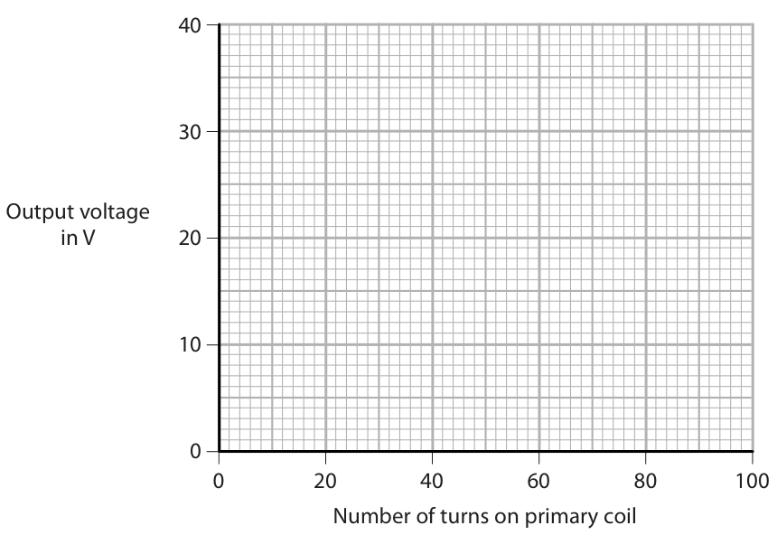
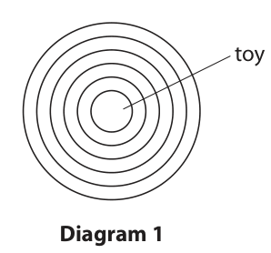

# 4PH1/2P — 2019-06 (official extraction)

> schema `syllabai.official-paper-questions/0.2` · paper_id `pearson-edexcel:international-gcse:physics:4ph1:2019-06:4PH1/2P` · qp sha256 `0530e035df5f00be…` · extraction is the disclosed baseline (ADR-039)

## Question 1 (3 marks)
### 1(a) [1]

Which force is responsible for keeping satellites in orbit?

- **(A)** electrostatic
- **(B)** gravitational  ✔
- **(C)** magnetic
- **(D)** nuclear

**Mark scheme answer**

> B – gravitational;
> A is incorrect because there are no charges
> C is incorrect because there are no magnetic
> fields
> D is incorrect because nuclear forces are
> short range

- **(1)** Answer B: gravitational

### 1(b) [1]

Which of these is the largest?

- **(A)** galaxy
- **(B)** planet
- **(C)** star
- **(D)** universe  ✔

**Mark scheme answer**

> D – universe;
> A is incorrect because the universe contains
> billions of galaxies
> B is incorrect because each solar system
> contains several planets
> C is incorrect because galaxies contain
> billions of stars

- **(1)** Answer D: universe

### 1(c) [1]

Which of these represents the brightness of stars at a standard distance?

- **(A)** absolute magnitude  ✔
- **(B)** colour
- **(C)** diameter
- **(D)** temperature

**Mark scheme answer**

> A – absolute magnitude;
> B is incorrect because colour determines the
> surface temperature of a star
> C is incorrect because diameter determines
> the power of a star
> D is incorrect because temperature
> determines the power of a star
> Answer Notes Marks

- **(1)** Answer A: absolute magnitude

## Question 2 (7 marks)

A student investigates a transformer. This is the student’s method. ● use a primary coil with 10 turns ● connect the primary coil to a constant maximum input voltage ● measure the output voltage across the secondary coil ● repeat using an increasing number of turns on the primary coil The table shows the student’s results. Number of turns Output voltage on primary coil in V 10 39.6 20 19.7 40 9.9 60 6.6 80 5.0 100 4.0

### 2(a)(i) [1]

Plot a graph of the student’s results on the grid.

**Mark scheme answer**

> Points plotted to within half a small square;
> Points should lie on a
> very good curved line.

- **(1)** Points plotted to within half a small square;

### 2(a)(ii) [1]

Draw a curve of best fit. Output voltage in V 20 0 20 40 60 80 100 Number of turns on primary coil

**Mark scheme answer**

> Best fit line is smooth curve; ECF their data points.

- **(1)** Best fit line is smooth curve; ECF their data points.

### 2(a)(iii) [2]

Describe the relationship between the output voltage and the number of turns on the primary coil.

**Mark scheme answer**

> As number of (primary) turns increases, (secondary) Allow RA
> voltage decreases;
> Allow unqualified
> ‘inversely proportional’
> for 2 marks.
> At a decreasing rate/is non-linear;
> Ignore:
> ‘negative exponential’

- **(2)** As number of (primary) turns increases, (secondary) Allow RA

### 2(b)(i) [1]

State the formula linking input and output voltages and the turns ratio for the transformer.

**Mark scheme answer**

> (Np/Ns) = (Vp/Vs); Allow any correct
> rearrangment.
> Allow ”i(nput) and
> o(utput)” or “1 and
> 2”for “p(rimary) and
> s(econdary)”.
> Allow correct word
> equation.
> Ignore ‘P’ for ‘N’
> Condone ‘T’, ’t’ or ‘n’ for
> ‘N’
> Condone ‘coils’ for
> ‘turns’

- **(1)** (Np/Ns) = (Vp/Vs); Allow any correct

### 2(b)(ii) [2]

The input voltage of the transformer is 6.8 V. Calculate the number of turns on the secondary coil. number of turns =

**Mark scheme answer**

> Substitution of values for Np, VP and Vs ; Allow any row of data
> from table or co-
> ordinates for a point
> on the line on the
> graph
> Evaluation of Ns ; Accept answer in range
> 57-60.
> Accept non-integer
> number of turns.
> e.g. 40 / Ns = (6.8/9.9) = 0.686….;
> Ns = 40 /0.601.. = 58(.2….) ;
> Answer Notes Marks

- **(2)** Substitution of values for Np, VP and Vs ; Allow any row of data

## Question 3 (10 marks)

This question is about sound waves.

**(b)** An oscilloscope can be used to determine the frequency of a sound wave. The diagram shows an oscilloscope trace of a sound wave. Oscilloscope settings y direction: 1 square = 1 V x direction: 1 square = 0.25 ms

### 3(a) [5]

Describe an experiment to measure the speed of sound in air. You may draw a diagram to help your answer.

**Mark scheme answer**

> Any FIVE from: A fully labelled diagram can score
> all the marks.
> MP1. measure time for a set distance; allow measuring wavelength for a
> known frequency
> MP2. realistic values suggested for e.g.
> experiment to work; • at least 1m for microphones
> and oscilloscope method
> • at least 100m for seeing and
> hearing a clap method
> • at least 50m for wall and echo
> method
> • wavelength measured at least
> 10cm
> MP3. suitable measuring instrument named; e.g. stop clock, stopwatch, ruler,
> tape measure, oscilloscope, trundle
> wheel, timer
> MP4. further detail of setup; e.g.
> • two microphones on bench
> connected to oscilloscope
> • start timing when see a clap and
> stop when hear it
> • clap by wall and time how long
> for clap to come back
> • moving a microphone until
> waveforms line up on
> oscilloscope
> • For echo method, idea time and
> distance is “there and back”
> MP5. idea of repeats AND average;
> MP6. speed = distance / time; allow speed = frequency ×
> wavelength for appropriate
> method

- **(5)** Any FIVE from: A fully labelled diagram can score

### 3(b)(i) [3]

Calculate the period of this sound wave. period = s

**Mark scheme answer**

> Measurement of one period on oscilloscope;
> Use of x-scale;
> -1 POT error
> Evaluation of period in s; Allow 1 SF answer
> e.g. Condone period = 0.0005 (s) or
> Period = 4 squares 0.002 (s) or in standard form for 2
> Period = 4 x 0.25 (ms) marks MAX.
> Period = 1.0 x 10-3 (s)

- **(3)** Measurement of one period on oscilloscope;

### 3(b)(ii) [2]

Calculate the frequency of this sound wave. frequency = Hz

**Mark scheme answer**

> Substitution into given equation f = 1/ T; Allow ECF from b) (i)
> Evaluation;
> i.e f = 1/(1.0 x 10-3)
> f = 1000 (Hz)
> Answer Notes Marks

- **(2)** Substitution into given equation f = 1/ T; Allow ECF from b) (i)

## Question 4 (11 marks)

This is a question about alpha particles.

**(b)** The diagram shows the path of an alpha particle as it passes close to a nucleus. X nucleus

### 4(a) [1]

Describe the nature of an alpha particle.

**Mark scheme answer**

> A helium nucleus /
> 2 protons and 2 neutrons/
> 4 nucleons, 2 protons; Ignore chemical
> symbol

- **(1)** A helium nucleus /

### 4(b)(i) [2]

Draw an arrow from point X to show the force on the alpha particle due to the nucleus. Label this force Y.

**Mark scheme answer**

> Arrow labelled Y, through X away from nucleus;
> Line of action of force would pass through centre
> of nucleus by eye;

- **(2)** Arrow labelled Y, through X away from nucleus;

### 4(b)(ii) [2]

Draw an arrow to show the force on the nucleus due to the alpha particle. Label this force Z.

**Mark scheme answer**

> Arrow labelled Z, opposite direction to their
> answer from b) (i) by eye;
> Same size as their answer from b) (i) by eye; If no arrow Y,
> condone correct
> direction for arrow Z,
> i.e. force arrow
> pointing away from
> point X.

- **(2)** Arrow labelled Z, opposite direction to their

### 4(b)(iii) [3]

Explain how the path of the alpha particle shows whether the nucleus is positive, negative or neutral.

**Mark scheme answer**

> MP1 Force on alpha is repulsive; Allow ‘like charges
> repel’ for MP1 and
> MP2
> MP2 Alpha and nucleus must be same (type of)
> charge;
> MP3 Alpha is positive therefore nucleus is
> positive;

- **(3)** MP1 Force on alpha is repulsive; Allow ‘like charges

### 4(c) [3]

The alpha particle experiences a resultant force of 3.6 N and has a mass of 6.6 × 10–27 kg. Calculate the acceleration of the alpha particle. acceleration = m/ s 2

**Mark scheme answer**

> Selection of F = ma; Can be implied from
> working
> Substitution or re-arrangement;
> Evaluation;
> -1 for PoT error
> e.g. a = 3.6 / 6.6 x 10-27 = 5.5 x 1026 m/s2
> Allow 5.45 x 1026,
> 5.454 x 1026, 5.4545…
> x 1026 etc
> Condone 5.4 x 1026
> Answer Notes Marks

- **(3)** Selection of F = ma; Can be implied from

## Question 5 (5 marks)

A toy produces continuous waves when floating on the surface of a pool of water. The waves spread out as circular wavefronts. Diagram 1 shows the wavefronts produced when the toy is not moving, as viewed from above. toy Diagram 1 Diagram 2 shows the wavefronts produced when the toy is moving across the surface of the pool of water. toy B A Diagram 2

### 5(a) [1]

Draw an arrow on diagram 2 to show the direction the toy is moving.

**Mark scheme answer**

> An arrow drawn from left to right by eye;

- **(1)** An arrow drawn from left to right by eye;

### 5(b) [4]

Explain how the frequency of the waves at point A is different to the frequency of the waves at point B.

**Mark scheme answer**

> Comparative statements for side containing A: Allow RA for B
> Wavefronts closer together/EQ; Allow e.g.“waves more
> compressed together”
> (therefore) wavelength smaller;
> Same speed;
> (v = f x so) frequency larger;
> Condone mention of
> the Doppler effect for 1
> mark if no other mark
> scored.
> Answer Notes Marks

- **(4)** Comparative statements for side containing A: Allow RA for B

## Question 6 (11 marks)

A dog sits on a water‑filled bag to keep cool. water-filled bag

**(a)** The table shows some data about the dog and the water in the bag. mass of water in kg 8.7 power output of dog by heating in W 75 specific heat capacity of water in J/kg °C 4200 initial temperature of water in °C 16 The dog sits on the bag for 22 minutes.

### 6(a)(i) [3]

Calculate the energy transferred from the dog to the water by heating in 22 minutes. energy = J

**Mark scheme answer**

> Substitution (including conversion of time to
> seconds);
> Re-arrangement of given equation P = W/t; Allow W or E for energy
> or work.
> Can be implied from
> their working.
> Evaluation;
> e.g. Energy = 75 x (22 x 60) = 99 000 (J)
> Accept 1650 or 5.9
> million for 2 marks.

- **(3)** Substitution (including conversion of time to

### 6(a)(ii) [1]

State an assumption you have made when calculating the energy transferred.

**Mark scheme answer**

> Any ONE assumption from
> • dog does not change temperature Ignore unqualified
> • dog does not change power output ‘100% efficient’ or ‘no
> • rate of transfer is constant (despite increase energy lost’
> in temp of water)
> • no heating of outside
> world/surroundings/material of bag
> • no heating from the surroundings

- **(1)** Any ONE assumption from

### 6(a)(iii) [4]

Calculate the temperature of the water after 22 minutes. temperature = °C

**Mark scheme answer**

> Use of Q = m x c x ∆ ;
> Substitution of their energy, mass, c; Allow ECF from (a)(i)
> Evaluation of temp change; Allow ECF from
> evaluation of temp
> change.
> Calculation of final temp = temp change + 16;
> e.g. 99 000 = 8.7 x 4200 x ∆
> temp rise = 99 000/(8.7 x 4200) = 2.7
> final temp = 19 (oC);
> Accept 16.04… for all
> marks (ecf E without
> min->s conversion)
> Accept answer to 3 or
> more sf i.e 18.7

- **(4)** Use of Q = m x c x ∆ ;

### 6(b) [3]

Discuss why conduction is the main way that thermal energy is transferred from the dog to the water.

**Mark scheme answer**

> Any THREE from
> MP1 Dog and water are at different temperatures;
> MP2 Dog and water in physical contact so likely to
> be conduction;
> MP3 No movement of particles from dog to water, Allow “no gap between
> so not convection / EQ; dog and bag so no
> convection”
> MP4 Dog and bag are both solids, so convection
> impossible;
> MP5 Not much radiation as dog and water similar
> temperatures;
> Answer Notes Marks

- **(3)** Any THREE from

## Question 7 (6 marks)
### 7(a) [2]

Give two pieces of evidence for the Big Bang theory.

**Mark scheme answer**

> Cosmic Microwave Background Radiation (CMBR) Allow one missing
> word
> (Cosmological) Red shift of galaxies
> Accept reference to
> Hubble’s Law.
> Allow higher level idea
> of ratio of hydrogen to
> helium as alternative to
> either marking point.

- **(2)** Cosmic Microwave Background Radiation (CMBR) Allow one missing

### 7(b) [4]

Explain how this evidence supports the Big Bang theory.

**Mark scheme answer**

> CMBR
> MAX TWO from
> MP1 CMBR appears to be the same in all
> directions/is everywhere;
> Allow implication of
> MP2 Which implies all parts of the Universe idea of coming from
> were in contact a long time ago; single point
> Allow frequency has
> MP3 Wavelength has increased as the universe decreased
> has expanded;
> Allow RA
> MP4 universe was (significantly) hotter long
> ago;
> Red Shift of Galaxies
> MAX TWO from
> Condone “star” for
> MP5 The further the galaxy is from Earth, the “galaxy” for MP5
> greater the red-shift;
> MP6 The greater the red-shift, the faster the
> galaxy is moving away;
> Allow ‘red shift’ for
> MP7 Speed of galaxies increases (is directly ‘speed of galaxies’
> proportional to) with increased distance;
> Allow ‘galaxies moving
> MP8 Relationship between speed and distance apart from each other’
> implies expansion from a single point or since the for ‘relationship
> Big Bang; between speed and
> distance’
> Answer Notes Marks

- **(4)** CMBR

## Question 8 (6 marks)

The diagram shows a bottle supported by a finger. force from finger = 2.1 N not to scale 3.2 cm 28 cm Z floor weight of bottle

### 8(a) [1]

State the name of point Z.

**Mark scheme answer**

> Centre of gravity; Accept ‘Centre of Mass’

- **(1)** Centre of gravity; Accept ‘Centre of Mass’

### 8(b)(i) [1]

State the formula linking moment, force and perpendicular distance from the pivot.

**Mark scheme answer**

> Moment = force x (perpendicular) distance; Condone M = f x d

- **(1)** Moment = force x (perpendicular) distance; Condone M = f x d

### 8(b)(ii) [4]

The bottle does not move. Calculate the weight of the bottle. weight of bottle = N

**Mark scheme answer**

> Any correct moment; Allow calculation
> i.e. 2.1 x 0.28 or W x 0.032 performed in cm
> Evidence of use of principle of moments;
> i.e. 2.1 x 28 = W x 3.2
> Re-arrangement ; i.e. W = 2.1 x 28 /3.2
> Evaluation; W = 18 (N) Accept unrounded
> 18.375, 18.4 N.
> Condone for 1 mark
> statement of principle of
> moments.
> Answer Notes Marks

- **(4)** Any correct moment; Allow calculation

## Question 9 (11 marks)

This is a question about a melting ice cube.

**(a)** The diagram shows an ice cube placed on the ground. ice cube ground

### 9(a)(i) [4]

The mass of the ice cube is 3.7 g and its area of contact with the ground is 2.6 × 10–4 m2. Calculate the pressure the ice cube exerts on the ground. pressure = Pa

**Mark scheme answer**

> Selection of P=F/A;
> Conversion of g to kg; 0.0037 seen anywhere
> Evaluation of weight;
> Evaluation of pressure;
> Correct answer: 140 (Pa) Accept any value that
> i.e. rounds to 140. i.e 142,
> W = 3.7 x 10-3 x 10 = 3.7 x 10-2 N; 142.3,
> P = 3.7 x 10-2 / (2.6 x 10-4);
> P = 140 (Pa); Accept use of 9.8(1) for
> ‘g’, giving 139(.46)

- **(4)** Selection of P=F/A;

### 9(a)(ii) [2]

The ice cube melts and becomes a puddle with a larger cross‑sectional area. Explain how the pressure of the ice cube on the ground changes when it melts.

**Mark scheme answer**

> Same weight (and larger cross-sectional area); Allow ‘force’ for weight
> P=F/A so smaller pressure;

- **(2)** Same weight (and larger cross-sectional area); Allow ‘force’ for weight

### 9(b) [3]

Ice melts at a temperature of 0 °C. On the axes, sketch how the temperature of the ice cube changes as it rises from a temperature of –10 °C to a temperature of 20 °C. Temperature in °C Time –10

**Mark scheme answer**

> Responses with no
> period of time at 0 oC
> score max 1 mark.
> Increases continuously from -10 oC to 0 oC; Accept
> • Any gradient
> Remains constant at 0 oC; • Straight lines or
> curves for the
> Increases continuously from 0 oC to 20 oC; increasing
> temperature parts
> • Any non-zero
> amount of time at 0
> o
> C by eye
> Ignore any numbers on
> the time axis.

- **(3)** Responses with no

### 9(c) [2]

Explain the changes that occur when a solid melts. Refer to particles in your answer.

**Mark scheme answer**

> Any TWO from:
> Bonds between particles are weakened or Allow particles get
> broken; (slightly) further
> apart/EQ;
> Particles go from regular to irregularly
> packed/EQ;
> Particles go from vibrating (about a fixed
> position) to sliding past each other/EQ;
> ignore references to KE
> Pearson Education Limited. Registered company number 872828
> with its registered office at 80 Strand, London, WC2R 0RL, United Kingdom

- **(2)** Any TWO from:

