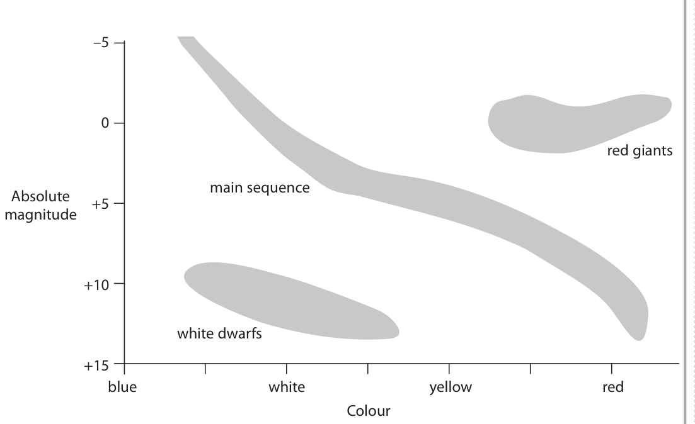
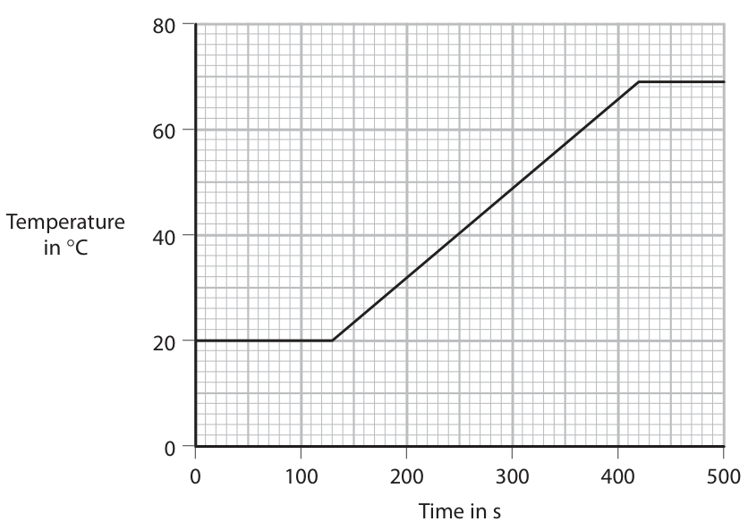
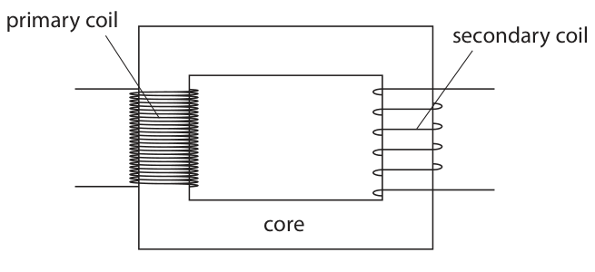
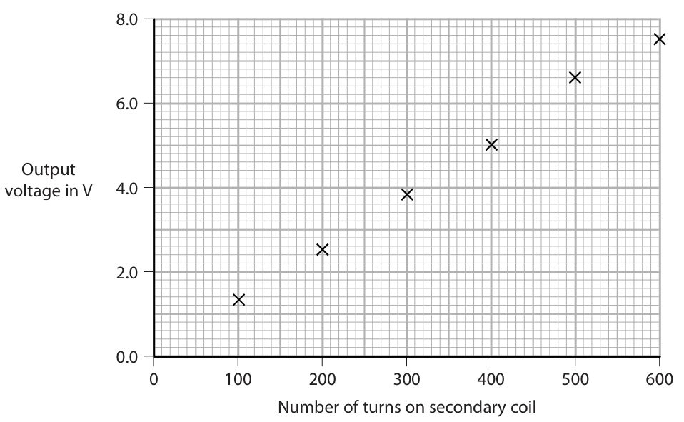

# 4PH1/2PR — 2019-06 (official extraction)

> schema `syllabai.official-paper-questions/0.2` · paper_id `pearson-edexcel:international-gcse:physics:4ph1:2019-06:4PH1/2PR` · qp sha256 `78fd786c083d6b41…` · extraction is the disclosed baseline (ADR-039)

## Question 1 (7 marks)
**(a)** The diagram shows a fossil fuel power station. Five stages of electricity generation and transmission are shown. steam water furnace and boiler condenser turbines generator transformer

### 1(a)(i) [1]

The power station burns a fossil fuel in the furnace. Give an example of a fossil fuel.

**Mark scheme answer**

> (crude) oil / coal / (natural) gas; allow petrol / diesel /
> gasoline / kerosene

- **(1)** (crude) oil / coal / (natural) gas; allow petrol / diesel /

### 1(a)(ii) [1]

Which stage of the power station transfers energy from a chemical store to a thermal store?

- **(A)** condenser
- **(B)** furnace and boiler  ✔
- **(C)** generator
- **(D)** turbines

**Mark scheme answer**

> B – (furnace and boiler);
> A is incorrect because this transfers energy between thermal stores
> C is incorrect because this transfers energy electrically from a kinetic store
> D is incorrect because this transfers energy from a thermal to a kinetic store

- **(1)** Answer B: furnace and boiler

### 1(a)(iii) [1]

Which stage of the power station transfers energy electrically from a kinetic energy store?

- **(A)** condenser
- **(B)** furnace and boiler
- **(C)** generator  ✔
- **(D)** turbines

**Mark scheme answer**

> C – (generator);
> A is incorrect because this transfers energy between thermal stores
> B is incorrect because this transfers energy from a chemical to a thermal
> store
> D is incorrect because this transfers energy from a thermal to a kinetic store

- **(1)** Answer C: generator

### 1(b) [4]

Electricity can also be generated by solar farms. (Source: © Zoonar GmbH/Alamy) Energy is transferred from the Sun to the solar farm by radiation. The solar farm uses photovoltaic cells to transfer this energy electrically. Discuss the advantages and disadvantages of generating electricity using solar farms.

**Mark scheme answer**

> any two advantages max. from:
> MP1. solar is renewable;
> MP2. no fuel / transportation cost; allow “sunlight is
> free”/eq
> MP3. no air pollution / greenhouse gases; allow named pollutant
> e.g. CO2 etc.
> any two disadvantages max. from: ignore comments
> relating to setup cost
> MP4. idea that Sun does not shine all the time; ignore “relies on the
> weather”
> MP5. idea that output depends on geographical
> location;
> MP6. need for large open spaces; allow “takes up farm
> land”/eq
> Answer Notes Marks

- **(4)** any two advantages max. from:

## Question 2 (13 marks)

This question is about sound waves.

**(b)** The speed of sound in liquids is greater than the speed of sound in gases.

**(c)** A buzzer is an electrical device that produces sound. The frequency of sound produced by the buzzer is 1400 Hz.

### 2(a) [1]

Sound is an example of a type of wave. State the name of this type of wave.

**Mark scheme answer**

> longitudinal;

- **(1)** longitudinal;

### 2(b)(i) [2]

Describe the arrangement of particles in liquids and in gases. You may use diagrams to help your answer.

**Mark scheme answer**

> allow either mark if clear
> from diagrams
> particles arranged randomly; allow irregularly for
> randomly mark can be given
> for description of liquid, gas,
> or both
> particles further apart in gas than in liquid; allow RA
> ignore diagram for this mark
> if gaps in liquid bigger than
> one particle

- **(2)** allow either mark if clear

### 2(b)(ii) [2]

Suggest why the speed of sound in liquids is greater than the speed of sound in gases.

**Mark scheme answer**

> (sound travels by) vibrations; allow alternatives for
> vibrations e.g. oscillations
> allow “sound vibrates
> particles”
> idea that {vibrations / sound / waves / energy} allow equivalents for
> are passed on more effectively because particles effectively e.g. faster, easily,
> are closer together; efficiently etc.

- **(2)** (sound travels by) vibrations; allow alternatives for

### 2(c)(i) [1]

State the formula linking speed, frequency and wavelength of a wave.

**Mark scheme answer**

> (wave) speed = frequency × wavelength; allow correct use of symbols
> and rearrangements e.g.
> $v = f\times \lambda$
> condone s as symbol for
> speed

- **(1)** (wave) speed = frequency × wavelength; allow correct use of symbols

### 2(c)(ii) [2]

Sound travels at a speed of 340 m/s in air. Calculate the wavelength of the sound wave from the buzzer. wavelength = m

**Mark scheme answer**

> substitution OR rearrangement;
> evaluation;
> e.g.
> 340 = 1400 x λ OR λ = v / f
> (λ =) 0.24 (m) allow 0.243, 0.242857… etc.
> condone 0.242

- **(2)** substitution OR rearrangement;

### 2(c)(iii) [5]

Two students use this method to investigate sound from a moving source. Student A connects a piece of string to the buzzer. She spins round so that the buzzer moves in a horizontal circular path. ● she spins round at a slow speed ● she then spins round at a high speed Student B stands several metres away from student A. student A student B buzzer The sound heard by student A is different to the sound heard by student B. Discuss the differences in the sounds heard by student A and student B.

**Mark scheme answer**

> any five from: allow use of frequency
> instead of pitch throughout
> MP1. sound heard by student A is louder; allow RA
> MP2. sound heard by student A is constant
> pitch;
> MP3. no change in sound heard by student A
> when speed of rotation is varied;
> MP4. sound heard by student B varies in pitch;
> MP5. sound heard by student B is high pitch
> when buzzer is moving towards them
> AND low pitch when moving away from
> them;
> MP6. change of pitch for student B is greater
> when speed of rotation is greater;
> MP7. sound varies in loudness for student B; allow RA i.e. constant
> loudness for student A
> Answer Notes Marks

- **(5)** any five from: allow use of frequency

## Question 3 (6 marks)
**(a)** A student charges a plastic rod by rubbing it with a cloth. The rod becomes negatively charged.

### 3(a)(i) [1]

Which statement explains how the rod becomes negatively charged?

- **(A)** the rod gains positively charged electrons
- **(B)** the rod loses positively charged electrons
- **(C)** the rod gains negatively charged electrons  ✔
- **(D)** the rod loses negatively charged electrons

**Mark scheme answer**

> C – the rod gains negatively charged electrons;
> A is incorrect because electrons are not positively charged
> B is incorrect because electrons are not positively charged
> D is incorrect because this would make the rod positively charged

- **(1)** Answer C: the rod gains negatively charged electrons

### 3(a)(ii) [2]

Describe how the student could demonstrate that the rod is charged.

**Mark scheme answer**

> a named demonstration;
> a relevant observation;
> e.g.
> put charged rod near hair
> hair moves towards / is attracted to rod
> put charged rod near (small) pieces of paper
> pieces of paper move towards to the rod
> put charged rod near stream of water
> water bends towards the rod
> put rod next to another charged rod
> rod will move towards / away from other rod
> use a gold leaf electroscope (GLE)
> gold leaf deflects

- **(2)** a named demonstration;

### 3(b) [3]

The student has several other rods made from different kinds of plastic. Some rods can be charged positively and some can be charged negatively. Describe an experiment to show that different rods have different types of charge. You may draw a diagram to help your answer.

**Mark scheme answer**

> marking points may be
> shown on a labelled
> diagram
> MP1. method to allow (rods) to swing freely; e.g. suspend / balance
> on watch glass
> allow if another
> charged insulator used
> e.g. a balloon
> MP2. idea that rods are brought close together; allow if rod brought
> near another charged
> insulator
> MP3. observation of attraction AND repulsion; reject if method would
> not give attraction and
> repulsion e.g. holding
> rod near stream of
> water
> Answer Notes Marks

- **(3)** marking points may be

## Question 4 (6 marks)

A Hertzsprung‑Russell diagram shows how different astronomical objects may be classified according to their colour and absolute magnitude. –5 red giants main sequence Absolute +5 magnitude +10 white dwarfs +15 blue white yellow red Colour The diagram shows three stages of evolution for stars of similar mass to the Sun. Describe the evolution of stars of similar mass to the Sun. You should refer to the temperature and brightness of the stars in your answer. (6)

### 4 [6]

A Hertzsprung‑Russell diagram shows how different astronomical objects may be classified according to their colour and absolute magnitude. –5 red giants main sequence Absolute +5 magnitude +10 white dwarfs +15 blue white yellow red Colour The diagram shows three stages of evolution for stars of similar mass to the Sun. Describe the evolution of stars of similar mass to the Sun. You should refer to the temperature and brightness of the stars in your answer.

**Mark scheme answer**

> a description including any six from:
> MP1. nebula collapses / forms protostar; allow ‘contracts’
> MP2. temperature / brightness of nebula /
> protostar increases;
> MP3. (when temperature becomes hot enough)
> fusion starts and star becomes main
> sequence;
> MP4. brightness / temperature of main allow ‘size’ for mass
> sequence star depends on its mass;
> MP5. (when hydrogen runs out) main sequence
> star becomes red giant;
> MP6. red giants are brighter (than main
> sequence);
> MP7. red giants (surfaces) are cooler (than most
> main sequence stars);
> MP8. red giant becomes white dwarf;
> MP9. white dwarfs are less bright (than red
> giant / main sequence stars);
> MP10. white dwarfs are hotter (than red giant /
> most main sequence stars);
> Answer Notes Marks

- **(6)** a description including any six from:

## Question 5 (8 marks)

Stearic acid is a solid at room temperature and melts at a temperature of 69 °C. A student investigates the specific heat capacity of solid stearic acid. He heats a sample of stearic acid from room temperature using an electrical heater and measures its temperature using a data logger and temperature sensor. The graph shows his results. Temperature in °C 40 0 100 200 300 400 500 Time in s

**(a)** The student starts heating the stearic acid at 130 seconds.

### 5(a)(i) [1]

Determine the time it takes to heat the stearic acid until it reaches its melting point. time = s

**Mark scheme answer**

> 290 (s);

- **(1)** 290 (s);

### 5(a)(ii) [3]

The stearic acid gains 39 kJ of energy during the time it is heated to its melting point. Calculate the mean (average) power of the heater. Give a unit with your answer. [assume no energy lost to surroundings] mean power = unit

**Mark scheme answer**

> substitution into P = E/t; allow ecf from (a)(i)
> evaluation;
> a matching unit for power; a correct unit for
> power may score 1 if
> no other mark scored
> e.g.
> (P =) 39000/290 allow 134.48…
> (P =) 130
> watts / W allow J/s
> answers of 0.13 kW,
> 0.13 kJ/s gain 3 marks
> answers of 0.13 W,
> 0.13 J/s gain 2 marks

- **(3)** substitution into P = E/t; allow ecf from (a)(i)

### 5(b) [4]

The mass of stearic acid used in the investigation is 0.45 kg. The stearic acid gains 39 kJ of energy when it is heated to its melting point. Calculate the specific heat capacity of stearic acid. You should use data from the graph in your calculation. specific heat capacity = J/kg °C

**Mark scheme answer**

> correct evaluation of temperature change; allow 49 seen
> anywhere in working
> substitution into ΔQ = m × c × Δθ; allow ecf from
> incorrect temperature
> change value of 50, 69
> or 70 only
> rearrangement;
> evaluation; -1 for POT error
> e.g.
> temperature change = 49 (°C)
> $39 000 = 0.45 \times c \times 49$
> (c =) 39 000 / (0.45 × 49)
> (c =) 1800 (J/kg°C) allow 1770, 1769,
> 1768.7…
> answer of 1.7687…
> gains 3 marks
> answer of 1733, 1256,
> 1238
> gains 3 marks
> answer of 1.256…,
> 1.733…, 1.238…
> gains 2 marks

- **(4)** correct evaluation of temperature change; allow 49 seen

## Question 6 (14 marks)

A student investigates transformers.

**(b)** The student investigates the effect of changing the number of turns in the secondary coil. This is his method. ● apply a constant maximum voltage to a primary coil with 1200 turns ● use a secondary coil with 100 turns ● measure the output voltage of the transformer ● replace the secondary coil with one that has 200 turns ● measure the output voltage again The student repeats this method using different numbers of turns in the secondary coil.

**(c)** The student plots this graph to show the results of his investigation. 8.0 6.0 Output voltage in V 4.0 2.0 0.0 0 100 200 300 400 500 600 Number of turns on secondary coil

### 6(a) [1]

The diagram shows a typical transformer. primary coil secondary coil core State the name given to this type of transformer.

**Mark scheme answer**

> step-down (transformer);

- **(1)** step-down (transformer);

### 6(b)(i) [1]

Suggest how the student could improve the reliability of his investigation.

**Mark scheme answer**

> idea of taking repeats (and removing anomalies); allow repeating the
> investigation or
> individual readings

- **(1)** idea of taking repeats (and removing anomalies); allow repeating the

### 6(b)(ii) [3]

These are the student’s results. number of turns = 100, number of turns = 400, output voltage = 1.3 V output voltage = 5.0 V number of turns = 200, number of turns = 500, output voltage = 2.5 V output voltage = 6.3 V number of turns = 300, number of turns = 600, output voltage = 3.8 V output voltage = 7.5 V Draw a table of these results.

> 🖼 crop required: table (qp.pdf p.18)

**Mark scheme answer**

> only two columns or rows with headings of columns can be in
> ‘number of turns’ and ‘(output) voltage’; either order
> allow use of standard
> symbols e.g. n/N for
> number of turns and V
> for voltage
> correct units included only in voltage heading; allow volts or V
> reject if units given
> with data values
> ignore any units given
> for number of turns
> all data correctly included in body of table to same
> precision as given in the paper;

- **(3)** only two columns or rows with headings of columns can be in

### 6(b)(iii) [1]

Suggest how the student could improve the precision of his voltage measurement.

**Mark scheme answer**

> idea of increasing sensitivity of voltmeter e.g.
> ‘using a voltmeter that measures to more decimal
> places’;

- **(1)** idea of increasing sensitivity of voltmeter e.g.

### 6(c)(i) [1]

The student plots one of his results incorrectly. Draw a circle around the incorrectly plotted result on the graph.

**Mark scheme answer**

> 500 turns reading circled;

- **(1)** 500 turns reading circled;

### 6(c)(ii) [1]

Draw the line of best fit.

**Mark scheme answer**

> straight line passing through all points except allow straight line with
> reading at 500 turns; points evenly
> distributed either side

- **(1)** straight line passing through all points except allow straight line with

### 6(c)(iii) [2]

Describe the relationship shown by the graph.

**Mark scheme answer**

> simple pattern statement e.g. ‘as the number of
> turns increases, the output voltage increases’;
> further detail e.g. linear relationship;
> allow “they are
> proportional” for both
> marks only if line
> passes through origin

- **(2)** simple pattern statement e.g. ‘as the number of

### 6(d) [4]

The primary coil has 1200 turns. Using the student’s data, calculate the primary voltage used in his investigation. primary voltage = V

**Mark scheme answer**

> pair of readings correctly read from the graph /
> results table;
> substitution into correct transformer formula;
> rearrangement; allow if seen anywhere
> in calculation either in
> symbols or numbers
> evaluation;
> N V in V
> 100 1.3
> 200 2.5
> 300 3.8
> e.g. 400 5.0
> number of turns = 600, output voltage = 7.5 V 500 6.3
> V₁ / 7.5 = 1200 / 600 600 7.5
> (V₁ =) (1200 × 7.5) / 600
> (V₁ =) 15 (V) allow range of 15–16
> (V)

- **(4)** pair of readings correctly read from the graph /

## Question 7 (9 marks)

A game is played on a table with balls of different colours.

**(a)** The diagram shows the white ball moving across a flat surface. v = 5.2 m/s white ball

**(b)** The white ball collides with a stationary black ball. v = 5.2 m/s v v = 5.0 m/s white ball black ball white ball black ball before collision after collision

### 7(a)(i) [1]

State the formula linking momentum, mass and velocity.

**Mark scheme answer**

> momentum = mass × velocity; allow rearrangements
> and standard symbols
> e.g. m = p / v
> reject m for
> momentum

- **(1)** momentum = mass × velocity; allow rearrangements

### 7(a)(ii) [2]

The white ball has a mass of 170 g. Calculate the momentum of the white ball. momentum = kg m/s

**Mark scheme answer**

> substitution;
> evaluation; -1 if POT error
> e.g.
> (p =) 0.170 × 5.2
> (p =) 0.88 (kgm/s) allow 0.884 (kgm/s)

- **(2)** substitution;

### 7(b)(i) [4]

The black ball has a mass of 160 g. After the collision, the black ball moves away from the white ball with a velocity of 5.0 m/s. Calculate the velocity of the white ball after the collision. velocity of white ball = m/s

**Mark scheme answer**

> momentum of black ball calculated; ignore units
> conservation of momentum used correctly; stated or implied from
> calculation
> allow ecf from (a)
> final momentum of white ball calculated; ignore units
> evaluation of final velocity of white ball;
> e.g.
> pblack = 0.80 (kgm/s) allow 800 (gm/s)
> 0.88 = pwhite + 0.80
> pwhite = 0.08 (kgm/s) allow 80 (gm/s)
> vwhite = 0.47 (m/s) allow 0.5, 0.4705…
> 0.49 for use of 0.884
> from a(ii)

- **(4)** momentum of black ball calculated; ignore units

### 7(b)(ii) [2]

During the collision, the white ball exerts a force of 80 N on the black ball. The direction of this force is to the right. State the magnitude and direction of the force the black ball exerts on the white ball during the collision. magnitude of force = N direction of force =

**Mark scheme answer**

> 80 (N);
> (to the) left;
> Answer Notes Marks

- **(2)** 80 (N);

## Question 8 (7 marks)

The photograph shows a device that can be used to ignite small pieces of combustible material. The device consists of a cylinder containing trapped air and a piston. piston cylinder combustible material before pushing piston after pushing piston A small piece of combustible material is placed at the bottom of the cylinder. When the piston is pushed quickly into the cylinder, the trapped air is compressed and heats up. This increase in temperature is enough to ignite the combustible material.

**(a)** The piston is quickly pushed down a distance of 145 mm. The average force exerted on the piston is 4.2 N.

### 8(a)(i) [1]

State the formula linking work done, force and distance moved in the direction of the force.

**Mark scheme answer**

> work (done) = force × distance (moved in direction accept correct symbols
> of force); and rearrangements
> e.g. W = F × s
> allow d for distance

- **(1)** work (done) = force × distance (moved in direction accept correct symbols

### 8(a)(ii) [2]

Calculate the work done on the trapped air when the piston is quickly pushed down. work done = J

**Mark scheme answer**

> substitution; -1 for POT error
> evaluation;
> e.g.
> (W =) 4.2 × 0.145
> (W =) 0.61 (J) allow 0.609 (J)
> 609 (J) gains 1 mark

- **(2)** substitution; -1 for POT error

### 8(a)(iii) [1]

State the maximum amount of energy that could be transferred to the trapped air. energy transferred = J

**Mark scheme answer**

> same answer as (ii);

- **(1)** same answer as (ii);

### 8(a)(iv) [2]

Using ideas about molecules, explain why the trapped air heats up.

**Mark scheme answer**

> kinetic energy (store) of molecules increases; allow molecules move
> faster / eq
> (temperature increases) because temperature is
> proportional to (mean) KE (of molecules);

- **(2)** kinetic energy (store) of molecules increases; allow molecules move

### 8(b) [1]

Suggest why the trapped air does not reach a high enough temperature to ignite the combustible material if the piston is slowly pushed into the cylinder.

**Mark scheme answer**

> any one from:
> MP1. idea that (more) energy would be allow less work done
> transferred / lost to the surroundings (for on air
> slow compressions);
> MP2. piston would have less KE (to transfer);
> MP3. less force on piston (so less work done on
> gas);
> Pearson Education Limited. Registered company number 872828
> with its registered office at 80 Strand, London, WC2R 0RL, United Kingdom

- **(1)** any one from:

