# 4PH1/1P — 2020-01 (official extraction)

> schema `syllabai.official-paper-questions/0.2` · paper_id `pearson-edexcel:international-gcse:physics:4ph1:2020-01:4PH1/1P` · qp sha256 `3ac1cfeed0766950…` · extraction is the disclosed baseline (ADR-039)

## Question 1 (5 marks)

The passage describes some of the properties of magnets and magnetic fields. Use words from the box to complete the passage. aluminium copper hard negative north positive soft south steel Each word may be used once, more than once or not at all. (5) The north pole of one magnet will repel the .............................................................. pole of another magnet. There is attraction between . . . . . . . . . . . . . . ................................................ and magnets. Materials that are difficult to magnetise are called .............................................................. magnetic materials. The direction of the magnetic field lines for a magnet is from .............................................................. to south. Iron is a . . . . . . . . . . . . . . . . . . . . . . . . . . . . . . . . . . . . . . . . . . . . . . . . . . . . . . . . . . . . . . magnetic material.

### 1 [5]

The passage describes some of the properties of magnets and magnetic fields. Use words from the box to complete the passage. aluminium copper hard negative north positive soft south steel Each word may be used once, more than once or not at all. The north pole of one magnet will repel the pole of another magnet. There is attraction between and magnets. Materials that are difficult to magnetise are called magnetic materials. The direction of the magnetic field lines for a magnet is from to south. Iron is a magnetic material.

## Question 2 (11 marks)

A ship floats on the sea. upthrust surface of sea

**(a)** The ship floats because of the forces acting on it.

**(b)** The upthrust force acting on the ship is proportional to the pressure difference between the bottom of the ship and the surface of the sea. The pressure acting on the ship at the surface of the sea is 100 kPa.

### 2(a)(i) [2]

The upward force acting on the ship is called upthrust. This force is shown on the diagram. Draw another labelled arrow on the diagram to show the other vertical force acting on the ship.

> 🖼 crop required: diagram (qp.pdf p.4)

### 2(a)(ii) [2]

Forces are vector quantities. State what is meant by the term vector quantity.

### 2(a)(iii) [1]

Give another example of a vector quantity.

### 2(b)(i) [1]

State the formula linking pressure difference, height, density and gravitational field strength (g).

**Mark scheme answer**

> pressure (difference) = height × density × g; allow standard symbols
> and rearrangements
> e.g. p = h × ρ × g
> allow d for density
> ignore “gravity” for g

- **(1)** pressure (difference) = height × density × g; allow standard symbols

### 2(b)(ii) [3]

The bottom of the ship is 15.8 m below the surface of the sea. Show that the pressure acting on the bottom of the ship is approximately 260 kPa. [density of seawater = 1030 kg/m3]

**Mark scheme answer**

> substitution; allow g = 9.8, 9.81
> evaluation of pressure difference in Pa OR kPa to at -1 for POT error unless
> least 3s.f.; due to physics error
> addition of surface pressure (100 kPa) to give reject this mark if
> answer; inconsistent units used
> allow final answer in Pa
> or kPa
> e.g.
> p = 15.8 × 1030 × 10
> p = 162740 Pa OR 162.74 kPa
> p = 162.74 + 100 (= 260 kPa) allow 262 740 (Pa)

- **(3)** substitution; allow g = 9.8, 9.81

### 2(b)(iii) [2]

Explain why the bottom of the ship is deeper below the surface of the sea when the ship is fully loaded with cargo.

**Mark scheme answer**

> any two from:
> MP1. idea that {weight of ship / downwards allow ship is heavier,
> force} is greater; ship has more mass
> MP2. larger pressure difference (when deeper in allow larger pressure
> water); (on bottom of ship)
> MP3. larger upthrust force (needed to keep
> forces balanced);
> Answer Notes Marks

- **(2)** any two from:

## Question 3 (14 marks)

This question is about electric circuits.

**(c)** Diagram 1 shows an electric circuit with two resistors, R and S. Some of the values of the current are also shown. 0.60 A A2 0.40 A R A1 S Diagram 1

### 3(a) [1]

Which quantity is defined as the rate of flow of charge?

- **(A)** current  ✔
- **(B)** power
- **(C)** resistance
- **(D)** voltage

**Mark scheme answer**

> A (current);
> B is incorrect because power is the rate of energy transferred
> C is incorrect because resistance is the ratio of voltage and current
> D is incorrect because voltage is the energy transferred per unit charge passed
> (b) D (voltage);
> A is incorrect because current is the rate of flow of charge
> B is incorrect because power is the rate of energy transferred
> C is incorrect because resistance is the ratio of voltage and current

- **(1)** Answer A: current

### 3(b) [1]

Which quantity is defined as the energy transferred per unit charge passed?

- **(A)** current
- **(B)** power
- **(C)** resistance
- **(D)** voltage

### 3(c)(i) [2]

On Diagram 1, draw a voltmeter to measure the voltage of resistor S.

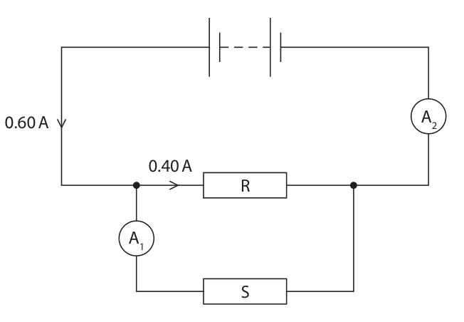

**Mark scheme answer**

> correct voltmeter symbol used;
> voltmeter drawn in parallel with S; condone drawn in parallel
> with R or the battery

- **(2)** correct voltmeter symbol used;

### 3(c)(ii) [2]

Deduce the readings on the ammeters. current measured by A1 = A current measured by A2 = A

**Mark scheme answer**

> 0.20 (A); this order only
> allow 0.2 (A)
> 0.60 (A); this order only
> allow 0.6 (A)

- **(2)** 0.20 (A); this order only

### 3(c)(iii) [3]

Resistor R has a resistance of 11 Ω. Calculate the voltage across resistor R. voltage = V

**Mark scheme answer**

> voltage = current × resistance; formula should be seen or
> implied by calculation
> allow standard symbols and
> rearrangements
> ignore C, c for current
> substitution;
> evaluation;
> e.g.
> V=I×R
> (V =) 0.40 × 11
> (V =) 4.4 (V)

- **(3)** voltage = current × resistance; formula should be seen or

### 3(c)(iv) [2]

Explain how the voltage across resistor R compares with the voltage across the battery.

**Mark scheme answer**

> idea that voltage across battery is the same as allow numerical value given
> voltage across R; e.g. ‘voltage of battery =
> 4.4V’
> (because) battery and R are connected in
> parallel / no other resistive components on
> loop with battery and R;
> (d) idea that resistance (of thermistor) changes; allow even if relationship is
> the wrong way round
> when temperature increases, resistance ORA
> decreases;
> (therefore) current increases when ORA
> temperature increases;
> Answer Notes Marks

- **(2)** idea that voltage across battery is the same as allow numerical value given

### 3(d) [3]

Diagram 2 shows a different circuit containing a battery, an ammeter and a thermistor. A Diagram 2 Explain how the thermistor can be used to vary the current in this circuit.

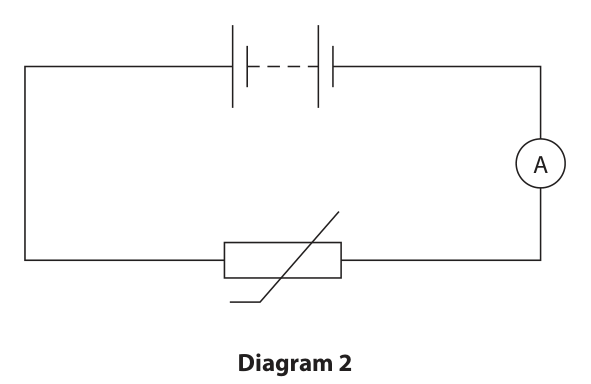

## Question 4 (11 marks)

A student investigates how much pressure she exerts on the ground when she is standing up.

**(a)** The weight of the student is 520 N.

**(b)** The student measures the area of one of her feet when it is in contact with the ground. She draws around her foot on a piece of squared paper. grid not to scale 2 cm 2 cm

### 4(a)(i) [1]

State the formula linking weight, mass and gravitational field strength (g).

### 4(a)(ii) [2]

Calculate the mass of the student. mass = kg

### 4(b)(i) [4]

The squares on the paper have a side length of 2 cm. Estimate the area of the student’s foot in contact with the ground. area = cm2

**Mark scheme answer**

> evidence of counting squares to find area; allow attempt to find
> area by splitting into
> rectangles / triangles
> number of squares in range 37-42;
> evaluation of area of one square; allow if 2 × 2 seen in
> working
> evaluation of total area; allow ecf from incorrect
> number of squares
> e.g.
> dots seen in each square in diagram
> number of squares = 39
> area of one square = (2 × 2) = 4 cm2
> total area = (4 × 39) = 156 cm2 allow 148-168

- **(4)** evidence of counting squares to find area; allow attempt to find

### 4(b)(ii) [1]

State the formula linking pressure, force and area.

**Mark scheme answer**

> pressure = force / area; allow standard symbols
> and rearrangements e.g.
> p=F/A

- **(1)** pressure = force / area; allow standard symbols

### 4(b)(iii) [3]

The weight of the student is 520 N. Calculate the pressure the student exerts on the ground when she is standing on both feet. Give the unit. pressure = unit

**Mark scheme answer**

> dimensionally correct substitution; allow ecf from (b)(i)
> evidence of doubling area or halving pressure to
> account for both feet;
> evaluation with matching unit; allow N/cm2, N/m2 or Pa
> if no marks awarded for
> calculation allow 1 mark
> if valid unit for pressure
> given
> e.g.
> (pressure =) 520 / 156
> area = 156 × 2 OR pressure = 3.2 ÷ 2
> (pressure =) 1.7 N/cm2 allow 1.5-1.8 N/cm2
> allow 15 000-18 000 N/m2
> Answer Notes Marks

- **(3)** dimensionally correct substitution; allow ecf from (b)(i)

## Question 5 (9 marks)

A bus transports passengers. © Mikbiz/Shutterstock

**(a)** The bus stops at certain points in its journey to let passengers get on or off the bus. The distance-time graph shows part of the bus journey, with sections labelled A to G. 8.0 6.0 G F E D Distance 4.0 in km C 2.0 B A 0.0 0 2 4 6 8 10 12 14 Time in minutes

### 5(a)(i) [1]

Give the letters of the sections where the bus is stationary.

### 5(a)(ii) [4]

Calculate the speed of the bus during section C of the journey. Give your answer in m / s. speed = m / s

### 5(a)(iii) [2]

Explain what the graph shows about the speed of the bus in section E compared with the speed of the bus in section A.

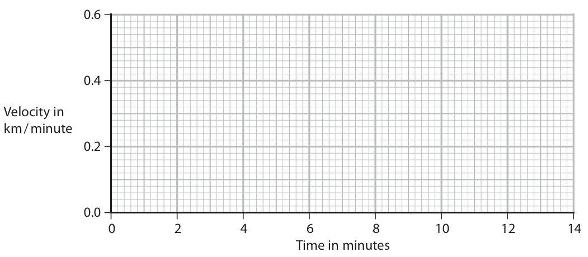

### 5(b) [2]

Another bus travels a distance of 7.0 km in a time of 14 minutes. This bus travels at a constant velocity. Complete the velocity-time graph to show the motion of this bus. 0.6 0.4 Velocity in km / minute 0.2 0.0 0 2 4 6 8 10 12 14 Time in minutes

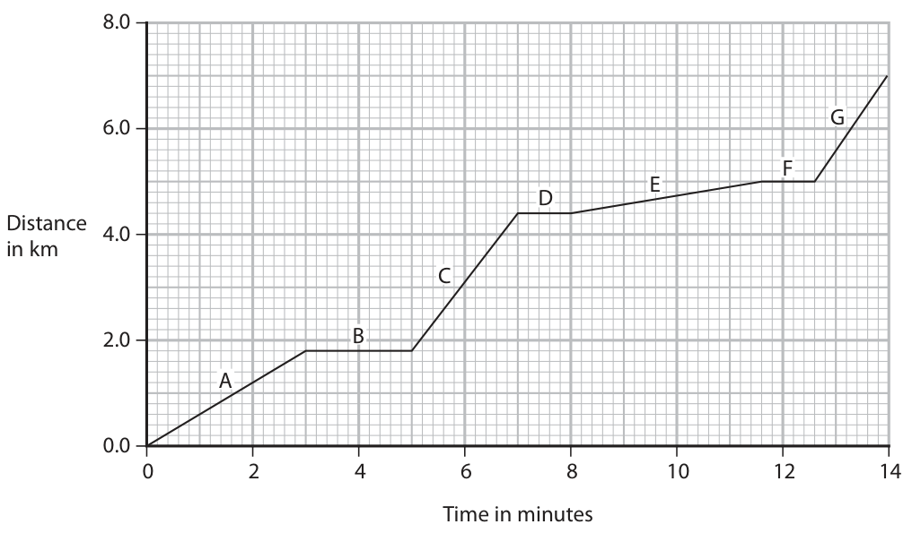

## Question 6 (6 marks)

A teacher makes a hot drink. He puts the drink in a cup designed to keep the drink hot. The photograph and cross-section diagram both show the cup. plastic lid vacuum shiny metal outer surface shiny metal inner surface Explain how the design of the cup keeps the drink hot. Refer to methods of energy transfer in your answer. (6)

### 6 [6]

A teacher makes a hot drink. He puts the drink in a cup designed to keep the drink hot. The photograph and cross-section diagram both show the cup. plastic lid vacuum shiny metal outer surface shiny metal inner surface Explain how the design of the cup keeps the drink hot. Refer to methods of energy transfer in your answer.

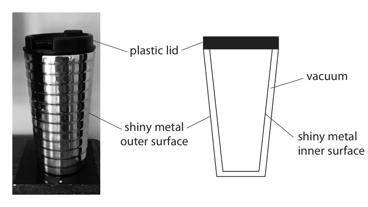

## Question 7 (8 marks)

A student uses a syringe containing trapped air to investigate pressure. Diagram 1 shows the apparatus he uses. pressure gauge syringe trapped air piston Diagram 1

**(c)** The position of the piston is then fixed so that the volume of trapped air in the syringe is now constant. The air in the syringe is then cooled.

### 7(a) [1]

Diagram 2 shows the pressure gauge when the piston is at its initial position. 20 40 10 50 kPa 0 60 © Lubos Chlubny/Shutterstock Diagram 2 Determine the reading on the pressure gauge. pressure = kPa

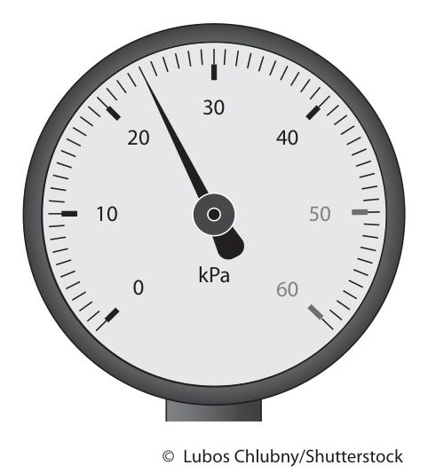

**Mark scheme answer**

> 24 (kPa);
> (b) any three from:
> MP1. reading increases / pressure increases;
> MP2. reading doubles / pressure doubles/ reading scores first 2 marks
> is 48 kPa;
> MP3. (because) air particles collide with walls
> more often;
> MP4. (because) pressure × volume is constant; allow quoted formula
> allow (because)
> pressure is inversely
> proportional to volume

- **(1)** 24 (kPa);

### 7(b) [3]

The piston is pushed in so that the volume of trapped air in the syringe is halved. The temperature of the trapped air remains constant. Explain how the reading on the pressure gauge will change when the piston is pushed in.

### 7(c)(i) [1]

State how the motion of air particles inside the syringe changes when the air is cooled.

**Mark scheme answer**

> {speed / velocity / KE} of particles decreases; allow less frequent
> collisions
> ignore ‘motion /
> movement decreases’

- **(1)** {speed / velocity / KE} of particles decreases; allow less frequent

### 7(c)(ii) [3]

Explain how the pressure of the trapped air inside the syringe changes when the air is cooled. Refer to particles in your answer.

**Mark scheme answer**

> pressure decreases;
> particles collide with walls less often;
> particles collide with less force; allow particles colliding
> less hard
> Answer Notes Marks

- **(3)** pressure decreases;

## Question 8 (8 marks)

A car is moving along a road.

**(a)** The car has an initial velocity of 26 m / s. The car then accelerates at 1. 2 m / s2 until it reaches a velocity of 35 m / s.

### 8(a)(i) [1]

State the formula linking acceleration, change in velocity and time taken.

### 8(a)(ii) [3]

Calculate the time taken for the car to accelerate to 35 m/s. time = s

### 8(b) [4]

A radar speed gun is used to measure the speed of the moving car. © Petar An/Shutterstock The radar speed gun emits radio waves towards the moving car. The moving car reflects the radio waves back to a detector on the gun. The detected radio waves have a different frequency from the emitted radio waves. This change in frequency is used to measure the speed of the moving car. Explain this change in frequency when the car is moving towards the radar speed gun.

## Question 9 (11 marks)

A teacher investigates the penetrating ability of the gamma rays from a gamma source. This is the teacher’s method. • place the gamma source at a distance of 25 cm from a radiation detector • place a 1 cm thick absorbing material between the source and the detector • measure the radiation count from the source for a time period of 3 s • calculate the count rate in counts per second • repeat the measurement two more times The teacher repeats this method for different absorbing materials.

**(e)** The table shows the teacher’s results for seven different absorbing materials. Count rate in counts per second Absorbing material Test 1 Test 2 Test 3 Mean plastic 248 230 226 235 copper 138 127 147 137 wood 226 231 224 227 aluminium 204 211 190 202 lead 96 102 92 97 glass 204 192 190 195 stone 205 200 205 203

### 9(a) [1]

Name a suitable radiation detector that the teacher could use.

**Mark scheme answer**

> Geiger-Muller tube / GM tube; allow Geiger counter, Geiger
> meter, GM detector
> (b) (absorbing) material; allow absorber
> (c) any two from:
> MP1. idea that thickness also affects the
> count/results;
> MP2. idea that thickness is a control
> variable;
> MP3. idea of making experiment valid; allow fair test for valid
> (d) measure count over longer time / take more allow quoted time longer
> repeats / measure background count; than 3 seconds

- **(1)** Geiger-Muller tube / GM tube; allow Geiger counter, Geiger

### 9(b) [1]

State the independent variable in the teacher’s investigation.

### 9(c) [2]

Explain why every absorbing material used in the investigation has a thickness of 1 cm.

### 9(d) [1]

Suggest one improvement the teacher could make to this method.

### 9(e)(i) [3]

On the grid, plot a bar chart of the mean count rate for each absorbing material.

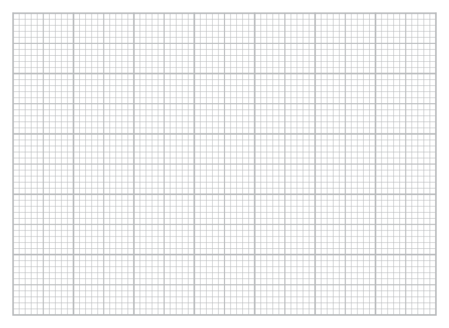

**Mark scheme answer**

> suitable linear scale chosen (>50% of grid ignore orientation
> used); do not accept multiples of 30
> for scale
> axes labelled with quantities and unit;
> all bar plotting correct to nearest half square;

- **(3)** suitable linear scale chosen (>50% of grid ignore orientation

### 9(e)(ii) [1]

Why is a bar chart the correct way to display the results?

- **(A)** absorbing material is a continuous variable
- **(B)** absorbing material is not a continuous variable
- **(C)** count rate is a continuous variable
- **(D)** count rate is not a continuous variable

**Mark scheme answer**

> B (absorbing material is not a continuous variable);
> A is incorrect because absorbing material is not a continuous variable
> C is incorrect because line graphs are drawn for continuous variables
> D is incorrect because count rate is a continuous variable

- **(1)** B (absorbing material is not a continuous variable);

### 9(e)(iii) [2]

A student concludes that plastic is the best absorber of gamma radiation because plastic gives the largest mean count rate. Evaluate the student’s conclusion.

**Mark scheme answer**

> ignore student is right/wrong
> idea that the lower the count, the better the allow RA
> absorber;
> lead is the best absorber; allow that plastic is the
> worst absorber
> Answer Notes Marks

- **(2)** ignore student is right/wrong

## Question 10 (11 marks)

This question is about light.

**(a)** Diagram 1 shows a light ray entering a glass prism. X B air 40° glass prism A light ray Y Diagram 1

### 10(a)(i) [2]

Describe what happens to the light ray when it enters the prism at point A.

### 10(a)(ii) [1]

State the name of line XY.

### 10(a)(iii) [1]

State the formula linking critical angle and refractive index.

### 10(a)(iv) [3]

The refractive index for the glass in this prism is 1.6 Calculate the critical angle for the glass in this prism. critical angle = °

### 10(a)(v) [2]

Complete Diagram 1 by continuing the path of the light ray from point B.

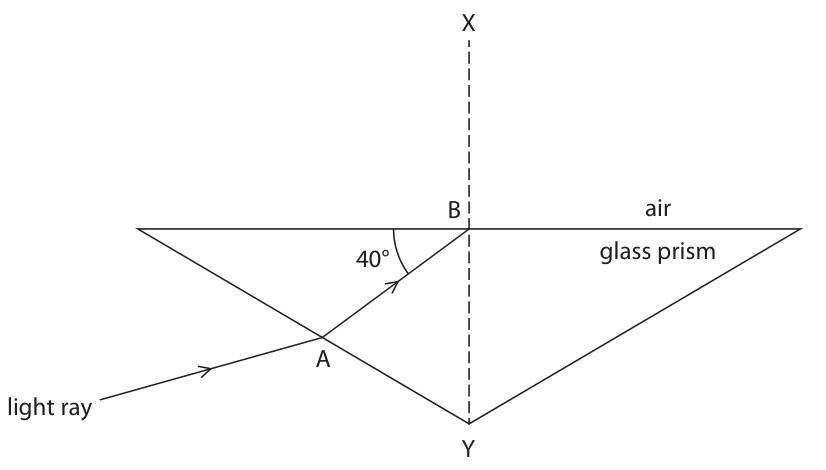

### 10(b) [2]

Diagram 2 shows a similar prism that is made from a material with a different refractive index. The critical angle for the material of this prism is 55° Complete Diagram 2 by continuing the path of the light ray. air 40° light ray Diagram 2

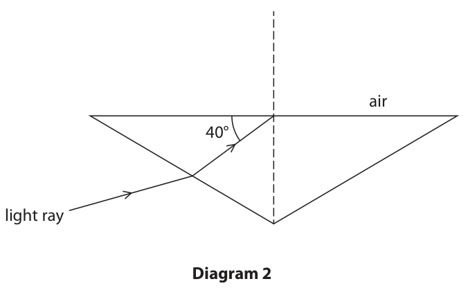

## Question 11 (9 marks)

Technetium-99m is an isotope of the element technetium.

**(b)** Technetium-99m has a half-life of 6 hours and can be used as a medical tracer. It is injected into a patient’s blood and moves around the patient’s body. Technetium-99m emits gamma radiation, which is used to locate the position of the tracer in the patient’s body.

### 11(a) [3]

Technetium-99m has a half-life of 6 hours. A sample of technetium-99m has an initial activity of 160 Bq. Complete the graph to show how the activity of this sample of technetium-99m changes over a period of 24 hours. 200 150 Activity 100 in Bq 0 5 10 15 20 25 Time in hours

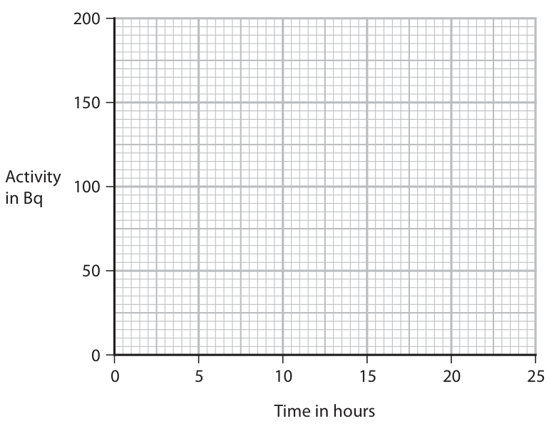

**Mark scheme answer**

> activity shown to decrease over time;
> descending curve getting shallower starting at
> (0,160);
> line passes through two other valid points;
> • (6,80)
> • (12,40)
> • (18,20)
> • (24,10)

- **(3)** activity shown to decrease over time;

### 11(b)(i) [1]

Technetium-99m does not exist naturally. Suggest why technetium-99m is usually made at the hospital where it is used.

**Mark scheme answer**

> idea that it decays very quickly / activity will ignore ‘it has a short half-
> be zero by the time it is injected / there will life’
> be no technetium-99m left;

- **(1)** idea that it decays very quickly / activity will ignore ‘it has a short half-

### 11(b)(ii) [2]

Explain why technetium-99m is an effective isotope to use as a medical tracer.

**Mark scheme answer**

> any one from:
> • idea that gamma can penetrate out of the
> body;
> • idea that gamma can be detected outside
> the body;
> marks must be from separate
> lists
> any one from:
> • idea that half-life is long enough to
> complete the procedure;
> • idea that activity will fall to safe level in a allow idea that technetium
> day / quickly; will not be in body for very
> long
> (c) harmful effect of gamma radiation given; e.g.
> • cancer
> • cell damage
> • cell mutation
> idea that patient will have procedure very allow suggestion that risk to
> rarely / only when necessary (so risk is low); patients is higher as they
> receive greater dose
> idea that doctor will administer procedure allow idea that doctor
> regularly (so risk is higher) / doctor limits increases distance from
> time exposure to patient (to reduce risk); patient (to reduce risk)
> Answer Notes Marks

- **(2)** any one from:

### 11(c) [3]

The gamma radiation emitted by technetium-99m is potentially harmful to humans. Discuss the risks of using technetium-99m to doctors and to patients.

## Question 12 (7 marks)

The planets Mars and Saturn orbit around the same star, the Sun.

### 12(a) [2]

The diagram shows the orbital paths of Mars and Saturn. Not to scale Saturn Sun Mars Draw an orbital path of a comet on the diagram.

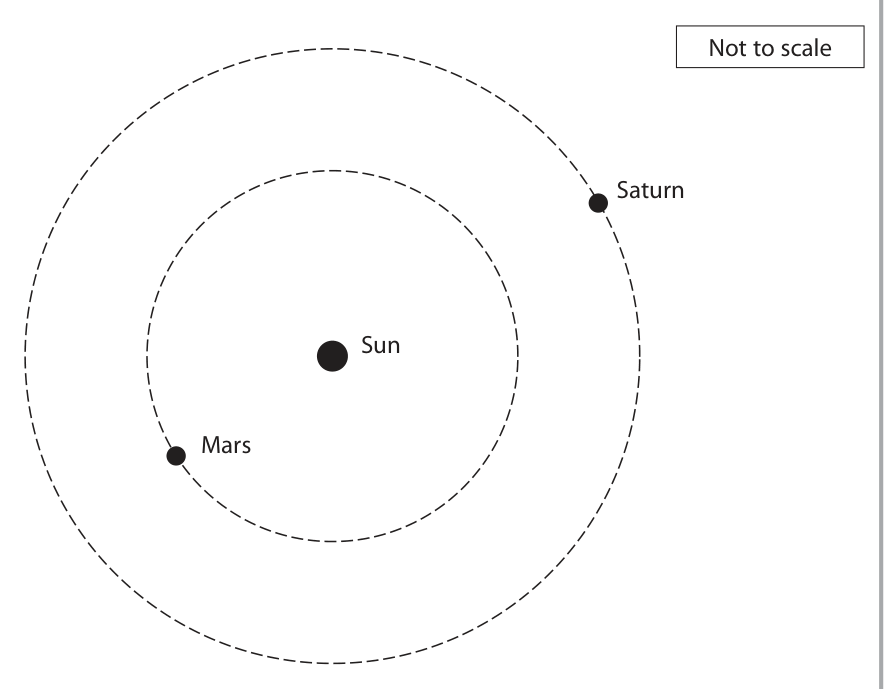

**Mark scheme answer**

> comet drawn in orbit around the Sun;
> orbital path is elliptical; judge by eye
> allow partially drawn ellipse
> Sun need not be at a focus of
> the ellipse, but should not be at
> the centre of the ellipse
> (b) attempted use of orbital speed formula;
> valid substitution into orbital speed formula; allow for either planet
> correct evaluation of time period for either
> planet;
> attempt to divide T for Saturn by T for Mars;
> correct final evaluation of ratio;
> e.g.
> v=2×π×r/T seen anywhere in working
> 24.1 = 2 × π × 2.28 × 108 / T 9.70 = 2 × π × 1.43 × 109 / T
> TMars = 5.94 × 107 (s) OR TSaturn = 9.26 × 108 (s) 5.944… 9.2628…
> n = TSaturn / TMars
> 15.6 allow range of 15-16
> Pearson Education Limited. Registered company number 872828
> with its registered office at 80 Strand, London, WC2R 0RL, United Kingdom

- **(2)** comet drawn in orbit around the Sun;

### 12(b) [5]

The table gives some information about the orbits of Mars and Saturn. Mars Saturn Orbital radius in km 2.28 × 108 1.43 × 109 Orbital speed in km/s 24.1 9.70 Mars completes a number of orbits in the time it takes for Saturn to complete one orbit. Calculate the number of orbits that Mars completes in the time it takes for Saturn to complete one orbit. number of orbits =

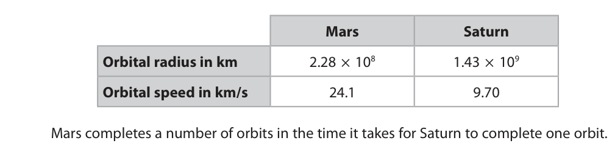

