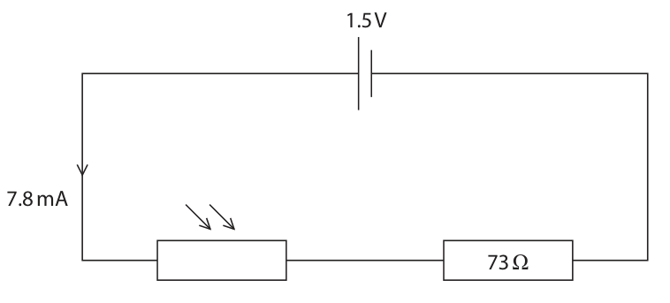
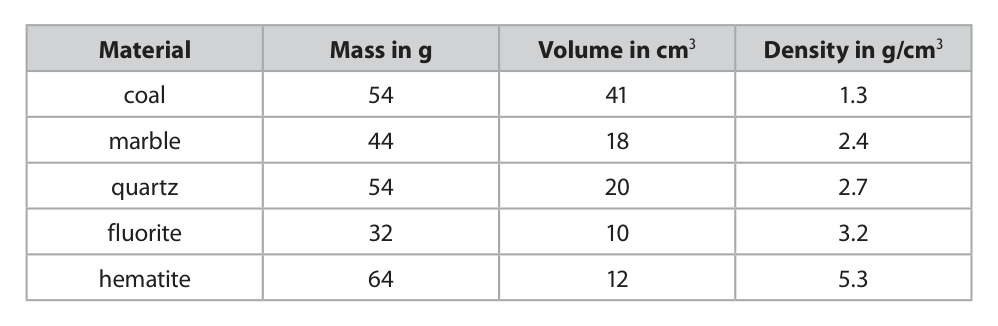
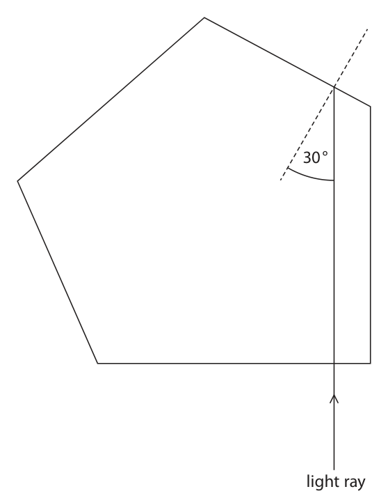
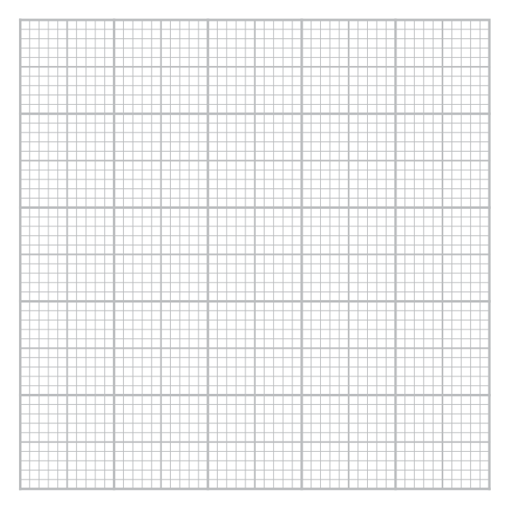
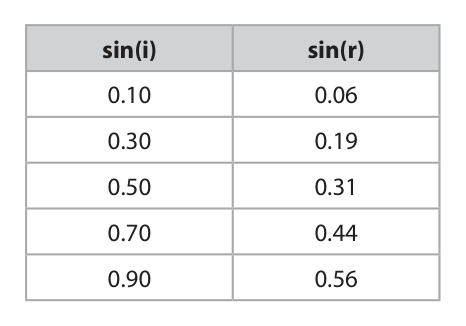
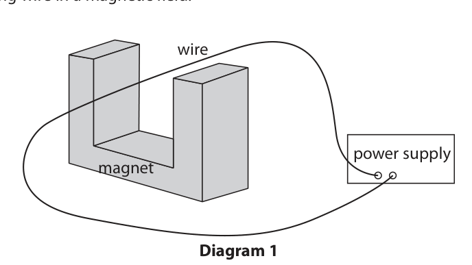

# 4PH1/1PR — 2020-01 (official extraction)

> schema `syllabai.official-paper-questions/0.2` · paper_id `pearson-edexcel:international-gcse:physics:4ph1:2020-01:4PH1/1PR` · qp sha256 `04a650a3a37615aa…` · extraction is the disclosed baseline (ADR-039)

## Question 1 (5 marks)

The diagram represents a water wave travelling on the surface of some water. Q Height S Distance P R

### 1(a) [1]

Which arrow represents the amplitude of the wave?

- **(A)** P
- **(B)** Q
- **(C)** R
- **(D)** S  ✔

**Mark scheme answer**

> D – arrow S;
> A is incorrect as arrow P shows twice the amplitude
> B is incorrect as arrow Q shows the wavelength
> C is incorrect as arrow R shows half of the
> wavelength

- **(1)** Answer D: S

### 1(b) [1]

Which arrow represents the wavelength of the wave?

- **(A)** P
- **(B)** Q  ✔
- **(C)** R
- **(D)** S

**Mark scheme answer**

> B – arrow Q;
> A is incorrect as arrow P shows twice the amplitude
> C is incorrect as arrow R shows have of the
> wavelength
> D is incorrect as arrow S shows the amplitude

- **(1)** Answer B: Q

### 1(c) [1]

What type of wave is this water wave?

- **(A)** electromagnetic
- **(B)** gravitational
- **(C)** longitudinal
- **(D)** transverse  ✔

**Mark scheme answer**

> D – transverse;
> A is incorrect as water waves are not
> electromagnetic
> B is incorrect as gravitational waves are not
> detectable by water
> C is incorrect as the water molecules vibrate at
> right angles to the direction of travel of the wave.

- **(1)** Answer D: transverse

### 1(d) [2]

The time period of the wave is 2.7 s. Calculate the frequency of the wave. frequency= Hz

**Mark scheme answer**

> substitution into given equation ‘f= 1/T’;
> evaluation;
> e.g.
> frequency = 1/2.7
> frequency = 0.37 (Hz) accept any value that
> rounds to 0.37 Hz
> Answer Notes Marks

- **(2)** substitution into given equation ‘f= 1/T’;

## Question 2 (5 marks)

The diagram shows a can filled with oil. oil

### 2(a) [1]

The total pressure at the bottom of the can is 110 kPa. Atmospheric pressure is 101 kPa. Calculate the pressure difference due to the oil. pressure difference = kPa

**Mark scheme answer**

> 9 (kPa);

- **(1)** 9 (kPa);

### 2(b) [1]

State the formula linking pressure difference, height, density and gravitational field strength.

**Mark scheme answer**

> (liquid) pressure = depth (of liquid) × density × g; accept
> d, h, height for depth
> rho, ρ for density
> g.f.s or gravitational field
> strength for g
> reject gravity for g

- **(1)** (liquid) pressure = depth (of liquid) × density × g; accept

### 2(c) [3]

Calculate the height of the oil in the can. [density of oil = 960 kg/m³] height = m

**Mark scheme answer**

> substitution; allow ecf from (a)
> rearrangement;
> evaluation;
> allow use of g = 9.8(1) m/s²
> giving 0.96 m
> e.g.
> pressure difference = 9 kPa
> $9 000 = d \times 960 \times 10$
> d = 9000 / (9600)
> d = 0.94 (m) allow 0.937(5)
> POT error penalty of 1
> mark, except if formula is
> incorrect i.e. no ‘g’

- **(3)** substitution; allow ecf from (a)

## Question 3 (8 marks)

The diagram shows a truck travelling along a horizontal road.

**(a)** The driver sees an obstacle in the road and then applies the brakes.

**(b)** The truck experiences a braking force of 46 000 N.

**(c)** The brakes increase in temperature when the truck is braking.

### 3(a)(i) [1]

Which of these factors affects thinking distance?

- **(A)** condition of the tyres
- **(B)** consumption of alcohol by the driver  ✔
- **(C)** mass of the vehicle
- **(D)** condition of the road

**Mark scheme answer**

> B – consumption of alcohol by the driver;
> A is incorrect because condition of tyres only
> affects braking distance
> C is incorrect because mass of vehicle only affects
> braking distance
> D is incorrect because wet road only affects braking
> distance

- **(1)** Answer B: consumption of alcohol by the driver

### 3(a)(ii) [1]

Which of these factors affects both thinking distance and braking distance?

- **(A)** condition of the brakes
- **(B)** condition of the road
- **(C)** mass of the vehicle
- **(D)** speed of the vehicle  ✔

**Mark scheme answer**

> D – speed of the vehicle;
> A is incorrect because condition of brakes only
> affects braking distance
> B is incorrect because condition of road only affects
> braking distance
> C is incorrect because mass of vehicle only affects
> braking distance

- **(1)** Answer D: speed of the vehicle

### 3(b)(i) [1]

State the formula linking work done, force and distance moved.

**Mark scheme answer**

> work done = force × distance; allow correct
> rearrangements
> allow standard symbols
> i.e. W/E/WD for work
> done, F/f for force,
> d/D/s for distance

- **(1)** work done = force × distance; allow correct

### 3(b)(ii) [3]

The truck has 590 000 J of energy in its kinetic energy (KE) store before the driver applies the brakes. The braking force does work on the truck to reduce the KE store of the truck to 0 J. The braking distance is defined as the distance required for the KE store of the truck to reduce to 0 J when the brakes are applied. Calculate the braking distance of the truck. distance = m

**Mark scheme answer**

> substitution; allow subs and re-
> arrange in either order
> rearrangement;
> evaluation;
> e.g.
> 590000 = 46000 × distance
> $d = 590000/46000$
> d = 13 (m) allow 12.8 (m), 12.83
> (m) etc

- **(3)** substitution; allow subs and re-

### 3(c)(i) [1]

State the name of the energy store that has increased for the brakes.

**Mark scheme answer**

> thermal;

- **(1)** thermal;

### 3(c)(ii) [1]

State the method of energy transfer from the truck to the brakes.

**Mark scheme answer**

> mechanic(ally);
> Answer Notes Marks

- **(1)** mechanic(ally);

## Question 4 (5 marks)

Betelgeuse is a red supergiant star. Betelgeuse has a mass that is much larger than the Sun. Describe the evolution of Betelgeuse through its entire life cycle. (5)

### 4 [5]

Betelgeuse is a red supergiant star. Betelgeuse has a mass that is much larger than the Sun. Describe the evolution of Betelgeuse through its entire life cycle.

**Mark scheme answer**

> MP1 nebula/gas cloud;
> MP2 protostar;
> MP3 main sequence (then red supergiant);
> MP4 supernova;
> MP5 neutron star/ black hole;
> 1 mark penalty for any
> incorrect sequence
> Answer Notes Marks

- **(5)** MP1 nebula/gas cloud;

## Question 5 (8 marks)

A table tennis ball is a very light plastic ball filled with air.

### 5(a) [3]

A student drops a table tennis ball from rest. The ball falls 13 m to the ground. Show that the final speed of the ball, just before it reaches the ground, should be about 16 m/s. Assume that there is no air resistance.

> 🖼 crop required: table (qp.pdf p.11)

**Mark scheme answer**

> substitution into given equation v² = u² + (2 x a x s); accept mgh = 1/2mv²
> evaluation of v2;
> evaluation of v to 3sf or more i.e. 16.1 (m/s); accept use of
> g = 9.8(1) m/s² giving
> v = 16.0, 15.97 etc.
> e.g.
> v² = u² + (2 x a x s)
> v² = 0² + (2 x 10 x 13)
> $v^{2} = 260$
> v =√260 = 16.1 (m/s)

- **(3)** substitution into given equation v² = u² + (2 x a x s); accept mgh = 1/2mv²

### 5(b) [5]

The student suggests that the ball will reach the ground with a speed that is less than 16 m/s because of air resistance. Use ideas about forces to justify the student’s suggestion.

**Mark scheme answer**

> any FIVE from:
> MP1 ball has weight; allow ‘has
> gravitational force’
> REJECT ‘has gravity’
> MP2 ball accelerates; REJECT ‘balls slows
> down’
> MP3 drag increases (while accelerating); allow ‘air resistance’
> for ‘drag’
> MP4 resultant force decreases;
> MP5 (so) acceleration decreases;
> MP6 drag = weight / resultant = 0 / forces balanced;
> MP7 terminal velocity/constant speed /acceleration=0;
> Answer Notes Marks

- **(5)** any FIVE from:

## Question 6 (12 marks)

The circuit diagram shows a light dependent resistor (LDR) and a 73 Ω resistor connected in series with a 1.5 V cell. 1.5 V 7.8 mA 73 Ω

**(c)** The graph shows how the resistance of the LDR changes with light intensity. Resistance Light intensity

### 6(a) [2]

Complete the diagram by adding an instrument to measure the voltage of the LDR.

**Mark scheme answer**

> correct symbol for voltmeter in parallel with any
> component;
> voltmeter drawn in parallel with the LDR;

- **(2)** correct symbol for voltmeter in parallel with any

### 6(b)(i) [1]

State the formula linking voltage, current and resistance.

**Mark scheme answer**

> V = I × R; allow any
> re-arrangement
> allow word equation
> condone ‘i’ for current
> reject ‘c’ or ‘C’ for
> current

- **(1)** V = I × R; allow any

### 6(b)(ii) [2]

The current in the circuit is 7.8 mA. Calculate the voltage across the 73 ohm resistor. voltage across resistor = V

**Mark scheme answer**

> substitution;
> evaluation; POT error gives 1 mark
> penalty
> e.g.
> V = 7.8 x 10⁻³ × 73
> V = 0.57 (V) allow 0.5694 (V) for
> both marks
> ‘0.6 (V)’ scores 1 mark

- **(2)** substitution;

### 6(b)(iii) [2]

Calculate the voltage across the LDR. voltage across LDR = V

**Mark scheme answer**

> idea that voltages of two resistors in series adds up to
> supply voltage;
> calculation of correct voltage; allow ecf from 6(c)(ii)
> e.g.
> Vcell = 1.5 = VLDR + Vresistor
> VLDR = 1.5 – 0.56(94)
> VLDR = 0.93 (V) allow 0.9306 (V) for
> both marks

- **(2)** idea that voltages of two resistors in series adds up to

### 6(c)(i) [2]

Describe the relationship between the resistance of the LDR and light intensity.

**Mark scheme answer**

> resistance decreases (with increasing L.I);
> non-linear/decreasing rate/curve;

- **(2)** resistance decreases (with increasing L.I);

### 6(c)(ii) [1]

The resistance of the LDR decreases. State the effect on the current in the circuit.

**Mark scheme answer**

> increases;

- **(1)** increases;

### 6(c)(iii) [2]

Explain why the voltage across the LDR decreases when the resistance of the LDR decreases.

**Mark scheme answer**

> larger current means larger voltage across fixed resistor;
> total voltage remains constant;
> Answer Notes Marks

- **(2)** larger current means larger voltage across fixed resistor;

## Question 7 (9 marks)

The diagram shows a van der Graaff generator, which is designed to provide very high voltages. Source: www.shutterstock.com

**(b)** When the van der Graaff generator is fully charged, it stores 2.9 × 10–8 C of charge.

### 7(a)(i) [1]

The unit of voltage is the volt. Which of these units is a volt?

- **(A)** coulomb per second
- **(B)** joule per coulomb  ✔
- **(C)** joule per second
- **(D)** newton per coulomb

**Mark scheme answer**

> B – joule per coulomb;
> A is incorrect because this is not a correct unit for
> volt
> C is incorrect because this is not a correct unit for
> volt
> D is incorrect this is not a correct unit for volt

- **(1)** Answer B: joule per coulomb

### 7(a)(ii) [1]

State the formula linking energy transferred, voltage and charge.

**Mark scheme answer**

> energy (transferred) = charge × voltage; allow standard symbols
> and rearrangements

- **(1)** energy (transferred) = charge × voltage; allow standard symbols

### 7(a)(iii) [3]

Calculate the energy transferred to an electron when it passes through a voltage of 150 kV. [charge of electron = 1.6 × 10⁻¹⁹ C] energy transferred = J

**Mark scheme answer**

> substitution;
> conversion of kV to V;
> evaluation;
> e.g.
> energy = 1.6 × 10⁻¹⁹ × 150 × 10³
> energy = 2.4 × 10⁻¹⁴ (J)

- **(3)** substitution;

### 7(b)(i) [1]

State the formula linking charge, current and time.

**Mark scheme answer**

> charge = current × time; allow standard symbols
> and rearrangements

- **(1)** charge = current × time; allow standard symbols

### 7(b)(ii) [3]

The charge on the generator discharges through the air as a spark. The charge takes a time of 0.68 ms to leave the generator. Calculate the mean (average) current in the air. mean current = A

**Mark scheme answer**

> substitution and re-arrangement;
> conversion of ms to s;
> evaluation; accept conversion to
> microamps or milliamps
> provided micro- (μ) or
> milli- (m) clear on
> answer line
> e.g.
> charge = current × time
> current = 2.9 × 10⁻⁸ / 0.68 × 10⁻³
> current = 4.3 × 10⁻⁵ (A) allow 4.265 × 10⁻⁵ (A)

- **(3)** substitution and re-arrangement;

## Question 8 (11 marks)

A scientist investigates different samples of rock.

**(b)** The table shows the scientist’s results for rocks made from different materials. Material Mass in g Volume in cm3 Density in g/cm3 coal 54 41 1.3 marble 44 18 2.4 quartz 54 20 2.7 fluorite 32 10 3.2 hematite 64 12 5.3

### 8(a) [5]

The scientist wants to calculate the density of a rock sample. She needs to measure the mass and the volume of the rock. Describe how to obtain accurate measurements of the mass and the volume of the rock. You may draw a diagram to support your answer.

**Mark scheme answer**

> any FIVE from: ignore
> • geometry
> equations
> • use of a ruler to
> measure rock
> • density = mass /
> volume
> MP1 use a balance (to measure the mass);
> MP2 mention a displacement method;
> MP3 measure the mass first; Can be implied
> from order of
> response.
> MP4 (because) a wet rock weighs more;
> MP5 use of eureka/displacement can or measuring cylinder;
> MP6 mention of eye-level or parallax avoidance;
> MP7 make sure rock completely submerged; explicit mention
> only
> MP8 make sure no water splashes out/put rock in gently;

- **(5)** any FIVE from: ignore

### 8(b)(i) [1]

State the formula linking density, mass and volume.

**Mark scheme answer**

> density = mass / volume; accept correct
> rearrangements
> accept symbols
> i.e. rho, m/M, v/V

- **(1)** density = mass / volume; accept correct

### 8(b)(ii) [3]

Rock X has a mass of 32 g and a volume of 12 cm³. Calculate the density of rock X. Give your answer to 2 significant figures. density = g/cm³

**Mark scheme answer**

> substitution;
> evaluation;
> answer to 2 sf; 2 sf marked
> independently
> e.g.
> density = 32/12
> density = 2.66… g/cm³
> density = 2.7 g/cm³ to 2 sf

- **(3)** substitution;

### 8(b)(iii) [2]

Rock X is made from the same material as one of the samples in the table. Explain which material rock X is made from.

**Mark scheme answer**

> quartz;
> as the density of rock X is the same as the density of quartz;
> Answer Notes Marks

- **(2)** quartz;

## Question 9 (10 marks)

A deioniser is a device used in rooms where workers build sensitive electronic circuits. The deioniser contains a small block of polonium-210.

**(b)** The half-life of polonium-210 is 140 days.

### 9(a)(i) [2]

Complete the equation that shows the alpha decay of polonium-210 into lead-206. 210 206 84 Po → 82 Pb + α

**Mark scheme answer**

> 4;
> 2;

- **(2)** 4;

### 9(a)(ii) [1]

The alpha particle ionises air molecules in the room. State what is meant by the term ionisation.

**Mark scheme answer**

> removal of electron(s) (from an atom); allow gaining
> electron(s)

- **(1)** removal of electron(s) (from an atom); allow gaining

### 9(a)(iii) [2]

Explain why workers in the same room as the deioniser are not at risk from the alpha radiation it emits.

**Mark scheme answer**

> alpha particles are absorbed by/cannot penetrate/ allow do not penetrate
> stopped by a few cm in air; casing (of deionser)
> condone ‘do not
> penetrate skin/clothes’
> so alphas do not reach the workers;

- **(2)** alpha particles are absorbed by/cannot penetrate/ allow do not penetrate

### 9(b)(i) [2]

State what is meant by the term half-life.

**Mark scheme answer**

> time taken; accept any synonym
> e.g. period/amount of
> time/
> for (radio)activity/mass/number of (remaining)
> nuclei to half;

- **(2)** time taken; accept any synonym

### 9(b)(ii) [3]

The initial activity of the polonium-210 source in the deioniser is 70 kBq. Calculate the activity of the source after 420 days. activity = kBq

**Mark scheme answer**

> evidence of halving of 70;
> 420 days means 3 half-lives; accept however
> presented i.e.
> 70→35→17.5→8.75
> evaluation of 8.75 (kBq); allow 9 (kBq)
> Answer Notes Marks

- **(3)** evidence of halving of 70;

## Question 10 (16 marks)

This is a question about refraction.

**(b)** A student plans an investigation to determine the refractive index of glass. The student uses a graph of sin(i) against sin(r) to determine the refractive index.

### 10(a)(i) [1]

State the formula linking critical angle and refractive index.

**Mark scheme answer**

> n =1/sin(c); accept any
> rearrangement or word
> equation

- **(1)** n =1/sin(c); accept any

### 10(a)(ii) [2]

Diamond has a critical angle of 26 degrees. Calculate the refractive index of diamond. refractive index =

**Mark scheme answer**

> substitution;
> evaluation;
> e.g.
> n = 1/sin(26)
> n = 2.3 allow 2.28…

- **(2)** substitution;

### 10(a)(iii) [3]

The diagram shows a light ray entering a block of diamond. Complete the diagram to show the light ray emerging from the block. 30° light ray

**Mark scheme answer**

> correct TIR at first boundary;
> refraction at boundary at 7 o’clock; allow ECF for incorrect
> TIR and correct
> subsequent
> boundaries.
> refraction away from the normal at exit point;

- **(3)** correct TIR at first boundary;

### 10(b)(i) [4]

The student uses this equipment ● a ray box ● a rectangular glass block ● a protractor ● a pencil Describe how the student should collect her data. You may draw a diagram to support your answer.

**Mark scheme answer**

> any FOUR from:
> MP1 any method of recording an incident ray; accept marks on a
> clear, labelled diagram
> MP2 any method of recording a refracted ray;
> MP3 range of angle of incidences;
> MP4 normal lines drawn;
> MP5 angles measured using a protractor;

- **(4)** any FOUR from:

### 10(b)(ii) [3]

The table shows the student’s results. sin(i) sin(r) 0.10 0.06 0.30 0.19 0.50 0.31 0.70 0.44 0.90 0.56 Plot a graph of the student’s results.

**Mark scheme answer**

> axes labelled;
> appropriate scale with data enclosed by 3 x 3 grid
> or larger;
> points plotted correctly within ½ a square;

- **(3)** axes labelled;

### 10(b)(iii) [1]

Draw a line of best fit.

**Mark scheme answer**

> best fit straight line drawn with ruler; judge by eye

- **(1)** best fit straight line drawn with ruler; judge by eye

### 10(b)(iv) [2]

Use the graph to calculate the refractive index of the glass block. refractive index =

**Mark scheme answer**

> evidence of gradient triangle used; accept markings on
> graph or evidence of a
> gradient calculation.
> evaluation of 1.6; accept answer in range
> 1.55 – 1.65 consistent
> with candidate’s LoBF
> allow ecf from
> candidate’s LoBF
> Answer Notes Marks

- **(2)** evidence of gradient triangle used; accept markings on

## Question 11 (9 marks)

The diagram shows a model of the human breathing system. tube seal glass jar balloon rubber sheet The rubber sheet is pulled downwards so that the air inside the glass jar occupies a larger volume. The temperature of the air does not change.

### 11(a) [3]

Explain, in terms of particles, why the pressure of the air inside the glass jar decreases.

**Mark scheme answer**

> any THREE from:
> MP1 walls further apart;
> MP2 fewer collisions between particles and walls reject unqualified
> per second/lower frequency of collisions; ‘fewer collisions’
> MP3 means (average) force on walls lower; accept idea that
> force per collision is
> the same
> MP4 lower force means lower pressure for same
> wall surface area;
> ignore references to
> particles colliding
> with each other
> accept

- **(3)** any THREE from:

### 11(b) [3]

Before the rubber sheet is pulled down, the air inside the jar is at atmospheric pressure. The volume of gas inside the jar increases from 110 cm³ to 140 cm³. Calculate the pressure inside the jar after the rubber sheet is pulled down. [atmospheric pressure = 101 kPa] pressure = Pa

**Mark scheme answer**

> substitution into given equation “p₁ × V₁ = p₂ × V₂”;
> rearrangement to give p₂;
> evaluation of p₂;
> e.g.
> 101 × 110 = p₂ × 140
> p₂ = 101 × 110 / 140
> p₂ = 79 000 (Pa) allow 79357.1… (Pa),
> 79(.4) kPa , standard
> form

- **(3)** substitution into given equation “p₁ × V₁ = p₂ × V₂”;

### 11(c) [3]

The jar is sealed, but the balloons are open to the atmosphere. Before the rubber sheet is pulled down, the air inside the balloons is at atmospheric pressure. Explain why the balloons start to expand when the rubber sheet is pulled down.

**Mark scheme answer**

> any THREE from:
> MP1 pressure outside balloon is lower than inside
> balloon;
> MP2 pressure difference causes a force;
> MP3 force is outwards on balloon;
> MP4 force causes extension of balloon; accept ‘stretching’
> Answer Notes Marks

- **(3)** any THREE from:

## Question 12 (12 marks)

Diagram 1 shows some apparatus used to demonstrate the magnetic force on a current-carrying wire in a magnetic field. wire power supply magnet Diagram 1

**(b)** The wire has a mass of 6.5 g.

### 12(a) [1]

Diagram 2 shows four different arrangements of the apparatus. The symbol shows that the current is directed out of the page. N S S N W X N N S S Y Z Diagram 2 Which arrangement of the apparatus will cause there to be an upwards magnetic force on the wire?

- **(A)** W  ✔
- **(B)** X
- **(C)** Y
- **(D)** Z

**Mark scheme answer**

> A – arrangement W;
> B cannot be correct as arrangement X would give a
> downwards force
> C and D cannot be correct because at the position
> of the wire, the magnetic field is zero, so there
> cannot be a magnetic force on the wire

- **(1)** Answer A: W

### 12(b)(i) [2]

Calculate the weight of the wire. Give your answer in mN. weight = mN

**Mark scheme answer**

> substitution into “W = mg”; ignore POT for this mark
> evaluation;
> e.g.
> W = 0.0065 × 10 accept use of g = 9.8(1)
> m/s² giving 63.7 or 63.8
> (mN)
> W = 65 (mN)

- **(2)** substitution into “W = mg”; ignore POT for this mark

### 12(b)(ii) [5]

There is an upwards magnetic force of 34 mN acting on the wire. Calculate the acceleration of the wire. acceleration = m/s²

**Mark scheme answer**

> resultant force is difference between weight and
> magnetic force;
> resultant force = 31 mN; allow ecf from (b)(i)
> substitution in “F=ma”;
> re-arrangement;
> evaluation; POT error gives 1 mark
> penalty
> 5.2(3) scores 3 MAX (no
> evidence of resultant
> idea)
> e.g.
> resultant force = 65 – 34 = 31 mN
> resultant force = 31 × 10⁻³ = 6.5 × 10⁻³ × a
> a = 31 × 10⁻³ / 6.5 × 10⁻³
> a = 4.8 (m/s²) allow 4.76(9) (m/s²)
> use of g = 9.81 m/s² gives
> 4.57 (m/s²)

- **(5)** resultant force is difference between weight and

### 12(b)(iii) [2]

Explain one method of increasing the magnitude of the magnetic force on the wire.

**Mark scheme answer**

> EITHER
> • increase the current; ignore unqualified
> reference to increasing
> the turns/creating a coil
> • by increasing the voltage of power supply;
> OR
> • increase the magnetic field strength;
> • by using stronger magnets/moving the poles
> closer together;

- **(2)** EITHER

### 12(b)(iv) [2]

Explain how the circuit could be changed to make the wire vibrate.

**Mark scheme answer**

> use a.c. rather than d.c.;
> since a.c. current has alternating/changing current
> direction;
> Pearson Education Limited. Registered company number 872828
> with its registered office at 80 Strand, London, WC2R 0RL, United Kingdom

- **(2)** use a.c. rather than d.c.;

