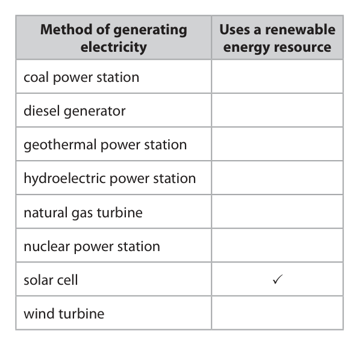
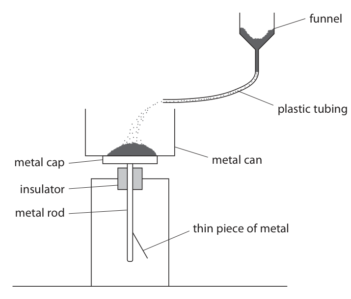
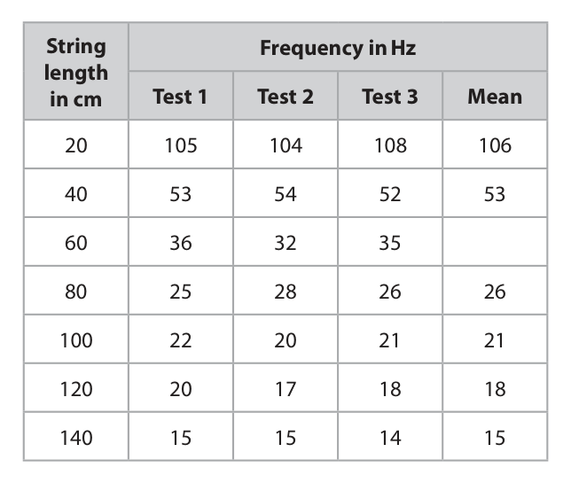
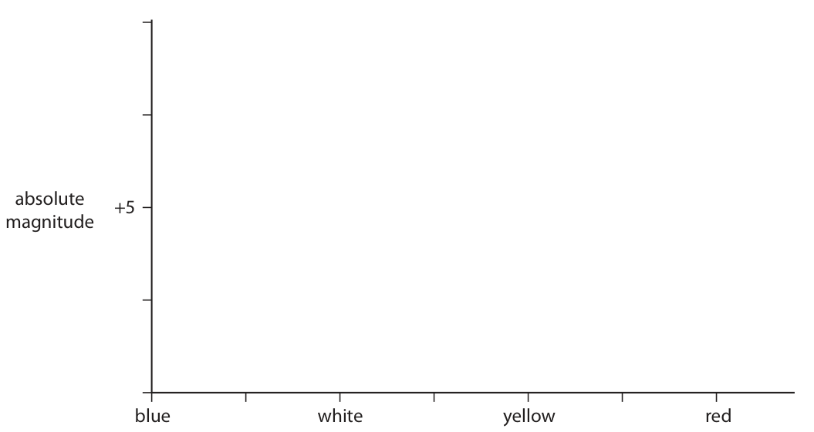
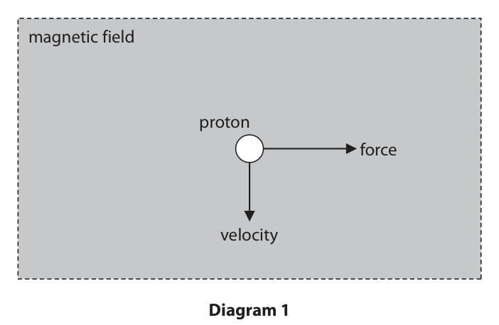
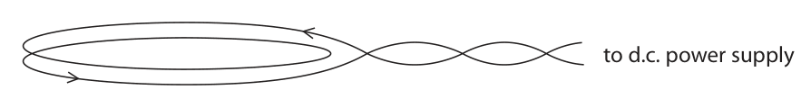

# 4PH1/2P — 2020-01 (official extraction)

> schema `syllabai.official-paper-questions/0.2` · paper_id `pearson-edexcel:international-gcse:physics:4ph1:2020-01:4PH1/2P` · qp sha256 `94798b2297c90391…` · extraction is the disclosed baseline (ADR-039)

## Question 1 (5 marks)

This question is about energy resources.

**(b)** Solar cells can be used to generate electricity.

### 1(a) [3]

The table lists some methods of generating electricity using energy resources. Place ticks (✓ ) in the table to show if each method uses a renewable energy resource. One has been done for you. Method of generating Uses a renewable electricity energy resource coal power station diesel generator geothermal power station hydroelectric power station natural gas turbine nuclear power station solar cell ✓ wind turbine

**Mark scheme answer**

> 1 mark for each correct tick;;; 4 candidate ticks = 2
> marks max.
> 5-6 candidate ticks = 1
> mark max.
> 7 candidate ticks = 0

- **(3)** 1 mark for each correct tick;;; 4 candidate ticks = 2

### 1(b)(i) [1]

How is energy transferred from the Sun to a solar cell?

- **(A)** by heating
- **(B)** by radiation  ✔
- **(C)** electrically
- **(D)** mechanically

**Mark scheme answer**

> B (by radiation);
> A is incorrect because transfers by heating cannot take place through space
> C is incorrect because there are no electrical conductors between the Sun and
> the panel
> D is incorrect because it requires particles that are not present in the vacuum
> of space

- **(1)** Answer B: by radiation

### 1(b)(ii) [1]

State one disadvantage of using solar cells to generate electricity.

**Mark scheme answer**

> any 1 of:
> MP1. only generates electricity when it is sunny / allow not generating
> eq; electricity at night
> ignore ‘depends on the
> weather’
> MP2. idea of visual pollution; Condone ‘ugly’
> MP3. idea that solar panels take up a lot of space;
> Answer Notes Marks

- **(1)** any 1 of:

## Question 2 (4 marks)

The photograph shows a brass mass. © Dudaeva/Shutterstock

### 2(a) [1]

State the formula linking density, mass and volume.

**Mark scheme answer**

> density = mass / volume; allow standard symbols
> and rearrangements
> e.g. ρ = m / V
> condone use of d for
> density
> (b) substitution OR rearrangement; equation must be
> correct
> evaluation; -1 for POT error
> unit; allow m3 only if
> consistent with data
> used
> e.g.
> 8.46 = 454 / V OR V = m / ρ
> (V =) 53.7 53.664…
> cm3
> 5.37 × 10-5 m3 gains 3
> Answer Notes Marks

- **(1)** density = mass / volume; allow standard symbols

### 2(b) [3]

The brass mass has a mass of 454 g. The density of brass is 8.46 g/cm3. Calculate the volume of the brass mass. Give the unit. volume = unit

## Question 3 (10 marks)

Curling is a sport played on ice. A player slides stone A across the ice towards a scoring zone. The ice reduces friction so that there is negligible friction when the stone is sliding. stone A © Corepics VOF/Shutterstock

**(a)** Stone A leaves the player’s hand with a velocity of 2.90 m/s. The mass of stone A is 17 kg.

**(b)** Stone A slides towards the scoring zone. In the scoring zone, stone A collides with a stationary stone, B. © Michael715/Shutterstock

### 3(a)(i) [1]

State the formula linking momentum, mass and velocity.

### 3(a)(ii) [2]

Show that the momentum of stone A is approximately 50 kg m/s.

### 3(b)(i) [4]

After the collision, both stones move in the same direction as the initial direction of stone A. The velocity of stone A after the collision is 0.40 m/s. Calculate the velocity of stone B after the collision. [mass of stone B = 19 kg] velocity of stone B = m/s

**Mark scheme answer**

> use of conservation of momentum; seen written explicitly
> or implied by working
> momentum of stone A after collision calculated;
> momentum of stone B after collision calculated;
> evaluation of velocity of stone B;
> allow, for 1 mark only,
> “(total) momentum
> before = (total)
> momentum after” if no
> other marks scored.
> e.g.
> momentum before = momentum after
> pA = (17 × 0.4 =) 6.8
> pB = (50 – 6.8 =) 43.2 allow 42.5, 42.2 from
> non-rounded values for

- **(4)** use of conservation of momentum; seen written explicitly

### 3(b)(ii) [3]

When the stones collided, they were in contact for a time of 25 ms. Calculate the magnitude of the force stone A exerted on stone B in this collision. force = N

## Question 4 (12 marks)

A student uses this apparatus to demonstrate the effect of electric charge. funnel plastic tubing metal cap metal can insulator metal rod thin piece of metal He pours some fine powder into a funnel. The fine powder moves through a length of plastic tubing and falls into a metal can. The metal can rests on a metal cap. The metal cap is connected to a thin piece of metal via a metal rod. When the powder lands in the can, the thin piece of metal moves away from the metal rod.

**(b)** A coulombmeter measures electric charge. The student connects a coulombmeter to the metal can. When all the powder has landed in the can, the coulombmeter shows a reading of –9.4 × 10–9 C.

### 4(a) [4]

Explain why the thin piece of metal moves away from the metal rod.

**Mark scheme answer**

> any four of:
> MP1. idea of friction/rubbing (between powder and
> funnel/plastic tubing);
> MP2. powder becomes charged; ignore whether positive
> or negative charge
> MP3. metals are conductors;
> MP4. charge is transferred to/from metal rod and allow electrons
> thin piece of metal; transferred
> MP5. metal rod and thin piece of metal have the
> same charge;
> MP6. therefore they repel / eq;

- **(4)** any four of:

### 4(b)(i) [1]

Which statement is true for the metal can?

- **(A)** it gains negatively charged electrons  ✔
- **(B)** it loses negatively charged electrons
- **(C)** it gains positively charged electrons
- **(D)** it loses positively charged electrons

**Mark scheme answer**

> A (gains negatively charged electrons);
> B is incorrect because it would leave the metal can positively charged
> C is incorrect because electrons are not positively charged
> D is incorrect because electrons are not positively charged

- **(1)** Answer A: it gains negatively charged electrons

### 4(b)(ii) [1]

State the formula linking charge, current and time.

**Mark scheme answer**

> charge = current × time; allow standard symbols
> and rearrangements
> e.g. Q = I × t
> reject use of C/c for
> charge or current

- **(1)** charge = current × time; allow standard symbols

### 4(b)(iii) [3]

It takes a time of 12 s from when the powder starts landing in the metal can until all the powder has landed in the can. Calculate the mean charging current. current = A

**Mark scheme answer**

> substitution;
> rearrangement;
> evaluation; -1 for POT error
> e.g.
> (-) 9.4 × 10-9 = current × 12
> (current =) (-) 9.4 × 10-9 / 12
> (current =) (-) 7.8 × 10-10 (A) 7.83… × 10-10 (A)
> (c) any three of:
> MP1. any relevant danger; e.g. spark, explosion,
> fire
> MP2. idea that metal can/aircraft should be allow description of
> earthed; earthing e.g. ‘connect
> metal can to ground
> with a wire’
> allow addition of earth
> path to diagram
> MP3. charge will flow to/from ground;
> MP4. idea that no charge will build up on metal allow idea that ‘charge
> can/aircraft; is neutralised’
> Answer Notes Marks

- **(3)** substitution;

### 4(c) [3]

The student suggests that this demonstration is similar to refuelling an aircraft. The powder represents the fuel and the metal can represents the fuel tank in the aircraft. funnel plastic tubing metal cap metal can insulator metal rod thin piece of metal Explain how the student should modify this apparatus to demonstrate how to minimise the dangers when refuelling an aircraft. You may add to the diagram to help your answer.

## Question 5 (14 marks)

A sonometer is a piece of equipment used to investigate the frequency of waves on a string. The photograph shows a sonometer. bridge string length of string The string is under tension. When the string is plucked it vibrates to produce a sound wave.

**(b)** A student investigates how the frequency of sound from the sonometer varies with the length of the string. This is the student’s method. ● apply a constant tension force to the string ● pluck the string and measure the frequency of the sound wave produced ● move the bridge to change the length of the string ● pluck the string and measure the new frequency of the sound wave produced Repeat the method for different lengths of string.

### 5(a) [4]

Describe how an oscilloscope should be used to measure the frequency of the sound wave from the sonometer.

**Mark scheme answer**

> any 4 of: ignore references to
> wavelength, amplitude,
> finding number of
> waves passing a point
> MP1. connect oscilloscope to microphone;
> MP2. adjust the oscilloscope to get a steady trace
> / eq;
> MP3. adjust time base / oscilloscope to give a
> minimum of 1 complete cycle (on the
> screen);
> MP4. measure number of squares for a number of allow ‘use oscilloscope
> complete cycles / waves; to measure/find the
> MP5. multiply number of squares by the time time period / time for
> base / eq. (to find T); one wave’ if neither
> MP4 or MP5 scored
> MP6. use f = 1/T;

- **(4)** any 4 of: ignore references to

### 5(b)(i) [1]

Give a control variable for the student’s investigation.

**Mark scheme answer**

> any 1 of:
> MP1. force / tension (on the string);
> MP2. material string is made from;
> MP3. diameter / thickness of the string;
> MP4. temperature;

- **(1)** any 1 of:

### 5(b)(ii) [2]

The table shows the student’s results. String Frequency in Hz length in cm Test 1 Test 2 Test 3 Mean 20 105 104 108 106 40 53 54 52 53 60 36 32 35 80 25 28 26 26 100 22 20 21 21 120 20 17 18 18 140 15 15 14 15 Calculate the mean frequency for a string length of 60 cm. mean frequency = Hz

**Mark scheme answer**

> correctly calculated mean;
> given to nearest whole number; mark independently
> e.g.
> 34.3… gains first mark
> 34 gains both marks

- **(2)** correctly calculated mean;

### 5(b)(iii) [3]

Plot a graph of the mean frequency and string length data on the grid.

> 🖼 crop required: graph (qp.pdf p.12)

> 🖼 crop required: grid (qp.pdf p.12)

**Mark scheme answer**

> suitable linear scale chosen (>50% of grid used); ignore orientation
> axes labelled with quantities and unit;
> all plotting correct to nearest half square; ignore point at 60cm

- **(3)** suitable linear scale chosen (>50% of grid used); ignore orientation

### 5(b)(iv) [1]

Draw the curve of best fit.

**Mark scheme answer**

> acceptable curve of best fit drawn; i.e. smooth curve
> within 1 small square of
> each point
> ignore parts of curve
> outside plotted points if
> extrapolated

- **(1)** acceptable curve of best fit drawn; i.e. smooth curve

### 5(b)(v) [1]

Determine the string length needed to produce a sound wave of frequency 75 Hz. string length = cm

**Mark scheme answer**

> string length in range 26-31cm; allow ecf from
> candidate’s line

- **(1)** string length in range 26-31cm; allow ecf from

### 5(b)(vi) [2]

The student cannot hear the sound from the sonometer for some of the string lengths tested. Explain which of the string lengths produce sounds that humans cannot hear.

**Mark scheme answer**

> both 120cm and 140cm strings / eq; allow correctly read
> string length from graph
> for 20Hz frequency
> (because) humans cannot hear frequencies lower
> than 20Hz;
> Answer Notes Marks

- **(2)** both 120cm and 140cm strings / eq; allow correctly read

## Question 6 (7 marks)

This question is about stars.

### 6(a) [2]

Astronomers measure the absolute magnitude of stars. State what is meant by the term absolute magnitude.

**Mark scheme answer**

> (a measurement of) the brightness (of a star); allow
> measurement of
> luminosity/power of a
> star
> apparent magnitude
> at a standard distance; allow at 10 pc/32.6 ly.
> condone incorrect
> distance.
> (b) correct absolute magnitude scale; i.e. going from +15 to -5
> in regular intervals
> x-axis labelled ‘colour’; condone ‘temperature’
> main sequence top-left to bottom-right with clear
> flatter region in the middle;
> white dwarf region in bottom-left corner with part
> of it in line with ‘white’ label on x-axis;
> red giant region in top-right corner with part of it in
> line with ‘red’ label on x-axis;
> Answer Notes Marks

- **(2)** (a measurement of) the brightness (of a star); allow

### 6(b) [5]

The evolution of stars can be shown on a Hertzsprung‑Russell diagram (HR diagram). Complete the HR diagram by ● labelling the x‑axis ● completing the absolute magnitude scale ● drawing the main sequence, red giant and white dwarf regions absolute +5 magnitude blue white yellow red

## Question 7 (9 marks)

The photograph shows a glass plate made from uranium glass. © Laura Healey/Shutterstock Uranium oxide is used to give the glass a green colour.

**(a)** Uranium‑238 is the most common isotope of uranium and can be represented using this symbol. 238 92 U

**(b)** The table gives some information about the uranium glass plate. mass of plate 1.1 kg percentage (%) of plate made of uranium-238 (by mass) 4.5% mass of uranium‑238 atom 4.0 × 10–27 kg

### 7(a)(i) [2]

State what information the numbers 92 and 238 give about the nucleus of this isotope of uranium. 92 238

### 7(a)(ii) [2]

Uranium‑238 decays by alpha emission. Describe how the nucleus of a uranium‑238 atom changes as a result of alpha emission.

### 7(b)(i) [2]

Calculate the number of uranium‑238 atoms in the plate. number of atoms =

**Mark scheme answer**

> evaluation of mass of U-238 in plate; accept 49.5 g or 0.0495
> kg or correct standard
> form
> evaluation of number of atoms;
> e.g.
> mass = (1.1 × 0.045) = 0.0495 kg
> (n = 0.0495 / 4.0 × 10-27 =) 1.2 × 1025 1.2375 × 1025

- **(2)** evaluation of mass of U-238 in plate; accept 49.5 g or 0.0495

### 7(b)(ii) [3]

Uranium‑238 is an alpha emitter and has a half‑life of 4.5 billion years. Explain why it is safe to eat food from the uranium glass plate.

**Mark scheme answer**

> any three from
> idea that food is irradiated / not contaminated;
> alpha cannot penetrate skin or body / range of ignore references to
> alpha insufficient to reach body; paper
> contains low percentage of uranium(-238); Accept ‘mass’ for
> ‘percentage’
> (long half-life means that) activity will be very low /
> decays very slowly;
> Answer Notes Marks

- **(3)** any three from

## Question 8 (9 marks)

This question is about magnetic fields.

**(c)** A wireless charging base uses a magnetic field to charge the battery of a mobile phone. wireless charging base mobile phone © BeeBright/Shutterstock There is an alternating current in a coil of wire in the charging base. There is another coil of wire connected to the battery in the mobile phone.

### 8(a) [1]

Diagram 1 shows a positively charged proton moving downwards in a uniform magnetic field. magnetic field proton force velocity Diagram 1 The proton experiences a force to the right. What is the direction of the magnetic field?

- **(A)** into the page  ✔
- **(B)** left
- **(C)** out of the page
- **(D)** upward

**Mark scheme answer**

> A (into the page);
> B is incorrect because this field would produce a force into the page
> C is incorrect because this field would produce a force to the left
> D is incorrect because this field would not produce a force at all
> (b) ignore breaking of field
> lines as they pass
> through the centre of
> the coil
> at least one straight, vertical central field line; judge by eye
> at least one field line drawn circling the wire / at condone spiral drawn
> least one peripheral field loop; around wire
> field direction correct and consistent throughout DOP
> and shown on at least two field lines;

- **(1)** Answer A: into the page

### 8(b) [3]

When a current passes through a flat circular coil, a magnetic field is produced. Complete diagram 2 by drawing the magnetic field of the flat circular coil. to d.c. power supply Diagram 2 for the last part of the question

### 8(c)(i) [3]

Explain how the wireless charging base charges the battery of the mobile phone.

**Mark scheme answer**

> any three of:
> MP1. (current produces) alternating magnetic field allow equivalent words
> (in charging base coil); for alternating e.g.
> variable, changing etc.
> MP2. idea that field is cut by coil in phone; allow higher level
> responses in terms of
> flux linkage
> MP3. voltage induced (across coil in phone);
> MP4. therefore current in battery (from coil in
> phone);

- **(3)** any three of:

### 8(c)(ii) [2]

Discuss the advantages and disadvantages of using a high current in the wireless charging base.

**Mark scheme answer**

> any one advantage;
> e.g. battery will charge faster / stronger magnetic
> field
> any one disadvantage;
> e.g. causes a great(er) heating effect condone ‘greater risk of
> electric shock’
> Pearson Education Limited. Registered company number 872828
> with its registered office at 80 Strand, London, WC2R 0RL, United Kingdom

- **(2)** any one advantage;

