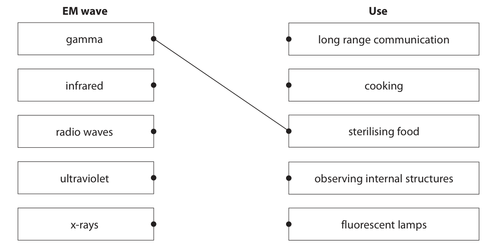
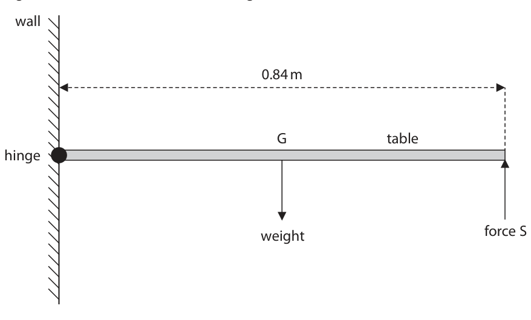
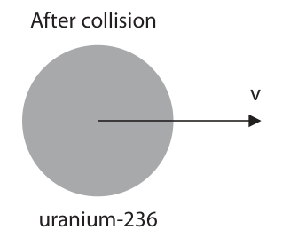
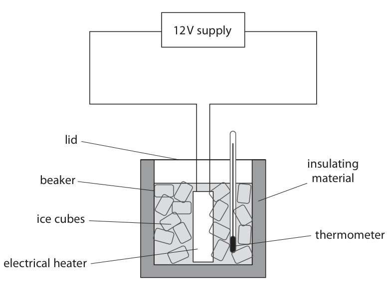
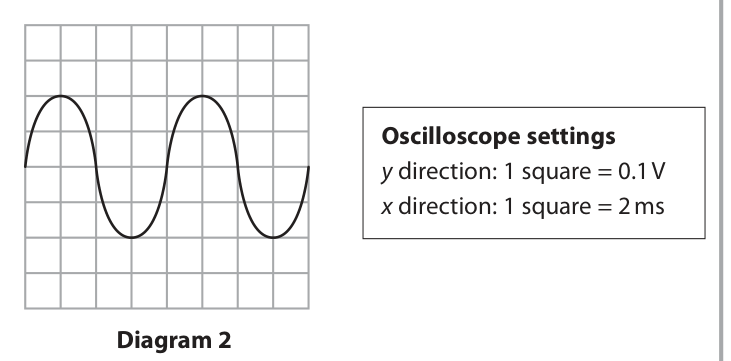

# 4PH1/2PR — 2020-01 (official extraction)

> schema `syllabai.official-paper-questions/0.2` · paper_id `pearson-edexcel:international-gcse:physics:4ph1:2020-01:4PH1/2PR` · qp sha256 `b8419c70375a6c58…` · extraction is the disclosed baseline (ADR-039)

## Question 1 (5 marks)

This question is about electromagnetic (EM) waves.

### 1(a) [3]

The boxes show some EM waves and their uses. Draw one straight line from each EM wave to its correct use. One has been done for you. EM wave Use gamma long range communication infrared cooking radio waves sterilising food ultraviolet observing internal structures x-rays fluorescent lamps

**Mark scheme answer**

> gamma use is given so
> only judge other four
> EM waves for marks
> all four correct;;; three or two correct
> scores 2 marks
> one correct
> scores 1 mark

- **(3)** gamma use is given so

### 1(b) [1]

Which of these is a hazard of microwave radiation?

- **(A)** blindness
- **(B)** cell mutation
- **(C)** internal heating of tissue  ✔
- **(D)** skin burns

**Mark scheme answer**

> C (internal heating of tissue);
> A is incorrect because this is a hazard of visible and ultraviolet radiation
> B is incorrect because this is a hazard of x-ray and gamma radiation
> D is incorrect because this is a hazard if infrared radiation

- **(1)** Answer C: internal heating of tissue

### 1(c) [1]

State the name of an electromagnetic wave with a wavelength longer than microwave radiation.

**Mark scheme answer**

> radio (waves);
> Answer Notes Marks

- **(1)** radio (waves);

## Question 2 (8 marks)

This question is about a folding table. The diagram shows some of the forces acting on the table. wall 0.84 m G table hinge weight force S

### 2(a) [1]

The weight of the table acts through point G. State the name of point G.

**Mark scheme answer**

> centre of gravity; accept centre of mass

- **(1)** centre of gravity; accept centre of mass

### 2(b) [1]

State the formula linking moment, force and perpendicular distance from the pivot.

**Mark scheme answer**

> moment = force × (perpendicular) distance; allow standard symbols
> and rearrangements
> e.g. M = F × d
> allow d, s, x for
> distance

- **(1)** moment = force × (perpendicular) distance; allow standard symbols

### 2(c) [3]

The moment of the weight force of the table about the hinge is 92 N m. By using the principle of moments, calculate the force S that a person applies to keep the table in equilibrium. force S = N

**Mark scheme answer**

> substitution;
> rearrangement;
> evaluation; -1 for POT error
> 2 marks max. if
> incorrect distance used
> e.g. 0.42 m giving
> answer of 219 (N)
> e.g.
> 92 = Fs × 0.84
> Fs = 92 / 0.84
> (Fs =) 110 (N) allow 109.5, 109.52…

- **(3)** substitution;

### 2(d) [1]

State Newton’s third law.

**Mark scheme answer**

> idea that every force has an equal and opposite reaction; however expressed
> allow “action” for force

- **(1)** idea that every force has an equal and opposite reaction; however expressed

### 2(e) [2]

State the magnitude and the direction of the force that the table applies to the person holding the table. magnitude = N direction =

**Mark scheme answer**

> same value as (c); allow ecf from (c)
> expected answer is
> 110 (N)
> down;
> Answer Notes Marks

- **(2)** same value as (c); allow ecf from (c)

## Question 3 (9 marks)

This question is about momentum. Diagram 1 shows a neutron approaching a uranium-235 nucleus. before collision 2200 m / s 10 m / s neutron uranium-235 Diagram 1

### 3(a) [1]

State the formula linking momentum, mass and velocity.

**Mark scheme answer**

> momentum = mass × velocity; allow standard
> symbols and
> rearrangements e.g.
> $p = m\times v$
> reject M, m for
> momentum

- **(1)** momentum = mass × velocity; allow standard

### 3(b) [3]

Calculate the momentum of the neutron. Give a unit with your answer. [mass of neutron = 1.67 × 10⁻²⁷ kg] momentum = unit

**Mark scheme answer**

> substitution;
> evaluation;
> unit;
> e.g.
> p = 1.67 × 10⁻²⁷ × 2200
> (p =) 3.7 × 10⁻²⁴ allow 3.6(74) × 10⁻²⁴
> kg m/s allow 3.7 × 10⁻²¹ g
> m/s for 3 marks

- **(3)** substitution;

### 3(c) [1]

State what is meant by the term conservation of momentum.

**Mark scheme answer**

> (total) momentum before (collision) =
> (total) momentum after (collision);

- **(1)** (total) momentum before (collision) =

### 3(d) [4]

Diagram 2 shows that when the neutron collides with the uranium-235 nucleus, they combine to give a uranium-236 nucleus. After collision v uranium-236 Diagram 2 Use conservation of momentum to calculate the velocity, v, of the uranium-236 nucleus. [mass of uranium-235 nucleus = 3.99 × 10⁻²⁵ kg] [mass of uranium-236 nucleus = 4.01 × 10⁻²⁵ kg] v = m/s

**Mark scheme answer**

> evaluation of momentum of U-235 before collision;
> addition of neutron momentum; allow ecf from (b)
> rearrangement to give velocity of U-236; seen or implied by
> working
> correct evaluation;
> not adding neutron
> momentum gives
> 9.95 m/s = 2 marks
> e.g.
> pU-235 = (3.99 × 10⁻²⁵ × 10 =) 3.99 × 10⁻²⁴
> pU-236 = 3.99 × 10⁻²⁴ + 3.7 × 10⁻²⁴
> vU-236 = momentum / mass = 7.664 × 10⁻²⁴ / 4.01 × 10⁻²⁵
> (vU-236 =) 19 (m/s) allow 19.1… (m/s)

- **(4)** evaluation of momentum of U-235 before collision;

## Question 4 (10 marks)

A metalworker uses a hammer of mass 1.8 kg to deform a piece of metal on an anvil. hammer 0.95 m metal anvil

### 4(a)(i) [2]

Calculate the increase in the hammer’s gravitational potential energy (GPE) store when the hammer is raised through a height of 0.95 m above the metal. [GPE gained = mass × gravitational field strength × height] GPE increase = J

**Mark scheme answer**

> substitution; allow g = 9.8, 9.81
> evaluation;
> e.g.
> (GPE =) 1.8 × 10 × 0.95
> (GPE =) 17 (J) allow 16.8, 16.7…,
> 17.1… (J)

- **(2)** substitution; allow g = 9.8, 9.81

### 4(a)(ii) [2]

The metalworker moves the hammer down to strike the metal. The hammer must have at least 21 J of energy in its kinetic energy (KE) store as it hits the metal to deform it. Explain why the metalworker must do at least 4 J of mechanical work on the hammer to deform the metal.

**Mark scheme answer**

> idea that KE (gained) is greater than GPE (lost);
> idea KE gained = GPE lost + work done;
> e.g. 17 + 4 = 21 OR 21 – 17 = 4

- **(2)** idea that KE (gained) is greater than GPE (lost);

### 4(b)(i) [4]

Calculate the velocity of the hammer just before it strikes the metal. [KE of hammer = 21 J] velocity = m/s

**Mark scheme answer**

> use of KE = ½ × mass × speed²; allow standard symbols
> can be implied from
> working
> substitution;
> rearrangement;
> evaluation;
> e.g.
> KE = ½ × m × v²
> $21 = 0.5 \times 1.8 \times v^{2}$
> $v = \sqrt{21/0.9}$
> (v =) 4.8 (m/s) allow 4.83, 4.83… (m/s)

- **(4)** use of KE = ½ × mass × speed²; allow standard symbols

### 4(b)(ii) [2]

When the hammer hits the metal, the hammer comes to rest without rebounding. Calculate the mean (average) force needed to bring the hammer to rest in a time of 0.12 s. mean force = N

**Mark scheme answer**

> substitution into F = mv-mu / t; allow ecf from (b)(i)
> evaluation;
> allow alternative
> method using
> a = (v-u)/t and F = ma
> e.g.
> $F = (1.8 \times 4.8) / 0.12$
> (F =) 72 (N) allow 72.5, 72.45… (N)

- **(2)** substitution into F = mv-mu / t; allow ecf from (b)(i)

## Question 5 (7 marks)

A student does an investigation to determine the temperature-time graph for water as it changes state from ice to liquid water. The diagram shows the student’s apparatus. 12 V supply lid insulating beaker material ice cubes thermometer electrical heater The ice has an initial temperature of –17 °C. After 5 minutes, the ice begins to melt. After a further 6 minutes, all the ice has melted. The investigation continues for a total time of 20 minutes.

### 5(a)(i) [3]

Sketch a graph on the axes to show how the temperature changes with time. Assume that the rate of energy transfer from the heater to the ice cubes is constant. Temperature in °C Time in minutes –17

**Mark scheme answer**

> allow candidate’s time axis
> scale or clearly marked times
> line starts at (0,-17) and rises to steady line can be curved or straight
> temperature of 0 °C (after 5 minutes);
> 6 minutes along time axis at temperature of 0 °C; ignore start and end times as
> long as duration is 6 minutes
> line drawn showing increase in temperature from line can be curved or straight
> 0 °C until 20 minutes on time axis; and can end at any
> temperature

- **(3)** allow candidate’s time axis

### 5(a)(ii) [1]

Suggest a precaution the student should take to obtain high quality data.

**Mark scheme answer**

> any one from: ignore using more insulation,
> digital thermometer
> • keep heater submerged;
> • (check) voltage remains constant;
> • idea of not removing lid; allow idea that lid is well
> sealed
> • stirring (once some ice has melted);
> • repeat and average; allow repeat and remove
> anomalies

- **(1)** any one from: ignore using more insulation,

### 5(b) [3]

During the experiment the heater transfers 2500 J of energy to the beaker. The beaker has a specific heat capacity of 880 J / kg °C and a mass of 48 g. Calculate the increase in the temperature of the beaker. temperature increase = °C

**Mark scheme answer**

> dimensionally correct substitution into allow mass in kg or g for this
> ∆Q = m × c × ∆T; mark
> rearrangement; seen or implied from working
> evaluation; -1 for POT error
> final answer of 42 = 2 marks
> e.g.
> 2500 = 0.048 × 880 × ∆T
> ∆T = 2500 / (0.048 × 880)
> (∆T =) 59 (°C) allow 59.2, 59.18… (°C)
> condone 59.1 (°C)
> Answer Notes Marks

- **(3)** dimensionally correct substitution into allow mass in kg or g for this

## Question 6 (8 marks)

The diagram shows the first stages in a method of transferring energy electrically through long distances. pylon power station step-up transformer The table shows data about the step-up transformer. number of turns in primary coil 2600 input voltage in kV 15 output voltage in kV 330

### 6(a)(i) [1]

State the formula linking input voltage, output voltage, number of primary turns and number of secondary turns for a transformer.

**Mark scheme answer**

> input voltage
> =
> primary turns
> ; allow standard symbols and
> output voltage secondary turns
> rearrangements
> e.g. Vp / Vs = Np / Ns
> allow T, n for turns
> allow 1,2 in,out for p and s

- **(1)** input voltage

### 6(a)(ii) [3]

Calculate the number of turns on the secondary coil. number of turns =

**Mark scheme answer**

> substitution; allow kV or V for voltages
> rearrangement;
> evaluation; -1 for POT error
> e.g.
> 15/330 = 2600/Ns
> Ns = 2600 × 330 / 15
> Ns = 57 000 allow 57 200

- **(3)** substitution; allow kV or V for voltages

### 6(b) [4]

Explain why step-up and step-down transformers are used in the large-scale transmission of electricity. You may draw a diagram to support your answer.

**Mark scheme answer**

> any four from: credit ideas seen in diagram
> MP1. step-up transformer increases voltage; allow RA
> MP2. step-up transformer decreases current; allow RA
> allow increasing the voltage
> decreases the current
> MP3. idea that Pin = Pout / VinIin=VoutIout (assuming 100%
> efficient);
> MP4. idea that transmission current is reduced;
> MP5. idea that energy losses are reduced; allow heating losses reduced
> MP6. (because) current causes heating (in
> transmission cables);
> MP7. idea that step-down transformer used to reduce
> voltage to safe level;
> Answer Notes Marks

- **(4)** any four from: credit ideas seen in diagram

## Question 7 (8 marks)

This question is about a proton moving in a uniform magnetic field.

**(b)** The diagram shows a proton moving in a circular path at constant speed in a uniform magnetic field. This motion is similar to the movement of a planet in the Solar System. direction of proton movement proton

### 7(a) [2]

Describe how to use two permanent magnets to produce a uniform magnetic field. You may draw a diagram to support your answer.

**Mark scheme answer**

> opposite poles facing;
> held (very) close together; reject if magnets
> described as touching

- **(2)** opposite poles facing;

### 7(b)(i) [1]

Draw an arrow to show the direction of the force on the proton.

**Mark scheme answer**

> arrow directed towards the centre of the circle in line judge by eye
> with the position of the proton;
> condone arrow that
> does not originate at
> the position of the
> proton

- **(1)** arrow directed towards the centre of the circle in line judge by eye

### 7(b)(ii) [2]

Accurately measure the diameter of the proton’s path. diameter = cm

**Mark scheme answer**

> correct diameter given to 6 (cm)
> 1 significant figure = 1 mark;
> correct diameter given to 5.8-6.1 (cm)
> 2 or 3 significant figures = 2 marks;;

- **(2)** correct diameter given to 6 (cm)

### 7(b)(iii) [3]

The proton completes one orbit of its circular path in a time period of 8.7 × 10⁻⁶ seconds. Calculate the orbital speed of the proton. orbital speed = m/s

**Mark scheme answer**

> use of radius; allow ecf from (b)(ii)
> dimensionally correct substitution into v = 2 × π × r / T;
> evaluation; -1 for POT error
> accept alternative
> method using
> $v = \pi \times d/T$
> e.g.
> r = (6.0 / 2 =) 3.0 cm
> v = 2 × π × 0.030 / 8.7 × 10⁻⁶
> (v =) 22 000 (m/s) allow
> 21 000-22 000 (m/s)

- **(3)** use of radius; allow ecf from (b)(ii)

## Question 8 (15 marks)

Diagram 1 shows two identical buzzers connected with springs. post spring A spring B microphone buzzer A buzzer B force Diagram 1 Spring A is connected to a post. A force acts on the apparatus for a short period of time, pulling both buzzers to the right. During this time, buzzer A moves 2 cm and buzzer B moves 4 cm.

**(c)** Diagram 3 shows two distant galaxies and the Earth. Earth Galaxy P Galaxy Q Not to scale 150 million light years 300 million light years Diagram 3 Light emitted from a nearby star has a wavelength of 590 nm. The light from an identical star in galaxy P arrives at the Earth. The wavelength of the light from the star in galaxy P is 600 nm.

### 8(a)(i) [2]

Explain why buzzer B travels with twice the average speed of buzzer A.

**Mark scheme answer**

> buzzer B travels twice the distance; ignore quoting distances
> since given in question
> in the same time (period) OR
> (average) speed = distance/time taken;

- **(2)** buzzer B travels twice the distance; ignore quoting distances

### 8(a)(ii) [3]

A student connects the microphone to an oscilloscope to measure the frequency of sound from the two buzzers while the force acts on the arrangement. Explain the difference in the measured frequencies of sound from buzzer A compared to buzzer B.

**Mark scheme answer**

> any three from:
> MP1. frequency decreases; allow for either / both
> buzzer(s)
> reject if one frequency
> said to be increased
> MP2. due to Doppler effect;
> MP3. idea of increased wavelength; allow idea of waves behind
> buzzers being more spread
> out
> reject if one wavelength
> said to be decreased
> MP4. idea that decrease in frequency of buzzer B is allow frequency of buzzer
> twice that of buzzer A; B being lower than
> frequency of buzzer A /
> ORA

- **(3)** any three from:

### 8(b) [3]

Diagram 2 shows an oscilloscope trace. The trace represents the sound wave received by the microphone from buzzer A. Oscilloscope settings y direction: 1 square = 0.1 V x direction: 1 square = 2 ms Diagram 2 Measure the period of the sound waves from buzzer A. Give your answer in standard form. period = s

**Mark scheme answer**

> determination of number of squares for one period;
> correct use of oscilloscope settings; seen anywhere in working
> evaluation in standard form;
> award 2 marks for answers
> of 4 × 10⁻³, 16 × 10⁻³ (s)
> e.g.
> period = 4 squares
> (period = 4) × 0.002
> (period =) 8 × 10⁻³ (s)

- **(3)** determination of number of squares for one period;

### 8(c)(i) [1]

Calculate the change in wavelength for light from the star in galaxy P. change in wavelength = nm

**Mark scheme answer**

> 10 (nm);

- **(1)** 10 (nm);

### 8(c)(ii) [1]

Galaxy Q is twice as far away from the Earth as galaxy P. Suggest how the speed of galaxy Q relates to the speed of galaxy P.

**Mark scheme answer**

> idea the speed of Q is double the speed of P; allow greater speed

- **(1)** idea the speed of Q is double the speed of P; allow greater speed

### 8(c)(iii) [1]

Suggest a value for the change in wavelength of light from an identical star in galaxy Q when the light arrives at the Earth. change in wavelength = nm

**Mark scheme answer**

> 20 (nm); allow ecf from (c)(i)

- **(1)** 20 (nm); allow ecf from (c)(i)

### 8(c)(iv) [4]

Explain how comparing the speeds of the two galaxies provides evidence for the Big Bang theory.

**Mark scheme answer**

> any four from:
> MP1. further / faster galaxy (Q) shows greater red shift;
> MP2. further galaxy (Q) is travelling faster;
> MP3. (which suggests) universe is expanding;
> MP4. idea that at an earlier point in time; allow use of phrases such
> as “originated” / eq.
> MP5. the universe was a single point;
> Pearson Education Limited. Registered company number 872828
> with its registered office at 80 Strand, London, WC2R 0RL, United Kingdom

- **(4)** any four from:

