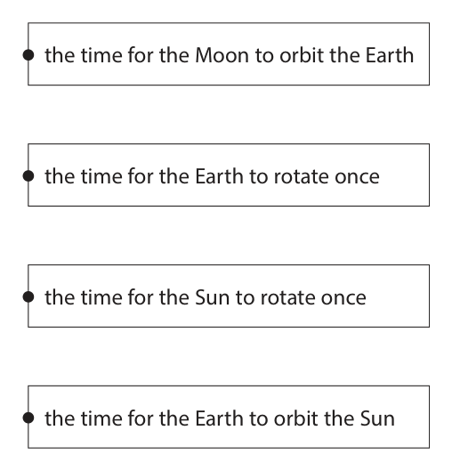
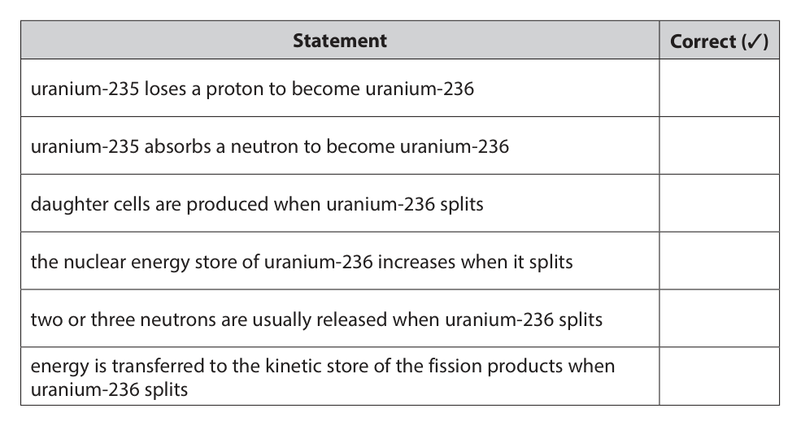
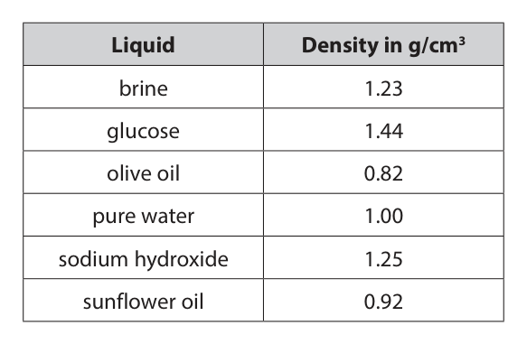
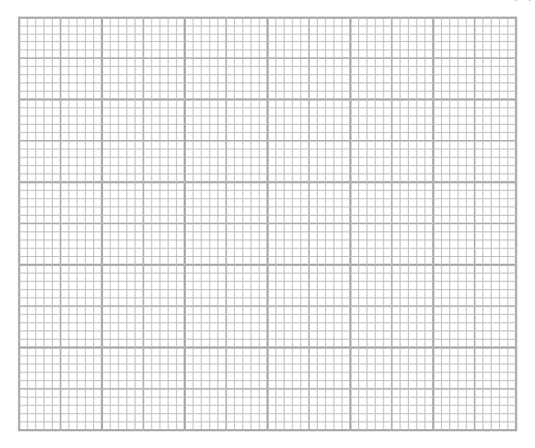
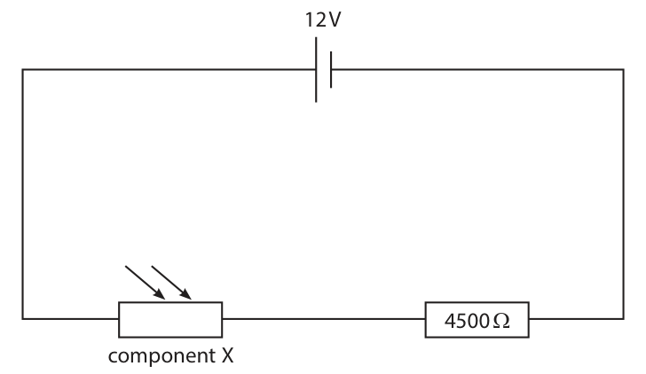
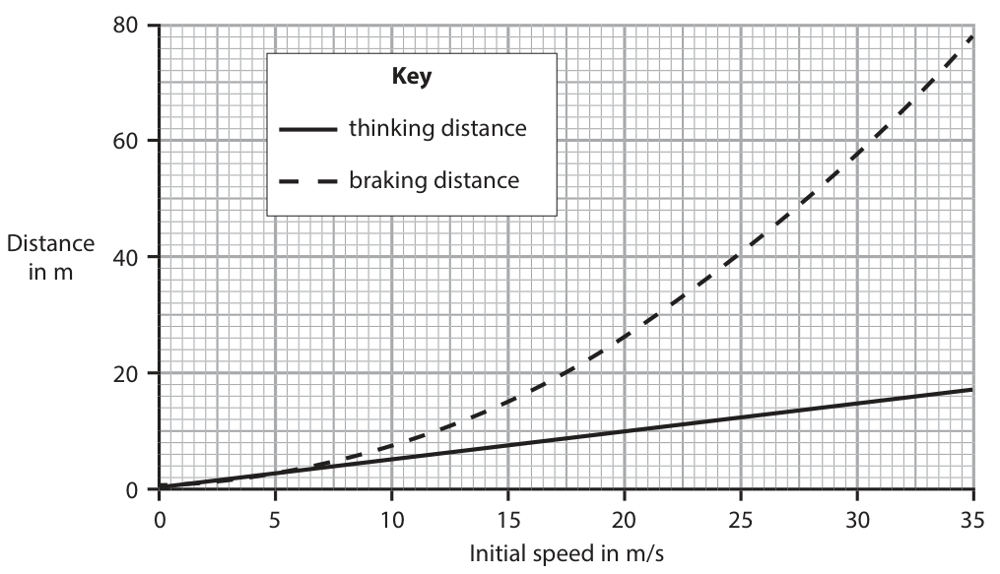
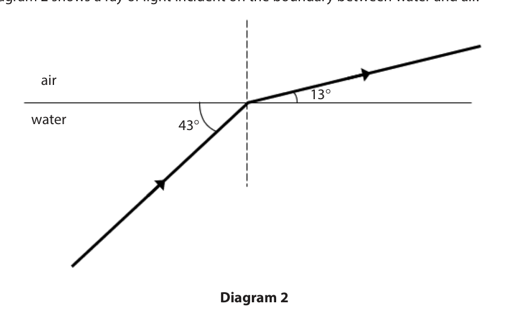

# 4PH1/1PR — 2020-06 (official extraction)

> schema `syllabai.official-paper-questions/0.2` · paper_id `pearson-edexcel:international-gcse:physics:4ph1:2020-06:4PH1/1PR` · qp sha256 `a8576c46ea59dc7c…` · extraction is the disclosed baseline (ADR-039)

## Question 1 (7 marks)

This question is about astrophysics.

**(b)** The diagram shows the orbit of a comet around the Sun. comet C D Sun A B

### 1(a) [3]

Complete the sentences by writing a suitable word or phrase in each blank space. Space and all the galaxies in it is called the A large collection of billions of stars is called a The Sun and its collection of planets and moons is called the

**Mark scheme answer**

> Universe;
> galaxy allow named galaxy e.g. Milky
> Way
> Solar System;

- **(3)** Universe;

### 1(b)(i) [1]

At which point in its orbit is the comet moving fastest? A B C D

**Mark scheme answer**

> A;
> B is incorrect because it is further from the Sun and speed decreases with distance
> C is incorrect because it is further from the Sun and speed decreases with distance
> D is incorrect because it is further from the Sun and speed decreases with distance

- **(1)** A;

### 1(b)(ii) [1]

Name the force that keeps the comet in orbit around the Sun.

**Mark scheme answer**

> gravity; allow gravitational force,
> gravitational pull
> reject gravitational potential,
> gravitational field strength, g
> (c) one mark for each correct line;; -1 for each additional line
> Answer Notes Marks

- **(1)** gravity; allow gravitational force,

### 1(c) [2]

The boxes give some units of time and some definitions. Draw a straight line from each unit of time to its correct definition. Unit of time Definition the time for the Moon to orbit the Earth 1 day the time for the Earth to rotate once the time for the Sun to rotate once 1 year the time for the Earth to orbit the Sun

## Question 2 (6 marks)

This question is about a nuclear fission chain reaction.

### 2(a) [3]

Uranium-235 is an isotope of uranium that can undergo nuclear fission. The table gives some statements about this fission process. Add ticks (✓) to the table to show which statements are correct. Statement Correct (✓) uranium-235 loses a proton to become uranium-236 uranium-235 absorbs a neutron to become uranium-236 daughter cells are produced when uranium-236 splits the nuclear energy store of uranium-236 increases when it splits two or three neutrons are usually released when uranium-236 splits energy is transferred to the kinetic store of the fission products when uranium-236 splits

**Mark scheme answer**

> all three correct ticks = 3 marks;;; -1 for 4 ticks
> two correct ticks = 2 marks;; -2 for 5 ticks
> one correct tick = 1 mark; 0 marks if all ticked
> (b) neutron / n / neutrons;
> (c) B (a helium nucleus);
> A is incorrect because this describes gamma radiation
> C is incorrect because this describes beta radiation
> D is incorrect because this describes neutron radiation
> (d) beta (minus); accept β, β-
> reject beta plus
> Answer Notes Marks

- **(3)** all three correct ticks = 3 marks;;; -1 for 4 ticks

### 2(b) [1]

State which product of nuclear fission causes the next uranium-235 nucleus to split in the chain reaction.

### 2(c) [1]

Uranium-235 is radioactive and emits alpha radiation. Which of these statements describes alpha radiation?

- **(A)** an electromagnetic wave
- **(B)** a helium nucleus
- **(C)** a high energy electron
- **(D)** a high energy neutron

### 2(d) [1]

Some of the products of nuclear fission are radioactive because their nuclei have too many neutrons. These nuclei become more stable when a neutron changes into a proton. State which type of radiation is emitted by radioactive nuclei with too many neutrons.

## Question 3 (10 marks)

When a meteor explodes, light waves and sound waves are produced at the same time.

**(c)** In 2013, a meteor exploded above Russia. Just before the meteor exploded, it was travelling at a speed of 19.2 km/s. The mass of the meteor was estimated to be 1.25 × 107 kg.

### 3(a)(i) [1]

State the formula linking average speed, distance moved and time taken.

### 3(a)(ii) [2]

A person standing 1860 m away from the site of a meteor explosion hears the sound of the explosion 5.6 s later. Calculate the speed of sound in air. speed of sound = m/s

### 3(a)(iii) [2]

A scientist stands a long way from the meteor explosion. Explain why he hears the explosion at a different time to when he sees it.

### 3(b) [2]

Sound is a longitudinal wave. Describe what is meant by the term longitudinal wave.

### 3(c)(i) [1]

State the formula linking kinetic energy, mass and speed.

**Mark scheme answer**

> kinetic energy = ½ × mass × speed2; allow standard symbols and
> rearrangements e.g.
> KE = ½ × m × v2

- **(1)** kinetic energy = ½ × mass × speed2; allow standard symbols and

### 3(c)(ii) [2]

Calculate the energy in the kinetic store of the meteor just before the meteor exploded. energy in kinetic store = J

**Mark scheme answer**

> substitution;
> evaluation; -1 for POT error
> e.g.
> (KE =) 0.5 × 1.25 × 107 × 192002
> (KE =) 2.30 × 1015 (J) allow 2.304 × 1015 (J)
> Answer Notes Marks

- **(2)** substitution;

## Question 4 (10 marks)

This question is about Rigel, a very large star with a high surface temperature.

**(d)** Astronomers think that Rigel will become a supernova in the future.

### 4(a) [1]

Stars can appear as different colours because of their different surface temperatures. Which of these colours shows the highest surface temperature for a star?

- **(A)** blue-white  ✔
- **(B)** orange
- **(C)** red
- **(D)** yellow

**Mark scheme answer**

> A (blue-white);
> B is incorrect because orange stars are cooler than blue-white stars
> C is incorrect because red stars are cooler than blue-white stars
> D is incorrect because yellow stars are cooler than blue-white stars
> (b) any two from:
> gas collapses / gas particles attract each other; condone ‘dust’ for ‘gas’
> temperature (of the gas) increases; allow particles increase in KE
> fusion starts/eq;
> (c) two (small) nuclei;
> join together (to produce a large nucleus);
> releasing energy; allow gamma radiation

- **(1)** Answer A: blue-white

### 4(b) [2]

Describe how a star is formed in a nebula.

### 4(c) [3]

Rigel is a main sequence star. A star joins the main sequence when nuclear fusion of hydrogen starts in its core. Describe the process of nuclear fusion in a star.

### 4(d)(i) [1]

Which property of a star determines whether it will become a supernova?

- **(A)** colour
- **(B)** distance from Earth
- **(C)** mass  ✔
- **(D)** temperature

**Mark scheme answer**

> C (mass);
> A is incorrect because colour is determined by the surface temperature
> B is incorrect because distance determines its apparent brightness
> D is incorrect because temperature determines the spectral class

- **(1)** Answer C: mass

### 4(d)(ii) [3]

Describe the evolution of Rigel after it leaves the main sequence.

**Mark scheme answer**

> any three from:
> MP1. Rigel will become a red supergiant;
> MP2. then contracts rapidly;
> MP3. (explodes as a supernova) leaving a neutron
> star;
> MP4. (or) black hole;
> Answer Notes Marks

- **(3)** any three from:

## Question 5 (6 marks)

A toaster is an electrical device used for toasting bread. © Levent Konuk/Shutterstock The toaster contains thin metal wires. These wires get hot when there is a current in them. The wires transfer energy to the bread by heating and by radiation.

### 5(a) [1]

Give a reason why the wires in the toaster are connected in parallel.

**Mark scheme answer**

> wires have a higher current / voltage; allow idea that if one breaks
> the rest will keep working /
> some can be on but not
> others / eq

- **(1)** wires have a higher current / voltage; allow idea that if one breaks

### 5(b)(i) [1]

State the formula linking power, current and voltage.

**Mark scheme answer**

> power = current × voltage; allow standard symbols and
> rearrangements e.g.
> P=I×V
> reject C for current, W for
> power

- **(1)** power = current × voltage; allow standard symbols and

### 5(b)(ii) [3]

The power rating of the toaster is 2.8 kW. Calculate the total current in the toaster. [mains voltage = 230 V] current = A

**Mark scheme answer**

> substitution;
> rearrangement; in either order
> evaluation; -1 for POT error
> e.g.
> 2800 = current × 230
> (current =) 2800 / 230
> (current =) 12 (A) allow 12.17…(A)

- **(3)** substitution;

### 5(b)(iii) [1]

The toaster contains 48 thin metal wires. Calculate the current in each of the thin metal wires. current = A

**Mark scheme answer**

> (current = 12 / 48 =) 0.25 (A) allow ecf from (ii)
> Answer Notes Marks

- **(1)** (current = 12 / 48 =) 0.25 (A) allow ecf from (ii)

## Question 6 (7 marks)

A student needs to identify a sample of an unknown liquid. She decides to do this by finding the density of the liquid.

### 6(a) [2]

Describe how the student should measure the mass of the liquid.

**Mark scheme answer**

> using a balance; ignore weighing scales /
> scales
> suitable method to subtract mass of container; e.g.
> • measure mass of
> similar empty
> container and
> subtract
> • place another
> container on balance
> and press zero then
> pour liquid into this
> container
> (b) any two from: ignore idea of ‘repeat and
> average’
> MP1. measuring cylinder placed on horizontal condone ‘flat surface’
> surface;
> MP2. reading taken from bottom of meniscus/eq;
> MP3. reading taken at eye level (to avoid
> parallax);
> MP4. wait for all liquid to run down the sides of
> the measuring cylinder;
> MP5. ensure measuring cylinder is empty before
> use;
> (c) use of density formula;
> evaluation of density of liquid;
> liquid is sunflower oil;
> e.g.
> density = 150 / 163
> density = 0.92 (g/cm3)
> closest to sunflower oil => liquid is sunflower oil unsupported correct
> conclusion scores 1 mark only
> Answer Notes Marks
> 7 any six from: allow RA
> throughout
> MP1. cat X loses more energy by conduction / convection than
> cat Y;
> MP2. cat Y loses more energy by radiation than cat X;
> MP3. fur traps air;
> MP4. larger surface area increases conduction (losses);
> MP5. air is a (good) insulator/ poor conductor;
> MP6. fur is a (good) insulator / poor conductor;
> MP7. trapped air cannot move around;
> MP8. trapped air reduces convection;
> . MP9. black surfaces are better emitters / emit radiation faster; ignore black
> surfaces being
> better absorbers
> Answer Notes Marks

- **(2)** using a balance; ignore weighing scales /

### 6(b) [2]

Describe how the student should use a measuring cylinder to obtain an accurate measurement of the liquid’s volume.

### 6(c) [3]

The table gives the values of the densities for some liquids. Liquid Density in g/cm3 brine 1.23 glucose 1.44 olive oil 0.82 pure water 1.00 sodium hydroxide 1.25 sunflower oil 0.92 The student measures the mass of the sample of unknown liquid as 150 g and the volume as 163 cm3. Deduce the name of the unknown liquid.

## Question 7 (6 marks)

The photographs show two different breeds of cat. © Kucher Serhii/Shutterstock © Eric Isselee/Shutterstock Cat X Cat Y Cat X has no fur and light-coloured skin. Cat Y has thick, black fur. Both cats have the same body temperature and transfer energy to their surroundings when they are outside on a cold day. Compare how cat X and cat Y transfer energy to their surroundings. Refer to conduction, convection and radiation in your answer. (6)

### 7 [6]

The photographs show two different breeds of cat. © Kucher Serhii/Shutterstock © Eric Isselee/Shutterstock Cat X Cat Y Cat X has no fur and light-coloured skin. Cat Y has thick, black fur. Both cats have the same body temperature and transfer energy to their surroundings when they are outside on a cold day. Compare how cat X and cat Y transfer energy to their surroundings. Refer to conduction, convection and radiation in your answer.

## Question 8 (14 marks)

A student uses this apparatus to investigate how the efficiency of an electric motor varies with its input voltage. d.c. power joulemeter supply electric motor metre rule 1.0 kg mass This is the student’s method. • connect the electric motor to a d.c. power supply and a joulemeter • attach a 1.0 kg mass to the electric motor using a length of string • set the voltage of the power supply to 10 V and switch on the power supply • switch off the power supply when the mass has been lifted through a distance of 50 cm • record the input energy to the motor from the joulemeter • calculate the energy transferred to the gravitational store of the mass • calculate the efficiency of the motor The student repeats this process, setting the power supply to a different voltage each time.

**(d)** The table shows the student’s results. Power supply voltage Joulemeter reading Motor efficiency (%) in V in J 3.0 99.4 5.0 3.5 25.5 19.6 4.0 16.5 30.3 5.0 13.5 37.0 6.0 12.6 39.7 8.0 12.8 39.1 10.0 12.7

### 8(a) [1]

State how the student could improve the reliability of her results.

**Mark scheme answer**

> take repeats and find the mean; allow ‘average’ for ‘mean’
> (b) any two from: ignore ‘same motor’
> MP1. mass (being lifted); condone weight
> MP2. height (lifted) / distance;
> MP3. power supply / circuit being used;
> MP4. temperature (of motor);
> (c) conversion of cm to m;
> substitution into GPE = mass × g × height;
> e.g.
> 50 cm = 0.5 m allow 0.5 seen anywhere
> GPE = 1 × 10 × 0.5 (= 5 J) allow use of g = 9.8(1) (m/s2)

- **(1)** take repeats and find the mean; allow ‘average’ for ‘mean’

### 8(b) [2]

Give two control variables for the investigation. 1 2

### 8(c) [2]

Show that the gravitational store of the 1.0 kg mass increases by 5.0 J when it is lifted through a distance of 50 cm.

### 8(d)(i) [3]

Calculate the motor efficiency when the power supply is set to a voltage of 10 V. efficiency = %

**Mark scheme answer**

> efficiency formula seen;
> substitution;
> evaluation; ignore s.f.
> e.g.
> efficiency = useful energy output / total energy
> input
> efficiency = 5 / 12.7 (×100%)
> efficiency = 39.4 (%) allow 39, 39.37…
> reject unsupported incorrect

- **(3)** efficiency formula seen;

### 8(d)(ii) [3]

Plot a graph of the motor efficiency on the y-axis against the power supply voltage on the x-axis.

**Mark scheme answer**

> suitable linear scale chosen (>50% of grid used); ignore orientation
> axes labelled with quantities and unit;
> all plotting correct to nearest half square; ignore plotting at 10V

- **(3)** suitable linear scale chosen (>50% of grid used); ignore orientation

### 8(d)(iii) [2]

Draw a curve of best fit.

**Mark scheme answer**

> acceptable curve of best fit drawn up to a voltage i.e. curved line with even
> of 6V; distribution of points either
> side
> straight horizontal line of best fit drawn from 6V by eye
> onwards;

- **(2)** acceptable curve of best fit drawn up to a voltage i.e. curved line with even

### 8(d)(iv) [1]

Using the graph, determine the minimum power supply voltage that will allow the electric motor to operate at maximum efficiency. power supply voltage = V

**Mark scheme answer**

> correctly read voltage from graph consistent with allow range 5.4V – 6.6V
> candidate’s curve of best fit;
> allow ecf from (iii)
> Answer Notes Marks

- **(1)** correctly read voltage from graph consistent with allow range 5.4V – 6.6V

## Question 9 (12 marks)

The diagram shows part of a circuit used for an outdoor lighting system. 12 V 4500 Ω component X

**(c)** The voltage across component X is 3.0 V.

### 9(a) [2]

Draw a voltmeter on the diagram to measure the voltage of the 4500 Ω resistor.

**Mark scheme answer**

> correct voltmeter symbol;
> voltmeter connected in parallel with resistor;
> (b) light dependent resistor; allow LDR

- **(2)** correct voltmeter symbol;

### 9(b) [1]

Give the name of component X.

### 9(c)(i) [1]

Calculate the voltage across the 4500 Ω resistor. voltage = V

**Mark scheme answer**

> 9(.0) (V);

- **(1)** 9(.0) (V);

### 9(c)(ii) [2]

Calculate the current in the circuit. [voltage = current × resistance] current = A

**Mark scheme answer**

> substitution OR rearrangement; allow ecf from (i)
> evaluation;
> e.g.
> 9.0 = current × 4500
> OR current = voltage / resistance
> (current =) 0.0020 (A) allow 0.002 (A)

- **(2)** substitution OR rearrangement; allow ecf from (i)

### 9(c)(iii) [3]

Calculate the resistance of component X. Give your answer in kΩ. resistance = kΩ

**Mark scheme answer**

> substitution OR rearrangement; allow ecf from (ii)
> evaluation in Ω;
> conversion to kΩ;
> e.g.
> 3.0 = 0.0020 × resistance
> OR resistance = voltage / current
> (resistance =) 1500 (Ω)
> (resistance =) 1.5 (kΩ)
> (d) lamp should be connected in parallel with
> component X / LDR;
> resistance of component X increases when it gets
> dark;
> voltage across component X increases / becomes
> greater than 10V when it gets dark;
> Answer Notes Marks

- **(3)** substitution OR rearrangement; allow ecf from (ii)

### 9(d) [3]

Explain where a lamp should be connected in this circuit, so that the voltage across it increases as the light received by component X decreases.

## Question 10 (8 marks)

This question is about bar magnets.

**(b)** A bar magnet is used in a bicycle dynamo. The diagram shows a cross-section of a bicycle dynamo. rotating wheel spindle bar magnet iron core coil of wire © 1000 Words Images/Shutterstock to to lights lights The dynamo has a rotating wheel that presses against the tyre of the bicycle. The rotating wheel is connected to a bar magnet by a spindle. When the rotating wheel spins, the bar magnet spins.

### 10(a) [3]

Describe an investigation to show the shape and direction of the magnetic field for a bar magnet. You may draw a diagram to help your answer.

**Mark scheme answer**

> all marks may be awarded
> from a labelled diagram
> method to show shape;
> e.g.
> use compass(es)
> use of iron filings/powder
> use of plotting compass to show direction;
> a further method detail;
> e.g.
> mark card/move compass/multiple compasses
> idea of another line or lines added
> sprinkle (iron filings)
> tap card (to distribute iron filings)

- **(3)** all marks may be awarded

### 10(b)(i) [4]

The dynamo is connected to the lights on the bicycle. Explain how the dynamo causes the lights to turn on when the bicycle is moving.

**Mark scheme answer**

> any four from:
> MP1. idea that core gains a magnetic field;
> MP2. idea of a changing magnetic field; allow higher level ideas in
> MP3. idea that field lines cut by wire; terms of flux and flux linkage
> MP4. voltage induced (across coil);
> MP5. (causing a) current in the wire;

- **(4)** any four from:

### 10(b)(ii) [1]

Suggest a disadvantage of using the dynamo to power the bicycle lights.

**Mark scheme answer**

> any one from:
> MP1. idea that dynamo-wheel friction makes
> bicycle harder to pedal;
> MP2. idea that lights would vary in brightness; allow current / brightness of
> lamps depends on how fast
> bicycle is moving
> MP3. lights will be off when bicycle is stationary;
> Answer Notes Marks

- **(1)** any one from:

## Question 11 (9 marks)

The graph shows how the thinking distance and braking distance of a car vary with its initial speed. Key thinking distance braking distance Distance in m 0 5 10 15 20 25 30 35 Initial speed in m/s

### 11(a) [4]

A car has an initial speed of 35 m/s. The brakes are applied and the car comes to a complete stop in the braking distance shown by the graph. Calculate the mean braking acceleration of the car. braking acceleration = m/s2

**Mark scheme answer**

> value of braking distance correctly read from graph; allow 77-79 m
> substitution into v2 = u2 + 2as; allow ecf incorrect distance
> rearrangement;
> evaluation;
> e.g.
> braking distance = 78 m
> 0 = 352 + (2 × a × 78)
> (a =) (-) 352 / (2 × 78)
> (a =) (-) 7.9 (m/s2) allow 7.75… - 7.95…(m/s2)
> (b) any five from:
> MP1. thinking distance OR braking distance
> increases as (initial) speed increases;
> MP2. braking distance increases by a greater e.g. gradient of braking
> amount than thinking distance for the same distance graph larger than
> increase in (initial) speed; gradient for thinking distance
> MP3. thinking distance is (directly) proportional
> to (initial) speed;
> MP4. braking distance has a non-linear
> relationship with (initial) speed;
> MP5. idea that braking distance is proportional to e.g. when initial speed
> (initial) speed squared; doubles, the braking distance
> is four times greater / eq.
> MP6. suitable use of data to justify thinking e.g. reading off thinking
> distance relationship; distance for two values of
> initial speed and showing
> they increase by the same
> factor
> MP7. suitable use of data to justify braking e.g. reading off braking
> distance relationship; distance for two values of
> initial speed and showing
> they do not increase by the
> same factor
> Answer Notes Marks

- **(4)** value of braking distance correctly read from graph; allow 77-79 m

### 11(b) [5]

Evaluate how the thinking distance and the braking distance vary for different values of initial speed. Refer to information from the graph in your answer.

## Question 12 (7 marks)

This question is about refraction.

**(a)** Diagram 1 shows a ray of light incident on the boundary between a liquid called acetone and air. air acetone 43° Diagram 1

### 12(a)(i) [1]

Calculate the critical angle for the boundary between acetone, and air. critical angle = °

### 12(a)(ii) [1]

State the formula linking critical angle and refractive index.

### 12(a)(iii) [2]

Calculate the refractive index of acetone. refractive index =

### 12(b) [3]

Diagram 2 shows a ray of light incident on the boundary between water and air. air 13° water 43° Diagram 2 Explain how the refractive index of water compares to the refractive index of acetone.

## Question 13 (8 marks)

This question is about pressure in gases.

**(a)** Photograph 1 shows an open conical flask containing air. Photograph 1 The air in the flask is heated to a temperature of 85 °C.

### 13(a)(i) [1]

Calculate the temperature of the air in the flask in kelvin. temperature = K

### 13(a)(ii) [2]

Describe how the motion of the molecules in the flask changes when the temperature of the air inside the flask increases.

### 13(a)(iii) [1]

The pressure of the air in the flask does not change when the temperature of the air increases. State what happens to the number of air molecules in the flask when the temperature of the air inside the flask increases.

### 13(b) [4]

Photograph 2 shows a boiled egg, without its shell, placed in the top of the conical flask containing hot air. The flask is no longer being heated. The egg seals the flask so that no air escapes. Photograph 3 shows the egg and the flask a short time later. Photograph 2 Photograph 3 Explain why the egg moves down into the flask and then stops moving. Refer to ideas about pressure in your answer.

