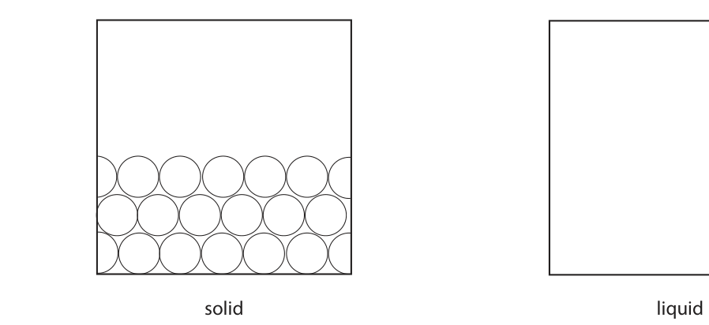
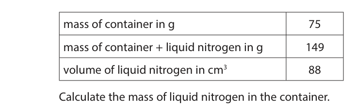
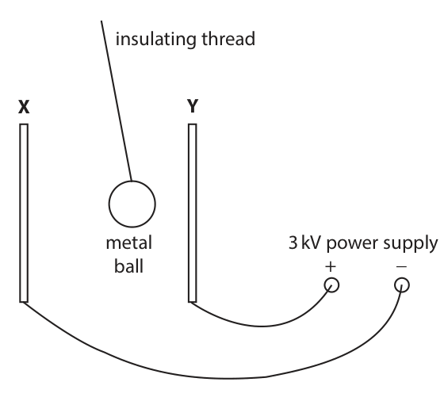
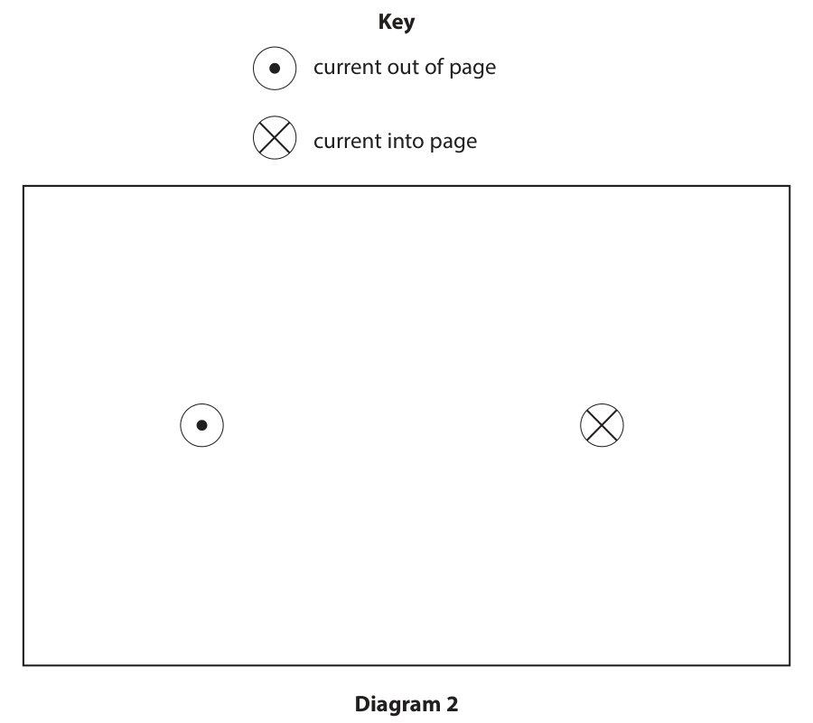
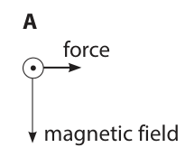
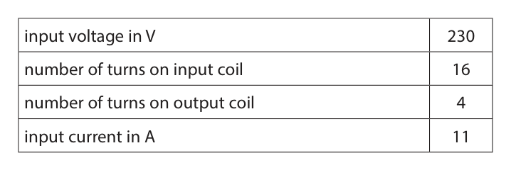

# 4PH1/2P — 2020-06 (official extraction)

> schema `syllabai.official-paper-questions/0.2` · paper_id `pearson-edexcel:international-gcse:physics:4ph1:2020-06:4PH1/2P` · qp sha256 `c10b95175e0fbb0b…` · extraction is the disclosed baseline (ADR-039)

## Question 1 (13 marks)

This question is about liquid nitrogen.

**(b)** A teacher uses this method to find the density of liquid nitrogen. • measure the mass of a container • pour liquid nitrogen into the container • measure the total mass of the container and the liquid nitrogen • read the volume of the liquid nitrogen from the scale on the side of the container

### 1(a)(i) [2]

The diagram shows the arrangement of particles in solid nitrogen. Draw the arrangement of particles in liquid nitrogen. solid liquid

**Mark scheme answer**

> particles with larger spaces between them; max space in body or
> surface one of
> particles from
> diagram on left.
> particles in less regular structure;

- **(2)** particles with larger spaces between them; max space in body or

### 1(a)(ii) [1]

Describe the motion of the particles in liquid nitrogen.

**Mark scheme answer**

> particles {slide/move/flow} past each other; ignore ‘more freely’

- **(1)** particles {slide/move/flow} past each other; ignore ‘more freely’

### 1(b)(i) [1]

Give a safety precaution the teacher should take when pouring the liquid nitrogen.

**Mark scheme answer**

> safety goggles/gauntlets/gloves/not splashing/eq;

- **(1)** safety goggles/gauntlets/gloves/not splashing/eq;

### 1(b)(ii) [1]

State the name of the apparatus that the teacher should use to measure the mass of the container.

**Mark scheme answer**

> balance; condone ‘scales’
> ignore ‘meter(s)’

- **(1)** balance; condone ‘scales’

### 1(b)(iii) [1]

The table shows the teacher’s results. mass of container in g 75 mass of container + liquid nitrogen in g 149 volume of liquid nitrogen in cm3 88 Calculate the mass of liquid nitrogen in the container. mass = g

**Mark scheme answer**

> 74 (g);

- **(1)** 74 (g);

### 1(b)(iv) [1]

State the formula linking density, mass and volume.

**Mark scheme answer**

> density = mass/volume; allow any accepted
> letters for density,
> mass or volume
> allow d, ρ for density

- **(1)** density = mass/volume; allow any accepted

### 1(b)(v) [3]

Calculate the density of the liquid nitrogen. Give a suitable unit. density = unit =

**Mark scheme answer**

> substitution; ECF for incorrect
> mass
> evaluation;
> matching unit;
> correct answer: 0.84 g/cm3
> e.g. density = mass / volume
> density = 74/88
> density = 0.84 g/cm3 to 2 sf allow 0.8409090…

- **(3)** substitution; ECF for incorrect

### 1(c) [3]

Over time, the liquid nitrogen warms up and changes state from a liquid into a gas. Describe the changes to the arrangement and motion of particles when the liquid nitrogen changes state.

**Mark scheme answer**

> (particles) far apart / much further apart;
> particles move with (much) higher speed / have allow KE for kinetic
> higher kinetic energy; energy
> move (more) randomly;
> Answer Notes Marks

- **(3)** (particles) far apart / much further apart;

## Question 2 (10 marks)

This question is about a demonstration to show the link between current and charge. The diagram shows two metal plates, X and Y, with a metal ball moving between them. insulating thread X Y metal 3 kV power supply ball + −

**(c)** When the metal ball moves away from plate Y to plate X, a charge of 5.1 × 10-6 C is transferred.

### 2(a) [2]

The two metal plates have no charge before the power supply is connected. When plate Y is connected to the positive terminal of the power supply, the plate becomes positively charged. Explain how plate Y gains a positive charge.

**Mark scheme answer**

> plate loses negatively charged particles; reject response that
> infers positive electrons
> (loses) electrons;
> ‘plate loses electrons’
> scores 2 marks.

- **(2)** plate loses negatively charged particles; reject response that

### 2(b)(i) [2]

The metal ball becomes positively charged when it touches plate Y. The metal ball then moves away from plate Y towards plate X. Explain why the metal ball moves away from plate Y.

**Mark scheme answer**

> plate and ball have same (sign) charge;
> (so there is a) repulsive force on the ball (from accept ‘attractive force
> that plate); from other plate’/
> ‘like charges repel’/
> ‘plate X is negative and
> opposite charges
> attract’ for 2 marks

- **(2)** plate and ball have same (sign) charge;

### 2(b)(ii) [1]

Give a reason why the ball is made of metal.

**Mark scheme answer**

> metal is a conductor; allow ‘it conducts’

- **(1)** metal is a conductor; allow ‘it conducts’

### 2(c)(i) [1]

State the formula linking charge transferred, current and time taken.

**Mark scheme answer**

> charge (transferred) = current x time; allow standard symbols
> and rearrangements
> e.g. I = Q / t
> reject C or c for current

- **(1)** charge (transferred) = current x time; allow standard symbols

### 2(c)(ii) [2]

Calculate the current if the metal ball takes 0.45 seconds to travel from plate Y to plate X. current = A

**Mark scheme answer**

> substitution and rearrangement;
> evaluation;
> correct answer: 1.1 x 10-5 (A) allow factor of 2 either
> way
> i.e. {2.2 / 0.55} x 10-5
> POT error scores -1
> e.g.
> charge = current x time
> current = charge / time = 5.1 x 10-6 / 0.45
> current = 1.1(3) x 10-5 A

- **(2)** substitution and rearrangement;

### 2(c)(iii) [1]

Suggest why the current increases if the voltage of the power supply is increased.

**Mark scheme answer**

> any ONE of:
> • larger charge transfer (per trip); ignore ‘V=IR’ argument
> • ball gains more kinetic energy;
> • more trips per second;

- **(1)** any ONE of:

### 2(c)(iv) [1]

Give the name of the apparatus that can be used to measure current.

**Mark scheme answer**

> ammeter;
> Answer Notes Marks

- **(1)** ammeter;

## Question 3 (9 marks)

The diagram shows some of the forces acting on a large rubbish bin on wheels. F not to scale G weight 98 cm 37 cm

**(b)** The mass of the bin is 23 kg.

### 3(a) [1]

The weight of the bin acts through point G. Give the name of point G.

**Mark scheme answer**

> centre of gravity; allow centre of mass

- **(1)** centre of gravity; allow centre of mass

### 3(b)(i) [1]

What is the weight of the bin?

- **(A)** 23 kg
- **(B)** 230 kg
- **(C)** 230 N  ✔
- **(D)** 23 000 N

**Mark scheme answer**

> C (230 N);
> A is not correct as this is the mass of the bin;
> B is not correct as this has the incorrect unit for
> force;
> D is not correct as the mass has been converted to
> grams before being multiplied by g.

- **(1)** Answer C: 230 N

### 3(b)(ii) [1]

State the principle of moments.

**Mark scheme answer**

> (in equilibrium) sum of clockwise moments = sum condone ‘clockwise
> of anticlockwise moments; moment = anticlockwise
> moment’

- **(1)** (in equilibrium) sum of clockwise moments = sum condone ‘clockwise

### 3(b)(iii) [4]

A person applies force F to the bin to keep it stationary. Calculate the magnitude of force F. magnitude of force F = N

**Mark scheme answer**

> calculation of moment of weight or expression for ignore POT for this MP
> moment of F;
> equating moments;
> rearrangement for F;
> correct evaluation of F;
> e.g. moment of F = 0.98 x F
> moment of weight = 230 x 0.37
> 230 x 0.37 = 0.98 x F
> F = 230 x 0.37 / 0.98
> F = 87 (N) allow 86.8, 86.84,
> 86.83…

- **(4)** calculation of moment of weight or expression for ignore POT for this MP

### 3(b)(iv) [2]

State the magnitude and direction of the force applied to the person by the bin. magnitude = N direction =

**Mark scheme answer**

> Magnitude=candidate’s answer for (iii); expect 87 N
> direction: down(wards);
> Answer Notes Marks

- **(2)** Magnitude=candidate’s answer for (iii); expect 87 N

## Question 4 (6 marks)

The photograph shows a solar power farm. © Alessandro Pierpaoli/Shutterstock

### 4(a) [4]

Discuss the advantages and disadvantages of using solar power rather than fossil fuels to generate electricity.

**Mark scheme answer**

> any FOUR from:
> advantages:
> MP1 no carbon (dioxide) emissions; ignore unnamed
> ‘greenhouse gases’
> MP2 no contribution to { global warming /
> greenhouse effect / acid rain };
> MP3 is renewable;
> MP4 low maintenance/no moving parts;
> disadvantages:
> MP5 needs a favourable climate;
> MP6 needs long days /doesn’t work at night;
> MP7 needs a lot of space;
> MP8 cannot respond to rapid changes in
> demand;

- **(4)** any FOUR from:

### 4(b) [2]

Solar panels produce direct current (d.c.). The National Grid in many countries operates on alternating current (a.c.). Describe the difference between direct current (d.c.) and alternating current (a.c.).

> 🖼 crop required: grid (qp.pdf p.13)

**Mark scheme answer**

> d.c. travels in one direction only;
> a.c. changes direction frequently/continuously;
> Answer Notes Marks

- **(2)** d.c. travels in one direction only;

## Question 5 (6 marks)

This question is about using radio waves to track an aeroplane. aeroplane aerial at airport

### 5(a) [3]

Radio waves are emitted from an aerial at an airport, and are then reflected back to the aerial from an aeroplane. The time taken between emitting the radio waves and receiving the waves back at the aerial is 1.9 milliseconds. Show that the aeroplane is approximately 300 km away from the aerial. [speed of radio waves = 3.0 × 105 km/s]

**Mark scheme answer**

> use/substitution of distance = average speed x time; reject use of
> v=fλ
> total distance travelled = 2 x distance to plane; allow idea
> that time
> required is
> half of total
> time.
> evaluation of distance to at least 2s.f.;
> e.g.
> total distance = 1.9 x 10-3 x 3.0 x 105
> total distance = 570 km = 2 x distance to plane
> distance to plane = 570/2 = 285 (km)

- **(3)** use/substitution of distance = average speed x time; reject use of

### 5(b) [3]

As the aeroplane travels away from the airport, it sends a signal to the airport using radio waves with a wavelength of 1.2 m. When the signal is received at the airport, the wavelength is 1.1 × 10-6 m longer than when it is emitted by the aeroplane. Calculate the speed of the aeroplane using the formula change of wavelength speed of aeroplane wavelength speed of radio wave [speed of radio waves = 3.0 × 108 m/s] speed of aeroplane = m/s

**Mark scheme answer**

> substitution into given equation Δλ/λ = v/c ;
> rearrangement;
> evaluation; -1 POT error
> allow ecf
> from wrong
> change in
> wavelength
> condone
> premature
> rounding
> e.g. 1.1 x 10-6 / 1.2 = v/3 x 108
> v = 3 x 108 x 1.1 x 10-6 / 1.2
> v = 280 (m/s) allow 275
> (m/s)
> Answer Notes Marks

- **(3)** substitution into given equation Δλ/λ = v/c ;

## Question 6 (8 marks)

The Parker Solar Probe is a spacecraft that was launched in 2018 on a mission to explore the Sun. The spacecraft is partly covered in tiles. These tiles are filled with a solid containing small pockets of trapped air. The outer surface of the tiles is painted white. These tiles protect the electric circuits in the spacecraft from extreme temperatures.

**(a)** The diagram shows one of these tiles in cross-section. outer surface of tile solid containing small pockets of inner surface trapped air of tile

### 6(a)(i) [2]

Explain why the outer surface of the tile is painted white.

**Mark scheme answer**

> reference to reflection or absorption; ignore reference to
> emission
> white is a good reflector/poor absorber;

- **(2)** reference to reflection or absorption; ignore reference to

### 6(a)(ii) [2]

Explain how the small pockets of trapped air help to reduce thermal energy transfer from the outer surface to the inner surface of the tile.

**Mark scheme answer**

> any TWO from:
> air is a (good) insulator / poor conductor;
> reduction in convection;
> idea that trapped air cannot circulate;

- **(2)** any TWO from:

### 6(b) [4]

The electric circuits inside the spacecraft are cooled by 4.5 kg of water. The initial temperature of the water is 35 oC. The thermal store of the water increases by 210 kJ. Calculate the final temperature of the water. [specific heat capacity of water = 4200 J/kg oC] final temperature = oC

**Mark scheme answer**

> substitution into given equation (energy = mcΔθ);
> rearrangement;
> evaluation of temperature change;
> evaluation of final temperature; ecf incorrect temp
> change
> e.g.
> 210 000 = 4.5 x 4200 x ΔT
> ΔT = 210 000/(4.5 x 4200)
> ΔT = 11 (°C)
> final temperature = 46 (°C) accept 35(°C) for 3
> marks if supported with
> working that shows
> evidence of a
> temperature change of
> 11 x 10-3 (°C)
> Answer Notes Marks

- **(4)** substitution into given equation (energy = mcΔθ);

## Question 7 (10 marks)

Diagram 1 shows a loop of wire connected to a power supply. loop of wire + − variable power supply card Diagram 1

### 7(a) [3]

Describe how to find the shape of the magnetic field produced by the loop of wire.

**Mark scheme answer**

> EITHER
> plotting compass;
> multiple compasses or repeated use of single compass;
> joining up of dots/idea of compasses forming continuous line(s);
> OR
> iron filings;
> sprinkled;
> card tapped;
> all marks can
> be awarded for
> a correctly
> labelled
> diagram

- **(3)** EITHER

### 7(b) [4]

Diagram 2 shows the view from above the card with two cross-sections of the loop of wire. Key current out of page current into page Diagram 2 On diagram 2, draw the magnetic field produced by the two cross-sections of the loop of wire.

**Mark scheme answer**

> one field line passing through middle from top to bottom;
> circular/elliptical field lines around wires;
> field line spacing increasing further from wires;
> arrows correct direction;

- **(4)** one field line passing through middle from top to bottom;

### 7(c)(i) [1]

These diagrams show the magnetic field acting on a cross-section of wire when the current in the wire is out of the page. A B force force magnetic field magnetic field C D force force magnetic field magnetic field Which diagram shows the correct direction of the force acting on the cross-section of wire due to the magnetic field? A B C D

**Mark scheme answer**

> A;
> B is not right as the force cannot be generated by the LHR.
> C and D are not right as the force cannot be parallel to the
> magnetic field.

- **(1)** A;

### 7(c)(ii) [2]

The magnetic field acting on the cross-section of wire is produced by the current in the other side of the loop of wire. Explain why there is no effect on the direction of the force on the cross-section of wire when the direction of the current in the loop is reversed. (Total for Question 7 =10 marks)

**Mark scheme answer**

> current (in one wire) and field (from other wire) both reversed;
> the two effects cancel (so no change); DOP
> allow relevant
> reference to

- **(2)** current (in one wire) and field (from other wire) both reversed;

## Question 8 (8 marks)

Welding is a process where pieces of metal are melted and then joined together. The diagram shows apparatus used for welding. plug transformer input current output current © Olha1981/Shutterstock The welding apparatus uses the transformer to decrease the voltage from 230 V.

**(c)** The table gives some information about the transformer. input voltage in V 230 number of turns on input coil 16 number of turns on output coil 4 input current in A 11

### 8(a) [1]

State the name of this type of transformer.

**Mark scheme answer**

> step-down;

- **(1)** step-down;

### 8(b) [1]

State the formula linking the turns ratio, the input voltage and the output voltage for a transformer.

**Mark scheme answer**

> input (primary) voltage primary turns allow V for
> = ;
> voltage, n or
> output (secondary) voltage secondary turns
> N or t or T
> for turns,
> allow
> subscripts ‘i’
> and ‘o’ or ‘p’
> and ‘s’ or ‘1’
> and ‘2’

- **(1)** input (primary) voltage primary turns allow V for

### 8(c)(i) [5]

Use information from the table to calculate the output current of the transformer. Assume that the transformer is 100% efficient. current = A

**Mark scheme answer**

> substitution into correct turns ratio equation;
> rearrangement to find Vs;
> substitution into VpIp=VsIs; ecf from
> incorrect Vs
> rearrangement to give Is;
> evaluation;
> e.g.
> 230/Vs = 16/4
> Vs = 230 / 4 = 57.5 (V)
> 230 x 11 = 57.5 x Is
> Is = 230 x 11 / 57.5
> Is = 44 (A)

- **(5)** substitution into correct turns ratio equation;

### 8(c)(ii) [1]

A fuse is installed in the plug which supplies the input current. Which fuse should be used in this plug? A 3A B 5A C 10 A D 13 A

**Mark scheme answer**

> D;
> A, B and C are all rated below the nominal current of the
> input coil, so would all ‘blow’ instantly.
> Pearson Education Limited. Registered company number 872828
> with its registered office at 80 Strand, London, WC2R 0RL, United Kingdom

- **(1)** D;

