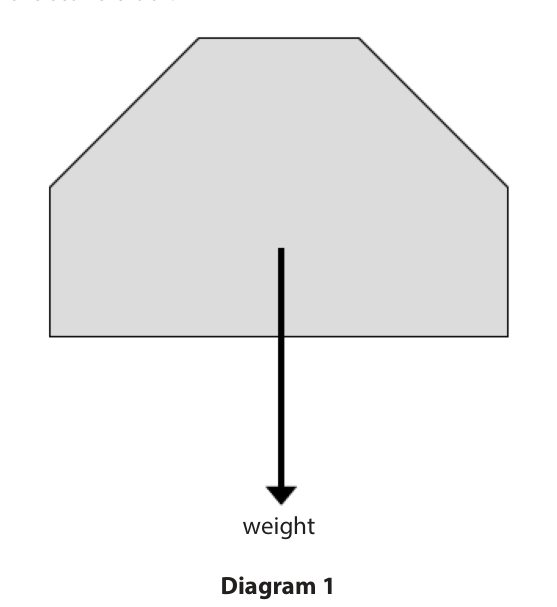
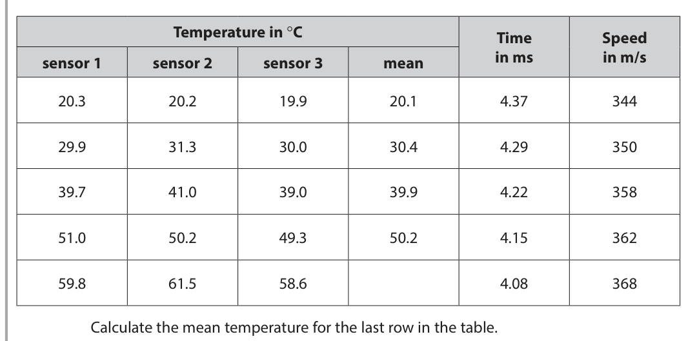
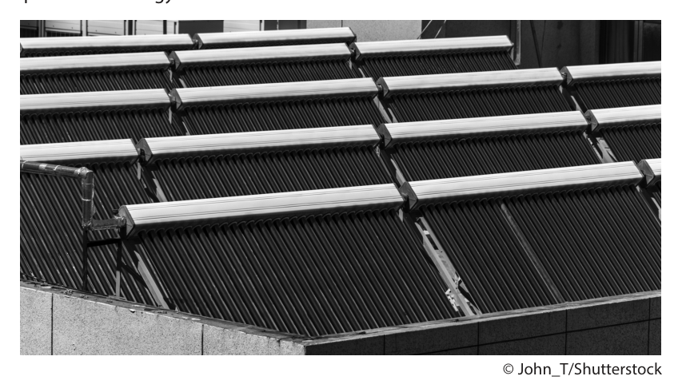
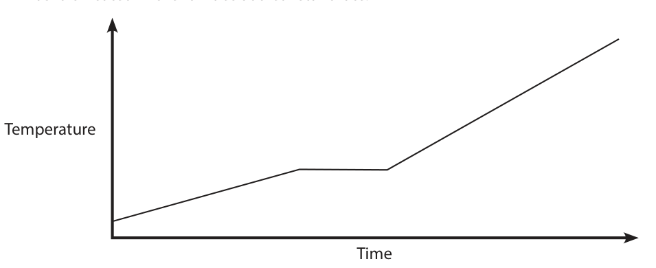
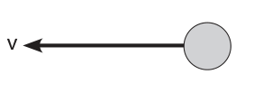

# 4PH1/2PR — 2020-06 (official extraction)

> schema `syllabai.official-paper-questions/0.2` · paper_id `pearson-edexcel:international-gcse:physics:4ph1:2020-06:4PH1/2PR` · qp sha256 `5d29cc2a8177affb…` · extraction is the disclosed baseline (ADR-039)

## Question 1 (9 marks)

This question is about electrostatics.

**(a)** A student uses a plastic rod to investigate electrostatics.

**(b)** Electrostatic charges can be useful but they can also be dangerous.

### 1(a)(i) [2]

Describe how the student could have charged the plastic rod.

### 1(a)(ii) [1]

The student uses a meter to measure the amount of charge on the rod. The meter displays a reading of –5.2 mC. Which of these is the same as –5.2 mC?

- **(A)** –0.52 C
- **(B)** –0.052 C
- **(C)** –0.0052 C
- **(D)** –0.00052 C

### 1(a)(iii) [1]

The rod is negatively charged. Which statement correctly explains why the rod is negatively charged?

- **(A)** the rod has gained negatively charged electrons
- **(B)** the rod has gained positively charged electrons
- **(C)** the rod has lost negatively charged electrons
- **(D)** the rod has lost positively charged electrons

### 1(a)(iv) [2]

Using a meter is one method of demonstrating that the rod is charged. Describe another method of demonstrating that the rod is charged.

### 1(b)(i) [1]

Give one use of electrostatic charges.

**Mark scheme answer**

> photocopiers / inkjet printers / smoke precipitators / allow any correct use
> (electrostatic) spray painting;

- **(1)** photocopiers / inkjet printers / smoke precipitators / allow any correct use

### 1(b)(ii) [2]

Explain why electrostatic charges can be dangerous when fuelling an aeroplane.

**Mark scheme answer**

> risk of a spark;
> (causing) explosion / fire;
> Answer Notes Marks

- **(2)** risk of a spark;

## Question 2 (5 marks)

X-rays are electromagnetic waves used to obtain images of bones. An x-ray machine produces x-ray waves with a frequency of 1.25 × 1018 Hz.

### 2(a) [2]

Calculate the time period of these x-rays. time period = s

**Mark scheme answer**

> substitution OR rearrangement;
> evaluation; -1 for POT error
> e.g.
> 1.25 × 1018 = 1 / T OR T = 1/f
> (T =) 8.00 × 10-19 (s) allow 8 × 10-19 (s)
> (b) use of v = f × λ; seen as a formula or implied
> by working
> allow v, c, s for speed
> allow λ for wavelength
> substitution OR rearrangement;
> evaluation; -1 for POT error
> e.g.
> v=f×λ
> 3.00 × 108 = 1.25 × 1018 × λ OR λ = v / f
> (λ =) 2.40 × 10-10 (m) allow 2.4 × 10-10 (m)
> Answer Notes Marks

- **(2)** substitution OR rearrangement;

### 2(b) [3]

X-rays have a speed of 3.00 × 108 m/s in air. Calculate the wavelength of these x-rays. wavelength = m

## Question 3 (10 marks)

A builder needs to lift a large stone block.

**(a)** Diagram 1 shows the stone block. weight Diagram 1

**(b)** The builder uses a wooden plank to lift the large stone block. The plank is uniform and pivoted at its centre. The builder pushes down on one end of the plank to lift the stone block. Diagram 2 shows the plank when it is horizontal and stationary. 0.30 m distance X weight 520 N Diagram 2

### 3(a)(i) [1]

Draw an X on diagram 1 at the centre of gravity of the stone block.

### 3(a)(ii) [1]

State the formula linking weight, mass and gravitational field strength.

### 3(a)(iii) [2]

The mass of the stone block is 130 kg. Calculate the weight of the stone block. weight = N

### 3(b)(i) [2]

State the principle of moments.

**Mark scheme answer**

> in equilibrium / when balanced;
> (sum of) clockwise moment(s) = (sum of) anti- allow idea that net moment is
> clockwise moment(s); zero

- **(2)** in equilibrium / when balanced;

### 3(b)(ii) [3]

The builder is pushing down with a force of 520 N to keep the plank horizontal. Calculate distance X. distance X = m

**Mark scheme answer**

> correct expression for either moment; allow ecf from (a)(iii)
> correct use of principle of moments;
> evaluation of distance X;
> e.g.
> 1300 × 0.30 OR 520 × X
> 1300 × 0.30 = 520 × X
> X = 0.75 (m)

- **(3)** correct expression for either moment; allow ecf from (a)(iii)

### 3(b)(iii) [1]

Calculate the length of the plank. length of plank = m

**Mark scheme answer**

> (length of plank =) 1.5 (m); allow ecf from (b)(ii)
> Answer Notes Marks

- **(1)** (length of plank =) 1.5 (m); allow ecf from (b)(ii)

## Question 4 (13 marks)

A student investigates the speed of sound in air.

**(a)** The student sets up two microphones, A and B, as shown in Diagram 1. microphone A microphone B source of sound to datalogger Diagram 1 The microphones are connected to a datalogger. A sound is made to the left of microphone A. The datalogger records the time when the sound wave reaches each microphone. The student uses the data to calculate the time taken for the sound wave to travel from microphone A to microphone B.

**(b)** The student investigates how the speed of sound in air varies with temperature. He places several Bunsen burners in the space between the microphones, as shown in diagram 2. microphone A microphone B source of sound to datalogger heat heat heat heat heat heat Diagram 2 He uses this method • light all the Bunsen burners on a low heating flame • measure the air temperature in three places between the microphones using three temperature sensors • use the datalogger to record the time taken for a sound wave to travel from microphone A to microphone B • determine the speed of sound The student repeats this method as the air temperature increases.

### 4(a)(i) [3]

Describe how the student could determine the speed of sound in air using his calculated value of time taken.

### 4(a)(ii) [1]

Suggest why the student does not use a stop clock in this investigation.

### 4(b)(i) [1]

Suggest why it is important for all the Bunsen burners to burn the same amount of gas each second.

**Mark scheme answer**

> idea that air needs to be same temperature at all allow idea that speed will
> points between microphones; change if temperature not
> constant
> ignore ‘fair test’

- **(1)** idea that air needs to be same temperature at all allow idea that speed will

### 4(b)(ii) [2]

The table shows the student’s results. Temperature in °C Time Speed sensor 1 sensor 2 sensor 3 mean in ms in m/s 20.3 20.2 19.9 20.1 4.37 344 29.9 31.3 30.0 30.4 4.29 350 39.7 41.0 39.0 39.9 4.22 358 51.0 50.2 49.3 50.2 4.15 362 59.8 61.5 58.6 4.08 368 Calculate the mean temperature for the last row in the table. Give your answer to a suitable number of decimal places. mean temperature = °C

**Mark scheme answer**

> correctly calculate average;
> given to 1 decimal place; DOP
> 59.9 scores 1 mark
> e.g.
> 59.97 = 1 mark allow 59.96, 60
> 60.0 = 2 marks

- **(2)** correctly calculate average;

### 4(b)(iii) [1]

The student plots his results and draws the line of best fit. Draw a circle around the anomalous result. 370 + + 360 + Speed in m/s 350 + + 340 20 30 40 50 60 70 Mean temperature in °C

**Mark scheme answer**

> point at (40, 358) circled;

- **(1)** point at (40, 358) circled;

### 4(b)(iv) [1]

State how the student should deal with the anomalous result.

**Mark scheme answer**

> repeat it / discard it; allow repeat experiment
> condone ‘ignore it’

- **(1)** repeat it / discard it; allow repeat experiment

### 4(b)(v) [2]

Explain why a line graph is the correct type of graph to display these results.

**Mark scheme answer**

> line graph suitable for continuous data; allow ‘data is continuous’
> both variables are continuous;

- **(2)** line graph suitable for continuous data; allow ‘data is continuous’

### 4(b)(vi) [2]

Describe the relationship between the speed of sound in air and temperature.

**Mark scheme answer**

> idea that speed increases as temperature increases; ignore positive correlation
> idea of a linear relationship; reject mark if relationship
> described as directly
> proportional
> Answer Notes Marks

- **(2)** idea that speed increases as temperature increases; ignore positive correlation

## Question 5 (10 marks)

Energy is transferred from the Sun to the Earth.

**(a)** Nuclear fusion happens in the Sun.

**(b)** Solar panels use energy from the Sun to heat water. © John_T/Shutterstock

### 5(a)(i) [1]

Which energy store of the Sun decreases during nuclear fusion?

- **(A)** chemical
- **(B)** kinetic
- **(C)** nuclear
- **(D)** thermal

### 5(a)(ii) [1]

How is energy transferred through space from the Sun to the Earth?

- **(A)** by heating
- **(B)** by radiation
- **(C)** electrically
- **(D)** mechanically

### 5(b)(i) [3]

The total area of the solar panels is 15 m2. Each 1.0 m2 of the solar panels receives 1000 J of energy per second from the Sun. Show that the total energy transferred to the solar panels in 2 hours is about 100 MJ.

**Mark scheme answer**

> evaluation of total power / conversion of hours to allow ×3600 seen anywhere in
> seconds; working
> evaluation of energy in J;
> evaluation of energy in MJ;
> e.g.
> power = (1000 × 15 =) 15 000 (m2)
> OR time = (2 × 60 × 60 =) 7200 (s)
> energy = (15 000 × 7200 =) 108 000 000 (J)
> energy = (108 000 000 ÷ 1 000 000 =) 108 (MJ)

- **(3)** evaluation of total power / conversion of hours to allow ×3600 seen anywhere in

### 5(b)(ii) [4]

A mass of 1100 kg of cold water is in the solar panels at an initial temperature of 20 °C. Calculate the final temperature of this water after it has been heated by the Sun for 2 hours. [specific heat capacity of water = 4200 J/kg °C] final temperature = °C

**Mark scheme answer**

> substitution into ΔQ = m × c × ΔT;
> rearrangement;
> evaluation of ΔT; -1 for POT error
> evaluation of final temperature; allow ECF from incorrect ΔT
> e.g.
> 100 000 000 = 1100 × 4200 × ΔT
> ΔT = 100 000 000 / (1100 × 4200)
> (ΔT =) 22 (°C) allow 23.3…, 21.6…
> T = (20 + 22 =) 42 (°C) allow 41.6-43.8 (°C)

- **(4)** substitution into ΔQ = m × c × ΔT;

### 5(b)(iii) [1]

Give a reason why the actual final temperature of the water will be lower than the calculated value.

**Mark scheme answer**

> any sensible suggestion;
> e.g.
> • heating process is not 100% efficient
> • energy also heats up pipes / not all energy is allow energy transferred to
> transferred to water (solar) panel
> • some energy is transferred to the ignore ‘heat is lost’
> surroundings
> • power of Sun may change
> Answer Notes Marks

- **(1)** any sensible suggestion;

## Question 6 (8 marks)

Conventional power stations burn fuel in a furnace. steam out water in burning fuel

**(b)** When the fuel is burned, energy is transferred from the fuel to the water. The water boils and turns into steam.

### 6(a) [3]

The fuel can be a solid, a liquid or a gas. Describe the motion of particles in a solid, a liquid and a gas. solid liquid gas

**Mark scheme answer**

> (i) (in solids) particles vibrate only;
> (in liquids) particles slide over each other;
> (in gases) particles move freely / randomly;

- **(3)** (i) (in solids) particles vibrate only;

### 6(b)(i) [3]

Describe how energy stored in the fuel is transferred to the water. Refer to energy stores and transfers in your answer.

**Mark scheme answer**

> energy starts in a chemical store (in the fuel);
> energy is transferred by heating; allow transfer by convection /
> radiation
> to a thermal store (in the water); allow kinetic store of water
> allow heat energy for thermal
> energy

- **(3)** energy starts in a chemical store (in the fuel);

### 6(b)(ii) [2]

The temperature-time graph shows how the temperature of the water changes as it is heated in the furnace at a constant rate. Temperature Time Explain how the graph shows that the water changes state as it is heated.

**Mark scheme answer**

> horizontal line shows the change of state; can be shown on graph
> (because) temperature remains constant during
> change of state;
> Answer Notes Marks

- **(2)** horizontal line shows the change of state; can be shown on graph

## Question 7 (8 marks)

A machine called the synchrocyclotron (SC) was designed to cause protons to move in a circular path using strong magnetic fields.

**(c)** The SC is surrounded by very thick concrete walls. The radiation produced by the SC created atoms of radioactive barium-133 in the concrete walls. Barium-133 has a half-life of 10.5 years.

### 7(a) [3]

The SC used electromagnets to produce the strong magnetic fields. Describe the construction of a simple electromagnet. You may draw a diagram to support your answer.

**Mark scheme answer**

> coil of wire;
> current in the wire; current may be inferred from
> diagram
> iron core;
> (b) down; allow force arrow drawn
> pointing down on diagram

- **(3)** coil of wire;

### 7(b) [1]

The diagram shows a proton moving at velocity v in the magnetic field produced by the SC. v The direction of the magnetic field is into the page. Using the left hand rule, determine the direction of the force acting on the proton due to the magnetic field.

### 7(c)(i) [2]

State what is meant by the term half-life.

**Mark scheme answer**

> time taken;
> for {activity / number of (radioactive) nuclei / allow atoms for nuclei
> amount of isotope / count rate} to halve;

- **(2)** time taken;

### 7(c)(ii) [2]

In 1990, the SC stopped being used at CERN, a research centre. In 1990, the largest number of barium-133 atoms were found 40 cm deep in the concrete walls. Since 2014, members of the public have been allowed to visit the SC at CERN. Explain why the radioactive barium-133 in the concrete walls is not a risk to people visiting the SC.

**Mark scheme answer**

> any two from:
> MP1. radiation unlikely to penetrate out of walls;
> MP2. (more than) two half-lives have passed;
> MP3. amount of barium-133 remaining is less (than allow idea that activity /
> 25%); amount of radiation is (much)
> less than before
> MP4. visitors exposed to radiation for very short
> time;
> Answer Notes Marks

- **(2)** any two from:

## Question 8 (7 marks)

The Big Bang theory suggests that the Universe is approximately 14 billion years old.

### 8(a) [3]

Describe the evolution of the Universe from the Big Bang until the present day.

**Mark scheme answer**

> Universe began as hot / dense point; allow idea that Universe
> started as a single point
> Universe has expanded since the Big Bang;
> Universe has cooled since the Big Bang;
> (b) any four from:
> MP1. presence of cosmic microwave background allow CMBR
> radiation;
> MP2. CMBR comes from all directions; allow CMBR is uniform
> MP3. CMBR (began as gamma radiation and)
> wavelength increased (as Universe expanded);
> MP4. red-shift of galaxies;
> MP5. further/faster galaxies show a greater red-
> shift;
> MP6. red-shift indicates that galaxies are moving
> away from each other;
> MP7. relative abundance of helium; allow large amount of helium
> MP8. helium formed when Universe was hot enough
> to fuse protons;
> Pearson Education Limited. Registered company number 872828
> with its registered office at 80 Strand, London, WC2R 0RL, United Kingdom

- **(3)** Universe began as hot / dense point; allow idea that Universe

### 8(b) [4]

Describe the evidence that supports the Big Bang theory.

