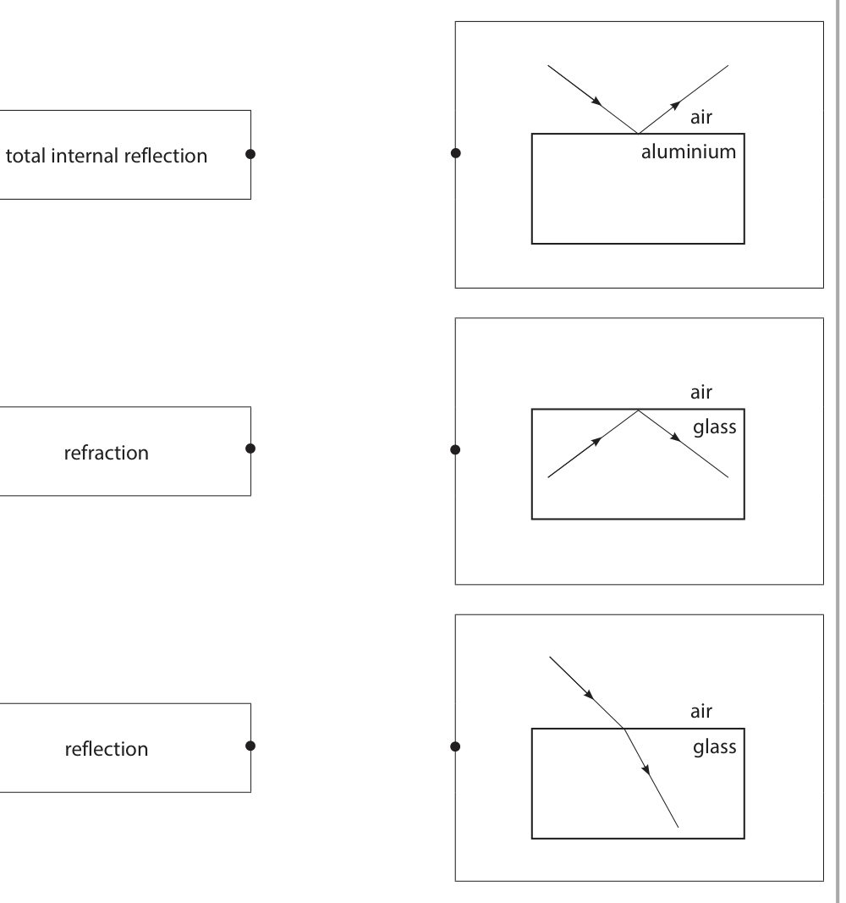
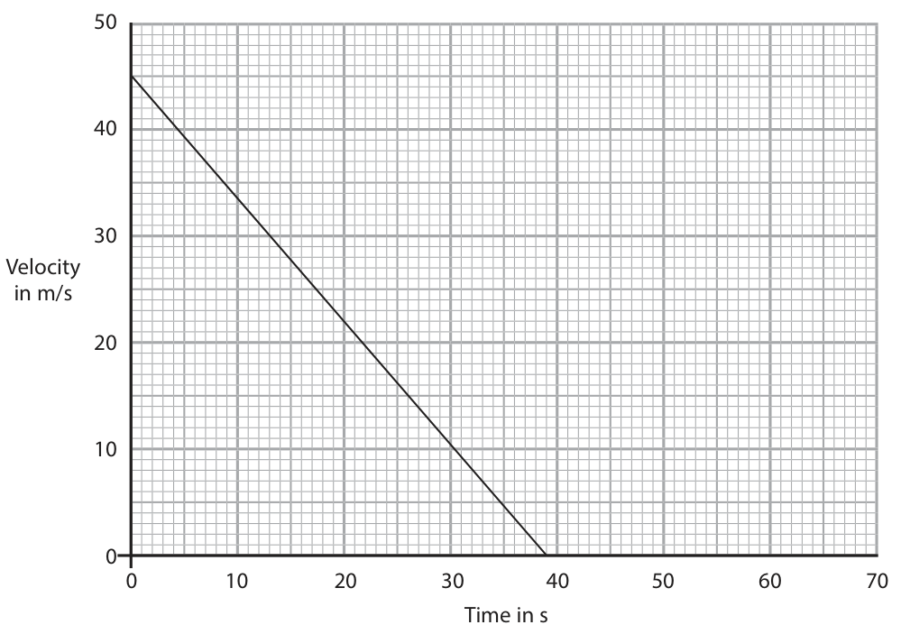
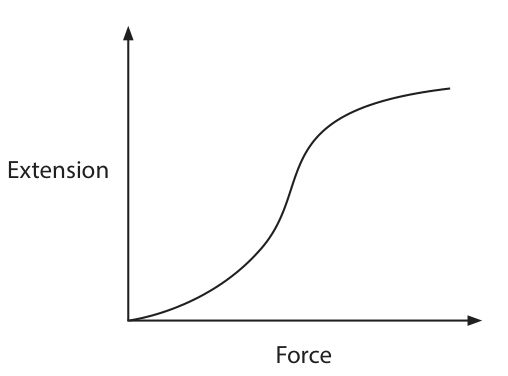
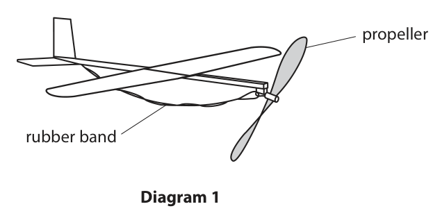
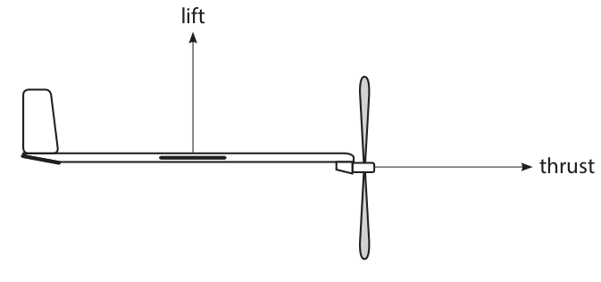
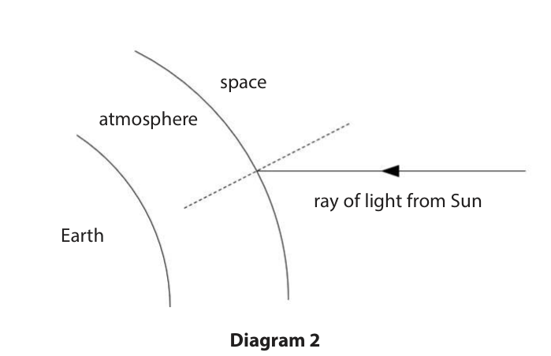
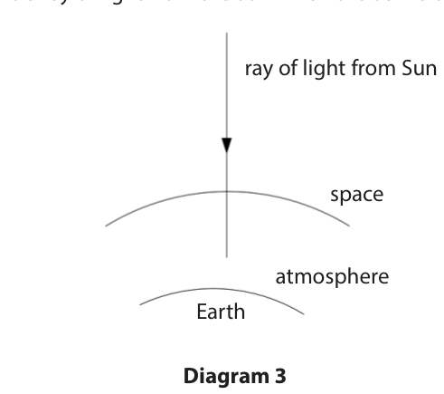
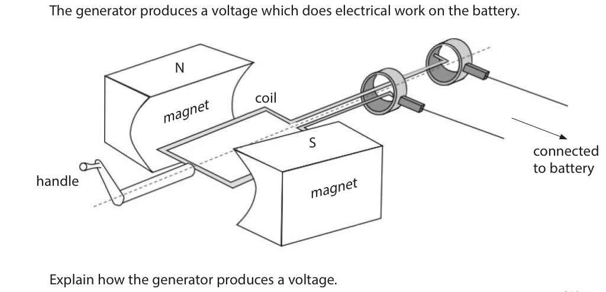
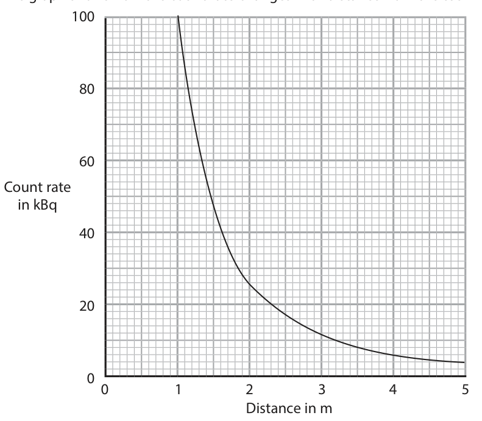
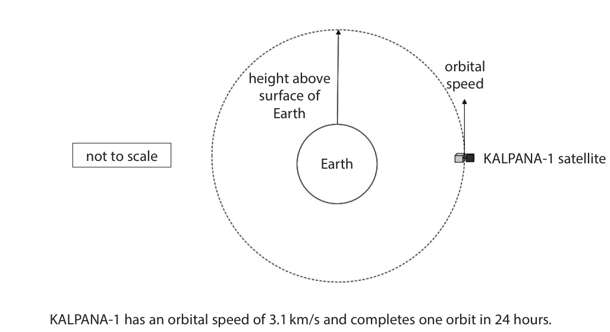

# 4PH1/1P — 2020-11 (official extraction)

> schema `syllabai.official-paper-questions/0.2` · paper_id `pearson-edexcel:international-gcse:physics:4ph1:2020-11:4PH1/1P` · qp sha256 `e6da3465b62dbec9…` · extraction is the disclosed baseline (ADR-039)

## Question 1 (5 marks)

This question is about wave behaviour.

### 1(a) [3]

The boxes give three types of wave behaviour and the diagrams give three examples of wave behaviour. Draw one straight line from each wave behaviour to the example that best shows that behaviour. Wave behaviour Example air total internal reflection aluminium air glass refraction air reflection glass

**Mark scheme answer**

> one mark for each correct line drawn;;; allow line for reflection
> drawn to first or second
> example diagram
> allow two lines drawn from
> reflection to first and
> second diagrams only
> reject mark if two lines
> drawn from either TIR or
> refraction
> (b) any two from: allow higher level common
> properties e.g. diffraction,
> interference etc.
> (all waves) reflect;
> (all waves) refract;
> idea that (all waves) transfer energy (without allow ‘information’ for
> transferring matter); energy
> (all waves) have amplitude/wavelength/frequency;
> Answer Notes Marks

- **(3)** one mark for each correct line drawn;;; allow line for reflection

### 1(b) [2]

State two properties that all waves have in common. 1 2

## Question 2 (8 marks)

This question is about the movement of a train. The diagram shows the train on a track. The train starts braking at point P and stops moving at point Q. P Q The graph shows how the train’s velocity changes with time as the train travels from P to Q. Velocity in m/s 0 10 20 30 40 50 60 70 Time in s

### 2(a) [3]

Calculate the acceleration of the train. acceleration = ………………………………………… m/s2

**Mark scheme answer**

> any attempt at gradient/reference to correct check graph for evidence of
> formula; working
> substitution of values from graph;
> evaluation; ignore minus sign
> e.g.
> acceleration = change in velocity/time taken
> acceleration = (-)45 / 39
> acceleration = (-)1.2 (m/s2) allow 1.1-1.2 (m/s2)
> (b) any attempt at or reference to an area; allow alternative method
> using v2 = u2 + 2as with answer
> from (a)
> correct attempt = ½ × 45 × 39; allow ECF of incorrect velocity
> or time reading if also used in
> correct evaluation;
> e.g.
> distance travelled = area under graph
> distance = 1/2 × 45 × 39
> distance = 880 (m) allow 878, 877.5 (m)
> (c) line showing decreasing velocity from same initial
> velocity as existing line;
> line drawn is less steep than existing line throughout;
> Answer Notes Marks

- **(3)** any attempt at gradient/reference to correct check graph for evidence of

### 2(b) [3]

Calculate the distance travelled by the train from P to Q. distance = ………………………………………… m

### 2(c) [2]

Draw a line on the graph to show how the train’s velocity will change if its initial velocity is the same but the braking force is lower.

## Question 3 (7 marks)

This question is about stars.

### 3(a) [4]

Describe the stages in the evolution of a star similar in mass to the Sun.

**Mark scheme answer**

> any four correctly linked stages in star’s limit to 2 marks max. if incorrect
> evolution: stages given e.g. red supergiant,
> supernova, neutron star, black hole
> allow cloud of dust/gas for nebula
> allow main stage for main sequence
> MP1. nebula to protostar;
> MP2. protostar to main sequence;
> MP3. main sequence to red giant;
> MP4. red giant to white dwarf;
> MP5. white dwarf to black dwarf;
> allow 1 marking point if stage
> missing e.g. nebula to main
> sequence gets either MP1 or MP2
> since protostar is missing
> (b) stars use fusion, reactor uses fission; both needed
> fusion detail e.g.;
> • (fusion is the) joining of nuclei condone atoms for nuclei
> • involves light nuclei e.g. hydrogen
> fission detail e.g.;
> • (fission is the) splitting of nuclei condone atoms for nuclei
> • involves heavy nuclei e.g.
> uranium/plutonium
> Answer Notes Marks

- **(4)** any four correctly linked stages in star’s limit to 2 marks max. if incorrect

### 3(b) [3]

The process of energy release in the core of a star is different to the process of energy release in a nuclear reactor in a power station. Describe how these processes of energy release are different.

## Question 4 (11 marks)
### 4(a)(i) [2]

State Hooke’s Law.

### 4(a)(ii) [2]

The graph shows how the extension of a rubber band varies with the force applied. Extension Force Explain how the graph shows that the rubber band does not obey Hooke’s Law.

### 4(b) [3]

Diagram 1 shows a model aeroplane powered by a rubber band. propeller rubber band Diagram 1 A person rotates the propeller of the model aeroplane, which twists the rubber band. He then releases the propeller and it spins. Energy transfer occurs during this process. The box lists words associated with energy. kinetic gravitational electrostatic mechanical elastic magnetic heating chemical radiation Use words from the box to complete the passage. The person does work to twist the rubber band. As the person twists the rubber band it extends, increasing the energy store of the rubber band. When the rubber band is released it does mechanical work, increasing the energy store of the propeller.

### 4(c) [4]

Diagram 2 shows the aeroplane flying horizontally to the right. lift thrust Diagram 2 The aeroplane flies at a constant speed. Diagram 2 shows two forces acting on the aeroplane. Draw labelled arrows on diagram 2 to show two more forces acting on the aeroplane.

## Question 5 (9 marks)

A student does an investigation to determine the current-voltage graph for an unknown component, X. The student uses this equipment • component X • cell • variable resistor • ammeter • voltmeter • connecting wires

**(b)** The student completes her investigation. The table shows her results. Voltage in V Current in mA 0.00 0 0.10 0 0.20 0 0.30 0 0.40 0 0.50 2 0.60 8 0.70 33 0.80 140

### 5(a) [4]

Complete the circuit diagram to show how the student should set up this equipment for her investigation. component X

**Mark scheme answer**

> allow higher level potential
> divider type circuits
> symbols for cell, variable resistor, ammeter and condone symbols for more
> voltmeter all correct; than one cell or battery
> cell and variable resistor in series with component X;
> ammeter in series with component X;
> voltmeter in parallel with component X only; allow voltmeter in parallel
> with component X and
> ammeter
> e.g.

- **(4)** allow higher level potential

### 5(b)(i) [3]

Plot a graph of the student’s results on the grid. Plot current on the y-axis and voltage on the x-axis.

**Mark scheme answer**

> sensible linear scales; must have voltage on
> x-axis
> e.g. occupy >50% of the
> grid and not multiples of 3
> etc.
> axes labelled with units;
> all points plotted correctly within ½ a small square;
> e.g.

- **(3)** sensible linear scales; must have voltage on

### 5(b)(ii) [1]

Draw a curve of best fit.

**Mark scheme answer**

> smooth curve with increasing gradient that passes allow if within ½ a small
> through all data points; square of each data point

- **(1)** smooth curve with increasing gradient that passes allow if within ½ a small

### 5(b)(iii) [1]

State the name of component X.

**Mark scheme answer**

> diode / light emitting diode; allow LED
> Answer Notes Marks

- **(1)** diode / light emitting diode; allow LED

## Question 6 (8 marks)

The diagram shows an electric circuit. 6.0 V 6.8 mA 490 Ω

### 6(a) [5]

When the thermistor is in hot water, its resistance is 490 Ω. Show that the resistance of the fixed resistor is about 400 Ω.

**Mark scheme answer**

> use of voltage = current × resistance; seen or implied
> substitution and rearrangement of formula; allow current in mA or A
> evaluation of total circuit resistance;
> subtraction of thermistor resistance; allow ECF from POT error
> correct evaluation of fixed resistor resistance;
> e.g. accept, for full marks, answers
> that calculate voltage of
> thermistor to find voltage of
> resistor
> voltage = current × resistance voltage = current × resistance
> Rtotal = 6.0 / 6.8 (mA) Vthermistor = 6.8 (mA) × 490 (=
> 3.332) V
> Rtotal = 882 (Ω) Vfixed = (6.0 – 3.332 =) 2.668 V
> Rfixed = 882 – 490 Rfixed = 2.668 / 6.8 × 10-3
> Rfixed = 392(.35…) (Ω) Rfixed = 392(.35…) (Ω)
> (b) resistance of thermistor increases;
> current through circuit decreases;
> (so) voltage (across fixed resistor) decreases; dependent on scoring one of
> previous two marking points
> allow 2 max. as ECF for correct
> description with incorrect Rtherm
> change
> allow correct potential divider
> argument for full marks
> Answer Notes Marks

- **(5)** use of voltage = current × resistance; seen or implied

### 6(b) [3]

Explain how the voltage across the fixed resistor changes when the hot water is replaced with cold water.

## Question 7 (15 marks)

This is a question about Io, a moon of Jupiter. The diagram shows two jets of gas from volcanoes on Io. One jet of gas is from the volcano Prometheus and the other is from the volcano Tvashtar. Tvashtar Prometheus

**(b)** Before the gas particles leave the surface of Io, they are trapped in a chamber. jet of gas chamber

### 7(a) [3]

Gas particles in the Prometheus jet leave the surface of Io and move vertically upwards. The particles reach their maximum height when their speed is zero. Some particles in the Prometheus jet reach a maximum height of 92 km. Calculate the initial speed of these particles as they leave the surface of Io. [acceleration due to gravity on Io = 1.8 m/s2] initial speed = ………………………………………… m/s

**Mark scheme answer**

> substitution into v2 = u2 + 2as; allow answers in terms of
> conservation of energy for full marks
> rearrangement;
> evaluation;
> e.g.
> 02 = u2 + (2 × -1.8 × 92 000) ignore units
> condone poor handling of minus
> signs
> u = √3.6 × 92000
> (initial speed =) 580 (m/s) allow 575.(499…) (m/s)
> answer of 331 200 gains 2 marks
> POT error on distance will give 18.2
> (m/s) for 2 marks

- **(3)** substitution into v2 = u2 + 2as; allow answers in terms of

### 7(b)(i) [3]

Explain how the gas particles exert a pressure on the walls of the chamber.

**Mark scheme answer**

> particles collide with walls; ignore collisions between particles
> (collisions result in) force on walls; allow momentum arguments
> force over area gives pressure; allow p = F / A

- **(3)** particles collide with walls; ignore collisions between particles

### 7(b)(ii) [3]

The Tvashtar chamber has the same volume as the Prometheus chamber and contains the same number of molecules of the same type of gas. The temperature of the gas in the Prometheus chamber is 1200 K. The temperature of the gas in the Tvashtar chamber is 1600 K. The pressure of the gas in the Prometheus chamber is 8.2 kPa. Calculate the pressure of the gas in the Tvashtar chamber. pressure = ………………………………………… kPa

**Mark scheme answer**

> substitution into p1/T1 = p2/T2; allow pressure in kPa or Pa
> rearrangement;
> evaluation;
> e.g.
> 8.2/1200 = p2/1600
> p2= (1600 × 8.2/1200)
> (p2 =) 11 (kPa) allow 10.9… (kPa)

- **(3)** substitution into p1/T1 = p2/T2; allow pressure in kPa or Pa

### 7(b)(iii) [3]

Explain why the pressure inside the chambers increases when the temperature increases. Use ideas about particles in your answer.

**Mark scheme answer**

> any three from:
> particles have more kinetic energy; allow particles move faster/eq.
> particles collide with walls more frequently;
> idea that particles collide with walls with more
> force / ‘harder’;
> (average) force increases;

- **(3)** any three from:

### 7(b)(iv) [3]

Explain why the particles from the Tvashtar chamber reach a greater maximum height than the particles from the Prometheus chamber.

**Mark scheme answer**

> any three from:
> MP1. idea that higher pressure means higher allow Tvashtar particles have higher
> speed; speed / RA
> MP2. Tvashtar particles have more (initial) KE;
> MP3. particles from both chambers experience
> the same deceleration;
> MP4. (higher speed with same deceleration) allow Tvashtar particles take longer
> takes longer to reach 0 m/s; to reach max. height / RA
> MP5. relevant quantitative argument based on
> motion formulae;
> MP6. Tvashtar particles have more GPE (at
> max. height);
> Answer Notes Marks

- **(3)** any three from:

## Question 8 (11 marks)

This question is about atmospheric optical illusions.

**(a)** A mirage is an optical illusion formed due to total internal reflection of light from the sky at the boundary between cold air and hot air. Diagram 1 shows how a mirage is formed. eye patch of sky 89° 89° cold air image of patch of sky hot air not to scale Diagram 1

### 8(a)(i) [1]

State the formula linking critical angle and refractive index.

### 8(a)(ii) [3]

The critical angle of the cold air at the boundary is 88.500° Calculate the refractive index of the cold air. Give your answer to 5 significant figures. refractive index = …………………………………………

### 8(b)(i) [2]

Diagram 2 shows a ray of light from the Sun. The refractive index of the atmosphere is greater than the refractive index of space. Complete the diagram by drawing the path of the ray of light through the atmosphere. space atmosphere ray of light from Sun Earth Diagram 2

**Mark scheme answer**

> straight line drawn passing into atmosphere above
> normal line;
> line bends towards normal; DOP
> accept any bend towards
> normal however small

- **(2)** straight line drawn passing into atmosphere above

### 8(b)(ii) [2]

Diagram 3 shows a ray of light from the Sun when the Sun is directly overhead. ray of light from Sun space atmosphere Earth Diagram 3 Explain why the ray of light does not change direction when it enters the atmosphere.

**Mark scheme answer**

> angle of incidence is zero; allow idea that ray ‘hits’
> atmosphere at 90°, ray is
> travelling along the normal
> angle of refraction must be zero also; allow angle of refraction is
> equal to angle of incidence

- **(2)** angle of incidence is zero; allow idea that ray ‘hits’

### 8(b)(iii) [2]

Explain why the wavelength of the light reduces when it enters the atmosphere.

**Mark scheme answer**

> any two from:
> • reference to speed = frequency × wavelength;
> • frequency is constant;
> • speed decreases (so wavelength must
> decrease);

- **(2)** any two from:

### 8(b)(iv) [1]

Suggest why the Sun appears not to be circular when it is close to the horizon at sunset.

**Mark scheme answer**

> any one from:
> • idea that rays of light from different parts of
> the Sun refract by different amounts;
> • amount of refraction very large (when Sun is
> close to the horizon);
> Answer Notes Marks

- **(1)** any one from:

## Question 9 (12 marks)

This question is about a radio powered by a person turning a handle. The radio has a battery which stores energy when the handle is turned.

**(b)** The radio receives a radio wave of frequency 93 MHz.

**(c)** The signal received by the radio is converted into an alternating current (a.c.) signal.

### 9(a) [3]

The diagram shows the part of the radio called a generator. The generator produces a voltage which does electrical work on the battery. N coil net mag S connected to battery handle et magn Explain how the generator produces a voltage.

**Mark scheme answer**

> (turning handle makes) coil turn / rotate; reject if suggested that coil
> rotation is due to motor
> effect
> coil cuts through; ignore ‘interacts with’
> magnetic field (of the permanent magnets);

- **(3)** (turning handle makes) coil turn / rotate; reject if suggested that coil

### 9(b)(i) [1]

State the formula linking speed, frequency and wavelength of a wave.

**Mark scheme answer**

> speed = frequency × wavelength; allow standard symbols and
> rearrangements
> allow v, c, s for speed
> allow λ for wavelength

- **(1)** speed = frequency × wavelength; allow standard symbols and

### 9(b)(ii) [3]

Calculate the wavelength of the radio wave. [speed of radio waves = 3.0 × 108 m/s] wavelength = ………………………………………… m

**Mark scheme answer**

> substitution; ignore units until evaluation
> rearrangement;
> evaluation;
> 1 mark may be awarded in the
> absence of any others for
> correctly converting MHz to
> Hz
> POT error scores 2 marks
> max.
> e.g.
> 3.0 × 108 = 93 (× 106) × wavelength
> wavelength = 3.0 × 108 / 93 (× 106)
> (wavelength =) 3.2 (m) allow 3.2258…(m)

- **(3)** substitution; ignore units until evaluation

### 9(c)(i) [4]

Describe how the loudspeaker in the radio converts this a.c. signal into a sound wave.

**Mark scheme answer**

> any four from:
> MP1. loudspeaker (coil) has a current / magnetic
> field;
> MP2. interaction between magnetic fields; allow ‘interferes’ for interacts
> MP3. causes a force to be exerted on speaker
> (cone);
> MP4. a.c. changes direction;
> MP5. force on speaker (cone) changes direction;
> MP6. causes speaker (cone) to vibrate;

- **(4)** any four from:

### 9(c)(ii) [1]

State a modification that would increase the force on the loudspeaker coil.

**Mark scheme answer**

> any one from: ignore references to adding
> iron core
> increase strength of magnet; ignore ‘increase size of
> magnet’
> use a larger current; allow larger voltage (across
> coil)
> use more turns of wire on loudspeaker coil; allow ‘more coils of wire’
> Answer Notes Marks

- **(1)** any one from: ignore references to adding

## Question 10 (13 marks)

Technetium-98 and technetium-99 are isotopes of the element technetium.

### 10(a)(i) [2]

Describe the difference between the nuclei of technetium-98 and technetium-99

### 10(a)(ii) [2]

Technetium-99 is formed when the element molybdenum-99 decays. Complete the nuclear equation for the decay of molybdenum into technetium-99 99 Mo → 99 Tc + 0 β

### 10(b) [5]

Describe an experiment that a scientist could use to demonstrate that the emission from technetium-99 is gamma radiation. Include details of a safety precaution in your answer.

### 10(c) [4]

A scientist measures the count rate at different distances from the technetium source. The graph shows how the count rate changes with distance from the technetium source. 100 Count rate in kBq 0 1 2 3 4 5 Distance in m The scientist suggests that the relationship between the count rate and distance is (distance)2 × count rate = constant Use data from the graph to determine whether these results support this relationship.

## Question 11 (11 marks)

This question is about satellites and their orbits.

**(b)** KALPANA-1 was an artificial satellite used to monitor the weather.

### 11(a)(i) [1]

State a difference between an artificial satellite’s orbit and a planet’s orbit.

### 11(a)(ii) [1]

State a similarity between an artificial satellite’s orbit and a moon’s orbit.

### 11(b)(i) [4]

The diagram shows the orbit of the satellite. orbital height above speed surface of Earth not to scale KALPANA-1 satellite Earth KALPANA-1 has an orbital speed of 3.1 km/s and completes one orbit in 24 hours. Calculate the height of KALPANA-1’s orbit above the Earth’s surface. [radius of Earth = 6400 km] height above surface = ………………………………………… km

**Mark scheme answer**

> substitution into v = 2π × r / T; ignore units
> conversion of 24 hours into seconds; allow 86 400 seen anywhere
> rearrangement and evaluation of orbital radius;
> evaluation of height;
> e.g.
> 3.1 = 2 × π × r / [24 × (60 × 60)]
> T = (24 × 60 × 60 =) 86 400 (s)
> r = 42628 (km)
> (height = 42628 – 6400 =) 36 000 (km) allow 36228.05996 (km)

- **(4)** substitution into v = 2π × r / T; ignore units

### 11(b)(ii) [3]

The Doppler effect occurs when there is relative motion between the source of waves and the observer of the waves. Explain how the Doppler effect causes a change in the observed frequency of the waves.

**Mark scheme answer**

> any three from:
> MP1. speed of waves constant;
> MP2. if source moving away, wavefronts spread allow RA for source
> out / wavelength increases; approaching
> MP3. speed = frequency × wavelength;
> MP4. (higher wavelength and constant speed of allow RA for source
> waves) gives lower frequency; approaching

- **(3)** any three from:

### 11(b)(iii) [2]

Suggest why the radio waves from KALPANA-1 detected on the Earth’s surface are not affected by the Doppler effect.

**Mark scheme answer**

> idea that there is no (relative) motion between allow distance to satellite from
> point on Earth’s surface and satellite; Earth does not change
> (therefore) no wavelength/frequency change; DOP
> Pearson Education Limited. Registered company number 872828
> with its registered office at 80 Strand, London, WC2R 0RL, United Kingdom

- **(2)** idea that there is no (relative) motion between allow distance to satellite from

