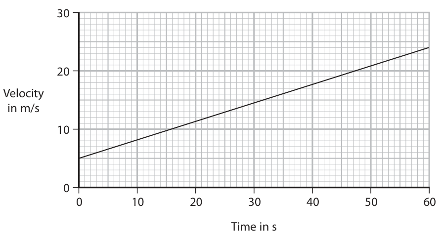
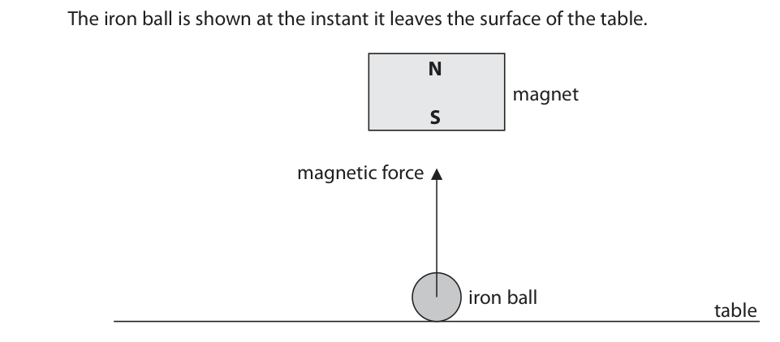
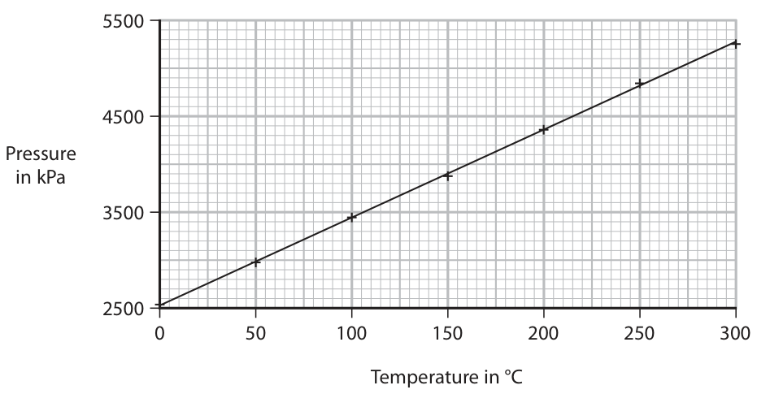
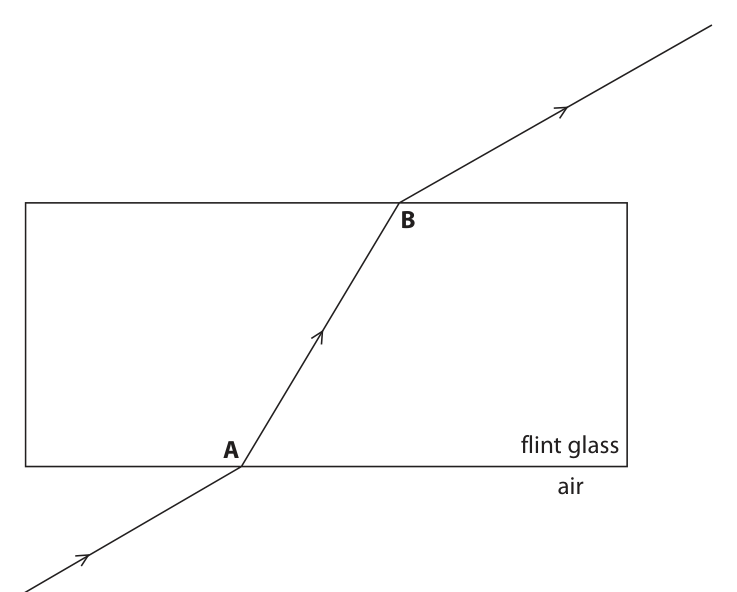
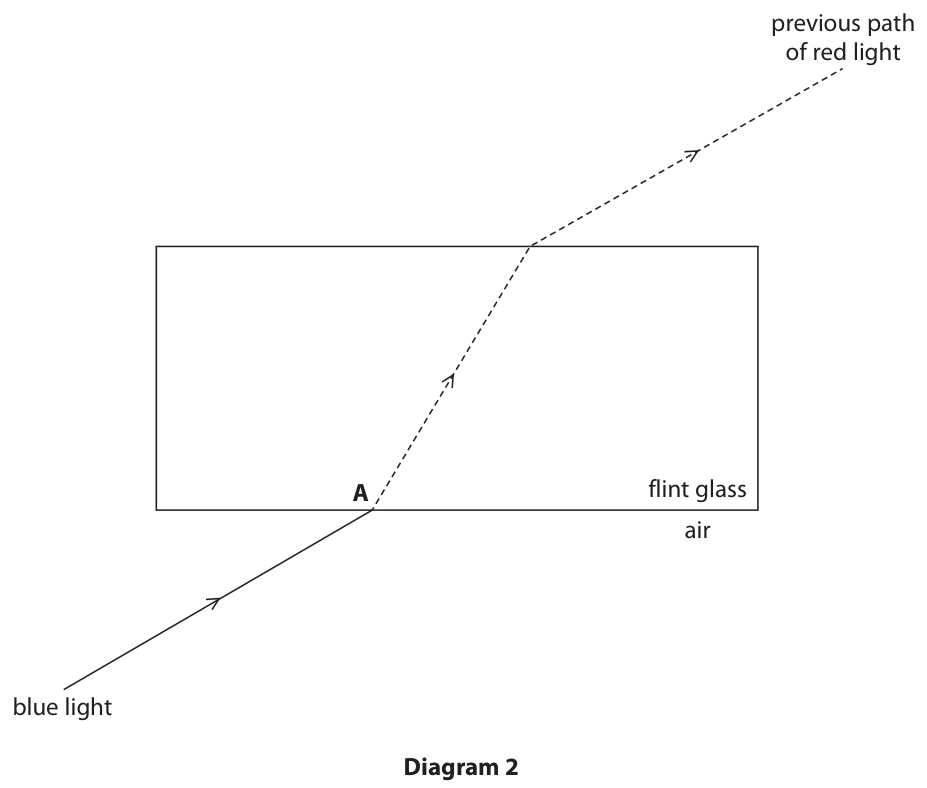

# 4PH1/1P — 2021-01 (official extraction)

> schema `syllabai.official-paper-questions/0.2` · paper_id `pearson-edexcel:international-gcse:physics:4ph1:2021-01:4PH1/1P` · qp sha256 `7cae0df7d5f4dfb5…` · extraction is the disclosed baseline (ADR-039)

## Question 1 (6 marks)

The passage describes the evolution of a star with a mass that is much larger than the mass of the Sun. Use words or phrases from the box to complete the passage. Each word or phrase may be used once, more than once, or not at all. (6) chemical contract expand gravitational kinetic main sequence neutron star nuclear protostar supernova vibrate white dwarf Hydrogen atoms in a nebula move towards each other due to the force of gravity. As the atoms move towards each other, their .......................................................................................... energy store increases, which increases the temperature. If the temperature becomes high enough, nuclear fusion of hydrogen will start and the star enters the ..................... . . . . . . . . . . . . . . . . . . . . . . . . . . . . . . . . . . . . . . . . . . . . . . . . . . . . . . . . . . . . . . . . . . . . . stage of its evolution. When hydrogen fusion stops in the core of the star, the core of the star will start to ..................... . . . . . . . . . . . . . . . . . . . . . . . . . . . . . . . . . . . . . . . . . . . . . . . . . . . . . . . . . . . . . . . . . . . . . . This increases the temperature in a layer surrounding the core. Hydrogen fusion restarts in a layer surrounding the core. This causes the star to . . . . . . . . . . . . . . . . . . . . . . . . . . . . . ............................................................. and its surface temperature decreases. The star is now a red super giant. Eventually nuclear fusion stops in the core of the star and the star explodes as a .......................................................................................... . The core of the star collapses to form either a .......................................................................................... or a black hole.

### 1 [6]

The passage describes the evolution of a star with a mass that is much larger than the mass of the Sun. Use words or phrases from the box to complete the passage. Each word or phrase may be used once, more than once, or not at all. chemical contract expand gravitational kinetic main sequence neutron star nuclear protostar supernova vibrate white dwarf Hydrogen atoms in a nebula move towards each other due to the force of gravity. As the atoms move towards each other, their energy store increases, which increases the temperature. If the temperature becomes high enough, nuclear fusion of hydrogen will start and the star enters the stage of its evolution. When hydrogen fusion stops in the core of the star, the core of the star will start to This increases the temperature in a layer surrounding the core. Hydrogen fusion restarts in a layer surrounding the core. This causes the star to and its surface temperature decreases. The star is now a red super giant. Eventually nuclear fusion stops in the core of the star and the star explodes as a The core of the star collapses to form either a or a black hole.

## Question 2 (11 marks)
**(a)** A speed camera is positioned at the side of a road. © Darryl Sleath/Shutterstock The camera measures the speed of a vehicle on the road to determine whether the vehicle is travelling too fast. The camera takes two photographs of the vehicle 0.25 s apart. The photographs are used to measure the distance travelled by the vehicle during this time.

**(b)** The velocity-time graph shows how the velocity of a lorry changes with time. Velocity in m/s 0 10 20 30 40 50 60 Time in s

### 2(a)(i) [1]

State the formula linking average speed, distance moved and time taken.

### 2(a)(ii) [2]

In the time between the two photographs, the car travels a distance of 6.5 m. Calculate the average speed of the car. average speed = m/s

### 2(a)(iii) [2]

The speed limit of the road is 80 kilometres per hour. Determine whether the car is exceeding the speed limit.

### 2(b)(i) [2]

Explain how the graph shows that the lorry has a constant acceleration.

**Mark scheme answer**

> acceleration is the gradient (of the graph);
> graph has a constant gradient; allow line on graph is
> straight

- **(2)** acceleration is the gradient (of the graph);

### 2(b)(ii) [1]

State the formula linking acceleration, change in velocity and time taken.

**Mark scheme answer**

> acceleration = change in velocity / time; allow standard symbols and
> rearrangements e.g.
> a = (v-u) / t, a = ∆v / t

- **(1)** acceleration = change in velocity / time; allow standard symbols and

### 2(b)(iii) [3]

Calculate the acceleration of the lorry. acceleration = m/s2

**Mark scheme answer**

> correct reading of either two velocity values or time allow attempt at gradient
> interval taken from graph; calculation
> correct substitution into formula;
> evaluation;
> e.g.
> u = 5 (m/s), v = 24 (m/s) OR t = 60 (s) allow (v – u =) 19 seen
> (a =) 24-5 / 60
> (a =) 0.32 (m/s2) allow range of 0.30-0.32
> Answer Notes Marks

- **(3)** correct reading of either two velocity values or time allow attempt at gradient

## Question 3 (13 marks)

The photograph shows a mains-operated, decorative lamp, X. bulb Lamp X has seven identical bulbs that are connected in series.

**(c)** Each bulb has a working resistance of 390 Ω. The voltage across each bulb is 33 V.

### 3(a) [1]

Give a disadvantage of connecting the bulbs in series.

**Mark scheme answer**

> idea that if one bulb fails all bulbs turn off; allow idea that bulbs cannot be
> controlled individually
> (b) any one from:
> • less likely to overheat;
> • idea that the circuit is simpler; accept uses fewer wires
> • lower voltage bulbs;
> • all bulbs controlled with one switch;

- **(1)** idea that if one bulb fails all bulbs turn off; allow idea that bulbs cannot be

### 3(b) [1]

Suggest an advantage of connecting the bulbs in series.

### 3(c)(i) [1]

State the formula linking voltage, current and resistance.

**Mark scheme answer**

> voltage = current × resistance; allow standard symbols and
> rearrangements e.g. I = V / R

- **(1)** voltage = current × resistance; allow standard symbols and

### 3(c)(ii) [3]

Calculate the current in each bulb. current = A

**Mark scheme answer**

> substitution;
> rearrangement;
> evaluation;
> e.g.
> 33 = I × 390
> (I =) 33 / 390
> (I =) 0.085 (A) allow 0.08, 0.0846…
> condone 0.084

- **(3)** substitution;

### 3(c)(iii) [4]

Calculate the energy transferred to lamp X when it is used for 2.5 hours. energy transferred = J

**Mark scheme answer**

> dimensionally correct substitution into allow ECF from (ii)
> E = V × I × t;
> conversion of hours to seconds; allow 60 × 60 or 9000 seen anywhere
> in working
> use of 7 bulbs;
> evaluation;
> 23 760-25 245 = 3 marks (x7 not
> used)
> e.g. 6.60-7.01 = 2 marks
> E = 33 × 0.085 × 2.5
> 2.5 hours = 9000 seconds
> voltage used = 231 OR ×7 used in working
> (E =) 180 000 (J) allow answer between 165000 to
> 180000
> (d) brightness is greater in lamp Y; allow RA
> with any two from:
> more energy transferred to each bulb in lamp
> Y;
> bulbs in lamp Y have a larger voltage / 46 V;
> resistance of (circuit in) lamp Y is less;
> current in bulb / circuit in lamp Y is greater;
> Answer Notes Marks

- **(4)** dimensionally correct substitution into allow ECF from (ii)

### 3(d) [3]

Another decorative lamp, Y, uses five of the same 390 Ω bulbs connected in series. Both lamps are mains operated. Explain how the brightness of a single bulb in lamp Y compares to the brightness of a single bulb in lamp X.

## Question 4 (13 marks)

The photograph shows a hair dryer plugged into the mains supply. The hair dryer contains a fuse. © Cristina Bernardo/Shutterstock

**(c)** The hair dryer has a current of 9.6 A. The mains supply voltage is 230 V.

### 4(a) [1]

State which wire in the hair dryer should be in series with the fuse.

**Mark scheme answer**

> live / L; allow red / brown wire
> (b) any two from:
> MP1. earth wire;
> MP2. circuit breaker; allow RCD, trip switch, surge
> protector
> MP3. double insulation;
> MP4. insulated cables; allow any mention of
> insulated wires

- **(1)** live / L; allow red / brown wire

### 4(b) [2]

The fuse is an electrical safety feature used in mains-operated domestic appliances. State two other electrical safety features that can be used in mains-operated domestic appliances. 1 2

### 4(c)(i) [1]

State the formula linking power, current and voltage.

**Mark scheme answer**

> power = current × voltage; allow standard symbols
> e.g. P = I × V
> ignore C, c for current

- **(1)** power = current × voltage; allow standard symbols

### 4(c)(ii) [3]

Calculate the power of the hair dryer. Give the unit. power = unit

**Mark scheme answer**

> substitution;
> evaluation;
> unit; mark independently
> 2.2 kW = full marks
> e.g.
> (P =) 9.6 × 230
> (P =) 2200 allow 2208, 2210
> watts / W allow J/s

- **(3)** substitution;

### 4(c)(iii) [3]

The hair dryer contains a coil of wire which is used to heat air passing through the hair dryer. Explain why the coil of wire heats up when there is a current in it.

**Mark scheme answer**

> allow wire for coil
> throughout
> coil has resistance;
> electrons transfer/lose energy (as they flow
> through coil);
> (due to) electron collisions with (lattice) ions in the allow atoms, particles for
> coil; ions
> (d) idea of excessive current; e.g. “current becomes too
> high”
> melts the fuse (wire); allow breaking the fuse
> condone “blows the fuse”
> breaking the circuit; allow “stops the current” / eq
> Answer Notes Marks

- **(3)** allow wire for coil

### 4(d) [3]

Explain how a fuse protects a domestic appliance.

## Question 5 (7 marks)

A teacher uses a radioactive source containing atoms of the isotope radium-226.

**(c)** The teacher investigates the type of radiation emitted from the radioactive source.

**(d)** The number of radium-226 atoms in the source decreases over time, with a half-life of 1600 years.

### 5(a) [1]

Give a safety precaution that would reduce the teacher’s exposure to radiation when working with the radioactive source.

**Mark scheme answer**

> any one from:
> • handling source with tongs/gloves;
> • storing source in lead box (when not in
> use);
> • minimising time handling source;
> • maximising distance from source;
> • taking care with direction of emission from
> source;
> • use of lead apron/shielding; ignore if mention of other
> room etc.
> (b) B (138);
> A is incorrect because this is the number of protons
> C is incorrect because this is the number of nucleons
> D is incorrect because this is the number of nucleons + protons

- **(1)** any one from:

### 5(b) [1]

Radium-226 can be represented using the symbol 226 88 Ra How many neutrons are in the nucleus of an atom of radium-226?

- **(A)** 88
- **(B)** 138
- **(C)** 226
- **(D)** 314

### 5(c)(i) [1]

Give the name of a piece of apparatus that detects ionising radiation.

**Mark scheme answer**

> photographic film / Geiger-Muller tube; allow GM tube, GM detector
> condone Geiger counter
> allow spark counter

- **(1)** photographic film / Geiger-Muller tube; allow GM tube, GM detector

### 5(c)(ii) [1]

The teacher finds that the radiation emitted from the radioactive source is not detected when the detector is more than 5 cm away from the source. State the type of radiation emitted by the radioactive source.

**Mark scheme answer**

> alpha / α;

- **(1)** alpha / α;

### 5(d)(i) [2]

State what is meant by the term half-life.

**Mark scheme answer**

> time taken; allow “how long it takes”
> reject “half the time”
> and either of
> • for (radio)activity to halve; allow count rate for activity
> • for half of the (radioactive) nuclei / atoms /
> isotope to decay;

- **(2)** time taken; allow “how long it takes”

### 5(d)(ii) [1]

The radioactive source contains 2.66 × 1021 atoms of radium-226. Approximately how many atoms of radium-226 will remain in the source after 800 years?

- **(A)** 0.67 × 10²¹
- **(B)** 1.33 × 10²¹
- **(C)** 1.88 × 10²¹  ✔
- **(D)** 2.66 × 10²¹

**Mark scheme answer**

> C (1.88 × 1021);
> A is incorrect because this is the number of atoms after 3200 years
> B is incorrect because this is the number of atoms after 1600 years
> D is incorrect because this is the initial number of atoms
> Answer Notes Marks
> 6 max. 2 marks for details of varying any mark can be given from
> temperature labelled diagram
> MP1. suitable method of heating ball; e.g. water bath, oven,
> freezer, heating water in
> beaker
> MP2. thermometer used to measure allow temperature sensor
> temperature; and data logger
> max. 2 marks for control variables ignore “same ball”
> MP3. height ball is dropped from;
> MP4. bouncing surface;
> MP5. ball dropped from rest each time; allow idea of no force being
> used to drop ball
> max. 2 mark for high-quality data
> MP6. suitable method to increase/give good e.g. viewing at eye level,
> accuracy of bounce height measurement; recording with camera and
> viewing at slow motion
> MP7. at least five different temperatures tested; can be inferred from
> method
> MP8. repeats and average;
> Answer Notes Marks

- **(1)** Answer C: 1.88 × 1021

## Question 6 (6 marks)

When a rubber ball is dropped it hits the floor and bounces. Design an investigation to determine how the temperature of the rubber ball affects the maximum height the ball reaches after it bounces. In your answer, refer to • how to change the temperature of the ball • the variables that need to be controlled • how to obtain high-quality data You may draw a labelled diagram to support your answer. (6)

### 6 [6]

When a rubber ball is dropped it hits the floor and bounces. Design an investigation to determine how the temperature of the rubber ball affects the maximum height the ball reaches after it bounces. In your answer, refer to • how to change the temperature of the ball • the variables that need to be controlled • how to obtain high-quality data You may draw a labelled diagram to support your answer.

## Question 7 (13 marks)

Very strong magnets can be made using the element neodymium.

**(b)** Diagram 2 shows another neodymium magnet being used to lift an iron ball from a table. The iron ball is shown at the instant it leaves the surface of the table. N magnet S magnetic force iron ball table Diagram 2

### 7(a) [3]

Diagram 1 shows parts of two neodymium magnets, X and Y, when they are held close together. S magnet X magnet Y Diagram 1 A uniform magnetic field is produced in the space between the magnets. Diagram 1 shows the south pole of magnet X. Complete diagram 1 by drawing the uniform magnetic field and labelling the pole on magnet Y.

**Mark scheme answer**

> north pole labelled on magnet Y;
> lines drawn straight and vertical between ignore curved lines at the
> magnets; edges of the magnets
> lines are equally spaced with arrows pointing
> upwards;

- **(3)** north pole labelled on magnet Y;

### 7(b)(i) [2]

Explain why the iron ball experiences an upward magnetic force.

**Mark scheme answer**

> any two from:
> MP1. iron is (a) magnetic (material);
> MP2. iron ball becomes a magnet / becomes
> magnetised (N pole at top);
> MP3. iron ball is attracted to the magnet;

- **(2)** any two from:

### 7(b)(ii) [1]

The iron ball experiences an upward resultant force at the instant shown in diagram 2. Draw a labelled arrow on diagram 2 to show the weight of the iron ball.

**Mark scheme answer**

> downward arrow drawn shorter than magnetic ignore starting point of
> force arrow; arrow, judge length and
> direction only

- **(1)** downward arrow drawn shorter than magnetic ignore starting point of

### 7(b)(iii) [1]

State the formula linking weight, mass and gravitational field strength.

**Mark scheme answer**

> weight = mass × gravitational field strength; allow standard symbols and
> rearrangements
> e.g. m = W / g

- **(1)** weight = mass × gravitational field strength; allow standard symbols and

### 7(b)(iv) [4]

At the instant shown in diagram 2, the resultant force acting on the iron ball is 124 mN and the magnetic force is 165 mN. Calculate the mass of the iron ball. mass of iron ball = kg

**Mark scheme answer**

> calculation of weight;
> dimensionally correct substitution into weight ECF if incorrect weight or
> formula; 165, 124, 289 used as the
> weight
> allow g=9.8, 9.81
> rearrangement;
> evaluation; -1 for POT error provided
> 10 (N/kg) is used somewhere
> e.g.
> weight = (165 – 124 =) 41 (mN)
> 0.041 = mass × 10
> (mass =) 0.041 / 10
> (mass =) 0.0041 (kg)
> 0.0165, 0.0124, 4.1
> gets 3 marks max
> 16.5, 12.4 gets 2 marks max

- **(4)** calculation of weight;

### 7(b)(v) [2]

Explain why the resultant force acting on the iron ball increases as the iron ball moves towards the magnet.

**Mark scheme answer**

> any two from:
> MP1. weight (of the iron ball) stays the same;
> MP2. magnetic force increases; allow greater attraction from
> magnet
> MP3. magnetic field strength increases;
> Answer Notes Marks

- **(2)** any two from:

## Question 8 (13 marks)

A student uses a computer simulation to investigate the motion of particles in a gas. He records the pressure of the gas and the mean speed of the particles in the gas at different temperatures. The graphs show his results. 5500 4500 Pressure in kPa 3500 2500 0 50 100 150 200 250 300 Temperature in °C Graph 1 700 600 Mean speed of particles in m/s 500 400 0 50 100 150 200 250 300 Temperature in °C Graph 2

**(d)** The student then calculates the kinetic energy of a single gas particle at each temperature.

### 8(a) [1]

Give a reason why the student does not start the y-axis scale from zero on either of his graphs.

**Mark scheme answer**

> any one from:
> • idea that there is no data at the value of 0;
> • idea that {pressure of gas / speed of
> particles} cannot be zero;
> • idea that all data would be bunched
> together at the top of the axis / eq;
> (b) for either graph:
> MP1. as temperature increases, pressure/speed ignore positive correlation
> increases;
> for graph 1:
> MP2. relationship is linear; accept proportional only if
> there is a clear link to the
> temperature being
> measured in kelvin
> for graph 2:
> MP3. relationship is non-linear;
> MP4. idea of decreasing gradient of curve;
> (c) any two from:
> MP1. this temperature is absolute zero;
> MP2. pressure/speed/kinetic energy of gas allow idea that negative
> particles would be 0 at this temperature; pressure/speed/KE is
> impossible
> MP3. idea that it is impossible to have a
> temperature lower than this;

- **(1)** any one from:

### 8(b) [3]

Describe the relationships shown by the graphs.

### 8(c) [2]

Explain why the value of temperature chosen in the simulation should not decrease below – 273 °C.

### 8(d)(i) [1]

Using the curve of best fit on graph 2, determine the mean speed of a gas particle when the gas temperature is 100 °C. mean speed = m/s

**Mark scheme answer**

> answer in range 520-525 (m/s); ignore 515

- **(1)** answer in range 520-525 (m/s); ignore 515

### 8(d)(ii) [3]

The mass of a single gas particle is 5.3 × 10–26 kg. Calculate the average kinetic energy of a gas particle when the temperature of the gas is 100 °C. kinetic energy = J

**Mark scheme answer**

> recall of KE formula; can be implied from working
> substitution; ECF from (i)
> evaluation; -1 for POT error
> e.g.
> KE = ½ × mass × speed2
> (KE =) 0.5 × 5.3 × 10-26 × 5202
> (KE =) 7.2 × 10-21 (J) allow 7.16 × 10-21 - 7.31 × 10-21

- **(3)** recall of KE formula; can be implied from working

### 8(d)(iii) [1]

Calculate the temperature of the gas in kelvin when its temperature is 100 °C. temperature = K

**Mark scheme answer**

> 373 (K);

- **(1)** 373 (K);

### 8(d)(iv) [2]

On the axes, sketch a graph of the average kinetic energy of the gas particles against temperature in kelvin. Average kinetic energy Temperature in K

**Mark scheme answer**

> straight line with positive gradient; judge straightness by eye
> line passes through origin;
> Answer Notes Marks

- **(2)** straight line with positive gradient; judge straightness by eye

## Question 9 (12 marks)

A student does an investigation to determine the refractive index of a block made from flint glass.

**(a)** She directs a ray of red light at the block, as shown in diagram 1. B A flint glass air red light Diagram 1

### 9(a)(i) [1]

Some of the light is reflected from the surface of the block at point A. On diagram 1, draw this reflected ray of light.

### 9(a)(ii) [2]

Use a protractor to determine the angle of incidence and the angle of refraction of the red light at point A on diagram 1. angle of incidence = degrees angle of refraction = degrees

### 9(a)(iii) [1]

State the formula linking refractive index, angle of incidence and angle of refraction.

### 9(a)(iv) [2]

Calculate the refractive index of the glass for red light. refractive index =

### 9(a)(v) [3]

Describe how the student could improve her investigation to obtain a more reliable value of the refractive index.

### 9(b) [3]

The student replaces the red light with a blue light. Diagram 2 shows a ray of blue light directed at point A, at the same angle of incidence as the previous ray of red light. The dashed lines on diagram 2 show the previous path of the ray of red light. previous path of red light A flint glass air blue light Diagram 2 The refractive index of flint glass for blue light is higher than the refractive index of flint glass for red light. Complete diagram 2 by drawing the path of blue light from point A until it passes into air.

## Question 10 (6 marks)

The photograph shows a large hurdle on an athletics track. bar © Sony Ho/Shutterstock

### 10(a) [2]

The bar of the hurdle is made of wood and is painted black and white. The temperature of the hurdle increases when the Sun shines on it. Explain which part of the bar reaches the highest temperature.

**Mark scheme answer**

> black because it is a better/good absorber; ignore references to
> emission
> of radiation (from the Sun); allow IR, infrared for
> radiation
> (b) any four from:
> MP1. temperature of air increases; allow air particles gain KE
> MP2. air expands / air particles move further reject particles expand
> apart;
> MP3. density of air decreases; reject particles become less
> dense
> MP4. warm/heated air rises; ignore heat rises
> allow cool air sinks
> MP5. cool air replaces warmed air;
> MP6. process repeats;
> Answer Notes Marks

- **(2)** black because it is a better/good absorber; ignore references to

### 10(b) [4]

The air near the bar receives energy by heating. Explain how a convection current is formed in the air near the bar.

## Question 11 (10 marks)

A student uses a bottle and a stopper to find the density of an unknown liquid. The stopper fits tightly into the bottle and has a small diameter hole through it. stopper bottle

### 11(a) [4]

This is the student’s method. • use a balance to find the mass of the bottle and stopper • completely fill the bottle with water • insert the stopper and dry the outside of the bottle • use the balance to find the mass of the full bottle and stopper These are the student’s results. mass of empty bottle and stopper = 63.4 g mass of full bottle and stopper = 112.9 g Use the student’s results to determine the volume of the water in the bottle. Give your answer to three significant figures. [density of water = 0.998 g/cm3] volume = cm3

**Mark scheme answer**

> determination of mass of water;
> substitution into / rearrangement of density allow ECF from incorrect
> formula; mass
> evaluation;
> rounding to 3 s.f.; mark independently
> e.g.
> mass = 49.5 (g)
> 0.998 = 49.5/volume OR volume = mass/density
> volume = 49.599
> 49.6 (cm3)
> (b) determination of mass of liquid;
> use of volume from (a); allow ECF from (a)
> evaluation; allow ECF from incorrect
> mass
> e.g.
> 143.8 - 63.4 = 80.4 (g)
> density = 80.4 / 49.6
> density = 1.62 (g/cm3)
> (c) any three from: allow RA throughout
> MP1. with measuring cylinder can read volume to
> nearest cm3;
> MP2. measuring cylinder is easier/quicker to use;
> MP3. measuring cylinder does not need to be
> dried;
> MP4. idea that measuring cylinder value could be
> incorrect due to parallax errors/meniscus
> etc;
> MP5. ‘bottle’ gives volume to nearest 1dp;
> MP6. ‘bottle’ allows density to be more precisely
> determined;
> Pearson Education Limited. Registered company number 872828
> with its registered office at 80 Strand, London, WC2R 0RL, United Kingdom

- **(4)** determination of mass of water;

### 11(b) [3]

The student empties the bottle and then dries it. He refills the bottle with the unknown liquid. He measures the mass of the full bottle and stopper as 143.8 g. Calculate the density of the unknown liquid. density of unknown liquid = g/cm3

### 11(c) [3]

Another student uses a measuring cylinder to find the volume of the unknown liquid. Discuss the advantages and disadvantages of using each method to find the volume of the unknown liquid.

