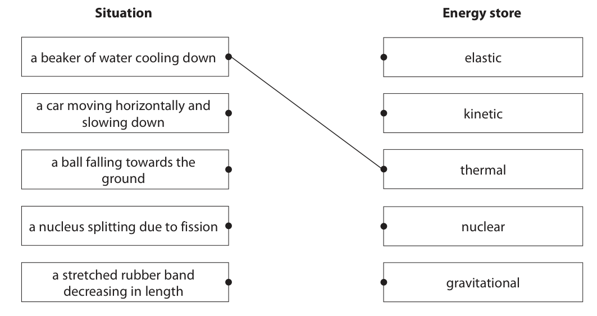
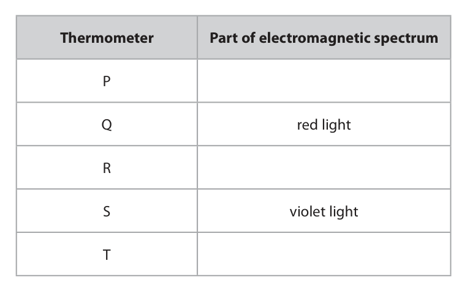
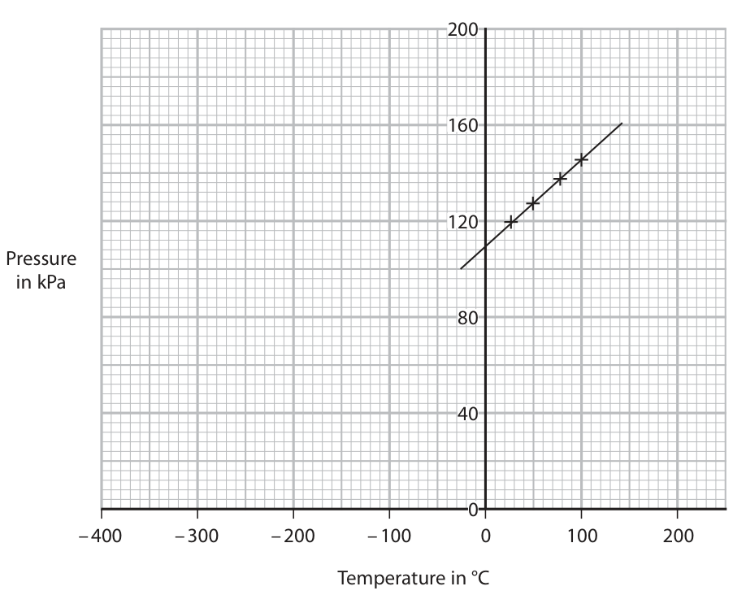
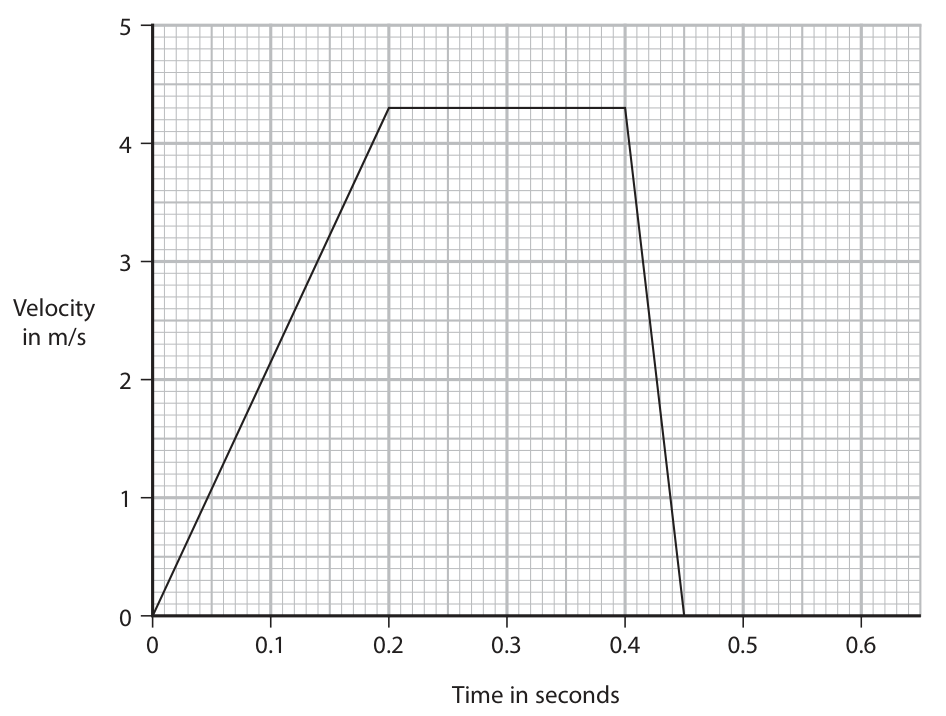
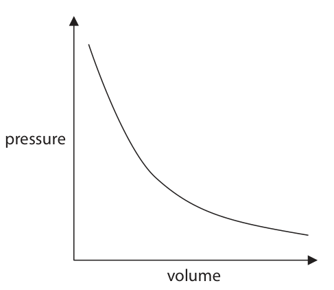
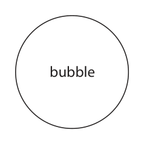
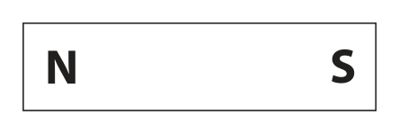
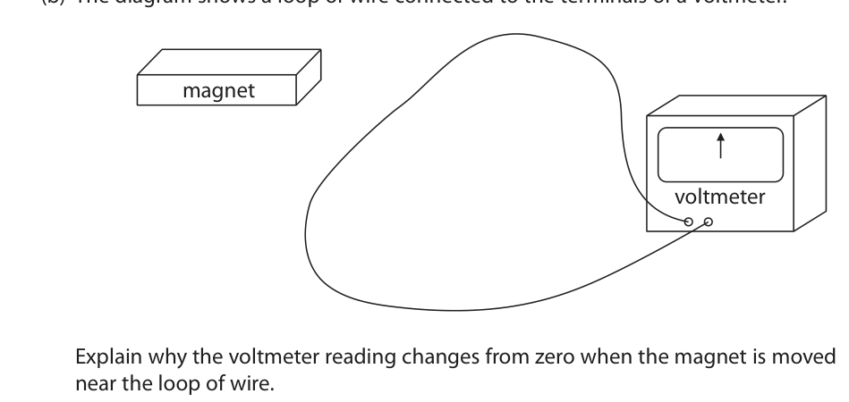
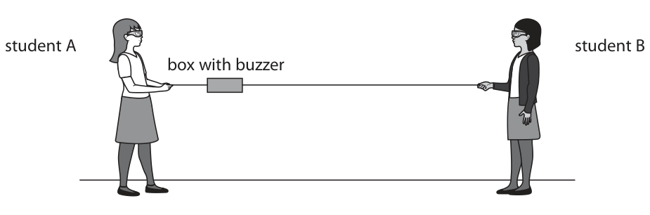
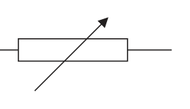

# 4PH1/1PR — 2021-01 (official extraction)

> schema `syllabai.official-paper-questions/0.2` · paper_id `pearson-edexcel:international-gcse:physics:4ph1:2021-01:4PH1/1PR` · qp sha256 `29edd018de47b021…` · extraction is the disclosed baseline (ADR-039)

## Question 1 (6 marks)
**(b)** Energy is transferred when a filament lamp is connected to a battery.

### 1(a) [4]

The boxes give some situations and some energy stores. Draw one straight line from each situation to the energy store that decreases for that situation. The first one has been done for you. Situation Energy store a beaker of water cooling down elastic a car moving horizontally and kinetic slowing down a ball falling towards the thermal ground a nucleus splitting due to fission nuclear a stretched rubber band gravitational decreasing in length

**Mark scheme answer**

> -1 for each additional line

- **(4)** -1 for each additional line

### 1(b)(i) [1]

Which method of energy transfer takes place between the battery and the lamp?

- **(A)** electrical  ✔
- **(B)** heating
- **(C)** mechanical
- **(D)** radiation

**Mark scheme answer**

> A - electrical;

- **(1)** Answer A: electrical

### 1(b)(ii) [1]

Which method of energy transfer takes place between the lamp and the surroundings?

- **(A)** electrical
- **(B)** light radiation  ✔
- **(C)** mechanical
- **(D)** sound radiation

**Mark scheme answer**

> B - light radiation;
> (Total for Question 1 = 6 marks)
> Answer Notes Marks

- **(1)** Answer B: light radiation

## Question 2 (6 marks)

The diagram shows the apparatus used to demonstrate the existence of electromagnetic radiation just beyond the visible spectrum. Electromagnetic radiation from the Sun passes through a slit and a prism. The electromagnetic radiation refracts through the prism onto the screen. Five thermometers are placed in front of the screen. slit not to scale electromagnetic radiation from Sun screen P Q prism R S thermometers T

### 2(a) [3]

Complete the table to show the missing parts of the electromagnetic spectrum. Thermometer Part of electromagnetic spectrum P Q red light R S violet light T

**Mark scheme answer**

> 3
> thermometer part of spectrum
> P infrared;
> Q red
> R green / yellow; allow all valid colours/
> visible
> S violet
> T ultraviolet;

- **(3)** 3

### 2(b) [2]

Suggest why the lower part of each thermometer should be painted black.

**Mark scheme answer**

> any reference to absorption; allow reference to
> reflection
> black is the better/best/good absorber; allow reference to
> ‘poor reflector’

- **(2)** any reference to absorption; allow reference to

### 2(c) [1]

The equipment is left for a short period of time. The thermometers now show higher temperatures than before. State the part of the electromagnetic spectrum in this demonstration that would give the largest temperature increase.

**Mark scheme answer**

> infrared/IR;
> (Total for Question 2 = 6 marks)
> Answer Notes Marks

- **(1)** infrared/IR;

## Question 3 (5 marks)

The diagram shows two objects orbiting a star. not to scale Y X star

### 3(a) [1]

Object X has a circular orbit around the star. State the type of object that has a circular orbit around a star.

**Mark scheme answer**

> planet;

- **(1)** planet;

### 3(b) [1]

Object Y has an elliptical orbit around the star. State the type of object that has an elliptical orbit around a star.

**Mark scheme answer**

> comet; accept planet

- **(1)** comet; accept planet

### 3(c) [3]

Object X completes an orbit of the star in 35 days. The radius of its orbit is 1.5 × 10¹¹ m. Calculate the orbital speed of object X. orbital speed = m/s

**Mark scheme answer**

> substitution into given formula;
> conversion of 35 days into seconds;
> evaluation; allow full credit for
> 2.6927937 × 10¹⁰ if unit
> changed to m/day.
> e.g.
> v = 2 × π × 1.5 × 10¹¹/(35 × 24 × 60 × 60)
> v = 310 000 m/s
> 311665.93(7)8
> Answer for incorrect/no
> conversion of days→
> seconds 2.69etc x 10¹⁰
> scores 2
> -1 for POT error

- **(3)** substitution into given formula;

## Question 4 (13 marks)

The diagram shows apparatus used to investigate how the pressure of a gas varies with temperature. to data logger thermometer pressure sensor flask gas water heat

**(b)** The pressure of the gas changes as its temperature increases. The graph shows the results. 200 160 120 Pressure in kPa – 400 – 300 – 200 – 100 0 100 200 Temperature in °C

**(c)** The pressure of the gas is 112 kPa when its temperature is 35 °C. The gas is heated to 340 °C using some different apparatus.

### 4(a) [1]

The volume of the gas is kept constant by the flask. The volume of the gas is a control variable. State why it is important to keep a control variable constant throughout the investigation.

**Mark scheme answer**

> idea that not doing so means impossible to tell what allow idea of a ‘fair
> change caused the change in the dependent; test’
> ignore references to
> accuracy, reliability

- **(1)** idea that not doing so means impossible to tell what allow idea of a ‘fair

### 4(b)(i) [2]

Explain how these results show that there is a linear, but not proportional, relationship between the pressure of the gas and its temperature in °C.

**Mark scheme answer**

> straight line; condone linear
> (line) does not go through origin;

- **(2)** straight line; condone linear

### 4(b)(ii) [2]

Use the graph to determine the value for absolute zero. temperature = °C

**Mark scheme answer**

> given line extrapolated to x-axis; accept in range –320 to
> -280 degrees C
> -300 °C;

- **(2)** given line extrapolated to x-axis; accept in range –320 to

### 4(b)(iii) [3]

Explain how the pressure of the gas changes as its temperature increases. Include ideas about particles in your answer.

**Mark scheme answer**

> any THREE from:
> MP1 (increase in temperature) increases
> speed/KE;
> MP2 collisions between walls and particles more
> frequent/eq;
> MP3 idea collisions between walls and particles
> are harder;
> MP4 idea that force (between wall and particle) is
> increased;
> MP5 P=F/A so increased force means increased
> pressure for same area.

- **(3)** any THREE from:

### 4(c)(i) [4]

Calculate the pressure of the gas when its temperature is 340 °C. Assume the gas has a constant volume. pressure = kPa

**Mark scheme answer**

> conversion of both temperatures to kelvin scale;
> substitution;
> rearrangement;
> evaluation; -1 for POT error
> e.g.
> 35°C and 340°C→ 308 and 613 K
> 112 (kPa)/308 = P / 613
> $P = 613 \times 112 / 308$
> P = 220 (kPa) accept 222.909…
> accept 1088 (kPa) for 2
> marks (no conversion of
> temperature)

- **(4)** conversion of both temperatures to kelvin scale;

### 4(c)(ii) [1]

The volume of the gas is constant in the investigation. Give the name of the other quantity that must be constant for the calculation to be correct.

**Mark scheme answer**

> number of {particles/moles/mass/molecules} of gas accept type of gas
> (Total for Question 4 = 13 marks)
> Answer Notes Marks

- **(1)** number of {particles/moles/mass/molecules} of gas accept type of gas

## Question 5 (13 marks)

A student does an investigation to show how the velocity of a toy car changes when the car rolls down a ramp onto a table and hits a wooden block. The graph shows how the velocity of the toy car changes with time. Velocity in m/s 0 0.1 0.2 0.3 0.4 0.5 0.6 Time in seconds

### 5(a) [4]

Calculate the distance travelled by the car during the first 0.4 seconds. distance = m

**Mark scheme answer**

> any attempt at finding the area/ “area = distance”
> stated;
> area of triangle = ½ x 4.3 x 0.2 (= 0.43 m); accept area of
> trapezium = ½ x 4.3 x
> (0.2 + 0.4) for MP2 and
> MP3.
> area of rectangle = 4.3 x 0.2 (= 0.86 m); count squares;
> area of 1 square = 0.001
> (m);
> distance = 1.29 (m) ; distance = 1.29 (m)

- **(4)** any attempt at finding the area/ “area = distance”

### 5(b)(i) [3]

Calculate the acceleration of the car between 0.40 s and 0.45 s. acceleration = m/s²

**Mark scheme answer**

> idea that acceleration = gradient;
> gradient = (-)4.3 / 0.05;
> acceleration = (-) 86 (m/s²); -1 for POT error

- **(3)** idea that acceleration = gradient;

### 5(b)(ii) [1]

State the formula linking resultant force, mass and acceleration.

**Mark scheme answer**

> (resultant) force = mass x acceleration / F = ma

- **(1)** (resultant) force = mass x acceleration / F = ma

### 5(b)(iii) [2]

The car has a mass of 0.13 kg. Calculate the resultant force on the car as it slows down. resultant force = N

**Mark scheme answer**

> substitution;
> evaluation; allow ECF from (i)
> eg
> F = 0.13 x 86 ignore sign
> F = 11 (N) 11.18, 11.2

- **(2)** substitution;

### 5(c) [3]

A piece of soft material is fixed to the front of the toy car. Explain how this will affect the gradient of the velocity-time graph after the car hits the block.

**Mark scheme answer**

> increases time of collision;
> any reference to shallower gradient on graph;
> so acceleration will be smaller (in magnitude);
> (Total for Question 5 = 13 marks)
> Answer Notes Marks

- **(3)** increases time of collision;

## Question 6 (5 marks)

The diagram shows a ray of light travelling from air into glass. 29 ° air glass

### 6(a) [1]

Use a protractor to determine the angle of refraction. angle of refraction = degrees

**Mark scheme answer**

> 17 (degrees); Allow in range 15-19
> degrees

- **(1)** 17 (degrees); Allow in range 15-19

### 6(b) [1]

State the formula linking refractive index, angle of incidence and angle of refraction.

**Mark scheme answer**

> refractive index = sin(i) / sin (r); accept n or η for
> refractive index
> accept any valid
> rearrangement

- **(1)** refractive index = sin(i) / sin (r); accept n or η for

### 6(c) [3]

Calculate the refractive index of this glass. refractive index =

**Mark scheme answer**

> substitution; allow ecf from (a)
> evaluation of either sine correctly;
> evaluation;
> e.g.
> refractive index = sin(29)/sin(17)
> refractive index = 0.484…/0.292… 0.48480962/0.292371705
> refractive index = 1.7 1.6581961
> (Total for Question 6 = 5 marks)
> Answer Notes Marks

- **(3)** substitution; allow ecf from (a)

## Question 7 (12 marks)

A glass contains fizzy water. Bubbles of carbon dioxide form at the bottom of the glass and rise to the surface.

**(a)** The graph shows the relationship between the volume of a bubble and the pressure of the gas in the bubble. pressure volume

### 7(a)(i) [2]

Describe the relationship shown by the graph.

**Mark scheme answer**

> as pressure increases, volume decreases; ORA
> pattern statement relating to gradient;
> e.g. ‘at a decreasing rate’
> ‘inversely
> proportional’ scores
> 2 marks.

- **(2)** as pressure increases, volume decreases; ORA

### 7(a)(ii) [1]

State the formula linking pressure difference, height, gravitational field strength and density.

**Mark scheme answer**

> pressure = depth × gravitational field strength × density; allow recognised
> symbols
> e.g. P or p for
> pressure
> d or h for depth
> ρ for density
> reject d for density,
> reject gravity for g

- **(1)** pressure = depth × gravitational field strength × density; allow recognised

### 7(a)(iii) [2]

The depth of the fizzy water in the glass is 22 cm. The density of the fizzy water is 1080 kg/m³. Calculate the pressure difference at the bottom of the glass due to the fizzy water. pressure difference = Pa

**Mark scheme answer**

> substitution;
> evaluation;
> e.g.
> pressure = 0.22 × 10 × 1080 Accept use of
> pressure = 2 400 (Pa) g=9.8(1) (N/kg)
> 2376 (Pa)
> -1 for POT error
> provided g is used

- **(2)** substitution;

### 7(a)(iv) [1]

Calculate the pressure of the gas in the bubble when the bubble is at the bottom of the glass. [atmospheric pressure = 101 000 Pa] pressure = Pa

**Mark scheme answer**

> 103 000 (Pa) accept 103 400 (Pa)
> allow ECF

- **(1)** 103 000 (Pa) accept 103 400 (Pa)

### 7(a)(v) [3]

When a bubble is at the top of the glass, the pressure of the gas in the bubble is equal to 101 000 Pa and the bubble has a volume of 0.084 cm³. Calculate the volume of the gas in the bubble when the bubble is at the bottom of the glass. Assume the temperature of the gas remains constant. volume = cm³

**Mark scheme answer**

> substitution into given formula; allow ECF from (iv)
> rearrangement; e.g. 98624 gives
> 0.086 (cm³)
> evaluation;
> e.g
> p₁ × V₁ = p₂ × V₂ 0.082368932
> 101 000 × 0.084 = 103 000 x V₂
> V₂ = 0.082 (cm³) -1 for POT error

- **(3)** substitution into given formula; allow ECF from (iv)

### 7(b) [3]

A force called upthrust acts vertically upwards on the bubble. When the bubble is released, it accelerates vertically upwards. Draw two labelled arrows on the diagram to show the forces on the bubble as it is released. bubble

**Mark scheme answer**

> vertical arrow upwards labelled upthrust;
> vertical arrow downwards labelled weight; ignore drag
> upthrust > weight; reject this mark if
> there are more than
> two arrows
> (Total for Question 7 = 12 marks)
> Answer Notes Marks

- **(3)** vertical arrow upwards labelled upthrust;

## Question 8 (5 marks)
### 8(a) [3]

The diagram shows a bar magnet. Draw four magnetic field lines around the bar magnet. N S

**Mark scheme answer**

> at least four lines leaving/entering poles; accept part loops
> ignore field lines that
> cross
> at least one loop ‘above’ and one loop ‘below’;
> arrowheads on at least four lines which are self-
> consistent;

- **(3)** at least four lines leaving/entering poles; accept part loops

### 8(b) [2]

The diagram shows a loop of wire connected to the terminals of a voltmeter. magnet voltmeter Explain why the voltmeter reading changes from zero when the magnet is moved near the loop of wire.

**Mark scheme answer**

> idea of wire cutting field lines; allow higher order ideas
> involving flux linkage
> idea of an induced voltage;
> (Total for Question 8 = 5 marks)
> Answer Notes Marks

- **(2)** idea of wire cutting field lines; allow higher order ideas

## Question 9 (5 marks)

The diagram shows two students holding a piece of string with a box attached. The box has a buzzer inside and can move along the string. student A student B box with buzzer The buzzer in the box emits a loud sound of constant frequency. The box moves away from student A at a constant speed. Explain why the sound heard by student A has a different frequency to the sound emitted by the buzzer. (5)

### 9 [5]

The diagram shows two students holding a piece of string with a box attached. The box has a buzzer inside and can move along the string. student A student B box with buzzer The buzzer in the box emits a loud sound of constant frequency. The box moves away from student A at a constant speed. Explain why the sound heard by student A has a different frequency to the sound emitted by the buzzer.

**Mark scheme answer**

> Any FIVE from:
> MP1 reference to Doppler effect;
> MP2 wavefronts are emitted at constant
> frequency by buzzer;
> MP3 wavefronts arrive at student (A) further
> apart than when they were emitted;
> MP4 distance between wavefronts is the Allow ‘wavelength
> wavelength; increases’ if MP3 or MP4
> not awarded
> MP5 speed = frequency × wavelength;
> MP6 speed of waves is constant;
> MP7 as speed is constant and wavelength has
> increased, frequency must decrease;
> MP8 decrease in frequency is experienced as a
> decrease in pitch;
> (Total for Question 9 = 5 marks)
> Answer Notes Marks

- **(5)** Any FIVE from:

## Question 10 (13 marks)
### 10(a) [2]

Uranium-235 captures a neutron and undergoes nuclear fission in a chain reaction. The equation shows a possible nuclear fission reaction. 235 92 U + 10 n → 97 40 Zr + 135 1 52 Te + x 0 n Calculate x, the number of neutrons released by this fission reaction. x =

**Mark scheme answer**

> 236 – (97 + 135); answer of 4 scores 2
> $x = 4$;

- **(2)** 236 – (97 + 135); answer of 4 scores 2

### 10(b) [3]

Describe what is meant by a chain reaction.

**Mark scheme answer**

> (fission) releases neutrons;
> neutrons can be captured by other uranium nuclei;
> (these nuclei) then undergo fission;

- **(3)** (fission) releases neutrons;

### 10(c) [3]

Iodine-129 is an isotope found in radioactive waste from nuclear power stations. Iodine-129 has a half-life of approximately 15 million years. A sample of iodine-129 has an activity of 72 kBq. Show that the time required for the sample to have an activity less than 5 kBq is approximately 60 million years.

**Mark scheme answer**

> evidence of halving of 72 (kBq);
> evidence of four half-lives required;
> e.g. count rate after 4 half-lives is 4.5 (kBq)
> evidence that four half-lives is equivalent to 60
> million years;

- **(3)** evidence of halving of 72 (kBq);

### 10(d) [5]

Some radioactive waste from nuclear power stations has a very long half-life. Discuss precautions that must be taken when disposing of this radioactive waste.

**Mark scheme answer**

> Any FIVE from:
> MP1 Idea of strong containers;
> MP2 idea that containers can’t rust; accept idea of a
> location that prevents
> rust
> MP3 idea that rust-proof containers
> expensive/difficult to manufacture;
> MP4 reference to security of waste site; accept low earthquake
> risk
> MP5 reference to dilution in sea water;
> MP6 reference to leakage into water table;
> (Total for Question 10 = 13 marks)
> Answer Notes Marks

- **(5)** Any FIVE from:

## Question 11 (12 marks)

A student uses this apparatus to investigate the force needed to pull a block along a ramp. 0.89 m 26 N 0.11 m ramp block ground

### 11(a)(i) [1]

State the formula linking work done, force and distance moved in the direction of the force.

**Mark scheme answer**

> work done = force × distance (travelled); allow accepted symbols

- **(1)** work done = force × distance (travelled); allow accepted symbols

### 11(a)(ii) [2]

The student pulls the block 0.89 m along the ramp with a force of 26 N. Show that the work done on the block by the 26 N force is about 23 J.

**Mark scheme answer**

> substitution;
> evaluation;
> e.g
> work done = 0.89 × 26
> work done = 23.1(4 J)

- **(2)** substitution;

### 11(a)(iii) [3]

The block has a mass of 1.3 kg and moves vertically upwards 0.11 m. Calculate the increase in the gravitational potential energy (GPE) store of the block between the bottom and the top of the ramp. increase in GPE = J

**Mark scheme answer**

> evidence of recall of formula GPE = mgh;
> substitution; allow g = 9.8(1) (N/kg)
> evaluation;
> e.g.
> GPE = mgh
> GPE = 1.3 × 10 × 0.11
> GPE = 1.4(3 J)
> -1 for POT error providing
> use of g seen

- **(3)** evidence of recall of formula GPE = mgh;

### 11(a)(iv) [2]

Explain why the work done to move the block along the ramp is greater than the increase in the GPE store of the block.

**Mark scheme answer**

> any TWO from:
> any reference to friction/air resistance;
> energy transferred to the surroundings (by allow ‘heat/thermal energy
> mechanical work); transferred to air/ramp by
> friction for 2 marks
> block not necessarily at constant speed;

- **(2)** any TWO from:

### 11(b) [4]

The student suggests it is better to use a less steep ramp to raise the block through the same vertical height. Discuss an advantage and a disadvantage of using a less steep ramp.

**Mark scheme answer**

> any TWO from:
> lower force required;
> to prevent block from slipping down required allow ‘to overcome friction’
> / to move block;
> allow ‘easier to move
> block’ for 2 marks
> any TWO from:
> longer distance required (with a lower force);
> more inefficient; Allow idea of more work
> required (for same increase
> in GPE)
> greater proportion of energy transferred to
> the surroundings;
> (Total for Question 11 = 12 marks)
> Answer Notes Marks

- **(4)** any TWO from:

## Question 12 (15 marks)

The diagram shows some apparatus used to find the mass of an object. The two pieces of metal foil act as a variable resistor. When more mass is added, the elastic string stretches and the small piece of metal foil moves to the right. screw elastic string pulley metal foil metal foil ammeter mass cell resistor

**(c)** The student extends the investigation by keeping the mass constant and replacing the cell with a variable power supply. The student measures the current in the circuit for different voltages. These are the results. Voltage Current in V in mA 0.0 0.0 2.0 4.0 4.0 7.0 6.0 11.0 8.0 14.0

### 12(a)(i) [4]

Draw the circuit diagram for this electrical circuit. The variable resistor has been drawn for you.

**Mark scheme answer**

> correct symbol for resistor;
> correct symbol for cell;
> correct symbol for ammeter;
> circuit is complete series circuit; reject extra components
> allow ECF for
> missing/incorrect symbols

- **(4)** correct symbol for resistor;

### 12(a)(ii) [2]

Draw a voltmeter on the diagram to measure the voltage of the variable resistor.

**Mark scheme answer**

> voltmeter symbol is correct and in parallel with
> any component;
> voltmeter is in parallel with variable resistor;

- **(2)** voltmeter symbol is correct and in parallel with

### 12(b) [4]

Explain how the voltage across the variable resistor changes if more mass is added to the end of the elastic string.

**Mark scheme answer**

> any FOUR from:
> stretchy resistor increases in resistance (when
> mass increased);
> total resistance increases;
> I = V/R; reject V=IR or I=V/R with
> assumption of constant
> current
> current in circuit less;
> voltage across fixed resistor decreases;
> so voltage across stretchy resistor increases;
> as total voltage is constant/voltage of cell
> constant;

- **(4)** any FOUR from:

### 12(c)(i) [1]

State the independent variable in the student’s investigation.

**Mark scheme answer**

> voltage; allow ‘V’

- **(1)** voltage; allow ‘V’

### 12(c)(ii) [3]

Plot the student’s results on the grid.

**Mark scheme answer**

> suitable linear scale chosen (>50% of grid used); ignore orientation
> axes labelled with quantities and unit;
> all plotting correct to nearest half square;

- **(3)** suitable linear scale chosen (>50% of grid used); ignore orientation

### 12(c)(iii) [1]

Draw a line of best fit.

**Mark scheme answer**

> correct best fit line judged by eye;
> (Total for Question 12 = 15 marks)
> Pearson Education Limited. Registered company number 872828
> with its registered office at 80 Strand, London, WC2R 0RL, United Kingdom

- **(1)** correct best fit line judged by eye;

