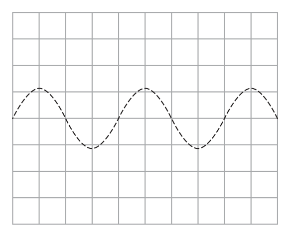
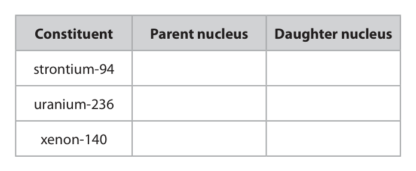
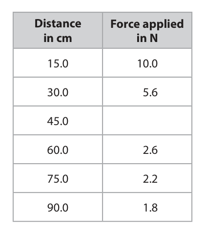
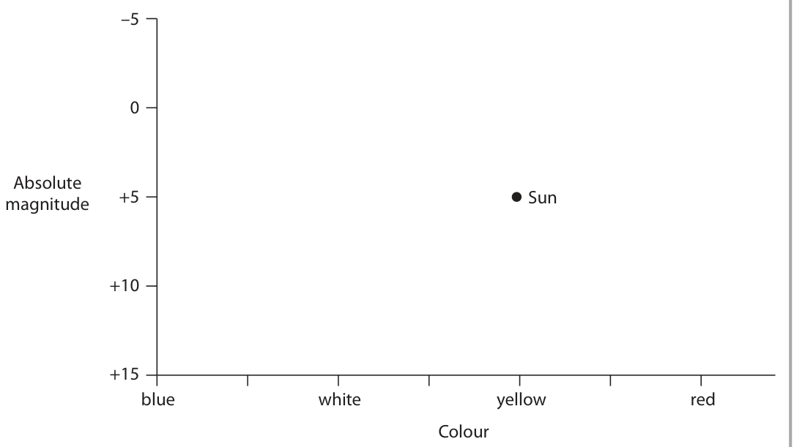
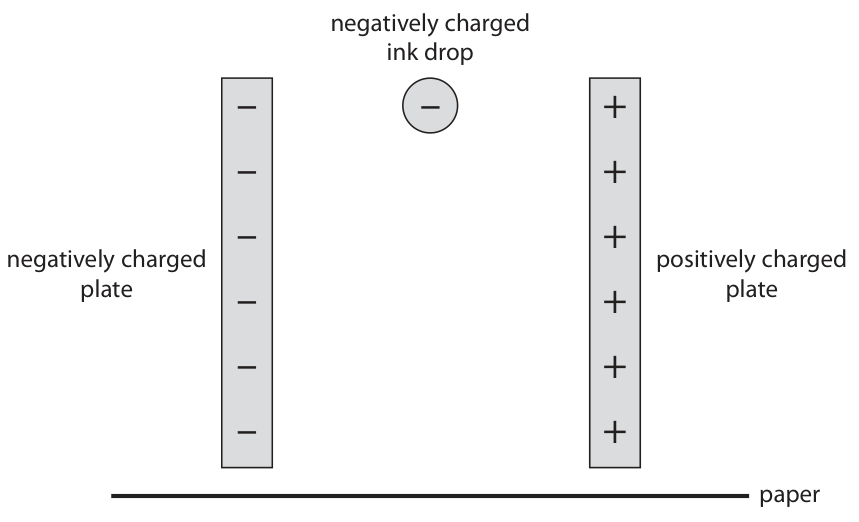

# 4PH1/2P — 2021-01 (official extraction)

> schema `syllabai.official-paper-questions/0.2` · paper_id `pearson-edexcel:international-gcse:physics:4ph1:2021-01:4PH1/2P` · qp sha256 `d73e09fcc0916fac…` · extraction is the disclosed baseline (ADR-039)

## Question 1 (7 marks)

The photograph shows a security camera. The camera detects light waves and sound waves.

**(b)** The camera detects infrared waves, which allow the camera to record videos in the dark.

### 1(a) [2]

State two differences between light waves and sound waves. 1 2

**Mark scheme answer**

> any two from: ignore references to
> frequency and
> wavelength
> MP1. light waves are transverse and sound waves
> are longitudinal;
> MP2. light travels faster than sound; condone ‘different
> speeds’
> MP3. light can travel through vacuum but sound
> waves can’t;

- **(2)** any two from: ignore references to

### 1(b)(i) [1]

Which of these electromagnetic waves has a longer wavelength than infrared waves?

- **(A)** gamma rays
- **(B)** microwaves  ✔
- **(C)** ultraviolet rays
- **(D)** visible light waves

**Mark scheme answer**

> B (microwaves);
> A is incorrect because gamma rays have a shorter wavelength than infrared
> C is incorrect because ultraviolet rays have a shorter wavelength than infrared
> D is incorrect because visible light waves have a shorter wavelength than
> infrared

- **(1)** Answer B: microwaves

### 1(b)(ii) [1]

Which of these is another use for infrared waves?

- **(A)** fluorescent lamps
- **(B)** heating lamps  ✔
- **(C)** satellite transmissions
- **(D)** sterilising medical equipment

**Mark scheme answer**

> B (heating lamps);
> A is incorrect because ultraviolet rays are used in fluorescent lamps
> C is incorrect because there is too much interference from the Earth for
> infrared to be used for satellite transmissions
> D is incorrect because gamma rays are used to sterilise medical equipment

- **(1)** Answer B: heating lamps

### 1(b)(iii) [1]

Which of these is a harmful effect of infrared waves?

- **(A)** blindness
- **(B)** cancer
- **(C)** internal heating of body tissue
- **(D)** skin burns  ✔

**Mark scheme answer**

> D (skin burns);
> A is incorrect because infrared is not absorbed by the retina
> B is incorrect because infrared is non-ionising
> C is incorrect because infrared cannot penetrate into the body to cause
> internal heating

- **(1)** Answer D: skin burns

### 1(c) [2]

The grid shows the oscilloscope trace for a quiet, low‑pitch sound wave. The security camera has an alarm that produces a loud, high‑pitch sound. On the grid, draw a trace to represent the sound wave produced by the alarm.

**Mark scheme answer**

> trace drawn with higher amplitude throughout; allow variable
> amplitude
> trace drawn with higher frequency throughout; allow variable
> amplitude
> e.g.
> Answer Notes Marks

- **(2)** trace drawn with higher amplitude throughout; allow variable

## Question 2 (5 marks)

The nuclear equation shows how a nucleus of uranium‑236 may undergo nuclear fission. 236 U → 140 Xe + 94 Sr + 1 n

### 2(a) [1]

Determine how many neutrons are released in this fission process. number of neutrons =

**Mark scheme answer**

> 2;

- **(1)** 2;

### 2(b) [2]

The table gives some of the constituents of this nuclear fission. Complete the table by putting one tick (ü) in each row to show whether the constituent is a parent nucleus or a daughter nucleus. Constituent Parent nucleus Daughter nucleus strontium‑94 uranium‑236 xenon‑140

**Mark scheme answer**

> all rows correct;;
> any 2 rows correct;
> e.g.
> ✓
> ✓
> ✓

- **(2)** all rows correct;;

### 2(c) [2]

Describe how the neutrons released in this fission process can cause a chain reaction.

**Mark scheme answer**

> any two from: do not penalize use of
> atom for nucleus for
> more than one mark
> MP1. neutrons absorbed by another nucleus;
> MP2. uranium-235 named;
> MP3. nucleus splits, releasing more neutrons (and
> process repeats);
> Answer Notes Marks

- **(2)** any two from: do not penalize use of

## Question 3 (11 marks)

A student uses this apparatus to investigate moments. elastic bands at 15 cm intervals newton meter force applied base of clamp stand This is the student’s method. • attach elastic bands at 15 cm intervals on a one metre tall clamp stand • attach a newton meter to the highest elastic band and measure the horizontal force required to tilt the stand • repeat the method at each 15 cm interval

**(b)** The table shows the student’s results. Distance Force applied in cm in N 15.0 10.0 30.0 5.6 45.0 60.0 2.6 75.0 2.2 90.0 1.8

### 3(a) [1]

Name an instrument that the student should use to accurately measure the distances on the clamp stand.

**Mark scheme answer**

> (metre) rule(r)/(metal) tape measure; allow
> (Vernier) caliper(s)

- **(1)** (metre) rule(r)/(metal) tape measure; allow

### 3(b)(i) [1]

The photograph shows the reading on the newton meter when the distance is 45.0 cm. Use the photograph to determine the force required to tilt the stand when the distance is 45.0 cm. force = N

**Mark scheme answer**

> 3.6; allow 3.7

- **(1)** 3.6; allow 3.7

### 3(b)(ii) [1]

Give a reason why this newton meter is unsuitable for measuring the force for distances less than 15.0 cm.

**Mark scheme answer**

> idea that the reading would be larger than the
> range of the instrument;

- **(1)** idea that the reading would be larger than the

### 3(c)(i) [3]

Plot a graph of the student’s results on the grid.

> 🖼 crop required: graph (qp.pdf p.8)

> 🖼 crop required: grid (qp.pdf p.8)

**Mark scheme answer**

> suitable linear scale chosen (>50% of grid used);
> axes labelled with quantities and units;
> plotting correct to nearest half square; ignore plotting of 45cm
> point

- **(3)** suitable linear scale chosen (>50% of grid used);

### 3(c)(ii) [1]

Draw the curve of best fit.

**Mark scheme answer**

> line (curve) of best fit acceptable; allow ECF from plotting
> i.e. smooth curve with
> points evenly
> distributed about it

- **(1)** line (curve) of best fit acceptable; allow ECF from plotting

### 3(d) [4]

The student concludes that the moment required to tilt the clamp stand does not change when the distance is varied. Use data from the table or the graph to evaluate the student’s conclusion.

> 🖼 crop required: graph (qp.pdf p.9)

**Mark scheme answer**

> any four from: no mark for simply
> ‘student is right/wrong’
> MP1. as distance increases, force decreases;
> MP2. (because) moment = force x distance;
> MP3. any one calculated moment value from
> results table or graph;
> MP4. a second calculated moment value from
> results table or graph;
> MP5. evidence shows moments are not all the allow evidence shows
> same; moments are similar
> MP6. (but) no pattern in the data (so could be allow consistent
> attributed to experimental errors); conclusion i.e. variation
> isn’t large enough
> Answer Notes Marks

- **(4)** any four from: no mark for simply

## Question 4 (12 marks)

The bar chart gives information about how some of the electrical power in the United States of America (USA) was generated in the year 2018. Percentage of electrical power 20 generated (%) Coal Natural Nuclear Solar Water Wind gas Energy resource

**(a)** Most of the electricity generated in the USA uses non‑renewable energy resources.

**(c)** The mean total electrical power output of the USA in 2018 was 4.76 × 1011 W.

### 4(a)(i) [1]

State what is meant by the term non‑renewable.

**Mark scheme answer**

> idea that it will run out / cannot be replaced; ignore renewed/re-used

- **(1)** idea that it will run out / cannot be replaced; ignore renewed/re-used

### 4(a)(ii) [2]

Determine the percentage of electrical power generated using the non‑renewable energy resources shown on the bar chart. percentage = %

**Mark scheme answer**

> any two correct readings taken from graph;
> evaluation of total;
> e.g.
> (proportion =) 27.5 + 35 + 19.5
> (proportion =) 82 (%) allow 81-83 (%)

- **(2)** any two correct readings taken from graph;

### 4(b) [2]

In 2018, the USA generated more than half of its electrical power by burning fossil fuels. Explain one way that burning fossil fuels can be harmful to the environment.

**Mark scheme answer**

> a named effect e.g. global warming, acid rain;
> a named pollutant e.g. carbon dioxide, sulphur -1 for incorrectly linked
> dioxide, nitrogen (di)oxide; effect and pollutant

- **(2)** a named effect e.g. global warming, acid rain;

### 4(c)(i) [2]

Calculate the mean electrical power output from solar energy resources. mean electrical power output = W

**Mark scheme answer**

> correct reading of solar from graph; seen anywhere in
> working
> evaluation;
> e.g.
> solar = 1.5%
> (solar output = 0.015 × 4.76 × 1011 =) 7.1(4) × 109 (W)

- **(2)** correct reading of solar from graph; seen anywhere in

### 4(c)(ii) [2]

The mean total electrical power output of the USA in 2018 was 4.76 × 1011 W. A typical solar farm generates 250 W of electrical power for every 1.0 m2 of land area used. Calculate the amount of land area needed if the USA were to generate all of its electrical power using solar energy resources. land area = m2

**Mark scheme answer**

> correct use of ratio;
> evaluation;
> e.g.
> land area = 4.76 × 1011 / 250
> (land area =) 1.90 × 109 (m2) allow 1.904… × 109 (m2)

- **(2)** correct use of ratio;

### 4(c)(iii) [3]

The total land area of the USA is 9.83 × 1012 m2. Discuss whether the USA could generate all of its electrical power using solar energy resources.

**Mark scheme answer**

> any three from: no mark for simple
> yes/no for suitability
> MP1. land area needed is much less than total land allow ecf from (ii)
> area of USA / there is enough space;
> MP2. land area needed is (much) less than 1% of also scores MP1
> total land area;
> MP3. idea that Sun doesn’t shine all the time;
> MP4. idea that some areas of land may not be allow idea of competing
> suitable for solar power; land uses e.g.
> housing/agriculture
> Answer Notes Marks

- **(3)** any three from: no mark for simple

## Question 5 (10 marks)

Transformers are useful in the transmission of electricity.

**(a)** The diagram shows a step‑down transformer. metal core Output Input voltage = 230 V voltage = 275 kV current = 95 A

### 5(a)(i) [1]

Give the name of a suitable metal that could be used in the core of the transformer.

**Mark scheme answer**

> (soft) iron; accept other suitable
> ferromagnetic materials

- **(1)** (soft) iron; accept other suitable

### 5(a)(ii) [1]

State the formula linking input power and output power for a transformer.

**Mark scheme answer**

> input power = output power; allow
> • formula in words or symbols
> OR • standard abbreviations: i.e.
> s, p, in, out, 1, 2
> primary voltage × primary current =
> secondary voltage × secondary current;

- **(1)** input power = output power; allow

### 5(a)(iii) [3]

The step‑down transformer has an input voltage of 275 kV and an output voltage of 230 V. The transformer has an output current of 95 A. Calculate the input current to the transformer. Assume the transformer is 100% efficient. input current = A

**Mark scheme answer**

> substitution;
> rearrangement;
> evaluation; -1 for POT error
> 79.45…(A) scores 2 marks
> e.g.
> 275 000 × Ip = 230 × 95
> (Ip =) 230 × 95 / 275 000
> (Ip =) 0.079 (A) allow 0.07945…

- **(3)** substitution;

### 5(b) [5]

Explain how transformers are useful in the large‑scale transmission of electricity. You may draw a diagram to support your answer.

**Mark scheme answer**

> any five from: allow any mark if clear from
> diagram
> MP1. step-up transformer used before
> transmission;
> MP2. voltage is increased before transmission;
> MP3. current is reduced before transmission;
> MP4. less heating in transmission cables;
> MP5. less energy wasted in transmission cables;
> MP6. step-down transformer used after
> transmission;
> MP7. voltage is decreased after transmission for
> safety;
> Answer Notes Marks

- **(5)** any five from: allow any mark if clear from

## Question 6 (5 marks)

The Hertzsprung‑Russell diagram shows the relationship between the absolute magnitude and colour of stars. –5 Absolute magnitude +5 Sun +10 +15 blue white yellow red Colour The position of the Sun is shown on the Hertzsprung‑Russell diagram.

### 6(a) [1]

Star W is a white dwarf. Add a W to the Hertzsprung‑Russell diagram to show the position of star W.

**Mark scheme answer**

> W marked between +10 and +15 absolute magnitude
> and between blue and white/yellow colour marks;

- **(1)** W marked between +10 and +15 absolute magnitude

### 6(b) [1]

Star X is a red giant. Add an X to the Hertzsprung‑Russell diagram to show the position of star X.

**Mark scheme answer**

> X marked between 0 and -5 absolute magnitude and
> between yellow/red and end of colour scale;

- **(1)** X marked between 0 and -5 absolute magnitude and

### 6(c) [1]

Star Y is a main sequence star that is much larger than the Sun. Add a Y to the Hertzsprung‑Russell diagram to show the position of star Y.

**Mark scheme answer**

> Y marked above and to the left of the Sun; judge by eye

- **(1)** Y marked above and to the left of the Sun; judge by eye

### 6(d) [1]

Star Z has the same surface temperature as the Sun, but would be dimmer than the Sun if it were the same distance away from Earth as the Sun. Add a Z to the Hertzsprung‑Russell diagram to show the position of star Z.

**Mark scheme answer**

> Z marked vertically in line with and below the Sun; judge by eye

- **(1)** Z marked vertically in line with and below the Sun; judge by eye

### 6(e) [1]

The Moon is the brightest object in the night sky. Suggest why the Moon cannot be shown on the Hertzsprung‑Russell diagram.

**Mark scheme answer**

> Any one from:
> MP1. idea that the Moon does not emit its own
> light;
> MP2. Idea that the Moon is not a star
> MP3. idea that the (surface) temperature of the
> Moon is too low / does not fit on the scale;
> Answer Notes Marks

- **(1)** Any one from:

## Question 7 (7 marks)

The diagram shows a child’s toy for accelerating steel balls. magnet ball A ball B ball C This is how the toy works. • the toy uses three identical steel balls, each with a mass of 4.1 g • ball A moves towards the magnet • ball B is in contact with the magnet • balls B and C are initially at rest and are in contact with each other • when ball A collides with the magnet, ball C moves away from the magnet

### 7(a) [2]

Ball A moves towards the magnet with an initial velocity of 0.15 m/s. Calculate the initial momentum of ball A. initial momentum = kg m/s

**Mark scheme answer**

> substitution into momentum = mass × velocity; allow use of standard
> symbols e.g. p = m × v
> evaluation; -1 for POT error
> e.g.
> p = 0.0041 × 0.15
> (p =) 0.00062 (kgm/s) allow decimal or
> standard form
> allow 0.000615

- **(2)** substitution into momentum = mass × velocity; allow use of standard

### 7(b) [2]

Ball A is attracted to the magnet. Explain how this attraction affects the momentum of ball A as it approaches the magnet.

**Mark scheme answer**

> velocity of ball increases; allow ball speeds up
> momentum increases;

- **(2)** velocity of ball increases; allow ball speeds up

### 7(c) [3]

When ball A collides with the magnet, a force of 1.3 N is exerted on ball C for a time of 0.0025 s. This causes ball C to move away from the magnet. Calculate the change in velocity of ball C due to this force. change in velocity = m/s

**Mark scheme answer**

> substitution into F = (mv – mu) / t;
> rearrangement;
> evaluation; -1 for POT error
> e.g.
> 1.3 = 0.0041 × v (– 0) / 0.0025
> (v =) 1.3 × 0.0025 / 0.0041
> (v =) 0.79 (m/s) allow 0.79268…
> Answer Notes Marks

- **(3)** substitution into F = (mv – mu) / t;

## Question 8 (13 marks)

The diagram shows a simplified view of part of an inkjet printer. negatively charged ink drop – – + – + negatively charged – + positively charged plate plate – + – + – + paper A negatively charged ink drop falls vertically between a pair of charged plates.

### 8(a) [2]

The ink drop experiences a horizontal electrostatic force as it falls. Explain the direction of the electrostatic force exerted on the ink drop by the charged plates.

**Mark scheme answer**

> (force to the) right; allow ‘towards the
> positive plate” or “away
> from the negative plate”
> (because) opposite charges attract / like charges
> repel;

- **(2)** (force to the) right; allow ‘towards the

### 8(b) [2]

On the diagram, draw the path of the ink drop as it falls between the charged plates until it hits the paper.

**Mark scheme answer**

> line drawn showing the ink drop deflecting to the allow ECF from (a) if
> right of the centre and hitting paper below; direction of force to the
> left
> line drawn starts vertical and becomes increasingly DOP
> more curved as the ink drop moves towards paper;

- **(2)** line drawn showing the ink drop deflecting to the allow ECF from (a) if

### 8(c)(i) [3]

The ink drop experiences a horizontal force of 8.5 × 10–7 N when it is between the charged plates. The mass of the ink drop is 1.1 × 10–10 kg. Calculate the horizontal acceleration of the ink drop when it is between the charged plates. acceleration = m/s2

**Mark scheme answer**

> substitution into force = mass × acceleration;
> rearrangement;
> evaluation; -1 for POT error
> e.g.
> 8.5 × 10-7 = 1.1 × 10-10 × a
> (a =) 8.5 × 10-7 / 1.1 × 10-10
> (a =) 7700 (m/s2) allow 7727.27…

- **(3)** substitution into force = mass × acceleration;

### 8(c)(ii) [4]

The ink drop has no initial horizontal velocity before it passes between the charged plates. After passing between the charged plates, the horizontal velocity of the ink drop is 3.9 m/s. Calculate the horizontal distance travelled by the ink drop as it passes between the charged plates. Give your answer in mm. distance = mm

**Mark scheme answer**

> use of v2 = u2 + (2 × a × s); can be implied from
> substitution
> substitution OR rearrangement; allow ECF from (i)
> evaluation in metres;
> conversion to mm; independent mark
> award if correct
> conversion attempted on
> incorrect answer
> e.g.
> v2 = u2 + (2 × a × s)
> 3.92 = 0 + (2 × 7700 × s) OR s = (v2 – u2) / 2a
> (s =) 9.9 × 10-4 (m) allow 9.8 × 10-4 – 9.9 × 10-4
> (s =) 0.99 (mm) allow 0.98 - 0.99

- **(4)** use of v2 = u2 + (2 × a × s); can be implied from

### 8(d) [2]

Explain how another ink drop could be deflected in the opposite direction by a greater distance using the charged plates in the inkjet printer.

**Mark scheme answer**

> idea of swapping polarities of plates; allow positively charging
> ink drop
> idea of increasing the amount of charge on plates; allow increasing amount
> of charge on ink drop
> allow decreasing {mass or
> volume} of the ink drop
> Pearson Education Limited. Registered company number 872828
> with its registered office at 80 Strand, London, WC2R 0RL, United Kingdom

- **(2)** idea of swapping polarities of plates; allow positively charging

