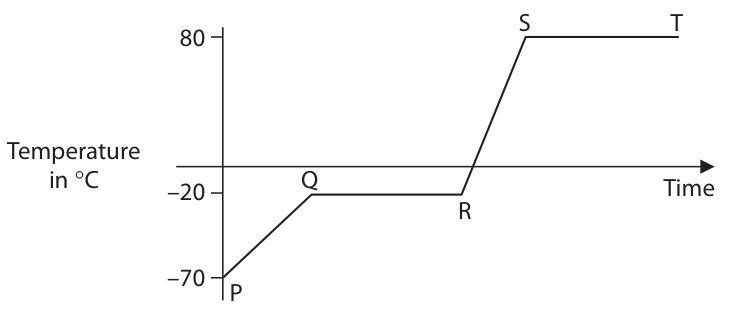

# 4PH1/2PR — 2021-01 (official extraction)

> schema `syllabai.official-paper-questions/0.2` · paper_id `pearson-edexcel:international-gcse:physics:4ph1:2021-01:4PH1/2PR` · qp sha256 `527709a1d1c40787…` · extraction is the disclosed baseline (ADR-039)

## Question 1 (9 marks)

The diagram shows the temperature‑time graph for a substance which is heated at a constant rate. S T Temperature in °C –20 Q Time R –70 P

### 1(a)(i) [1]

Which section of the graph shows when the substance is melting?

- **(A)** PQ
- **(B)** QR
- **(C)** RS
- **(D)** ST

### 1(a)(ii) [1]

Which section of the graph shows when all the substance is a solid?

- **(A)** PQ
- **(B)** QR
- **(C)** RS
- **(D)** ST

### 1(a)(iii) [1]

Draw particles in the box to show the arrangement of particles when the substance is a gas.

### 1(a)(iv) [1]

Which of these statements best describes the motion of particles in a gas?

- **(A)** they vibrate about fixed points
- **(B)** they are stationary
- **(C)** they slide past each other
- **(D)** they move quickly and randomly

### 1(b)(i) [1]

Name a piece of apparatus that could be used to measure the temperature of the substance.

**Mark scheme answer**

> thermometer; allow temperature sensor,
> temperature probe

- **(1)** thermometer; allow temperature sensor,

### 1(b)(ii) [1]

Determine the boiling point of this substance. boiling point = °C

**Mark scheme answer**

> 80 (°C);
> (c) temperature difference = 27 (°C);
> substitution; allow ECF from incorrect
> temperature difference
> evaluation;
> 37296, 10080 = 2 marks
> e.g.
> ∆T = 37 - 10 = 27 (°C)
> energy = 1.2 × 840 × 27
> (energy =) 27 000 (J) allow 27216, 27220, 27200
> (Total for Question 1 = 8 marks)
> Answer Notes Marks

- **(1)** 80 (°C);

### 1(c) [3]

The substance has a mass of 1.2 kg. Calculate the energy required to raise the temperature of the substance from 10 °C to 37 °C. [assume specific heat capacity of substance = 840 J/kg °C] energy = J

## Question 2 (7 marks)

The diagram shows a metal block on top of a wooden block. The metal block is held stationary by force F. G metal block P 4.3 cm wooden 11 cm block force F

### 2(a)(i) [1]

The weight of the metal block acts through point G. Give the name of point G.

### 2(a)(ii) [1]

Name a piece of apparatus that could be used to measure the weight of the metal block.

### 2(b)(i) [1]

State the formula linking moment, force and perpendicular distance from the pivot.

**Mark scheme answer**

> moment = force × (perpendicular) distance; allow standard
> symbols and
> rearrangements e.g.
> moment = F × d
> ignore m for moment

- **(1)** moment = force × (perpendicular) distance; allow standard

### 2(b)(ii) [1]

The weight of the metal block is 0.68 N. Show that the moment of the weight of the metal block about point P is approximately 2.9 N cm.

**Mark scheme answer**

> substitution;
> e.g.
> 0.68 × 4.3 (= 2.924 N cm)

- **(1)** substitution;

### 2(b)(iii) [3]

Force F is applied to the metal block to stop it from moving. Calculate the magnitude of force F. force F = N

**Mark scheme answer**

> idea that anti-clockwise moment = clockwise stated or implied by
> moment; working
> rearrangement;
> evaluation; allow ECF from (ii)
> e.g.
> 2.9 = F × 11
> F = 2.9 / 11
> (F =) 0.26 (N) allow 0.2636…-
> 0.2658…
> allow 0.27
> condone 0.263
> (Total for Question 2 = 6 marks)
> Answer Notes Marks

- **(3)** idea that anti-clockwise moment = clockwise stated or implied by

## Question 3 (8 marks)

The diagram shows an air track that can be used to investigate motion without friction. Air comes out through a series of small holes in the air track, which lifts the gliders slightly above the track. There are two gliders on the track. Each glider has a magnet. 0.045 kg m/s magnet magnet A B glider B glider A (at rest) air in air track The poles of the magnets nearest each other are alike.

**(b)** The gliders collide and the magnets cause them to rebound. Before the collision, the momentum of glider A is 0.045 kg m/s to the right and glider B is at rest.

### 3(a) [2]

Explain the direction of the force acting on magnet A from magnet B.

**Mark scheme answer**

> (to the) left; allow towards A, away
> from B
> ignore backwards
> (because) repulsion (due to like magnetic poles); reject if mention of
> charge

- **(2)** (to the) left; allow towards A, away

### 3(b)(i) [1]

State the total momentum of glider A and glider B after the collision. total momentum = kg m/s

**Mark scheme answer**

> 0.045 (kg m/s); allow ‘the same’

- **(1)** 0.045 (kg m/s); allow ‘the same’

### 3(b)(ii) [2]

After the collision, the momentum of glider A is 0.021 kg m/s to the left. Calculate the momentum of glider B after the collision. momentum of glider B = kg m/s

**Mark scheme answer**

> momentum of B after collision = 0.045 – (-0.021);
> evaluation;
> allow 0.024 for 1 mark
> e.g.
> 0.045 - −0.021 allow 0.045 + 0.021
> (momentum =) 0.066 (kg m/s)

- **(2)** momentum of B after collision = 0.045 – (-0.021);

### 3(b)(iii) [2]

The time taken for glider B to change its momentum is 0.19 seconds. Calculate the average force on glider B that causes this change in momentum. average force = N

**Mark scheme answer**

> substitution into allow ECF from (ii)
> F = change in momentum / time taken;
> evaluation; use of 0.024 from (ii)
> gives 0.126… (N)
> e.g.
> F = 0.066 / 0.19
> (F =) 0.35 (N) allow 0.347… (N)

- **(2)** substitution into allow ECF from (ii)

### 3(b)(iv) [1]

Give the direction of the force on glider B from glider A.

**Mark scheme answer**

> (to the) right; allow towards B, away
> from A
> (Total for Question 3 = 8 marks)
> Answer Notes Marks

- **(1)** (to the) right; allow towards B, away

## Question 4 (11 marks)
**(a)** A student uses an oscilloscope to determine the speed of sound. The diagram shows the oscilloscope trace produced by the sound wave. Oscilloscope settings y direction: 1 square = 1 mV x direction: 1 square = 1 ms The student uses two microphones and a ruler to determine the wavelength of the sound wave. He finds that the wavelength is 1.4 m.

### 4(a)(i) [1]

State the formula linking the speed, frequency and wavelength of a wave.

### 4(a)(ii) [5]

Use the oscilloscope trace to calculate the speed of the wave. speed = m/s

### 4(b) [5]

Another student uses this method to determine the speed of sound. Step 1 The student stands 50 m away from her teacher, measuring the distance with a metre ruler. Step 2 The teacher makes a loud sound and flashes a light at the same time. Step 3 The student starts the stopwatch when she sees the flash of light. Step 4 She stops the stopwatch when she hears the loud sound. The speed of sound is calculated using the formula distance speed of sound = time taken Evaluate whether this method could produce an accurate value for the speed of sound in air.

## Question 5 (8 marks)

An aircraft travels along a runway.

**(b)** The aircraft takes off and reaches its maximum height above the ground. At maximum height, the background radiation count rate is higher than on the ground.

### 5(a) [3]

The aircraft starts from rest and has a constant acceleration of 4.1 m/s2. Calculate the distance required to reach take‑off speed of 75 m/s. distance = m

**Mark scheme answer**

> allow alternative
> method of finding the
> time taken and then
> using average speed =
> distance/time
> substitution into v2 = u2 + 2as;
> rearrangement;
> evaluation;
> 1371-1372 = 2 marks
> e.g.
> 752 = (02 +) 2 × 4.1 × s
> s = 5 625 / 8.2
> (s =) 690 (m) allow 686, 685.9756…

- **(3)** allow alternative

### 5(b)(i) [2]

Explain what is meant by background radiation.

**Mark scheme answer**

> any two from:
> MP1. idea of radiation that is always present /
> present everywhere;
> MP2. idea of no ‘obvious’ source;
> MP3. any valid source of background radiation
> given e.g. radon/rocks/cosmic rays/medical
> or military activity/the Sun etc.;

- **(2)** any two from:

### 5(b)(ii) [3]

Suggest why there is a limit to the number of hours that an airline pilot can fly at maximum height.

**Mark scheme answer**

> any three from:
> MP1. idea that excessive exposure time can be
> harmful/increases risk;
> MP2. idea that dosage is higher (at maximum
> height);
> MP3. idea that increased risk of cancer; allow cell mutation for
> cancer
> MP4. idea that there is less atmosphere to
> absorb cosmic radiation;
> MP5. cosmic rays/radiation is increased;
> (Total for Question 5 = 8 marks)
> Answer Notes Marks

- **(3)** any three from:

## Question 6 (6 marks)

The Big Bang theory describes the evolution of the universe.

### 6(a) [2]

Explain how cosmic microwave background radiation (CMBR) supports the Big Bang theory.

**Mark scheme answer**

> any two from:
> MP1. CMBR appears to be the same in all directions /
> is everywhere;
> MP2. (which) implies all parts of the Universe were in allow implication of
> contact a long time ago; idea of coming from
> single point
> MP3. wavelength has increased (as the universe has allow red-shift of
> expanded); radiation
> allow frequency has
> decreased
> MP4. Universe was (significantly) hotter long ago; allow RA
> (b) change in wavelength = 78 (nm); ignore units
> substitution;
> rearrangement;
> evaluation; -1 for POT error
> use of incorrect source
> wavelength gives
> 3.4 × 107 (m/s) = 3
> e.g.
> (683 – 605 =) 78 (nm)
> 78 / 605 = v / c
> v = 3.0 × 108 × (78/605)
> (v =) 3.9 × 107 (m/s) allow 3.86… × 107 (m/s)
> (Total for Question 6 = 6 marks)
> Answer Notes Marks

- **(2)** any two from:

### 6(b) [4]

Hydrogen gas in a laboratory on Earth emits light with a wavelength of 605 nm. A distant galaxy contains hydrogen which emits light of the same wavelength. The wavelength of the light from the distant galaxy is measured as 683 nm on Earth. Calculate the speed of the distant galaxy. [speed of light = 3.0 × 108 m/s] speed = m/s

## Question 7 (13 marks)

The diagram shows part of a device used to demonstrate electrostatic charge. water in metal metal A B bucket V bucket rubber mat

### 7(a) [2]

Negatively charged water droplets fall into bucket A. Describe how bucket A becomes negatively charged.

**Mark scheme answer**

> movement of electrons;
> bucket gains electrons; scores both marks
> (b) (droplets in each stream are) like/same charge;
> (like charges) repel; ignore attraction to
> bucket

- **(2)** movement of electrons;

### 7(b) [2]

Explain why the negatively charged droplets spread out as they fall.

### 7(c)(i) [3]

A droplet hits bucket A with a speed of 3.8 m/s. Calculate the kinetic energy of the droplet when it hits bucket A. [mass of droplet = 6.2 × 10–9 kg] kinetic energy = J

**Mark scheme answer**

> use of KE = ½mv2; stated or implied by
> working
> substitution;
> evaluation; -1 for POT error
> allow 4.4 × 10-8,
> 4.47 × 10-8 = 2 marks
> e.g.
> KE = ½mv2
> KE = ½ × 6.2 × 10-9 × 3.82
> (KE =) 4.5 × 10-8 (J) allow 4.4764 × 10-8 (J)

- **(3)** use of KE = ½mv2; stated or implied by

### 7(c)(ii) [3]

The total charge stored in bucket A is –1.1 × 10–10 C. This charge passes through the air between the buckets in 9.2 × 10–3 s, causing a spark between bucket A and bucket B. Calculate the mean current between the buckets. mean current = A

**Mark scheme answer**

> substitution into Q = It; stated or implied by
> working
> rearrangement;
> evaluation; -1 for POT error
> e.g.
> 1.1 × 10-10 = current × 9.2 × 10-3
> current = 1.1 × 10-10 / 9.2 × 10-3
> current = 1.2 × 10-8 (A) allow 1.195… × 10-8 (A)

- **(3)** substitution into Q = It; stated or implied by

### 7(c)(iii) [3]

The spark transfers a charge of –1.1 × 10–10 C. The mean voltage between the buckets is 1.7 kV. Calculate the energy transferred by the spark. energy transferred = J

**Mark scheme answer**

> substitution into E = QV; allow valid substitution
> into E=VIt
> ignore units
> conversion of kV to V; allow 1700 or ×1000
> seen anywhere in
> working
> evaluation; -1 for POT error
> e.g.
> E = 1.1 × 10-10 × 1.7
> 1.7 kV = 1700 V
> (E =) 1.9 × 10-7 (J) allow 1.87 × 10-7 (J),
> 1.88 × 10-7 (J),
> 1.8768 × 10-7 (J)
> (Total for Question 7 = 13 marks)
> Answer Notes Marks

- **(3)** substitution into E = QV; allow valid substitution

## Question 8 (8 marks)

The diagram shows a step‑down transformer. primary coil (160 turns) iron core 12 V V secondary coil (45 turns)

### 8(a) [4]

Explain the operation of a step‑down transformer.

**Mark scheme answer**

> any four from:
> MP1. idea that step-down means secondary allow RA
> voltage is less than primary voltage;
> MP2. current in (primary) coil produces
> magnetic field;
> MP3. the current is changing / has frequency allow recognition that
> of 50 Hz; alternating current is used
> MP4. causing a (changing) magnetic field in
> the core;
> MP5. the core strengthens the magnetic field;
> MP6. the secondary coil experiences a allow ‘secondary is cut by
> changing magnetic field; (changing) field lines’
> MP7. which induces a voltage in the allow current for voltage
> secondary coil;

- **(4)** any four from:

### 8(b)(i) [1]

State the formula linking input voltage, output voltage and the turns ratio of a transformer.

**Mark scheme answer**

> (Np/Ns) = (Vp/Vs); allow any correct
> rearrangement
> allow ”i(nput) and
> o(utput)” or “1 and 2”for
> “p(rimary) and
> s(econdary)”
> allow correct word
> equation
> ignore ‘P’ for ‘N’
> condone ‘T’, ’t’ or ‘n’ for ‘N’
> condone ‘coils’ for ‘turns’

- **(1)** (Np/Ns) = (Vp/Vs); allow any correct

### 8(b)(ii) [3]

Calculate the output voltage for the transformer. voltage = V

**Mark scheme answer**

> substitution;
> rearrangement;
> evaluation;
> e.g.
> (160/45) = 12/Vs
> Vs = 12 / (160/45)
> (Vs =) 3.4 (V) allow 3.375 (V)
> Total for Question 8 = 8 marks)
> Pearson Education Limited. Registered company number 872828
> with its registered office at 80 Strand, London, WC2R 0RL, United Kingdom

- **(3)** substitution;

