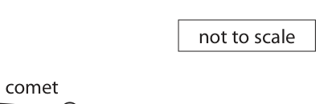
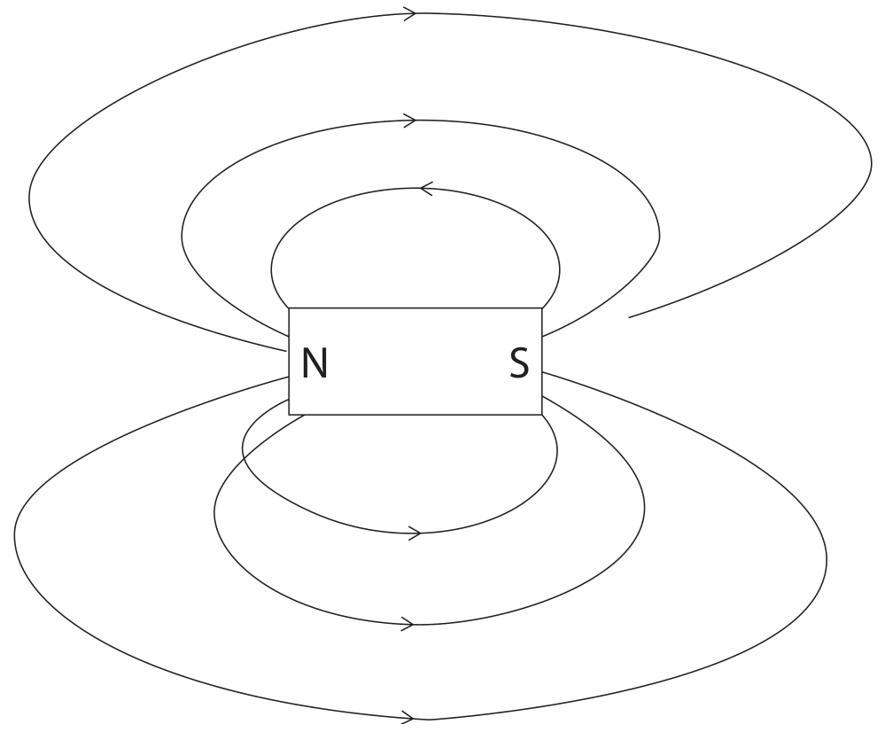
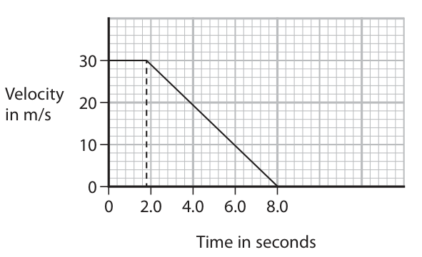
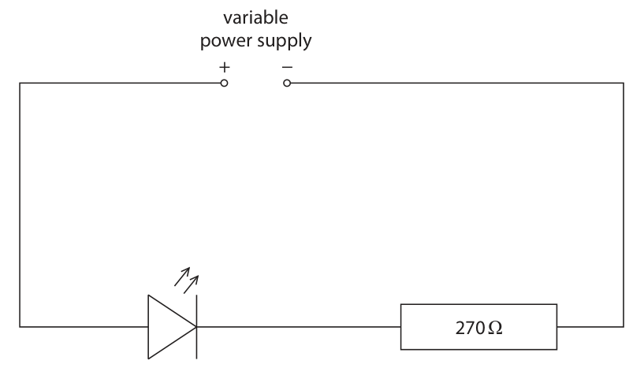
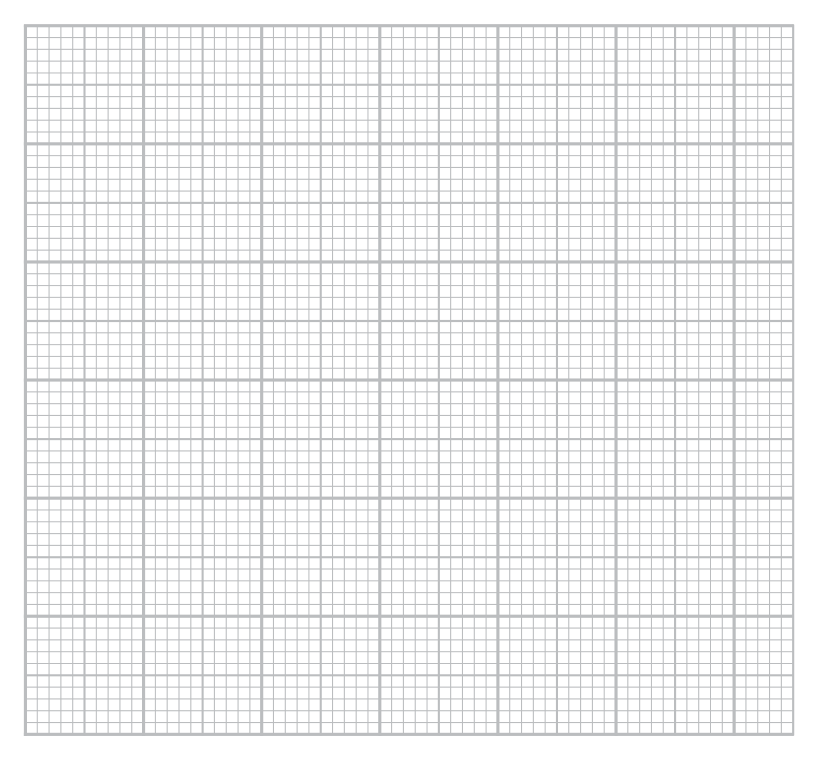
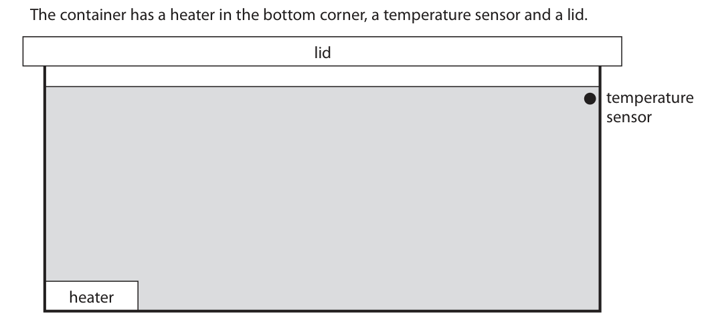
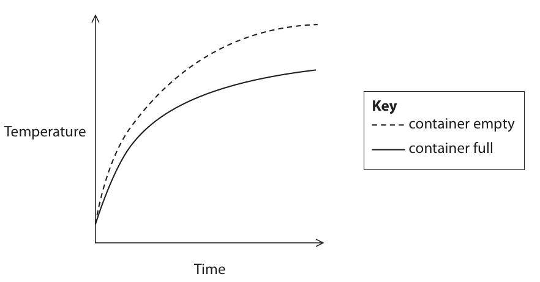
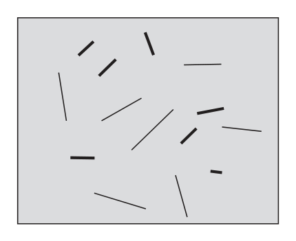
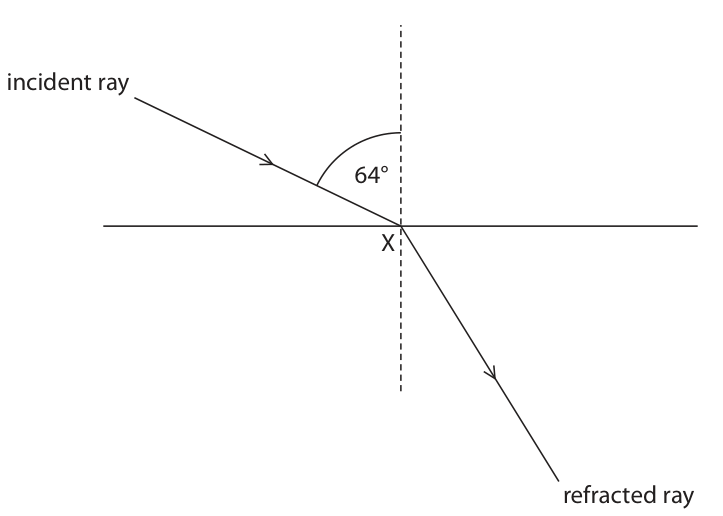

# 4PH1/1P — 2021-06 (official extraction)

> schema `syllabai.official-paper-questions/0.2` · paper_id `pearson-edexcel:international-gcse:physics:4ph1:2021-06:4PH1/1P` · qp sha256 `56b53d506ed8b0d0…` · extraction is the disclosed baseline (ADR-039)

## Question 1 (5 marks)
### 1(a)(i) [1]

Which of these coloured stars has the highest surface temperature?

- **(A)** orange
- **(B)** red
- **(C)** white  ✔
- **(D)** yellow

**Mark scheme answer**

> C (white);
> A is incorrect because its temperature is the second
> lowest
> B is incorrect because its temperature is the lowest
> D is incorrect because its temperature is the second
> highest

- **(1)** Answer C: white

### 1(a)(ii) [1]

Which of these is a stage in the life cycle of the Sun?

- **(A)** black hole
- **(B)** neutron star
- **(C)** supernova
- **(D)** white dwarf  ✔

**Mark scheme answer**

> D (white dwarf);
> A is incorrect because the Sun is not massive
> enough to form a black hole
> B is incorrect because the Sun is not massive
> enough to form a neutron star
> C is incorrect because the Sun is not massive
> enough to form a supernova

- **(1)** Answer D: white dwarf

### 1(a)(iii) [1]

Which of these is the stage nearest the end of the life cycle of a star with a mass much greater than the Sun?

- **(A)** main sequence
- **(B)** protostar
- **(C)** supernova  ✔
- **(D)** white dwarf

**Mark scheme answer**

> C (supernova);
> A is incorrect because this is during the middle of
> the life cycle
> B is incorrect because this is an early stage of the
> life cycle
> D is incorrect because this is a late stage in the life
> cycle of stars like our Sun

- **(1)** Answer C: supernova

### 1(b) [2]

The diagram shows the orbit of a comet around a star. Draw a labelled arrow to show the force acting on the comet due to the star. not to scale comet star

**Mark scheme answer**

> arrow pointing from the comet to the star; accept any arrow
> pointing from comet to
> star within shaded area
> ignore starting position
> of arrow
> force labelled ‘gravitational’; allow ‘gravity’ or
> ‘weight’
> Answer Notes Marks

- **(2)** arrow pointing from the comet to the star; accept any arrow

## Question 2 (6 marks)

A student uses iron filings to investigate the magnetic field pattern around a bar magnet.

### 2(a) [1]

Name the apparatus that the student could use to find the direction of the field lines.

> 🖼 crop required: apparatus (qp.pdf p.6)

**Mark scheme answer**

> (plotting) compass(es); allow suspended
> magnet, magnetometer
> allow higher level
> responses e.g. Hall
> probe, search coil

- **(1)** (plotting) compass(es); allow suspended

### 2(b) [3]

The student draws a diagram of the magnetic field pattern of the magnet. The student makes three mistakes. Draw a circle around each mistake on the diagram. N S

**Mark scheme answer**

> one mark for each correct indication;;; 2 marks max. if more
> than three indications
> given

- **(3)** one mark for each correct indication;;; 2 marks max. if more

### 2(c) [2]

The magnet is made of a magnetically hard material. Describe what is meant by the term magnetically hard.

**Mark scheme answer**

> any two from:
> difficult to magnetise; allow idea of taking a
> long time to magnetise
> difficult to demagnetise; allow idea of taking a
> long time to
> demagnetise
> idea that it retains its magnetism;
> Answer Notes Marks

- **(2)** any two from:

## Question 3 (10 marks)

The diagram shows a model of a chain reaction in a nuclear fission reactor. A ball falls through the hole and hits a mousetrap. This mousetrap then releases another ball. Each released ball hits a different mousetrap. ball hole plastic box mousetraps

**(a)** Each mousetrap represents a uranium-235 nucleus.

### 3(a)(i) [1]

Name the particle represented by the balls.

**Mark scheme answer**

> neutron;

- **(1)** neutron;

### 3(a)(ii) [2]

Describe what is meant by the term nuclear fission.

**Mark scheme answer**

> nucleus/nuclei splitting; condone nucleus/nuclei
> breaking apart
> releasing (two) daughter nuclei / neutrons / ignore daughter cells
> energy; allow smaller/lighter
> nuclei for daughter
> nuclei

- **(2)** nucleus/nuclei splitting; condone nucleus/nuclei

### 3(a)(iii) [2]

Describe what is meant by the term chain reaction.

**Mark scheme answer**

> neutrons released (by fission) are absorbed by condone atoms for
> other (uranium) nuclei; nuclei
> causing fission/splitting in other (uranium) nuclei; condone atoms for
> nuclei

- **(2)** neutrons released (by fission) are absorbed by condone atoms for

### 3(b) [1]

The walls of a real nuclear reactor are not made of plastic. Give a suitable material for the walls of a real nuclear reactor.

**Mark scheme answer**

> concrete / lead / (thick) steel;

- **(1)** concrete / lead / (thick) steel;

### 3(c) [4]

Use words from the box to complete the sentences about the moderator and control rods in a nuclear reactor. absorb ionise neutralise reflect slow boron granite graphite paper uranium The moderator in a nuclear reactor can be made of The moderator is designed to neutrons. The control rods in a nuclear reactor can be made of The control rods are designed to neutrons.

**Mark scheme answer**

> graphite;
> slow;
> boron;
> absorb;
> Answer Notes Marks

- **(4)** graphite;

## Question 4 (11 marks)

The diagram shows a velocity-time graph for a car from the time the driver sees an obstacle in the road until the car comes to rest. Velocity in m/s 0 2.0 4.0 6.0 8.0 Time in seconds

### 4(a)(i) [3]

Calculate the acceleration of the car between 1.8 and 8.0 seconds. acceleration = m/s²

**Mark scheme answer**

> use of acceleration = change in velocity / time; seen anywhere in
> working
> allow clear indication
> that acceleration is
> gradient
> substitution;
> evaluation; ignore minus sign
> e.g.
> acceleration = change in velocity / time
> acceleration = (-)30 / 6.2
> (acceleration =) (-)4.8 (m/s²) allow
> (-)4.8 to (-)5.0 (m/s²)

- **(3)** use of acceleration = change in velocity / time; seen anywhere in

### 4(a)(ii) [3]

Calculate the braking distance of the car. braking distance = m

**Mark scheme answer**

> clear indication that distance is area under line;
> understanding braking distance is area of triangle
> section only;
> evaluation;
> 54 (m) = 1 mark
> 147 (m) = 2 marks
> e.g.
> distance = area
> distance = 0.5 × 30 × 6.2
> (distance =) 93 (m)
> accept alternative
> method using ecf
> answer from (a)(i) and
> v² = u² + 2as giving
> 93.75 (m)

- **(3)** clear indication that distance is area under line;

### 4(a)(iii) [4]

Explain the effect, if any, of increased driver tiredness on the thinking distance and on the braking distance of the car. thinking distance braking distance

**Mark scheme answer**

> thinking distance:
> increase in thinking distance;
> (due to) increased reaction time;
> braking distance:
> no effect on braking distance;
> (due to) no effect on braking time / braking force; allow idea that braking
> distance does not
> depend on human
> factors

- **(4)** thinking distance:

### 4(b) [1]

Which of these represents the distance-time graph for the car? Distance Distance A B Time Time Distance Distance C D Time Time

**Mark scheme answer**

> A;
> B is incorrect because it does not show deceleration
> C is incorrect because the distance cannot change
> abruptly and the car is moving throughout
> D is incorrect because the first portion shows that
> the car is not moving
> Answer Notes Marks

- **(1)** A;

## Question 5 (14 marks)

The diagram shows a circuit used to investigate the relationship between current and voltage for a light-emitting diode (LED). variable power supply + − 270 Ω

**(b)** The table shows the results of the investigation. Voltage in V Current in mA 0.00 0.0 0.30 0.5 0.35 2.5 0.40 1.5 0.45 2.0 0.50 4.5 0.55 9.0 0.60 15.0

### 5(a) [3]

Draw meters on the diagram to measure the voltage of the LED and the current in the LED.

**Mark scheme answer**

> both ammeter and voltmeter symbols correct;
> ammeter drawn in series with LED;
> voltmeter drawn in parallel with LED;

- **(3)** both ammeter and voltmeter symbols correct;

### 5(b)(i) [3]

Plot the results on the grid.

**Mark scheme answer**

> axes scales cover 50% of the grid in both directions reject if either scale uses multiples
> and have a sensible, continuous scale; of 3, 7 or 9 or if discontinuous
> ignore orientation
> both axes labelled with quantities and units;
> all data plotted correctly; reject if either scale is
> discontinuous
> data should be plotted to within
> half a small square

- **(3)** axes scales cover 50% of the grid in both directions reject if either scale uses multiples

### 5(b)(ii) [1]

One of the results is anomalous. On the graph, draw a circle around the anomalous result.

**Mark scheme answer**

> (0.35,2.5) circled;

- **(1)** (0.35,2.5) circled;

### 5(b)(iii) [1]

Draw a curve of best fit.

**Mark scheme answer**

> smooth curve drawn with approximately even allow ecf from (i) so judge curve
> distribution of points either side ignoring anomaly; for the student’s plotting

- **(1)** smooth curve drawn with approximately even allow ecf from (i) so judge curve

### 5(b)(iv) [1]

Give a reason why a line graph is the best way of showing these results.

**Mark scheme answer**

> (data are) continuous/not discrete;

- **(1)** (data are) continuous/not discrete;

### 5(b)(v) [1]

State the formula linking voltage, current and resistance.

**Mark scheme answer**

> voltage = current × resistance; allow standard symbols and
> rearrangements
> reject C, c for current

- **(1)** voltage = current × resistance; allow standard symbols and

### 5(b)(vi) [4]

Any current larger than 15 mA will permanently damage the LED. The resistor in the circuit has a resistance of 270 Ω. Use the results from the investigation to determine the maximum voltage of the power supply without damaging the LED. maximum voltage = V

**Mark scheme answer**

> MP1. voltage across resistor = 0.015 × 270; allow 15 × 270 for this mark
> MP2. voltage across resistor is 4.05 (V); allow 4.0, 4.1 (V) scores MP1 and
> MP2
> MP3. voltage across power supply = voltage
> across LED + voltage across resistor;
> MP4. voltage across power supply is allow 4.65, 4.6 (V)
> (4.05 + 0.60 =) 4.7 (V);
> V = 4050.6 (V) = 3 marks
> allow alternative method of
> calculating resistance of LED to
> find total resistance of circuit
> Answer Notes Marks

- **(4)** MP1. voltage across resistor = 0.015 × 270; allow 15 × 270 for this mark

## Question 6 (9 marks)

The diagram shows a container of water. The container has a heater in the bottom corner, a temperature sensor and a lid. lid temperature sensor heater

**(b)** The graph shows how the temperature sensor reading changes with time. It shows the change in temperature when the container is full of water and when the container is empty. Key Temperature container empty container full Time

### 6(a) [4]

Explain how a convection current is formed in the container. You may add to the diagram or draw your own diagram to support your answer.

**Mark scheme answer**

> any four from: allow clear annotations
> on diagram
> MP1. water near heater is heated;
> MP2. (heated) water expands; accept ‘particles move
> apart from each
> other’/’particles spread
> out’
> reject particles expand
> MP3. density of (heated) water decreases;
> MP4. lower density / warm water rises;
> MP5. cooler / denser water sinks;
> MP6. process repeats / is continuous;

- **(4)** any four from: allow clear annotations

### 6(b)(i) [2]

Describe the relationship between temperature and time when the container is full of water.

**Mark scheme answer**

> temperature increases with time;
> idea that rate of temperature increase reduces;
> allow ‘temperature
> increases at a
> decreasing rate’/ EQ for
> 2 marks

- **(2)** temperature increases with time;

### 6(b)(ii) [3]

Explain the differences between the two curves on the graph.

**Mark scheme answer**

> temperature rise is quicker when container is allow empty container
> empty; reaches higher
> temperature
> with any two explanations from: ignore comments about
> conduction
> • particles move around quicker/have more KE allow particles in gases
> in gases; are more free to move
> • convection current is faster in gases;
> • energy transfer (by convection) is quicker;
> • mass of air in empty container less than mass allow less particles in
> of water in full container; empty container
> • specific heat capacity of air is lower than allow RA
> water;
> Answer Notes Marks

- **(3)** temperature rise is quicker when container is allow empty container

## Question 7 (11 marks)
**(b)** Uranium-235 is an isotope of uranium that can decay by emitting an alpha particle.

### 7(a) [2]

The diagram shows tracks produced by radiation in a device called a cloud chamber. The tracks are formed when particles ionise the material in the cloud chamber. Alpha particles produce the shorter, thicker tracks. Beta particles produce the longer, thinner tracks. Explain why alpha particles produce the shorter, thicker tracks.

**Mark scheme answer**

> any two from:
> MP1. alphas do not penetrate as far; allow RA
> MP2. alphas are more ionizing; allow RA
> MP3. alphas are more likely to collide (with material); allow RA
> MP4. alphas have more mass / move slower; allow RA

- **(2)** any two from:

### 7(b)(i) [2]

Describe what is meant by the term isotope.

**Mark scheme answer**

> (nuclei with) same numbers of protons; allow (nuclei with)
> same atomic
> (nuclei with) different numbers of neutrons; allow (nuclei with)
> different mass

- **(2)** (nuclei with) same numbers of protons; allow (nuclei with)

### 7(b)(ii) [2]

Complete the equation for the decay of uranium-235 235 U → 231 Th + 2 α

**Mark scheme answer**

> one mark for each correct number;;

- **(2)** one mark for each correct number;;

### 7(b)(iii) [5]

Uranium-235 decays to thorium-231 with a half-life of 700 million years. When a rock was formed, it contained 6400 million uranium-235 nuclei and no thorium-231 nuclei. Show that after 2100 million years there are seven times more thorium nuclei than uranium nuclei in the rock.

**Mark scheme answer**

> any indication that 2100 million years is 3 half-lives;
> evaluation of number of uranium nuclei after 1 half-life; 3200 (million)
> uranium nuclei
> after one half-life
> (after 2100 million years) there are 800 million uranium scores first three
> nuclei; marks
> (after 2100 million years) there are 5600 million thorium allow total number
> nuclei; of nuclei is
> constant
> 5600 (million) / 800 (million) = 7; allow
> $7 \times 800 = 5600$

- **(5)** any indication that 2100 million years is 3 half-lives;

## Question 8 (9 marks)
**(b)** The diagram shows a wire in a uniform magnetic field. movement of wire magnetic field 0.00 ammeter

### 8(a) [2]

Describe how two magnets can be arranged to produce a uniform magnetic field. You may draw a diagram to support your answer.

**Mark scheme answer**

> two magnets with opposite poles facing; accept annotated
> diagram for either mark
> poles brought close to each other; accept from diagram if
> A
> magnets drawn closer
> B together than the
> thickness of their poles
> i.e. A < B (on diagram)

- **(2)** two magnets with opposite poles facing; accept annotated

### 8(b)(i) [3]

The wire is moved up and down repeatedly in the magnetic field. Explain the effect that this movement has on the ammeter reading.

**Mark scheme answer**

> any three from:
> MP1. ammeter displays a current/reading (in one
> direction);
> MP2. (because) a voltage is induced;
> MP3. induced voltage gives a current;
> MP4. ammeter reading goes negative / shows allow ‘an alternating
> current in opposite direction; current / a.c. is
> produced’
> MP5. (because) wire changes direction;

- **(3)** any three from:

### 8(b)(ii) [4]

Explain the effects on the ammeter reading of moving the wire with the same amplitude but at a higher frequency.

**Mark scheme answer**

> any four from:
> MP1. ammeter reading / current is greater (than
> before);
> MP2. because wire moving quicker;
> MP3. more field lines cut (per second);
> MP4. gives a larger induced voltage;
> MP5. frequency of alternating current increases; allow idea that
> direction of current
> changes more
> frequently
> Answer Notes Marks

- **(4)** any four from:

## Question 9 (8 marks)

The photograph shows a whale jumping out of the surface of the sea. (Source: © Alexander Baumann/Shutterstock)

**(b)** A resultant force causes the whale to slow down when it hits the surface of the sea.

### 9(a) [4]

At the top of the jump, the whale’s velocity is 0 m/s. The whale falls 2.2 m from the top of the jump to the surface of the sea. Calculate the velocity of the whale when it hits the surface of the sea. velocity = m/s

**Mark scheme answer**

> use of v² = u² + 2as; seen anywhere in
> working
> substitution; allow use of g=9.8, 9.81
> rearrangement;
> evaluation;
> allow alternative
> method using
> mgh = 1/2mv²
> e.g. final answer of 44 (m/s)
> is 2 marks only
> v² = u² + 2as
> $v^{2} = (0) + 2 \times 10 \times 2.2$
> v = √44
> (v =) 6.6 (m/s) allow 6.63…(m/s),
> 6.56…(m/s)
> 6.5 scores 3 marks only

- **(4)** use of v² = u² + 2as; seen anywhere in

### 9(b)(i) [1]

Draw an arrow to show this resultant force. (Source: © Eugenia Petrovskaya/Shutterstock)

**Mark scheme answer**

> vertical arrow drawn upwards; ignore labels
> reject if more than one
> arrow drawn unless
> resultant force is
> clearly labelled

- **(1)** vertical arrow drawn upwards; ignore labels

### 9(b)(ii) [3]

The resultant force acting on the whale is 18 000 N. The mass of the whale is 4100 kg. Calculate the acceleration of the whale. acceleration = m/s²

**Mark scheme answer**

> substitution into F = ma;
> rearrangement;
> evaluation; -1 for POT error
> e.g.
> $18 000 = 4100 \times a$
> $a = 18 000 / 4100$
> (a =) 4.4 (m/s²) allow 4.39…(m/s²)

- **(3)** substitution into F = ma;

## Question 10 (15 marks)

The diagram shows a device called a hydraulic lift. The hydraulic lift consists of a tube of oil with a piston at each end. piston X piston Y cross-sectional area 1.2 m² cross-sectional area 4.8 m² 57 cm oil

**(b)** A 24 kg mass is placed on piston X.

### 10(a) [3]

Calculate the pressure difference between the bottom of piston X and the bottom of the oil. [density of oil = 820 kg/m³] pressure difference = Pa

**Mark scheme answer**

> use of p = h × density × g; allow mark if formula on its
> own is seen in working
> conversion of 57 cm into 0.57 m;
> evaluation; allow use of g = 9.8, 9.81
> 470 000, 467 000,
> 467 400, 458 052,
> 458 519.4 etc. score 2 marks
> e.g.
> pressure difference = 57 × 820 × 10
> pressure difference = 0.57 × 820 × 10
> (pressure difference =) 4700 (Pa) allow 4670, 4674, 4580.52,
> 4585.194 etc.

- **(3)** use of p = h × density × g; allow mark if formula on its

### 10(b)(i) [3]

Calculate the weight of the 24 kg mass. Give the unit. weight = unit

**Mark scheme answer**

> substitution into W = m × g; no mark for formula on its own
> allow use of g = 9.8, 9.81
> evaluation; -1 for POT error e.g.
> incorrectly changing kg to g
> correct unit; mark independently
> e.g.
> $W = 24 \times 10$
> (W =) 240 allow 235.2, 235.44
> newtons / N

- **(3)** substitution into W = m × g; no mark for formula on its own

### 10(b)(ii) [2]

Calculate the extra pressure on the oil due to the mass. extra pressure = Pa

**Mark scheme answer**

> substitution into p = F/A; no mark for formula on its own
> allow ecf from (i)
> evaluation;
> e.g.
> $p = 240 / 1.2$
> (p =) 200 (Pa)

- **(2)** substitution into p = F/A; no mark for formula on its own

### 10(b)(iii) [3]

The oil transfers the same extra pressure to piston Y. Calculate the force acting upwards on piston Y due to the extra pressure. force = N

**Mark scheme answer**

> substitution into p = F/A; no mark for formula on its own
> allow ecf from (ii)
> rearrangement;
> evaluation;
> e.g.
> $200 = F / 4.8$
> $F = 200 \times 4.8$
> (F =) 960 (N)

- **(3)** substitution into p = F/A; no mark for formula on its own

### 10(c) [4]

Piston Y starts at rest, rises slowly and then comes to rest. State how the following energy stores have changed from before the motion to after the motion is complete. Energy store Change gravitational potential energy of piston X gravitational potential energy of piston Y chemical energy of piston Y kinetic energy of piston Y

**Mark scheme answer**

> allow marks if the meaning is
> clear e.g. allow +, ↑ for
> increase etc.
> GPE of piston X = decrease;
> GPE of piston Y = increase;
> chemical energy of piston Y = no change;
> kinetic energy of piston Y = no change;
> Answer Notes Marks

- **(4)** allow marks if the meaning is

## Question 11 (12 marks)

Diagram 1 shows what happens when light is incident on a piece of transparent material. ray of light X not to scale Y Z Diagram 1

**(a)** When very bright light shines on this transparent material, a small amount of light is reflected at point X.

### 11(a)(i) [2]

On diagram 2, draw the reflected ray from point X. incident ray 64° X refracted ray Diagram 2

**Mark scheme answer**

> line drawn in top-right quadrant; accept if drawn on
> diagram 1 instead of
> diagram 2
> correct angle by eye; DOP

- **(2)** line drawn in top-right quadrant; accept if drawn on

### 11(a)(ii) [1]

Measure the angle of refraction at point X on diagram 2. angle = degrees

**Mark scheme answer**

> 32 (degrees); allow in range
> 31-33 (degrees)

- **(1)** 32 (degrees); allow in range

### 11(a)(iii) [1]

State the formula linking refractive index, angle of incidence and angle of refraction.

**Mark scheme answer**

> refractive index = allow standard symbols
> sin(angle of incidence) / sin(angle of refraction); and rearrangements
> e.g.
> ‘i’ for angle of
> incidence
> ‘r’ for angle of
> refraction
> ‘n’ for refractive index

- **(1)** refractive index = allow standard symbols

### 11(a)(iv) [2]

Show that the refractive index of the transparent material is about 1.7

**Mark scheme answer**

> substitution; allow ecf from (ii)
> evaluation to at least 3s.f.;
> e.g.
> n = sin(64) / sin (32)
> n = 1.70 allow 1.696…

- **(2)** substitution; allow ecf from (ii)

### 11(a)(v) [1]

State the formula linking refractive index and critical angle.

**Mark scheme answer**

> sin(c) = 1 / n; allow standard symbols
> and rearrangements

- **(1)** sin(c) = 1 / n; allow standard symbols

### 11(a)(vi) [2]

Calculate the critical angle for the transparent material. critical angle = degrees

**Mark scheme answer**

> substitution OR rearrangement; allow ecf from (iv)
> evaluation;
> e.g.
> sin(c) = 1/1.7 OR c = sin⁻¹(1/n)
> (c =) 36 (degrees) allow 36.03…(degrees)

- **(2)** substitution OR rearrangement; allow ecf from (iv)

### 11(b) [3]

Explain the behaviour of the light at points Y and Z. ray of light X not to scale Y Z

**Mark scheme answer**

> light undergoes total internal reflection; allow TIR for ‘total
> internal reflection’
> angle of incidence is above the critical angle;
> light (would be) going from more (optically) dense allow idea that light
> to less (optically) dense; would speed up if it
> travelled through the
> boundary / light travels
> faster in air than in
> material
> Pearson Education Limited. Registered company number 872828
> with its registered office at 80 Strand, London, WC2R 0RL, United Kingdom

- **(3)** light undergoes total internal reflection; allow TIR for ‘total

