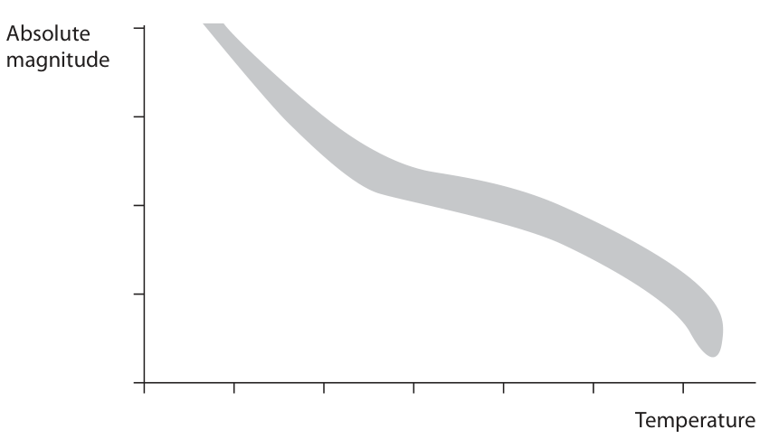
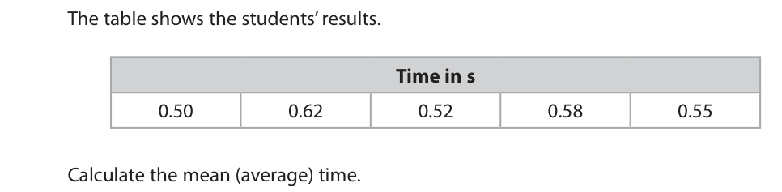
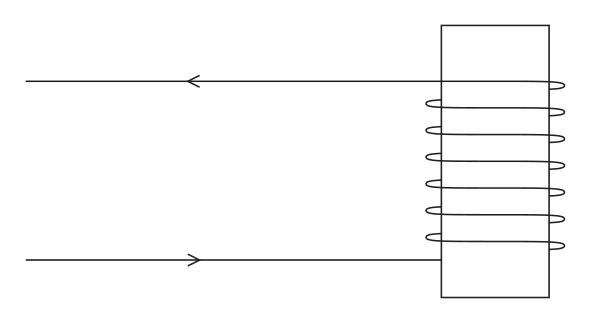
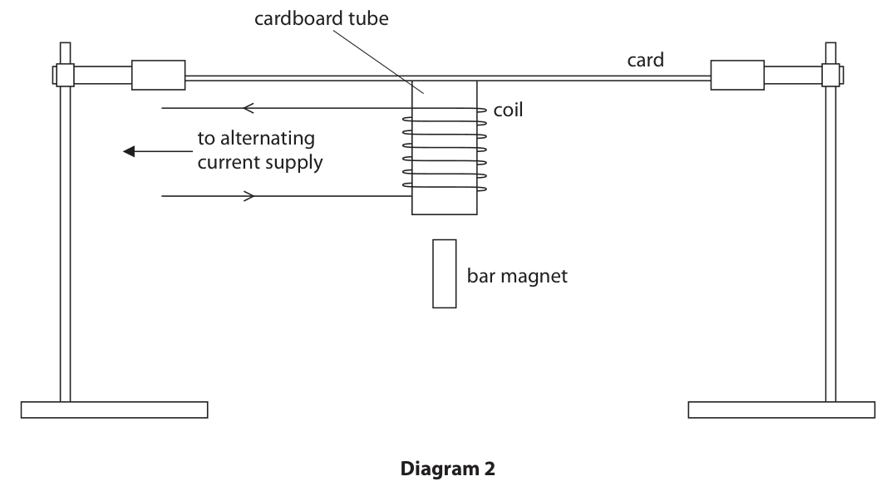
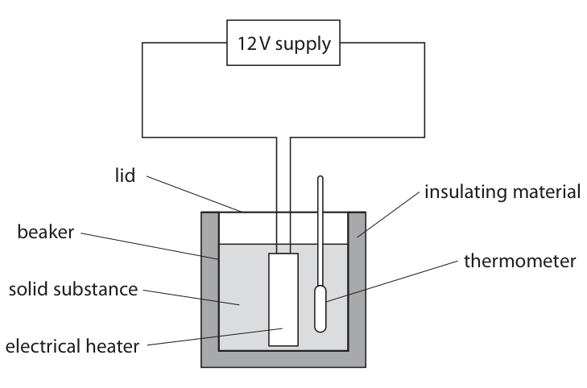
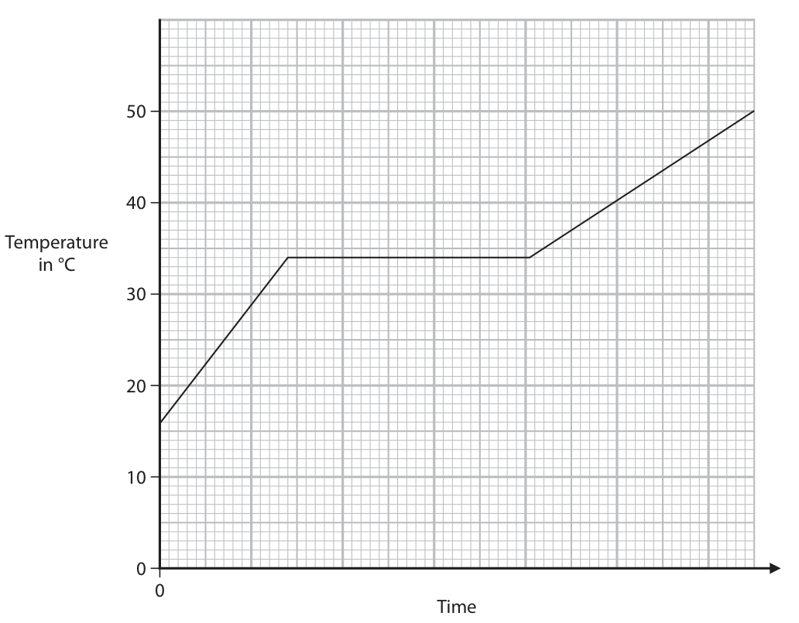
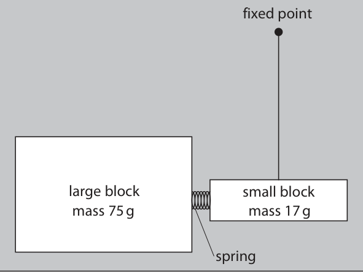

# 4PH1/2P — 2021-06 (official extraction)

> schema `syllabai.official-paper-questions/0.2` · paper_id `pearson-edexcel:international-gcse:physics:4ph1:2021-06:4PH1/2P` · qp sha256 `cc2a694287e74f5c…` · extraction is the disclosed baseline (ADR-039)

## Question 1 (7 marks)
**(a)** This is an incomplete Hertzsprung-Russell diagram. Absolute magnitude Temperature

**(b)** The Sun emits various parts of the electromagnetic spectrum.

### 1(a)(i) [1]

Which of these is in the shaded area of the diagram?

- **(A)** black holes
- **(B)** main sequence stars  ✔
- **(C)** neutron stars
- **(D)** protostars

**Mark scheme answer**

> B – main sequence stars;
> A is not correct as black holes do not appear on the
> HR diagram
> C is not correct as neutron stars are not part of the
> main sequence.
> D is not correct as protostars are not part of the
> main sequence

- **(1)** Answer B: main sequence stars

### 1(a)(ii) [1]

On the diagram, draw the area to show the position of white dwarf stars. Label this area WD.

**Mark scheme answer**

> bottom left area of the HR diagram; unlabelled scores 0

- **(1)** bottom left area of the HR diagram; unlabelled scores 0

### 1(a)(iii) [1]

On the diagram, draw the area to show the position of red giant stars. Label this area RG.

**Mark scheme answer**

> top right hand area of HR diagram; unlabelled scores 0

- **(1)** top right hand area of HR diagram; unlabelled scores 0

### 1(a)(iv) [2]

State what is meant by the term absolute magnitude.

**Mark scheme answer**

> a measure of brightness/luminosity; accept power
> idea that a star would be at a standard distance (10 ignore lack of or
> parsecs/32(.6) light years); incorrect value for
> distance

- **(2)** a measure of brightness/luminosity; accept power

### 1(b)(i) [1]

Which part of the electromagnetic spectrum causes damage to human surface skin cells?

- **(A)** microwaves
- **(B)** radio waves
- **(C)** ultraviolet  ✔
- **(D)** visible light

**Mark scheme answer**

> C – ultraviolet;
> A is not correct as microwaves cause internal
> heating
> B is not correct as radio waves do not give skin
> burns
> D is not correct as visible light cannot harm skin
> cells.

- **(1)** Answer C: ultraviolet

### 1(b)(ii) [1]

Which of these increases the risk of damage to human surface skin cells?

- **(A)** sunbathing  ✔
- **(B)** using protective sun cream
- **(C)** very cloudy weather
- **(D)** wearing sunglasses

**Mark scheme answer**

> A – sunbathing;
> B, C and D are not correct as all reduce the
> absorption of UV by skin.
> Total for Question 1: 7 marks
> Answer Notes Marks

- **(1)** Answer A: sunbathing

## Question 2 (8 marks)

Two students investigate the speed of sound. Student A has a device that makes a loud sound. Student B has a stopwatch. A sound wave travels from student A to the wall and is reflected back to student B. not to scale wall 210 metres 120 metres A B

### 2(a) [1]

Calculate the total distance the sound wave travels from student A to the wall and back to student B. distance = m

**Mark scheme answer**

> 300 (metres);

- **(1)** 300 (metres);

### 2(b) [2]

Student B hears the sound before and after the sound wave reflects from the wall. When student B hears the sound before reflection, he starts the stopwatch. When student B hears the sound after reflection, he stops the stopwatch. The students repeat this experiment five times. The table shows the students’ results. Time in s 0.50 0.62 0.52 0.58 0.55 Calculate the mean (average) time. Give your answer to 2 significant figures. mean time = s

**Mark scheme answer**

> 0.554;
> any answer given to 2 sf; mark independently
> correct answer = 0.55 (s)
> e.g. (0.50+0.62+0.52+0.58+0.55)/5 = 0.554 (s)
> = 0.55 (s) to 2 s.f.

- **(2)** 0.554;

### 2(c) [4]

Calculate the speed of sound for this investigation. speed = m/s

**Mark scheme answer**

> difference in distance is 180 m;
> recall of equation: speed = distance / time taken; allow use of standard
> symbols e.g. v = d/t
> condone s for v, s for d
> substitution; ECF incorrect distance
> and ECF incorrect time
> from (b)
> correct evaluation;
> correct answer = 330 (m/s) answer is 327.2727…
> (m/s)
> e.g.
> speed = (300 – 120)/0.55
> speed = 180/0.55
> speed = 327.2727... (m/s)
> answer is 324.90...
> (m/s) if 0.554(s) is
> used

- **(4)** difference in distance is 180 m;

### 2(d) [1]

Suggest a reason why the students’ results are not always the same.

**Mark scheme answer**

> human reaction time;
> accept alternative valid
> variables
> e.g. wind speed,
> temperature, humidity,
> air pressure
> Total for Question 2: 8 marks
> Answer Notes Marks

- **(1)** human reaction time;

## Question 3 (11 marks)

The diagram shows part of a radio antenna. The plastic tube protects the radio antenna from bad weather. Dust particles carried by the wind rub against the plastic tube. After some time, the dust particles cause the tube to become positively charged. plastic tube antenna metal mast wire attached to Earth

### 3(a) [1]

State the property of plastic that allows it to become electrostatically charged.

**Mark scheme answer**

> insulator; Allow ‘non/not
> conductive’

- **(1)** insulator; Allow ‘non/not

### 3(b) [2]

Explain how the plastic tube becomes positively charged.

**Mark scheme answer**

> any reference to electron transfer;
> loss (of electrons);
> idea of ‘loss of
> electrons (from tube)’
> scores 2.
> reject any reference to
> movement of positive
> charges

- **(2)** any reference to electron transfer;

### 3(c) [3]

The plastic tube is attached to a metal mast. This would cause the metal mast to become positively charged. Explain why there is a wire connecting the metal mast to the Earth.

**Mark scheme answer**

> electrons move through wire;
> as they are attracted by or to the metal mast; allow idea of ‘opposite
> charges attracting’
> idea that this makes metal mast neutral (again);
> allow idea of ‘to
> earth/earthing the
> mast’ if no other mark
> scored

- **(3)** electrons move through wire;

### 3(d) [3]

The plastic tube gains a charge of 4.3 mC. The energy stored on the tube is 3.7 J. Calculate the voltage between the plastic tube and the metal mast. voltage = V

**Mark scheme answer**

> recall of equation energy = charge × voltage; allow use of standard
> symbols e.g. E = Q × V
> reject C,c for charge
> substitution or re-arrangement;
> evaluation;
> correct answer = 860 (V) -1 for PoT error
> e.g.
> energy = charge × voltage
> voltage = energy/charge = 3.7/0.0043
> voltage = 860.465… (V)
> voltage = 860 (V)

- **(3)** recall of equation energy = charge × voltage; allow use of standard

### 3(e) [2]

An engineer is working on the radio antenna. Describe the hazard to the engineer if there is no earth wire.

**Mark scheme answer**

> spark/discharge;
> damage/harm/injury/electrocution (of engineer);
> Total for Question 3: 11 marks
> Answer Notes Marks

- **(2)** spark/discharge;

## Question 4 (14 marks)
**(a)** A student investigates a sound wave with a frequency of 25 000 Hz.

### 4(a)(i) [3]

Calculate the wavelength of this sound wave. [speed of sound = 330 m/s] wavelength = m

**Mark scheme answer**

> recall of equation: speed = frequency × allow use of standard
> wavelength; symbols e.g. v = f × λ
> condone s for speed
> reject w for wavelength
> substitution or re-arrangement;
> correct evaluation;
> correct answer = 0.013 (m) answer to 3sf is 0.0132 (m)
> e.g. speed = frequency × wavelength
> wavelength = speed ÷ frequency
> wavelength = 330 ÷ 25000
> wavelength = 0.0132… (m)

- **(3)** recall of equation: speed = frequency × allow use of standard

### 4(a)(ii) [2]

The oscilloscope trace represents the sound wave. Oscilloscope settings y direction: 1 square = 5 V x direction: 1 square = 0.01 ms Determine the amplitude of the oscilloscope trace. amplitude = V

**Mark scheme answer**

> amplitude corresponds to 2 squares;
> 2 squares gives 10 V for amplitude; ecf incorrect number of
> squares for amplitude
> e.g. 4 squares giving 20V
> scores 1 mark

- **(2)** amplitude corresponds to 2 squares;

### 4(b)(i) [3]

Diagram 1 shows a coil of wire wrapped around a cardboard tube. The coil is fixed to the cardboard tube. On diagram 1, draw field lines to represent the magnetic field produced when the current is in the direction shown. Diagram 1

**Mark scheme answer**

> field lines outside of coil appear to loop from allow field lines
> end to end; approximately uniform
> through solenoid
> arrow directions self-consistent; condone incorrect poles
> no overlapping field lines;

- **(3)** field lines outside of coil appear to loop from allow field lines

### 4(b)(ii) [3]

Diagram 2 shows a model of a loudspeaker that uses the coil and the cardboard tube. The cardboard tube is fixed to a thin piece of card, which is clamped at both ends. cardboard tube card coil to alternating current supply bar magnet Diagram 2 The student holds a bar magnet near the bottom of the cardboard tube. Explain why this causes the loudspeaker to produce a sound.

**Mark scheme answer**

> any THREE from:
> MP1. idea of force on coil from magnet; allow idea of interaction
> between fields of bar
> magnet and coil
> MP2. idea of alternating force on card;
> MP3. card vibrates;
> MP4. idea that card forces air to vibrate;
> MP5. longitudinal wave formed; allow idea of series of
> compressions and
> rarefactions

- **(3)** any THREE from:

### 4(b)(iii) [2]

When the frequency of the alternating current is 10 kHz, the student hears a sound. The student increases the frequency of the alternating current to 25 kHz. Explain why the student cannot hear a sound now, even though the card is still vibrating.

**Mark scheme answer**

> idea that 25 kHz is outside the range of human
> hearing;
> upper limit of human hearing is 20 kHz; ignore reference to 20Hz
> or lower limit

- **(2)** idea that 25 kHz is outside the range of human

### 4(b)(iv) [1]

Suggest a change to the apparatus that would increase the loudness of the sound when the frequency of the alternating current is 10 kHz.

**Mark scheme answer**

> increase current (amplitude)/
> increase strength of (bar) magnet/ allow increase density of
> increase number of turns on coil; turns on coil
> condone change card for a
> different material
> allow change size or shape
> of card
> allow moving magnet
> closer to the coil
> allow higher order answers
> in terms of resonance
> Total for Question 4: 14 marks
> Answer Notes Marks

- **(1)** increase current (amplitude)/

## Question 5 (10 marks)

The diagram shows some of the apparatus a student uses to investigate the effect of heating a solid substance. 12 V supply lid insulating material beaker thermometer solid substance electrical heater

**(b)** The student continues to heat the substance, keeping the power of the heater constant. The graph shows how the temperature of the substance changes with time. Temperature in °C Time

### 5(a) [5]

Describe how the student could use their apparatus to help determine the specific heat capacity of the substance. You should give details of any additional apparatus needed in your answer.

**Mark scheme answer**

> Any FIVE from:
> MP1. measure current and voltage to work out accept ‘known power’
> power;
> MP2. use ammeter and voltmeter; accept ‘power meter’
> or ‘joulemeter’
> accept idea of ‘known
> voltage’
> MP3. measure temperature increase AND time accept measure initial
> taken; and final temperature
> for temp increase
> accept idea of waiting
> for highest
> temperature after
> power switched off
> accept ‘use a
> stopwatch’ for time
> taken
> MP4. find total energy (E = Pt or E = VIt);
> MP5. measure mass of substance;
> MP6. use a balance;
> MP7. rearrange to give c = E / m Δθ;
> MP8. plot a temperature-time graph;
> MP9. use gradient (so c = P/(m × gradient));

- **(5)** Any FIVE from:

### 5(b)(i) [1]

Use the graph to determine the melting point of this substance. melting point = °C

**Mark scheme answer**

> 34 (oC);

- **(1)** 34 (oC);

### 5(b)(ii) [2]

Describe, in terms of particles, what is happening in the substance when the graph line is horizontal.

**Mark scheme answer**

> any TWO from:
> MP1. bonds between particles are weakened or allow particles get
> broken; (slightly) further
> apart /EQ
> MP2. particles go from regular to irregularly
> packed/EQ;
> MP3. particles go from vibrating (about a fixed
> position) to sliding past each other / EQ;
> ignore references to
> KE

- **(2)** any TWO from:

### 5(b)(iii) [2]

Suggest why the two non-horizontal lines on the graph have different gradients.

**Mark scheme answer**

> reference to different temperature changes in the accept recognition
> same time; that the states are
> different
> different specific heat capacities/EQ; condone incorrect
> SHC comparisons
> between phases
> Total for Question 5: 10 marks
> Answer Notes Marks

- **(2)** reference to different temperature changes in the accept recognition

## Question 6 (7 marks)

This is a question about a nuclear fusion power station.

**(b)** The diagram shows how a fusion power station could supply the National Grid in the future. pylon, 330 kV fusion power station 28 kA, 21 kV step-up transformer

### 6(a) [3]

Explain what happens during nuclear fusion.

**Mark scheme answer**

> creation of a (large) nucleus from small nuclei; condone “fusing of two
> nuclei”
> resulting in a loss of mass;
> and the release of energy; accept reference to
> E=mc2
> condone “converted to
> energy”

- **(3)** creation of a (large) nucleus from small nuclei; condone “fusing of two

### 6(b)(i) [1]

State the main method of energy transfer from the fusion power station generator to the primary coil of the step-up transformer.

**Mark scheme answer**

> electrical working; condone ‘electrically’

- **(1)** electrical working; condone ‘electrically’

### 6(b)(ii) [3]

The fusion power station could supply the input coil of the step-up transformer with a current of 28 kA at a voltage of 21 kV. The output coil of the transformer has a voltage of 330 kV. Assume the transformer is 100% efficient. Calculate the current in the output coil of the transformer. current = kA

**Mark scheme answer**

> substitution in VinIin = VoutIout;
> re-arrangement;
> evaluation;
> correct answer = 1.8 (kA) -1 POT error
> e.g. input power = output power
> VinIin = VoutIout
> 28 × 21 = 330 × Iout
> Iout = (28 × 21) ÷ 330
> Iout =1.7818…
> Total for Question 6: 7 marks
> Answer Notes Marks

- **(3)** substitution in VinIin = VoutIout;

## Question 7 (13 marks)

The diagram shows two blocks at rest on a table, viewed from above. A spring is attached to the large block. The small block is attached by a piece of string to a fixed point on the table. A student pushes the two blocks together so that the spring is compressed. fixed point large block small block mass 75 g mass 17 g spring

### 7(a) [3]

The student releases the blocks. The kinetic energy (KE) store of the small block is 0.29 J when the blocks are no longer in contact. Show that the speed of the small block is about 6 m/s.

**Mark scheme answer**

> correct substitution KE = ½ (mass) × (speed)2; allow use of standard
> symbols e.g. KE = ½ m v2
> allow mass = 17 at this
> point
> re-arrangement to give v;
> evaluation to show 5.8(4…) (m/s);
> e.g. KE = ½ m v2
> 0.29 = 0.5 × 0.017 × v2
> v2 = 0.29 ÷ (0.5 × 0.017) = 34.1176471..
> v = √34.1176471 = 5.8(4…) (m/s)

- **(3)** correct substitution KE = ½ (mass) × (speed)2; allow use of standard

### 7(b) [4]

Using ideas about momentum, show that the speed of the large block is about 1 m/s after the blocks are no longer in contact.

**Mark scheme answer**

> idea of conservation of momentum; however expressed
> idea that momentum before release was zero; allow idea that momenta of
> two blocks is equal in
> magnitude
> evidence of re-arrangement;
> evaluation of large block speed giving 1.3 m/s; allow 1.4 if vsmall = 6 m/s
> ignore mass unit provided
> both masses consistent
> e.g. momentum of small block = 17 × 6 = 102 g m/s
> therefore momentum of large block = 102 g m/s
> momentum = mass × velocity = 75 v
> so v = 102/75 = 1.36 m/s
> v=1.31 if vsmall = 5.8 m/s
> v=1.32 if vsmall = 5.84 m/s

- **(4)** idea of conservation of momentum; however expressed

### 7(c) [3]

The small block takes 0.11 s to reach 6 m/s. Calculate the mean force exerted on the small block by the spring. mean force = N

**Mark scheme answer**

> substitution into given equation;
> idea of initial momentum = 0; allow use of init velocity = 0
> evaluation;
> correct answer = 0.93 (N)
> e.g. force = change in momentum ÷ time taken
> force = ((0.017 × 6) – 0) ÷ 0.11
> force = 0.102 ÷ 0.11
> force = 0.9272… (N)

- **(3)** substitution into given equation;

### 7(d) [3]

The small block then moves around the fixed point on the table. The block moves in a circular orbit of radius 17.6 cm at a constant orbital speed of 6 m/s. The time period of the orbit can be found using the formula 2π × orbital radius orbital speed = time period Calculate the time period of the orbit. time period = s

**Mark scheme answer**

> substitution and re-arrangement of given equation;
> conversion of 17.6 cm to 0.176 m;
> evaluation;
> correct answer = 0.18(41…) (s) accept 0.2 (s)
> accept use of v=5.84…(m/s)
> -1 POT error
> e.g. orbital speed=(2π × orbital radius)÷time period
> 6 = (2π × 0.176)÷T
> T = (2π × 0.176) ÷ 6
> T = 0.1843… (s)
> 0.092.. (s) for using 17.6 cm
> as a diameter scores 2
> Total for Question 7: 13 marks
> Pearson Education Limited. Registered company number 872828
> with its registered office at 80 Strand, London, WC2R 0RL, United Kingdom

- **(3)** substitution and re-arrangement of given equation;

