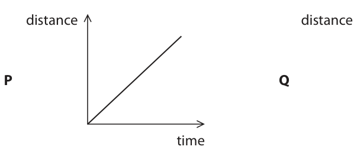
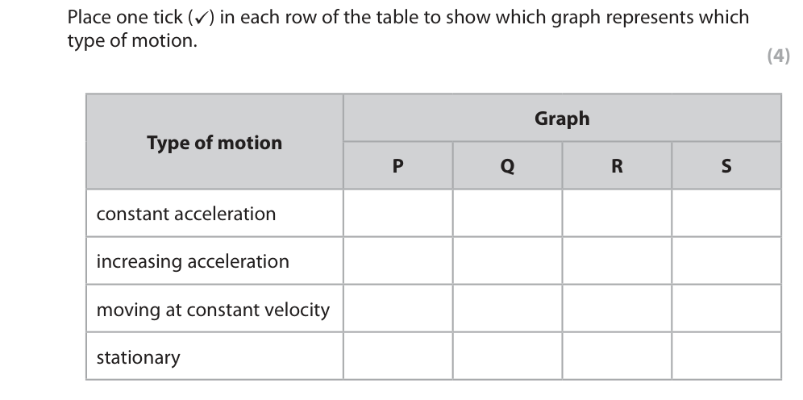
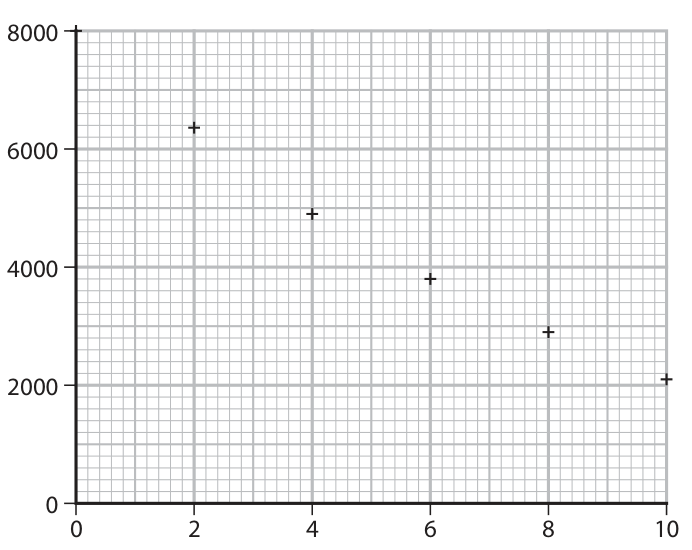
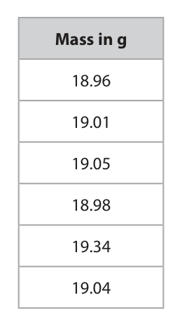
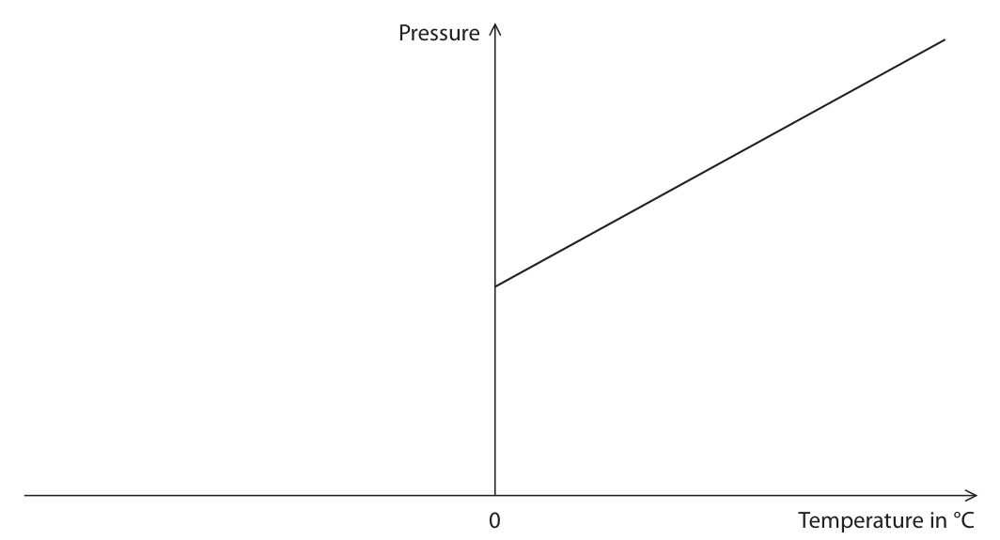
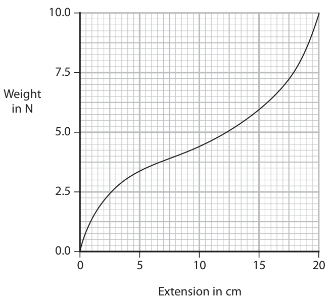

# 4PH1/1P — 2021-11 (official extraction)

> schema `syllabai.official-paper-questions/0.2` · paper_id `pearson-edexcel:international-gcse:physics:4ph1:2021-11:4PH1/1P` · qp sha256 `c175625fc8031c4d…` · extraction is the disclosed baseline (ADR-039)

## Question 1 (5 marks)

The motion of an object can be represented using graphs.

### 1(a) [4]

The graphs, P, Q, R and S, show different types of motion. distance distance P Q time time velocity velocity R S time time The table lists some types of motion. Place one tick (✓) in each row of the table to show which graph represents which type of motion. Graph Type of motion P Q R S constant acceleration increasing acceleration moving at constant velocity stationary

**Mark scheme answer**

> one mark for each correct row;;;;
> ✓
> ✓
> ✓
> ✓
> reject mark for row if more than one tick seen

- **(4)** one mark for each correct row;;;;

### 1(b) [1]

State the feature of a velocity‑time graph that can be used to determine the distance travelled by an object.

**Mark scheme answer**

> area (under the line) / eq;
> Answer Notes Marks

- **(1)** area (under the line) / eq;

## Question 2 (8 marks)

This question is about electric current.

**(c)** An electric heater contains wires that heat up when there is a current in the wires. The electric heater has a power of 1.4 kW when connected to a mains voltage of 230 V.

### 2(a) [1]

State what is meant by the term electric current.

**Mark scheme answer**

> the rate of flow of charge/electrons; allow amount of charge per
> second, amount of charge per
> unit time

- **(1)** the rate of flow of charge/electrons; allow amount of charge per

### 2(b) [1]

Give the name of the particles that flow if there is an electric current in a wire.

**Mark scheme answer**

> electron(s); ignore words written in
> addition to electron(s)

- **(1)** electron(s); ignore words written in

### 2(c)(i) [1]

State the formula linking power, current and voltage.

**Mark scheme answer**

> power = current × voltage; allow standard symbols and
> rearrangements
> e.g. I = P / V

- **(1)** power = current × voltage; allow standard symbols and

### 2(c)(ii) [3]

Calculate the current in the wires. current = A

**Mark scheme answer**

> substitution;
> rearrangement;
> evaluation; -1 for POT error
> e.g.
> 1400 = current × 230
> (current =) 1400 / 230
> (current =) 6.1 (A) allow 6, 6.09, 6.086…

- **(3)** substitution;

### 2(c)(iii) [2]

Explain why the current in the wires causes the temperature of the wires to increase.

**Mark scheme answer**

> any two from:
> MP1. idea that wire has resistance; ignore friction
> MP2. electrons collide with lattice ions; allow sensible alternatives
> for lattice ions e.g. atoms in
> the wire etc.
> MP3. idea of transferring energy (from electrons to ignore generic references to
> wire/eq); “heat”
> MP4. increasing vibrations of lattice ions; allow sensible alternatives
> for lattice ions e.g. atoms in
> the wire etc.
> Answer Notes Marks

- **(2)** any two from:

## Question 3 (5 marks)

The diagram shows a torch that uses a rechargeable battery. The battery is recharged by shaking the torch up and down. coil of wire direction of magnet shaking switch rechargeable battery lamp (Source: adapted from © www.shutterstock.com/1328720216)

### 3(a) [3]

Shaking the torch causes the magnet to move up and down inside the coil of wire. Explain why the movement of the magnet causes a current in the coil.

**Mark scheme answer**

> magnet moves through / near coil of wire; allow idea that magnet
> enters / leaves coil
> field lines of magnet are cut by coil; ignore references to the coil
> having its own field
> idea that voltage is induced across the coil; ignore references to current

- **(3)** magnet moves through / near coil of wire; allow idea that magnet

### 3(b) [2]

Using a stronger magnet could increase the current in the coil of wire. State two other factors that could increase the current in the coil. 1 2

**Mark scheme answer**

> any two from:
> MP1. shaking torch harder / faster; allow moving coil/magnet
> faster
> MP2. increasing the number of turns on the coil; ignore “larger coil”
> MP3. using a less resistive metal for the coil of
> wire;
> Answer Notes Marks

- **(2)** any two from:

## Question 4 (15 marks)

Cobalt‑60 is a radioactive isotope of cobalt. The table gives the activity of a sample of cobalt‑60 over a period of 10 years. Time in years Activity 0 8000 2 6350 4 4900 6 3800 8 2900 10 2100

**(b)** The graph shows the data. 8000 6000 4000 2000 0 2 4 6 8 10

### 4(a) [1]

Give a suitable unit for activity.

**Mark scheme answer**

> becquerel(s) / Bq; allow recognisable spellings
> allow if written in table

- **(1)** becquerel(s) / Bq; allow recognisable spellings

### 4(b)(i) [1]

Label both axes.

**Mark scheme answer**

> vertical axis labelled “activity” AND horizontal ignore unit on vertical axis
> axis labelled “time in years”;

- **(1)** vertical axis labelled “activity” AND horizontal ignore unit on vertical axis

### 4(b)(ii) [1]

Draw the curve of best fit.

**Mark scheme answer**

> smooth curve of best fit drawn; curve should pass within 1
> small square of each data point
> condone curve starting at
> second point

- **(1)** smooth curve of best fit drawn; curve should pass within 1

### 4(b)(iii) [2]

Use the graph to determine the half‑life of cobalt‑60. half‑life = years

**Mark scheme answer**

> evidence of working on graph or in working space; e.g. lines shown on graph or
> evidence of halving 8000 etc.
> half-life = 5.6 (years); allow range of 5.4-5.8

- **(2)** evidence of working on graph or in working space; e.g. lines shown on graph or

### 4(b)(iv) [2]

Estimate the time taken for the activity to decrease to of its initial value. 8 time = years

**Mark scheme answer**

> 3 half-lives;
> (3 × 5.6 =) 16.8 (years); allow 16.2-17.4 (years)
> allow ecf from (iii)

- **(2)** 3 half-lives;

### 4(c) [2]

Cobalt‑60 is produced when a neutron is absorbed by the nucleus of a stable atom of cobalt‑59. The nuclei of these two isotopes can be represented as 60 59 27 Co 27Co Describe a similarity and a difference for the nuclei of these two isotopes of cobalt.

**Mark scheme answer**

> both have same number of protons;
> cobalt-60 has one more neutron; allow RA
> ignore references to
> atomic/mass numbers

- **(2)** both have same number of protons;

### 4(d) [2]

Cobalt‑60 decays by beta emission. Describe what happens to the nucleus of a cobalt‑60 atom during beta decay.

**Mark scheme answer**

> nucleus loses a neutron; “neutron becomes a proton”
> nucleus gains a proton; scores both marks
> condone plurals e.g. neutrons,
> protons

- **(2)** nucleus loses a neutron; “neutron becomes a proton”

### 4(e) [4]

Cobalt‑60 also emits gamma radiation. Cobalt‑60 is produced in a nuclear reactor. Discuss the hazards involved and the precautions taken when disposing of cobalt‑60.

**Mark scheme answer**

> any four from:
> Hazards (max. 2 marks)
> MP1. radiation from them can cause cancer /
> cell damage / damage to organisms /
> people;
> MP2. radiation is highly penetrating;
> MP3. risk of theft / eq;
> MP4. remain radioactive for some time;
> MP5. risk of contamination of land/water;
> Precautions (max. 2 marks)
> MP6. need for shielding; e.g. lead, concrete etc.
> MP7. use of machines to remove from reactor;
> MP8. need for security (to prevent public
> access/protect from hijacking/eq);
> MP9. need to be suitably protected against e.g. from earthquakes,
> damage; overheating etc.
> MP10. special facilities required, not landfill; e.g. stored
> underground/underwater,
> measures to avoid leakage
> MP11. relatively short half-life means that very
> long-term storage is not necessary;
> Answer Notes Marks

- **(4)** any four from:

## Question 5 (7 marks)

A student uses a balance to measure the mass of an object. This is the student’s method. ● adjust the balance so that it displays a reading of zero ● place the object on the balance and record the reading The student repeats this measurement several times.

**(c)** The student measures the mass of the object using six different balances. The table shows the student’s results. Mass in g 18.96 19.01 19.05 18.98 19.34 19.04

### 5(a) [1]

What is improved by adjusting the balance to give a reading of zero before the object is placed on it?

- **(A)** accuracy of the measurement  ✔
- **(B)** precision of the measurement
- **(C)** reliability of the measurement
- **(D)** validity of the measurement

**Mark scheme answer**

> A (accuracy of the measurement);
> B is incorrect because removing a zero error does not allow the measurement to be
> made to more decimal places
> C is incorrect because removing a zero error does not allow the repeatability to be
> assessed
> D is incorrect because removing a zero error does nothing to improve the control of
> other variables that may affect the measurement of mass

- **(1)** Answer A: accuracy of the measurement

### 5(b) [1]

What is improved by repeating the measurement?

- **(A)** accuracy of the measurement
- **(B)** precision of the measurement
- **(C)** reliability of the measurement  ✔
- **(D)** validity of the measurement

**Mark scheme answer**

> C (reliability of the measurement);
> A is incorrect because repeating a measurement does not make the measurement
> closer to the true value
> B is incorrect because repeating a measurement does not allow the measurement to
> be made to more decimal places
> D is incorrect because repeating a measurement does nothing to improve the
> control of other variables that may affect the measurement of mass

- **(1)** Answer C: reliability of the measurement

### 5(c)(i) [1]

Draw a circle around the anomalous reading in the table.

**Mark scheme answer**

> 19.34 reading circled;

- **(1)** 19.34 reading circled;

### 5(c)(ii) [3]

Calculate the mean mass of the object. mean mass = g

**Mark scheme answer**

> anomalous reading excluded from calculation; allow ecf from (i)
> mean mass evaluated; allow ecf if anomalous
> reading included
> final answer expressed to 2 decimal places; allow ecf if anomalous
> reading included
> e.g.
> (mean =) [18.96 + 19.01 + 19.05 + 18.98 + 19.04] ÷ 5
> (mean =) 19.008
> (mean mass =) 19.01 (g)
> if anomalous reading
> included, allow final 2
> marking points only
> 19.06 = 2 marks
> 19.063… = 1 mark

- **(3)** anomalous reading excluded from calculation; allow ecf from (i)

### 5(c)(iii) [1]

State what other measurement the student would need to make to determine the density of the object.

**Mark scheme answer**

> volume;
> Answer Notes Marks

- **(1)** volume;

## Question 6 (13 marks)

A student does an experiment to determine the refractive index of a glass block.

**(b)** The diagram shows the path of a ray of light as it travels towards and then through the glass block.

### 6(a) [2]

The student places the glass block on a piece of paper and draws round the block with a pencil. Name two additional pieces of equipment the student will need for his experiment. 1 2

**Mark scheme answer**

> any two from:
> MP1. ruler;
> MP2. protractor;
> MP3. named suitable light source; e.g. ray box, light box, laser
> ignore torch
> MP4. optical pin(s);

- **(2)** any two from:

### 6(b)(i) [2]

Draw the path of the ray of light when it leaves the glass block.

**Mark scheme answer**

> ray drawn bending in the correct direction;
> ray drawn parallel to ray before it enters the block; judge by eye

- **(2)** ray drawn bending in the correct direction;

### 6(b)(ii) [1]

Draw the normal line at the point where the ray of light enters the glass block.

**Mark scheme answer**

> normal drawn perpendicular to block’s surface judge by eye
> where light ray enters; normal must be drawn in
> both air and block

- **(1)** normal drawn perpendicular to block’s surface judge by eye

### 6(b)(iii) [2]

Determine the angle of incidence and the angle of refraction at the point where the ray of light enters the glass block. ° angle of incidence = ° angle of refraction =

**Mark scheme answer**

> angle of incidence = 44 (degrees); allow 43-45
> angle of refraction = 26 (degrees); allow 25-27

- **(2)** angle of incidence = 44 (degrees); allow 43-45

### 6(b)(iv) [1]

State the formula linking refractive index, angle of incidence and angle of refraction.

**Mark scheme answer**

> refractive index = sin (angle of incidence) ; allow standard symbols and
> sin (angle of refraction) rearrangements
> e.g. n = sin(i) ÷ sin (r)

- **(1)** refractive index = sin (angle of incidence) ; allow standard symbols and

### 6(b)(v) [2]

Calculate the refractive index of the glass block. refractive index =

**Mark scheme answer**

> substitution; allow ecf from (iii)
> evaluation;
> e.g.
> (n =) sin44 / sin26
> (n =) 1.6 allow range 1.5-1.7

- **(2)** substitution; allow ecf from (iii)

### 6(c) [3]

A teacher suggests that a more accurate value for the refractive index can be found using a graphical method. Design a method to obtain a value for the refractive index of the glass block using a graph. You may draw a diagram to support your answer.

> 🖼 crop required: graph (qp.pdf p.17)

**Mark scheme answer**

> idea that multiple angles (of incidence) measured;
> graph of sin(i) against sin(r) plotted; can be gained from diagram
> ignore orientation of axes
> gradient of graph = refractive index; can be gained from diagram
> reject if inconsistent with
> graph. However, accept if
> sin(r) on y-axis then gradient
> = 1/n
> Answer Notes Marks

- **(3)** idea that multiple angles (of incidence) measured;

## Question 7 (5 marks)

The diagram shows the construction of a simple loudspeaker. paper tube N magnet S N coil of wire a.c. power supply loudspeaker cone A coil of wire is wrapped around a paper tube attached to the loudspeaker cone. When there is an alternating current (a.c.) in the coil, the cone moves. Explain how the loudspeaker produces a sound wave. (5)

### 7 [5]

The diagram shows the construction of a simple loudspeaker. paper tube N magnet S N coil of wire a.c. power supply loudspeaker cone A coil of wire is wrapped around a paper tube attached to the loudspeaker cone. When there is an alternating current (a.c.) in the coil, the cone moves. Explain how the loudspeaker produces a sound wave.

**Mark scheme answer**

> any five from:
> MP1. current in coil produces magnetic field; allow coil is magnetised /
> becomes an electromagnet
> MP2. direction of this magnetic field is
> (continuously) changing;
> MP3. field of coil interacts with field of magnet;
> MP4. producing a force on coil/wire;
> MP5. direction of the force changes;
> MP6. cone/coil/wire vibrates; allow cone moves in and out
> / backwards and forwards
> MP7. air particles (next to the cone) are made to
> vibrate;
> Answer Notes Marks

- **(5)** any five from:

## Question 8 (10 marks)

The photograph shows Callisto, a moon of the planet Jupiter. (Source: © Elena11/Shutterstock)

**(c)** Callisto has a gravitational field strength of 1.2 N/kg at its surface. The Earth’s moon has a gravitational field strength of 1.6 N/kg at its surface.

### 8(a) [2]

In the space below, draw a labelled diagram to show how Callisto orbits Jupiter.

**Mark scheme answer**

> Callisto drawn with a circular orbit around Jupiter; judge circular shape by eye
> Jupiter positioned at the centre of the orbit;

- **(2)** Callisto drawn with a circular orbit around Jupiter; judge circular shape by eye

### 8(b) [4]

Callisto orbits Jupiter at an orbital radius of 1 880 000 km and with an orbital period of 400 hours. Calculate the orbital speed of Callisto in km/s. Give your answer to 3 significant figures. orbital speed = km/s

**Mark scheme answer**

> conversion of time from hours to seconds; allow use of 1 440 000 seen
> anywhere
> substitution into orbital speed formula; allow ecf from incorrect time
> conversion
> evaluation;
> final answer given to 3s.f.; mark independently
> e.g.
> time = (400 × 60 × 60 =) 1 440 000 (s)
> (orbital speed =) 2 × π × 1 880 000 / 1 440 000
> (orbital speed =) 8.203… (km/s)
> (orbital speed =) 8.20 (km/s)

- **(4)** conversion of time from hours to seconds; allow use of 1 440 000 seen

### 8(c)(i) [1]

Callisto has a larger mass than the Earth’s moon. Suggest why Callisto has a lower gravitational field strength than the Earth’s moon.

**Mark scheme answer**

> any one from: allow RA
> MP1. Callisto has a larger radius; allow Callisto is larger
> ignore references to orbital
> radius/distance from Sun
> MP2. Callisto has a lower density;
> MP3. Callisto has a smaller core;

- **(1)** any one from: allow RA

### 8(c)(ii) [3]

An object has a weight of 59 N on the surface of the Earth’s moon. Calculate the weight of the same object if it were on the surface of Callisto. weight = N

**Mark scheme answer**

> use of weight = mass × g; seen anywhere in working
> setting up ratio OR evaluation of mass of object;
> evaluation of weight on Callisto;
> answer of 78-79 gets 2 marks
> e.g.
> $W = m\times g$
> Wc / gc = Wm / gm OR m = 37 (kg)
> (Wc =) 44 (N) allow 44.3, 44.25

- **(3)** use of weight = mass × g; seen anywhere in working

## Question 9 (11 marks)

This question is about gas pressure.

**(a)** The diagram shows a cylinder containing propane gas. (Source: © VitaminCo/Shutterstock) The propane gas is stored in the cylinder at a pressure of 1.03 × 106 Pa.

**(b)** The graph shows how the pressure of a gas varies with its temperature. Pressure 0 Temperature in °C

### 9(a)(i) [1]

State the formula linking pressure, force and area.

**Mark scheme answer**

> pressure = force / area; allow standard symbols and
> rearrangements e.g. p = F / A

- **(1)** pressure = force / area; allow standard symbols and

### 9(a)(ii) [3]

The cylinder has an internal surface area of 1.13 m². Calculate the force exerted on the walls of the cylinder by the propane gas. force = N

**Mark scheme answer**

> substitution;
> rearrangement;
> evaluation; -1 for POT error
> e.g.
> 1.03 × 10⁶ = force / 1.13
> (force =) 1.03 × 10⁶ × 1.13
> (force =) 1.16 × 10⁶ (N) allow 1.2 × 10⁶, 1163900 etc.

- **(3)** substitution;

### 9(a)(iii) [2]

Explain why the pressure exerted by the propane gas acts equally in all directions.

**Mark scheme answer**

> any two from:
> MP1. idea that gas particles move randomly; allow move in all directions
> MP2. idea that gas particles collide with all walls
> of container;
> MP3. idea that force per unit area is the same on
> all sides of cylinder;

- **(2)** any two from:

### 9(b)(i) [2]

Describe how the graph can be used to show that there is a minimum value of temperature, known as absolute zero.

**Mark scheme answer**

> idea of extrapolating line backwards; allow if seen on graph
> absolute zero is the temperature when the pressure allow temperature when line
> is zero; cuts x-axis/temperature axis
> (may be indicated on graph)

- **(2)** idea of extrapolating line backwards; allow if seen on graph

### 9(b)(ii) [1]

Give the value of absolute zero in °C. absolute zero = °C

**Mark scheme answer**

> −273 (°C); allow −273.15

- **(1)** −273 (°C); allow −273.15

### 9(b)(iii) [2]

Temperature can also be measured in kelvin. On the axes below, sketch a graph to show how the pressure of a gas varies with its kelvin temperature. Pressure 0 Temperature in kelvin

**Mark scheme answer**

> straight line with positive gradient drawn; judge by eye
> line passes through the origin;
> Answer Notes Marks

- **(2)** straight line with positive gradient drawn; judge by eye

## Question 10 (9 marks)

A student uses this apparatus to investigate the stretching of a rubber band. clamp stand rubber band weights This is the student’s method. ● attach the 12 cm long rubber band to a clamp stand ● hang a 1 N weight from the other end of the rubber band ● determine the extension of the rubber band The student repeats this method, increasing the weight by 1 N each time until the weight is 10 N.

**(b)** The graph shows the student’s results. 10.0 7.5 Weight in N 5.0 2.5 0.0 0 5 10 15 20 Extension in cm

### 10(a) [3]

Describe how the student could determine the extension of the rubber band.

**Mark scheme answer**

> determine stretched/original length; set unstretched length to
> zero (on) ruler
> with a ruler / tape measure;
> extension = stretched length – original reading on ruler is extension
> length/12(cm);

- **(3)** determine stretched/original length; set unstretched length to

### 10(b)(i) [2]

Explain how the graph shows that the rubber band does not obey Hooke’s Law.

**Mark scheme answer**

> line is not straight / line is curved; allow gradient is not constant
> (therefore) weight/force and extension are not
> proportional to each other;

- **(2)** line is not straight / line is curved; allow gradient is not constant

### 10(b)(ii) [4]

The area under the curve on the graph is equal to the increase in the rubber band’s elastic energy store. Estimate the increase in the rubber band’s elastic energy store when the rubber band has been extended by 20 cm. increase = J

**Mark scheme answer**

> evidence of using a reasonable method of e.g. counting squares,
> estimating an area; splitting into rectangles,
> approximating to a triangle
> etc.
> evaluation of the area of one shape; medium square = 0.03125 (J)
> large square = 0.125 (J)
> correct evaluation of area without factoring cm to allow 85-100
> m;
> correct final evaluation; allow 0.85-1.00 (J)
> e.g.
> counting squares approach used
> 1 medium square = (1.25 × 2.5 =) 3.125
> total area = 29 squares × 3.125 = 91
> increase in energy = (91/100 =) 0.91 (J)
> Answer Notes Marks

- **(4)** evidence of using a reasonable method of e.g. counting squares,

## Question 11 (12 marks)

The diagram shows a circuit that includes a battery, an ammeter, a voltmeter and three different resistors. 12 V 35 mA V 19 mA X A 250 Ω Y

### 11(a)(i) [1]

Give the voltmeter reading. voltage = V

**Mark scheme answer**

> 12 (V);

- **(1)** 12 (V);

### 11(a)(ii) [1]

State the formula linking voltage, current and resistance.

**Mark scheme answer**

> voltage = current × resistance; allow standard symbols and
> rearrangements e.g. R = V / I

- **(1)** voltage = current × resistance; allow standard symbols and

### 11(a)(iii) [3]

Calculate the resistance of resistor X. resistance = Ω

**Mark scheme answer**

> substitution; allow ecf from (i)
> rearrangement;
> evaluation; -1 for POT error
> 0.631… scores 2 marks
> if 35mA used as the current
> (giving 342.8…) then award 2
> marks max.
> e.g.
> 12 = 0.019 × R
> (R =) 12 / 0.019
> (R =) 630 (Ω) allow 632, 631.6, 631.57…

- **(3)** substitution; allow ecf from (i)

### 11(b)(i) [1]

Give the reason why the reading on the ammeter would be 16 mA.

**Mark scheme answer**

> idea that current is conserved at a junction in a e.g. current before and after
> circuit; junction must be the same,
> 16 + 19 = 35 etc.
> ignore “current is shared”

- **(1)** idea that current is conserved at a junction in a e.g. current before and after

### 11(b)(ii) [4]

Calculate the resistance of resistor Y. resistance = Ω

**Mark scheme answer**

> use of voltage = current × resistance; must be more than just
> quoting the formula for the
> mark
> calculation of total resistance of path (750 Ω); calculation of voltage across
> 250 Ω resistor (4.0 V)
> idea that resistances of two resistors in series adds evaluation of voltage across R
> up to total resistance; (8.0 V)
> evaluation of resistance of Y; evaluation of resistance of R
> (using V=IR)
> e.g.
> 12 = 0.016 × RT
> RT = 750 (Ω)
> 750 = 250 + RY
> RY = 500 (Ω)
> if mA not converted to A and
> 0.75 seen then award 2 marks
> max.

- **(4)** use of voltage = current × resistance; must be more than just

### 11(c) [2]

Resistor X and the voltmeter are removed from the circuit, leaving a break in this part of the circuit. Explain how the current in the battery changes when these components are removed.

**Mark scheme answer**

> current decreases;
> with any one from: DOP
> • (total) resistance of circuit has increased;
> • idea that there are now less paths for the
> current in the circuit;
> Answer Notes Marks

- **(2)** current decreases;

## Question 12 (10 marks)

The diagram shows a building in a hot climate. The air temperature is 35 °C and the underground temperature is 12 °C. The external pipe is heated by the Sun. This causes cool air to enter the house through a tube in the ground. Sun external pipe 35 °C cool air out warm air in opening Y X tube 12 °C

### 12(a) [1]

How is energy transferred to the external pipe from the Sun?

- **(A)** conduction
- **(B)** convection
- **(C)** evaporation
- **(D)** radiation  ✔

**Mark scheme answer**

> D (by radiation);
> A is incorrect because conduction cannot take
> place through the vacuum of space
> B is incorrect because convection cannot take
> place through the vacuum of space
> C is incorrect because evaporation cannot take
> place through the vacuum of space

- **(1)** Answer D: radiation

### 12(b) [3]

Explain why air moves upwards through the external pipe.

**Mark scheme answer**

> air (inside external pipe) is heated;
> air expands; allow particles move further
> apart
> air decreases in density (and therefore rises); reject particles become less
> dense

- **(3)** air (inside external pipe) is heated;

### 12(c) [3]

Warm air enters the tube at point X. Cool air leaves the tube at point Y. Explain how the air is cooled as it travels through the tube.

**Mark scheme answer**

> idea that air entering tube is hotter than the allow RA e.g. ground is
> ground; cooler than air
> energy is transferred from air (to
> ground/surroundings);
> by conduction;

- **(3)** idea that air entering tube is hotter than the allow RA e.g. ground is

### 12(d) [3]

The external pipe is painted to increase the air flow through the building. Explain what colour of paint would give the greatest increase in air flow.

**Mark scheme answer**

> black / other dark colour;
> (because) dark colours are better/good absorbers allow infrared / IR for
> of radiation; radiation
> ignore heat
> air inside pipe becomes hotter / convection
> increases;
> Pearson Education Limited. Registered company number 872828
> with its registered office at 80 Strand, London, WC2R 0RL, United Kingdom

- **(3)** black / other dark colour;

