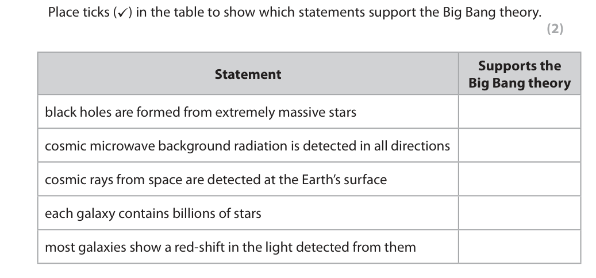
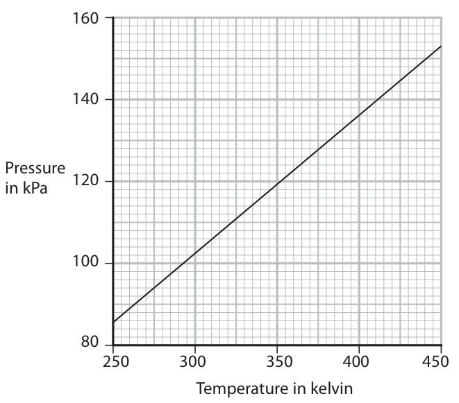
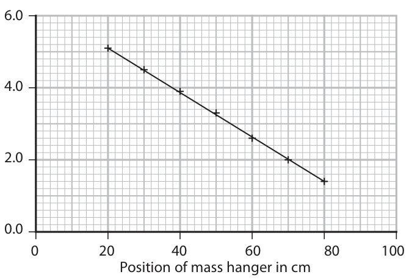
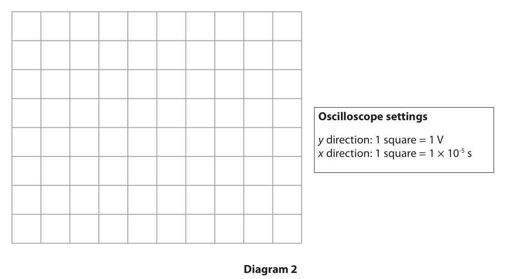

# 4PH1/2P — 2021-11 (official extraction)

> schema `syllabai.official-paper-questions/0.2` · paper_id `pearson-edexcel:international-gcse:physics:4ph1:2021-11:4PH1/2P` · qp sha256 `dc1bed30a5484aec…` · extraction is the disclosed baseline (ADR-039)

## Question 1 (5 marks)

This question is about astrophysics.

### 1(a) [2]

The table lists some statements about the universe. Place ticks (✓) in the table to show which statements support the Big Bang theory. . Supports the Statement Big Bang theory black holes are formed from extremely massive stars cosmic microwave background radiation is detected in all directions cosmic rays from space are detected at the Earth’s surface each galaxy contains billions of stars most galaxies show a red-shift in the light detected from them

**Mark scheme answer**

> 2
> 1 mark for each correct tick;
> -1 for each additional tick if more than two ticks seen
> 5 ticks scores zero

- **(2)** 2

### 1(b) [1]

The Sun will become a red giant star when it leaves the main sequence. Which row correctly describes how the surface temperature and brightness of the Sun will change when it becomes a red giant? Surface Brightness temperature

- **(A)** decreases                                                                          decreases
- **(B)** decreases                                                                           increases  ✔
- **(C)** increases                                                                         decreases
- **(D)** increases                                                                          increases

**Mark scheme answer**

> B (decreases, increases);
> A is incorrect because a red giant is more powerful
> than a main sequence star
> C is incorrect because a red giant is cooler and
> more powerful than a main sequence star
> D is incorrect because a red giant is cooler than a
> main sequence star

- **(1)** Answer B: decreases                                                                           increases

### 1(c) [2]

Astronomical objects can be classified by their absolute magnitude. State what is meant by the term absolute magnitude.

**Mark scheme answer**

> the brightness/luminosity (of an object);
> idea of a standard distance; allow 10 parsecs/32(.6)
> light years
> condone incorrect
> distance
> Answer Notes Marks

- **(2)** the brightness/luminosity (of an object);

## Question 2 (10 marks)

The photograph shows the Three Gorges Dam in China, one of the largest hydroelectric power stations on Earth. reservoir river dam © PRILL/Shutterstock

**(b)** Water is held in a reservoir on one side of the dam. The water flows through turbines to a river on the other side of the dam. The water level of the river is lower than the water level of the reservoir.

**(c)** The Three Gorges Dam has a larger maximum output power than any other hydroelectric power station on Earth.

### 2(a) [2]

State two advantages of generating electricity using hydroelectric power stations. 1 2

**Mark scheme answer**

> any two from:
> MP1. water is renewable/eq; allow “water is free”/eq
> MP2. no fuel / transportation cost;
> MP3. no air pollution / greenhouse gases; allow named pollutant e.g.
> CO2 etc.
> MP4. always available (vs wind/solar); allow “reliable”
> allow “respond quickly to
> demand”

- **(2)** any two from:

### 2(b)(i) [1]

State which energy store of the water decreases as the water flows from the reservoir to the river.

**Mark scheme answer**

> gravitational (potential energy);

- **(1)** gravitational (potential energy);

### 2(b)(ii) [1]

How is energy transferred from the dam to homes and factories in China?

- **(A)** by heating
- **(B)** by radiation
- **(C)** electrically  ✔
- **(D)** mechanically

**Mark scheme answer**

> C (electrically);
> A is incorrect because there is no temperature
> difference
> B is incorrect because there are no light or
> sound waves emitted
> D is incorrect because the transfer does not
> involve forces

- **(1)** Answer C: electrically

### 2(c)(i) [1]

State what is meant by the term power.

**Mark scheme answer**

> rate of {energy transfer / doing work}; allow alternatives to rate
> e.g. per second, per unit
> time etc.

- **(1)** rate of {energy transfer / doing work}; allow alternatives to rate

### 2(c)(ii) [3]

The mean energy transferred by the dam each day is 9.7 × 1014 J. Calculate the mean output power of the dam. mean output power = W

**Mark scheme answer**

> evaluation of number of seconds in a day; seen anywhere in working
> substitution into P = W ÷ t;
> evaluation; -1 for POT error
> e.g.
> 1 day = (24 × 60 × 60 =) 86 400 seconds
> (P =) 9.7 × 1014 ÷ 86 400
> (P =) 1.1 × 1010 (W) allow 1.1226…× 1010 (W)
> allow 6.7 x 1011 J/min or
> 4.04 x 1013 J/hr if given unit
> changed.
> 2 marks max. if time unit
> conversion attempted but
> incorrect unit e.g. 6.7 x
> 1011 (J/min) or 4.04 x 1013
> (J/hr)

- **(3)** evaluation of number of seconds in a day; seen anywhere in working

### 2(c)(iii) [1]

The maximum output power is 22 500 MW. Which of these is the same as 22 500 MW?

- **(A)** 22 500 000 J
- **(B)** 22 500 000 J/s
- **(C)** 22 500 000 000 J
- **(D)** 22 500 000 000 J/s  ✔

**Mark scheme answer**

> D (22 500 000 000 J/s);
> A is incorrect because joules is not the unit for
> power and mega has not been dealt with
> correctly
> B is incorrect because mega has not been dealt
> with correctly
> C is incorrect because joules is not the unit for
> power

- **(1)** Answer D: 22 500 000 000 J/s

### 2(c)(iv) [1]

Suggest why the Three Gorges Dam does not always operate at its maximum output power.

**Mark scheme answer**

> any one from: ignore idea of efficiency
> • idea that electricity demand varies;
> • idea that water level in reservoir varies;
> • idea that water may not be available as
> readily at certain times of the year;
> Answer Notes Marks

- **(1)** any one from: ignore idea of efficiency

## Question 3 (10 marks)

This question is about solids, liquids and gases.

**(b)** A sealed metal flask contains air at room temperature. The flask is then heated. The graph shows how the pressure of the air increases as its temperature increases. 160 140 Pressure in kPa 120 100 250 300 350 400 450 Temperature in kelvin

### 3(a) [2]

Melting is the process that occurs when a solid changes into a liquid. Using ideas about particles, describe the process of melting.

**Mark scheme answer**

> award either or both marks if
> clear from diagram
> (some) bonds (between particles) are broken or accept idea of reduction in
> weakened; intermolecular forces
> particles begin to move around or slide over each reject MP2 if there is a
> other; reference to the speed of
> particles or KE changing
> during melting

- **(2)** award either or both marks if

### 3(b)(i) [2]

Explain how heating the flask increases the temperature of the air inside the flask.

**Mark scheme answer**

> any two from:
> MP1. energy is transferred to air/particles (by accept molecules for particles
> heating);
> MP2. idea that particles move faster; accept particles gain KE
> MP3. temperature (in K) is (directly)
> proportional to KE of particles;

- **(2)** any two from:

### 3(b)(ii) [2]

Explain why the pressure of the air increases as its temperature increases.

**Mark scheme answer**

> particles hit (flask) walls more frequently;
> particles hit (flask) walls with more force /
> harder;

- **(2)** particles hit (flask) walls more frequently;

### 3(b)(iii) [1]

Using the graph, determine the pressure of the air when its temperature is 400 K. pressure = kPa

**Mark scheme answer**

> 136 (kPa); allow answers in the range
> 135-137 (kPa)

- **(1)** 136 (kPa); allow answers in the range

### 3(b)(iv) [3]

The air in the flask is now cooled to a temperature of 230 K. Calculate the new pressure of the air. pressure = kPa

**Mark scheme answer**

> substitution; allow ecf from (b)(iii)
> rearrangement; e.g. 86 (kPa) for (iii) gives 79
> (kPa) for (iv)
> substitution and
> evaluation; rearrangement in either order
> e.g.
> 136 / 400 = p2 / 230
> (p2 =) (136 x 230) / 400
> (p2 =) 78 (kPa) allow 78.2…
> accept extrapolation back to
> T = 230 for 2 marks
> accept value between 79 and
> 77 by this method
> accept calculation using graph
> (i.e. extrapolation
> numerically/algebraically)
> back to 230 for 2 marks
> accept value between 79 and
> 77 by this method
> Answer Notes Marks

- **(3)** substitution; allow ecf from (b)(iii)

## Question 4 (6 marks)

In extreme conditions, the isotope lithium-6 can be made to undergo nuclear fission.

**(a)** The lithium-6 nucleus absorbs a neutron and produces an alpha particle and an isotope of hydrogen. The incomplete nuclear equation for this fission is 6 4 Li + 1 n → 2 He + H

### 4(a)(i) [2]

Complete the nuclear equation by writing the numbers in the boxes.

> 🖼 crop required: boxes (qp.pdf p.8)

**Mark scheme answer**

> mass number = 3;
> atomic number = 1;

- **(2)** mass number = 3;

### 4(a)(ii) [2]

Explain why this fission does not cause a chain reaction.

**Mark scheme answer**

> idea that a (further) neutron is required (for further
> fission reactions);
> (but) no neutrons produced (in the fission process);

- **(2)** idea that a (further) neutron is required (for further

### 4(b) [2]

Explain the difference between nuclear fission and nuclear fusion.

**Mark scheme answer**

> fission is the splitting of a nucleus; allow “breaking down”,
> “dividing” for splitting
> fusion is the joining of two nuclei; allow “fusing”,
> “combining” for joining
> Answer Notes Marks

- **(2)** fission is the splitting of a nucleus; allow “breaking down”,

## Question 5 (13 marks)

A student investigates how the support forces acting on a metre rule are affected by the position of a mass hanger. He uses this apparatus. newton meter A newton meter B metre rule mass hanger This is the student’s method. ● suspend a metre rule from its 10 cm and 90 cm marks using two newton meters ● place a mass hanger with a weight of 5 N at the 20 cm mark on the metre rule ● adjust the heights of the newton meters until the metre rule is horizontal ● record the readings on both newton meters The student repeats the method, moving the mass hanger to a different position on the metre rule each time.

**(b)** The table shows the student’s results. Position of mass Reading on newton Reading on newton hanger in cm meter A in N meter B in N 20 5.1 1.4 30 4.5 2.0 40 3.9 2.6 50 3.3 3.3 60 2.6 3.9 70 2.0 4.5 80 1.4 5.1 The graph shows the results for newton meter A. 6.0 4.0 Reading on newton meter in N 2.0 0.0 0 20 40 60 80 100 Position of mass hanger in cm

### 5(a)(i) [1]

State the independent variable in the student’s investigation.

**Mark scheme answer**

> position of the mass hanger; allow distance of mass
> hanger/eq
> reject unqualified
> “distance”

- **(1)** position of the mass hanger; allow distance of mass

### 5(a)(ii) [2]

State two control variables in the student’s investigation. 1 2

**Mark scheme answer**

> any two from: ignore “same
> equipment”
> MP1. weight or mass of metre rule
> MP2. weight or mass of mass hanger;
> MP3. positions of newton meter(s);

- **(2)** any two from: ignore “same

### 5(a)(iii) [1]

Suggest how the student could improve the quality of his data.

**Mark scheme answer**

> any one from:
> • take repeats and find mean;
> • extend the range of the results;
> • measure more intermediate positions;
> • repeat to {identify/remove} anomalies;
> • plot a graph to spot anomalies;

- **(1)** any one from:

### 5(b)(i) [1]

Plot the results for newton meter B.

**Mark scheme answer**

> all data plotted to within half a small square;

- **(1)** all data plotted to within half a small square;

### 5(b)(ii) [1]

Draw the line of best fit for newton meter B.

**Mark scheme answer**

> straight line passing through all points; allow straight line
> with points evenly
> distributed either side
> if plotting error in (i)

- **(1)** straight line passing through all points; allow straight line

### 5(b)(iii) [4]

Describe the relationships shown by the graph.

**Mark scheme answer**

> any four from:
> MP1. as position of mass hanger increases, reading
> on newton meter A decreases;
> MP2. as position of mass hanger increases, reading accept “as A
> on newton meter B increases; decreases, B
> increases” for MP1 &
> MP2
> MP3. relationship(s) are linear; ignore references to
> proportionality
> MP4. idea that newton meter readings are the same
> when the position is 50cm;
> MP5. idea that the sum of the newton meter
> readings is constant;

- **(4)** any four from:

### 5(c) [3]

Using ideas about moments, explain why the reading on newton meter A decreases as the mass hanger is moved towards newton meter B.

**Mark scheme answer**

> any three from:
> MP1. idea that clockwise moment equals anti- allow idea that
> clockwise moment; moments must
> balance
> MP2. distance of mass hanger from newton meter B allow distance from
> decreases; newton meter A
> increases
> MP3. (therefore) anti-clockwise moment of mass
> hanger weight (about B) decreases;
> MP4. clockwise moment (of newton meter A
> reading) decreases (thereby decreasing
> reading);
> Answer Notes Marks

- **(3)** any three from:

## Question 6 (11 marks)

This question is about electromagnetism.

**(a)** Diagram 1 shows the construction of an electromagnet. metal core coil of wire Diagram 1

**(b)** Electromagnets are used in transformers to change the size of a voltage. Diagram 2 shows the construction of a simple transformer. primary coil (1500 turns) secondary coil (280 turns) metal core voltage = 115 V current = 1.2 A Diagram 2

### 6(a)(i) [1]

Name a suitable metal for the core.

**Mark scheme answer**

> (soft) iron;

- **(1)** (soft) iron;

### 6(a)(ii) [1]

State what must be done to the coil of wire to produce a magnetic field.

**Mark scheme answer**

> pass a current in the coil / eq; condone reference to
> ‘electricity’

- **(1)** pass a current in the coil / eq; condone reference to

### 6(b)(i) [1]

State the formula linking the input (primary) voltage, output (secondary) voltage and the turns ratio for a transformer.

**Mark scheme answer**

> Np/Ns = Vp/Vs; allow any correct
> rearrangement
> allow “i(nput) and
> o(utput)” or “1 and 2” for
> “p(rimary) and
> s(econdary)”
> allow correct word
> equation
> ignore ‘P’ for ‘N’
> condone ‘T’, ’t’ or ‘n’ for
> ‘N’
> condone ‘coils’ for ‘turns’

- **(1)** Np/Ns = Vp/Vs; allow any correct

### 6(b)(ii) [3]

The input voltage to the transformer is 115 V. Show that the output voltage is approximately 20 V.

**Mark scheme answer**

> substitution;
> rearrangement;
> evaluation to 2s.f. or more;
> e.g.
> 1500/280 = 115/Vs
> (Vs =) 115 × 280 / 1500
> (Vs =) 21 (V) allow 21.4666…(V)

- **(3)** substitution;

### 6(b)(iii) [3]

The input current to the transformer is 1.2 A. Calculate the output current. Assume that the transformer is 100% efficient. output current = A

**Mark scheme answer**

> use of transformer power formula;
> substitution OR rearrangement; allow use of 20, 21, 21.5
> etc. for output voltage
> evaluation; allow use of turns ratio
> i.e. step-down voltage
> means step-up current
> e.g.
> input power = output power OR VpIp = VsIs
> 115 × 1.2 = 20 × Is OR Is = VpIp/Vs
> (Is =) 6.9 (A) allow 7 (A)
> allow range of 6.4-6.9

- **(3)** use of transformer power formula;

### 6(b)(iv) [2]

State two factors that would increase the output current of the transformer. 1 2

**Mark scheme answer**

> any two from:
> MP1. increase input voltage/current;
> MP2. decrease number of turns on secondary coil; condone “decrease
> number of secondary
> coils”
> MP3. increase number of turns on primary coil; condone “increase
> number of primary coils”
> Answer Notes Marks

- **(2)** any two from:

## Question 7 (6 marks)

An electrostatic paint sprayer is used to paint an object. paint particles uncharged object positively charged nozzle wire to power supply

### 7(a) [3]

The nozzle of the paint sprayer is positively charged. Explain the advantage of using a charged nozzle. .

**Mark scheme answer**

> ignore statements
> relating to paint as a
> whole being attracted
> to the object
> paint particles are positively charged; allow idea of particles
> being given same
> charge
> condone particles being
> negatively charged
> paint particles repel/like charges repel; Allow idea that paint
> particles are attracted
> to the electrons in the
> (metal) object
> producing a thin / even coat of paint; allow idea that paint
> finish is improved
> allow idea that paint
> reaches parts that
> would otherwise be
> difficult

- **(3)** ignore statements

### 7(b) [3]

The object is an electrical conductor and is initially uncharged. Explain why the painting process would be more effective if the object were earthed. .

**Mark scheme answer**

> any three from:
> MP1. object becomes charged when paint particles
> land on it;
> MP2. (without earthing) further paint particles
> would be repelled by the object as they have
> the same charge;
> MP3. earthing discharges object; allow ‘neutralises
> object’ or ‘object
> becomes neutral’
> MP4. electrons transferred between Earth and
> object;
> MP5. (earthing means) paint continues to reach
> object/ giving thicker coat/give even
> coverage;
> Answer Notes Marks

- **(3)** any three from:

## Question 8 (9 marks)

The photograph shows an oscilloscope. © dny3d/Shutterstock An oscilloscope can be used to determine the frequency of a sound wave.

**(b)** Diagram 1 shows an oscilloscope screen when a sound wave is detected. It also shows the settings of the oscilloscope. Oscilloscope settings y direction: 1 square = 2 V x direction: 1 square = 5 × 10-6 s Diagram 1

### 8(a)(i) [1]

Name the piece of equipment that should be used with an oscilloscope to detect a sound wave.

**Mark scheme answer**

> microphone;

- **(1)** microphone;

### 8(a)(ii) [2]

Describe how an oscilloscope can be used to measure the time period of a sound wave.

**Mark scheme answer**

> measure number of squares for a number of complete condone ‘find number
> cycles / waves and find average number of squares for of squares for one
> one cycle; cycle’
> accept ‘period’ for
> ‘cycle’
> multiply number of squares for one cycle by the time
> base / eq;
> condone use of
> ‘wavelength’ for
> ‘period’ or ‘cycle’
> ignore reference to T =
> 1/f

- **(2)** measure number of squares for a number of complete condone ‘find number

### 8(b)(i) [4]

Determine whether the sound can be heard by humans. Include a calculation of frequency in your answer.

**Mark scheme answer**

> evaluation of time period of wave; reject if candidate
> uses y-axis
> substitution into f = 1 ÷ T;
> evaluation of frequency;
> conclusion consistent with frequency value; allow ecf if frequency
> is incorrect
> e.g.
> time period = 4 × 10-5 s
> f = 1 ÷ 4 × 10-5
> f = 25 000 (Hz)
> (therefore) sound cannot be heard (since frequency is conclusion must be
> greater than 20 000 Hz) consistent with
> candidate’s frequency
> value to be awarded
> the mark

- **(4)** evaluation of time period of wave; reject if candidate

### 8(b)(ii) [2]

The oscilloscope settings are changed, as shown in Diagram 2. Oscilloscope settings y direction: 1 square = 1 V x direction: 1 square = 1 × 10-5 s Diagram 2 On Diagram 2, draw the wave that would be displayed on the oscilloscope screen if the same sound wave is detected using these new settings.

**Mark scheme answer**

> wave has amplitude of 4 squares;
> wave has time period of 4 squares;
> e.g.
> Pearson Education Limited. Registered company number 872828
> with its registered office at 80 Strand, London, WC2R 0RL, United Kingdom

- **(2)** wave has amplitude of 4 squares;

