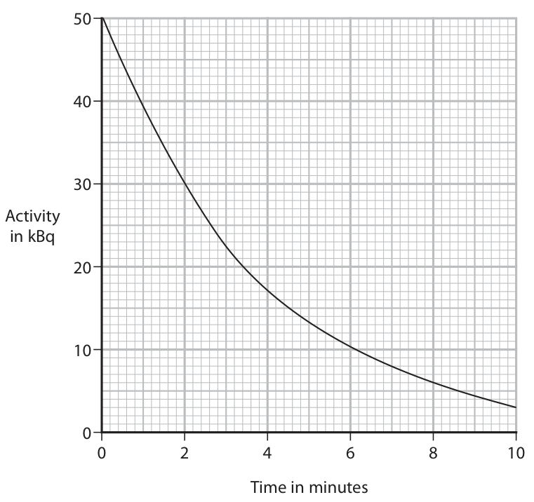
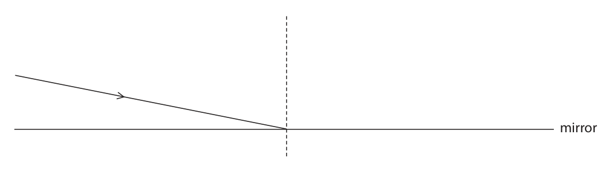
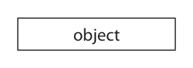
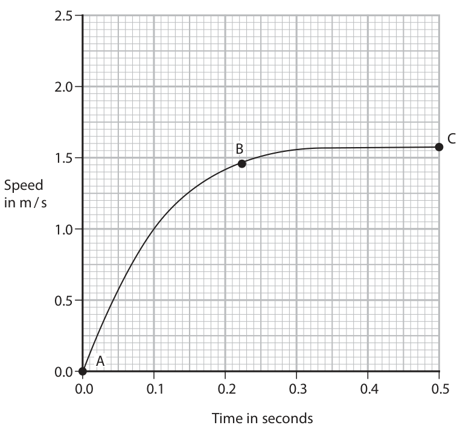
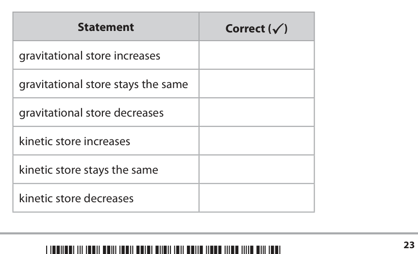
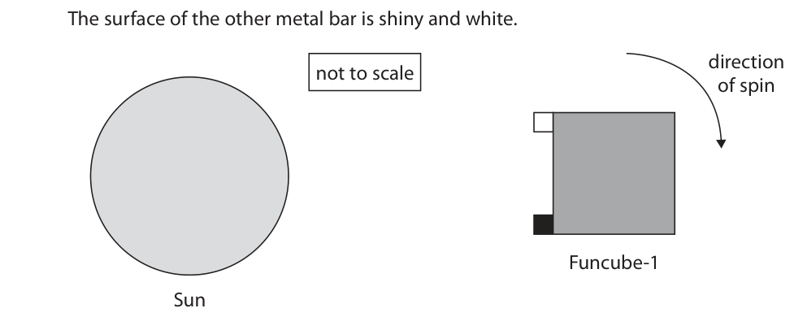
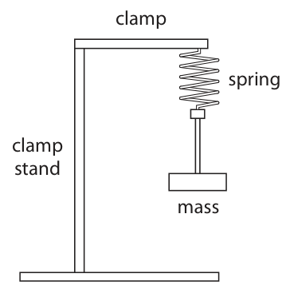
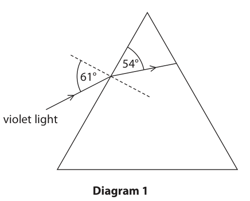

# 4PH1/1P — 2022-01 (official extraction)

> schema `syllabai.official-paper-questions/0.2` · paper_id `pearson-edexcel:international-gcse:physics:4ph1:2022-01:4PH1/1P` · qp sha256 `3dd03eab2e82185e…` · extraction is the disclosed baseline (ADR-039)

## Question 1 (7 marks)

The region of space around a magnet is known as a magnetic field.

**(b)** The diagram shows two bar magnets placed close together. N S N S

### 1(a) [1]

Which of these diagrams correctly represents the magnetic field around a bar magnet?

- **(A)** N       S
- **(B)** N       S
- **(C)** N       S
- **(D)** N       S

**Mark scheme answer**

> B;
> A is incorrect because the top two field lines are in the wrong direction
> C is incorrect because all the field lines are in the wrong direction
> D is incorrect because the second field line from the top is in the wrong
> direction

- **(1)** B;

### 1(b)(i) [1]

Which of these describes what happens to the two magnets?

- **(A)** nothing happens
- **(B)** they attract
- **(C)** they repel
- **(D)** they spin

**Mark scheme answer**

> B;
> A is incorrect because there is a magnetic force on each of the magnets
> C is incorrect because the two nearest poles are opposite not alike
> D is incorrect because the forces on the magnets pass through their centres of
> gravity

- **(1)** B;

### 1(b)(ii) [1]

Which of these magnet arrangements gives a uniform field between the poles? N N S N A B N S S N S S S C D

**Mark scheme answer**

> C;
> A is incorrect because the field lines are not straight nor parallel to each other
> B is incorrect because the field lines are not straight nor parallel to each other
> D is incorrect because the field lines are not parallel to each other
> (c) steel / nickel / cobalt / neodymium; condone iron
> (d) EITHER: all marks can be
> awarded from a
> diagram
> (plotting) compass used;
> multiple compasses or repeated use of single
> compass;
> joining up of dots/idea of compasses forming
> continuous line;
> OR
> iron filings used;
> sprinkled / eq; ignore ‘poured’ or other
> heavy-handed method
> card tapped (to reveal pattern);
> Answer Notes Marks

- **(1)** C;

### 1(c) [1]

State the name of a material that would be suitable for use as a permanent magnet.

### 1(d) [3]

Describe an investigation that could be used to determine the shape of the magnetic field around a bar magnet.

## Question 2 (5 marks)

A scientist wants to determine the half-life of a radioactive isotope. The scientist measures the count rate from the radioactive isotope.

**(b)** The graph shows how the activity of the radioactive isotope varies with time. Activity in kBq 0 2 4 6 8 10 Time in minutes

### 2(a) [1]

State how the scientist should correct the count rate for background radiation.

**Mark scheme answer**

> idea of subtracting the background
> count rate;

- **(1)** idea of subtracting the background

### 2(b)(i) [2]

Explain what is meant by the term half-life.

**Mark scheme answer**

> time taken; allow “how long it takes”
> reject “half the time”
> and either of
> for (radio)activity to halve; allow count rate for activity
> for half of the (radioactive) nuclei / atoms / ignore mass, substance
> isotope to decay;

- **(2)** time taken; allow “how long it takes”

### 2(b)(ii) [2]

Use the graph to determine the half-life of this isotope. half-life = minutes

**Mark scheme answer**

> indication on graph of a half in count rate; e.g. line drawn across from 25
> until it reaches the curve, then
> down to the time axis
> 2.6 (minutes); allow 2.5-2.7 (minutes)
> 2.3 (minutes) = 1 mark
> Answer Notes Marks

- **(2)** indication on graph of a half in count rate; e.g. line drawn across from 25

## Question 3 (8 marks)

Wi-Fi signals are electromagnetic waves that can be transmitted at frequencies of 2.4 GHz and 5.2 GHz.

### 3(a)(i) [1]

State a similarity of the Wi-Fi signals at 2.4 GHz and 5.2 GHz.

### 3(a)(ii) [1]

The two Wi-Fi signals have different frequencies. State another difference between the Wi-Fi signals.

### 3(b)(i) [1]

State the formula linking speed, frequency and wavelength.

**Mark scheme answer**

> speed = frequency × wavelength; allow standard symbols
> and rearrangements
> e.g. λ = v / f
> allow c for speed
> ignore s for speed

- **(1)** speed = frequency × wavelength; allow standard symbols

### 3(b)(ii) [2]

Calculate the wavelength of Wi-Fi signals transmitted at 5.2 × 109 Hz. [speed of light = 3.0 × 108 m / s] wavelength = m

**Mark scheme answer**

> substitution OR rearrangement;
> evaluation; -1 for POT error
> e.g.
> 3.0 × 10⁸ = 5.2 × 10⁹ × λ OR λ = v / f
> (wavelength =) 0.058 (m) allow 0.06, 0.0576…(m)

- **(2)** substitution OR rearrangement;

### 3(c)(i) [1]

Which type of wave is a Wi-Fi signal?

- **(A)** longitudinal
- **(B)** mechanical
- **(C)** sound
- **(D)** transverse

**Mark scheme answer**

> D;
> A is incorrect because electromagnetic waves are not longitudinal
> B is incorrect because electromagnetic waves are not mechanical waves
> C is incorrect because sound waves are not electromagnetic waves

- **(1)** D;

### 3(c)(ii) [2]

Describe the difference between a transverse wave and a longitudinal wave. You may draw a diagram to help your answer.

**Mark scheme answer**

> both marks can be
> scored from a suitable
> diagram
> vibrations / oscillations;
> correct relationship between direction of allow movement of
> travel/energy transfer and direction of vibration for particles / eq for
> both transverse and longitudinal waves; vibrations for this mark
> Answer Notes Marks

- **(2)** both marks can be

## Question 4 (5 marks)

A student investigates the reflection of light by a plane mirror. The student uses a ray box, a ruler, a pencil and a mirror.

**(b)** The diagram shows a ray of light directed to a point on the mirror. mirror

### 4(a) [1]

Name the apparatus that can be used to measure angles during the investigation.

**Mark scheme answer**

> protractor;

- **(1)** protractor;

### 4(b)(i) [1]

Label the angle of incidence.

**Mark scheme answer**

> any indication that the angle is between the normal
> and the incident ray;

- **(1)** any indication that the angle is between the normal

### 4(b)(ii) [1]

Measure the angle of incidence. angle of incidence = degrees

**Mark scheme answer**

> 79 (degrees); allow 78-80 (degrees)
> ecf from indicated
> angle of incidence in (i)
> e.g. 10-12 (degrees) if
> angle marked between
> ray and boundary

- **(1)** 79 (degrees); allow 78-80 (degrees)

### 4(b)(iii) [2]

Complete the diagram to show the ray reflected from the mirror.

**Mark scheme answer**

> any straight ray to the right of the normal that judge by eye
> comes from the point of incidence;
> correct angle of reflection; judge by eye
> Answer Notes Marks

- **(2)** any straight ray to the right of the normal that judge by eye

## Question 5 (9 marks)

A driver of a car sees an obstruction in the road ahead and must stop the car.

**(b)** The car experiences a braking force of 7600 N. The car has a mass of 1200 kg.

### 5(a)(i) [1]

State the formula linking average speed, distance travelled and time taken.

### 5(a)(ii) [2]

A car travels at 21 m / s. The driver’s reaction time is 0.14 seconds. Calculate the distance travelled by the car during the driver’s reaction time. distance = m

### 5(b)(i) [1]

State the formula linking force, mass and acceleration.

**Mark scheme answer**

> force = mass × acceleration; allow standard symbols
> and rearrangements
> e.g. a = F / m

- **(1)** force = mass × acceleration; allow standard symbols

### 5(b)(ii) [2]

Calculate the acceleration of the car. acceleration = m / s2

**Mark scheme answer**

> substitution OR rearrangement;
> evaluation;
> e.g.
> 7600 = 1200 × a OR a = F / m
> (a =) (−)6.3 (m/s2) allow 6.33… (m/s2)

- **(2)** substitution OR rearrangement;

### 5(b)(iii) [3]

Calculate the braking distance travelled as the speed of the car is reduced from 21 m / s to 0 m / s. distance = m

**Mark scheme answer**

> substitution into v2 = u2 + 2as; ecf answer from (ii)
> rearrangement;
> evaluation;
> e.g.
> 02 = 212 + [2 × (−)6.3 × distance]
> distance = 441 / 12.6
> distance = 35 (m) allow 34.8…(m)
> Answer Notes Marks

- **(3)** substitution into v2 = u2 + 2as; ecf answer from (ii)

## Question 6 (15 marks)
**(a)** A person throws an object vertically upwards. The speed-time graph shows how the speed of the object varies from the time it is thrown until reaching its maximum height. 5.0 4.0 3.0 Speed in m / s 2.0 1.0 0.0 0.0 0.1 0.2 0.3 0.4 0.5 Time in seconds

**(b)** A different object is dropped from rest and begins to fall. The graph shows how the speed of this object varies with time. 2.5 2.0 C B 1.5 Speed in m / s 1.0 0.5 A 0.0 0.0 0.1 0.2 0.3 0.4 0.5 Time in seconds

### 6(a)(i) [3]

Calculate the acceleration of the object. acceleration = m / s2

### 6(a)(ii) [3]

Calculate the distance the object travels to reach its maximum height. distance = m

### 6(b)(i) [2]

Give the name of the two forces acting on the object as it falls. 1 2

**Mark scheme answer**

> weight / gravitational force; ignore unqualified ‘gravity’,
> gravitational field strength
> drag / air resistance; ignore upthrust, lift

- **(2)** weight / gravitational force; ignore unqualified ‘gravity’,

### 6(b)(ii) [3]

Draw arrows on the diagram to show the forces acting on the object at B. object

**Mark scheme answer**

> one upward arrow and one downward arrow drawn; judge by eye
> arrows originate at object;
> downward arrow drawn longer than upward arrow; judge by eye

- **(3)** one upward arrow and one downward arrow drawn; judge by eye

### 6(b)(iii) [4]

Explain the shape of the graph from A to C. You should use ideas about forces to help your answer.

**Mark scheme answer**

> any four from:
> MP1. object is accelerating (from A to B); allow speeding up
> MP2. downward force greater than upward force allow any recognisable upward
> (at A); force and downward force
> MP3. gradient / acceleration decreasing (from A to
> B);
> MP4. drag increases as speed increases;
> MP5. resultant force decreases;
> MP6. idea that (just after) B, downward force = allow any recognisable upward
> upward force; force and downward force
> MP7. idea that in region BC, acceleration is
> zero/close to zero;
> MP8. terminal velocity achieved in region BC; allow constant velocity
> Answer Notes Marks

- **(4)** any four from:

## Question 7 (11 marks)

A teacher uses this circuit to investigate how the current in a circuit changes with the temperature of a room. 1.5 V 0.91 V 6.2 mA V 140 Ω

**(b)** The graph shows how the resistance of the thermistor changes with temperature. Resistance Temperature

### 7(a)(i) [2]

Calculate the voltage across the thermistor. voltage = V

### 7(a)(ii) [1]

State the formula linking voltage, current and resistance.

### 7(a)(iii) [3]

Calculate the resistance of the thermistor. resistance = Ω

### 7(b)(i) [2]

Describe the relationship between the temperature and the resistance of the thermistor.

**Mark scheme answer**

> idea that resistance of thermistor decreases with an
> increase in temperature;
> idea of non-linear relationship; allow idea that rate of
> change is decreasing
> resistance inversely
> proportional to
> temperature scores
> both marks

- **(2)** idea that resistance of thermistor decreases with an

### 7(b)(ii) [3]

Explain how the reading on the voltmeter changes when the temperature of the room decreases.

**Mark scheme answer**

> voltmeter reading decreases; allow voltage across
> resistor decreases
> (because) resistance of thermistor increases;
> idea that current in circuit/thermistor decreases;
> Answer Notes Marks

- **(3)** voltmeter reading decreases; allow voltage across

## Question 8 (11 marks)

Funcube-1 is a satellite that was launched into orbit around the Earth. (Source: © Shutterstock)

**(a)** The rocket carrying Funcube-1 burns fuel to accelerate upwards. As the rocket burns fuel, the energy in its chemical store reduces and the energy in its kinetic store and gravitational store changes.

**(c)** Funcube-1 goes into a circular orbit above the surface of the Earth.

### 8(a)(i) [1]

State how the kinetic store of the rocket changes as the rocket burns fuel.

### 8(a)(ii) [1]

State how the gravitational store of the rocket changes as the rocket burns fuel.

### 8(b) [2]

The rocket engine stops burning fuel. The rocket continues to go further away from the surface of the Earth. The table gives some statements about the rocket’s energy stores. Add ticks (✓) to the table to show which two statements are correct. Statement Correct (✓) gravitational store increases gravitational store stays the same gravitational store decreases kinetic store increases kinetic store stays the same kinetic store decreases

### 8(c)(i) [1]

State the name of the force responsible for keeping Funcube-1 in orbit.

**Mark scheme answer**

> gravitational (force); allow weight, gravity

- **(1)** gravitational (force); allow weight, gravity

### 8(c)(ii) [2]

Funcube-1 has an orbital radius of 7100 km and an orbital period of 5800 s. Calculate the orbital speed, in km / s, of Funcube-1. orbital speed = km / s

**Mark scheme answer**

> substitution into given formula;
> evaluation;
> e.g.
> orbital speed = (2 × π × 7100) / 5800
> (orbital speed =) 7.7 (km/s) allow 7.69… (km/s)
> (d) any four from: accept any clear
> reverse argument
> MP1. bars increase in temperature when facing towards
> Sun / decrease in temperature when facing away
> from Sun;
> MP2. (when pointed at the Sun,) black bar increases
> temperature faster than white bar;
> MP3. (because) black is a better absorber of radiation than allow energy, heat, IR
> white; for radiation
> MP4. (so) black bar reaches a higher temperature than
> white bar;
> MP5. (when pointed away from the Sun,) black bar
> decreases temperature faster than white bar;
> MP6. (because) black is a better emitter of radiation than allow energy, heat, IR
> white; for radiation
> MP7. convection/conduction plays no part in heat transfer
> (outside the spacecraft);
> MP8. (because) there are no particles outside the
> spacecraft;
> Answer Notes Marks

- **(2)** substitution into given formula;

### 8(d) [4]

Funcube-1 spins and is heated by the Sun. The diagram shows two coloured metal bars attached to a face of Funcube-1. The surface of one metal bar is dull and black. The surface of the other metal bar is shiny and white. direction not to scale of spin Funcube-1 Sun Temperature probes measure the temperature of each metal bar. Use ideas about thermal energy transfer to explain how the temperature of each metal bar changes as Funcube-1 spins.

## Question 9 (13 marks)

A student investigates how the extension of a spring varies when the mass attached to the spring is changed.

**(b)** The student calculates the force each mass applies to the spring. The table shows the student’s results. Force in N Extension in cm 0.0 0.0 1.0 2.5 2.0 5.0 3.0 9.8 4.0 10.0 5.0 12.5 6.0 15.5 7.0 19.5

### 9(a) [5]

The diagram shows most of the equipment the student uses in the investigation. clamp spring clamp stand mass Describe a method the student could use for the investigation. Your description should include the measurements taken and how the student could obtain accurate results.

**Mark scheme answer**

> any five from: allow any marking points if
> seen on diagram
> MP1. measure original length of spring;
> MP2. measure new length / extension for a range
> of masses;
> MP3. extension = new length – original length;
> MP4. use of ruler; allow tape measure
> MP5. method of avoiding parallax, e.g. look at eye
> level or use a pointer;
> MP6. use of a set square / clamping ruler
> vertically;
> MP7. idea of measuring between the same two
> points (on the spring);
> MP8. idea of repeating and averaging; allow repeating to identify
> anomalies
> MP9. idea of measuring extension with decreasing
> mass as well;

- **(5)** any five from: allow any marking points if

### 9(b)(i) [3]

Plot the student’s results.

**Mark scheme answer**

> suitable linear scale chosen (>50% of grid used); ignore orientation
> axes labelled with quantities and units;
> all plotting correct to nearest half square;

- **(3)** suitable linear scale chosen (>50% of grid used); ignore orientation

### 9(b)(ii) [1]

Draw a circle around the anomalous point.

**Mark scheme answer**

> data point at (3.0,9.8) identified; allow (7.0,19.5) as chosen
> point

- **(1)** data point at (3.0,9.8) identified; allow (7.0,19.5) as chosen

### 9(b)(iii) [1]

Draw a line of best fit.

**Mark scheme answer**

> straight line of best fit passing through origin and ecf from plotting in (i)
> non-anomalous points; ignore line beyond 6.0N

- **(1)** straight line of best fit passing through origin and ecf from plotting in (i)

### 9(b)(iv) [3]

Explain whether the spring obeys Hooke’s Law.

**Mark scheme answer**

> any three from:
> MP1. quotation of Hooke’s Law; i.e. force and extension
> should be proportional
> MP2. line is straight; allow idea that line is not
> straight if consistent with
> (iii)
> MP3. line passes through origin;
> MP4. no evidence of having passed elastic limit; allow idea that elastic limit
> has been reached if
> consistent with (iii)
> Answer Notes Marks

- **(3)** any three from:

## Question 10 (8 marks)

Diagram 1 shows a ray of violet light entering a prism. 54° 61° violet light Diagram 1

### 10(a)(i) [1]

Calculate the angle of refraction for the violet light. angle of refraction = degrees

### 10(a)(ii) [1]

State the formula linking refractive index, angle of incidence and angle of refraction.

### 10(a)(iii) [3]

Calculate the refractive index of the prism for violet light. Give your answer to 2 significant figures. refractive index = Diagram 2 shows rays of red light and violet light entering the same prism. Red light has a longer wavelength than violet light. red light violet light red and violet light Diagram 2

### 10(b) [3]

Deduce a possible relationship between the wavelength and the refractive index for colours of the visible spectrum.

## Question 11 (9 marks)

Scientific balloons are tested in a laboratory before they are used.

**(a)** In the first test the pressure of the air inside the balloon is 120 kPa. The balloon is sealed and has a volume of 92 m3.

**(b)** The pressure of the air in the balloon is returned to 120 kPa. The temperature of the air inside the balloon is 290 K. The balloon is tested again, changing the temperature of the air and keeping the volume of the balloon constant.

### 11(a)(i) [2]

The pressure of the air inside the balloon is reduced to 64 kPa by reducing the external air pressure. Calculate the new volume of the balloon. volume = m3

### 11(a)(ii) [1]

Give an assumption that is made in the calculation.

### 11(b)(i) [3]

Explain why the pressure of the air in the balloon decreases when the temperature of the air decreases.

**Mark scheme answer**

> any three from:
> MP1. (reduction in temperature) reduces
> speed/KE of particles;
> MP2. idea of fewer collisions with walls per unit allow particles collide
> time; with walls less often
> MP3. idea of each collision with wall being less
> ‘hard’;
> MP4. force (per unit area) on the container
> decreases;

- **(3)** any three from:

### 11(b)(ii) [3]

Calculate the temperature of the air when the pressure of the air in the balloon is 64 kPa. Give your answer in kelvin. temperature = K

**Mark scheme answer**

> substitution into given formula;
> rearrangement;
> evaluation;
> e.g.
> 120 / 290 = 64 / T2
> T2 = (64 × 290) / 120
> (temperature =) 150 (K) allow 155, 154.6… (K)
> Answer Notes Marks

- **(3)** substitution into given formula;

## Question 12 (9 marks)

This question is about an electric fan.

**(b)** The diagram shows part of the electric motor inside the fan. permanent axle magnet X Y N S W Z coil + −

### 12(a) [4]

A battery supplies a voltage of 12 V and a current of 0.25 A to the fan. The fan is switched on for 12 seconds and the fan gains 25 J in its kinetic energy store. Calculate the efficiency of this energy transfer. efficiency = %

**Mark scheme answer**

> calculation of energy transferred by battery; 36 (J) seen
> efficiency formula stated; seen or implied
> anywhere in working
> correct substitution; allow ecf from battery
> energy if clear
> 25/36 (×100) seen
> evaluation;
> e.g.
> energy supplied = VIt = 12 × 0.25 × 12 = 36 (J)
> efficiency = useful energy output
> total energy output
> efficiency = 25 / 36 (×100%)
> efficiency = 69 (%) allow 70, 69.4…(%)

- **(4)** calculation of energy transferred by battery; 36 (J) seen

### 12(b)(i) [4]

Explain why the coil starts to rotate when there is a current in the coil.

**Mark scheme answer**

> current / coil has a magnetic field;
> interaction between fields;
> resulting in a force; ignore references to
> attraction / repulsion
> forces on opposite sides of the coil are in opposite
> directions;

- **(4)** current / coil has a magnetic field;

### 12(b)(ii) [1]

Which side of the coil moves vertically upwards?

- **(A)** WX
- **(B)** XY
- **(C)** YZ  ✔
- **(D)** ZW

**Mark scheme answer**

> C - YZ;
> A is incorrect because WX moves downwards
> B is incorrect because part of XY moves downwards
> D is incorrect because part of ZW moves downwards
> Pearson Education Limited. Registered company number 872828
> with its registered office at 80 Strand, London, WC2R 0RL, United Kingdom

- **(1)** Answer C: YZ

