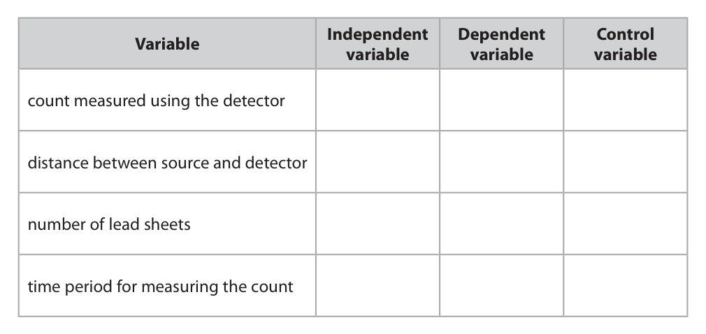
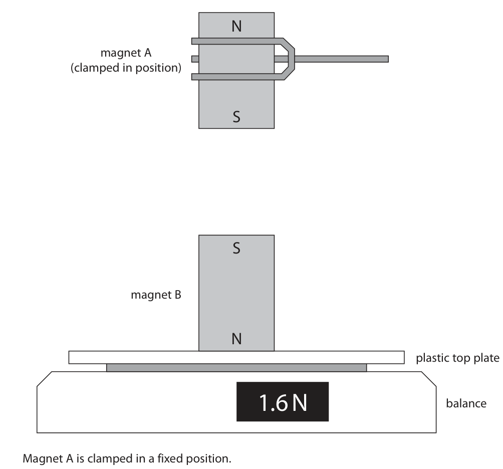
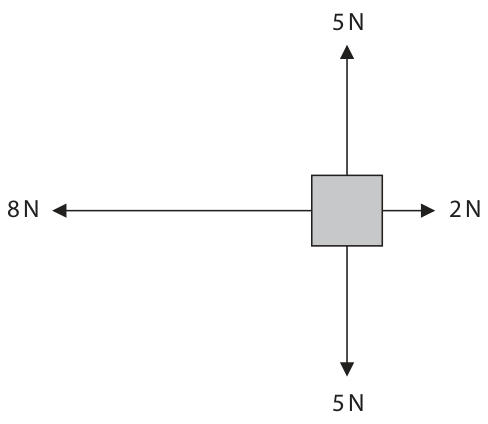
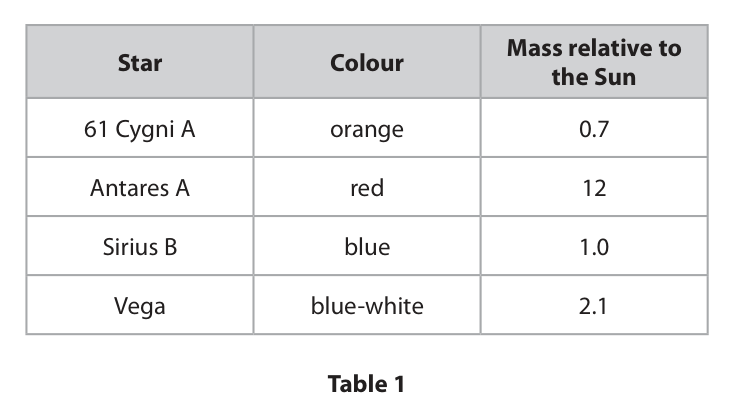
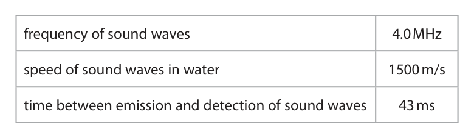
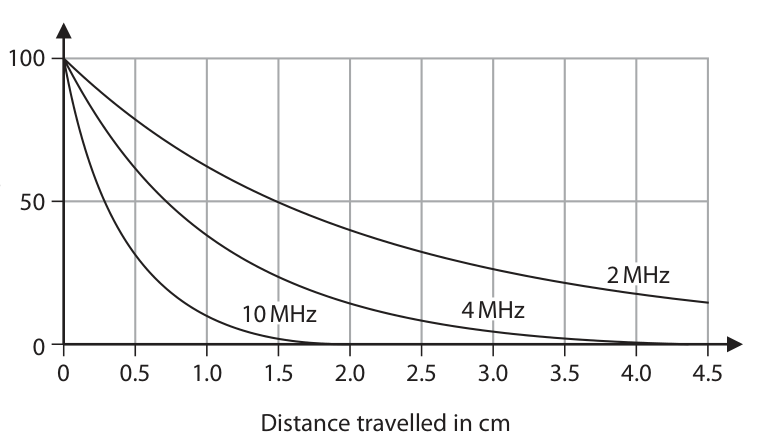
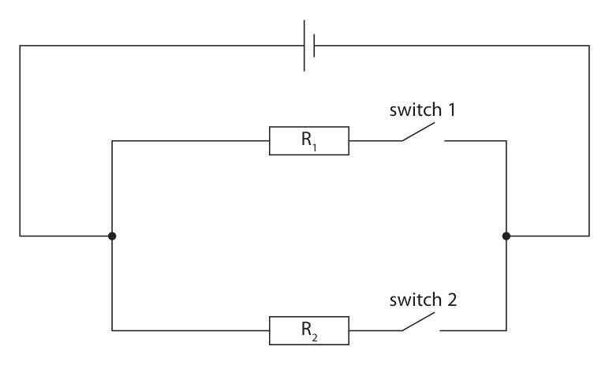
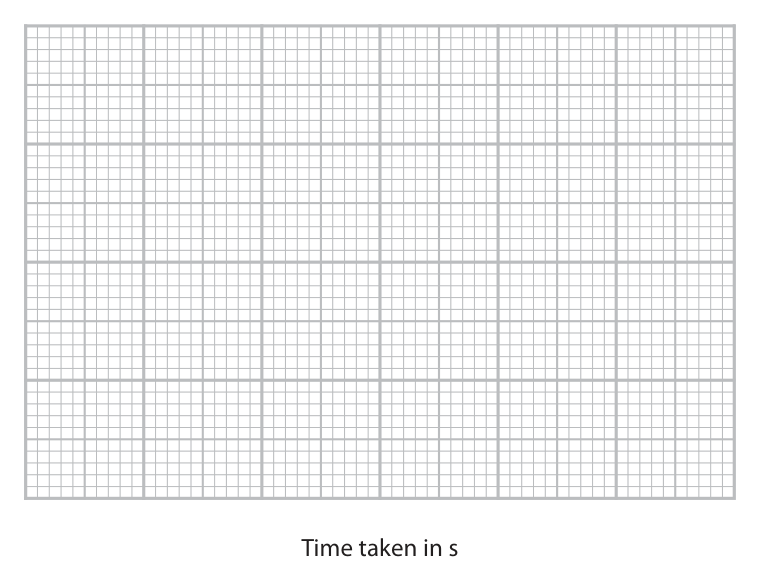

# 4PH1/1PR — 2022-01 (official extraction)

> schema `syllabai.official-paper-questions/0.2` · paper_id `pearson-edexcel:international-gcse:physics:4ph1:2022-01:4PH1/1PR` · qp sha256 `19c423c689cccd5b…` · extraction is the disclosed baseline (ADR-039)

## Question 1 (5 marks)
### 1(a) [1]

Bismuth‑207 is a gamma emitter and is represented by the symbol 207 83 Bi How many neutrons are in the nucleus of an atom of bismuth‑207?

- **(A)** 83
- **(B)** 124  ✔
- **(C)** 207
- **(D)** 290

**Mark scheme answer**

> B (124);
> A is incorrect because this is the number of protons
> C is incorrect because this is the number of protons and neutrons
> D is incorrect because this is twice the number of protons added to the neutrons

- **(1)** Answer B: 124

### 1(b) [1]

Which of these gives the best description of gamma radiation?

- **(A)** a helium nucleus
- **(B)** a high energy electron
- **(C)** a high frequency electromagnetic wave  ✔
- **(D)** a subatomic particle with mass, but with no charge

**Mark scheme answer**

> C (a high frequency electromagnetic wave);
> A is incorrect because this is the description of alpha radiation
> B is incorrect because this is the description of beta radiation
> D is incorrect because this is the description of neutron radiation

- **(1)** Answer C: a high frequency electromagnetic wave

### 1(c) [3]

A technician uses this method to investigate the penetration power of gamma radiation. • place a gamma emitting source at a fixed distance from a radiation detector • measure the count using the detector, for a period of one minute • place a thin sheet of lead between the source and the detector • measure the new count using the detector, for a period of one minute • increase the number of lead sheets between the source and detector and repeat this process The table gives some of the variables from the technician’s method. Complete the table by placing a tick (✓) in each row to show whether each variable is an independent, a dependent or a control variable. Independent Dependent Control Variable variable variable variable count measured using the detector distance between source and detector number of lead sheets time period for measuring the count

**Mark scheme answer**

> all 4 rows correct = 3 marks;;;
> 2-3 rows correct = 2 marks;;
> any 1 row correct = 1 mark;
> more than one tick in a row negates the mark for that row
> Answer Notes Marks

- **(3)** all 4 rows correct = 3 marks;;;

## Question 2 (8 marks)

X‑rays and gamma rays are examples of ionising radiation.

### 2(a) [1]

Which of these is another example of ionising radiation?

- **(A)** infrared
- **(B)** microwave
- **(C)** radio
- **(D)** ultraviolet  ✔

**Mark scheme answer**

> D (ultraviolet);
> A is incorrect because frequencies lower than visible light are non-ionising
> B is incorrect because frequencies lower than visible light are non-ionising
> C is incorrect because frequencies lower than visible light are non-ionising

- **(1)** Answer D: ultraviolet

### 2(b) [2]

Give one use of x‑rays and one use of gamma rays. x‑rays gamma rays

**Mark scheme answer**

> one use for x-rays;
> e.g. taking photos or detecting of (broken) bones, allow treating cancer /
> internal structures (of objects), sterilising medical equipment
> one use for gamma rays;
> e.g. radiotherapy, sterilising medical equipment, allow treating cancer
> reference to tracing, airport scanning of luggage,
> irradiating food (for preservation)

- **(2)** one use for x-rays;

### 2(c)(i) [1]

State the formula linking speed, frequency and wavelength of a wave.

**Mark scheme answer**

> speed = frequency × wavelength; allow standard symbols and
> rearrangements e.g.
> λ=v/f
> condone s for speed

- **(1)** speed = frequency × wavelength; allow standard symbols and

### 2(c)(ii) [3]

Calculate the wavelength of a gamma ray with a frequency of 2.8 × 1019 Hz. [speed of gamma ray = 3.0 × 108 m/s] wavelength = m

**Mark scheme answer**

> substitution;
> rearrangement;
> evaluation; -1 for POT error
> e.g.
> 3.0 × 108 = 2.8 × 1019 × wavelength
> wavelength = speed / frequency
> (wavelength =) 1.1 × 10-11 (m) allow 1.07… × 10-11 (m)

- **(3)** substitution;

### 2(d) [1]

X‑rays and gamma rays are electromagnetic waves. Which of these graphs is correct for waves travelling at a constant speed? frequency frequency 0 0 0 0 wavelength wavelength A B frequency frequency 0 0 0 0 wavelength wavelength C D

**Mark scheme answer**

> B;
> A is incorrect because it shows an exponential relationship
> C is incorrect because it shows a proportional relationship
> D is incorrect because it shows no relationship
> Answer Notes Marks

- **(1)** B;

## Question 3 (8 marks)

A student uses this apparatus to measure the force of repulsion between magnet A and magnet B. N magnet A (clamped in position) S S magnet B N plastic top plate 1.6 N balance Magnet A is clamped in a fixed position. Magnet B is resting on a balance.

**(d)** In the position shown, the balance reading is 1.6 N.

### 3(a) [1]

Give a reason why the two magnets shown in the diagram will repel each other.

**Mark scheme answer**

> idea that like poles repel;

- **(1)** idea that like poles repel;

### 3(b) [1]

Give a reason why the top plate of the balance is not affected by the magnetic fields of the magnets.

**Mark scheme answer**

> it is made of plastic / idea that plastic is non-
> magnetic;

- **(1)** it is made of plastic / idea that plastic is non-

### 3(c) [2]

Complete the diagram by drawing the shape and direction of the magnetic field pattern between the magnets.

**Mark scheme answer**

> correct shape e.g. lines deviating away from both reject if any field lines touch
> magnets; or cross except at pole
> correct direction e.g. any arrows must face towards
> poles;

- **(2)** correct shape e.g. lines deviating away from both reject if any field lines touch

### 3(d)(i) [2]

Explain how the balance reading will change if magnet A is brought closer to magnet B.

**Mark scheme answer**

> reading will increase;
> (because) magnetic field / (repulsive) force will be allow statement to the effect
> stronger; that magnet B will be pushed
> down more (by magnet A)

- **(2)** reading will increase;

### 3(d)(ii) [2]

Explain how the balance reading will change if the poles of magnet A are reversed but the distance between the magnets remains constant.

**Mark scheme answer**

> reading will decrease; allow reading will become
> negative / zero ;
> (because) magnets will now attract; allow statement to the effect
> that magnet B will be pulled
> upwards
> Answer Notes Marks

- **(2)** reading will decrease; allow reading will become

## Question 4 (7 marks)

This question is about scalar quantities and vector quantities.

### 4(a) [2]

Give a similarity and a difference for scalar quantities and vector quantities. similarity difference

**Mark scheme answer**

> both have magnitude;
> (only) vectors have a direction;

- **(2)** both have magnitude;

### 4(b) [3]

The box gives some physical quantities. Draw a circle around each physical quantity that is a scalar. acceleration charge force power temperature velocity weight

**Mark scheme answer**

> charge; if 4 circled,
> 2 marks max.
> power; if 5-6 circled,
> 1 mark max.
> temperature; no marks if all circled

- **(3)** charge; if 4 circled,

### 4(c) [2]

The diagram shows four forces acting on an object. Calculate the size and direction of the resultant force. 5N 8N 2N 5N resultant force = N direction =

**Mark scheme answer**

> (resultant force =) 6 (N); ignore sign
> (direction =) left; allow indication of same
> direction as 8 (N) force
> condone West
> Answer Notes Marks

- **(2)** (resultant force =) 6 (N); ignore sign

## Question 5 (12 marks)

The chart shows the efficiencies of different methods of generating electricity. hydroelectric (large) hydroelectric (small) oil nuclear fission wind turbine geothermal 0 10 20 30 40 50 60 70 80 90 100 Electricity generation efficiencies (%)

### 5(a) [2]

The chart shows that the geothermal power station has an efficiency of 15%. Explain what is meant by an efficiency of 15%.

**Mark scheme answer**

> idea that 15% of total energy; allow reverse argument e.g.
> 85% of total energy is wasted
> is transferred usefully;

- **(2)** idea that 15% of total energy; allow reverse argument e.g.

### 5(b) [4]

A small hydroelectric power station has a useful energy output of 6.0 kJ. Calculate the total energy input for this power station using information from the chart. total energy input = kJ

**Mark scheme answer**

> correct efficiency read from graph;
> substitution into efficiency formula; allow ecf from incorrect
> efficiency
> rearrangement;
> evaluation;
> e.g.
> 90% or 0.9 seen in working
> 0.9 = 6.0 / total energy input allow working in J or kJ
> total energy input = useful energy / efficiency
> (total energy input =) 6.7 (kJ)
> allow any correctly rounded
> value for 4 marks
> allow 6.6 or 6.6 recurring (kJ)
> for 3 marks

- **(4)** correct efficiency read from graph;

### 5(c)(i) [1]

Name a fuel used in the reactor of a nuclear power station.

**Mark scheme answer**

> uranium or plutonium; allow specifically named fuel
> e.g. uranium-235, plutonium-
> 239
> condone incorrect isotope

- **(1)** uranium or plutonium; allow specifically named fuel

### 5(c)(ii) [5]

These sentences describe the process of nuclear fission. Complete these sentences by writing a suitable word in each blank space. A nucleus absorbs a The nucleus formed splits because it is The nucleus splits into two smaller nuclei called nuclei and two or three The energy released is transferred into the energy store of the fission products.

**Mark scheme answer**

> neutron;
> unstable;
> daughter;
> neutrons;
> kinetic;
> Answer Notes Marks

- **(5)** neutron;

## Question 6 (11 marks)

This question is about stars.

**(a)** Table 1 gives some information about four stars. Mass relative to Star Colour the Sun 61 Cygni A orange 0.7 Antares A red 12 Sirius B blue 1.0 Vega blue‑white 2.1 Table 1

### 6(a)(i) [3]

Stars can be classified using their surface temperature. Complete Table 2 by giving the four stars in order of increasing surface temperature. Coolest Hottest Table 2

**Mark scheme answer**

> ;;;
> all four stars in the correct positions = 3 marks
> any two stars in the correct positions = 2 marks
> any 1 star in the correct position = 1 mark

- **(3)** ;;;

### 6(a)(ii) [1]

Name the star in Table 1 that does not follow a similar evolutionary path to the Sun.

**Mark scheme answer**

> Antares (A);

- **(1)** Antares (A);

### 6(b) [3]

The life cycle of a star begins in a nebula. Describe how a main sequence star is formed from a nebula.

**Mark scheme answer**

> any three from:
> MP1. nebula is (cold) cloud of dust/gas;
> MP2. gravity causes cloud to collapse/eq;
> MP3. temperature of cloud increases/eq;
> MP4. creating a protostar;
> MP5. idea that (main sequence star created when)
> fusion starts;

- **(3)** any three from:

### 6(c) [4]

Describe how a main sequence star becomes a white dwarf.

**Mark scheme answer**

> any four from:
> MP1. idea that hydrogen fusion stops (in core); condone idea of hydrogen
> runs out
> MP2. core collapses; allow star collapses
> MP3. core temperature of star increases;
> MP4. (star expands to) become a red (super)
> giant;
> MP5. surface temperature of star decreases
> (during red giant phase)
> MP6. helium fusion begins;
> MP7. white dwarf formed when helium fusion
> stops (in core);
> MP8. idea of rest of star released (as a planetary
> nebula);
> Answer Notes Marks

- **(4)** any four from:

## Question 7 (8 marks)
### 7(a) [6]

Describe an experiment to determine the refractive index of a glass block. In your answer you should include • a labelled diagram • the apparatus needed • the method used

> 🖼 crop required: apparatus (qp.pdf p.16)

> 🖼 crop required: diagram (qp.pdf p.16)

**Mark scheme answer**

> any five from MP1-MP7: allow marking points from
> diagram
> apparatus:
> MP1. method of creating thin beam of light; e.g. laser, ray box etc.
> ignore torch
> MP2. protractor;
> method:
> MP3. draw round the block;
> MP4. shine light into the block at an angle to the however expressed
> normal;
> MP5. mark incident and refracted rays;
> MP6. measure angles from the normal;
> MP7. repeat for different angles of incidence;
> PLUS
> allow simple use of
> MP8. graph of sin(i) and sin(r) with n found from n=sin(i)/sin(r)
> gradient

- **(6)** any five from MP1-MP7: allow marking points from

### 7(b) [2]

Give two uses of total internal reflection. 1 2

**Mark scheme answer**

> optical fibres;
> named prismatic use e.g. cats eye reflector,
> binoculars, periscope etc;
> Answer Notes Marks

- **(2)** optical fibres;

## Question 8 (9 marks)
**(a)** The diagram shows a fishing boat fitted with a high frequency sound wave emitter. The boat is above some fish. emitter fish The high frequency sound waves travel from the emitter to the fish and then back to the emitter, where they are detected.

**(b)** High frequency sound waves decrease in amplitude as they travel through soft tissue in the human body. The graph shows this decrease in amplitude for three different high frequency sound waves. 100 Relative amplitude (%) 50 2 MHz 10 MHz 4 MHz 0 0.5 1.0 1.5 2.0 2.5 3.0 3.5 4.0 4.5 Distance travelled in cm

### 8(a)(i) [1]

Name the wave behaviour that causes the sound waves to change direction when they reach the fish.

**Mark scheme answer**

> reflection;

- **(1)** reflection;

### 8(a)(ii) [4]

The table gives some data about the sound waves used. frequency of sound waves 4.0 MHz speed of sound waves in water 1500 m/s time between emission and detection of sound waves 43 ms Calculate the distance between the sound wave emitter and the fish. distance = m

**Mark scheme answer**

> substitution into speed = distance / time; ignore units
> condone incorrect conversion
> of time from 43 ms i.e. 43,
> 43/60, 43 × 1000, 43 × 60
> rearrangement;
> evaluation of correct total distance;
> halved to find distance to fish; accept wherever applied i.e.
> to the time or to the distance
> travelled.
> e.g.
> 1500 = distance / 0.043
> distance = speed × time
> (distance =) 64.5
> (distance = 64.5 ÷ 2) = 32 (m)
> 64.5, 65 = 3 marks (no
> halving)
> 32250 etc = 3 marks (POT)
> 64500 etc = 2 marks (POT and
> no halving)

- **(4)** substitution into speed = distance / time; ignore units

### 8(b)(i) [1]

Estimate the distance travelled by a 2 MHz wave when its amplitude is 25% of its original value. distance = cm

**Mark scheme answer**

> 3.0 ± 0.5 (cm); accept ‘3’

- **(1)** 3.0 ± 0.5 (cm); accept ‘3’

### 8(b)(ii) [3]

Describe what the graph shows about the penetrating ability of high frequency sound waves as they travel through soft tissue.

**Mark scheme answer**

> any three from:
> MP1. all frequencies show reduction in amplitude
> or intensity with distance;
> MP2. this reduction is non-linear; ignore ‘inverse proportion’
> condone ‘(negative)
> exponential’
> MP3. penetration decreases with increasing however expressed e.g. 2MHz
> frequency; penetrates more than 4 MHz
> which penetrates more than
> 10MHz
> MP4. use of data from graph to justify MP3; e.g. relative values at a given
> distance
> or distances at which the
> frequencies are at a given
> value
> Answer Notes Marks

- **(3)** any three from:

## Question 9 (12 marks)

The diagram shows a circuit containing a cell, two switches and two resistors, R1 and R2 . switch 1 R1 switch 2 R2

**(b)** Both switches in the circuit are now closed.

**(c)** Switch 1 is now opened whilst switch 2 remains closed.

### 9(a) [2]

A light emitting diode (LED) is represented using the symbol Draw a LED on the circuit diagram that will indicate when there is a current in resistor R1 .

**Mark scheme answer**

> LED drawn on branch of circuit containing only R1;
> LED drawn in the correct orientation;

- **(2)** LED drawn on branch of circuit containing only R1;

### 9(b)(i) [1]

Draw an ammeter on the circuit diagram that will measure the current in the cell.

**Mark scheme answer**

> correct ammeter symbol drawn on main branch of
> circuit and in series with cell;

- **(1)** correct ammeter symbol drawn on main branch of

### 9(b)(ii) [2]

The voltage across the cell is 4.5 V. Explain how the voltage across R2 compares with the voltage across the cell.

**Mark scheme answer**

> voltage across R2 is the same / 4.5 V;
> (because) they are in parallel; allow higher level answers in
> terms of energy transferred
> per unit charge

- **(2)** voltage across R2 is the same / 4.5 V;

### 9(c)(i) [1]

State the formula linking energy transferred, charge and voltage.

**Mark scheme answer**

> energy (transferred) = charge × voltage; allow standard symbols and
> rearrangements
> e.g. Q = E / V
> reject C for charge

- **(1)** energy (transferred) = charge × voltage; allow standard symbols and

### 9(c)(ii) [3]

The voltage across the cell stays constant at 4.5 V. Calculate the charge transferred through the cell when the cell transfers 4.1 J of energy. charge transferred = C

**Mark scheme answer**

> substitution;
> rearrangement;
> evaluation;
> e.g.
> 4.1 = charge × 4.5
> (charge =) 4.1 / 4.5
> (charge =) 0.91 (C) allow 0.911…(C)

- **(3)** substitution;

### 9(c)(iii) [3]

A student investigates how the current in resistor R2 varies with the voltage across it. Describe how the circuit could be modified for the student to do this investigation.

**Mark scheme answer**

> idea that a voltmeter is needed;
> voltmeter should be connected across / in parallel
> (with R2);
> suitable means of varying circuit current described; e.g. changing number of
> cells, using a variable power
> supply, adding variable
> resistor to the circuit
> Answer Notes Marks

- **(3)** idea that a voltmeter is needed;

## Question 10 (13 marks)

A student does an experiment to determine the acceleration due to gravity, g. The diagram shows the apparatus used. steel ball light gate A clamp stand transparent tube light gate B This is the student’s method. • connect both light gates to a data logger • drop a steel ball from rest at the top of the transparent tube • record the speed of the ball at each light gate • record the time taken for the ball to fall from light gate A to light gate B

**(a)** The box shows the data recorded by the data logger. speed at A = 1.45 m/s speed at B = 4.20 m/s time from A to B = 0.286 s

**(b)** The student changes the distance between the light gates by varying the position of light gate B. The student measures the time taken for the steel ball to fall from light gate A to light gate B when the light gates are different distances apart. The table shows the student’s results. Distance between Time taken light gates in s in m 0.10 0.058 0.20 0.103 0.30 0.141 0.40 0.175 0.50 0.205 0.60 0.233 0.70 0.260

### 10(a)(i) [2]

Show that the acceleration of the steel ball is approximately 9.6 m/s2 . acceleration = m/s2

**Mark scheme answer**

> substitution into a = ∆v / t;
> evaluation to 3 or more s.f.;
> e.g.
> acceleration = (4.20 – 1.45) / 0.286
> (acceleration =) 9.62 (m/s2)

- **(2)** substitution into a = ∆v / t;

### 10(a)(ii) [2]

Explain why the student’s value for the acceleration of the steel ball is lower than the accepted value for the acceleration due to gravity, g.

**Mark scheme answer**

> idea that air resistance / friction also acts on ball; allow drag
> which opposes the ball’s weight; allow idea that frictional force
> is upwards whilst weight is
> downwards
> allow idea that resultant force
> is less that weight
> ignore idea of reaction time /
> other human errors

- **(2)** idea that air resistance / friction also acts on ball; allow drag

### 10(a)(iii) [3]

Calculate the distance between the light gates. distance = m

**Mark scheme answer**

> substitution into v2 = u2 + 2×a×s; allow use of a=9.6, 9.8, 9.81 or
> rearrangement;
> evaluation;
> reject ‘change in speed ×
> time’ giving 0.78(65) as
> incorrect physics
> allow answers using correct
> average velocity.
> e.g.
> 4.202 = 1.452 + (2 × 9.6 × s)
> s = (v2 - u2) / 2a
> (s =) 0.809 (m) allow range 0.78-0.81 (m)

- **(3)** substitution into v2 = u2 + 2×a×s; allow use of a=9.6, 9.8, 9.81 or

### 10(b)(i) [2]

Plot a graph of the student’s results on the grid.

**Mark scheme answer**

> suitable scale on both axes;
> all points plotted correctly to nearest half square;

- **(2)** suitable scale on both axes;

### 10(b)(ii) [1]

Draw the curve of best fit. Distance between light gates in m Time taken in s

**Mark scheme answer**

> smooth curve drawn with an even distribution of ECF candidate plotting
> data points either side;

- **(1)** smooth curve drawn with an even distribution of ECF candidate plotting

### 10(b)(iii) [3]

Explain how the graph shows that the steel ball is accelerating as it falls.

**Mark scheme answer**

> gradient of graph is equal to the speed / velocity
> of the ball;
> gradient is increasing (as time increases); allow “curve gets steeper”
> allow idea of greater distance
> in a unit of time
> speed / velocity is increasing (as time increases); DOP
> award 1 mark for idea that
> graph is a curve if no other
> marks awarded
> Answer Notes Marks

- **(3)** gradient of graph is equal to the speed / velocity

## Question 11 (10 marks)

The photograph shows a mechanic pumping air into a car tyre. (Source: Rido/Shutterstock)

**(b)** The car is fitted with a tyre pressure monitoring system. A warning light will show in the car if the air pressure in the tyre falls below 250 kPa.

### 11(a) [3]

Before being pumped into the tyre, some air has a volume of 0.0043 m3 at a pressure of 100 kPa. The pressure of this air inside the tyre is 270 kPa. Calculate the volume of this air inside the tyre, assuming the temperature of the air does not change. Give your answer in standard form. volume = m3

**Mark scheme answer**

> substitution into p1 × V1 = p2 × V2 OR
> rearrangement;
> evaluation of volume;
> correctly expressed in standard form;
> e.g.
> 100 × 0.0043 = 270 × V2
> OR V2 = p1 × V1 / p2
> (V2 =) 0.0016 (m3) allow 0.00159… (m3)
> (V2 =) 1.6 × 10-3 (m3) allow 1.59… × 10-3 (m3)

- **(3)** substitution into p1 × V1 = p2 × V2 OR

### 11(b)(i) [3]

Using ideas about particles, explain why the air pressure inside the tyre is lower on a cold winter day than on a warm summer day.

**Mark scheme answer**

> idea that particles move more slowly at lower allow RA if clear
> temp; allow lower kinetic energy
> (KE)
> reject no KE
> particles collide with walls less often;
> particles collide with walls less force; allow particles colliding less
> hard
> note: with walls/eq must be
> mentioned once

- **(3)** idea that particles move more slowly at lower allow RA if clear

### 11(b)(ii) [4]

The air pressure in the tyre is 270 kPa when the air temperature is 20 °C. On a cold winter day, the temperature is 2 °C. Determine whether the tyre pressure warning light will show in the car on the cold winter day. [assume tyre volume does not change]

**Mark scheme answer**

> dimensionally correct substitution into ignore units
> p1 / T1 = p2 / T2;
> conversion of either temperature into kelvin;
> rearrangement; can be implied
> correct subsequent evaluation of p2 with consistent
> conclusion;
> e.g.
> 270 / 293 = p2 / 275
> 293 or 275 used anywhere in calculation
> p2 = 270 × 275 / 293
> (p2 =) 253 (kPa) so light will not show
> 27 (kPa) so light will show
> scores 3 marks
> 243 (kPa) so light will show
> scores 2 marks
> Answer Notes Marks

- **(4)** dimensionally correct substitution into ignore units

## Question 12 (7 marks)

The photograph shows a recyclable box designed for transporting cold food. layered cardboard lid layered cardboard walls The box has these design features • thick walls made from several layers of cardboard with air trapped between the layers • a thick lid made from layers of cardboard Cold food and ice packs are placed in the box.

### 12(a) [1]

Give a reason why there is a net transfer of energy from the outside of the box to the inside of the box during transportation in a hot country.

**Mark scheme answer**

> idea that the temperature outside the box is however described
> greater than the temperature inside the box;
> e.g. “it is hotter outside the
> box than inside the box”

- **(1)** idea that the temperature outside the box is however described

### 12(b) [2]

Explain how the box is designed to reduce energy transfer by conduction.

**Mark scheme answer**

> any two from:
> MP1. air / cardboard is a poor conductor / (good) ignore idea of trapped air
> insulator;
> condone idea of ‘non-
> conductor’
> MP2. air is a gas (which are poor conductors);
> MP3. particles in air are far apart / collide with
> each other rarely;
> MP4. idea that thicker objects (of the same
> material) conduct slower;

- **(2)** any two from:

### 12(c) [2]

Explain how the box is designed to reduce energy transfer by convection.

**Mark scheme answer**

> idea that air (particles) cannot move around; e.g. air cannot flow or air
> trapped
> lid stops or reduces convection currents forming;
> accept idea that box is a solid
> and convection is impossible
> in solids for 1 mark

- **(2)** idea that air (particles) cannot move around; e.g. air cannot flow or air

### 12(d) [2]

A student suggests that painting the inner surfaces of the box a different colour would help to reduce the rate of energy transfer to the cold food. Explain which colour the inner surfaces of the box should be painted.

**Mark scheme answer**

> white / silver ;
> (because) these are poor emitters of infrared / accept ‘radiators’ for
> radiation; emitters
> ignore references to
> absorption or reflection
> Pearson Education Limited. Registered company number 872828
> with its registered office at 80 Strand, London, WC2R 0RL, United Kingdom

- **(2)** white / silver ;

