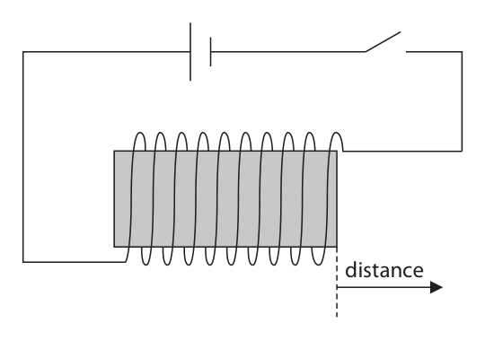
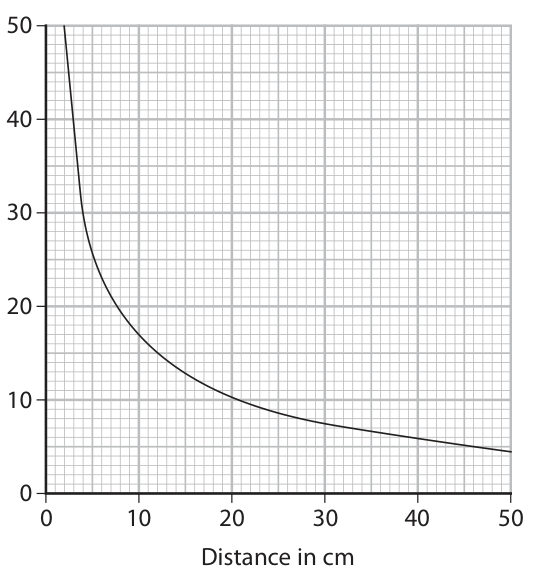

# 4PH1/2P — 2022-01 (official extraction)

> schema `syllabai.official-paper-questions/0.2` · paper_id `pearson-edexcel:international-gcse:physics:4ph1:2022-01:4PH1/2P` · qp sha256 `d5eb57419f98e3c4…` · extraction is the disclosed baseline (ADR-039)

## Question 1 (6 marks)
**(b)** Airbags are safety devices used in cars to protect the driver if there is a crash.

### 1(a) [1]

Which of these is a device used to measure force?

- **(A)** newton meter  ✔
- **(B)** ruler
- **(C)** thermometer
- **(D)** voltmeter

**Mark scheme answer**

> A;
> B cannot be correct as it measures distance
> C cannot be correct as it measures temperature
> D cannot be correct as it measures voltage

- **(1)** Answer A: newton meter

### 1(b)(i) [1]

State the formula linking momentum, mass and velocity.

**Mark scheme answer**

> momentum = mass × velocity; accept standard
> symbols e.g. p for
> momentum
> reject m or M for
> momentum

- **(1)** momentum = mass × velocity; accept standard

### 1(b)(ii) [1]

A person inside a car has a mass of 72 kg and a velocity of 13 m/s. Show that the momentum of the person is about 900 kg m/s.

**Mark scheme answer**

> $72 \times 13 = 936$;

- **(1)** $72 \times 13 = 936$;

### 1(b)(iii) [2]

The person experiences a crash and comes to rest in 0.29 s. Calculate the force on the person. force = N

**Mark scheme answer**

> substitution into given equation;
> accept use of Δp of 900,
> correct evaluation; 936 or 940
> correct answer: 3200 (N)
> e.g. force = change in momentum ÷ time taken
> = 936 ÷ 0.29 = 3200 (N)
> expect values of 3103,
> 3228 and 3241

- **(2)** substitution into given equation;

### 1(b)(iv) [1]

Which statement explains how airbags protect the driver?

- **(A)** increase the force acting on the driver
- **(B)** increase the time taken for the driver to stop  ✔
- **(C)** increase the kinetic energy store of the driver
- **(D)** increase the momentum of the driver

**Mark scheme answer**

> A cannot be correct as increasing the force does not
> protect the driver
> C cannot be correct as they would both increase
> the force on the person
> D cannot be correct as the airbag decreases the
> momentum
> Total for question 1: 6 marks
> Answer Notes Marks

- **(1)** Answer B: increase the time taken for the driver to stop

## Question 2 (6 marks)
### 2(a) [3]

Describe the arrangement and motion of particles in a solid. You may draw a diagram to help your answer.

**Mark scheme answer**

> idea of regular pattern/tightly packed; allow diagram
> particles vibrating; condone molecules or
> atoms for particles
> (about) fixed positions / eq;
> ignore reference to
> force

- **(3)** idea of regular pattern/tightly packed; allow diagram

### 2(b) [3]

A solid changes state by melting at a certain temperature. For phosphorus, this change of state occurs at 44 °C. Sketch how the temperature of a sample of phosphorus changes when it is heated at a constant rate from –40 °C to 80 °C. Temperature in °C 0 Time –20 –40

**Mark scheme answer**

> increases continuously from -40 to 44 oC ;
> remains constant (at 44 oC);
> increases continuously from 44 to 80 oC; ECF incorrect plateau
> responses with no
> period of time at 44
> score max 1 mark
> accept any gradient,
> straight lines or curves
> for the increasing
> temperature parts
> ignore any numbers on
> the time axis
> ignore second plateau
> after 44 if drawn
> Total for question 2: 6 marks
> Answer Notes Marks

- **(3)** increases continuously from -40 to 44 oC ;

## Question 3 (5 marks)

Nuclear fusion is a process that occurs in the core of stars.

### 3(a) [1]

Which is the best description of nuclear fusion?

- **(A)** large nucleus splitting into two smaller nuclei
- **(B)** nucleus emitting an electromagnetic wave
- **(C)** nucleus releasing a beta particle
- **(D)** two smaller nuclei joining together to form a larger nucleus  ✔

**Mark scheme answer**

> D;
> A cannot be correct as this is a description of
> fission
> B cannot be correct as this is a description of
> gamma decay
> C cannot be correct as this is a description of beta
> decay

- **(1)** Answer D: two smaller nuclei joining together to form a larger nucleus

### 3(b) [2]

Two nuclei are close together and stationary. Explain why these nuclei will move apart.

**Mark scheme answer**

> (nuclei are) positively charged; reject idea of charged
> atoms
> like charges repel;

- **(2)** (nuclei are) positively charged; reject idea of charged

### 3(c) [2]

Describe the conditions needed for fusion to occur in the core of a star.

**Mark scheme answer**

> high temperature;
> high pressure;
> ‘high temperature and
> pressure’ scores 2
> Total for question 3: 5 marks
> Answer Notes Marks

- **(2)** high temperature;

## Question 4 (9 marks)

A student investigates how the strength of the magnetic field from a solenoid changes with distance from the end of the solenoid. The diagram shows the solenoid connected to a power supply. distance

### 4(a) [5]

The student uses a device called a Hall probe, which can be placed anywhere in the magnetic field to measure its strength at that point. Design a suitable method for the investigation. Your answer should include • any extra measuring equipment needed • details of the independent variable, dependent variable and any control variables You may include a diagram to help your answer.

**Mark scheme answer**

> Any FIVE from: marks may be
> awarded from a
> suitable labelled
> diagram
> MP1: ruler; condone tape
> measure or metre
> stick
> MP2: idea of measuring mag field at different
> distances;
> MP3: idea of repeat and average;
> MP4: distance is independent variable;
> MP5: mag field strength is dependent variable;
> MP6: current is a control variable; condone voltage
> accept idea of
> ammeter use to
> monitor current
> MP7: reference to suitable second control variable
> e.g. coil (spacing or turns), the rest of the apparatus;

- **(5)** Any FIVE from: marks may be

### 4(b) [4]

The graph shows the results of the student’s investigation. Strength of magnetic field in arbitrary units 0 10 20 30 40 50 Distance in cm The student suggests that the relationship linking the strength of the magnetic field and the distance from the end of the solenoid is strength of magnetic field × (distance)³ = constant Use readings from the graph to deduce whether the results of the student’s investigation support this relationship.

**Mark scheme answer**

> any pair of readings from the graph;
> correct substitution into formula and constant found;
> different pair of readings used correctly to find a
> constant;
> statement that the results do not agree with the DOP
> conclusion;
> allow idea that the
> constants are the
> same so that the
> results agree with the
> conclusion
> e.g.
> when distance = 10 cm ,
> magnetic field strength = 17
> $17 \times 10^{3} = 17000$
> when distance = 50 cm ,magnetic field strength = 4
> $4 \times 50^{3} = 500000$
> constants are different so results disagree with
> conclusion

- **(4)** any pair of readings from the graph;

## Question 5 (9 marks)

The diagram shows a ball at the bottom of a ramp. The ball moves up the ramp with an initial speed v. v 29 cm ball

### 5(a) [1]

State the formula linking gravitational potential energy (GPE), mass, gravitational field strength (g) and height.

**Mark scheme answer**

> GPE = mass × gravitational field strength × height; Accept g for
> gravitational field
> strength
> allow standard symbols
> e.g. m for mass, h for
> height
> reject ‘gravity’ for g

- **(1)** GPE = mass × gravitational field strength × height; Accept g for

### 5(b) [3]

The ball has a mass of 14 g. Show that when the ball reaches a height of 29 cm above the bottom of the ramp, the GPE gained by the ball is about 4 × 10⁻² J.

**Mark scheme answer**

> substitution; allow use of 9.8, 9.81
> conversion of mass to kg and height to m;
> correct evaluation to at least 2 sf; 0.0406 (J) to 3sf
> e.g.
> GPE = 0.014 × 10 × 0.29
> = 0.041 (J)
> reject responses that do
> not use ‘g’
> reject incorrect physics
> i.e. 14/29 = 0.48...
> which with a POT error
> gives 0.048
> correct substitution
> with POT error scores 2

- **(3)** substitution; allow use of 9.8, 9.81

### 5(c) [3]

At the bottom of the ramp, the 14 g ball has a kinetic energy (KE) of 5.1 × 10⁻² J. Calculate the speed of the ball at the bottom of the ramp. speed = m/s

**Mark scheme answer**

> recall of KE= 1/2 mv²;
> substitution and rearrangement to v2 as subject;
> evaluation;
> correct answer: 2.7 (m/s)
> e.g. treat answer of 8.53.. ×
> KE= 1/2 mv² 10n as a POT error, 1
> 5.1 × 10⁻² = ½ × 0.014 × v² mark penalty
> v² = 2 × 5.1 × 10⁻² ÷ 0.014 = 7.2857….
> v = 2.6992….
> v = 2.7 (m/s)

- **(3)** recall of KE= 1/2 mv²;

### 5(d) [2]

The ball is stationary when it reaches the top of the ramp. There is a difference between the KE of the ball at the bottom of the ramp and the GPE of the ball at a height of 29 cm above the bottom of the ramp. Explain why the work done by friction between the ball and the ramp is equal to this difference.

**Mark scheme answer**

> idea of conservation of energy; accept idea that
> without friction KE
> (lost) = GPE (gained)
> idea that KE lost = GPE gained + WD; i.e. idea that KE lost is
> greater than GPE gained
> condone ‘friction
> reduces KE as wasted
> heat’
> Total for question 5: 9 marks
> Answer Notes Marks

- **(2)** idea of conservation of energy; accept idea that

## Question 6 (14 marks)

Magnetic Resonance Imaging (MRI) machines can take scans of the inside of a patient.

**(b)** During the scan, music can be played through a loudspeaker to the patient. The oscilloscope trace in the diagram represents a sound played to the patient. Oscilloscope settings: 0 y direction: 1 square = 0.5 V x direction: 1 square = 0.5 ms

### 6(a) [4]

There is an electromagnet inside the MRI machine. Describe the construction of an electromagnet. You may draw a diagram to help your answer.

**Mark scheme answer**

> reference to a coil or solenoid; all marks can be scored
> by a labelled
> diagram(s)
> reference to a core;
> reference to a current;
> reference to a named magnetic material; i.e. (soft) allow reference to
> iron or steel ‘material that
> magnetises and
> demagnetises easily‘

- **(4)** reference to a coil or solenoid; all marks can be scored

### 6(b)(i) [3]

Determine the period of the sound wave. period = s

**Mark scheme answer**

> period given as 4 squares;
> correct use of x scale;
> ECF candidate’s reading
> subsequent correct evaluation of period; of period in squares
> correct answer: 0.002 (s) -1 for POT error
> Accept 2(.0) ms
> e.g. period is 4 squares
> period = 4 x (0.50 ÷ 1000)
> = 2(.0) × 10⁻³ (s)

- **(3)** period given as 4 squares;

### 6(b)(ii) [2]

Calculate the frequency of the sound wave. frequency = Hz

**Mark scheme answer**

> substitution into given equation; allow ECF from (i)
> -1 for POT error from
> evaluation; candidate’s answer
> correct answer: 500 Hz from (i)
> e.g.
> frequency = 1/0.002
> frequency = 500 (Hz)

- **(2)** substitution into given equation; allow ECF from (i)

### 6(b)(iii) [2]

Deduce whether humans can hear the sound wave.

**Mark scheme answer**

> statement of at least one frequency boundary of condone 25 Hz for lower
> human hearing; boundary
> valid comparison of answer to (ii) with relevant
> frequency boundary;

- **(2)** statement of at least one frequency boundary of condone 25 Hz for lower

### 6(b)(iv) [2]

The current in the loudspeaker is alternating current (a.c.). Give the evidence from the oscilloscope trace to support this statement.

**Mark scheme answer**

> (trace) goes both positive and negative/eq;
> frequently/continuously/eq;

- **(2)** (trace) goes both positive and negative/eq;

### 6(b)(v) [1]

Draw the circuit symbol for an a.c. power supply.

**Mark scheme answer**

> symbol with two clear terminals and (sine) wave;
> Total for question 6: 12 marks
> Answer Notes Marks

- **(1)** symbol with two clear terminals and (sine) wave;

## Question 7 (7 marks)

The photographs show two large-scale electrical production methods • a hydroelectric power (HEP) station • a wind farm (Source: © Bryan Busovicki/Shutterstock) (Source: © Tom Buysse/Shutterstock) Hydroelectric power station Wind farm

### 7(a) [4]

Discuss the advantages and disadvantages of using hydroelectric power stations compared with wind farms for large-scale electricity production.

**Mark scheme answer**

> any FOUR from: accept RA where clear
> Advantages:
> MP1: can respond to changes in demand;
> MP2: larger output for installation;
> MP3: less space required (for same output);
> MP4: not weather dependent; accept idea of
> continuity
> Disadvantages:
> MP5: may require a mountainous region;
> MP6: may require a large dam; accept idea of flooding
> large areas
> MP7: installations are permanent;
> ignore cost of
> installation
> ignore maintenance
> ignore global warming
> /greenhouse effect

- **(4)** any FOUR from: accept RA where clear

### 7(b) [3]

Describe the energy transfers that are involved in generating electricity in a hydroelectric power station.

**Mark scheme answer**

> any THREE from:
> MP1. reduction in GPE store of water;
> MP2. mechanical work done on turbine; accept GPE of water
> converted to KE
> MP3. increase in KE store of turbine;
> accept KE of water
> MP4. mechanical work done on generator; converted to KE of
> turbine
> MP5. increase in KE store of generator; accept KE of turbine
> converted to KE of
> generator
> MP6. idea of electrical work done on grid; accept KE of generator
> converted to electrical
> energy
> Total for question 7: 7 marks
> Answer Notes Marks

- **(3)** any THREE from:

## Question 8 (7 marks)
### 8(a)(i) [3]

A galaxy moves away from the Earth at a speed of 3.9 × 10⁴ km/s. The speed of light is 3.0 × 10⁵ km/s. Light from the galaxy is emitted with a wavelength of 6.2 × 10⁻⁷ m. Calculate the change in the wavelength of the light that is received by an observer on the Earth. change in wavelength = m

**Mark scheme answer**

> substitution into given equation;
> rearrangement;
> correct evaluation of wavelength change; -1 POT error
> condone 1 sf
> correct answer: 8.1 × 10⁻⁸ (m) 8.06 × 10⁻⁸ to 3sf
> e.g. (change in wavelength/6.2 × 10 ⁻⁷)=
> (3.9 × 10⁴/3.0 × 105)
> change in wavelength = 6.2 × 10⁻⁷ ×
> (3.9 × 10⁴/3.0 × 105)
> change in wavelength = 8.1 × 10⁻⁸ (m)

- **(3)** substitution into given equation;

### 8(a)(ii) [1]

Calculate the wavelength of light that is received by an observer on the Earth. wavelength = m

**Mark scheme answer**

> candidate’s answer to (i) + 6.2 × 10 -7 (m); ECF wavelength
> change
> e.g. 8.1 x 10⁻⁸ + 6.2 × 10⁻⁷ = 7.0 × 10⁻⁷(m) condone 1sf

- **(1)** candidate’s answer to (i) + 6.2 × 10 -7 (m); ECF wavelength

### 8(b) [3]

One of the pieces of evidence for the Big Bang theory is the red-shift of galaxies. Explain how the red-shift of galaxies supports the Big Bang theory.

**Mark scheme answer**

> Any THREE from:
> MP1: the further the galaxy is from Earth, condone “star” for
> the greater the red-shift; “galaxy”
> MP2: the greater the red-shift, the faster
> the galaxy is moving away;
> MP3: speed of galaxies increases with
> increased distance;
> MP4: the speed and distance are directly
> proportional;
> MP5: relationship between speed and allow “galaxies
> distance implies expansion; moving apart from
> each other”
> MP6: expansion implies there was a single condone RA for MP6
> point in the past;
> Total for question 8: 7 marks
> Answer Notes Marks

- **(3)** Any THREE from:

## Question 9 (7 marks)

A student uses a small iron nail and a beaker of water to estimate the temperature of a flame. The diagram shows some of the equipment used. nail flame beaker heatproof mat water This is the student’s method • place a thermometer into the beaker of water • record the temperature of the water • heat the nail in the flame for a long period of time • quickly move the nail into the beaker of water • record the highest temperature of the water

**(b)** While in the water, the thermal energy store of the nail decreases and the thermal energy store of the water increases until their temperatures are the same. The energy lost from the nail is equal to the energy gained by the water. The table shows the student’s results. Mass of water in g 138 Specific heat capacity of water in J/kg °C 4200 Temperature change of water in °C 5.0 Mass of nail in g 4.8 Specific heat capacity of iron in J/kg °C 450

### 9(a) [1]

State a safety precaution the student should take.

**Mark scheme answer**

> goggles/safety spectacles/tongs/gloves/hair tied back

- **(1)** goggles/safety spectacles/tongs/gloves/hair tied back

### 9(b)(i) [2]

Show that the energy gained by the water is approximately 3000 J.

**Mark scheme answer**

> substitution of ‘water’ data into given equation;
> correct energy gain of water to more than 1sf;
> e.g. energy gain by water = 0.138 × 4200 × 5 -1 POT error
> = 2898 (J)

- **(2)** substitution of ‘water’ data into given equation;

### 9(b)(ii) [3]

Calculate the temperature change of the nail. Temperature change = °C

**Mark scheme answer**

> evidence that the energy loss by nail=energy gain by e.g.
> water; 3000 = 0.048 x 450 x
> temp change
> rearrangement to find temperature change of nail;
> correct evaluation of temperature change for nail;
> allow correctly
> correct answer: 1300 (oC) (using 2898) or 1400 (oC) rounded 1388.8… for
> (using 3000) 3 marks
> e.g.
> 2898 = 0.0048 × 450 × ΔT
> ΔT = 2898 ÷ (0.0048 × 450)
> ΔT = 1342 (oC)

- **(3)** evidence that the energy loss by nail=energy gain by e.g.

### 9(b)(iii) [1]

Give a reason why the calculated temperature change of the nail is lower than the actual temperature change.

**Mark scheme answer**

> {heat / energy} lost to surroundings (by water) accept {heat /
> energy} lost by nail
> during transfer from
> flame to water
> Total for question 9: 7 marks
> Pearson Education Limited. Registered company number 872828
> with its registered office at 80 Strand, London, WC2R 0RL, United Kingdom

- **(1)** {heat / energy} lost to surroundings (by water) accept {heat /

