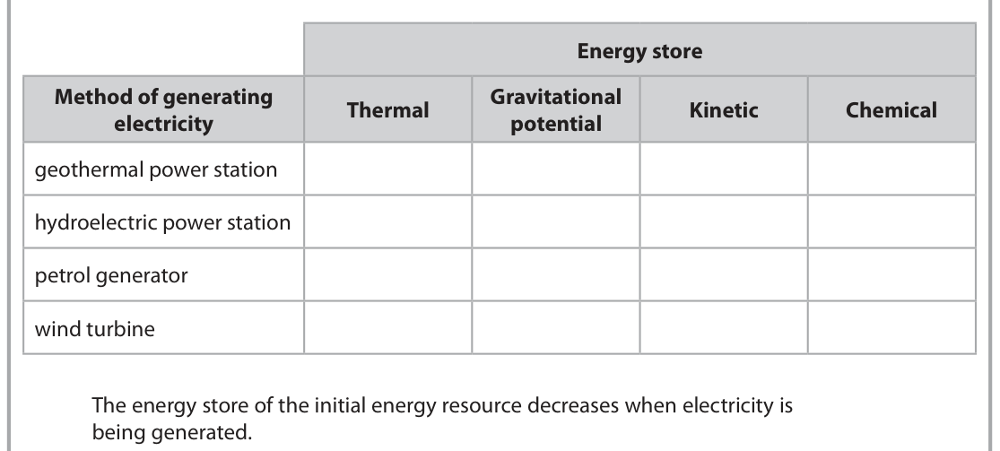
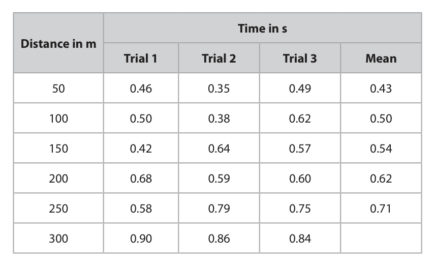
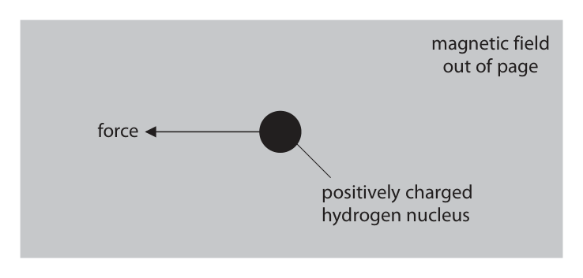
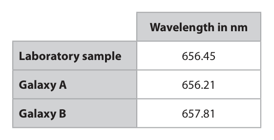
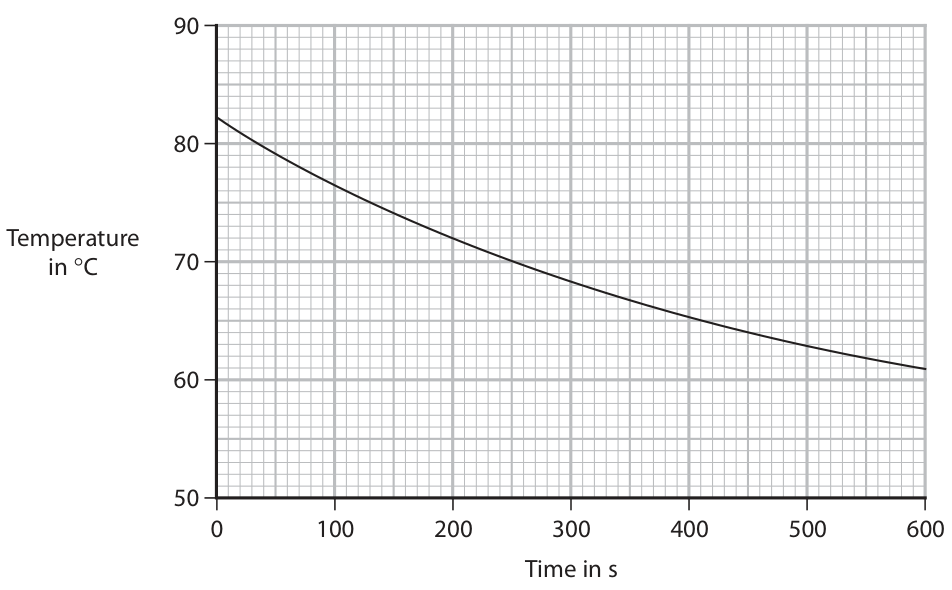

# 4PH1/2PR — 2022-01 (official extraction)

> schema `syllabai.official-paper-questions/0.2` · paper_id `pearson-edexcel:international-gcse:physics:4ph1:2022-01:4PH1/2PR` · qp sha256 `f057e68f7452536f…` · extraction is the disclosed baseline (ADR-039)

## Question 1 (7 marks)
**(a)** The table lists four methods of generating electricity and four energy stores. Energy store Method of generating Gravitational Thermal Kinetic Chemical electricity potential geothermal power station hydroelectric power station petrol generator wind turbine The energy store of the initial energy resource decreases when electricity is being generated.

### 1(a)(i) [4]

Complete the table by placing one tick (✓) in each row to show which energy store decreases.

**Mark scheme answer**

> each tick correctly placed in each row;;;; more than one tick in
> a row negates the
> mark

- **(4)** each tick correctly placed in each row;;;; more than one tick in

### 1(a)(ii) [1]

State which method of generating electricity in the table does not use a renewable energy resource.

**Mark scheme answer**

> petrol generator;

- **(1)** petrol generator;

### 1(b) [2]

State two disadvantages of using wind turbines to generate electricity. 1 2

**Mark scheme answer**

> any two from: ignore statements
> relating to cost
> MP1. idea of noise pollution; ignore bald ‘pollution’
> MP2. idea of visual pollution; ignore bald ‘pollution’
> MP3. idea that turbine only generates electricity
> when the wind blows;
> MP4. difficult for output to match demand; ignore ‘do not
> generate much
> electricity/energy’
> MP5. wind is a dilute source of energy; allow idea that wind
> farms take up a lot of
> space
> MP6. can cause harm to migrating flocks of birds;
> Answer Notes Marks

- **(2)** any two from: ignore statements

## Question 2 (7 marks)

Cricket is a sport played with bats and balls.

### 2(a)(i) [3]

A cricket player hits a ball with a bat. Before the ball is hit, it is moving to the left with a momentum of 4.2 kg m/s. The bat is in contact with the ball for 0.012 s. After the ball is hit, it moves to the right with a momentum of 6.7 kg m/s. Calculate the mean force the bat exerts on the ball and state the direction of the force. mean force = N direction

**Mark scheme answer**

> substitution into F = (mv – mu)/t;
> evaluation; -1 if POT error
> correct direction; independent mark
> 208.3… scores 2 marks
> max. if given with
> correct direction
> e.g.
> (F =) (6.7 - −4.2) / 0.012
> (F =) 910 (N) allow 908.3…(N)
> (direction =) right allow forwards
> ignore compass
> directions
> 0.9083… scores 1 mark

- **(3)** substitution into F = (mv – mu)/t;

### 2(a)(ii) [1]

State the magnitude and direction of the mean force the ball exerts on the bat. magnitude of mean force = N direction of force

**Mark scheme answer**

> same forces as in (a)(i) AND opposite direction; allow ECF from (a)(i) for
> both points
> allow ECF for compass
> direction only if
> opposite to direction
> given in (i)
> e.g.
> (F =) 910 (N) AND (direction =) left

- **(1)** same forces as in (a)(i) AND opposite direction; allow ECF from (a)(i) for

### 2(b) [3]

The cricket player wears padded protective equipment. This protective equipment reduces the risk of injury to the player if they are struck by the cricket ball. Explain how this protective equipment reduces the risk of injury to the player. Use ideas about momentum in your answer.

**Mark scheme answer**

> any three from:
> MP1. idea that there is a change of momentum
> (when ball hits player);
> MP2. (equipment) increases (impact) time;
> MP3. decreases rate of change of momentum (of
> ball);
> MP4. decreases force (on player);
> MP5. decreases pressure (on player); allow spreads force
> over larger area
> Answer Notes Marks

- **(3)** any three from:

## Question 3 (10 marks)

Two students do an experiment to measure the speed of sound in air. They use two blocks of wood that make a loud noise when hit together. They do their experiment outside in a wide‑open space.

**(b)** The table shows the students’ results. Time in s Distance in m Trial 1 Trial 2 Trial 3 Mean 50 0.46 0.35 0.49 0.43 100 0.50 0.38 0.62 0.50 150 0.42 0.64 0.57 0.54 200 0.68 0.59 0.60 0.62 250 0.58 0.79 0.75 0.71 300 0.90 0.86 0.84

### 3(a) [5]

Describe how the students should use their equipment to measure the speed of sound in air. You may draw a diagram to support your answer.

**Mark scheme answer**

> any five from: allow alternative
> approach using echoes
> from a wall
> MP1. idea that students stand a large distance allow stated distance if
> apart; 50m or greater
> allow a large distance
> from a wall (at least
> 25m)
> MP2. measure distance with tape measure / ignore ruler
> trundle wheel;
> MP3. start timing when see blocks hit together; allow idea of setting of
> a rhythm if wall method
> used
> MP4. stop timing when hear sound from blocks allow dividing total
> being hit together; time by number of hits
> if wall method used
> MP5. measure time with stopclock / stop watch; ignore timer
> MP6. take repeats and determine mean; allow take repeats to
> identify anomalies
> MP7. use of speed = distance / time; allow use of speed =
> 2×distance / time if
> wall method used
> MP8. use of a distance-time graph to find speed
> from gradient;

- **(5)** any five from: allow alternative

### 3(b)(i) [2]

Calculate the mean time for the last row in the table. mean time = s

**Mark scheme answer**

> mean calculated correctly;
> expressed to 2 decimal places; DOP
> e.g.
> (mean time =) 0.866… (s)
> (mean time =) 0.87 (s) 0.86 scores 1 mark only

- **(2)** mean calculated correctly;

### 3(b)(ii) [1]

The students think that some of their time readings are anomalous. State how the students should deal with these anomalous readings.

**Mark scheme answer**

> idea of ignoring or repeating the anomaly; ignore ‘repeat the
> experiment’

- **(1)** idea of ignoring or repeating the anomaly; ignore ‘repeat the

### 3(b)(iii) [2]

Explain which distance in the table is likely to give the most accurate value for the speed of sound in air.

**Mark scheme answer**

> 300m distance chosen; allow greatest distance
> allow 200m only if
> justified with a speed
> of sound argument
> idea that reaction time is likely to be less allow idea that it gives
> significant at greater distances; a speed closest to the
> true value
> allow idea that readings
> from trials show least
> variation
> Answer Notes Marks

- **(2)** 300m distance chosen; allow greatest distance

## Question 4 (11 marks)

A racing car uses an engine and an electric motor to power its wheels. (Source: Jens Mommens/Shutterstock)

**(b)** The diagram shows a simplified view of a direct current (d.c.) electric motor. N S commutator brush brush + –

**(c)** The electric motor in the racing car can also be used as a generator to charge a battery pack. It is known as a motor generator unit (MGU). The rotating wheels of the car cause the magnets in the MGU to spin near a coil of wire. This induces a current in the coil when the coil is connected to the battery pack.

### 4(a) [3]

The electric motor can only operate at maximum power for part of each lap of the race. The electric motor has a maximum power output of 1.2 × 10⁵ W. The electric motor transfers 4.0 × 10⁶ J of energy when it operates at maximum power. Calculate the amount of time the electric motor can operate at maximum power. time = s

**Mark scheme answer**

> substitution into P = E / t;
> rearrangement;
> evaluation; -1 for POT error
> e.g.
> 1.2 × 10⁵ = 4.0 × 10⁶ / time
> (time =) 4.0 × 10⁶ / 1.2 × 10⁵
> (time =) 33 (s) allow 33.3…

- **(3)** substitution into P = E / t;

### 4(b)(i) [1]

State what is meant by the term direct current.

**Mark scheme answer**

> idea that current only passes (a point) in one allow does not change
> direction; direction

- **(1)** idea that current only passes (a point) in one allow does not change

### 4(b)(ii) [3]

Explain the purpose of the brushes and the commutator in the d.c. motor.

**Mark scheme answer**

> any three from:
> MP1. provides a connection / current to the coil /
> commutator;
> MP2. idea of reverses the current in the coil; allow idea of swapping the
> contacts
> MP3. every half turn;
> MP4. reverses (coil) field / polarity / force (every
> half turn);
> MP5. so that force is always in the same direction; allow moment for force
> MP6. so that the motor keeps turning (the same
> way);

- **(3)** any three from:

### 4(c)(i) [1]

Name the energy store of the battery pack that increases when the battery pack is being charged.

**Mark scheme answer**

> chemical; allow thermal / heat

- **(1)** chemical; allow thermal / heat

### 4(c)(ii) [3]

Explain why the kinetic energy store of the car must decrease when the MGU charges the battery pack.

**Mark scheme answer**

> idea of conservation of energy; allow “energy can’t be
> created or destroyed” / eq
> idea that energy is transferred (from kinetic store allow energy transferred
> of car); electrically
> to chemical store (of battery pack);
> Answer Notes Marks

- **(3)** idea of conservation of energy; allow “energy can’t be

## Question 5 (9 marks)

This question is about nuclear fusion.

**(a)** The incomplete nuclear equation shows the fusion of two isotopes of hydrogen. H + 31H → 42He + X

**(b)** A tokamak is an experimental nuclear fusion reactor. Strong magnetic fields are used to contain the reactants inside the tokamak.

### 5(a)(i) [1]

Identify particle X in the nuclear equation.

**Mark scheme answer**

> neutron / n;

- **(1)** neutron / n;

### 5(a)(ii) [2]

Each fusion reaction releases approximately 3 × 10⁻¹² J of energy. Estimate how many reactions are needed to produce 1 J of energy. Give your answer to 1 significant figure. number of reactions =

**Mark scheme answer**

> correct evaluation;
> given to 1s.f.; independent mark
> e.g.
> (number =) 3.3…× 1011
> (number =) 3 × 1011

- **(2)** correct evaluation;

### 5(a)(iii) [3]

Explain why this fusion reaction will only happen at high temperature and high pressure.

**Mark scheme answer**

> any three from: allow RA in terms of high
> temperature/pressure
> allow
> atoms/particles/hydrogen
> for nuclei
> MP1. nuclei move (too) slowly at low temperature; allow nuclei not having
> enough KE
> MP2. nuclei interact/collide less often at low allow less chance of
> temperature; collisions
> MP3. nuclei repel each other;
> MP4. nuclei cannot get close enough / don’t have
> chance to undergo fusion;

- **(3)** any three from: allow RA in terms of high

### 5(b)(i) [2]

The diagram shows a positively charged hydrogen nucleus in a uniform magnetic field directed out of the page. magnetic field out of page force positively charged hydrogen nucleus The nucleus experiences a force acting to the left because of the magnetic field. Deduce how the nucleus must behave to experience this force.

**Mark scheme answer**

> nucleus must be moving; allow travelling for moving
> reject if implication that
> movement is caused by the
> force
> downwards;

- **(2)** nucleus must be moving; allow travelling for moving

### 5(b)(ii) [1]

Suggest how engineers working on the tokamak could increase the force on the nucleus.

**Mark scheme answer**

> increase magnetic field strength / increase speed of allow use stronger magnets
> nucleus / increase temperature of reactor;
> Answer Notes Marks

- **(1)** increase magnetic field strength / increase speed of allow use stronger magnets

## Question 6 (9 marks)
**(c)** Hydrogen is an element that can emit visible light waves. The table shows the wavelength of one of these waves when detected from a laboratory sample of hydrogen and when detected from the hydrogen in two different galaxies. The detected wavelengths from the galaxies are different from the detected wavelength from the laboratory sample because of the Doppler effect. Wavelength in nm Laboratory sample 656.45 Galaxy A 656.21 Galaxy B 657.81

### 6(a) [1]

State what is meant by the astronomical term galaxy.

**Mark scheme answer**

> a (large) collection of (billions of) stars; allow solar systems for
> stars

- **(1)** a (large) collection of (billions of) stars; allow solar systems for

### 6(b) [1]

Which of these is a large collection of billions of galaxies?

- **(A)** a nebula
- **(B)** a red giant
- **(C)** the solar system
- **(D)** the universe  ✔

**Mark scheme answer**

> D (the universe);
> A is not the correct answer because a nebula is a gas cloud
> B is not the correct answer because a red giant is a star
> C is not the correct answer because a solar system consists of a star and planets

- **(1)** Answer D: the universe

### 6(c)(i) [3]

Galaxy A and galaxy B are both moving relative to Earth. Compare the motions of galaxy A and galaxy B relative to Earth.

**Mark scheme answer**

> galaxy A is moving towards Earth; allow 1 mark for galaxies
> galaxy B is moving away from Earth; moving in opposite
> directions if neither of
> these marks scored
> galaxy B is moving faster than galaxy A;

- **(3)** galaxy A is moving towards Earth; allow 1 mark for galaxies

### 6(c)(ii) [4]

Use data from the table to calculate the speed of galaxy B relative to Earth. [speed of light, c = 3.0 × 10⁸ m/s] speed = m/s

**Mark scheme answer**

> correct evaluation of Δλ;
> substitution into Δλ/λ = v/c; allow ECF from incorrect
> Δλ if clear from working
> can be in nm or m
> -1 if 657.81 used as λ
> rearrangement;
> evaluation;
> allow 3 marks max. if
> galaxy A used, giving
> v = 109 681…
> 729 693…, 731 473…
> score 2 marks
> 620 239 etc.
> scores 3 marks
> Δλ = (657.81 – 656.45 =) 1.36 (nm)
> 1.36/656.45 = v/3×10⁸
> (v =) 1.36 × 3×10⁸ / 656.45
> (v =) 620 000 (m/s) allow 621 524 etc.

- **(4)** correct evaluation of Δλ;

## Question 7 (6 marks)

A student investigates the rate of cooling of water in a beaker. The student pours boiling water into a beaker and monitors the temperature of the water for a period of time. The graph shows the student’s results. Temperature in °C 70 0 100 200 300 400 500 600 Time in s

### 7(a) [4]

The rate of cooling is represented by the gradient of the graph and is measured in °C/s. By drawing a tangent to the curve, determine the rate of cooling of the water at 70 °C. rate of cooling = °C/s

**Mark scheme answer**

> attempt to draw tangent to the curve at 70°C;
> attempt at finding gradient of tangent;
> correct evaluation of gradient; allow range of 0.030-
> 0.045
> final answer given as negative; independent mark
> e.g.
> tangent seen on graph at 70°C
> gradient = [57-79]/600
> gradient = −0.037 (°C/s)

- **(4)** attempt to draw tangent to the curve at 70°C;

### 7(b) [2]

The student repeats the investigation with the same beaker wrapped in woollen insulation. Sketch another line on the graph to show the expected results when the beaker is wrapped in woollen insulation. Assume that the starting temperature of the water is 82 °C.

**Mark scheme answer**

> curve drawn of similar shape to original starting at
> 82 °C;
> curve drawn above original;
> Answer Notes Marks

- **(2)** curve drawn of similar shape to original starting at

## Question 8 (11 marks)

Diagram 1 shows a machine used for demonstrating electrostatics. + + + + + + metal dome + + + + rubber belt spindle handle Diagram 1

**(a)** When the handle is turned, the dome becomes positively charged.

**(b)** The metal dome is discharged. A thin metal case is then placed on top of the metal dome, as shown in Diagram 2. thin metal case metal dome Diagram 2

### 8(a)(i) [1]

In terms of electron movement, give a reason why the metal dome becomes positively charged.

**Mark scheme answer**

> idea that the dome loses electrons; however expressed
> reject if idea that
> positive charge has
> been transferred

- **(1)** idea that the dome loses electrons; however expressed

### 8(a)(ii) [3]

When the handle is turned for 15 s the dome gains 0.50 J of energy in its electrostatic store as it becomes charged. The voltage between the dome and the earth is 120 kV. Calculate the mean charging current during this time. mean charging current = A

**Mark scheme answer**

> substitution into E = V × I × t; ignore units
> rearrangement;
> evaluation; -1 for POT error
> e.g.
> $0.50 = 120 000 \times I \times 15$
> I = 0.50 / [120 000 × 15]
> (I =) 2.8 × 10⁻⁷ (A) allow 0.000 000 277…(A)
> condone 2.7 × 10⁻⁷ (A)

- **(3)** substitution into E = V × I × t; ignore units

### 8(b)(i) [3]

When the handle is turned, the thin metal case moves upwards away from the dome. Explain why the thin metal case starts to move upwards.

**Mark scheme answer**

> any three from:
> MP1. metal case loses electrons; allow metal case
> becomes (positively)
> charged
> MP2. (because) metal case is a conductor;
> MP3. dome and metal case have the same charge;
> MP4. repulsion between dome and metal case;

- **(3)** any three from:

### 8(b)(ii) [4]

Explain why the metal case reaches a maximum height above the metal dome.

**Mark scheme answer**

> any four from:
> MP1. repulsive force from dome decreases as
> separation increases;
> MP2. named downward force e.g. weight, air
> resistance acts on the case;
> MP3. (eventually, resultant) downwards force acts
> on case;
> MP4. causing the case to slow down;
> MP5. kinetic energy decreases;
> MP6. gravitational potential energy increases;
> MP7. kinetic energy becomes zero (at maximum allow speed becomes
> height); zero
> Pearson Education Limited. Registered company number 872828
> with its registered office at 80 Strand, London, WC2R 0RL, United Kingdom

- **(4)** any four from:

