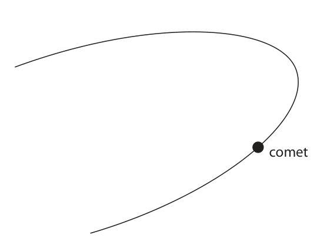
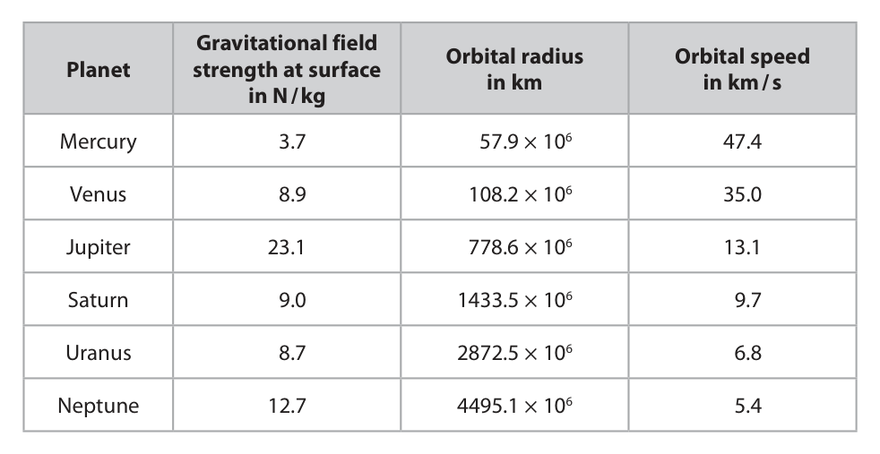
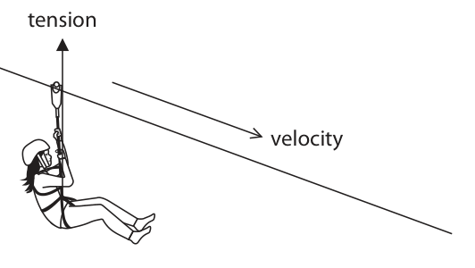
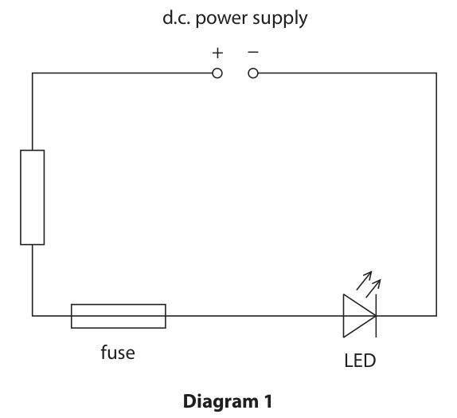
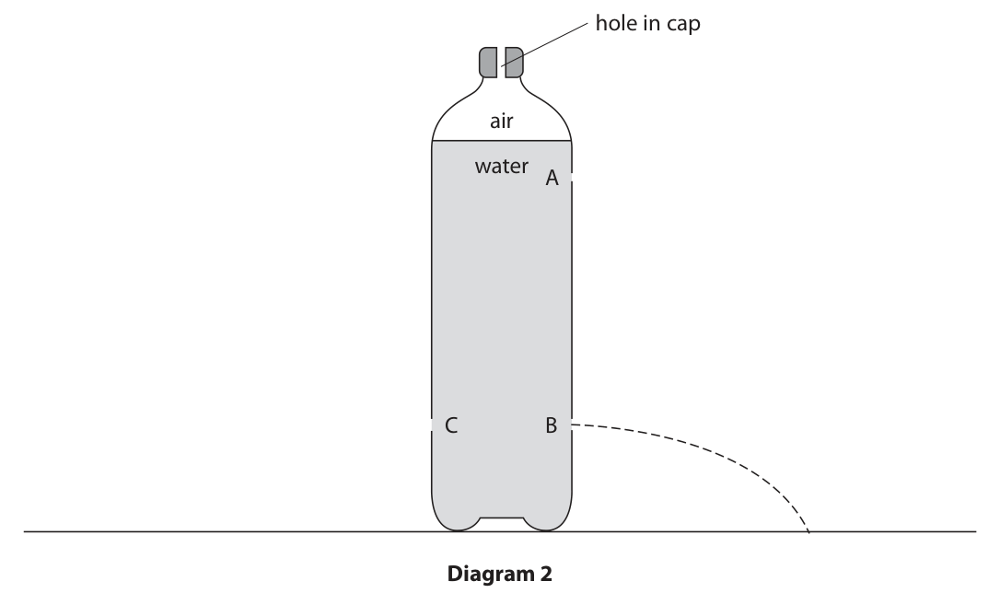
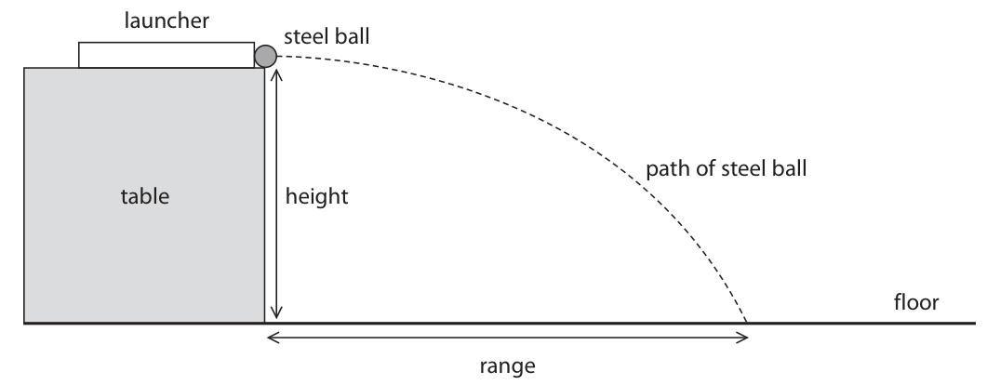
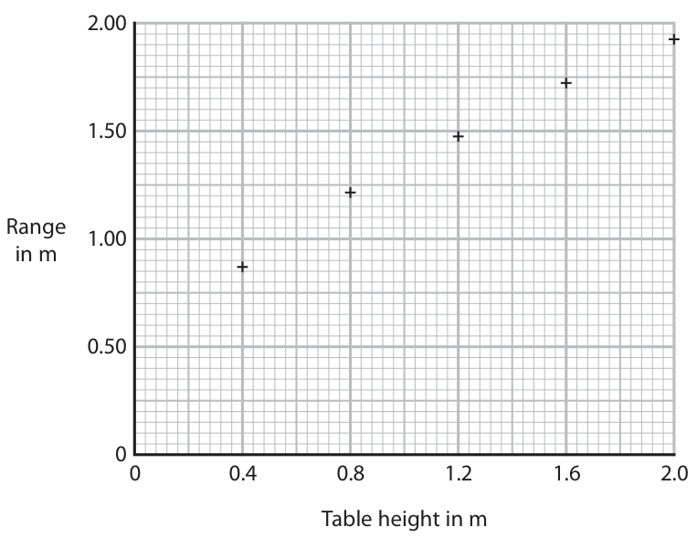

# 4PH1/1P — 2022-06 (official extraction)

> schema `syllabai.official-paper-questions/0.2` · paper_id `pearson-edexcel:international-gcse:physics:4ph1:2022-06:4PH1/1P` · qp sha256 `beca36c265719dc1…` · extraction is the disclosed baseline (ADR-039)

## Question 1 (7 marks)

The diagram shows a comet as it moves through part of its orbit around the Sun. comet

### 1(a)(i) [1]

Add an S to the diagram to show the position of the Sun.

**Mark scheme answer**

> centre of S marked in the grey region shown; allow if centre of S marked in
> a similar position on the
> other side of the drawn orbit

- **(1)** centre of S marked in the grey region shown; allow if centre of S marked in

### 1(a)(ii) [2]

Complete the diagram to show the orbit of the comet.

**Mark scheme answer**

> closed path drawn with curve;
> total size approximately twice size of original curve should extend at least
> diagram; as far as the start of the word
> “diagram” in sentence below
> i.e.

- **(2)** closed path drawn with curve;

### 1(a)(iii) [1]

Add an X to the diagram to show the position where the comet is moving fastest.

**Mark scheme answer**

> X marked on part of path closest to candidate’s S; reject if another
> contradictory cross drawn

- **(1)** X marked on part of path closest to candidate’s S; reject if another

### 1(b) [3]

Describe how the orbit of a comet compares with the orbit of a planet.

**Mark scheme answer**

> any three from: comparison needs to be seen
> MP1. comet’s orbit is more elliptical/oval; allow planet’s orbit is more
> circular
> MP2. (orbital) path of comet is longer; allow distance for path
> allow period of orbit of
> comet is longer
> MP3. idea that speed of comet varies but speed of
> planet does not;
> MP4. both planet and comet orbit a star; allow the Sun for star
> MP5. idea that orbital radius of comet varies but
> orbital radius of planet does not;
> MP6. plane of comet’s orbit different to plane of
> planet’s orbit;
> MP7. star is at centre of planet orbit but not at allow (star’s) gravitational
> centre of comet orbit; force is constant for planet
> but varies for comet
> Answer Notes Marks

- **(3)** any three from: comparison needs to be seen

## Question 2 (6 marks)
### 2(a) [1]

Which statement describes the term atomic number for a nucleus?

- **(A)** number of electrons in the nucleus
- **(B)** number of neutrons in the nucleus
- **(C)** number of protons in the nucleus  ✔
- **(D)** number of protons and neutrons in the nucleus

**Mark scheme answer**

> C (number of protons in the nucleus);
> A is incorrect because electrons are not found in the nucleus
> B is incorrect because this is deduced from the mass number
> D is incorrect because this is the mass number

- **(1)** Answer C: number of protons in the nucleus

### 2(b) [1]

Which statement describes the term mass number for a nucleus?

- **(A)** number of electrons in the nucleus
- **(B)** number of neutrons in the nucleus
- **(C)** number of protons in the nucleus
- **(D)** number of protons and neutrons in the nucleus  ✔

**Mark scheme answer**

> D (number of protons and neutrons in the nucleus);
> A is incorrect because electrons are not found in the nucleus
> B is incorrect because this is determined from the mass number and is not the mass
> number itself
> C is incorrect because this is the atomic number

- **(1)** Answer D: number of protons and neutrons in the nucleus

### 2(c) [1]

Which statement describes the term isotopes? A a toms with the same number of electrons but a different number of protons B atoms with the same number of neutrons but a different number of electrons C a toms with the same number of neutrons but a different number of protons D a toms with the same number of protons but a different number of neutrons

**Mark scheme answer**

> D (atoms with the same number of protons but a different number of neutrons;
> A is incorrect because isotopes must have the same number of protons
> B is incorrect because isotopes have a different number of neutrons to each other
> C is incorrect because isotopes must have the same number of protons

- **(1)** D (atoms with the same number of protons but a different number of neutrons;

### 2(d) [1]

An atom contains 8 protons, 8 neutrons and 8 electrons. Which of these would result in a negatively charged ion of the same element?

- **(A)** adding an electron  ✔
- **(B)** adding a proton
- **(C)** removing an electron
- **(D)** removing a proton

**Mark scheme answer**

> A (adding an electron);
> B is incorrect because this will change the element and make it positively charged
> C is incorrect because this will create a positively charged ion
> D is incorrect because this will change the element

- **(1)** Answer A: adding an electron

### 2(e) [1]

It is not possible to predict exactly when a radioactive nucleus will decay. Which feature of radioactive decay best explains this observation?

- **(A)** radioactive decay can change the structure of the nucleus
- **(B)** radioactive decay happens at random  ✔
- **(C)** radioactive decay is irreversible
- **(D)** radioactive decay makes a nucleus more stable

**Mark scheme answer**

> B (radioactive decay happens at random);
> A is incorrect because this is a consequence of radioactive decay
> C is incorrect because it does not explain the random nature of radioactive decay
> D is incorrect because this explains why radioactive decay happens in the first place

- **(1)** Answer B: radioactive decay happens at random

### 2(f) [1]

Which of these is the correct unit for measuring the activity of a radioactive sample?

- **(A)** becquerel (Bq)  ✔
- **(B)** coulomb (C)
- **(C)** joule (J)
- **(D)** watt (W)

**Mark scheme answer**

> A (becquerel (Bq);
> B is incorrect because this is the unit for charge
> C is incorrect because this is the unit for energy
> D is incorrect because this is the unit for power
> Answer Notes Marks

- **(1)** Answer A: becquerel (Bq)

## Question 3 (14 marks)

An ultrasonic distance-measuring device can be used to measure the length of a room. The device emits a pulse of sound with a frequency of 40 kHz. The device also emits a bright beam of red visible light. dot of light from laser ultrasonic distance‑measuring device

**(b)** A sound wave from the device travels at 345 m / s.

### 3(a) [2]

Explain what is meant by a frequency of 40 kHz.

**Mark scheme answer**

> 40 000 {waves / vibrations / oscillations}; allow 40 000 wavelengths /
> wavefronts
> in 1 second / unit time; allow per second

- **(2)** 40 000 {waves / vibrations / oscillations}; allow 40 000 wavelengths /

### 3(b)(i) [1]

State the formula linking wave speed, frequency and wavelength.

**Mark scheme answer**

> (wave) speed = frequency × wavelength; allow standard symbols and
> rearrangements e.g. λ = v / f
> condone s for speed
> ignore incorrect symbols e.g wl
> for wavelength, ws for wave
> speed

- **(1)** (wave) speed = frequency × wavelength; allow standard symbols and

### 3(b)(ii) [3]

Calculate the wavelength of the sound wave. wavelength = m

**Mark scheme answer**

> substitution;
> rearrangement;
> evaluation; POT error = -1
> correct answer with no working
> gains full marks
> e.g. 8.6, 8.62, 8.63, 8.625 = 2 marks
> 345 = 40 (000) × λ
> λ = 345/40 (000)
> (λ =) 8.6 × 10-3 (m) allow 9 × 10-3, 8.62 × 10-3, 8.63 ×
> 10-3, 8.625 × 10-3 (m)

- **(3)** substitution;

### 3(b)(iii) [4]

The device emits a sound wave. The sound wave travels to the wall, reflects back to the device and is received by the device. The distance from the device to the wall is 2.35 m. Calculate the time between the sound wave being emitted and received by the device. time = s

**Mark scheme answer**

> use of speed = distance/time seen or allow any rearrangement or in
> implied; correct symbols
> allow d, s, x for distance
> allow v for speed
> condone s for speed
> factor of 2 seen;
> substitution;
> evaluation;
> 0.007, 0.0068… scores 3 marks
> (no factor of 2 used)
> e.g.
> speed = distance/time
> distance should be doubled
> 345 = 4.70 ÷ time
> (time =) 0.0136 (s) allow 0.01, 0.014,
> 0.01362… (s)

- **(4)** use of speed = distance/time seen or allow any rearrangement or in

### 3(c) [1]

Suggest why the device emits visible light.

**Mark scheme answer**

> idea that the person can see/know what e.g. marks the position that
> (distance) they are measuring/eq; (distance) is being measured to

- **(1)** idea that the person can see/know what e.g. marks the position that

### 3(d) [3]

Sound waves and light waves can have different frequencies and wavelengths. Describe three other differences between sound waves and light waves. You may draw diagrams to support your answer.

**Mark scheme answer**

> any three from: allow points shown on a labelled
> diagram
> allow higher level ideas i.e. light
> can be polarised but sound can’t
> allow reverse argument (RA) for
> all marking points
> MP1. sound is longitudinal light is can be given from diagram
> transverse; showing longitudinal and
> transverse waves
> MP2. sound vibrations are in the direction allow oscillations, displacements
> of travel, light vibrations are for vibrations
> perpendicular to the direction of allow direction of energy
> travel; transfer for direction of travel
> MP3. light is electromagnetic, sound is not; allow sound is mechanical, light
> is not
> MP4. light can travel through a allow sound needs a medium but
> vacuum/space, sound cannot; light does not
> MP5. light travels (much) faster (in air) allow quoted speeds for
> than sound; comparison
> MP6. light slows down in denser medium
> but sound speeds up;
> Answer Notes Marks

- **(3)** any three from: allow points shown on a labelled

## Question 4 (8 marks)

The table gives data for some of the planets in the solar system. Gravitational field Orbital radius Orbital speed Planet strength at surface in km in km / s in N / kg Mercury 3.7 57.9 × 106 47.4 Venus 8.9 108.2 × 106 35.0 Jupiter 23.1 778.6 × 106 13.1 Saturn 9.0 1433.5 × 106 9.7 Uranus 8.7 2872.5 × 106 6.8 Neptune 12.7 4495.1 × 106 5.4

### 4(a) [3]

Plot a bar chart of the gravitational field strength for each planet.

**Mark scheme answer**

> suitable linear scale chosen (>50% of grid used); ignore orientation of axes
> do not accept multiples of 3
> for scale
> axes labelled with quantities and unit; condone missing “planets”
> label if individual planets are
> written with bars
> all bar plotting correct to nearest half square; reject if non-linear scale used
> bars do not need to be
> separated from each other or
> in the same order as the
> table
> condone stick graphs

- **(3)** suitable linear scale chosen (>50% of grid used); ignore orientation of axes

### 4(b) [1]

Suggest why planets have different gravitational field strengths at their surface.

**Mark scheme answer**

> any one from: ignore different orbital radius
> different masses; ignore weight
> different sizes; allow different volume, radii,
> diameter
> ignore different (surface)
> area
> different densities;

- **(1)** any one from: ignore different orbital radius

### 4(c) [1]

Give the relationship shown by the data in the table between the orbital radius and the orbital speed for the planets in the solar system.

**Mark scheme answer**

> as orbital radius increases, the orbital speed condone idea that they are
> decreases; inversely proportional
> ignore negative correlation

- **(1)** as orbital radius increases, the orbital speed condone idea that they are

### 4(d) [3]

Calculate the time period of Mercury’s orbit around the Sun. time period = s

**Mark scheme answer**

> 3
> substitution into ;
> rearrangement;
> evaluation; -1 for POT error
> allow 1s.f. answer if
> supported by working
> e.g.
> 47.4 = 2 × π × 57.9 × 106 / T
> T = 2 × π × 57.9 × 106 / 47.4
> (T =) 7.68 × 106 (s) allow 7.7 × 106, 7.67 × 106,
> 7 675 030.154 (s)
> Answer Notes Marks

- **(3)** 3

## Question 5 (9 marks)

A material called granite is used as a work surface in a kitchen. (Source: Ksana_uk/Shutterstock)

**(b)** Granite contains the isotope thorium‑232 (232 Th). Thorium‑232 decays by a sequence of alpha decays and beta decays to form radon‑220 (220 Rn).

### 5(a) [1]

Granite is formed naturally and contains radioactive isotopes. The granite work surface contributes to the background radiation in the kitchen. Give another naturally occurring source of background radiation.

**Mark scheme answer**

> any suitable natural source; reject if contradicted by a
> list
> e.g. (the) Sun, cosmic rays, rocks, (named) food, allow named radioactive
> radon etc. isotopes e.g. carbon-14,
> uranium-235, uranium-238
> ignore “space”, cosmic
> microwave background
> radiation (CMBR)

- **(1)** any suitable natural source; reject if contradicted by a

### 5(b)(i) [2]

State two differences between alpha radiation and beta radiation. 1 2

**Mark scheme answer**

> any two described differences from: allow RA throughout
> MP1. alpha has more mass; allow alpha is heavier
> MP2. alpha has more charge;
> MP3. alpha is positive and beta is negative; allow oppositely charged
> MP4. alpha has shorter range (in air);
> MP5. alpha is slower;
> MP6. alpha is less penetrating; allow alpha stopped by
> air/paper and beta stopped
> by aluminium/thin metal
> MP7. alpha is more ionising;
> MP8. alpha is a helium nucleus but beta is an allow alpha is 2 protons and 2
> electron; neutrons but beta is an
> electron

- **(2)** any two described differences from: allow RA throughout

### 5(b)(ii) [3]

The incomplete nuclear decay equation summarises the decay sequence of thorium-232 into radon‑220. 232 Th 220 Rn + 4 α + 0 −1 β Calculate the number of alpha particles and the number of beta particles emitted in this decay sequence. number of alpha particles = number of beta particles =

**Mark scheme answer**

> evidence of trying to balance nuclear equation; e.g. 232 – 220 = 12
> correct number of alphas; also gains first mark
> correct number of betas; also gains first mark
> e.g.
> 90 = 86 + 2α this balances atomic number
> despite mass number not
> balancing (if no beta was
> present)
> number of alpha = 3
> number of beta = 2

- **(3)** evidence of trying to balance nuclear equation; e.g. 232 – 220 = 12

### 5(c) [3]

Thorium‑232 is a solid and remains in the work surface. Radon‑220 is a gas and is emitted from the work surface. Thorium‑232 and radon‑220 both emit alpha radiation. Discuss the hazards due to the granite work surface when a person is working in the kitchen. Refer to contamination and irradiation in your answer.

**Mark scheme answer**

> any three from:
> MP1. (alpha) can cause cell mutation / cancer;
> MP2. idea that alpha is only dangerous when inside
> body;
> MP3. alpha is blocked by skin / few cm of air;
> MP4. thorium can only cause irradiation (since it allow both (thorium and
> remains in work surface); radon) can cause irradiation
> MP5. radon / gas can cause (both) contamination
> (and irradiation) (since it can go inside body /
> food);
> MP6. radon / gas can be inhaled / enter body;
> MP7. thorium cannot enter body;
> Answer Notes Marks

- **(3)** any three from:

## Question 6 (5 marks)

The diagram shows a child on a zip-line ride. During the ride the child slides along a metal wire with the velocity in the direction shown in the diagram. tension velocity The diagram also shows the tension force acting on the safety harness the child is wearing.

### 6(a) [1]

Force and velocity are examples of vector quantities. State what is meant by the term vector quantity.

**Mark scheme answer**

> (quantity that has both) magnitude and direction; allow size, value, number or
> amount for magnitude
> ignore scale for magnitude

- **(1)** (quantity that has both) magnitude and direction; allow size, value, number or

### 6(b) [4]

Draw labelled arrows on the diagram to show two other forces that act on the child.

**Mark scheme answer**

> ignore starting points and
> lengths of arrows
> 3 marks max. if more than
> two arrows drawn
> vertically downward arrow drawn; judge by eye
> labelled weight; dependent on previous mark
> being awarded (DOP)
> allow gravitational force,
> force of gravity
> ignore gravity, gravitational
> field strength, gfs
> arrow drawn in opposite direction to velocity;
> labelled air resistance / drag / air friction; DOP but allow if arrow
> pointing to the left
> condone wind resistance
> Answer Notes Marks

- **(4)** ignore starting points and

## Question 7 (8 marks)
**(b)** Diagram 1 shows an electric circuit used to test a fuse. d.c. power supply + − fuse LED Diagram 1

**(c)** Diagram 2 shows a different electric circuit containing three different lamps. + − 0.6 A I2 lamp 1 0.2 A lamp 2 I1 lamp 3 0.3 A Diagram 2

### 7(a) [1]

State what is meant by the term electric current.

**Mark scheme answer**

> (current is the) rate of flow of charge; allow amount of charge
> passing per unit
> time/second
> ignore rate of flow of
> electrons

- **(1)** (current is the) rate of flow of charge; allow amount of charge

### 7(b)(i) [1]

Give a reason why an LED is included in the circuit.

**Mark scheme answer**

> idea that LED shows that current is present / fuse is allow idea that it shows
> still working; when the fuse has
> blown

- **(1)** idea that LED shows that current is present / fuse is allow idea that it shows

### 7(b)(ii) [1]

Add another component to the circuit in diagram 1 to measure the current in the fuse.

**Mark scheme answer**

> correct symbol for ammeter placed in series with fuse;

- **(1)** correct symbol for ammeter placed in series with fuse;

### 7(c)(i) [1]

Calculate the current I1 . I1 = A

**Mark scheme answer**

> 0.1 (A);

- **(1)** 0.1 (A);

### 7(c)(ii) [1]

State the current I2 . I2 = A

**Mark scheme answer**

> 0.6 (A);

- **(1)** 0.6 (A);

### 7(c)(iii) [3]

Explain which lamp is the brightest.

**Mark scheme answer**

> lamp 3; allow ECF from (c)(i) if
> any two from: I1 given as greater than
> 0.3(A) leading to lamp
> 2 being brightest
> • (because) power = current × voltage; allow P = V2 / R
> • voltage is the same for all lamps;
> • current is greatest; allow resistance is
> lowest
> Answer Notes Marks

- **(3)** lamp 3; allow ECF from (c)(i) if

## Question 8 (13 marks)

The photograph shows a toy car. When the toy car is pulled backwards, energy is stored in the elastic store as the rubber band is twisted. metal can rubber band (Source: Mama Belle and the kids/Shutterstock) When the car is released, some of the energy from the elastic store is transferred to the kinetic store of the car. The remaining energy is transferred into the thermal store of the surroundings.

**(b)** The car is pulled backwards so that there is 165 J of energy in its elastic store. When the car is released, this energy is transferred to the car’s kinetic energy store with an efficiency of 15 %.

**(c)** The car is pulled backwards again. When released, 45 J of energy transfers into the car’s kinetic store. The car travels a distance of 7.5 m during this energy transfer.

### 8(a) [1]

State what is meant by the principle of conservation of energy.

**Mark scheme answer**

> idea that energy can’t be created or both created and destroyed / eq
> destroyed; need to be seen
> ignore lost, removed for destroyed

- **(1)** idea that energy can’t be created or both created and destroyed / eq

### 8(b)(i) [1]

State the formula linking efficiency, useful energy output and total energy output.

**Mark scheme answer**

> useful (energy) output ignore ×100(%)
> efficiency = ;
> total (energy) output allow rearrangements
> allow total (energy) input for total
> (energy) output

- **(1)** useful (energy) output ignore ×100(%)

### 8(b)(ii) [4]

Calculate the energy transferred into the thermal store of the surroundings. energy transferred to thermal store = J

**Mark scheme answer**

> substitution;
> rearrangement;
> evaluation of useful energy output; allow 24.75 (J)
> subtraction from total to find wasted energy allow 140.25 (J)
> output;
> allow alternative method of
> determining 85% of energy wasted,
> leading to correct final answer
> e.g. e.g.
> 0.15 = Euseful / 165 % wasted = 100 - 15 = 85
> Euseful = 0.15 × 165 0.85 = Ewasted / 165
> (Euseful =) 25 (J) (Ewasted =) 0.85 × 165
> (Ewasted =) 165 – 25 = 140 (J) (Ewasted =) 140 (J)

- **(4)** substitution;

### 8(b)(iii) [3]

Draw a labelled Sankey diagram for this energy transfer.

> 🖼 crop required: diagram (qp.pdf p.19)

**Mark scheme answer**

> diagram to show standard single input with arrows can be in any orientation
> two output arrows; e.g. both useful and wasted arrows
> drawn horizontally
> input and output arrows labelled correctly; allow
> elastic, input, total for initial arrow
> kinetic, useful (output) for
> narrower output thermal/heat,
> wasted (output) for wider output
> but apply ECF from (b)(ii)
> scale approximately correct; allow ECF from (b)(ii)
> judge by eye – wasted arrow should
> be at least 4× wider than useful
> arrow and they should sum to
> approximately the width of the
> input
> e.g.

- **(3)** diagram to show standard single input with arrows can be in any orientation

### 8(c)(i) [1]

State the useful work done on the car. work done = J

**Mark scheme answer**

> 45 (J);

- **(1)** 45 (J);

### 8(c)(ii) [3]

Calculate the mean accelerating force acting on the car. accelerating force = N

**Mark scheme answer**

> substitution into
> work done = force × distance;
> rearrangement;
> evaluation;
> e.g.
> 45 = force × 7.5
> force = 45 / 7.5
> (force =) 6.0 (N) allow 6 (N)
> Answer Notes Marks

- **(3)** substitution into

## Question 9 (11 marks)
**(a)** Diagram 1 shows a plastic bottle containing water. hole in cap air water Diagram 1

**(b)** Three holes are made in the bottle at positions A, B and C. Diagram 2 shows the path of the water leaving the bottle from hole B. hole in cap air water A C B Diagram 2

### 9(a)(i) [1]

State the formula linking pressure difference, height, density and gravitational field strength, g.

**Mark scheme answer**

> pressure (difference) = height × density × g; allow standard symbols and
> rearrangements e.g.
> h = p / (ρ × g)
> condone d for density

- **(1)** pressure (difference) = height × density × g; allow standard symbols and

### 9(a)(ii) [3]

The pressure difference between the surface of the water and the water at the bottom of the bottle is 2300 Pa. Calculate the depth of water in the bottle. Give your answer in cm. [density of water = 1000 kg / m3] depth = cm

**Mark scheme answer**

> substitution; allow g = 9.81, 9.8
> rearrangement;
> evaluation in cm; -1 for POT error but check
> carefully due to value of g
> 0.23 (cm) gains 2 marks
> e.g.
> 2300 = h × 1000 × 10
> h = 2300 / (1000 × 10)
> (h =) 23 (cm) allow 23.46…, 23.44… (cm)

- **(3)** substitution; allow g = 9.81, 9.8

### 9(b)(i) [1]

Draw a line on diagram 2 to show the path of the water leaving the bottle from hole A.

**Mark scheme answer**

> line drawn of similar curved path and aiming towards reject if curve drawn
> ground to the left of path from hole B; upwards at any point

- **(1)** line drawn of similar curved path and aiming towards reject if curve drawn

### 9(b)(ii) [2]

Explain the path of the water leaving the bottle from hole A.

**Mark scheme answer**

> any two from: allow “near top of
> bottle”/eq for A
> MP1. pressure is lower at A; allow RA
> MP2. force acting on water at A is less; allow RA
> MP3. water leaves the bottle at a lower speed/KE at allow RA
> A;
> OR
> any two from:
> MP1. initial velocity of water is horizontal; allow water leaves bottle
> horizontally
> MP2. (force of) gravity acts on the water;
> MP3. water accelerates downwards;

- **(2)** any two from: allow “near top of

### 9(b)(iii) [3]

Hole C is at the same depth in the bottle as hole B but on the opposite side of the bottle. Explain the shape of the path of the water leaving the bottle from hole C.

**Mark scheme answer**

> any three from: ignore holes at same height
> above ground
> MP1. idea that path from C is identical / allow path is the same (as
> symmetrical to path from B; B)
> MP2. (because) pressure is the same; allow force acting on water
> is the same
> MP3. (initial) speed of water is the same; allow (initial) KE of water is
> the same
> MP4. idea that pressure acts (equally) in all
> directions;

- **(3)** any three from: ignore holes at same height

### 9(b)(iv) [1]

Suggest why there is a hole in the cap of the bottle.

**Mark scheme answer**

> any one from:
> MP1. idea that it allows air to enter the bottle (as
> water level falls);
> MP2. idea that it maintains equal pressure between
> air inside and air outside the bottle;
> MP3. idea that no water would come out of the
> holes otherwise;
> Answer Notes Marks

- **(1)** any one from:

## Question 10 (10 marks)

The photograph shows a vertical drop ride at an amusement park. passenger car vertical shaft (Source: Kenneth Sponsler/Shutterstock) The car is pulled to the top of a vertical shaft and then released from rest. The car then falls freely because of the force of gravity.

### 10(a) [3]

Calculate the speed of the car when it has fallen 18 m. speed = m / s

**Mark scheme answer**

> allow alternative method
> involving changing GPE
> lost = KE gained e.g.
> substitution into v2 = u2 + 2as; sub into mgh = ½mv2
> rearrangement;
> evaluation;
> allow use of 9.8, 9.81 for
> g
> e.g.
> v2 = 0 + (2 × 10 × 18)
> v = √360
> (v =) 19 (m/s) allow 18.8, 18.78…,
> 18.79…,18.97… (m/s)

- **(3)** allow alternative method

### 10(b)(i) [1]

State the formula linking kinetic energy, mass and speed.

**Mark scheme answer**

> kinetic energy = ½ × mass × speed2; allow rearrangements
> and standard symbols
> e.g. KE = ½ × m × v2

- **(1)** kinetic energy = ½ × mass × speed2; allow rearrangements

### 10(b)(ii) [2]

The mass of the car and its passengers is 2.1 tonnes. Calculate the kinetic energy of the car when it has fallen 18 m. [1 tonne = 1000 kg] kinetic energy = J

**Mark scheme answer**

> substitution; allow ECF from (a)
> evaluation; allow alternative method
> involving changing GPE
> lost = KE gain
> allow 370 000-372 000
> from g = 9.8, 9.81
> e.g.
> (KE =) 0.5 × 2100 × 192
> (KE =) 380 000 (J) allow 400 000, 378 000,
> 379 000
> 1 mark only for not
> converting tonnes to kg
> e.g. KE = 380 (J), 378 (J)

- **(2)** substitution; allow ECF from (a)

### 10(c) [4]

The actual speed of the car when it has fallen 18 m is lower than the value calculated in (a). Describe the energy transfers occurring from immediately before the car was released to when the car has fallen 18 m. Refer to stores and transfers in your answer.

**Mark scheme answer**

> allow answers in terms of
> types of energy rather
> than stores and transfers
> idea that energy is transferred from a gravitational allow GPE to KE
> (store) to a kinetic (store);
> idea that energy is transferred to a thermal (store) allow heat for thermal
> of {car / shaft / surroundings};
> idea that energy is transferred mechanically; allow energy transferred
> due to a named force
> e.g. gravity, friction
> idea that energy is transferred by radiation / by allow energy transferred
> heating; as sound
> Answer Notes Marks

- **(4)** allow answers in terms of

## Question 11 (13 marks)

A steel ball is fired from a launcher on an adjustable table. A student investigates how the range of the steel ball varies with the height of the table. launcher steel ball path of steel ball table height floor range

**(b)** The graph shows the student’s results. 2.00 1.50 Range 1.00 in m 0.50 0 0.4 0.8 1.2 1.6 2.0 Table height in m

### 11(a) [6]

Describe a method for the student’s investigation. Your answer should include details of • the variables in the investigation • how the investigation will be valid (a fair test) • how the range will be measured accurately

**Mark scheme answer**

> any two from:
> MP1. height is independent variable;
> MP2. at least five different heights tested;
> MP3. range is dependent variable;
> with any two from:
> MP4. one control variable named; e.g. launch speed/launch force,
> MP5. second control variable named; angle of launch, same ball
> MP6. idea of repeating process at each height to allow repeating process at each
> find mean; height to identify anomalies
> AND:
> MP7. ruler used to measure height / range; allow tape measure
> condone metre stick
> MP8. suitable method to see where ball lands; e.g. record video (and playback
> in slow motion) cover ball in
> paint, material on floor to show
> landing point etc.

- **(6)** any two from:

### 11(b)(i) [1]

Draw the curve of best fit.

**Mark scheme answer**

> smooth curve within one small square of data ignore extrapolation of curve
> points; beyond the points
> take care the curve is not dot to
> dot straight lines

- **(1)** smooth curve within one small square of data ignore extrapolation of curve

### 11(b)(ii) [1]

Estimate what the height of the table would be when the range of the projectile is 0.60 m. height = m

**Mark scheme answer**

> height reading consistent with curve of best fit; allow 0.15-0.25 (m)
> allow ECF from (b)(i)

- **(1)** height reading consistent with curve of best fit; allow 0.15-0.25 (m)

### 11(b)(iii) [1]

Justify why the student has plotted a line graph rather than a bar chart.

**Mark scheme answer**

> idea that (both) variables are continuous; allow results/data are
> continuous

- **(1)** idea that (both) variables are continuous; allow results/data are

### 11(b)(iv) [4]

The range of the projectile is related to the table height by this formula table height range = launch speed × Using data from the graph, show that the launch speed of the projectile is approximately 3 m / s. launch speed = m / s

**Mark scheme answer**

> pair of readings taken from graph; allow data points or readings
> taken from candidate’s curve
> substitution into given formula; allow ECF from (b)(i) and (b)(ii)
> rearrangement;
> evaluation to at least 1 decimal place;
> 3 marks max. for reverse
> argument e.g. using speed of 3
> m/s to calculate height or range
> e.g.
> range = 1.92m when height = 2.0m
> 2.0
> 1.92 = launch speed × �
> launch speed = 1.92 / √0.4
> (launch speed =) 3.0 (m/s) allow range 2.9-3.1 (m/s) unless
> ECF from (b)(i)
> Answer Notes Marks

- **(4)** pair of readings taken from graph; allow data points or readings

## Question 12 (6 marks)
**(d)** Photograph 3 shows part of the ammeter after a student has adjusted the ammeter in error. The needle on the ammeter does not point to zero when there is no current. Photograph 3

### 12(a) [1]

Photograph 1 shows part of an ammeter that can measure very small currents. Photograph 1 A student moves a wire between the poles of a strong magnet and uses the ammeter to measure the induced current. Determine the current reading shown by the ammeter in photograph 1. current = mA

**Mark scheme answer**

> 2.8 (mA); allow -2.8 (mA)

- **(1)** 2.8 (mA); allow -2.8 (mA)

### 12(b)(i) [1]

Predict a value for the current if the movement of the wire was repeated with the poles of the magnet reversed. current = mA

**Mark scheme answer**

> same value as (a) but opposite polarity allow ecf from (a)
> e.g. -2.8 (mA);

- **(1)** same value as (a) but opposite polarity allow ecf from (a)

### 12(b)(ii) [1]

Predict a value for the current if the wire is moved faster between the poles of the magnet. current = mA

**Mark scheme answer**

> reading larger than value given in (a); ignore polarity

- **(1)** reading larger than value given in (a); ignore polarity

### 12(c) [1]

Photograph 2 shows the structure of the ammeter. The ammeter has a needle attached to a coil of wire which can move freely around a magnet. When there is a current in the coil, the needle moves. The larger the current, the more the coil turns. needle coil of wire magnet Photograph 2 Suggest how the design of the ammeter could be modified to increase its sensitivity.

**Mark scheme answer**

> any one from:
> MP1. longer needle; allow idea of moving scale
> further up the needle
> MP2. more turns in coil; ignore bigger coil, more coils
> MP3. stronger magnet; ignore bigger magnet
> MP4. weaker return spring;

- **(1)** any one from:

### 12(d)(i) [1]

Which of these factors has been decreased by the student’s adjustment?

- **(A)** accuracy  ✔
- **(B)** precision
- **(C)** reliability
- **(D)** resolution

**Mark scheme answer**

> A (accuracy);
> B is incorrect because no repeats are being taken
> C is incorrect because no repeats are being taken
> D is incorrect because the scale of the ammeter is
> the same

- **(1)** Answer A: accuracy

### 12(d)(ii) [1]

Suggest how the student could correct the readings taken from this ammeter due to this error without adjusting the ammeter.

**Mark scheme answer**

> idea of subtracting/adding the difference/error allow subtract/add a quoted
> from the measurement; value of current even if value
> is incorrect
> Pearson Education Limited. Registered company number 872828
> with its registered office at 80 Strand, London, WC2R 0RL, United Kingdom

- **(1)** idea of subtracting/adding the difference/error allow subtract/add a quoted

