# 4PH1/1PR — 2022-06 (official extraction)

> schema `syllabai.official-paper-questions/0.2` · paper_id `pearson-edexcel:international-gcse:physics:4ph1:2022-06:4PH1/1PR` · qp sha256 `83f74e40760af826…` · extraction is the disclosed baseline (ADR-039)

## Question 1 (4 marks)

This question is about astrophysics.

### 1(a) [1]

Which of these do planets orbit?

- **(A)** an artificial satellite
- **(B)** a comet
- **(C)** a moon
- **(D)** a star  ✔

**Mark scheme answer**

> D – a star;
> A and C cannot be correct because satellites orbit
> planets
> B cannot be correct because comets orbit stars

- **(1)** Answer D: a star

### 1(b) [1]

Which of these has the largest diameter?

- **(A)** a galaxy
- **(B)** the Solar System
- **(C)** the Sun
- **(D)** the universe  ✔

**Mark scheme answer**

> D – universe;
> A cannot be correct because there are billions of
> galaxies in the Universe
> B and C cannot be correct because there are
> billions of stars and their solar systems in each
> galaxy

- **(1)** Answer D: the universe

### 1(c) [1]

Which of these has the smallest diameter?

- **(A)** a galaxy
- **(B)** the Moon  ✔
- **(C)** a star
- **(D)** the Solar System

**Mark scheme answer**

> B – moon;
> A cannot be correct as there are billions of stars
> and their solar systems in each galaxy
> C cannot be correct because moons orbit planets
> and those planets orbit stars
> D cannot be correct because a solar system
> includes stars planets and moons

- **(1)** Answer B: the Moon

### 1(d) [1]

At the surface of the Earth, the gravitational field strength is 10 N/kg. At the surface of the Moon, the gravitational field strength is 1.7 N/kg. Give a reason for the difference in gravitational field strength.

**Mark scheme answer**

> Earth has a larger mass than the Moon; accept reverse
> argument
> allow Earth has a larger
> density
> condone referring to
> Moon as a planet
> condone idea of
> different mass
> ignore reference to size
> (Total for Question 1 = 4 marks)
> Answer Notes Marks

- **(1)** Earth has a larger mass than the Moon; accept reverse

## Question 2 (6 marks)

This question is about electromagnetic waves.

### 2(a) [4]

Draw a straight line from each electromagnetic wave to its correct use. One has been done for you. Electromagnetic wave Use detecting broken bones infrared inside the body detecting forged banknotes radio using fluorescent lamps ultraviolet television broadcasts x‑ray human vision visible light cooking food

**Mark scheme answer**

> ;;;;

- **(4)** ;;;;

### 2(b) [1]

State a hazard to humans of excessive exposure to infrared waves.

**Mark scheme answer**

> skin burns; apply ‘list’ principle
> allow 'damage to
> skin cells'

- **(1)** skin burns; apply ‘list’ principle

### 2(c) [1]

State a precaution that would reduce a person’s risk of exposure to ultraviolet waves.

**Mark scheme answer**

> reduce time of exposure/
> increase distance from source/ apply ‘list’ principle
> introduce more material between source and person;
> e.g.
> suncream, clothing, sunglasses, staying indoors, stay behind
> glass windows, only stay outside for 20 minutes without sun
> protection
> (Total for Question 2 = 6 marks)
> Answer Notes Marks

- **(1)** reduce time of exposure/

## Question 3 (9 marks)

The diagram shows an electric circuit containing component X and a lamp connected in series. 0.0018 A X

**(b)** The graph shows how the resistance of component X changes with light intensity. 5000 4000 3000 Resistance in Ω 2000 1000 0 2.0 4.0 6.0 8.0 10.0 Light intensity in arbitrary units

### 3(a)(i) [1]

Add another component to the diagram to measure the voltage of component X.

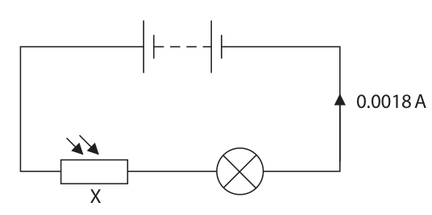

**Mark scheme answer**

> voltmeter in parallel with component X;

- **(1)** voltmeter in parallel with component X;

### 3(a)(ii) [1]

Give the name of component X.

**Mark scheme answer**

> light dependent resistor / LDR;

- **(1)** light dependent resistor / LDR;

### 3(b)(i) [2]

Use the graph to determine the resistance of component X when the light intensity is 4.0 arbitrary units. resistance = Ω

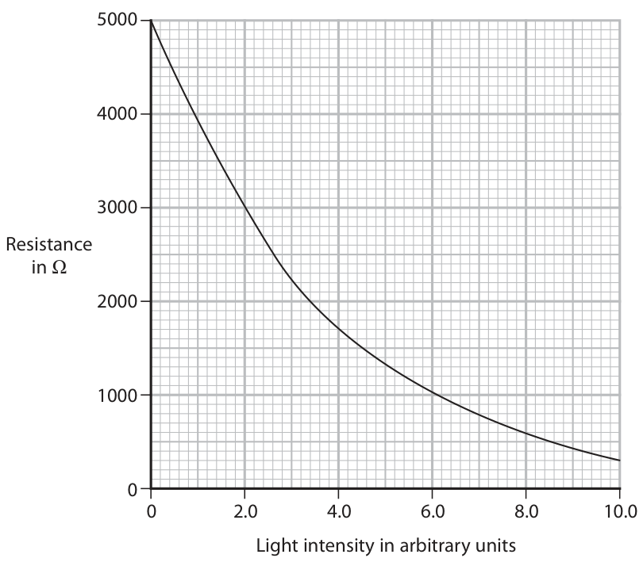

**Mark scheme answer**

> evidence of use of graph;
> 1700 (ohms); accept range 1650-1750 (ohms)
> allow full marks for 1700

- **(2)** evidence of use of graph;

### 3(b)(ii) [3]

The current in the circuit is 0.0018 A. Calculate the voltage across component X at a light intensity of 4.0 arbitrary units. voltage = V

**Mark scheme answer**

> evidence of use of voltage = current x allow use of standard
> resistance; symbols e.g. V = I × R
> accept v, V, i , I, r, R
> substitution; allow ECF from (i)
> evaluation;
> correct answer = 3.1 (V)
> e.g.
> V = IR
> V = 0.0018 × 1700
> V = 3.06 (V)

- **(3)** evidence of use of voltage = current x allow use of standard

### 3(b)(iii) [2]

Explain what happens to the brightness of the lamp when component X is covered with a dark sheet of paper.

**Mark scheme answer**

> brightness decreases; reject reference to covering the
> lamp reducing the brightness of
> the lamp
> plus ONE from:
> resistance (of circuit) increases;
> current in circuit decreases;
> (Total for Question 3 = 9 marks)
> Answer Notes Marks

- **(2)** brightness decreases; reject reference to covering the

## Question 4 (9 marks)

Diagram 1 shows an ice cube floating at rest in a beaker of water. ice cube water Diagram 1

**(b)** Diagram 2 shows the ice cube pushed down into the water by force X. The ice cube is at rest in this new position. force X ice cube water Diagram 2

### 4(a) [1]

State the value of the resultant force on the ice cube. resultant force = N

**Mark scheme answer**

> zero/0 (N);

- **(1)** zero/0 (N);

### 4(b)(i) [1]

State the formula linking pressure difference, height, density and gravitational field strength.

**Mark scheme answer**

> pressure = depth × density × gravitational field strength; allow use of standard
> symbols e.g. p = h × ρ × g
> allow ‘d’ for ‘h’
> reject ‘gravity’ for ‘g’ in
> formula

- **(1)** pressure = depth × density × gravitational field strength; allow use of standard

### 4(b)(ii) [2]

The bottom of the ice cube is 0.041 m below the surface of the water. The density of water is 1000 kg/m³. Show that the pressure difference between the bottom of the ice cube and the surface of the water is about 400 Pa.

**Mark scheme answer**

> substitution;
> evaluation; -1 POT error
> e.g.
> pressure = depth × density × gravitational field strength
> pressure = 0.041 × 1000 × 10 allow use of 9.8(1) for ‘g’
> pressure = 410 (Pa) giving 401.8…

- **(2)** substitution;

### 4(b)(iii) [1]

State the formula linking pressure, force and area.

**Mark scheme answer**

> pressure = force ÷ area; allow use of standard
> symbols e.g.P = F ÷ A

- **(1)** pressure = force ÷ area; allow use of standard

### 4(b)(iv) [2]

The area of the base of the ice cube is 0.0017 m². Calculate the upward force on the bottom of the cube from the water due to the pressure difference. upward force = N

**Mark scheme answer**

> substitution or re-arrangement; substitution and
> rearrangement in either
> order
> evaluation; allow correctly rounded
> values e.g. 0.697
> allow use of candidate’s
> unrounded value even if
> not approx 400
> e.g.
> pressure = force ÷ area
> 400 = force ÷ 0.0017
> force = 400 × 0.0017 = 0.68 (N)

- **(2)** substitution or re-arrangement; substitution and

### 4(b)(v) [2]

Explain why the ice cube will accelerate upwards when force X is removed.

**Mark scheme answer**

> upwards force greater than weight of cube;
> resultant force upwards;
> allow idea of ice being less
> dense than water for 1
> mark.
> (Total for Question 4 = 9 marks)
> Answer Notes Marks

- **(2)** upwards force greater than weight of cube;

## Question 5 (10 marks)

Table 1 shows the colour of some stars. Star Colour Sun yellow Rigel blue Betelgeuse red Arcturus orange Sirius white Table 1

### 5(a) [3]

Complete table 2 by giving the stars in order of increasing surface temperature. The hottest star, Rigel, has been done for you. Coolest Hottest Rigel Table 2

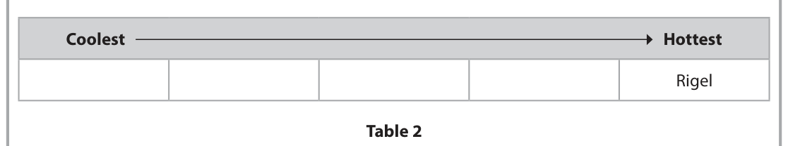

**Mark scheme answer**

> ;;; 1 star in correct place
> scores 1 mark
> Coolest Hottest 2 stars in correct places
> scores 2 marks
> B A Sun Sirius Rigel 3 marks for all stars in
> correct places
> accept colours instead
> of names
> i.e.
> red, orange, yellow,
> white
> condone a mix i.e.
> Betelgeuse, orange,
> yellow, Sirius

- **(3)** ;;; 1 star in correct place

### 5(b) [3]

A star has a much larger mass than the Sun. Describe the evolution of this star after it has left the main sequence.

**Mark scheme answer**

> any THREE from
> MP1. red supergiant; allow super red giant
> MP2. supernova;
> MP3. neutron star;
> MP4. (or) black hole; 2 marks max for any
> incorrect order
> including incorrect
> stages e.g. dust/gas
> cloud or protostar

- **(3)** any THREE from

### 5(c) [4]

The graph shows the relationship between the peak wavelength of light emitted by a star and the surface temperature of the star. 1000 800 600 Peak wavelength in nm 400 200 0 5 10 15 20 Surface temperature in thousands of K A scientist suggests that the two variables are linked by this formula. peak wavelength × surface temperature = constant Use data from the graph to justify this formula.

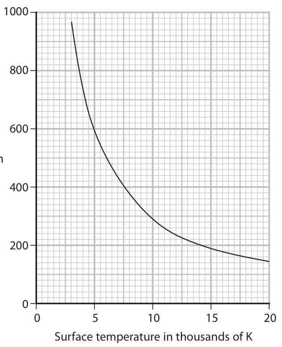

**Mark scheme answer**

> any pair of readings from the graph;
> correct substitution into formula to find constant; allow ECF for this mark
> alone
> different pair of readings used correctly to find
> constant;
> statement that the results agree with the DOP
> conclusion;
> allow idea that the
> constants are not the
> e.g. same so that the results
> when temp = 10 kK wavelength = 280 nm do not agree with the
> 280 × 10 = 2800 conclusion
> $140 \times 20 = 2800$
> constants are the same so results agree with
> proposal

- **(4)** any pair of readings from the graph;

## Question 6 (15 marks)

Diagram 1 shows a simple loudspeaker. The coil is connected to an alternating current (a.c.) supply. tube magnet N S paper cone N coil on tube Diagram 1

**(b)** Diagram 2 shows two loudspeakers connected in series with a variable resistor. The variable resistor is set to 5.0 Ω. 1.5 V 5.0 Ω 0.15 A Diagram 2

### 6(a) [4]

Describe how the loudspeaker produces sound.

**Mark scheme answer**

> any FOUR from: ignore references to
> MP1. idea of magnetic field around coil (when induction
> current flows);
> MP2. idea of interaction between fields of magnet
> and coil;
> MP3. idea of force on coil from magnet;
> MP4. idea of alternating force on cone;
> allow ‘tube’ for ‘cone’
> MP5. cone vibrates;
> MP6. idea that cone forces air to vibrate;
> MP7. longitudinal wave formed; allow idea of series of
> compressions and
> rarefactions

- **(4)** any FOUR from: ignore references to

### 6(b)(i) [2]

The total voltage across the two loudspeakers is 0.75 V and the current in the circuit is 0.15 A. Show that the total power of the two loudspeakers is about 0.1 W. [power = current × voltage]

**Mark scheme answer**

> substitution;
> evaluation; -1 for POT error
> correct answer = 0.11 (W)
> e.g. power = current × voltage = 0.15 × 0.75
> power = 0.1125 W

- **(2)** substitution;

### 6(b)(ii) [3]

A student varies the resistance of the variable resistor. The table shows the power of the loudspeakers for different resistance values of the variable resistor. Resistance of variable resistor in Ω Power of loudspeakers in W 0.0 0.000 2.5 0.100 5.0 0.113 7.5 0.108 10.0 0.100 12.5 0.092 15.0 0.084 Plot the student’s results on the grid.

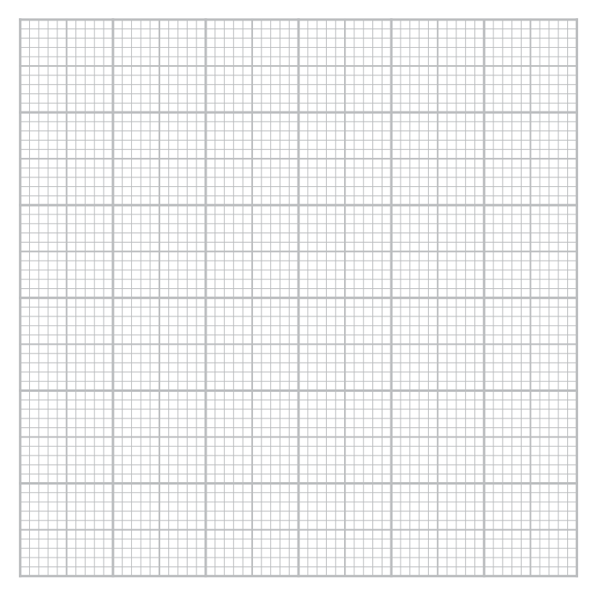

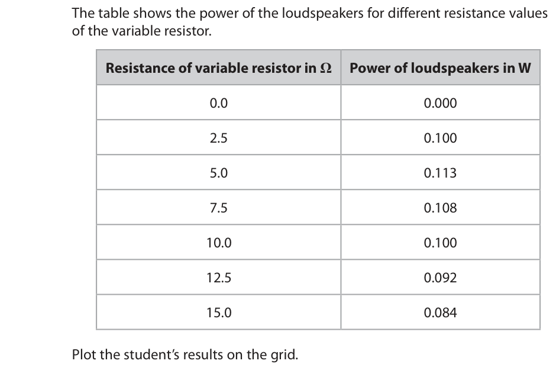

**Mark scheme answer**

> suitable linear scale chosen (>50% of grid used); ignore orientation
> axes labelled with quantities and units;
> all plotting correct to nearest half square;

- **(3)** suitable linear scale chosen (>50% of grid used); ignore orientation

### 6(b)(iii) [2]

Draw a curve of best fit.

**Mark scheme answer**

> attempt at fitting first two points and fitting rest of ecf candidate’s
> points separately; plotting
> single curve with a peak within one large square of
> third point; max 1 mark for straight
> line consistent with
> candidate's plotting

- **(2)** attempt at fitting first two points and fitting rest of ecf candidate’s

### 6(c) [4]

Diagram 3 shows the loudspeakers connected in series to a cell. Diagram 4 shows the loudspeakers connected in parallel to the same cell. 1.5 V 1.5 V 0.30 A 1.2 A Diagram 3 Diagram 4 Comment on how the total resistance of the loudspeakers in diagram 3 compares with the total resistance of the loudspeakers in diagram 4.

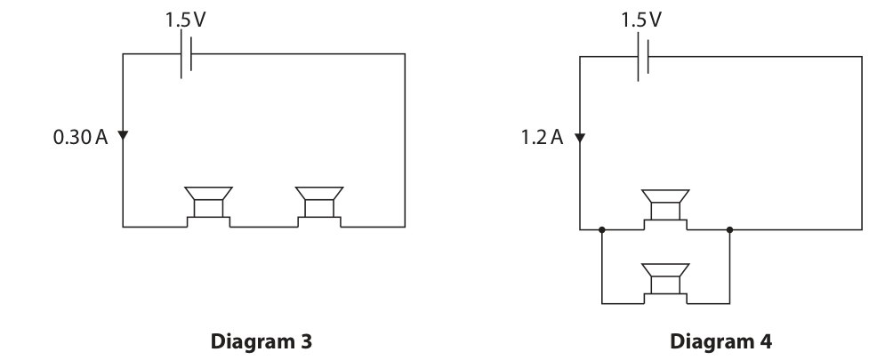

**Mark scheme answer**

> any FOUR from:
> MP1. for diagram 4, cell voltage no longer shared; accept voltages in
> parallel are the same
> accept voltage is
> shared in diagram 3
> MP2. means current through each loudspeaker is
> doubled;
> MP3. so current from supply is four times higher; accept idea of current
> from each branch adds
> to give total current in
> cell
> MP4. correct use of ‘R = V/I’;
> MP5. (so) total resistance is a quarter of that from accept higher order
> the series case; answers in terms of
> series and parallel
> equations
> accept calculation of
> both circuit’s total
> resistance
> (Total for Question 6 = 15 marks)
> Answer Notes Marks

- **(4)** any FOUR from:

## Question 7 (11 marks)

Radon is a radioactive gas that contributes to background radiation.

**(b)** The graph shows the activity of a sample of radon‑222. 1200 1000 800 Activity in kBq 600 400 200 0 1 2 3 4 5 6 7 Time in days

### 7(a) [2]

Describe what is meant by the term background radiation.

**Mark scheme answer**

> idea of radiation from sources in the environment; allow idea of ‘no other
> sources present’
> idea that background is ever present/all around;

- **(2)** idea of radiation from sources in the environment; allow idea of ‘no other

### 7(b)(i) [2]

State what is meant by the term half‑life.

**Mark scheme answer**

> time taken; allow "how long it
> and either of takes"
> reject "half the time"
> for the (radio)activity to halve; allow count rate for
> for half of the (radioactive) nuclei / atoms/ isotope activity
> /mass to decay; ignore substance

- **(2)** time taken; allow "how long it

### 7(b)(ii) [2]

Use the graph to determine the half‑life of radon‑222. half‑life = days

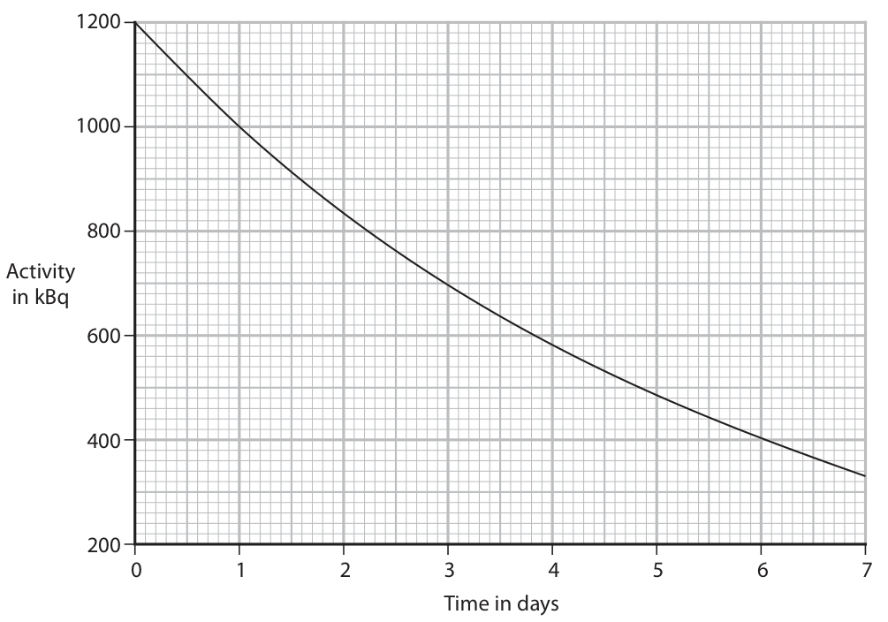

**Mark scheme answer**

> evidence of graph used correctly; i.e. line drawn across
> 3.8 (days); from 600 to curve and
> down to time axis
> allow full marks for 3.8-
> 3.85

- **(2)** evidence of graph used correctly; i.e. line drawn across

### 7(c) [3]

Radon‑222 is formed by multiple alpha decays of uranium‑234. Complete the nuclear equation by giving the missing information. 234 92 U → 222Rn + 3 α

**Mark scheme answer**

> 4 (for alpha nucleon number);
> 2 (for alpha proton number);
> 86 (for Rn proton number); ECF for incorrect alpha
> proton number then
> multiplied by 3

- **(3)** 4 (for alpha nucleon number);

### 7(d) [2]

Radon‑222 also emits alpha radiation. Explain the hazard to humans of breathing in air contaminated with radon‑222.

**Mark scheme answer**

> any TWO from:
> MP1. idea of irradiation of internal organs; allow idea that there is
> no ‘dead skin’ layer for
> alphas to penetrate
> allow ‘damages tissue’
> or ‘damages cells/DNA’
> MP2. alphas are {highly/very/most} ionizing;
> MP3. causes mutations/cancer;
> (Total for Question 7 = 11 marks)
> Answer Notes Marks

- **(2)** any TWO from:

## Question 8 (9 marks)

Hailstones are small pieces of ice that sometimes fall to the ground during storms.

### 8(a)(i) [4]

Describe how to determine the density of a hailstone. Assume that hailstones are spherical.

**Mark scheme answer**

> any FOUR from: condone reference to
> letting the ice melt
> MP1. measure mass;
> MP2. use (mass) balance; allow scales
> reject scale
> MP3. measure diameter;
> MP4. use ruler/callipers/micrometer;
> MP5. further experimental detail e.g. use set
> square against ruler/use callipers in different
> orientations/fully submerged/avoid splashing;
> MP6. repeat readings and take average;
> MP7. use formula to find volume of a sphere e.g.
> $V = 4/3 \pi r^{3}$;
> MP8. use density = mass ÷ volume; allow use of
> displacement method
> and measuring cylinder
> for MP3, MP4, MP7

- **(4)** any FOUR from: condone reference to

### 8(a)(ii) [3]

The mean volume of a hailstone is 1.1 cm³. The mean mass of a hailstone is 0.94 g. Calculate the mean density of a hailstone. Give the unit. density = unit

**Mark scheme answer**

> substitution into equation density = mass ÷ volume; allow use of standard
> symbols e.g. D = M ÷ V
> accept ρ for density
> evaluation; -1 for POT error
> unit i.e g/cm3; independently marked
> accept unit matching
> calculation i.e. if mass
> converted into kg
> correct answer = 0.85 g/cm³ accept 0.854 or 0.855
> e.g. density = mass ÷ volume
> density = 0.94 ÷ 1.1
> density = 0.8545…
> density = 0.85 g/cm³

- **(3)** substitution into equation density = mass ÷ volume; allow use of standard

### 8(b) [2]

Hailstones can be lifted to the top of clouds. The diagram shows the movement of some hailstones in a cloud. cloud movement of hailstones warm ground Suggest how hailstones are lifted to the top of the cloud by convection.

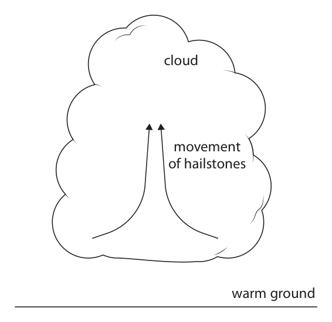

**Mark scheme answer**

> any TWO from: allow ‘cloud’ for ‘air’
> MP1. warm air rises;
> MP2. warm air expands; allow air particles
> spread out
> reject ‘particles
> expand’
> MP3. warm air is less dense than cold air;
> MP4. a convection current is formed;
> (Total for Question 8 = 9 marks)
> Answer Notes Marks

- **(2)** any TWO from: allow ‘cloud’ for ‘air’

## Question 9 (7 marks)

The diagram shows an empty metal container that has a hole in the top. container

### 9(a) [3]

Describe how the air molecules in the container exert a pressure on its inner walls.

**Mark scheme answer**

> molecules collide with walls; allow particles or
> atoms
> collisions provide force on walls;
> force per unit area gives a pressure; formula alone is
> insufficient

- **(3)** molecules collide with walls; allow particles or

### 9(b) [2]

The container is heated for a long time. Explain what happens to the number of air molecules in the container.

**Mark scheme answer**

> any TWO from:
> MP1. number of molecules in container decreases; allow particles or
> MP2. increase in temperature increases speed or atoms
> KE of molecules;
> MP3. molecules have a high enough speed or KE to
> escape;

- **(2)** any TWO from:

### 9(c) [2]

A lid is placed on the hot container. The lid seals the hole and the container is allowed to cool. As the container cools, it collapses. container collapsed with lid container Explain why the container collapses.

**Mark scheme answer**

> any TWO from: accept RA throughout
> MP1. idea fewer collisions per unit time gives accept "lower
> lower force; frequency of collisions"
> ignore collisions
> between molecules
> MP2. idea that each collision is less hard;
> MP3. (lower force per unit area gives) lower
> pressure;
> MP4. pressure outside container is larger than allow force (from air
> pressure in can; pressure) is lower
> inside than outside
> MP5. pressure difference causes a force;
> (Total for Question 9 = 7 marks)
> Answer Notes Marks

- **(2)** any TWO from: accept RA throughout

## Question 10 (10 marks)

Diagram 1 shows a trolley seen from above. A copper rod is attached to the front of the trolley. The rod is connected to a voltmeter fixed to the trolley. copper rod trolley V Diagram 1

**(a)** Diagram 2 shows the path of the trolley, backwards and forwards through a very strong magnetic field directed into the page. The shaded area shows the magnetic field. magnetic field into page path of trolley Diagram 2

**(b)** The voltmeter is replaced by a resistor. A charge of 1.4 × 10–4 C flows in the resistor during a time of 0.78 s.

### 10(a)(i) [3]

A voltage is induced in the copper rod as the trolley moves through the magnetic field. Explain why the sign of the voltmeter reading changes as the trolley moves backwards and forwards.

**Mark scheme answer**

> any THREE from: condone current for
> trolley changes direction; voltage
> induction depends on direction of relative motion; ignore idea induction
> depending on speed
> idea that voltage has changed directon (as sign of
> voltmeter reading depends on direction of
> voltage);
> idea that at ends of motion, voltage is zero;

- **(3)** any THREE from: condone current for

### 10(a)(ii) [1]

Give a reason why the magnitude of the induced voltage might change.

**Mark scheme answer**

> speed may change/
> magnetic field may not be uniform; accept idea that
> magnetic field may
> change
> allow idea of entering
> or leaving field

- **(1)** speed may change/

### 10(b)(i) [3]

Calculate the mean current in the resistor. mean current = A

**Mark scheme answer**

> substitution; substitution and
> re-arrangement; rearrangement in either
> order
> evaluation; -1 POT error
> correct answer: 1.8 × 10⁻⁴ (A)
> e.g.
> charge = current × time
> 1.4 × 10⁻⁴ = current × 0.78
> current = (1.4 × 10⁻⁴) ÷ 0.78 = 1.79 × 10⁻⁴ (A)

- **(3)** substitution; substitution and

### 10(b)(ii) [3]

The thermal energy store of the resistor increases by 2.3 × 10⁻⁶ J as energy is transferred to it electrically. Calculate the mean voltage across the resistor when a charge of 1.4 × 10⁻⁴ C transfers this energy. mean voltage = V

**Mark scheme answer**

> allow use of standard
> symbols e.g. E = Q × V
> allow v,V for voltage
> reject C,c for charge
> substitution; substitution and
> re-arrangement; rearrangement in either
> order
> evaluation;
> correct answer: 1.6 × 10⁻² (V) -1 POT error
> e.g.
> energy = charge × voltage
> 2.3 × 10⁻⁶ = 1.4 × 10⁻⁴ × voltage
> voltage = (2.3 × 10⁻⁶) ÷ (1.4 × 10⁻⁴) = 1.64 × 10⁻² (V)

- **(3)** allow use of standard

## Question 11 (10 marks)
**(a)** Diagram 1 shows water waves just before they reflect off the side of a stationary boat. wavefronts direction of travel side of boat Diagram 1

**(b)** The boat starts to move, creating its own waves on the surface of the water.

### 11(a)(i) [1]

Draw the normal at the point where the direction of travel of the waves meets the side of the boat.

**Mark scheme answer**

> line drawn at 90 degrees to side of boat at point where ignore normal inside
> direction of travel touches boat; boat

- **(1)** line drawn at 90 degrees to side of boat at point where ignore normal inside

### 11(a)(ii) [1]

Measure the angle of incidence of the water waves. angle of incidence = degrees

**Mark scheme answer**

> 66 (degrees); accept in range 64-68
> degrees

- **(1)** 66 (degrees); accept in range 64-68

### 11(a)(iii) [3]

Complete the diagram to show the wavefronts after they reflect off the side of the boat.

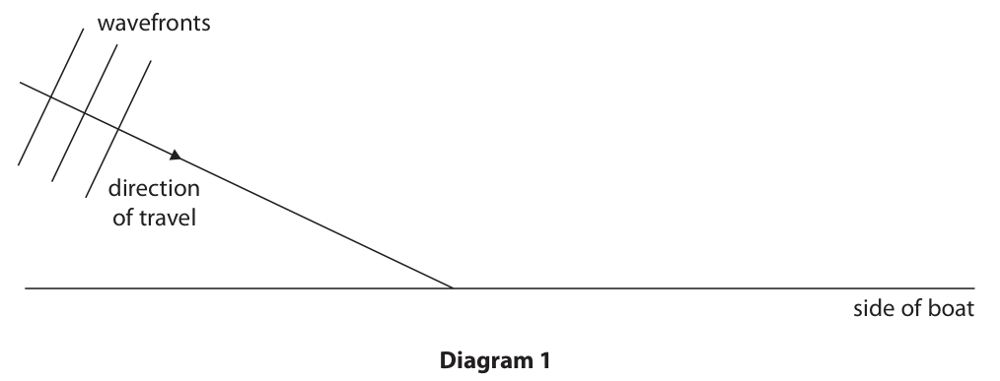

**Mark scheme answer**

> three wavefronts parallel and constant wavelength; by eye;
> condone different
> wavelength to
> incident wavefronts
> to the right of the normal and above boat surface;
> correct angle of reflection; by eye;
> allow ‘reflected ray’
> if no other mark
> awarded

- **(3)** three wavefronts parallel and constant wavelength; by eye;

### 11(b)(i) [2]

Surface water waves are transverse. Describe the difference between transverse waves and longitudinal waves.

**Mark scheme answer**

> transverse (waves/particles) vibrate at right angles to allow
> the direction of travel of the wave; ‘vibrations/oscillates
> at…’
> allow ‘perpendicular
> to’ for ‘at right
> angles’
> longitudinal (waves/particles) vibrate along line of allow ‘energy
> direction of travel of the wave; transfer’ for ‘travel’
> allow ‘(anti-)parallel
> to’ for ‘along’

- **(2)** transverse (waves/particles) vibrate at right angles to allow

### 11(b)(ii) [3]

Diagram 2 shows the boat moving towards an observer. boat observer Diagram 2 Explain why the frequency of the water waves measured by the observer is larger than the frequency of the water waves created by the boat.

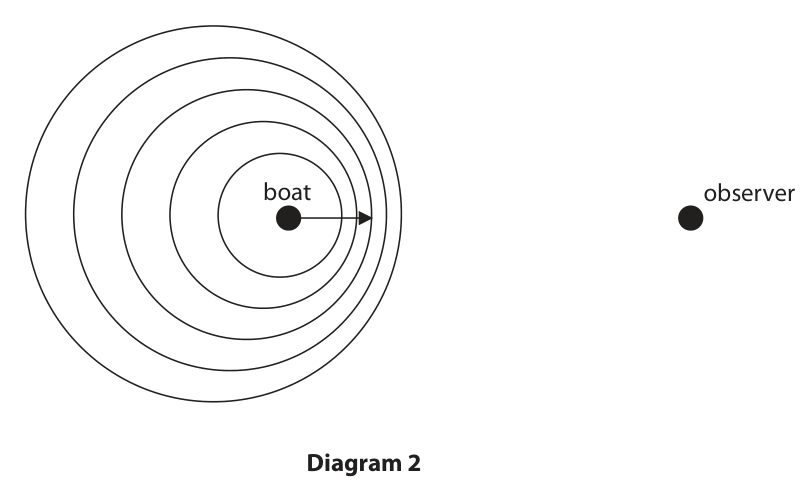

**Mark scheme answer**

> wavelength or distance between wavefronts smaller;
> speed of waves is constant;
> reference to wave equation v = fλ ; if no other marks
> awarded, 1 mark for
> reference to Doppler
> effect
> (Total for Question 11 = 10 marks)
> Answer Notes Marks

- **(3)** wavelength or distance between wavefronts smaller;

## Question 12 (10 marks)

This question is about a parachutist.

**(b)** When the parachutist is much nearer to the ground, they open their parachute. The parachutist slows down.

### 12(a) [4]

A parachutist leaves a helicopter that is hovering above the ground. The parachutist is initially at rest and falls vertically downwards. Calculate the speed of the parachutist after they have fallen through a distance of 1300 m. Ignore the effect of air resistance. speed = m/s

**Mark scheme answer**

> use of u=0 (m/s); accept loss of GPE =
> gain in KE
> correct substitution into ‘v² = u² + 2aS’; reject use of v=0 for
> this MP
> correct evaluation of v²; v² = 26000
> accept 25506, 25480
> reject v² = 2600 if no
> a=10 seen.
> correct evaluation of v; ignore sign
> correct answer = 160 (m/s) accept
> 159.7059..,159.62....
> e.g.
> v² = u² + 2aS
> $v^{2} = 0^{2} + (2 \times 10 \times 1300)$
> $v^{2} = 26000$
> v = 161.245... (m/s)

- **(4)** use of u=0 (m/s); accept loss of GPE =

### 12(b)(i) [3]

Explain the change in speed of the parachutist. Use ideas about forces in your answer.

**Mark scheme answer**

> any THREE from: ignore ‘upthrust’
> MP1. reference to weight and air resistance; accept drag for AR
> MP2. air resistance larger than weight (when accept ‘resultant or
> parachute opens); unbalanced force is
> upwards ‘
> allow idea of increased
> AR
> MP3. reference to ‘F = ma’;
> MP4. acceleration is upwards; ignore ‘decelerates’ or
> ‘slows down’
> MP5. air resistance decreases as parachutist
> slows down;

- **(3)** any THREE from: ignore ‘upthrust’

### 12(b)(ii) [3]

It is observed that from when the parachute opens to just before the parachutist touches the ground, the GPE store and the KE store of the parachutist both decrease, yet energy is still conserved. Justify these observations.

**Mark scheme answer**

> any THREE from:
> MP1. GPE reduces as height above ground
> reduces;
> MP2. KE reduces as speed reduces;
> MP3. friction force does mechanical work on accept ‘works
> parachutist; mechanically’
> MP4. thermal store of parachutist increases;
> MP5. thermal transfer between (warm) accept ‘energy lost to
> parachutist and (cold) air; the surroundings’
> accept idea of
> conversion to heat
> energy via friction
> MP6. thermal transfer happens by conduction or
> radiation;
> (Total for Question 12 = 10 marks)
> Pearson Education Limited. Registered company number 872828
> with its registered office at 80 Strand, London, WC2R 0RL, United Kingdom

- **(3)** any THREE from:

