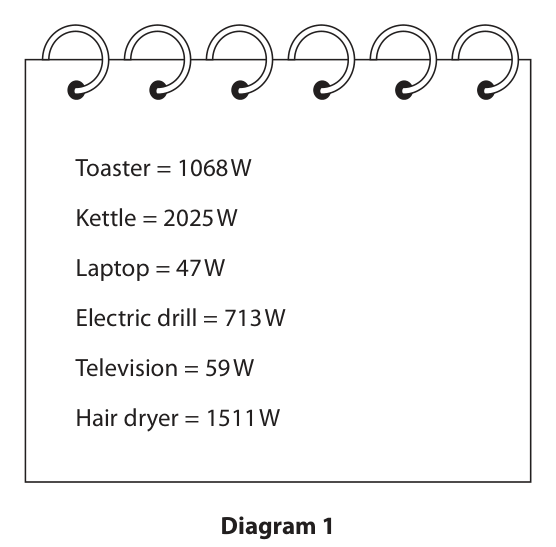
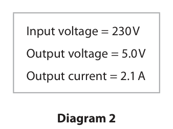
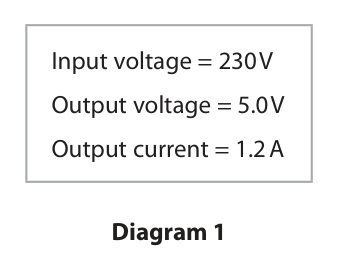
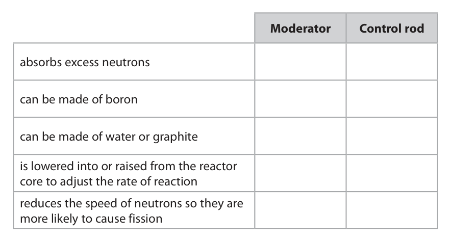
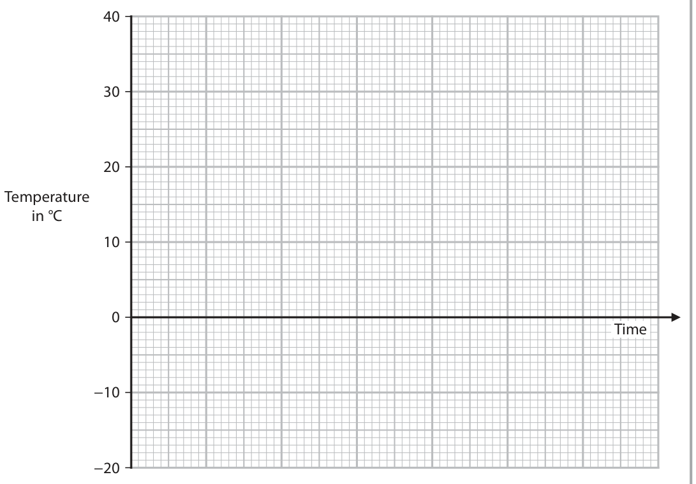

# 4PH1/2P — 2022-06 (official extraction)

> schema `syllabai.official-paper-questions/0.2` · paper_id `pearson-edexcel:international-gcse:physics:4ph1:2022-06:4PH1/2P` · qp sha256 `210d97236e5ff757…` · extraction is the disclosed baseline (ADR-039)

## Question 1 (7 marks)

A student uses a watt-meter to measure the power of electrically‑operated appliances.

**(c)** The student measures the power output for a different appliance. Diagram 2 shows their raw data. 199 W 202 W 201 W 213 W 200 W 201 W Diagram 2

### 1(a) [1]

State what is meant by the term power.

**Mark scheme answer**

> rate of doing work / rate of energy transfer; condone “amount of
> energy transferred each
> second”
> accept “energy transferred
> per second”
> allow correct formula
> allow correct word
> equation
> reject idea of P = IV
> reject “amount of energy
> in a given time”
> (b) results table constructed with appliance column allow alternative
> and power column; orientation with two rows
> condone power in 1st
> column
> ignore names given to non-
> power heading
> power column heading to include correct unit; reject if units given with
> raw data

- **(1)** rate of doing work / rate of energy transfer; condone “amount of

### 1(b) [2]

The student measures the mean power output (in watts) for six different appliances. Diagram 1 shows their results. Toaster = 1068 W Kettle = 2025 W Laptop = 47 W Electric drill = 713 W Television = 59 W Hair dryer = 1511 W Diagram 1 Draw a results table for the student’s results.

> 🖼 crop required: table (qp.pdf p.5)

### 1(c)(i) [1]

The student identifies an anomalous result in their data. Draw a circle around the anomalous result.

**Mark scheme answer**

> 213 W identified;

- **(1)** 213 W identified;

### 1(c)(ii) [3]

Calculate the mean power output for this appliance. Give your answer to three significant figures. mean power output = W

**Mark scheme answer**

> omission of anomalous result; allow ECF from (c)(i)
> mean calculated;
> candidate's mean correctly rounded and expressed
> to 3 significant figures;
> e.g.
> mean power = [199 + 202 + 200 + 201 + 201] ÷ 5
> mean power = 200.6 (W)
> mean power = 201 (W)
> 203 (W) scores 2 marks
> 202.667…(W) scores 1 mark
> Answer Notes Marks

- **(3)** omission of anomalous result; allow ECF from (c)(i)

## Question 2 (8 marks)

This question is about momentum.

**(b)** The diagram shows an object before and after an explosion. The object breaks into two parts, P and Q. The parts move away from each other in opposite directions. object stationary v P Q 3.7 m / s 4.8 kg 2.9 kg 1.9 kg Before After

### 2(a) [1]

Which of these is the correct unit for momentum?

- **(A)** kg / m / s
- **(B)** kg² m / s
- **(C)** kg m / s²
- **(D)** kg m / s  ✔

**Mark scheme answer**

> D (kg m/s);
> A is incorrect because this would be from mass / velocity
> B is incorrect because this would be from mass2 × velocity
> C is incorrect because this would be from mass × velocity2

- **(1)** Answer D: kg m / s

### 2(b)(i) [1]

State what is meant by the principle of conservation of momentum.

**Mark scheme answer**

> idea that (total) momentum before (collision) allow references to
> = (total) momentum after (collision) (in the explosion/event, rather than
> absence of external forces); collision
> ‘momentum is conserved’ is
> insufficient

- **(1)** idea that (total) momentum before (collision) allow references to

### 2(b)(ii) [3]

Calculate the magnitude of the velocity of part P after the explosion. velocity = m / s

**Mark scheme answer**

> setting up equation using conservation of using either substitution of
> momentum; correct values or
> algebraically
> rearrangement;
> evaluation;
> e.g.
> 0 = [1.9 × 3.7] + [2.9 × v] allow
> [1.9 × 3.7] = [2.9 × v]
> v = -7.03 / 2.9
> (v =) -2.4 (m/s) allow 2.42… (m/s)
> ignore sign of final answer
> correct evaluation of object
> Q’s momentum i.e. (-)7.03
> (kg m/s) scores 1 mark if no
> other mark scored
> (c) ignore references to
> hard/soft floors
> ignore references to
> absorbing force or reduction
> in ‘impact’
> ignore references to energy
> idea of carpet increases impact time; allow RA
> carpet reduces rate of change of momentum allow RA
> (for the same speed or momentum of egg); allow reference to given
> equation or word equation
> allow reduces deceleration
> or acceleration
> (carpet) reduces force; allow RA
> Answer Notes Marks

- **(3)** setting up equation using conservation of using either substitution of

### 2(c) [3]

A child drops an egg from a height of 10 cm and the egg lands on the floor. Explain why the egg is less likely to break if the floor is covered with a thick carpet than if the floor were covered in hard tiles.

## Question 3 (15 marks)

Mobile phone charger X contains a transformer and is used to charge the phone’s battery. Diagram 1 shows the information on charger X. Input voltage = 230 V Output voltage = 5.0 V Output current = 1.2 A Diagram 1

**(b)** Charger X transfers a charge of 10 500 C to the mobile phone battery.

### 3(a)(i) [2]

The power of the charger can be calculated using the formula power = current × voltage Calculate the output power of charger X. output power = W

### 3(a)(ii) [3]

Calculate the input current to charger X. Assume that charger X is 100% efficient. input current = A

### 3(b)(i) [1]

State the formula linking charge, current and time.

**Mark scheme answer**

> charge = current × time; allow rearrangements
> and standard symbols
> e.g. Q = I × t
> reject c, C for current,
> charge

- **(1)** charge = current × time; allow rearrangements

### 3(b)(ii) [3]

Calculate the time in minutes to transfer a charge of 10 500 C to the battery. time = minutes

**Mark scheme answer**

> substitution of 1.2 A for current;
> correct evaluation in seconds; -1 POT error
> evaluation in minutes; mark independently
> e.g.
> 10500 = 1.2 × time OR t = 10 500 / 1.2
> (t =) 8750 (s)
> (t =) 150 minutes allow 146, 145.83…
> 145 minutes gets 2
> marks only
> condone fractional
> minutes i.e. 145 5/6
> min)or combined
> minutes & seconds i.e.
> 145:50

- **(3)** substitution of 1.2 A for current;

### 3(b)(iii) [2]

Charger Y can also be used to charge the mobile phone battery. Diagram 2 shows the information label for charger Y. Input voltage = 230 V Output voltage = 5.0 V Output current = 2.1 A Diagram 2 Explain how the time taken to transfer the same amount of charge to the mobile phone battery will be affected when charger Y is used instead of charger X.

**Mark scheme answer**

> time will be less / eq;
> (because) current is greater; allow numerical
> statement e.g. “current
> is now 2.1A”
> reject reference to
> input current
> (c) any four from: accept input/output for
> primary/secondary
> MP1. (step-down) transformer decreases voltage; allow idea of fewer
> turns on secondary
> (than primary) including
> on the diagram (e.g.
> clearly more turns
> drawn and P/S coils
> labelled)
> MP2. current in (primary) coil produces magnetic allow (primary) coil
> field; becomes an
> electromagnet
> MP3. current is changing / alternating; allow ‘current is a.c.’
> MP4. causing a (changing) magnetic field in the allow reference to
> core; magnetise and
> demagnetise
> MP5. the core strengthens the field (at the
> secondary coil) /eq;
> MP6. field lines interact with secondary coil; allow field lines cutting
> secondary coil
> MP7. which induces a voltage in the secondary allow induces a current
> coil; in the secondary coil
> MP8. transformers won’t work with (constant)
> d.c.;
> Answer Notes Marks

- **(2)** time will be less / eq;

### 3(c) [4]

Both chargers contain step-down transformers. Explain how a step-down transformer works. You may include a diagram to support your answer.

## Question 4 (10 marks)

Sound waves with a frequency above the range of human hearing are known as ultrasound.

**(b)** The frequency of ultrasound waves can be determined using an oscilloscope.

**(c)** The diagram shows the oscilloscope screen when an ultrasound wave is detected. The oscilloscope settings are also shown. oscilloscope settings: y direction: 1 square = 2 V x direction: 1 square = 5 × 10−6 s

### 4(a) [2]

State the frequency range for human hearing.

**Mark scheme answer**

> units (if given) must be
> consistent with data
> i.e. 20 Hz - 20kHz
> 20 (Hz);
> to 20 000 (Hz);
> max 1 mark if non-
> frequency unit given

- **(2)** units (if given) must be

### 4(b)(i) [1]

Give the name of the piece of apparatus that could be connected to the oscilloscope to detect the ultrasound waves.

**Mark scheme answer**

> microphone; ignore sound sensor,
> ultrasound detector

- **(1)** microphone; ignore sound sensor,

### 4(b)(ii) [3]

The time period of the ultrasound waves must be measured to determine their frequency. Describe how the oscilloscope is used to measure the time period of the ultrasound waves.

**Mark scheme answer**

> any three from:
> MP1. idea of adjusting oscilloscope to obtain steady e.g. “freeze the
> trace /eq; screen”
> MP2. idea of adjusting time base to display (at
> least) one cycle on screen /eq;
> MP3. Idea of evaluating number of squares for full condone reference to a
> cycle /eq; wavelength rather than
> a time period or full
> cycle
> MP4. multiply number of squares (for full cycle) by
> time base /eq;

- **(3)** any three from:

### 4(c)(i) [2]

Determine the time period of the ultrasound waves. time period = s

**Mark scheme answer**

> number of squares for full cycle;
> correct evaluation of time period from candidate’s reject answer that
> number of squares; clearly uses the
> amplitude scale for 0
> e.g.
> one full cycle = 6 squares
> time period = (6 × 5 × 10-6) = 3 × 10-5 (s) allow 30 × 10-6 (s)

- **(2)** number of squares for full cycle;

### 4(c)(ii) [2]

Calculate the frequency of the ultrasound waves. frequency = Hz

**Mark scheme answer**

> substitution into f = 1/T; allow ECF from (c)(i)
> evaluation;
> e.g.
> f = 1 / 3 × 10-5
> (f =) 3.3 × 104 (Hz) allow 33 333.3…,
> 33 300, 33 000 etc (Hz)
> allow 30 000
> Answer Notes Marks

- **(2)** substitution into f = 1/T; allow ECF from (c)(i)

## Question 5 (9 marks)
**(c)** A uranium fuel rod is made from fuel pellets that contain uranium‑235 and uranium‑238. Only uranium‑235 undergoes nuclear fission in the reactor core. Energy is released when the uranium‑235 nuclei undergo fission. The box gives some data about a typical uranium fuel pellet. Total mass of uranium in fuel pellet 0.0088 kg Percentage (by mass) of uranium‑235 in fuel pellet 3.0 % Mass of uranium‑235 atom 3.90 × 10−25 kg Total energy released from fuel pellet due to fission 2.17 × 1010 J

### 5(a) [3]

The table gives some statements about different parts of a nuclear reactor. Place ticks (✓) in the boxes to show which statements are about the moderator and which statements are about a control rod in a nuclear reactor. Moderator Control rod absorbs excess neutrons can be made of boron can be made of water or graphite is lowered into or raised from the reactor core to adjust the rate of reaction reduces the speed of neutrons so they are more likely to cause fission

**Mark scheme answer**

> all ticks correct = 3 marks
> 3-4 ticks correct = 2 marks
> 1-2 ticks correct = 1 mark
> (b) ignore references to
> structural integrity of reactor
> prevents radiation escaping (the reactor core) allow absorbs radiation
> /eq ; allow idea of protecting
> workers outside the core
> by absorbing (high energy) neutrons/fission ignore imprecise technical
> products/gamma; language e.g. can't pass
> through, is stopped by etc.
> condone “can’t penetrate”

- **(3)** all ticks correct = 3 marks

### 5(b) [2]

Describe the role of shielding around a nuclear reactor.

### 5(c)(i) [2]

Calculate the number of uranium‑235 atoms in the fuel pellet. number of uranium‑235 atoms =

**Mark scheme answer**

> evaluation of total mass of U-235;
> evaluation of number of U-235 atoms; -1 for POT error
> allow ECF from non-use of 3%
> i.e. {2.3/2.25/ 2.26} × 1022
> e.g.
> mass = 3.0% × 0.0088 = 2.64 × 10-4 kg
> number = (2.64 × 10-4 / 3.90 × 10-25) = 6.8 × 1020 allow 6.77 × 1020

- **(2)** evaluation of total mass of U-235;

### 5(c)(ii) [2]

Calculate the energy released when the nucleus of a single atom of uranium‑235 undergoes fission. energy released = J

**Mark scheme answer**

> use of energy ratio; allow ECF from (c)(i) giving
> 9.6 × 10-13
> correct evaluation;
> e.g.
> energy = 2.17 × 1010 / 6.77 × 1020
> energy = 3.2 × 10-11 (J) allow 3.21 × 10-11
> allow 9.6(4…) × 10-13 (ECF
> 2.25 or 2.3 x 1022 from (i))
> Answer Notes Marks

- **(2)** use of energy ratio; allow ECF from (c)(i) giving

## Question 6 (8 marks)

The universe began with an event known as the Big Bang.

### 6(a) [2]

Describe how the size and temperature of the universe have changed since the Big Bang.

**Mark scheme answer**

> idea that universe is expanding / getting larger;
> idea that universe is cooling;
> (b) MAX four from:
> MP1. identification of cosmic (microwave)
> background radiation (CMBR);
> MP2. CMBR appears to be the same in all
> directions/is everywhere;
> MP3. which implies all parts of the Universe were allow idea of coming
> in contact a long time ago; from single point or
> singularity
> MP4. wavelength has increased as the universe allow 'frequency has
> has expanded; decreased as the
> universe has expanded'
> MP5. universe was (significantly) hotter long ago; allow RA
> MAX four from:
> MP6. identification of red shift of galaxies;
> MP7. the further the galaxy is (from Earth), the condone “star” for
> greater the red-shift; “galaxy” for MP7-10
> MP8. larger redshift means faster movement of
> galaxies;
> MP9. (therefore) the further away, the faster the accept speed of
> galaxy moves away; galaxies increases (is
> directly proportional to)
> with increased
> distance;
> MP10. galaxies moving apart from each other accept ‘relationship
> implies expansion from a single point or between speed and
> since the Big Bang; distance’ for ‘galaxies
> moving apart from each
> other’
> allow singularity for
> single point
> Answer Notes Marks

- **(2)** idea that universe is expanding / getting larger;

### 6(b) [6]

Discuss two pieces of evidence that support the Big Bang theory.

## Question 7 (13 marks)

This question is about specific heat capacity.

**(c)** The box shows the student’s data. Mass of aluminium block = 1.6 kg Mass of water = 2.3 kg Initial temperature of water = 20 °C Maximum temperature of water = 38 °C

### 7(a) [2]

State what is meant by the term specific heat capacity.

**Mark scheme answer**

> energy to change temperature by 1°C; accept 1 K
> per kilogram of mass; DOP
> (b) any two from:
> MP1. leave block in oven for longer / check it is
> definitely at 220°C;
> MP2. idea of transferring block from oven to water
> as quickly as possible;
> MP3. adding insulation to the container (of water); e.g. wrap it in wool
> MP4. place a lid on container (of water);
> MP5. use container (of water) with low (specific) e.g. use a polystyrene
> heat capacity or low thermal conductivity; cup
> MP6. idea of repeating and {average/remove
> anomalies};

- **(2)** energy to change temperature by 1°C; accept 1 K

### 7(b) [2]

A student uses this method to measure the specific heat capacity of water. • place an aluminium block of known mass in an oven at a temperature of 220 °C • place water of known mass in a container at a temperature of 20 °C • leave the aluminium block in the oven for 10 minutes • remove the aluminium block from the oven and place the block in the water • measure the maximum temperature of the water after it has been heated by the aluminium block The student uses their data to calculate the specific heat capacity of water. Give two ways that they could improve their method to increase the accuracy of their value of specific heat capacity. 1 2

### 7(c)(i) [1]

When the water reaches its maximum temperature, the water and aluminium block are in thermal equilibrium. State the temperature of the aluminium block as it reaches thermal equilibrium with the water. temperature of aluminium = °C

**Mark scheme answer**

> 38 (°C);

- **(1)** 38 (°C);

### 7(c)(ii) [1]

Calculate the temperature change of the water when it has been heated to its maximum temperature. temperature change of water = °C

**Mark scheme answer**

> (38 – 20 =) 18 °C;

- **(1)** (38 – 20 =) 18 °C;

### 7(c)(iii) [3]

The water gains 190 000 J of energy in its thermal store as it is heated to its maximum temperature. Calculate the specific heat capacity of water. specific heat capacity of water = J / kg °C

**Mark scheme answer**

> substitution; allow ECF from (c)(ii)
> rearrangement of ΔQ = m × c × ΔT; -1 for POT
> evaluation;
> e.g.
> 190 000 = 2.3 × c × 18
> c = 190 000 / (2.3 × 18)
> (c = ) = 4600 (J/kg °C) allow 4589.37…, 4590
> etc
> (d) ignore where lines 4 exp
> intersect the time axis
> throughout
> line has two downward sloping sections of different sections do not need to
> gradient; be straight, but one
> must be clearly steeper
> than the other
> horizontal line at 0 oC in between downward sloping reject this MP if there is
> sections; more than one
> horizontal line lower
> than 38 and higher than
> -20
> line starts at 38 oC and finishes at -20 oC; ignore start/finish time
> initial downward sloping line has smaller gradient than by eye
> final downward sloping line;
> note: responses with
> initial downward
> section and final
> downward section
> parallel (by eye) can
> only score MP2 and MP3
> Pearson Education Limited. Registered company number 872828
> with its registered office at 80 Strand, London, WC2R 0RL, United Kingdom

- **(3)** substitution; allow ECF from (c)(ii)

### 7(d) [4]

After finishing the experiment, the student removes the aluminium block and places the container of water into a freezer. The water loses energy at a constant rate and cools from 38 °C to –20 °C. The water freezes and turns into ice at 0 °C. Ice has a lower specific heat capacity than water. Use the axes to sketch a temperature-time graph from when the water is placed in the freezer until it reaches its lowest temperature. No calculations are required. Temperature in °C Time −10 −20

