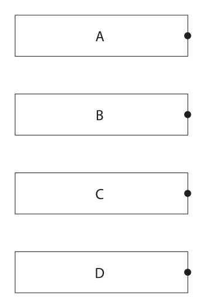
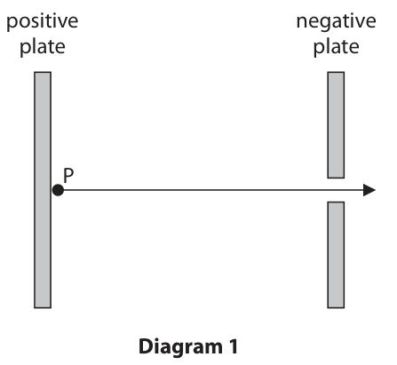
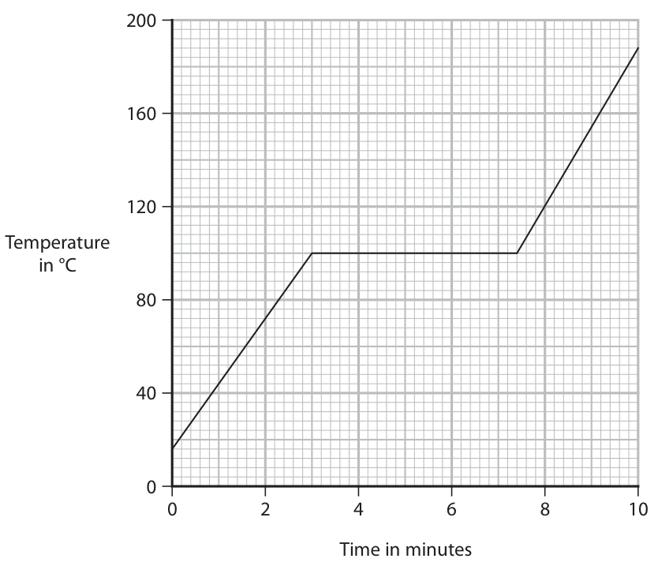
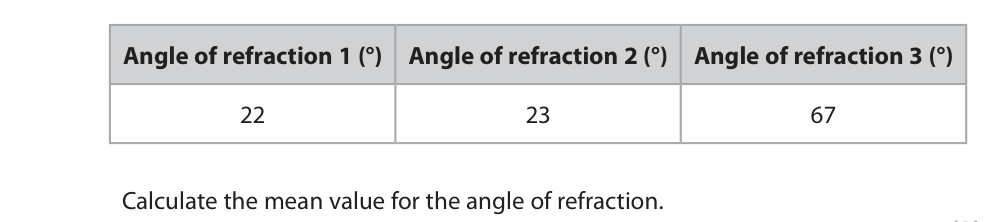
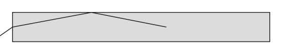
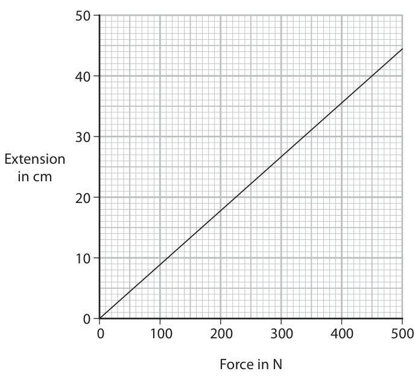
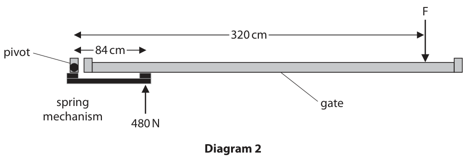

# 4PH1/2PR — 2022-06 (official extraction)

> schema `syllabai.official-paper-questions/0.2` · paper_id `pearson-edexcel:international-gcse:physics:4ph1:2022-06:4PH1/2PR` · qp sha256 `81a797320f4eb725…` · extraction is the disclosed baseline (ADR-039)

## Question 1 (6 marks)

The Hertzsprung–Russell diagram shows stars classified into different regions. A B Absolute magnitude C D Colour

### 1(a) [4]

The boxes give four points, A, B, C and D, and four star classifications. Draw lines connecting each point to the correct star classification. Point Star classification

- **(A)** star similar to the Sun
- **(B)** white dwarf
- **(C)** red giant
- **(D)** very bright blue star

**Mark scheme answer**

> 1 mark for each correct line;;;;
> reject any box from the
> left with 2 lines

- **(4)** 1 mark for each correct line;;;;

### 1(b) [2]

Describe what is meant by the term absolute magnitude.

**Mark scheme answer**

> (a measure of) brightness; allow power,
> luminosity, intensity
> (of a star) at a {standard / fixed / same} distance; allow correct distance
> e.g. 10 parsecs/32(.6)
> light years
> Answer Notes Marks

- **(2)** (a measure of) brightness; allow power,

## Question 2 (10 marks)
**(b)** A microphone is connected to an oscilloscope. A sound is detected by the microphone. The diagram shows the oscilloscope trace. Oscilloscope settings y direction: 1 square = 0.1 V x direction: 1 square = 5.0 ms

### 2(a) [5]

Describe an investigation to determine the speed of sound. You may draw a diagram to help your answer.

**Mark scheme answer**

> any five from: a fully labelled diagram can score all
> the marks
> MP1. outlines a viable method; e.g.
> • measuring time for a known
> distance
> • measuring wavelength for a known
> frequency
> MP2. realistic values suggested for e.g.
> experiment to work; • at least 1m for microphones/sound
> sensors and oscilloscope/data
> logger method
> • at least 100m for seeing and
> hearing a clap method
> • at least 50m for wall and echo
> method
> • wavelength measured at least
> 10cm
> MP3. suitable measuring instrument named; e.g. stop clock, stopwatch, ruler,
> tape measure, oscilloscope, trundle
> wheel, timer
> MP4. further detail of setup; e.g.
> • start timing when see a clap and
> stop when hear it
> • clap by wall and time how long for
> clap to come back
> • moving a microphone until
> waveforms line up on oscilloscope
> • for echo method, idea time and
> distance is “there and back”
> MP5. idea of repeats AND average; allow repeats AND identifying
> anomalies
> MP6. Correct formula for described method; e.g.
> • speed = distance / time
> • speed = frequency × wavelength

- **(5)** any five from: a fully labelled diagram can score all

### 2(b)(i) [3]

Determine the period of the sound wave. period = s

**Mark scheme answer**

> period represented by 4 squares;
> correct use of x-scale; allow ECF from wrong number of
> squares if clear in working
> correct evaluation; -1 POT error
> answer of 0.01, 0.04 (s) scores 2
> e.g.
> period = 4 squares
> period = 4 × 5.0 (×10-3)
> period = 20 ms = 2.0 × 10-2 (s) allow 0.02 (s)

- **(3)** period represented by 4 squares;

### 2(b)(ii) [2]

Calculate the frequency of the sound wave. frequency = Hz

**Mark scheme answer**

> substitution into given formula; allow ECF from (i)
> correct evaluation;
> e.g.
> frequency = 1 / 0.02
> frequency = 50 (Hz)
> Answer Notes Marks

- **(2)** substitution into given formula; allow ECF from (i)

## Question 3 (8 marks)

The SPS is a particle accelerator in Geneva. The SPS can accelerate sulfur particles to speeds almost as fast as the speed of light.

**(c)** The sulfur particles enter a large tube and complete a circular orbit. Diagram 2 shows a sulfur particle, travelling with velocity v, in the tube. v F Diagram 2

### 3(a) [2]

Neutral sulfur particles can become positively charged sulfur particles. Describe the difference between a neutral sulfur particle and a positively charged sulfur particle.

**Mark scheme answer**

> neutral particle has same number of protons and ignore neutral particle has
> electrons; no charge
> positive particle has more protons than electrons; allow positive particle has
> lost electrons
> reject positive particle has
> gained protons

- **(2)** neutral particle has same number of protons and ignore neutral particle has

### 3(b) [2]

Diagram 1 shows a section of the SPS. positive negative plate plate P Diagram 1 Positively charged sulfur particles are introduced at point P and accelerate to the right. Explain why the positively charged sulfur particles accelerate.

**Mark scheme answer**

> (sulfur particles are) attracted to negative accept correct use of “like
> plate/repelled by positive plate; charges repel” or “unlike
> charges attract”
> (sulfur) particles experiences a (resultant) force (to the
> right);

- **(2)** (sulfur particles are) attracted to negative accept correct use of “like

### 3(c)(i) [1]

A magnetic force acts on the positively charged sulfur particle. This force makes the particle travel in a circle. The force is labelled F. Use the left-hand rule to determine the direction of the applied magnetic field. A opposite to the direction of the velocity B along direction of force C out of the page D into the page

**Mark scheme answer**

> D – (into the page);
> A is incorrect because the force, direction of travel and
> magnetic field must be at right angles to each other
> B is incorrect because the force, direction of travel and
> magnetic field must be at right angles to each other
> C is incorrect because this would result in a force in
> the opposite direction to that shown

- **(1)** D – (into the page);

### 3(c)(ii) [3]

The tube has a radius of 1.1 km and the sulfur particle has an orbital speed of 2.9 × 108 m/s. Calculate the orbital period of the sulfur particle. orbital period = s

**Mark scheme answer**

> substitution into given formula;
> rearrangement;
> evaluation; -1 for POT error
> e.g.
> 2.9 × 108 = (2 × π × 1.1(× 103)) ÷ orbital period
> orbital period = (2 × π × 1.1(× 103)) ÷ 2.9 × 108
> (orbital period =) 2.4 × 10-5 (s) allow 2.383… × 10-5 (s)
> Answer Notes Marks

- **(3)** substitution into given formula;

## Question 4 (12 marks)

A student heats a sample of water. The student measures the temperature of the sample of water during heating.

**(b)** The diagram shows the temperature-time graph for the sample of water. 200 160 120 Temperature in °C 0 2 4 6 8 10 Time in minutes

### 4(a) [3]

The sample of water has a mass of 0.45 kg. Calculate the energy required to increase the temperature of the water from 16 °C to 100 °C. [specific heat capacity of water = 4200 J / kg °C] energy = J

**Mark scheme answer**

> temperature difference calculated; e.g. 84 seen
> or 100 - 16 seen
> substitution into given formula; allow ecf for incorrect
> temperature difference
> correct evaluation; 158 000 (J) scores 2 marks
> only
> e.g.
> ∆T = 100 – 16 = 84 (°C)
> energy supplied = 0.45 × 4200 × 84
> (energy supplied =) 160 000 (J) allow 159 000, 158 760 (J)

- **(3)** temperature difference calculated; e.g. 84 seen

### 4(b)(i) [1]

Use the graph to determine the time taken from when the water started to boil to when the water stopped boiling. time taken = minutes

**Mark scheme answer**

> (7.4 – 3.0) = 4.4 (minutes); allow 4 minutes and 24
> seconds, 4 and 4/10
> minutes

- **(1)** (7.4 – 3.0) = 4.4 (minutes); allow 4 minutes and 24

### 4(b)(ii) [3]

The heater used to heat the water has a power rating of 2200 W. Calculate the energy required to boil all of the water. energy = J

**Mark scheme answer**

> conversion of time into seconds; allow ECF from (i)
> substitution into P = W/t OR rearrangement; allow ECF from (i)
> allow substitution in
> minutes
> correct evaluation;
> 9700, 9680 (J) scores 2
> e.g.
> time = 264 (s)
> 2200 = W / 264 OR W = P × t
> energy supplied = 580 000 (J) allow 581 000, 580 800 (J)

- **(3)** conversion of time into seconds; allow ECF from (i)

### 4(c) [1]

Give a reason why the liquid water should be stirred during the heating.

**Mark scheme answer**

> idea of all water being the same temperature; allow idea of distributing
> thermal/heat (energy)
> evenly throughout water

- **(1)** idea of all water being the same temperature; allow idea of distributing

### 4(d) [4]

When water boils, the liquid water becomes a gas called steam. Describe the changes in arrangement and motion of the molecules in liquid water and the molecules in steam.

**Mark scheme answer**

> allow marks if seen on
> diagrams
> allow particles for
> molecules
> arrangement
> idea that liquid has molecules that are close ignore random/irregular
> together; arrangement for liquid
> idea that gas has (widely) spaced molecules; and gas
> motion
> idea that liquid has molecules that move/slide
> past each other;
> idea that gas has molecules that move
> {faster/freely/randomly/straight lines};
> Answer Notes Marks

- **(4)** allow marks if seen on

## Question 5 (12 marks)

The diagram shows part of the National Grid. pylon power station step-up transformer

**(c)** Transformers in the National Grid have efficiencies less than 100%.

### 5(a) [4]

There is a step-up transformer at the power station end of a transmission line and a step-down transformer at a distant town. Explain why step-up transformers and step-down transformers are used in this way.

**Mark scheme answer**

> step-up transformer increases voltage OR step-
> down transformer decreases voltage;
> step-up transformer reduces current;
> (lower current means) lower heating/energy
> losses;
> (town) requires low voltage {for safety / to reduce
> chance of electrocution / so appliances operate
> correctly};

- **(4)** step-up transformer increases voltage OR step-

### 5(b)(i) [1]

State the formula linking the input voltage, the output voltage and the turns ratio for a transformer.

**Mark scheme answer**

> Np/Ns = Vp/Vs; allow any correct
> rearrangement or word
> formula
> allow n, T for turns
> allow 1, in for p
> allow 2, out for s

- **(1)** Np/Ns = Vp/Vs; allow any correct

### 5(b)(ii) [3]

The primary coil on a step-up transformer has 3300 turns. Calculate the number of turns required on the transformer’s secondary coil to step up the voltage from 15 kV to 340 kV. number of turns =

**Mark scheme answer**

> substitution;
> rearrangement;
> evaluation; -1 for POT error
> e.g.
> 3300/Ns = 15/340
> Ns = (3300 × 340) ÷ 15
> (Ns =) 75 000 allow 74 800

- **(3)** substitution;

### 5(c)(i) [1]

Suggest which energy store of the transformer increases as a result of the efficiency being less than 100%.

**Mark scheme answer**

> thermal (store); condone heat

- **(1)** thermal (store); condone heat

### 5(c)(ii) [3]

The iron core of a transformer is an electrical conductor. When the transformer is in use, the primary coil causes a changing magnetic field in the iron core. This causes a small current to be induced in the core. Explain how a current is induced in the core of the transformer.

**Mark scheme answer**

> any three from:
> MP1. field lines cut by core;
> MP2. idea of an induced voltage;
> MP3. conductors have free electron(s);
> MP4. idea that there is a force on the
> electron(s);
> MP5. idea that the movement of electrons is the
> current;
> Answer Notes Marks

- **(3)** any three from:

## Question 6 (12 marks)

The refractive index, n, of a material can be calculated using this formula. sin(i ) n= sin(r )

**(a)** A student uses this method to determine the refractive index of a material. • draw around a semi-circular block of material • shine a light ray towards the centre of the straight edge of the semi‑circular block • use a pencil and a ruler to mark the positions of the incident ray and the refracted ray • remove the block • draw a normal where the ray was incident on the block • measure the angle of incidence and angle of refraction • calculate the refractive index using the formula Repeat the method for different angles of incidence.

**(b)** Diagram 1 shows a ray of light refracted by a transparent block of material. 82° air material 47° Diagram 1

### 6(a)(i) [1]

Name the independent variable in this investigation.

**Mark scheme answer**

> angle of incidence; ignore incident ray

- **(1)** angle of incidence; ignore incident ray

### 6(a)(ii) [2]

The table shows the student’s results for an angle of incidence of 40°. Angle of refraction 1 (°) Angle of refraction 2 (°) Angle of refraction 3 (°) 22 23 67 Calculate the mean value for the angle of refraction. mean angle = degrees

**Mark scheme answer**

> recognising 67 (degrees) as anomalous; allow 1 mark if anomalous
> result included
> e.g. 37, 37.3… (degrees)
> evaluation of a mean;
> e.g.
> mean angle = (22 + 23) / 2 = 23 (degrees) allow 22, 22.5 (degrees)

- **(2)** recognising 67 (degrees) as anomalous; allow 1 mark if anomalous

### 6(a)(iii) [2]

Describe how the student could improve their method to get a more accurate value for the refractive index.

**Mark scheme answer**

> n calculated for multiple angles;
> mean value obtained for n;
> OR
> idea of graph plotted of sin(i) against sin(r);
> n found from gradient of (sin(i)-sin(r)) graph;

- **(2)** n calculated for multiple angles;

### 6(b)(i) [2]

Calculate the refractive index of this material. refractive index =

**Mark scheme answer**

> substitution into n = sin(i) ÷ sin(r) ;
> evaluation; 1.3 scores 1 mark only
> e.g.
> refractive index = sin(82) ÷ sin(47)
> (refractive index =) 1.4 allow 1.35…

- **(2)** substitution into n = sin(i) ÷ sin(r) ;

### 6(b)(ii) [1]

State the formula linking critical angle and refractive index.

**Mark scheme answer**

> sin(c) = 1/n; allow any correct
> rearrangement

- **(1)** sin(c) = 1/n; allow any correct

### 6(b)(iii) [2]

The refractive index of a different material is 1.7 Calculate the critical angle of this material. critical angle = degrees

**Mark scheme answer**

> substitution and rearrangement;
> evaluation;
> e.g.
> c = sin-1(1/1.7) = sin-1(0.588…)
> (critical angle =) 36 (degrees) allow 36.03… (degrees)

- **(2)** substitution and rearrangement;

### 6(c) [2]

Diagram 2 shows a ray of light travelling through an optical fibre. Diagram 2 The optical fibre is made of a material with a refractive index of 1.7 Explain the path of the ray in the optical fibre.

**Mark scheme answer**

> light undergoes TIR;
> (because) angle (of incidence) is greater than
> critical angle;
> Answer Notes Marks

- **(2)** light undergoes TIR;

## Question 7 (10 marks)

Diagram 1 shows a gate fitted with a spring mechanism. The spring mechanism shuts the gate automatically. gate spring mechanism Diagram 1

### 7(a) [2]

The graph shows some data from an investigation into how the extension of the spring changes with an increasing force. Extension in cm 0 100 200 300 400 500 Force in N Describe the relationship shown by the graph.

**Mark scheme answer**

> idea that extension increases as force ignore positive correlation
> increases;
> idea of a linear relationship;
> allow “force is proportional
> to extension” for 2 marks
> if no other marks scored
> then mention of Hooke’s law
> scores 1 mark

- **(2)** idea that extension increases as force ignore positive correlation

### 7(b) [2]

Diagram 2 shows the gate viewed from above. F 320 cm pivot 84 cm spring gate mechanism 480 N Diagram 2 The force the spring exerts on the gate is 480 N. Show that the moment of the force the spring exerts on the gate is about 400 Nm.

**Mark scheme answer**

> substitution into moment = force × distance; ignore units
> evaluation of moment to at least 3s.f.;
> 1 mark max. for reverse
> calculation e.g. calculating
> the force or the distance
> e.g.
> moment = 480 × (0.)84
> moment = 403 (Nm) allow 403.2 (Nm)

- **(2)** substitution into moment = force × distance; ignore units

### 7(c) [4]

The force, F, is the minimum force needed to start opening the gate. Calculate the magnitude of force F. force F = N

**Mark scheme answer**

> idea of principle of moments; implied by substitution or
> written in words
> moment of push force = F × 3.2; seen anywhere in calculation
> rearrangement;
> evaluation; -1 for POT error
> allow use of 400 Nm, giving
> 125 N
> allow use of 403 Nm, giving
> 125.9…, 126 (N)
> e.g.
> 403.2 = F × 3.2 clockwise moment = anti-
> clockwise moment
> F = 403.2 / 3.2
> (F =) 130 (N) allow 126 (N)

- **(4)** idea of principle of moments; implied by substitution or

### 7(d) [2]

The spring is removed for testing. Explain what will happen to the spring if the force applied to extend the spring is too large.

**Mark scheme answer**

> ignore idea of spring losing
> elasticity / stop stretching
> idea of spring exceeding/reaching elastic allow limit of proportionality
> limit; for elastic limit
> idea of permanent deformation / not returning ignore spring breaking
> to original shape / permanent stretching;
> Pearson Education Limited. Registered company number 872828
> with its registered office at 80 Strand, London, WC2R 0RL, United Kingdom

- **(2)** ignore idea of spring losing

