# 4PH1/1P — 2023-01 (official extraction)

> schema `syllabai.official-paper-questions/0.2` · paper_id `pearson-edexcel:international-gcse:physics:4ph1:2023-01:4PH1/1P` · qp sha256 `894abfc6cd884f47…` · extraction is the disclosed baseline (ADR-039)

## Question 1 (5 marks)

A material is stretched by applying an increasing load. The material shows elastic behaviour as it is stretched.

### 1(a) [2]

Describe what is meant by elastic behaviour.

**Mark scheme answer**

> idea that material returns to its original shape /
> length;
> when the load / force is removed; condone mass / weight
> for load

- **(2)** idea that material returns to its original shape /

### 1(b) [3]

The material obeys Hooke’s law. Sketch a graph for this material to show that it obeys Hooke’s law as it is stretched. You should label both axes with appropriate physical quantities.

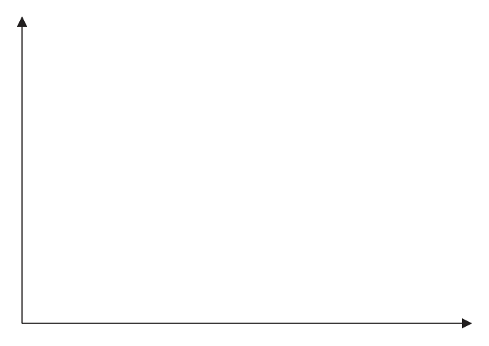

**Mark scheme answer**

> axes labelled “extension” and “load”/”force”; ignore units
> ignore orientation of
> axes
> straight line of positive gradient drawn throughout; judge by eye
> condone curve at end of
> line if clear indication
> that Hooke’s law does
> not apply for that part
> of the line e.g. limit of
> proportionality marked
> at end of straight
> section
> line passes through origin;
> allow full marks for
> axes labelled “length”
> and “load”/”force” if
> line intersects length
> axis above zero
> Answer Notes Marks

- **(3)** axes labelled “extension” and “load”/”force”; ignore units

## Question 2 (7 marks)

Diagram 1 shows the magnetic field between the poles of two strong bar magnets. Diagram 1

**(d)** Diagram 2 shows a metal wire being moved downwards through the uniform field between the poles of the same bar magnets. The orientation of the magnets has not been changed. wire movement Diagram 2

### 2(a) [1]

Add labels to diagram 1 to show the poles of the bar magnets.

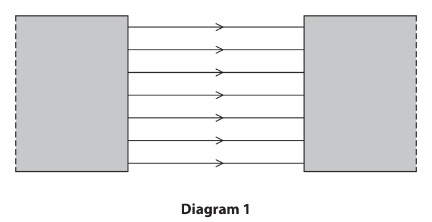

**Mark scheme answer**

> N on left pole and S on right pole; allow north for N and south
> for S
> ignore attempt at labelling
> poles on far sides of
> magnets

- **(1)** N on left pole and S on right pole; allow north for N and south

### 2(b) [1]

The bar magnets are made from steel. Give one reason why steel is a good material for making bar magnets.

**Mark scheme answer**

> idea that steel is a hard magnetic material; allow steel keeps its
> magnetism/magnetic field
> allow steel is hard to
> demagnetise

- **(1)** idea that steel is a hard magnetic material; allow steel keeps its

### 2(c) [2]

Explain how diagram 1 shows a uniform magnetic field.

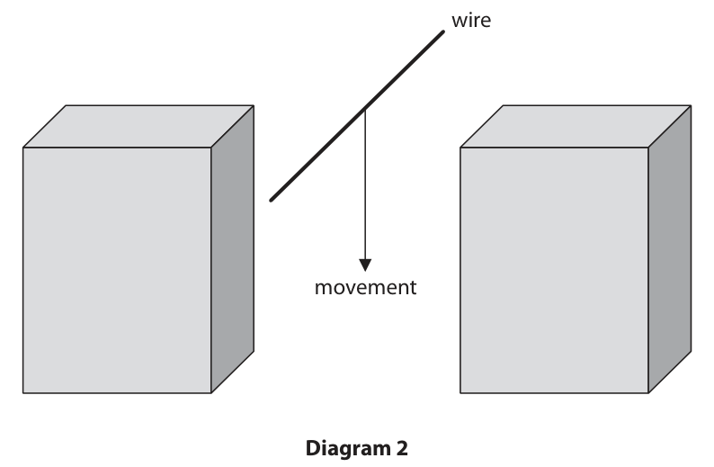

**Mark scheme answer**

> any two from: allow equivalent
> statements
> MP1. (field) lines are straight;
> MP2. (field) lines are evenly spaced;
> MP3. (field) lines are parallel;

- **(2)** any two from: allow equivalent

### 2(d)(i) [1]

Give a reason why a voltage is induced between the ends of the metal wire as it moves between the poles of the bar magnets.

**Mark scheme answer**

> idea that wire cuts magnetic field lines; allow wire passes through
> field lines
> ignore wire interacting
> with field lines

- **(1)** idea that wire cuts magnetic field lines; allow wire passes through

### 2(d)(ii) [2]

State two changes that could be made to this arrangement that would increase the magnitude of the induced voltage. 1 2

**Mark scheme answer**

> any two from:
> MP1. move wire faster;
> MP2. move magnets closer together;
> MP3. use stronger magnets; ignore “bigger” magnets
> MP4. turn wire into a coil; ignore more turns on the
> coil
> Answer Notes Marks

- **(2)** any two from:

## Question 3 (11 marks)

A winch is used to pull a truck along a horizontal road. The winch is connected to the truck by a thick rope. truck rope winch (Source: © A. Bizgaimer/Shutterstock)

**(a)** The winch does 41 kJ of useful work on the truck when the truck is pulled a horizontal distance of 15 m.

**(b)** The winch includes a small engine. The engine burns petrol to power the motor in the winch. The winch transfers energy mechanically to the truck.

### 3(a)(i) [1]

State the formula linking work done, force and distance moved in the direction of the force.

**Mark scheme answer**

> work (done) = force × distance (moved in direction of allow standard symbols and
> force); rearrangements
> e.g. W = F × s
> allow d for distance

- **(1)** work (done) = force × distance (moved in direction of allow standard symbols and

### 3(a)(ii) [3]

Calculate the force that the rope exerts on the truck. force = N

**Mark scheme answer**

> substitution; ignore units
> rearrangement;
> evaluation; -1 for POT error
> e.g.
> 41000 = force × 15
> force = 41000 / 15
> (force =) 2700 (N) allow correct answers to
> more significant figures e.g.
> 2733.3…(N)

- **(3)** substitution; ignore units

### 3(b)(i) [3]

The winch has an efficiency of 25% when pulling the truck. Draw a Sankey diagram for this energy transfer.

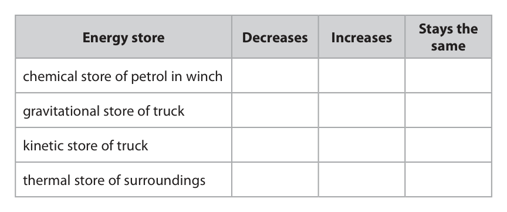

**Mark scheme answer**

> diagram showing one input and two outputs; arrows can be in any
> orientation e.g. both useful
> and wasted arrows drawn
> horizontally
> input and outputs appropriately labelled; allow
> input, total, chemical for
> initial arrow
> useful (output), mechanically
> for narrower output
> wasted (output), thermal for
> wider output
> approximately correct scale; wasted output must be
> consistently at least twice as
> wide as useful output arrow
> and they should sum to
> approximately the width of
> the input

- **(3)** diagram showing one input and two outputs; arrows can be in any

### 3(b)(ii) [4]

The winch can also be used to pull the truck uphill at a constant speed. The table gives some energy stores. Add one tick (ü) to each row to show what happens to the energy in each store as the truck is pulled uphill. Stays the Energy store Decreases Increases same chemical store of petrol in winch gravitational store of truck kinetic store of truck thermal store of surroundings

**Mark scheme answer**

> one mark for each correct row;;;; reject mark for that row if
> more than one tick drawn
> Answer Notes Marks

- **(4)** one mark for each correct row;;;; reject mark for that row if

## Question 4 (15 marks)

A teacher investigates the count rate detected from a radioactive source.

**(b)** The teacher places a piece of lead sheet between the radioactive source and a radiation detector. The teacher determines the corrected count rate from the radioactive source three times and calculates the mean. They repeat this process using different thicknesses of lead sheet. The table shows their results. Count rate Thickness of in Bq lead in mm trial 1 trial 2 trial 3 mean 0.0 480 504 469 484 2.0 374 337 357 356 4.0 247 239 229 238 6.0 141 154 148 8.0 110 104 131 115 10.0 88 91 85 88

### 4(a)(i) [1]

State one source of background radiation.

**Mark scheme answer**

> (the) Sun / cosmic rays / rocks / radon (in the air) / reject CMBR
> weapons testing / food / (named) nuclear disasters allow soil
> / medical equipment;

- **(1)** (the) Sun / cosmic rays / rocks / radon (in the air) / reject CMBR

### 4(a)(ii) [4]

Describe how the teacher could measure the count rate from a radioactive source and correct the count rate for background radiation.

**Mark scheme answer**

> use of GM tube (and counter, timer); allow radiation detector, Geiger
> counter for GM tube
> idea of removing source (from room); e.g. measuring count with source
> and without source
> idea of measuring background count several times
> and calculating mean;
> subtract background count from readings;

- **(4)** use of GM tube (and counter, timer); allow radiation detector, Geiger

### 4(b)(i) [2]

Calculate the mean count rate when the thickness of lead is 6.0 mm. mean count rate = Bq

**Mark scheme answer**

> correctly calculated mean;
> correctly rounded to 0 decimal places; answer of 147
> gains 1 mark
> e.g.
> (mean =) 147.666…
> (mean =) 148

- **(2)** correctly calculated mean;

### 4(b)(ii) [3]

Plot a graph of mean count rate against thickness of lead.

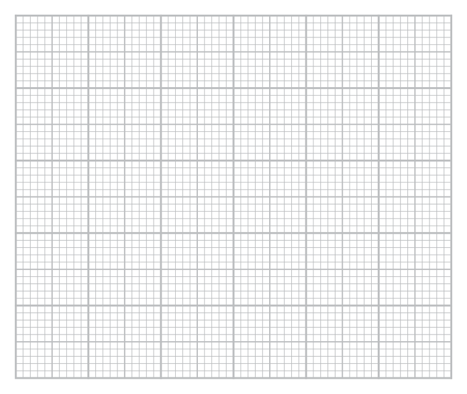

**Mark scheme answer**

> suitable linear scale chosen (>50% of grid used); ignore orientation
> axes labelled with quantities and unit;
> plotting correct to nearest half square; allow ecf from (i)
> reject if non-linear scale used

- **(3)** suitable linear scale chosen (>50% of grid used); ignore orientation

### 4(b)(iii) [1]

Draw the curve of best fit.

**Mark scheme answer**

> acceptable curve of best fit drawn; i.e. smooth curve with points
> distributed equally either side
> allow ecf from (ii)
> ignore curve outside given data
> range

- **(1)** acceptable curve of best fit drawn; i.e. smooth curve with points

### 4(b)(iv) [2]

When there is not a sheet of lead between the radioactive source and the radiation detector, the mean count rate is 484 Bq. Use the graph to determine the thickness of lead needed to reduce the mean count rate by 25%. thickness = mm

**Mark scheme answer**

> calculated value of 75% of initial count rate;
> correct read-off from candidate’s graph; allow 1 mark max. for correctly
> reading from 25% of initial count
> rate
> e.g.
> (count rate =) 363 (Bq)
> (lead thickness =) 1.8 (mm) allow 1.7 – 1.9 (mm)

- **(2)** calculated value of 75% of initial count rate;

### 4(c) [2]

The radioactive source emits only one type of radiation. Explain which type of radiation this radioactive source emits.

**Mark scheme answer**

> gamma;
> idea that all beta/alpha would be absorbed by lead
> / only gamma can penetrate through (thin) lead;
> Answer Notes Marks

- **(2)** gamma;

## Question 5 (13 marks)

The graph shows how the thinking distance and the braking distance vary with the speed of a car. braking distance Distance in m thinking distance 0 5 10 15 20 25 30 Speed in m / s

### 5(a) [1]

Which of these does not affect thinking distance?

- **(A)** alcohol consumed by the driver
- **(B)** condition of the road  ✔
- **(C)** speed of the car
- **(D)** tiredness of the driver

**Mark scheme answer**

> B (condition of the road);
> A is incorrect because consumption of alcohol increases reaction time
> C is incorrect because thinking distance is determined by speed
> D is incorrect because tiredness increases reaction time

- **(1)** Answer B: condition of the road

### 5(b) [1]

Which of these would increase the braking distance of the car?

- **(A)** faster reaction time of driver
- **(B)** ice on the road  ✔
- **(C)** more powerful brakes
- **(D)** tyres with more grip

**Mark scheme answer**

> B (ice on the road);
> A is incorrect because reaction time does not affect braking distance
> C is incorrect because more powerful brakes would decrease the braking distance
> D is incorrect because tyres with more grip would decrease the braking distance

- **(1)** Answer B: ice on the road

### 5(c) [3]

Determine the stopping distance of the car when the speed of the car is 20 m / s. stopping distance = m

**Mark scheme answer**

> idea that stopping distance = thinking distance + stated or implied
> braking distance;
> correct reading of either distance; allow 26.0-27.0 (m) for
> braking distance
> allow 10.0-10.5 (m) for
> thinking distance
> correct evaluation; allow 36.0-37.5 (m)
> e.g.
> stopping distance = thinking distance + braking
> distance
> thinking distance = 10.0 m / braking distance = 26.5 m
> stopping distance = (10.0 + 26.5) = 36.5 (m)

- **(3)** idea that stopping distance = thinking distance + stated or implied

### 5(d)(i) [1]

State the formula linking average speed, distance moved and time taken.

**Mark scheme answer**

> (average) speed = distance (moved) / time (taken); allow standard symbols
> and rearrangements e.g.
> t=s/v
> allow s or d for distance
> allow v or s for speed

- **(1)** (average) speed = distance (moved) / time (taken); allow standard symbols

### 5(d)(ii) [3]

Determine the reaction time of the driver of the car. reaction time = s

**Mark scheme answer**

> suitable pair of readings taken from graph; i.e. (30,15), (20,10),
> (10,5) etc.
> rearrangement of formula;
> evaluation; allow any answer in
> range 0.40-0.60 (s)
> e.g.
> thinking distance = 15 m when speed = 30 m/s
> time = distance / speed
> (time = 15 / 30 =) 0.50 (s)

- **(3)** suitable pair of readings taken from graph; i.e. (30,15), (20,10),

### 5(e) [4]

Calculate the mean braking acceleration of the car as it brakes to a stop from an initial speed of 30 m / s. acceleration = m / s2

**Mark scheme answer**

> correct braking distance reading from graph; allow 53 seen anywhere
> in working
> substitution into v2 = u2 + 2×a×s;
> rearrangement;
> evaluation;
> final answer of 6.6 (m/s2)
> (using stopping distance
> instead of braking
> distance) scores 3 marks
> final answer of 30 (m/s2)
> (using thinking distance
> instead of braking
> distance) scores 3 marks
> e.g.
> braking distance = 53 m allow 52-53 m
> 02 = 302 + [2 × a × 53]
> a = (-)900 / 106
> (a =) (-)8.5 (m/s2) allow 8.49-8.65
> Answer Notes Marks

- **(4)** correct braking distance reading from graph; allow 53 seen anywhere

## Question 6 (6 marks)

This question is about optical fibres.

**(b)** A ray of light passes from air into a glass optical fibre. Diagram 1 shows the path of the ray of light after it has passed through the boundary between air and the optical fibre.

### 6(a) [1]

Optical fibres use light waves for communication. Which of these is a correct statement about waves?

- **(A)** waves transfer energy, information and matter
- **(B)** waves do not transfer energy, information, or matter
- **(C)** waves transfer energy without transferring information or matter
- **(D)** waves transfer energy and information without transferring matter  ✔

**Mark scheme answer**

> D (waves transfer energy and information without transferring matter);
> A is incorrect because waves do not transfer matter
> B is incorrect because waves do transfer energy and information
> C is incorrect because waves do transfer information

- **(1)** Answer D: waves transfer energy and information without transferring matter

### 6(b)(i) [1]

Draw the path of the ray of light in air before it passed through the boundary. refracted ray glass air Diagram 1

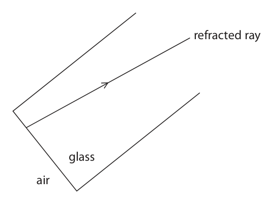

**Mark scheme answer**

> ray drawn such that it shows correct change of arrow on ray is not
> direction into the core i.e. bending towards normal; required
> e.g.

- **(1)** ray drawn such that it shows correct change of arrow on ray is not

### 6(b)(ii) [1]

State the name of the wave behaviour responsible for the path of the ray of light as it passes from air into the optical fibre.

**Mark scheme answer**

> refraction; allow recognisable
> spelling
> reject if spelling implies
> reflection

- **(1)** refraction; allow recognisable

### 6(c) [3]

Diagram 2 shows the path of the ray of light as it travels through the optical fibre. Diagram 2 Explain the path of the ray of light as it travels through the optical fibre.

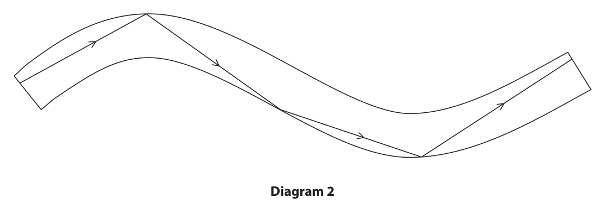

**Mark scheme answer**

> (total internal) reflection;
> (because) core has higher refractive index than air; allow core is more
> (optically) dense than
> air / light travels from a
> dense to a less dense
> medium
> (because) angle (of incidence) is greater than
> critical angle;
> Answer Notes Marks

- **(3)** (total internal) reflection;

## Question 7 (14 marks)

A student uses the circuit shown in diagram 1 to investigate how the current changes with voltage for a filament lamp. A V component Y Diagram 1

**(b)** The graph shows some of the student’s results. 0.6 Current in A 0.4 0.2 –12 –8 –4 0 4 8 12 Voltage in V –0.2 –0.4 –0.6

### 7(a)(i) [1]

Give the name of component Y.

**Mark scheme answer**

> variable resistor; allow rheostat

- **(1)** variable resistor; allow rheostat

### 7(a)(ii) [1]

Give a reason why component Y is included in the circuit.

**Mark scheme answer**

> idea that it allows the current / voltage (across ignore references to
> lamp) to be varied; changing resistance

- **(1)** idea that it allows the current / voltage (across ignore references to

### 7(b)(i) [1]

State the formula linking charge, current and time.

**Mark scheme answer**

> charge = current × time; allow standard symbols
> and rearrangements e.g.
> Q=I×t
> reject C, c for current
> and charge

- **(1)** charge = current × time; allow standard symbols

### 7(b)(ii) [1]

Determine the current in the lamp when the voltage across the lamp is 10 V. current = A

**Mark scheme answer**

> 0.48 (A);

- **(1)** 0.48 (A);

### 7(b)(iii) [3]

Calculate the charge transferred through the lamp in 30 s when the voltage across the lamp is 10 V. Give the unit. charge = unit

**Mark scheme answer**

> substitution; allow ecf from (ii)
> evaluation;
> unit; mark independently
> e.g.
> charge = 0.48 × 30
> (charge =) 14 allow 14.4
> coulombs / C ignore As

- **(3)** substitution; allow ecf from (ii)

### 7(b)(iv) [3]

Calculate the time for the lamp to transfer 250 J of energy when the voltage across the lamp is 10 V. time = s

**Mark scheme answer**

> substitution into E = V × I × t; allow ecf from (ii)
> rearrangement;
> evaluation;
> allow alternative method
> involving calculating
> charge transferred, then
> using Q=It
> e.g.
> 250 = 10 × 0.48 × time
> time = 250 / 4.8
> (time =) 52 (s) allow 52.08…(s)

- **(3)** substitution into E = V × I × t; allow ecf from (ii)

### 7(b)(v) [2]

The student disconnects the cell and reconnects it with its terminals reversed. Complete the graph to show how the current in the lamp varies with voltage across the lamp when the cell is connected with its terminals reversed.

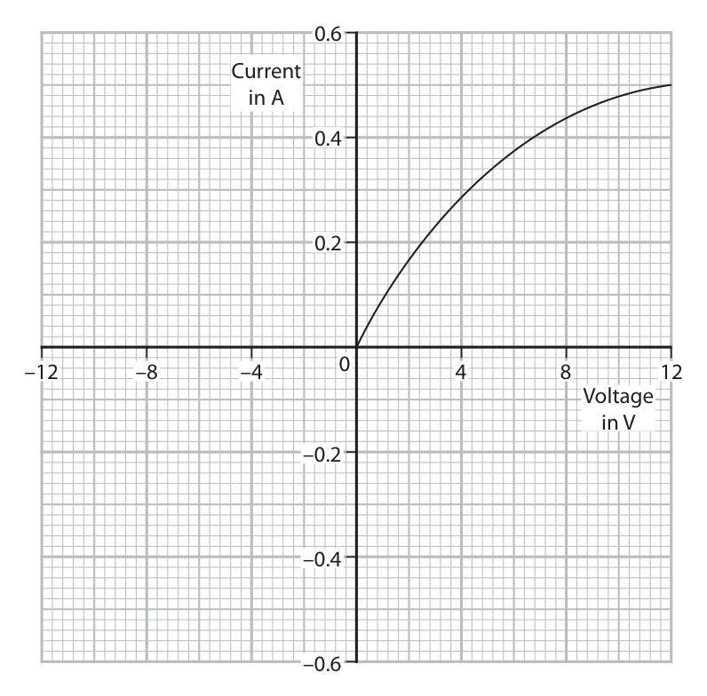

**Mark scheme answer**

> curve drawn of similar shape to existing but
> through 180° rotation into negative quadrant of
> graph;
> curve starts at (0,0) and finishes at (-12,-0.5); DOP

- **(2)** curve drawn of similar shape to existing but

### 7(c) [2]

The student replaces the filament lamp with a light emitting diode (LED) and replaces the cell with an alternating current (a.c.) power supply, as shown in diagram 2. The student also removes the ammeter and voltmeter from the circuit. component Y Diagram 2 Explain why the LED flashes on and off in this circuit.

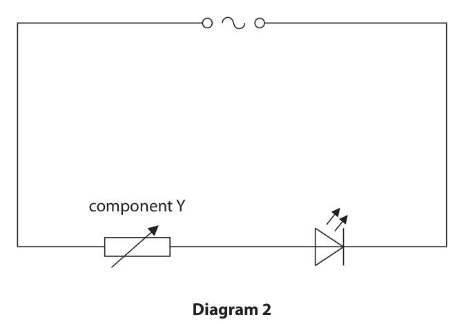

**Mark scheme answer**

> any two from: allow description of
> electron movement for
> current
> MP1. idea that current changes direction;
> MP2. LED only allows current in one direction;
> MP3. LED will not light up when current in allow RA
> reverse direction;
> Answer Notes Marks

- **(2)** any two from: allow description of

## Question 8 (8 marks)

The table gives information about four stars. Mass Star Colour in solar masses Sirius blue-white 2 Polaris yellow-white 5 Betelgeuse red 17 Rigel blue 21

### 8(a) [2]

Explain which of these stars has the highest surface temperature.

**Mark scheme answer**

> Rigel;
> (because) idea that colour depends on surface ignore links between mass
> temperature; and temperature

- **(2)** Rigel;

### 8(b) [6]

Discuss the evolution of the stars Rigel and Sirius.

**Mark scheme answer**

> any six from:
> for both stars:
> MP1. both stars began in a nebula; allow gas/dust cloud for
> nebula
> MP2. both stars were protostars;
> MP3. both stars were/are main sequence stars;
> for Rigel:
> MP4. Rigel is a high mass star;
> MP5. Rigel is/will become a red supergiant; accept blue supergiant
> MP6. Rigel will become a supernova;
> MP7. Rigel will become a neutron star; condone black hole
> for Sirius:
> MP8. Sirius is a low mass star; allow Sirius has mass
> similar to the Sun
> MP9. Sirius will become a red giant;
> MP10. Sirius will (eventually) become a white
> dwarf;
> Answer Notes Marks

- **(6)** any six from:

## Question 9 (11 marks)

This question is about waves.

**(a)** The diagram represents a wave.

**(b)** Microwaves are part of the electromagnetic spectrum.

**(c)** A student uses a microwave source and a receiver to investigate microwaves. Photograph 1 shows how the student sets up their apparatus. microwave source receiver analogue meter ruler Photograph 1 The meter shows the strength of the microwaves detected by the receiver. The strength of the microwaves is measured in arbitrary units. The student varies the distance between the microwave source and the receiver, and records the meter readings.

### 9(a)(i) [1]

Determine the amplitude of the wave by measuring it with a ruler. amplitude = cm

**Mark scheme answer**

> amplitude in the range of 0.8 – 0.9 (cm);

- **(1)** amplitude in the range of 0.8 – 0.9 (cm);

### 9(a)(ii) [1]

Determine the wavelength of the wave by measuring it with a ruler. wavelength = cm

**Mark scheme answer**

> wavelength in the range 3.9 – 4.0 (cm);

- **(1)** wavelength in the range 3.9 – 4.0 (cm);

### 9(b)(i) [1]

Name the part of the electromagnetic spectrum that has a lower frequency than microwaves.

**Mark scheme answer**

> radio (waves); allow radio frequency
> reject radioactive
> (waves), radiation
> (waves)

- **(1)** radio (waves); allow radio frequency

### 9(b)(ii) [3]

Microwaves travel at a speed of 3.0 × 108 m / s in air. A microwave has a wavelength of 2.7 cm. Calculate the frequency of this microwave. [wave speed = frequency × wavelength] frequency = Hz

**Mark scheme answer**

> substitution; allow wavelength
> substitution in cm or m
> rearrangement;
> evaluation; -1 if POT error
> e.g.
> 3.0 × 108 = frequency × 0.027
> (frequency =) 3.0 × 108 / 0.027
> (frequency =) 1.1 × 1010 (Hz) allow 1.11…× 1010 (Hz)

- **(3)** substitution; allow wavelength

### 9(c)(i) [1]

Photograph 2 shows the analogue meter for one of the readings. Photograph 2 Give the reading on the analogue meter. reading = arbitrary units

**Mark scheme answer**

> 68;

- **(1)** 68;

### 9(c)(ii) [4]

The graph shows the results of the student’s investigation. 100 Meter 60 readings in arbitrary units 40 10 15 20 25 30 35 40 45 50 Distance in cm The student concludes that the meter reading is inversely proportional to the distance between the microwave source and the receiver. To be inversely proportional meter reading × distance = constant Comment on the student’s conclusion. You should use data from the graph in your answer.

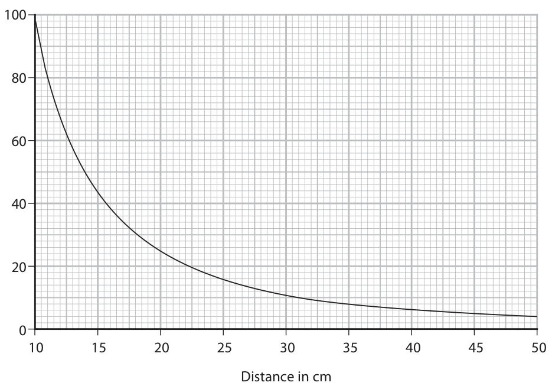

**Mark scheme answer**

> relationship is not inversely proportional; allow conclusion is
> incorrect
> correct calculation of constant for one pair of
> readings
> correct calculation of constant for second pair of
> readings;
> statement to show meter reading × distance is not
> constant;
> Answer Notes Marks

- **(4)** relationship is not inversely proportional; allow conclusion is

## Question 10 (11 marks)

A student pours a known volume of hot water into a metal container. They place the metal container into an insulated plastic cup containing an equal volume of cold water. metal container with hot water insulated plastic cup with cold water The student uses temperature probes to measure the temperatures of both the water in the metal container and the water in the plastic cup. The hot water has an initial temperature of 70 °C and the cold water has an initial temperature of 5 °C.

### 10(a) [4]

On the axes, sketch how the temperature of the hot water and the temperature of the cold water vary with time. Temperature in °C 0 Time in minutes

**Mark scheme answer**

> line decreases from 70;
> other line increases from 5;
> both are correctly curved;
> lines become asymptotic at an intermediate DOP
> temperature; reject if intermediate
> temperature closer to
> 70 than 5

- **(4)** line decreases from 70;

### 10(b) [4]

Explain why the temperatures of the hot water and the cold water change. You should refer to different types of thermal energy transfer in your answer.

**Mark scheme answer**

> any 4 from:
> MP1. hot water loses energy / cold water gains
> energy;
> MP2. (thermal) energy is transferred from hot to allow cold water gains
> cold water; heat from hot water
> MP3. by conduction (through the metal);
> MP4. idea that energy transfer stops when thermal allow equivalent
> equilibrium is reached; statements for thermal
> equilibrium e.g. same
> temperature
> MP5. some (thermal) energy lost (to surroundings)
> by convection/evaporation/radiation;
> MP6. little/no (thermal) energy is transferred out
> through the insulated plastic cup;

- **(4)** any 4 from:

### 10(c) [3]

Explain how placing a lid on the plastic cup would affect the results.

**Mark scheme answer**

> (energy transfer by) convection/radiation allow reference to
> decreases; evaporation
> idea that equilibrium temperature will be higher; condone no change to
> intermediate
> temperatures
> idea that time taken to cool (to room temperature)
> will be longer;
> Answer Notes Marks

- **(3)** (energy transfer by) convection/radiation allow reference to

## Question 11 (9 marks)
**(a)** Diagram 1 represents the atoms of a gas inside a container. Diagram 1

### 11(a)(i) [3]

Explain how the atoms exert a pressure on the walls of the container.

**Mark scheme answer**

> idea that atoms collide with (all) walls of the
> container;
> force is exerted on walls (during each collision);
> pressure is force on an area; allow p=F/A

- **(3)** idea that atoms collide with (all) walls of the

### 11(a)(ii) [2]

Explain why the pressure of the gas in the container decreases as its temperature decreases. The volume of the container does not change.

**Mark scheme answer**

> any two from:
> MP1. particles move slower; allow KE decreases / eq
> MP2. particles collide with walls less frequently; allow less often, less times
> per second etc.
> MP3. force on container decreases; allow particles collide less
> hard with walls

- **(2)** any two from:

### 11(b) [4]

Diagram 2 shows a device called a magneto-optical trap (MOT). Physicists use the device to cool gases to extremely low temperatures. The MOT uses laser beams and magnetic fields to trap a small collection of atoms with extremely small kinetic energies. trapped atoms laser beams coils producing magnetic field Diagram 2 Each trapped atom has a mass of 5.0 × 10–27 kg and a mean speed of 73 m / s. Calculate the temperature of the trapped atoms. [mean kinetic energy of an atom = 2.1 × 10–23 × temperature in kelvin] temperature = K

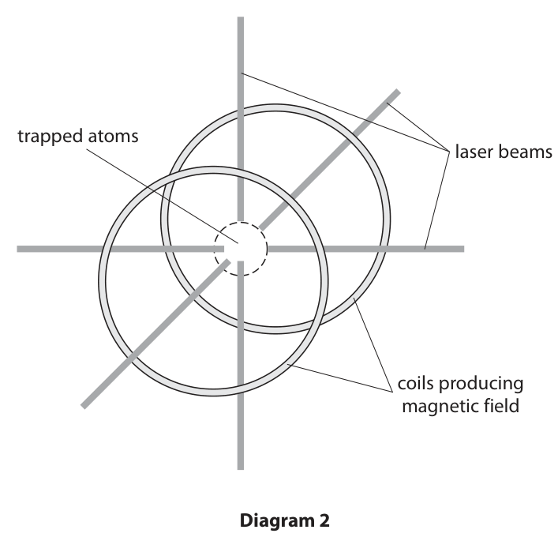

**Mark scheme answer**

> substitution into KE = ½ × m × v2;
> evaluation of KE;
> rearrangement of given formula;
> evaluation of kelvin temperature; allow ecf from incorrect
> KE
> e.g.
> KE = 0.5 × 5.0 × 10-27 × 732
> KE = 1.3 × 10-23 (J) allow 1.33225 × 10-23 (J)
> T = KE / 2.1 × 10-23
> (T =) 0.63 (K) allow answers in the range
> of 0.61-0.64 (K)
> Pearson Education Limited. Registered company number 872828
> with its registered office at 80 Strand, London, WC2R 0RL, United Kingdom

- **(4)** substitution into KE = ½ × m × v2;

