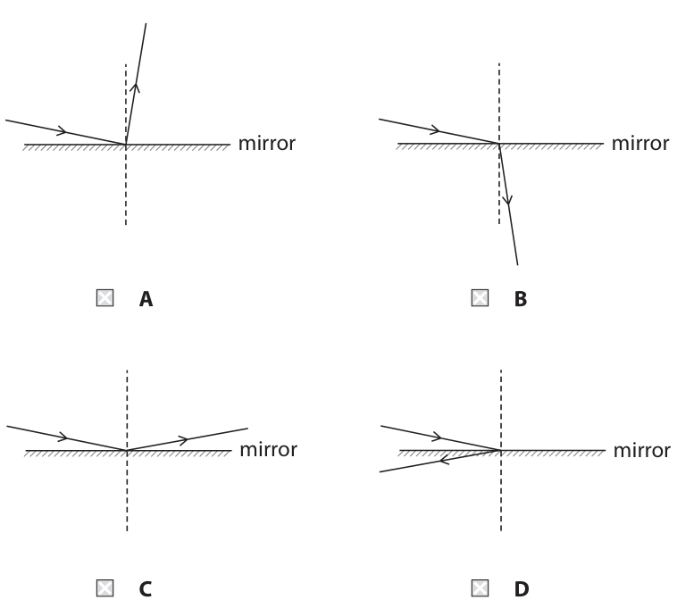
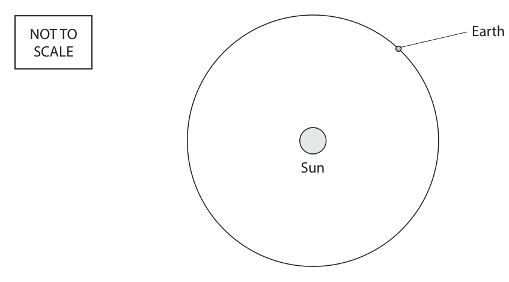
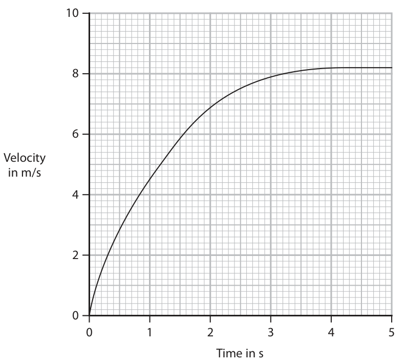
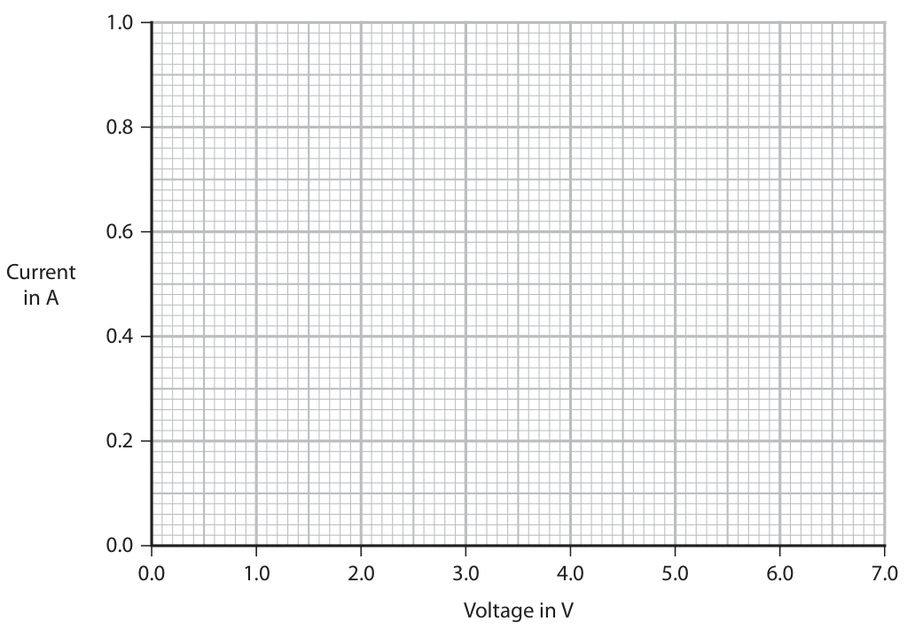
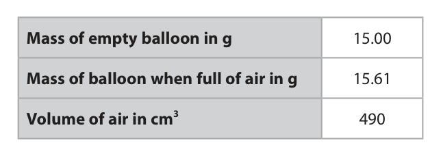
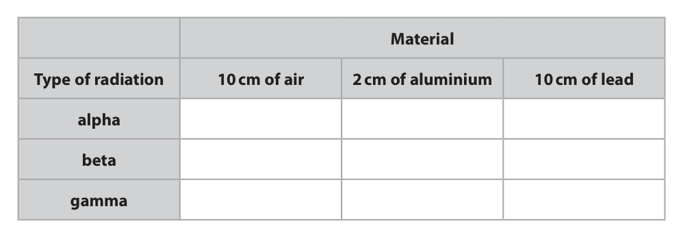
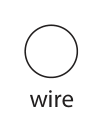
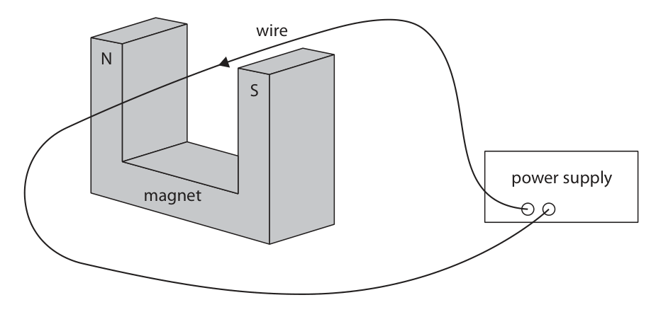

# 4PH1/1PR — 2023-01 (official extraction)

> schema `syllabai.official-paper-questions/0.2` · paper_id `pearson-edexcel:international-gcse:physics:4ph1:2023-01:4PH1/1PR` · qp sha256 `d518d13b432b3b6c…` · extraction is the disclosed baseline (ADR-039)

## Question 1 (7 marks)

This is a question about reflection.

**(c)** Light from a laser on the Earth reflects off special mirrors on the Moon. The graph shows the data from a light sensor attached to the laser. The first peak shows when the light leaves the laser and the second peak shows when the light has returned from the Moon. Light intensity 0 0.5 1.0 1.5 2.0 2.5 3.0 3.5 Time in s

### 1(a) [1]

Which diagram shows a light ray correctly reflected from a mirror? mirror mirror A B mirror mirror C D

**Mark scheme answer**

> C;
> A cannot be correct as the angle of reflection is not
> equal to the angle of reflection.
> B and D cannot be correct as the ray penetrates
> into the mirror rather than reflects.
> (b) protractor;

- **(1)** C;

### 1(b) [1]

Name the equipment needed to measure the angle of incidence on a ray diagram.

### 1(c)(i) [2]

Determine the time taken for the light to travel from the Earth to the Moon and back again. time taken = s

**Mark scheme answer**

> attempt at measuring the (time) difference
> between the two peaks;
> 2.5 s;
> award both marks if
> correct answer on
> answer line

- **(2)** attempt at measuring the (time) difference

### 1(c)(ii) [2]

The speed of light is 3.0 × 105 km/s. Calculate the total distance travelled by the light from the laser. [average speed = distance moved ÷ time taken] total distance = km

**Mark scheme answer**

> substitution and rearrangement into given eqn; ECF from (c)(i)
> evaluation;
> correct answer: 750 000 (km) accept answer given in
> standard form
> e.g. distance = speed × time
> distance = 300 000 × 2.5
> distance = 750 000 (km)

- **(2)** substitution and rearrangement into given eqn; ECF from (c)(i)

### 1(c)(iii) [1]

Calculate the distance from the Earth to the Moon. distance = km

**Mark scheme answer**

> division of candidate’s answer for (ii) by 2;
> correct answer: 375 000 (km)
> Answer Notes Marks

- **(1)** division of candidate’s answer for (ii) by 2;

## Question 2 (12 marks)

The diagram shows the orbit of the Earth around the Sun. NOT TO Earth SCALE Sun

### 2(a)(i) [2]

Draw the orbit of the Earth’s Moon on the diagram.

### 2(a)(ii) [2]

Draw the orbit of a comet on the diagram.

### 2(b) [3]

Earth orbits the Sun in 365 days with an orbital radius of 150 000 000 km. Calculate the Earth’s orbital speed in km/s. orbital speed = km/s

### 2(c) [1]

Which force keeps the Earth in orbit around the Sun?

- **(A)** electrostatic
- **(B)** gravitational
- **(C)** magnetic
- **(D)** nuclear

### 2(d) [4]

Describe the evolution of the Sun from the first stage of its evolution to the final stage of its evolution.

## Question 3 (11 marks)

The diagram shows a balloon with a mass attached held at rest just below the surface of a deep pool of water. air water balloon mass

**(a)** The balloon and mass are released. The graph shows the velocity-time graph for the balloon and mass as they fall through the water. Velocity in m/s 0 1 2 3 4 5 Time in s

### 3(a)(i) [1]

Use information from the graph to determine the terminal velocity of the balloon and mass. terminal velocity = m/s

### 3(a)(ii) [3]

Explain how the balloon reaches terminal velocity. You should use ideas about forces acting on the balloon in your answer.

### 3(b)(i) [1]

State the formula linking pressure difference, height, density and gravitational field strength.

**Mark scheme answer**

> pressure difference = height × density × g ; accept depth for height
> accept accepted symbols
> e.g. p, h, d (for height), d or
> ρ (for density),
> accept any correct
> rearrangement
> reject ‘gravity’ for ‘g’

- **(1)** pressure difference = height × density × g ; accept depth for height

### 3(b)(ii) [2]

Calculate the increase in pressure on the balloon when it has reached a depth of 25 m in the water. [for water, density = 1000 kg/m3] pressure increase = Pa

**Mark scheme answer**

> substitution; accept use of 9.8(1) for
> ‘g’ giving 245 000 (Pa)
> evaluation;
> correct answer: 250 000 (Pa) POT error gives −1 except if
> no evidence of use of ‘g’
> e.g. pressure difference = height × density × g
> pressure difference = 25 × 1000 × 10
> pressure difference = 250 000 (Pa)

- **(2)** substitution; accept use of 9.8(1) for

### 3(b)(iii) [1]

At the surface, the atmospheric pressure on the balloon is 1.0 × 105 Pa. Show that the total pressure on the balloon at a depth of 25 m is 3.5 × 105 Pa.

**Mark scheme answer**

> addition of 1.0 × 105 to candidate’s answer to accept answer not given in
> (ii); standard form
> correct answer: 3.5 × 10 5 (Pa)

- **(1)** addition of 1.0 × 105 to candidate’s answer to accept answer not given in

### 3(b)(iv) [3]

At the surface, where the pressure is 1.0 × 105 Pa, the balloon has a volume of 0.46 m3. Calculate the volume of the balloon at a depth of 25 m. volume = m3

**Mark scheme answer**

> substitution into given equation; subs and rearrange can be in
> either order;
> rearrangement;
> correct evaluation;
> correct answer: 0.13(14) (m3) condone use of 2.5 × 105 Pa
> giving V = 0.18… (m3) for 2
> e.g. p1 × V1 = p2 × V2 condone use of 2.45 × 105 Pa
> 1.0 × 105 × 0.46 = 3.5 × 105 × V2 giving V = 0.188… (m3) for 2
> V2 = (1.0 × 105 × 0.46) ÷ (3.5 × 105 ) marks
> V2 = 0.1314 (m3)
> Answer Notes Marks

- **(3)** substitution into given equation; subs and rearrange can be in

## Question 4 (9 marks)

A student investigates how the current in a filament lamp varies with the voltage across it. The student has this equipment • filament lamp • cell • variable resistor • ammeter • voltmeter • connecting wires

**(b)** The table gives the student’s results. Voltage in V Current in A 0.0 0.0 1.0 0.38 2.0 0.61 3.0 0.80 4.0 0.90 5.0 0.96 6.0 1.00

**(c)** The filament of the lamp is made of metal. The student suggests that a straight line on the graph is more appropriate than a curve because current is directly proportional to voltage for a metal.

### 4(a) [4]

Draw a circuit diagram that the student could use for this investigation.

> 🖼 crop required: diagram (qp.pdf p.11)

**Mark scheme answer**

> correct symbols for all components;
> components connected in a series circuit; ignore ammeter and
> voltmeter
> ammeter in series with lamp;
> voltmeter in parallel with lamp;

- **(4)** correct symbols for all components;

### 4(b)(i) [1]

Plot the results on the grid.

**Mark scheme answer**

> all points plotted correctly; within half a small
> square

- **(1)** all points plotted correctly; within half a small

### 4(b)(ii) [1]

Draw the curve of best fit. 1.0 0.8 0.6 Current in A 0.4 0.2 0.0 0.0 1.0 2.0 3.0 4.0 5.0 6.0 7.0 Voltage in V

**Mark scheme answer**

> curve passes within half a small square of all points; by eye

- **(1)** curve passes within half a small square of all points; by eye

### 4(c)(i) [1]

Suggest how the student could improve their investigation to find out whether a straight line or curve is more appropriate.

**Mark scheme answer**

> idea of taking more data at different voltages;

- **(1)** idea of taking more data at different voltages;

### 4(c)(ii) [2]

Explain why the student should not expect current to be proportional to voltage for this filament lamp.

**Mark scheme answer**

> any TWO from:
> MP1. current (in filament) heats up the filament; allow idea that
> higher voltage will
> increase the
> temperature of the
> filament
> condone ‘lamp’ for
> filament
> MP2. resistance changes with temperature;
> MP3. idea that change of resistance affects gradient
> (of graph);
> allow 'increasing
> resistance decreases
> current for the same
> voltage' for MP2 and
> MP3
> Answer Notes Marks

- **(2)** any TWO from:

## Question 5 (10 marks)

The photograph shows the nuclear fusion reactor called ITER. (Source: © Efman/Shutterstock)

**(b)** At ITER, hydrogen-3 and hydrogen-2 will be fused into helium and another particle labelled X.

### 5(a) [2]

Describe the difference between nuclear fusion and nuclear fission.

**Mark scheme answer**

> fission is the splitting of a nucleus; allow “breaking down”,
> “dividing” for splitting
> fusion is the joining of (two) nuclei; allow “fusing”,
> “combining” for joining
> reject “atom” for
> “nucleus”"

- **(2)** fission is the splitting of a nucleus; allow “breaking down”,

### 5(b)(i) [2]

Complete the nuclear equation for the fusion of hydrogen-3 and hydrogen-2. 1 H + H → He + 2 2 X

**Mark scheme answer**

> mass number = 1;
> atomic number = 0;

- **(2)** mass number = 1;

### 5(b)(ii) [3]

Discuss potential safety advantages of a fusion reactor compared with a fission reactor. You should refer to the products of this fusion reaction and to the fission reaction of uranium.

**Mark scheme answer**

> any THREE from: accept RA
> MP1. idea that reactants are not (as) hazardous
> for fusion;
> MP2. idea that products of fusion are not allow reference to no
> radioactive; gamma radiation from
> fusion
> MP3. (so) no {mutations/damage to
> cells/tissue/cancer} ;
> MP4. (so) no long-term storage problems;
> MP5. idea that no shielding is required;
> MP6. idea of lower or no risk of meltdown for
> fusion;
> MP7. idea that there is no runaway chain
> reaction for fusion;
> (c) evidence of activity halved;
> evidence of activity halved four times only; allow reference to 4 half
> lives, including showing
> that 48/12 = 4
> correct evaluation;
> correct answer: 7.5 (kBq)
> e.g. 120 ÷ 2 = 60
> 60 ÷ 2 = 30
> 30 ÷ 2 = 15
> 15 ÷ 2 = 7.5
> Question number Answer Notes Marks

- **(3)** any THREE from: accept RA

### 5(c) [3]

The half-life of a radioactive isotope is 12 years. The activity of a sample of this isotope is 120 kBq. Calculate the activity of this sample after 48 years. activity = kBq

## Question 6 (10 marks)

The diagram shows a small computer in two difference cases, X and Y. The electronic chip in the computer is hot when in use. Each case is designed to cool the computer chip. hot air from inside case plastic case aluminium case fan metal block chip chip plastic circuit board plastic circuit board case X case Y Case X is made of white plastic and has a fan. Case Y is made of black-painted aluminium metal and has no fan. There is a metal block that is in contact with the case and the chip.

### 6(a) [3]

Explain the main method of heat transfer from the chip to the surroundings for case X.

**Mark scheme answer**

> any THREE from:
> MP1. correct reference to convection;
> MP2. fan aids convection;
> MP3. reference to conduction not being the main method;
> MP4. (since) {plastic/air} is a poor conductor/good
> insulator;
> MP5. white (materials) are poor at emitting /eq; allow idea of
> heat reflecting
> back / not
> absorbing well
> from this
> interior white
> surface
> (b) any THREE from:
> MP1. correct reference to conduction;
> MP2. since {metals/aluminium} conducts well;
> MP3. reference to convection not being the main method;
> MP4. as hot air particles can’t circulate (from inside to
> outside);
> MP5. black (materials) are good at emitting/eq; allow idea of
> heat being
> absorbed well
> from the
> interior black
> surface

- **(3)** any THREE from:

### 6(b) [3]

Explain the main method of heat transfer from the chip to the surroundings for case Y.

### 6(c)(i) [1]

State the formula linking power, current and voltage.

**Mark scheme answer**

> power = voltage × current; accept ‘P = IV’
> accept any
> correct
> rearrangement

- **(1)** power = voltage × current; accept ‘P = IV’

### 6(c)(ii) [3]

The small computer operates at a voltage of 5.1 V with a current of 2.9 A. Calculate the power of the small computer. Give the unit. power = unit

**Mark scheme answer**

> substitution;
> evaluation;
> watt or W as the unit;
> correct answer: 15 watts accept
> 14.8,14.79 W
> e.g. power = voltage × current
> power = 5.1 × 2.9
> power = 14.8 watts
> Answer Notes Marks

- **(3)** substitution;

## Question 7 (9 marks)

The diagram shows the path of a ray of light. glass block K L

### 7(a)(i) [1]

Measure the angle of incidence for the ray at point K. Which of these is the angle of incidence?

- **(A)** 43°
- **(B)** 47°
- **(C)** 51°
- **(D)** 55°

### 7(a)(ii) [1]

State the formula linking refractive index, angle of incidence and angle of refraction.

### 7(a)(iii) [3]

The block has a refractive index of 1.52 Use the formula to show that the angle of refraction is about 30° for the ray at point K.

### 7(b)(i) [3]

The refractive index of the block is 1.52 Calculate the critical angle of the block.

**Mark scheme answer**

> use of formula sin c = 1/n;
> substitution;
> correct evaluation;
> correct answer: 41 (degrees)
> e.g.
> sin c = 1/n
> sin c = 1/1.52
> c = sin−1(1/1.52) = 41.1 (degrees)

- **(3)** use of formula sin c = 1/n;

### 7(b)(ii) [1]

State what happens to the ray at point L.

**Mark scheme answer**

> total internal reflection (TIR) /
> angle of incidence is above the critical angle and so
> reflects;
> Answer Notes Marks

- **(1)** total internal reflection (TIR) /

## Question 8 (9 marks)

A student wants to determine the density of air using an irregularly‑shaped balloon made of metal foil. The balloon has a label stating that the volume of the balloon when full is 490 cm3. This is part of the student’s method. Step 1 measure the mass of the empty balloon Step 2 fill the balloon with air Step 3 measure the mass of the full balloon Step 4 subtract the mass of the empty balloon from the mass of the full balloon.

### 8(a)(i) [1]

Name the equipment the student could use to measure the mass of the balloon.

### 8(a)(ii) [1]

Suggest how the student could improve the reliability of their data.

### 8(b) [4]

The table shows the student’s results. Mass of empty balloon in g 15.00 Mass of balloon when full of air in g 15.61 Volume of air in cm3 490 Calculate the density of air to 2 significant figures. Give the unit. density = unit

### 8(c) [3]

Describe how the volume of the balloon full of air could be measured using a large beaker and some water. You may use a diagram to help your answer.

## Question 9 (10 marks)

A teacher demonstrates the penetrating ability of alpha, beta and gamma radiation from some radioactive sources.

**(c)** An alpha particle of mass 6.6 × 10–27 kg travelling at a speed of 2.1 × 107 m/s hits a sheet of paper.

### 9(a)(i) [1]

State a precaution the teacher should take to make sure they are working safely with the radioactive sources.

### 9(a)(ii) [1]

State the name of a detector the teacher could use to detect the radiation from each source.

### 9(b) [3]

Draw crosses (× ) in the table to show which type of radiation cannot penetrate each material in the table. Material Type of radiation 10 cm of air 2 cm of aluminium 10 cm of lead alpha beta gamma

### 9(c)(i) [3]

Calculate the kinetic energy (KE) of the alpha particle. KE = J

**Mark scheme answer**

> recall of KE = ½ m v2;
> substitution;
> correct evaluation; −1 POT error
> correct answer: 1.5 × 10−12 (J)
> e.g.
> KE = ½ m v2
> KE = ½ × (6.6 × 10−27) × (2.1 × 107)2
> KE = 1.4553 x 10−12 (J)

- **(3)** recall of KE = ½ m v2;

### 9(c)(ii) [1]

State the work done on the alpha particle when its speed is reduced to 0 m/s by the sheet of paper. work done = J

**Mark scheme answer**

> candidate’s answer for (i)
> e.g. 1.5 × 10−12 (J)

- **(1)** candidate’s answer for (i)

### 9(c)(iii) [1]

State which energy store of the paper increases when the alpha particle is stopped.

**Mark scheme answer**

> thermal;
> Answer Notes Marks

- **(1)** thermal;

## Question 10 (12 marks)

The diagram shows the forces acting on a firework at take-off. thrust 28 N weight 1.6 N

### 10(a)(i) [1]

Calculate the magnitude of the resultant force on the firework. magnitude of resultant force = N

### 10(a)(ii) [1]

State the formula linking resultant force, mass and acceleration.

### 10(a)(iii) [3]

The mass of the firework is 160 g. Calculate the acceleration of the firework. acceleration = m/s2

### 10(a)(iv) [3]

Explain how the acceleration of the firework changes between take‑off and running out of fuel. You can assume that the thrust force stays the same as the firework burns the fuel.

### 10(b) [4]

The firework makes a sound with constant frequency. As the firework moves upwards, people on the ground notice that the frequency of the sound they hear changes. This is called the Doppler effect. Explain how the Doppler effect causes the observed frequency of sound to change for the people on the ground.

## Question 11 (11 marks)

The diagrams show some equipment that the physicist Ørsted used in an investigation in 1820. Diagram 1 shows the position of eight compass needles around a wire with no current in the wire. The compass needles line up with and show the direction of the Earth’s magnetic field lines. Earth's magnetic field compass needle wire Diagram 1 Diagram 2 shows the position of the same compass needles when a current is in the wire. wire Diagram 2

**(c)** The power supply in diagram 3 is replaced by an ammeter.

### 11(a)(i) [2]

Explain why the compass needles turn when the current is switched on.

### 11(a)(ii) [2]

Using evidence from the compass needles in diagram 2, draw on diagram 2 the shape and direction of a magnetic field line produced by the current in the wire.

### 11(a)(iii) [1]

Suggest what happens to the magnetic field when the current in the wire is reversed.

### 11(b) [2]

The current in the wire is turned off. Diagram 3 shows the wire placed in a uniform magnetic field. wire N S power supply magnet Diagram 3 The current is now switched on. Draw an arrow to show the direction of the force on the wire.

### 11(c)(i) [2]

When the wire is moved, a current is detected. Explain which direction the wire is moved in the magnetic field to produce a current in the wire.

**Mark scheme answer**

> up / down; allow any inference of
> up/down
> idea of cutting field lines;

- **(2)** up / down; allow any inference of

### 11(c)(ii) [2]

Explain why a current is produced in the wire when the wire is moved in the magnetic field.

**Mark scheme answer**

> cutting field lines induces a voltage across the allow emf or potential
> wire; difference or p.d. for
> voltage
> complete circuit so voltage gives a current; allow idea of a force on
> electron(s) causing
> them to move
> Pearson Education Limited. Registered company number 872828
> with its registered office at 80 Strand, London, WC2R 0RL, United Kingdom

- **(2)** cutting field lines induces a voltage across the allow emf or potential

