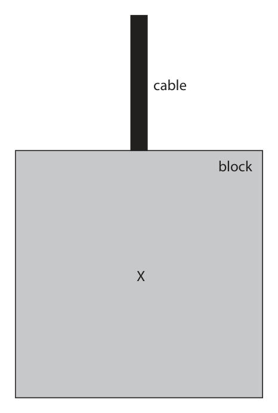
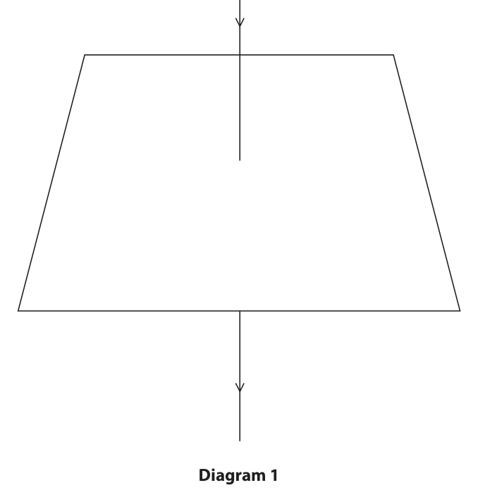
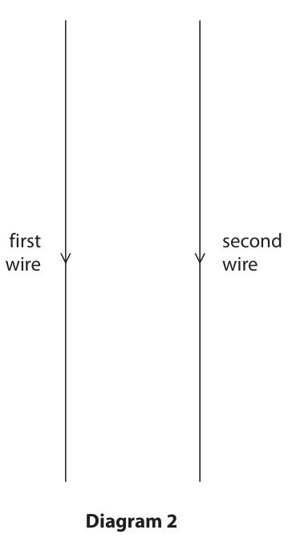
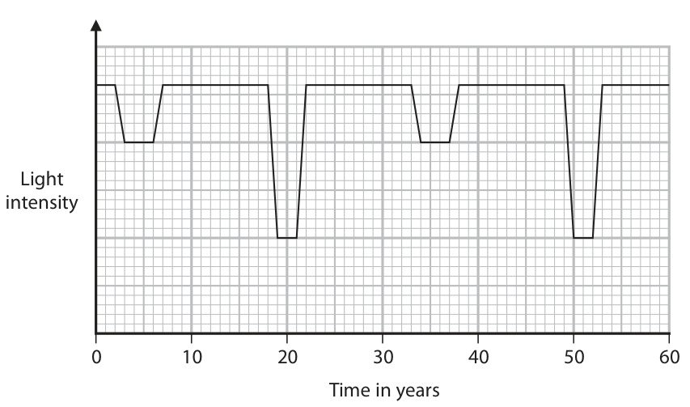

# 4PH1/2P — 2023-01 (official extraction)

> schema `syllabai.official-paper-questions/0.2` · paper_id `pearson-edexcel:international-gcse:physics:4ph1:2023-01:4PH1/2P` · qp sha256 `e9c475e4df1ac8c4…` · extraction is the disclosed baseline (ADR-039)

## Question 1 (5 marks)

The photograph shows a person using a roll of plastic wrapping to cover a plate of food. The plastic wrapping sticks to the plate due to electrostatic charges. (Source: © goffkein.pro/Shutterstock) The passage explains why the plastic wrapping sticks to the plate. Use words from the box to complete the passage. Each word may be used once, more than once, or not at all. attract electrons negative neutral neutrons positive protons repel The person pulls a layer of plastic wrapping from the roll. Forces between the layers of wrapping transfer particles called ........................................................... . . . from one layer to another layer. The layer gaining these particles acquires a .............................................................. charge. The layer losing these particles acquires a .............................................................. charge. The negatively charged layer of wrapping repels .............................................................. in the plate, leaving a positive charge in the plate where it touches the plastic wrapping. The wrapping and plate . . . . . . . . . . . . . . . . . . . . . . . . . ..................................... due to them having opposite charges.

### 1 [5]

The photograph shows a person using a roll of plastic wrapping to cover a plate of food. The plastic wrapping sticks to the plate due to electrostatic charges. (Source: © goffkein.pro/Shutterstock) The passage explains why the plastic wrapping sticks to the plate. Use words from the box to complete the passage. Each word may be used once, more than once, or not at all. attract electrons negative neutral neutrons positive protons repel The person pulls a layer of plastic wrapping from the roll. Forces between the layers of wrapping transfer particles called from one layer to another layer. The layer gaining these particles acquires a charge. The layer losing these particles acquires a charge. The negatively charged layer of wrapping repels in the plate, leaving a positive charge in the plate where it touches the plastic wrapping. The wrapping and plate due to them having opposite charges.

**Mark scheme answer**

> electrons;
> negative;
> positive;
> electrons;
> attract;
> accept recognisable
> spellings
> Answer Notes Marks

- **(5)** electrons;

## Question 2 (8 marks)

The photograph shows an ice cube placed on a metal tile. The solid ice cube melts to become liquid water. ice cube metal tile water

### 2(a) [3]

Compare the arrangement of particles in a solid with the arrangement of particles in a liquid. You may draw a diagram to help your answer.

**Mark scheme answer**

> ignore references to
> motion
> all marks can be given
> from clear, titled diagrams
> particles in a solid have a regular arrangement;
> particles in a liquid have an irregular arrangement;
> particles in both are closely packed;

- **(3)** ignore references to

### 2(b) [2]

Describe the difference in the movement of particles in a solid compared with the movement of particles in a liquid.

**Mark scheme answer**

> particles vibrate (about fixed positions) in a solid;
> idea that particles move around in a liquid/eq; e.g. “particles slide over
> each other”/”particles
> flow”

- **(2)** particles vibrate (about fixed positions) in a solid;

### 2(c) [3]

After the ice cube has melted, the liquid water increases in temperature. The water has a mass of 16 g and a specific heat capacity of 4200 J/kg °C. Calculate the energy transferred to the liquid water as it increases in temperature from 3 °C to 21 °C. energy transferred = J

**Mark scheme answer**

> evaluation of temperature change;
> substitution into ∆Q = m × c × ∆T; allow ecf from incorrect
> ∆T or use of 3, 21 or 24
> evaluation; -1 for POT error
> e.g.
> ∆T = (21 – 3) = 18 (°C)
> ∆Q = 0.016 × 4200 × 18
> (∆Q =) 1200 (J) allow 1210, 1209.6
> condone 1209
> 200, 201.6 scores 2
> 1400, 1411 scores 2
> 1600, 1613 scores 2
> Answer Notes Marks

- **(3)** evaluation of temperature change;

## Question 3 (7 marks)

Kori Nuclear Power Plant in South Korea is one of the world’s largest nuclear fission power stations. (Source: © seo byeong gon/Shutterstock)

**(c)** Kori has a maximum power output of 7.49 × 109 W.

### 3(a) [1]

The reactors at Kori use nuclear fission to generate electricity. The products released during nuclear fission have high energy in their kinetic store. Give a product of nuclear fission.

**Mark scheme answer**

> daughter nuclei / reject daughter cells
> named nuclei e.g. krypton or barium/ condone nucleus
> neutron(s); ignore atom
> reject uranium
> allow gamma (radiation)

- **(1)** daughter nuclei / reject daughter cells

### 3(b) [2]

Give two disadvantages of using nuclear fission to generate electricity. 1 2

**Mark scheme answer**

> any two from:
> MP1. radioactive waste; allow radiation can cause
> cancer/mutate {cells/DNA}
> accept long term storage
> argument
> MP2. uranium is radioactive;
> MP3. non-renewable;
> MP4. risk of nuclear accident/eq; allow named event e.g.
> Chernobyl, Fukushima
> MP5. higher {setup / decommissioning} cost; ignore unqualified “high
> cost” argument

- **(2)** any two from:

### 3(c)(i) [1]

State what is meant by the term power.

**Mark scheme answer**

> rate of {energy transfer/doing work}; allow energy transferred
> per {unit time / second}
> reject energy transferred in
> a unit time
> reject P=current × voltage

- **(1)** rate of {energy transfer/doing work}; allow energy transferred

### 3(c)(ii) [3]

Calculate the minimum time taken for Kori to transfer 6.47 × 10¹⁴ J of energy. minimum time = s

**Mark scheme answer**

> substitution into P = W / t;
> rearrangement;
> evaluation; -1 for POT error
> e.g.
> 7.49 × 10⁹ = 6.47 × 10¹⁴ / t
> t = 6.47 × 10¹⁴ / 7.49 × 10⁹
> (t =) 86 400 (s) allow 86000, 86382,
> 86381.8…

- **(3)** substitution into P = W / t;

## Question 4 (10 marks)

A squash ball is made of rubber and used to play a game called squash. (Source: © mexrix/Shutterstock) A student observes that the squash ball bounces higher after its temperature increases. The student designs an investigation to see how the temperature of the ball affects the maximum height after it bounces.

### 4(a) [2]

State the independent and dependent variables in the student’s investigation. independent variable dependent variable

**Mark scheme answer**

> IV = temperature (of ball); condone ‘T’
> DV = height (of bounce); allow vertical distance
> condone ‘h’

- **(2)** IV = temperature (of ball); condone ‘T’

### 4(b) [2]

The diagram shows the ball at its maximum height after it bounces. Determine the distance the ball moves from the floor to its maximum height. Assume the ball does not change shape when it bounces. [1 cm on diagram = 4 cm in laboratory] squash ball floor distance = cm

**Mark scheme answer**

> measurement from floor to bottom of ball; accept range 6.1-6.3 (cm)
> correct use of scale; accept range 24.4-25.2 (cm)
> e.g.
> distance = 6.2 (cm)
> distance = (6.2 × 4 =) 24.8 (cm) ECF candidate’s value for
> measurement.
> 25.6-30.0 (cm) scores 1 mark

- **(2)** measurement from floor to bottom of ball; accept range 6.1-6.3 (cm)

### 4(c) [6]

Design a method that the student could use to investigate how the temperature of the ball affects the maximum height after it bounces. Your answer should include details of • apparatus needed • measurements required • control variables You may draw a diagram to support your answer.

**Mark scheme answer**

> six marks as distributed: marks can be awarded if clear
> from diagram
> apparatus (2 marks max.)
> MP1. ruler / tape measure;
> MP2. idea of water bath (and thermometer); allow use of heated beaker
> and water with thermometer
> reject idea of heating ball
> directly with a Bunsen burner
> allow other methods of direct
> heating
> measurements (2 marks max.)
> MP3. range of temperatures; must be clear that different
> temperatures are tested
> MP4. height of the ball’s (first) bounce;
> MP5. height measured at eye level; allow reduce parallax error
> allow use of phone/video
> camera AND idea of freeze
> frame or ruler in shot
> MP6. repeats taken at each temperature
> and mean found;
> control variables (2 marks max.)
> MP7. height ball is dropped from;
> MP8. surface the ball bounces on;
> MP9. condition of drop; i.e. non-human dropping
> mechanism or checking that
> ball is dropped from rest
> MP10. idea of using multiple copies of the
> same ball;
> Answer Notes Marks

- **(6)** six marks as distributed: marks can be awarded if clear

## Question 5 (13 marks)

Diagram 1 shows a wooden plank balanced horizontally on two supports, A and B. A block is suspended from the plank between the supports by a cable of negligible weight. force F 25 cm 55 cm plank A B cable block Diagram 1

**(a)** The weight of the block is 260 N.

**(b)** Diagram 2 shows the block and the cable connecting the block to the plank. cable block X Diagram 2

### 5(a)(i) [1]

State the formula linking moment, force and perpendicular distance from the pivot.

**Mark scheme answer**

> moment = force × (perpendicular) distance; allow standard
> symbols and
> rearrangements
> allow d or s for
> distance
> condone m, M for
> moment

- **(1)** moment = force × (perpendicular) distance; allow standard

### 5(a)(ii) [3]

By taking moments about support A, calculate force F. Assume the weight of the plank is negligible. force F = N

**Mark scheme answer**

> correct calculation of or substitution for moment of
> block's weight;
> use of principle of moments; stated or implied
> evaluation of force F; POT -1
> e.g.
> (moment of weight = 260 × 0.25 =) 65 (Nm) allow 6500 (Ncm)
> 65 = force F × 0.80
> force F = 81 (N) allow 81.25 (N)
> 118(.2) (N) scores 2

- **(3)** correct calculation of or substitution for moment of

### 5(a)(iii) [3]

Explain what will happen to the magnitude of force F if the block is moved towards support B.

**Mark scheme answer**

> force F increases;
> with any two from:
> • distance from support A increases / distance ignore 'moves closer
> from support B decreases; to B'
> • clockwise moment / moment of weight
> increases;
> • anti-clockwise moment / moment of force F
> increases (to keep balance);

- **(3)** force F increases;

### 5(b)(i) [2]

The centre of gravity of the block is located at point X. Draw an arrow on diagram 2 to show the weight of the block.

**Mark scheme answer**

> one vertical downwards arrow drawn; ignore label
> arrow starts at centre of gravity; DOP

- **(2)** one vertical downwards arrow drawn; ignore label

### 5(b)(ii) [2]

The block also experiences a force due to the tension in the cable. Explain why the block remains stationary when it is supported by this tension force.

**Mark scheme answer**

> any two from:
> MP1. tension force is upwards;
> MP2. tension force is same magnitude as weight / eq;
> MP3. idea of no resultant force / acceleration; allow forces balance
> allow forces cancel
> out

- **(2)** any two from:

### 5(b)(iii) [2]

Explain why the forces acting on the block are not an example of Newton’s third law of motion.

**Mark scheme answer**

> any two from:
> MP1. forces are acting on the same body;
> MP2. idea that forces are not the same type / origin;
> MP3. correct example of Newton’s third law pair; e.g. weight of block is
> balanced by
> gravitational force of
> block on Earth
> Answer Notes Marks

- **(2)** any two from:

## Question 6 (8 marks)

This question is about magnetic fields.

**(a)** A student positions a thick wire vertically through the centre of a horizontal card. The student then passes a constant current through the wire in the downward direction, as shown in diagram 1. Diagram 1

### 6(a)(i) [3]

On diagram 1, draw the shape and direction of the magnetic field produced by the current in the wire.

**Mark scheme answer**

> single circle centred on the wire and parallel to the allow gap where circle
> plane of the card; crosses wire
> circles do not have to stay
> within the card
> at least two concentric circles in the same plane; DOP by eye
> ignore spacing
> clockwise direction arrow marked on at least one line; reject if contradicting
> arrows
> e.g.

- **(3)** single circle centred on the wire and parallel to the allow gap where circle

### 6(a)(ii) [2]

Describe a method the student could use to show the shape of the magnetic field produced by the current in the wire.

**Mark scheme answer**

> ignore references to
> magnets, other current-
> carrying wires being used
> EITHER:
> MP1. iron filings (used); allow iron powder, steel
> dust etc.
> MP2. tap card / eq.;
> OR
> MP1. (plotting) compass (used); allow use of a
> magnetometer
> MP2. multiple compasses used / compass moved to
> new position;
> condone correct use of
> right-hand grip rule for 1
> mark if no other mark
> scored

- **(2)** ignore references to

### 6(b) [3]

The student then removes the card and sets up a second wire next to the first wire, as shown in diagram 2. first second wire wire Diagram 2 The current in both wires is in the downward direction. The student observes that the wires move towards each other. Explain why the wires move towards each other.

**Mark scheme answer**

> any three from: ignore references to poles
> MP1. (both) wire(s) have magnetic fields around
> them;
> MP2. each wire has a current in a magnetic field; reject reference to opposite
> charge for MP2
> allow 'fields interact'
> MP3. each wire experiences a force; allow 'wires attract each
> other'
> MP4. forces are same size but in opposite directions; allow reference to Newton
> OR III
> MP1. RH grip rule indicates relationship between
> current and field for one of the wires;
> MP2. LH rule indicates relationship between field from
> one wire, current in other wire and force on
> second wire;
> MP3. combination of these two will give force on
> second wire towards first wire;
> Answer Notes Marks

- **(3)** any three from: ignore references to poles

## Question 7 (10 marks)

A student uses this method to investigate the speed of sound in air. • set up an oscilloscope to detect and display a sound wave • use a computer and a speaker to produce a sound of known wavelength • use the oscilloscope to determine the frequency of the sound wave • use a formula to calculate the speed of sound

**(b)** The diagram shows the oscilloscope screen and the oscilloscope settings. Oscilloscope settings y direction: 1 square = 5 mV x direction: 1 square = 0.5 ms

### 7(a) [1]

Give the name of the equipment that should be connected to the oscilloscope to detect the sound wave.

**Mark scheme answer**

> microphone;

- **(1)** microphone;

### 7(b)(i) [4]

Determine the frequency of the sound wave. frequency = Hz

**Mark scheme answer**

> determination of number of squares for 1 period by
> finding average period from whole diagram;
> correct use of timebase of 0.5 ms seen; ignore units
> evaluation of time period; ignore PoT
> evaluation of frequency; ecf candidate's time
> period
> apply PoT here
> time period of between
> 1.5 and 1.59 squares
> giving frequency
> between 1260 and
> 1333Hz scores 3 marks
> max.
> e.g.
> 1 period = 8 squares ÷ 5 = 1.6 squares
> time period = 1.6 × 0.5(×10⁻³)
> time period = 8.0×10⁻⁴ s
> frequency = (1/8.0×10⁻⁴) = 1250 (Hz)

- **(4)** determination of number of squares for 1 period by

### 7(b)(ii) [3]

The wavelength of the sound wave is 27 cm. Calculate the speed of sound. speed of sound = m/s

**Mark scheme answer**

> use of speed = frequency × wavelength; seen or implied
> dimensionally correct substitution; allow ecf from (b)(i)
> evaluation; -1 for POT error
> e.g.
> speed = frequency × wavelength
> speed = 1250 × 0.27
> (speed =) 340 (m/s) allow 337.5 (m/s)

- **(3)** use of speed = frequency × wavelength; seen or implied

### 7(b)(iii) [2]

Describe how the oscilloscope could be adjusted to show fewer wave cycles on the screen.

**Mark scheme answer**

> idea of adjusting timebase; however described
> idea of decreasing timebase/eq; DOP
> ignore reference to y-
> axis
> Answer Notes Marks

- **(2)** idea of adjusting timebase; however described

## Question 8 (9 marks)

A binary star system has two nearby stars, which orbit each other in a circular path around a common centre of gravity. star common centre of gravity star

**(a)** In an eclipsing binary system, one star passes behind the other star in its orbit. This causes a decrease in the light intensity of the binary star system when viewed from Earth. The graph shows how the light intensity of the binary star system changes with time. Light intensity 0 10 20 30 40 50 60 Time in years

### 8(a)(i) [1]

Suggest why the decreases in light intensity are not all the same.

**Mark scheme answer**

> idea that stars are not the same size / mass / brightness / ignore 'same intensity'
> (absolute) magnitude/ luminosity /temperature /depends
> on which star is in front;

- **(1)** idea that stars are not the same size / mass / brightness / ignore 'same intensity'

### 8(a)(ii) [1]

Use the graph to determine the time period of the binary star system. time period = years

**Mark scheme answer**

> any answer that rounds to 31 (years);

- **(1)** any answer that rounds to 31 (years);

### 8(a)(iii) [4]

One of the stars in this binary system has an orbital speed of 19 km/s. Calculate the orbital radius of this star. orbital radius = km

**Mark scheme answer**

> conversion from years to seconds; allow conversion from
> km/s to km/year
> substitution; allow ecf from (c)(ii)
> rearrangement;
> evaluation;
> e.g.
> 31 years = 9.78 × 10⁸ seconds
> 19 = 2π × radius / 9.78 × 10⁸
> (radius =) 19 × 9.78 x 10⁸ / 2π
> (radius =) 3.0 × 10⁹ (km) allow 2 956 255 958
> (km)
> answer of 94 (km) gets
> 3 marks max. (no unit
> conversion)

- **(4)** conversion from years to seconds; allow conversion from

### 8(b) [3]

A different binary star system is in a distant galaxy. When observed from the Earth, light from this galaxy has a longer wavelength than the wavelength of the light when it is emitted from the galaxy. Explain why this gives evidence for the Big Bang theory.

**Mark scheme answer**

> any three from: ignore CMBR
> ignore references to
> any other galaxy
> MP1. light (from galaxy) has been red-shifted;
> MP2. {binary system / galaxy} is moving away (from Earth);
> MP3. universe is expanding; allow idea of Hubble's
> Law i.e. speed and
> distance directly
> proportional
> MP4. (therefore) universe must have been at a single point
> some time in the past;
> Pearson Education Limited. Registered company number 872828
> with its registered office at 80 Strand, London, WC2R 0RL, United Kingdom

- **(3)** any three from: ignore CMBR

